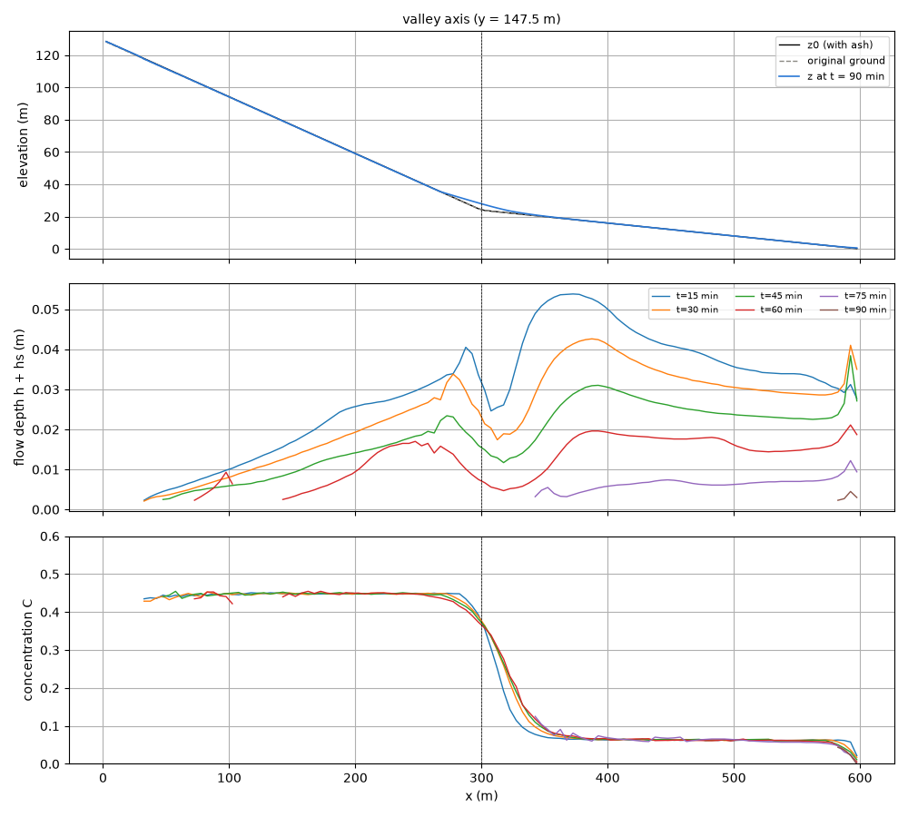
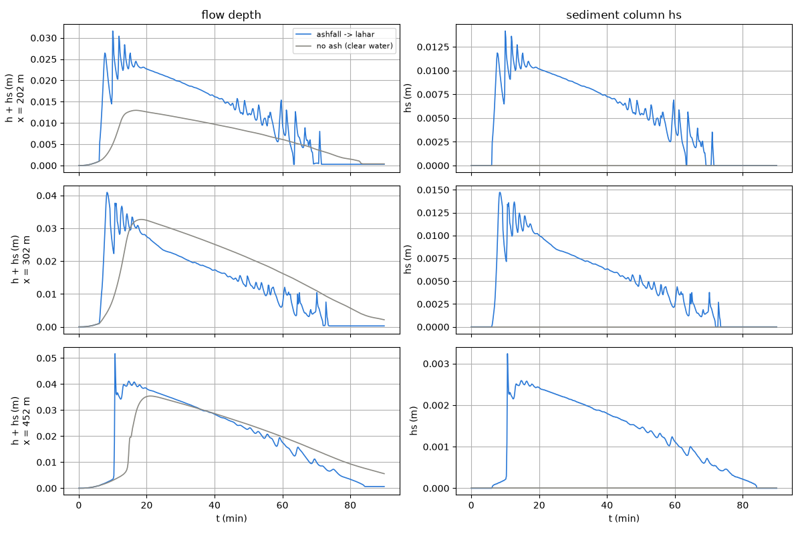

# examples/ashfall_lahar — ashfall → rainfall → initiation and deposition of a mudflow (lahar)

> English mirror of examples/ashfall_lahar/README.md. The Japanese file is the master copy.

[日本語](../README.md)

This example **gives the ashfall thickness distribution of volcanic ash as the
initial condition** and follows, in a single run, the subsequent rainfall whose
surface flow on the slopes erodes the ash into a mudflow that deposits on the
fan at the valley outlet. No source specification (failure depth or inflow
hydrograph) is needed. Simply giving the ash layer as an "erodible soil layer"
activates the **erosion-initiated** path (surface flow → erosion and rising
concentration → descent of the mixture → deceleration and deposition). As a
control, the same terrain and rainfall without ashfall (a clear-water flood) is
run alongside.

| Case | File | Contents |
|---|---|---|
| With ashfall | param.txt | ash layer sd (0.30 → 0.05 m) + rainfall 40 mm/h × 60 min + debris-flow model |
| Without ashfall (control) | param_noash.txt | same rainfall on the original terrain; no sediment process |

## Running

```
make                                   # link to ../../bin/encflow
python3 make_init.py z       > z.txt       # ground surface after ashfall (original terrain + ash thickness)
python3 make_init.py z_noash > z_noash.txt # original terrain (for the control)
python3 make_init.py ash     > ash.txt     # ash thickness (given as the soil depth sd)
./encflow param.txt                    # about 2 minutes (90-minute run)
./encflow param_noash.txt
python3 plot_results.py                # 3 figures in figs/ + tables
```

## How the initial condition is given (the key point of this example)

The ash layer is given as the **soil depth sd (the mobile layer)** and is
**also added to the ground elevation z**. In ENCflow z − sd is the original
bedrock surface, so the preprocessing produces the two files

- `fn_z` = original terrain + ash thickness (make_init.py z)
- `fn_sd` = ash thickness (make_init.py ash; f_sdtype=1)

If only the ash thickness is given as sd, erosion stops where it reaches the
bottom of the ash (the ash is used up). If the original topsoil is also assumed
to erode, add the topsoil thickness to sd.

The terrain is the volcano flank on the west (tanθ=0.35; a trapezoidal valley
with a 15 m floor gathers the flow to the centre) → the valley outlet at
x=300 m → a gently sloping fan (tanθ=0.08); the east edge is a free outflow.
The ashfall is a one-directional distribution: 0.30 m on the crater side
(west), 0.05 m at the valley outlet and 0.03 m on the fan.

The debris-flow model is set with `f_debris = 1`; the E-D is Takahashi-type
relaxation to the equilibrium concentration (`f_dbed = 1`; deposition
coefficient δd=0.01); the resistance law is Voellmy (`f_dbres = 4`, μ=0.05,
ξ=500); pore-water entrainment `f_dbwet = 1` (saturation 0.8); stopped sediment
is fixed to the terrain with `f_dbstop = 1`. Infiltration is neglected (the
crust of fresh ashfall has a low infiltration capacity = a conservative
estimate. To give an infiltration capacity, use the Horton-type
`gw_infil_mmh` of fn_gwflow, with f_dbwet set to 0 in that case).

## Results


Left: ash thickness. Centre: landform change at the end (90 min) (blue =
erosion, red = deposition). Right: maximum of the flow depth h+hs. The ash over
the whole slope is thinly scraped off and a fan-shaped depositional lobe forms
at the valley outlet.



Longitudinal profile along the valley. Top: terrain (after ashfall, original,
and at the end). Middle: time evolution of the flow depth. Bottom: concentration
C. On the slope C ≈ 0.45 (nearly saturated = mudflow); where the gradient drops
at the valley outlet C falls to ≈ 0.07 (leaving the sediment behind) and the
flow descends the fan as nearly clear water.



Flow depth and sediment column at 3 points (slope x=202 m, valley outlet 302 m,
fan 452 m). With ashfall the arrival is earlier (a mudflow with small μ is
faster than clear water), the peak is higher, and the flow recedes quickly once
the rain stops.

| Quantity | Value |
|---|---|
| Total ashfall | 18,449 m³ |
| Eroded ash | 9,434 m³ (51%) |
| Fan lobe (thickness ≥ 0.1 m, x 250–400 m)| about 8,200 m³, maximum thickness 3.6 m, width about 50 m |
| Solids leaving through the east edge | 43 m³ |
| Maximum flow depth at the valley outlet (with / without ashfall) | 0.041 m (8.3 min) / 0.033 m (18.3 min) |
| Maximum velocity at the valley outlet (with / without ashfall) | 1.7 m/s / 0.65 m/s |

The solid ledger (Σhs + (1−λ)Σ(z−z0) + outflow) closes to machine precision.

## Notes on reading the results

- The flow depth is thin, a few cm, because the catchment is small (0.09 km²
  upstream of the valley outlet) and the runoff of 40 mm/h rainfall is about
  1 m³/s. The mudflow flows as a thin sheet over the whole valley floor and
  stops at the valley outlet to build a thick lobe (3.6 m). To change the scale,
  increase lx (catchment) and the rainfall intensity (with dt matched to the
  CFL condition).
- Erosion on the slope is patchy at the cell scale (±0.2 m). This is numerical
  rilling, in which erosion and deposition alternate from cell to cell in a
  thin saturated flow on a steep slope; the integrated eroded volume (51%) is
  the robust quantity.
- Thin deposits also appear on the valley walls near the upstream end (because
  f_dbstop acts in the slow cells along the walls). This does not affect the
  reading of the fan lobe.
- The oscillation of the probe flow depth by about ±10% with a period of
  1–2 min is **roll waves** (periodic bores generated spontaneously by the
  surface flow). The concentration C does not fluctuate (standard deviation
  0.0002), and the crests travel down the slope at a wave speed of about 2 m/s
  (mean velocity 1.8 m/s) (confirmed with 5-second output). The Froude number
  on the slope is 3–4, and since the turbulent term of Voellmy is of Chézy type
  (resistance ∝ V²), this lies in the classical regime where uniform flow is
  unstable for Fr > 2. The clear-water control (Manning, Fr ≈ 1.8) is smooth.
  The phenomenon is physically reasonable, but the amplitude and period depend
  on the discretization (grid spacing and dt), so do not give them quantitative
  meaning.

## Design history (what the trials showed)

1. **The Egashira constitutive law (f_dbres=2) cannot be used for fine ash**:
   since the laminar resistance is proportional to (d/h)², with d50=1 mm and
   h = a few cm the resistance almost vanished and the velocity diverged to
   tens of m/s. The Egashira law is a resistance law for stony debris with d50
   of cm or more. For fine slurries use Voellmy (small μ) or Coulomb + Manning
   (f_dbres=1).
2. **With Coulomb yield (f_dbres=1, φ=30°) the flow cannot descend the fan**:
   the yield gradient of the mixture at C≈0.45 is tanφ·sC/(1+sC) ≈ 0.25, so on
   the fan gradient of 0.05–0.08 it stops immediately at the valley outlet.
   Voellmy with μ=0.05 was adopted as the apparent friction of a fine slurry
   with high pore pressure.
3. **The Egashira–Ashida E-D (f_dbed=2) erodes too fast**: the erosion rate is
   proportional to |V|, and 15 minutes after the rain started almost all of the
   16,000 m³ of ash on the slope had been stripped. Takahashi-type relaxation
   (f_dbed=1, δe=0.0007) gives 51% in 60 min.
4. **The location of deposition hardly depends on δd** (0.05 → 0.001 extends the
   toe of the lobe by only about 50 m). The drop of the equilibrium
   concentration from 0.45 to 0.1 at the valley outlet is itself what decides
   the deposition.
5. A V-shaped valley (one-cell floor) concentrates everything in a single
   column and gives unrealistic thicknesses, so a trapezoidal valley with a
   15 m floor was used.

## Entry points for sensitivity experiments

- `db_mu` (0.05 → 0.1): the stopping position on the fan moves upstream
- `db_deltd` (0.01 → 0.05): more concentrated just below the valley outlet
- Rainfall (prval): higher intensity deepens the erosion and widens the area
  where the ash is used up
- `fn_gwflow` + `gw_infil_mmh`: the difference between infiltration capacity
  and rainfall intensity decides whether a mudflow forms (compare a few mm/h
  for an ash crust with tens of mm/h for a well-infiltrating surface)
- Making columns of `ash.txt` zero allows trying a confluence with a
  "tributary without ashfall"
