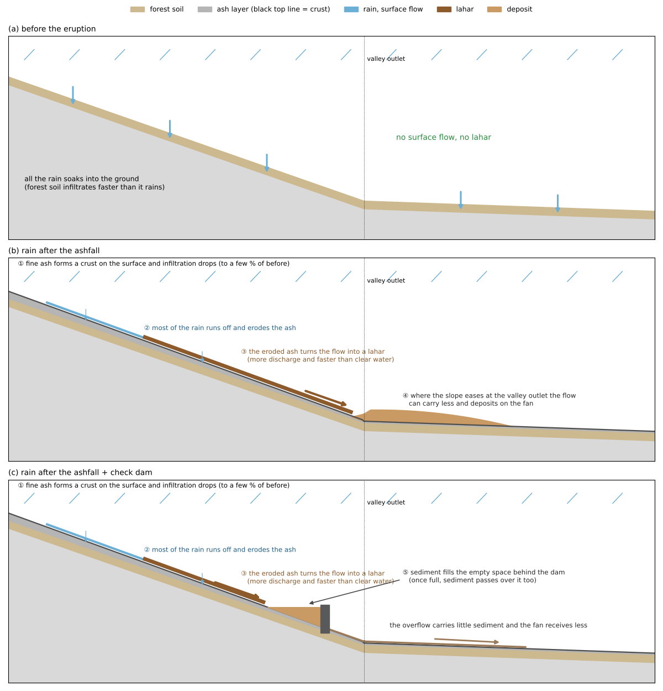
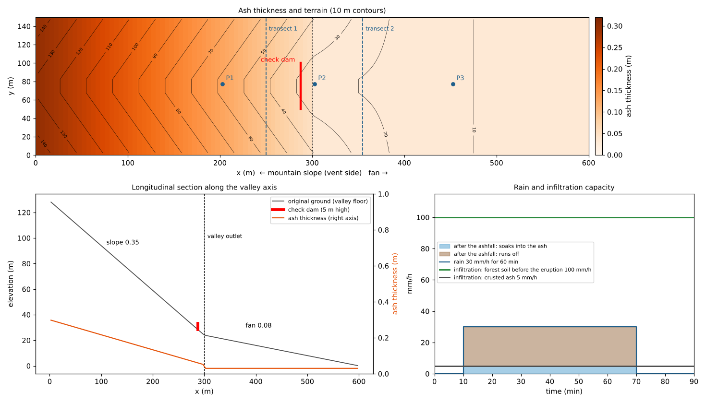
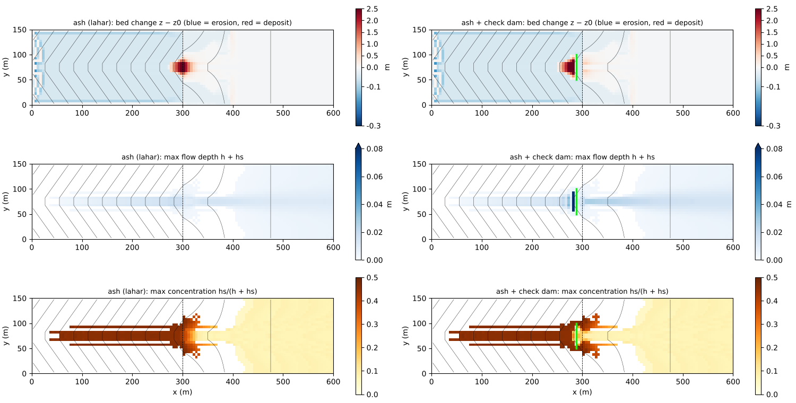
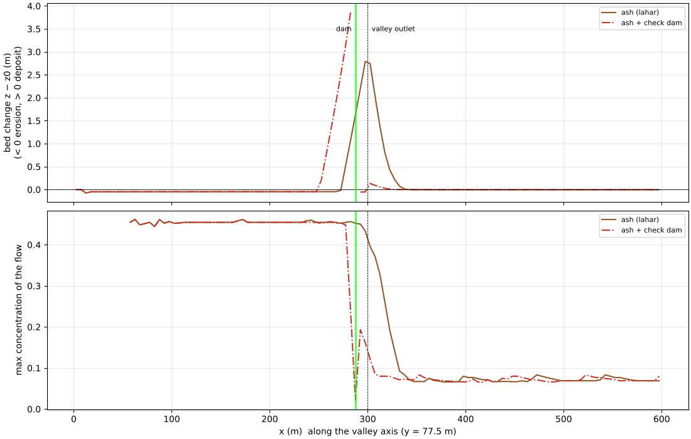
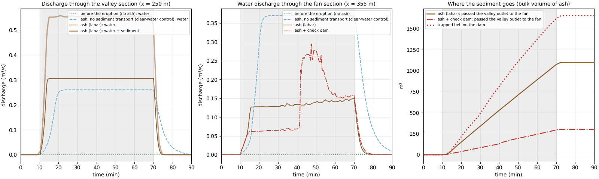
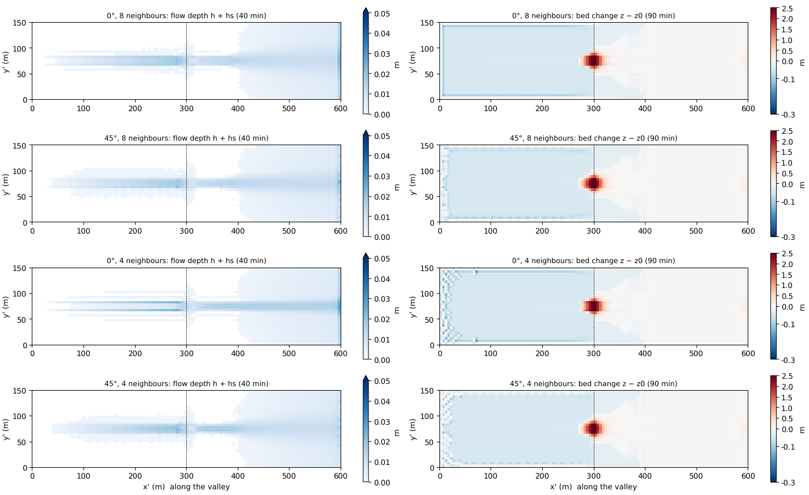
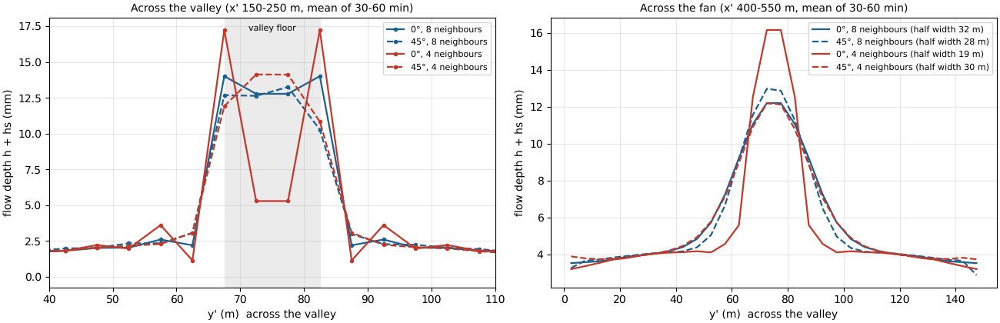

# ashfall_lahar — lahars caused by rain after an ashfall, and a check dam

> English mirror of examples/ashfall_lahar/README.md. The Japanese file is the master copy.

[日本語](../README.md)

Volcanic ash that settles on a mountain slope after an eruption makes it hard for rain to
soak in. This example follows, in a single run, how rain that would all soak into the
ground before the eruption runs over the slope after the ashfall, erodes the ash, becomes a
mudflow (lahar) and deposits on the fan at the valley outlet. It then adds a check dam just
upstream of the valley outlet and looks at how much of the lahar's sediment the dam holds
back. No source (failure depth or inflow hydrograph) is given; the lahar arises from the ash
thickness, the infiltration capacity and the rain alone. The values are schematic, chosen to
make the phenomena visible, and do not reproduce a particular volcano.

## What happens on a real volcano

- **Ashfall stops the ground from taking in rain**: in an explosive eruption fine ash
  covers the mountain slopes. Beaten by raindrops, fine ash forms a dense crust on the
  surface that no longer lets through the rain that the forest soil took in almost entirely
  before the eruption. After the 1980 eruption of Mount St Helens (USA) the infiltration
  capacity of a hillslope dropped by as much as 50-fold (Major & Yamakoshi 2005). Coarse ash
  and pumice let water through easily, so the effect depends on the grain size of the ash
  (Pierson & Major 2014).
- **Even weak rain triggers lahars**: rain that cannot soak in flows thinly over the slope
  and erodes the loose ash. The flow that takes up the eroded ash becomes a mudflow with a
  high sediment concentration, and its discharge swells beyond that of water alone. For
  several years after an eruption lahars recur with rain that would hardly move sediment
  before the eruption (Pinatubo from 1991, Unzen-Fugendake in 1991–1995, Sakurajima and
  others; Pierson & Major 2014). A numerical study found that when the infiltration capacity
  drops from 100 mm/h to 10 mm/h, the cumulative rainfall needed to trigger debris flows falls
  to a few percent of the pre-eruption value (Iwai et al. 2025).
- **Once out of the valley they stop and deposit**: in the steep valley a lahar flows on
  without stopping; at the valley outlet (the fan apex), where the slope eases, the amount
  of sediment it can carry drops and it deposits thickly on the fan. This is where houses and
  roads on the fan are buried.
- **Check dams**: a dam in the valley stores sediment in the empty space upstream of it and
  reduces the sediment that reaches the fan. Once full, sediment also passes over the dam,
  so the stored sediment is removed to keep the space empty (sediment excavation).

## Mechanisms needed for the reproduction



| Real phenomenon | How ENCflow represents it | Settings |
|---|---|---|
| Ashfall lowers the infiltration capacity | The infiltration capacity is given directly (constant infiltration capacity of Green-Ampt; the water that soaks in is stored up to the capacity of the layer = thickness × porosity) | `fn_gwflow`, `f_gwvertical = 2`, `gw_ksv_mmh`, `gw_psif = 0` |
| Rain that cannot soak in flows over the slope | Shallow water flow (rain − infiltration becomes surface water) | `fn_precip` |
| Surface flow erodes the ash and becomes a dense lahar | Erodible layer = ash thickness. A mixture that erodes and deposits so that its concentration approaches the equilibrium concentration set by the slope (Takahashi type) | `fn_sd`, `f_debris = 1`, `f_dbed = 1` |
| A lahar of fine ash has low friction and reaches the gentle fan | Resistance law of the mixture (Voellmy type: apparent friction + turbulent resistance) | `f_dbres = 4`, `db_mu`, `db_xi` |
| Erosion stops once the ash is stripped | Erosion only within the soil depth (ash thickness) | `fn_sd` |
| It deposits where the slope eases and becomes terrain | Deposition by the drop of the equilibrium concentration, and fixing the stopped sediment into the terrain | `f_dbstop = 1` |
| The water in the eroded ash joins the flow, and the deposits hold water in their pores | The water that had soaked into the eroded layer returns to the surface, and the pores of the layer added by deposition are filled from the local flow | `f_dbwet = 2` (pore water with the groundwater computation) |
| Check dam (closed type) | The dam body is added to the terrain and its soil depth set to 0 (not erodible) | `fn_z`, `fn_sd` (made by make_init.py) |

## Geometry and settings



Top: ash thickness (colour) and terrain (contours), check dam (red), and the two transects
that measure discharge (dashed; in the valley at x = 250 m and on the fan at x = 355 m).
P1–P3 are probes (time series in result_*/probes/). Bottom left: longitudinal section along
the valley axis and ash thickness. Bottom right: rain and infiltration capacity (after the
ashfall only 5 mm/h soaks in and the remaining 25 mm/h flows over the surface; the soil before
the eruption takes in water faster than it rains).

600 m × 150 m, dx = dy = 5 m (120 × 30 cells). The western half is a valley cut into a
mountain slope of gradient 0.35, with a valley floor 15 m wide and valley walls with a cross
slope of 0.25 (up to 17 m high). Rain on the valley walls reaches the valley floor within
about 100 m of flow, and most of the flow upstream of the dam passes through the dam. East of
the valley outlet at x = 300 m is a fan of gradient 0.08, where the valley walls fade out over
100 m. The east edge is free outflow; the north and south edges are walls.

- **Ashfall**: a one-directional distribution, 0.30 m on the vent side (west), 0.05 m at the
  valley outlet and 0.03 m on the fan. The ash layer is given as the soil depth sd (the
  erodible layer) and the same thickness is added to the ground surface z (z − sd is the
  original ground; erosion stops when the ash is stripped).
- **Rain**: 30 mm/h from 10 to 70 minutes (30 mm in one hour; the lower end of "intense rain"
  in the Japan Meteorological Agency's classes). The run lasts 90 minutes with dt = 0.1 s. The
  water flowing over the slope is a thin sheet flow about 1 mm deep, so the movement
  threshold depth `dd` of the shallow water flow is lowered from the default 1 mm to 0.2 mm
  (see Notes).
- **Infiltration capacity**: 100 mm/h for the forest soil before the eruption, 5 mm/h after
  the ashfall (1/20 of it; a schematic value for fine ash with a crust; the measured drop is
  up to 50-fold). The water that soaks in is stored up to the capacity of the layer
  (thickness × porosity; 0.5 for the ash, a soil 1 m thick with 0.3).
- **Lahar model**: erosion and deposition by relaxation to the Takahashi-type equilibrium
  concentration (`f_dbed = 1`, deposition coefficient `db_deltd = 0.01`), resistance law of
  Voellmy type (`f_dbres = 4`, apparent friction μ = 0.05, turbulence coefficient
  ξ = 500 m/s²). Ash grain size 1 mm, internal friction angle 30°, deposit porosity 0.5.
  Stopped sediment is fixed into the terrain (`f_dbstop = 1`).
- **Check dam**: a closed-type dam 12.5 m upstream of the valley outlet (one column,
  x = 285–290 m), 5 m above the valley floor with a level crest 50 m wide (`I_DAM`, `DAM_H`
  in make_init.py).

| Case | Settings file | Ashfall | Infiltration capacity | Sediment transport | Check dam |
|---|---|---|---|---|---|
| Before the eruption | param_preeruption.txt | none | 100 mm/h | — | none |
| Ash, clear-water control | param_water.txt | yes | 5 mm/h | none (no erosion) | none |
| Ash (lahar) | param.txt | yes | 5 mm/h | yes | none |
| Ash + check dam | param_dam.txt | yes | 5 mm/h | yes | yes |

The clear-water control has the same terrain, rain and infiltration as the lahar but carries
no sediment. It is run alongside to see what changes because the flow became a lahar
(discharge, speed).

## How to run

```
cd examples/ashfall_lahar
make                       # links and inputs (make_init.py)
make run                   # the four cases in turn (a few minutes each)
python3 plot_results.py en # en/figs/*.png and the table (without en: figs/, Japanese labels)
make rotated               # the four cases of the supplement (valley orientation and grid)
python3 plot_rotated.py en # en/figs/rotated*.png and the table
```

## Results



Left: ash (lahar); right: ash + check dam (green line). From the top: bed change after
90 minutes, maximum flow depth, and maximum concentration of the flow (maximum over the
outputs every 2 minutes; the concentration only at times with a flow depth of 2 mm or more).



Along the valley axis. Top: bed change after 90 minutes; bottom: maximum concentration of the
flow.



Left: discharge through the valley section (x = 250 m, upstream of the dam and the deposits;
thin lines = water, thick pale line = water + sediment of the lahar). Middle: water
discharge through the fan section (x = 355 m, downstream of the deposits at the fan apex).
Right: sediment that passed the valley outlet to the fan and sediment trapped behind the dam
(bulk volume of ash). Grey band = rain.

| Case | Water into the ground | Ash eroded upstream of the valley outlet | Sediment passing the valley outlet to the fan | Trapped behind the dam | Deposit at the fan apex (x 300–350 m) / max thickness | Discharge through the valley section (40–60 min) | Water through the fan section (90 min) |
|---|---:|---:|---:|---:|---:|---:|---:|
| Before the eruption | 2,700 m³ (100 % of the rain) | — | — | — | — | 0 | 0 |
| Ash, clear-water control | 540 m³ (20 %) | — | — | — | — | water 0.26 m³/s | 1,295 m³ |
| Ash (lahar) | 1,332 m³ (49 %) | 2,104 m³ (27 %) | 1,077 m³ | — | 1,069 m³ / 2.7 m | water 0.30, water + sediment 0.54 m³/s | 471 m³ |
| Ash + check dam | 1,323 m³ (49 %) | 2,080 m³ (26 %) | 302 m³ | 1,616 m³ | 294 m³ / 0.6 m | (as above) | 481 m³ |

The rain totals 2,700 m³ from 10 to 70 minutes. The water into the ground is the sum of the
rain that soaked in and the water that went into the pores of the deposits.

- **Before the eruption nothing happens**: all the rain soaks into the forest soil and no
  surface flow appears.
- **After the ashfall most of the rain runs off**: the 25 mm/h above the infiltration
  capacity of 5 mm/h flows over the slope; in the clear-water control 0.26 m³/s passes the
  valley section and 0.37 m³/s the fan section (both the upstream area × 25 mm/h).
- **The flow erodes the ash and becomes a lahar**: 27 % of the ash upstream of the valley
  outlet (2,104 m³) is eroded, and the flow in the valley becomes a lahar with a sediment
  concentration of 0.45 (the upper limit it can carry). Water and sediment together pass the
  valley section at about twice the clear-water control (0.54 m³/s), and the flow arrives
  2.7 minutes earlier (11.3 versus 14.0 minutes). The whole slope is eroded by 4–5 cm, nearly
  uniformly.
- **Out of the valley it stops and deposits**: at the valley outlet, where the gradient breaks
  from 0.35 to 0.08, the amount of sediment the flow can carry drops, and a deposit of
  1,069 m³, up to 2.7 m thick, forms at the fan apex. Downstream of it a thin flow with a
  concentration of about 0.07 crosses the fan. When a dense lahar deposits, its pores take
  most of the water of the flow (a lahar of 0.45 solids and 0.55 water that deposits with a
  porosity of 0.5 leaves about 80 % of its water in the pores), so the water through the fan
  section is about 40 % of the clear-water control (471 m³).
- **The check dam holds back the sediment**: 1,616 m³ is trapped behind the dam, the sediment
  passing the valley outlet to the fan falls from 1,077 to 302 m³ (a 70 % reduction), and the
  deposit at the fan apex falls from 2.7 to 0.6 m at most. Until about 42 minutes, while the
  space behind the dam first fills with water, no flow from the valley reaches the fan; once
  the overflow starts, a flow of low concentration comes out. The deposit just upstream of the
  dam reaches the crest level at about 52 minutes (the dam is full), and after that sediment
  also passes over the dam. Of the 302 m³ that reached the fan, 134 m³ came out before the
  overflow started; it was carried by water flowing down the valley walls downstream of the
  dam and at both ends of the dam (not through the dam).

## Supplement: valley orientation and the grid (the eight neighbours of the ENC grid)

The ENC grid of ENCflow exchanges flow with the four diagonal neighbours as well as the four
axial ones ([Shallow water flow computation](../../../docs/en/users_guide/swflow.md)). To see
whether the flow behaves the same when the valley is oblique to the grid, the same valley
(without the dam) is placed along the grid (0°) and turned by 45°. For comparison, a
four-neighbour grid, in which the passing width of the diagonal edges is 0
(`p_diagratio = 0`), is run alongside. The 45° grid is a 555 m square that holds the valley;
outside the valley is outside the domain, and beyond the downstream end of the valley is a
sea mask with a water level of 0 m (a sink; the 0° case is treated the same way;
make_rotated.py). The 45° results are drawn back in the coordinates along the valley
(x', y').



From the top: 0° with 8 neighbours, 45° with 8 neighbours, 0° with 4 neighbours, 45° with
4 neighbours. Left: flow depth at 40 minutes; right: bed change after 90 minutes.



Cross-sections of the flow depth averaged over 30–60 minutes. Left: in the valley
(x' 150–250 m; grey = valley floor); right: on the fan (x' 400–550 m).

| | 8 neighbours (ENC default) | 4 neighbours |
|---|---:|---:|
| Difference between 0° and 45° in flow depth (30–60 min mean; relative L1 difference) | 9 % | 25 % |
| Difference between 0° and 45° in bed change | 13 % | 17 % |
| Flow on the valley floor (0°; 4 cells across) | nearly uniform (11–13 mm) | split to both edges (17 mm and 5 mm) |
| Central flow on the fan: peak / half width (0° → 45°) | 10 → 11 mm / 28 → 24 m | 16 → 12 mm / 19 → 30 m |
| Sediment passing the valley outlet to the fan (0° → 45°) | 1,077 → 1,141 m³ | 1,056 → 1,137 m³ |
| Deposit at the fan apex (0° → 45°) | 1,069 → 1,144 m³ | 1,047 → 1,144 m³ |

- **With 4 neighbours the flow is tied to the grid direction**: water can only move along the
  axes, so at 0°, with the valley along the grid, the water from the valley walls flows along
  the two edge columns of the valley floor and the centre of the floor is shallow (stripes
  along the valley). At 45° the flow advances in steps and gathers into one stream on the
  valley floor. On the fan too, the central flow hardly spreads sideways at 0° (half width
  19 m) but spreads at 45° (30 m).
- **With 8 neighbours the flow does not depend on the valley orientation**: exchanging flow
  with the diagonal neighbours as well, the difference between 0° and 45° in the flow
  distribution is about a third of that with 4 neighbours, and both the flow on the valley
  floor and that on the fan keep the same shape.
- **The sediment amounts are hardly affected**: the eroded volume, the sediment passing the
  valley outlet and the deposit at the fan apex are nearly the same with 8 and 4 neighbours
  (the 6–7 % difference between 0° and 45° is common to both and does not depend on the
  number of neighbours). The lahar in this example is controlled by the steep valley and the
  gradient break; the difference of the eight neighbours shows up strongly in computations
  where the direction and spreading of the flow themselves matter (flooded areas on a
  floodplain, channels oblique to the grid and so on).

## What this model cannot represent (differences from real phenomena)

- **The infiltration capacity is constant**: a real crust develops under raindrops, is
  stripped by erosion and breaks up as vegetation recovers, so the infiltration capacity
  recovers over the years (up to tenfold in 20 years at Mount St Helens; Major & Yamakoshi
  2005). In this example the infiltration capacity is a given constant and does not change
  when the ash is eroded.
- **Rills and gullies**: real erosion concentrates in narrow channels on the slope (rills and
  gullies). Channels narrower than the 5 m cells are not resolved; erosion is represented as
  areal erosion averaged over the cell.
- **Lahars from slope failures**: initiation by a water-laden ash layer sliding off (shallow
  landslides) is not treated. This example covers only initiation by erosion from surface
  flow (initiation by failure: the slope-stability judgement f_slide of
  [Sediment and landform change](../../../docs/en/users_guide/geomorph.md)).
- **Saturation of the deposits**: sediment deposited under a flow is assumed to be saturated
  immediately by the local water (the simplification of `f_dbwet = 2`). The time it takes
  water to soak into the pores, and deposits on dry ground that stay unsaturated, are not
  represented.
- **Grain size**: the ash has a single grain size. Sorting of gravel and boulders, and
  grain-size-selective trapping by slit dams, cannot be represented.
- **Drain holes of the dam**: the dam body is a step in the terrain that lets no water
  through. A real dam drains water through drain holes, so the delay before the overflow
  starts, while water collects upstream, is shorter than in this example.
- **Repeated rain**: only one rain event. The dam's empty space shrinking with each rain and
  restoring it by excavation need cases chained together
  ([Suspend and Restart](../../../docs/en/users_guide/restart.md)).

## Notes

- **Movement threshold depth dd**: the sheet flow on the slope is about 1 mm deep. When `dd`
  is comparable with the flow depth (the default 1 mm), cells switch between flowing and
  stopped, and a stopped cell drops the sediment it was carrying. A slightly lower row
  collects water from the side and keeps eroding, while the neighbouring row that lost the
  water drops sediment and rises; this positive feedback makes stripes one grid cell wide
  (on this steep slope the concentration the flow can carry is pinned at its upper limit, and
  nothing fills a dip back through the change of slope). Make `dd` well below the flow depth
  (0.2 mm in this example).
- **The flow is thin**: the catchment is only 0.045 km², so even the flow on the valley floor
  is a few centimetres deep. To change the scale, enlarge the domain (lx, ly) and the rain
  (with dt matched to the CFL condition).
- **Domain edges**: in the single row along the upstream end and the north and south walls
  the flow is thin and erosion and deposition come out somewhat stronger (an effect of the
  boundary; the lines along the edges in the bed-change maps).
- **The ash on the fan moves too**: the ash on the fan (0.03 m) is also eroded by the rain on
  the fan and deposits thinly at the slope break where the valley walls fade out
  (x = 400 m). The sediment from the valley is counted as "sediment passing the valley outlet
  to the fan" (the sediment budget upstream of the valley outlet).
- **The free-outflow east edge**: in the easternmost column, too, the equilibrium
  concentration of the flow uses the same slope as the interior (the terrain beyond the edge is
  extended at its slope). Before the fix of 2026-10-30 (developer.md §28.15) the slope in the
  easternmost column became 0, and an artificial deposit formed in the easternmost few
  columns (at most 0.2 m in the easternmost column, about 160 m³ in all). Because of the water that
  was in its pores, the "water into the ground" in the table is now about 90 m³ less than
  before the fix (the other values are unchanged).

## Choosing the settings (resistance and erosion laws)

- **The Egashira constitutive law (`f_dbres = 2`) cannot be used for fine ash**: its laminar
  resistance scales with (d/h)², so with a grain size of 1 mm and a flow depth of a few
  centimetres the resistance almost vanishes and the velocity blows up. The Egashira law is
  a resistance law for stony flows with grain sizes of centimetres or more.
- **With Coulomb friction (`f_dbres = 1`) the flow cannot descend the fan**: with φ = 30° the
  gradient at which a mixture of concentration 0.45 keeps flowing is
  tanφ·sC/(1 + sC) ≈ 0.25, so it stops before the fan of gradient 0.08. The Voellmy type
  (μ = 0.05) is used as the apparent friction of a fine mud with high pore pressure.
- **Erosion speed**: in the erosion-deposition of Egashira and Ashida (`f_dbed = 2`) the
  erosion speed is proportional to the flow velocity, and on the fast flow of a steep slope
  the ash is stripped in a short time. The Takahashi-type relaxation (`f_dbed = 1`) lets the
  erosion speed be adjusted with a coefficient.
- **Valley shape**: in a V-shaped valley with a floor one cell wide the sediment gathers into
  one column and deposits unrealistically thick, so the valley is trapezoidal with a floor
  15 m wide.

## Starting points for sensitivity tests

- `gw_ksv_mmh` (5 → 15 mm/h): the difference from the rain sets how much flows over the
  surface. The closer it is to the rain (30 mm/h), the less surface flow and the smaller the
  lahar.
- `prval` (rain intensity): the stronger, the deeper the erosion and the wider the area where
  the ash is stripped.
- `DAM_H` (make_init.py; dam height): more empty space and more sediment trapped.
- `db_mu` (0.05 → 0.1): the place where the flow stops on the fan moves upstream.
- `db_deltd` (0.01 → 0.05): the deposit concentrates more just below the valley outlet.

## References

- Iwai, Miyata and Yamanoi (2025): Changes in the debris flow threshold owing to volcanic
  eruptions: evaluation with numerical simulations. Journal of Disaster Research, 20(6),
  1054–1061.
- Major, J. J. and Yamakoshi, T. (2005): Decadal-scale change of infiltration characteristics
  of a tephra-mantled hillslope at Mount St Helens, Washington. Hydrological Processes, 19(18),
  3621–3630.
- Pierson, T. C. and Major, J. J. (2014): Hydrogeomorphic effects of explosive volcanic
  eruptions on drainage basins. Annual Review of Earth and Planetary Sciences, 42, 469–507.
