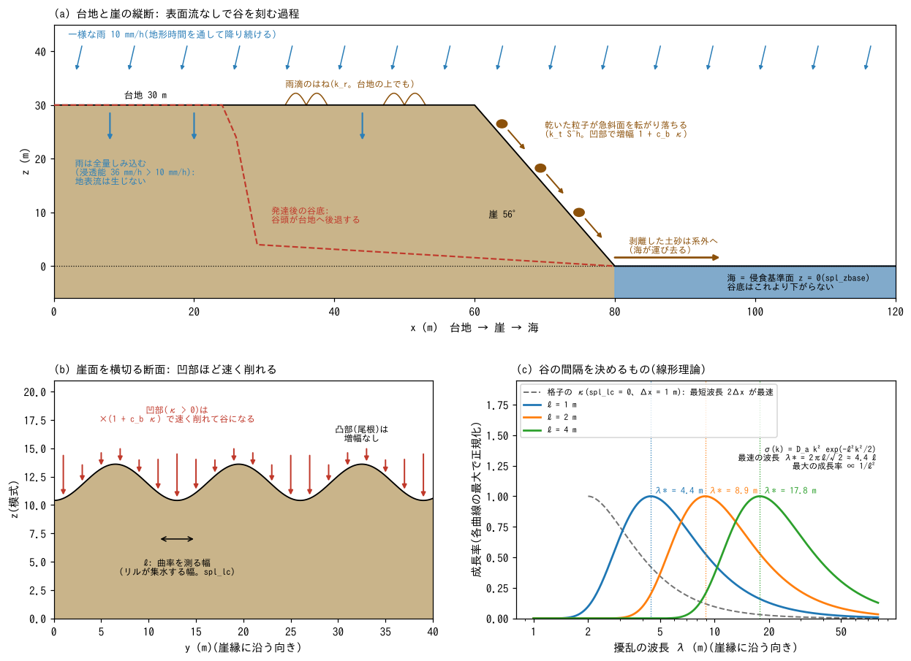
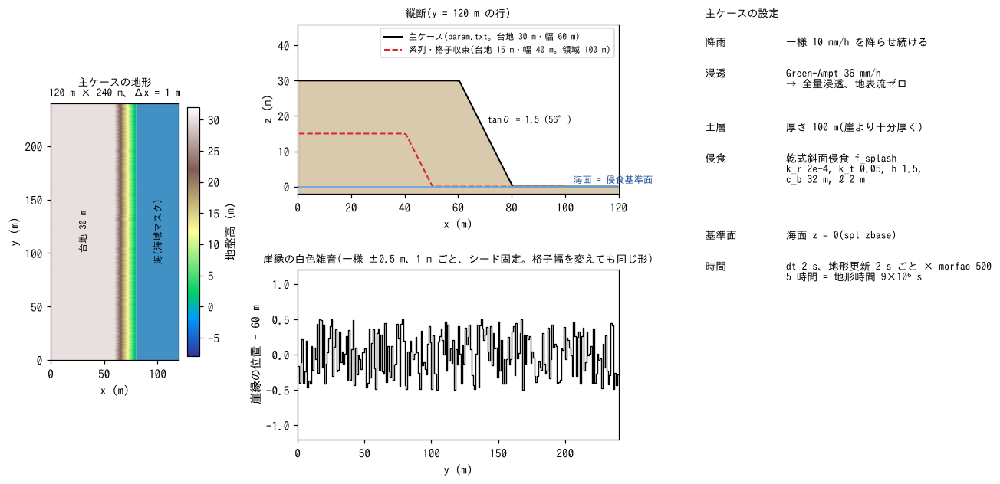
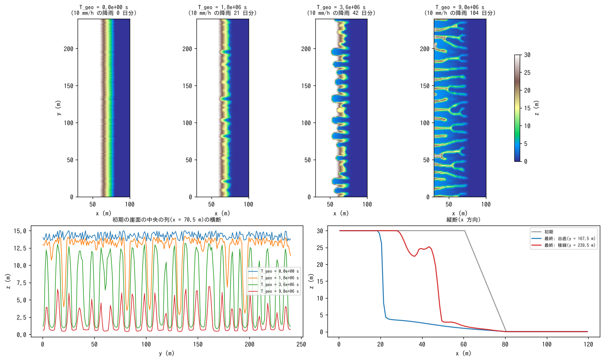
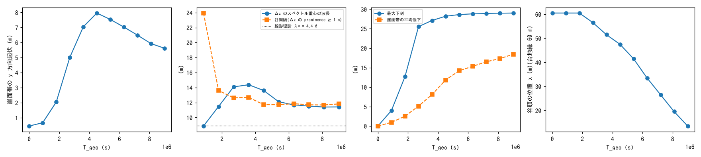
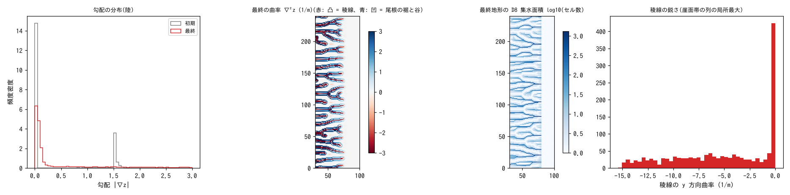
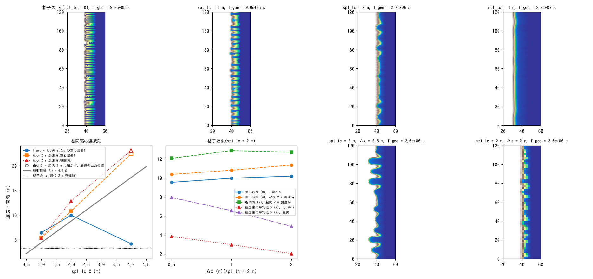

# badland — 表面流のない崖に刻まれる谷(乾式斜面侵食によるバッドランド型の地形発達)

[English](en/README.md)

透水性の高い火砕物の台地が崖で直接海に落ちる地形(例えば新島南部の火砕丘の縁)に
雨を降らせ続け、崖縁から谷ができて、深い谷と鋭い稜線に育つまでを一つの計算で追う
例題です。雨は全量しみ込んで**地表流は最後まで生じません**。谷を刻むのは
[乾式斜面侵食](../../docs/users_guide/geomorph.md#乾式斜面侵食f_splash)(f_splash: 雨滴の
はねと、乾いた急斜面を転がり落ちる粒子)だけです。谷の間隔を決めるもの(曲率を測る幅
`spl_lc`)と、格子幅を変えたときの結果の変わり方も比べます。値は現象を見やすくする
ための模式値で、特定の地形の再現ではありません。

乾式斜面侵食の侵食則は ENCflow の開発者による**独自の定式化**で、論文としては未発表です
(式と線形理論は[解説](../../docs/users_guide/sediment.md#6-乾式斜面侵食f_splash)、
検証は [test/splash](../../test/splash/README.md) ほか)。

## 実際のバッドランドで起きていること

- **バッドランド**: 植生がほとんどなく、軟らかい堆積物(泥岩・頁岩・固まりきらない
  火砕物など)が雨で削られて、急な斜面と細かく密な谷、鋭い稜線に刻まれた地形です。
  谷はほぼ一定の間隔で並びます(Perron et al. 2009)。
- **多くのバッドランドでは表面流が谷を刻む**: 透水性の低い泥岩の斜面では、強い雨が
  地表を流れてリル・ガリーを刻み、斜面の崩れと組み合わさって谷が育ちます。地形発達の
  モデルも、表面流の侵食と斜面の土砂移動の組合せで谷を作るものが標準です(Howard
  1994, 1997)。
- **表面流が生じなくても斜面の粒子は動く**: 乾いた急斜面では、粒子が一つずつ転がり・
  跳ね・滑り落ちます(dry ravel。Gabet 2003)。乾いた砂の斜面に落ちた雨滴は、砂粒を
  まとった塊(sandball)になって斜面を転がり、はねるだけの場合よりずっと多くの砂を
  運びます(Trottet et al. 2025)。透水性が高く雨がしみ込んでしまう火砕物の崖でも、
  こうした乾いた斜面の過程は働きます。
- **谷頭は台地へ後退し、崖下の海が土砂を運び去る**: 谷は崖縁から始まり、谷頭が
  円形劇場状(amphitheater)に台地へ食い込みながら後退します。崖が直接海に落ちる
  所では、崩れ落ちた土砂は波に運び去られ、谷底は海面より下がりません(海面が侵食
  基準面)。

## 再現に必要な機構



模式図。(a) 台地と崖の縦断: 雨は全量しみ込み、台地の上では雨滴のはね、急な崖面では
乾いた粒子の転落が地表を削る。削れた土砂は海へ出て、谷底は海面より下がらない。
破線は発達後の谷底(結果の縦断を模したもの)。(b) 崖面を横切る断面: 凹部ほど速く
削れて谷になる(矢印の長さ = 侵食の速さ)。(c) 崖縁に沿う起伏の成長率と波長
(線形理論): 曲率を幅 ℓ で測ると、成長の最も速い波長が λ* ≈ 4.4 ℓ に決まる。格子の
曲率のままだと、最も短い波長(2Δx)が最も速い。

この例題で働いている機構と、それを担う設定:

| 実際の現象 | モデルの機構 | 設定 |
|---|---|---|
| 雨が全量しみ込み、地表を流れない | Green-Ampt の浸透(浸透能 36 mm/h > 雨 10 mm/h)。地表に水のない乾いたセルだけで乾式斜面侵食が働く | `f_gwvertical = 2`、`gw_ksv_mmh = 36` |
| 雨滴が粒子をはね飛ばす(台地の上でも) | 雨滴項 $`P k_r`$ | `spl_kr` |
| 乾いた急斜面を粒子が転がり落ちる | 勾配項 $`P k_t S^h`$(勾配 $`S`$ が急なほど速い) | `spl_kt`、`spl_h` |
| 窪んだ所(谷)ほど粒子とリルが集まって速く削れる | 凹地形増幅 $`1 + c_b \kappa`$($`\kappa`$ は地表の曲率。凹で正) | `spl_cb` |
| 谷の間隔(リルが集水する幅) | 曲率を相関長 ℓ で平滑化した地表から測る | `spl_lc` |
| 削れた土砂を崖下の海が運び去る | 剥離した土砂は堆積させず系外へ出す(終了時に総量を表示) | `f_splash = 1` の動作 |
| 谷底は海面より下がらない | 侵食基準面 | `spl_zbase = 0` |
| 長い時間をかけて地形が変わる | 地形の変化だけを morfac 倍に加速する(地形時間。主ケースは 10 mm/h の雨の 104 日分) | `dt_geomorph`、`morfac` |
| (補足)崖の崩落と、崖錐が波で除去される海食崖 | [崩落と崖錐](../../docs/users_guide/geomorph.md#崩落と崖錐f_rockfall)。海に面した崖から崩れた分は系外へ | `f_rockfall`、`rf_hc`、`rf_rc` |

侵食の速さ $`E`$ は $`E = P\,[k_r + k_t(1 + c_b\kappa)S^h]`$ です($`P`$ は降雨強度)。
この侵食則は表面流の項(集水面積で決まる河川の侵食)を持たず、凹地形に粒子とリルが
集まる効果を格子より小さいスケールの効果として勾配項に掛けます。表面流で谷を刻む
既存の地形発達モデルとはこの点が違い、この組立てが ENCflow の独自の部分です。
dry ravel や雨滴が転がす砂の塊は、この侵食則が表そうとする現象の例で、式の形と
係数をこれらの文献から導いたものではありません。係数は校正を前提とした経験値です。

## 幾何と設定



左: 主ケースの地形(青 = 海域マスク)。中上: 縦断(実線 = 主ケース、破線 = 相関長系列・
格子収束の地形)。中下: 崖縁の位置に与えた白色雑音。右: 主ケースの設定の要約。

120 m × 240 m、Δx = 1 m(120 × 240 セル)。高さ 30 m・幅 60 m の台地が、tanθ = 1.5
(56°)の崖で海(z ≤ 0 のセル = 海域マスク)に落ちます。

- **崖縁の白色雑音**: 崖縁の位置に一様乱数 ±0.5 m(1 m ごと。シード固定)を与えるだけで、
  特定の波長は持ち込みません。谷の位置と間隔は侵食則の側で決まります(自己組織化)。
  雑音は 1 m の基準格子で作り、格子幅を変えても同じ縁の形になるように写します。
- **降雨と浸透**: 一様 10 mm/h を降らせ続けます。Green-Ampt の浸透能 36 mm/h がこれを
  上回るので、雨は全量しみ込み、地表流は最後まで生じません(画面表示の S_surf は常に 0)。
- **侵食**: 乾式斜面侵食($`k_r`$ = 2×10⁻⁴、$`k_t`$ = 0.05、$`h`$ = 1.5、$`c_b`$ = 32 m、
  ℓ = 2 m)。侵食基準面は海面(`spl_zbase = 0`)。土層厚は 100 m で崖高より十分厚くします
  (注意を参照)。斜面クリープなどの拡散の過程は使いません。
- **時間**: dt = 2 s、地形の更新は 2 s ごとで、地形の変化を morfac = 500 倍に加速します
  (地形時間 T_geo = 実時間 × 500)。主ケースの 5 時間は T_geo = 9×10⁶ s(10 mm/h の雨の
  104 日分)。30 分(T_geo 9×10⁵ s)ごとに地盤高 Z を出力します。
- 1 更新の侵食の上限 `spl_dzmax = 0.2` m は安全弁です(注意を参照)。

| ケース | 設定ファイル | 地形 | ℓ(spl_lc) | Δx | 地形時間 T_geo | 計算時間の目安 |
|---|---|---|---|---|---|---|
| 主ケース | param.txt | 台地 30 m・幅 60 m(120 × 240 m) | 2 m | 1 m | 9×10⁶ s | 約 1 分 |
| 格子の曲率(対照) | param_grid.txt | 台地 15 m・幅 40 m(100 × 240 m) | 0(格子の曲率) | 1 m | 5.4×10⁶ s | 各 10 秒〜3 分 |
| 相関長の系列 | param_lc1 / lc2 / lc4.txt | 同上 | 1 / 2 / 4 m | 1 m | 5.4×10⁶ s(lc4 は 2.2×10⁷ s) | 同上 |
| 格子収束 | param_lc2_dx05 / lc2_dx2.txt | 同上(同じ雑音) | 2 m | 0.5 / 2 m | 5.4×10⁶ s | 同上 |
| 補足: 崖の崩落 | param_rockfall.txt | 主ケースと同じ | 2 m | 1 m | 9×10⁶ s | 約 2 分 |

対照・系列・格子収束の 6 ケースは、主ケースより小さい台地(高さ 15 m・幅 40 m)で、
`spl_lc` か Δx だけを変えます(param_grid は `spl_lc = 0`)。

## 実行方法

```
cd examples/badland
make                     # 実行ファイルへのリンクと入力(make_terrain.py が z_*.txt・sw_*.txt を作る)
make run                 # 7 ケース(主ケース・格子の曲率・相関長 3・格子収束 2)を順に計算(各 10 秒〜3 分)
python3 plot_setup.py    # figs/mechanism.png・setup.png(計算結果は使わない)
python3 plot_results.py  # figs/main_*.png・spacing.png と数表
make supp                # 補足: 崖の崩落(param_rockfall.txt。約 2 分)
```

引数 `en` を付けると英語ラベルの図を en/figs/ に描きます(`python3 plot_setup.py en`、
`python3 plot_results.py en`)。図化には Python 3・NumPy・matplotlib が要ります。

## 結果

### 主ケース: 白色雑音から深い谷と鋭い稜線へ



上: 地形の時間発展(T_geo = 0、1.8×10⁶、3.6×10⁶、9×10⁶ s。題の日数は 10 mm/h の雨に
換算した値)。下左: 初期の崖面の中央の列(x = 70.5 m)の横断の時間発展。下右: 最終地形の
谷底と稜線を通る縦断(灰色 = 初期)。

- **谷の自己形成**: 白色雑音しかない崖縁から、まず崖面に間隔 10 m 強の谷ができます
  (1.8×10⁶ s)。凹部ほど速く削れる正のフィードバックで、雑音のうち特定の波長だけが
  育つためです。
- **谷頭の後退**: 谷頭が円形劇場状に台地へ食い込み(3.6×10⁶ s)、ほぼ一定の速さで
  後退します。
- **台地の解体**: 最後は台地が櫛の歯状の長い平行な尾根に解体され、谷底は海面
  (基準面)に達します(9×10⁶ s)。平面図では、細く枝分かれした尾根(明るい色)が、
  海面近くまで下がった広い谷底(青)の間に残ります。



左から: 崖面帯(列平均の標高が台地と海面の間にある列)の y 方向の起伏(標準偏差)、
地形変化 Δz のスペクトル重心の波長と谷間隔(点線 = 線形理論 λ* = 4.4 ℓ)、最大下刻と
崖面帯の平均低下、谷頭の位置(台地縁 60 m)。



左: 陸の勾配の分布(灰 = 初期、赤 = 最終)。中左: 最終地形の曲率 ∇²z(赤 = 凸 = 稜線の頂、
青 = 凹 = 尾根の裾と谷。図の題の色の対応は逆に書かれています。次に図を描き直すと
正しくなります)。中右: 最終地形の D8 集水面積。右: 稜線(崖面帯の各列の局所最大)の
y 方向の曲率の分布(負に大きいほど鋭い)。

| 量 | 初期 | 最終(T_geo = 9×10⁶ s) |
|---|---|---|
| 崖面帯の y 方向の起伏 (m) | 0.44 | 5.50(最大は T_geo 4.5×10⁶ s の約 7.8) |
| 谷間隔 (m)(Δz の prominence ≥ 1 m) | – | 1.8×10⁶ s: 13.6 ± 8.1(15 本 / 240 m)、最終: 12.2 ± 6.8(18 本) |
| Δz のスペクトル重心の波長 (m) | – | 1.8×10⁶ s: 11.5、3.6×10⁶ s: 14.6、最終: 12.4 |
| 最大下刻 / 崖面帯の平均低下 (m) | – | 29.0 / 18.0 |
| 谷頭の位置 x (m)(台地縁 60 m) | 60.5 | 12.5(後退 48 m。T_geo 3.6×10⁶ s 以降はほぼ一定の速さ ≈ 7 m / 10⁶ s) |
| 稜線の y 方向の曲率 (1/m): 中央値 / 最小 | – | −4.2 / −16.5 |
| 勾配 > 1.0 の陸セルの割合 | 0.24 | 0.34 |
| 系外へ出た土砂(固体の体積、m³) | – | 160,371(地表の体積の減少 Σ(z₀ − z)Δx² ≈ 2.7×10⁵ m³ = 固体 ÷ (1 − 空隙率 0.4)) |
| spl_dzmax で頭打ちにした回数(セル・更新の累計) | – | 3.8×10⁴ |

(数表は `python3 plot_results.py` が出力する。最大の起伏は時系列の図から読んだ値。)

- **表面流なしで谷ができる**: 地表流は最後までゼロのままで、谷は乾式斜面侵食の凹地形
  フィードバックだけで育ちます。勾配の分布は初期の 2 値(台地 0・崖 1.5)から、鋭い
  稜線と谷壁の連続した分布に変わります。
- **間隔は ℓ で決まる**: 谷間隔と Δz の重心波長は、谷ができる段階で ≈ 5〜6 ℓ に決まり
  (線形理論 λ* = 4.4 ℓ)、以後は 12 m 前後で安定します。
- **鋭い稜線**: 稜線は幅 2〜4 セルの尾根で、頂も両側の勾配で削られて下がります。
- **起伏の山**: 起伏は谷の深化で増え(最大 ≈ 7.8 m)、台地の解体で減ります。

### 谷の間隔は何が決めるか



上: 格子の曲率(spl_lc = 0)と spl_lc = 1 / 2 / 4 m の地形(崖面帯の起伏が初めて 2 m を
超えた時刻。ℓ が大きいほど成長が遅いので、時刻ではなく成長の段階をそろえる)。下左:
谷間隔の選択則(T_geo = 1.8×10⁶ s と起伏 2 m 到達時の Δz の重心波長・谷間隔 vs ℓ。
灰色の線は線形理論 λ* = 4.4 ℓ)。下中: spl_lc = 2 m の格子収束(Δx = 0.5 / 1 / 2 m)。
下右: Δx = 0.5 m と 2 m の地形(T_geo = 3.6×10⁶ s)。

| ケース | ℓ (m) | Δx (m) | T_geo = 1.8×10⁶ s: Δz の重心波長 / 谷間隔 / 平均低下 (m) | 起伏 2 m 到達時(T_geo): 重心波長 / 谷間隔 (m) / 本数 / 平均低下 (m) | 最終: 起伏 / 最大下刻 / 平均低下 / 谷頭 x (m) |
|---|---|---|---|---|---|
| param_grid | 0 | 1 | 3.3 / 3.5 / 7.5 | (9×10⁵ s) 3.4 / 3.5 / 66 / 4.9 | 1.02 / 15.0 / 12.5 / 0.5(台地を貫通) |
| param_lc1 | 1 | 1 | 6.8 / 6.7 / 4.6 | (9×10⁵ s) 5.5 / 6.0 / 39 / 3.0 | 4.10 / 14.8 / 8.1 / 0.5(台地を貫通) |
| param_lc2 | 2 | 1 | 10.1 / 14.5 / 3.0 | (2.7×10⁶ s) 10.9 / 13.2 / 17 / 4.6 | 3.74 / 14.5 / 6.5 / 30.5 |
| param_lc4(T_geo 2.2×10⁷ s まで) | 4 | 1 | 4.2 / – / 1.7(まだ育っていない) | (2.2×10⁷ s) 22.5 / 24.5 / 4 / 10.3 | 0.53 / 14.7 / 10.3 / 30.5 |
| param_lc2_dx05 | 2 | 0.5 | 9.6 / 11.8 / 3.8 | (2.7×10⁶ s) 10.4 / 11.8 / 19 / 5.4 | 4.55 / 14.5 / 7.9 / 22.8 |
| param_lc2_dx2 | 2 | 2 | 10.8 / 15.4 / 2.0 | (5.4×10⁶ s) 12.8 / 15.1 / 14 / 4.9 | 1.96 / 13.9 / 4.9 / 37.0 |

台地縁は x = 40 m。最終は param_lc4 以外 T_geo = 5.4×10⁶ s。

- **格子の曲率では間隔が格子に張り付く**: spl_lc = 0 では重心波長が 3.4 m(≈ 3Δx)で、
  市松状の凹凸が立ち、格子 2 つ分の幅の侵食前線が台地を貫通します。凹地形増幅は
  短い波長ほど強く効くので(線形化すると成長率 ∝ k²)、最も短い波長が最も速く育つ
  ためです(Smith and Bretherton 1972 の「無限波数」の問題と同じ)。拡散の項
  (斜面クリープ)を足しても、拡散も k² に比例するので成長の有無が変わるだけで、
  間隔は選ばれません。
- **ℓ を与えると間隔が ℓ に比例する**: 起伏 2 m 到達時の重心波長は ℓ = 1 / 2 / 4 m で
  5.5 / 10.9 / 22.5 m(≈ 5〜6 ℓ。線形理論 λ* = 4.4 ℓ。ℓ = 4 m は到達までに谷の併合が
  進んでいる)。ℓ が大きいほど成長は遅く(最大の成長率 ∝ 1/ℓ²)、ℓ = 4 m は 2 m の
  約 8 倍の時間がかかります。
- **格子収束**: ℓ = 2 m を Δx = 0.5 / 1 / 2 m で解くと、谷ができる段階
  (T_geo = 1.8×10⁶ s)の重心波長は 9.6 / 10.1 / 10.8 m とそろいます(間隔の選択則は
  格子によらない)。一方、平均低下は 3.8 / 3.0 / 2.0 m、最終は 7.9 / 6.5 / 4.9 m で、
  谷が深くなってからの発達は Δx が細かいほど速く、**完全には収束しません**。この
  侵食則は勾配に上限を持たず、谷壁は 1 セル幅の段差(S ≈ Δz/Δx)まで急になり得るので、
  勾配の 99 % 点が Δx = 0.5 / 1 / 2 m で 11 / 6.5 / 3.3 と格子幅に反比例し、S^1.5 に
  比例する侵食が細かい格子ほど速くなるためです。間隔や初期の下刻の比較には
  **ℓ/Δx ≥ 2** を目安にし、深い谷の段階の速さは格子を固定した相対比較に使ってください。

## 補足: 崖の崩落と海への排出(param_rockfall.txt)

主ケースに[崩落と崖錐](../../docs/users_guide/geomorph.md#崩落と崖錐f_rockfall)
`f_rockfall` を重ねた派生です。窓の中の最低点との落差が限界高さ H_c = 15 m を超えた
崖の面(窓の半径 r_c = 8 m)が崩れ、陸に落ちた岩屑は崖錐(安息角 35°、乾式侵食の
0.1 倍しか削れない)になります。海セルに面した崖から崩れた分は海へ落ちて系外へ出ます
(崖錐が波で除去される海食崖の極限。終了時の「rockfall exported to sea cells」)。

| 量(T_geo = 9×10⁶ s) | 主ケース | 崩落あり |
|---|---|---|
| 乾式侵食で系外へ出た土砂(固体 m³) | 160,371 | 40,495 |
| 崩落で移した体積(かさ m³、累計)/ うち海へ | – | 25,465 / 192 |
| 崖錐の総量(m³、最終) | – | 754 |
| 谷頭の位置 x (m)(台地縁 60 m) | 12.5 | 42.5 |

- 崩落は 56° の崖の面(窓の中の落差 > 15 m)を安息角まで崩し、崖錐が面を覆うので、
  乾式侵食(S^1.5 と凹地形増幅)の駆動力が落ちて、谷頭の後退は 47.5 m → 17.5 m、
  乾式侵食の排出は 4 分の 1 になります。
- 海への崩落は 192 m³ と少なく、この地形では崖の脚部が海面(z = 0)で海セルに接する
  ため、海に面した段差が小さいからです(垂直な海食崖を海セルに直接接して置けば、
  海への排出が主になります)。
- 崩落のパラメータは校正値ではありません。実際の崖が崩落で後退するか乾式侵食で
  後退するかは、この例題では決めていません。

## このモデルで表せないこと(実際の現象との違い)

- **侵食は格子より小さい過程のまとめ**: 粒子の転落・雨滴のはね・リルを一つずつは解かず、
  勾配と凹地形の効果をまとめた 1 本の式で表します。係数($`k_r`$・$`k_t`$・$`c_b`$・ℓ)は
  校正を前提とした経験値です。実際の地形に当てはめるなら、実測の谷間隔から
  ℓ ≈ 間隔 / 5 を逆算し、谷頭の後退速度などから $`k_t`$・$`c_b`$ を合わせます。
- **土砂は溜まらない**: 剥離した土砂はすぐ系外へ出します(崖下の海が運び去る極限)。
  谷底や崖の脚部に土砂が溜まること(崖錐・扇状地)は、補足の崩落と崖錐を重ねない限り
  表しません。
- **拡散型の斜面の過程は入れていない**: 斜面クリープのように稜線を丸める過程は使って
  いません。丸い稜線になる場合は [badland_round](../badland_round/README.md) を見て
  ください。
- **深い谷の段階の速さは格子に依存する**: 谷壁が垂直に近づくと勾配が格子幅で決まる
  ためです(格子収束の結果)。谷の間隔・形(円形劇場状の谷頭 → 平行な尾根)・初期の
  深化は格子によりません。
- **時間は実際の年代に換算できない**: 係数は形の発達を短い計算で見るための模式値で、
  実際の侵食速度に合わせていません。主ケースの T_geo = 9×10⁶ s は 10 mm/h の雨の約 25 m 分
  ですが、これを実際の地形の年代と比べることはできません。
- **表面流と雨の強さの変化**: 一様な雨を降らせ続けるだけで、豪雨で地表流が出る場合は
  扱いません([badland_storm](../badland_storm/README.md) がその対照)。風・植生・乾湿の
  繰り返しによる表層の変化も扱いません。

## 注意

- **土層厚は崖高より十分厚く**: 土層 `sd0` が 0 に近づくと、地下水の容量が貯留を下回って
  水が地表へ溢れ、地表流がないという前提が崩れます。侵食基準面を土層厚ではなく
  `spl_zbase` で与えるのはそのためです。
- **1 更新の侵食の上限**: `spl_dzmax = 0.2` m は安全弁で、谷頭の後退が最も速い段階で
  一部のセルに働きます(累計 3.8×10⁴ セル・更新)。0.5 m にしても時系列は変わりませんが、
  0.1 m に下げると最終の谷頭の位置が 12.5 → 29.5 m とこの上限に縛られます。
- **勾配の評価**: 勾配は 8 近傍への最急降下で評価します(`spl_sgrad = 1`。既定)。
  中央差分(0)にすると、稜線の頂で左右の勾配が打ち消して 1 セル幅の尾根が削れずに
  残ります。
- 海面に達した谷底は削れません。台地がすべて解体されると地形は基準面の平地に近づきます
  (param.txt の tt を倍にすると、T_geo = 1.8×10⁷ s で台地は消えます)。
- 地表流がないので、浅水流の設定(粗度・移流の扱い)は結果に影響しません。
- 検証: [test/splash](../../test/splash/README.md)(解析解との比較)、
  [test/splashlc](../../test/splashlc/README.md)(間隔の選択則)、
  [test/splashslide](../../test/splashslide/README.md)(固結・未固結の崖の対照)。

## 感度実験の入口

- `spl_lc`: 谷の間隔(≈ 5〜6 ℓ)。ℓ/Δx ≥ 2 を保ちます。
- `spl_cb`: 凹地形増幅の強さ(谷の育つ速さ)。`spl_kt`・`spl_kr`: 侵食の速さ。
- make_terrain.py の `SEED`(崖縁の雑音): 谷の位置は変わりますが、間隔と成長の統計は
  変わりません。
- 安息角崩落 `f_repose` を重ねると(φ = 56.3° で確認)、谷壁の勾配に上限ができて格子への
  依存は小さくなりますが、崩れた土砂が谷を埋める(体積を保存する)ため起伏が 1〜2 m に
  とどまり、鋭い稜線の深い谷にはなりません。固結した火砕物は安息角より急な壁を保つ
  ので、この例題では使っていません。

## 参考文献

- Gabet, E. J. (2003): Sediment transport by dry ravel. *J. Geophys. Res.*, 108(B1), 2049.
  doi:10.1029/2001JB001686(要旨で確認)
- Howard, A. D. (1994): A detachment-limited model of drainage basin evolution.
  *Water Resour. Res.*, 30(7), 2261–2285.
- Howard, A. D. (1997): Badland morphology and evolution: interpretation using a simulation
  model. *Earth Surf. Process. Landforms*, 22, 211–227.
- Perron, J. T., Kirchner, J. W. and Dietrich, W. E. (2009): Formation of evenly spaced ridges
  and valleys. *Nature*, 460, 502–505.
- Smith, T. R. and Bretherton, F. P. (1972): Stability and the conservation of mass in drainage
  basin evolution. *Water Resour. Res.*, 8, 1506–1529.
- Trottet, B., Noto, D., Jerolmack, D. J. and Ulloa, H. N. (2025): Sandball genesis from
  raindrops. *Proc. Natl. Acad. Sci. USA*, 122(52), e2519392122. doi:10.1073/pnas.2519392122
  (書誌と紹介記事で確認)
