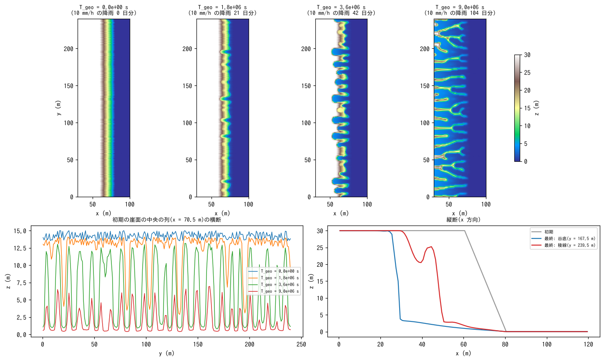
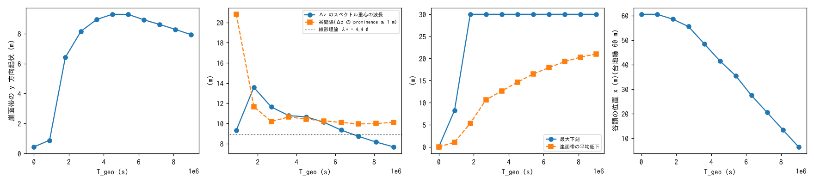
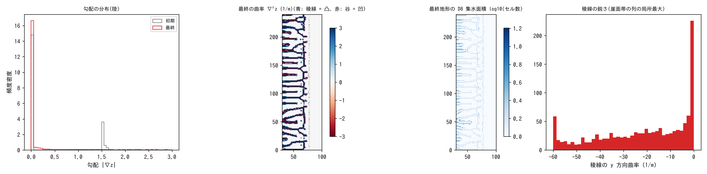
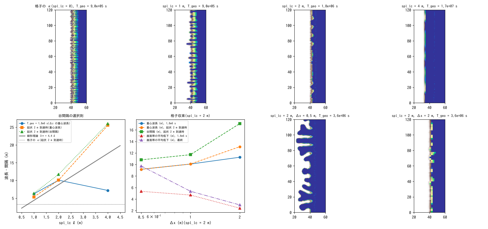

# examples/badland — 台地と急崖に刻まれる谷(バッドランド型の地形発達)

[English](en/README.md)

透水性の高い火砕物の台地が海食崖で海に落ちる地形(新島南部の火砕丘の
縁辺が典型)に、降雨を与え続けたときの谷の形成と発達を一つの計算で追う
例題です。降雨は全量浸透して**地表流はゼロ**のまま、乾式斜面侵食
`f_splash`(雨滴 + サブグリッドリルの凹地形フィードバック。
[解説](../../docs/users_guide/sediment.md#6-乾式斜面侵食f_splash))が
崖縁の白色雑音から谷を自己形成し、深い谷と鋭い稜線へ育てます。
谷の間隔は曲率の相関長 `spl_lc`(サブグリッドリルの集水スケール)が決め、
海面を侵食基準面 `spl_zbase` に与えます(developer.md §48.3)。

| ケース | ファイル | 内容 |
|---|---|---|
| 主ケース | param.txt | 120 × 240 m、台地 30 m・幅 60 m、56° の崖、spl_lc = 2 m。T_geo = 9×10⁶ s の長期発達 |
| 相関長系列 | param_lc1 / lc2 / lc4.txt | 100 × 240 m、台地 15 m。spl_lc = 1 / 2 / 4 m(谷間隔 ∝ ℓ) |
| 格子の κ の対照 | param_grid.txt | 同上で spl_lc = 0(旧版と同じ評価法。間隔が格子に張り付く) |
| 格子収束 | param_lc2_dx05 / dx2.txt | spl_lc = 2 m を Δx = 0.5 / 2 m で(param_lc2 と同じ地形・雑音) |

## 実行

```
make                                   # ../../bin/encflow へのリンク
python3 make_terrain.py main           # z_main.txt, sw_main.txt
python3 make_terrain.py sweep          # z_sweep.txt, sw_sweep.txt(系列・対照用)
python3 make_terrain.py sweep --dx 0.5 # z_sweep05.txt(格子収束用)
python3 make_terrain.py sweep --dx 2   # z_sweep2.txt
./encflow param.txt                    # 主ケース(約 1 分。result/ に 30 分 = T_geo 9×10⁵ s 毎の Z)
for p in param_lc1 param_lc2 param_lc4 param_grid param_lc2_dx2 param_lc2_dx05; do ./encflow $p.txt; done   # 各 10 s〜3 分
python3 plot_results.py                # figs/ に 4 枚の図 + 数表
```

## 設定の要点

- **地形**(make_terrain.py): 台地(z = h_p)+ 崖(tanθ = 1.5)が z ≤ 0 で海
  (海域マスク `fn_sw`)に落ちます。崖縁の位置に**白色雑音**(一様 ±0.5 m、
  シード固定、1 m の基準格子上)を与え、特定の波長を持ち込みません。格子幅を
  変えても同じ縁の形を見ます(格子収束の比較のため)。
- **降雨と浸透**: 一様 10 mm/h を与え続け、Green-Ampt の浸透能 36 mm/h が
  これを上回るので地表流は生じません(画面の S_surf は常に 0)。侵食は
  f_splash だけが担い、剥離した土砂は海へ系外排出されます(終了時に総量を表示)。
- **侵食則**: `spl_kt = 0.05`、`spl_h = 1.5`、凹地形増幅 `spl_cb = 32`、雨滴項
  `spl_kr = 0.0002`。曲率は相関長 `spl_lc`(m)で平滑化した z から取ります。
  クリープなどの拡散項は力学的モデルではないので使いません(間隔の選択には
  不要です。初期の白色雑音は減衰せず中立に残りますが、成長しないだけで、
  選ばれた波長の谷が指数的に育って覆い隠します)。
- **基準面**: `spl_zbase = 0`(海面)。谷底は海面より下がりません。土層厚
  `sd0` は崖高より十分大きくします(土層が 0 に近づくと地下水の容量が
  貯留を下回って地表へ溢れ、無流水の前提が崩れます。基準面は sd ではなく
  spl_zbase で与えるのはそのためです)。
- **時間**: dt = 2 s、地形更新 2 s 毎 × morfac 500 → 地形時間 T_geo は実時間の
  500 倍。主ケースの 5 時間は T_geo = 9×10⁶ s(10 mm/h の降雨 104 日分)。
  `spl_dzmax = 0.2` は 1 更新の上限(安全弁)で、谷頭の後退が最も速い段階で
  一部のセルに発動します(下の「読み方の注意」)。

## 結果 1: 主ケース(白色雑音から深い谷と鋭い稜線へ)



上: 地形の時間発展(T_geo = 0、1.8×10⁶、3.6×10⁶、9×10⁶ s)。白色雑音しか
ない崖縁から、まず崖面に間隔 10 m 強の谷が自己形成され(1.8×10⁶ s)、
谷頭が円形劇場状(amphitheater)に台地へ食い込み(3.6×10⁶ s)、最後は
台地が櫛の歯状の**長い平行な尾根**に解体されて、谷底は海面(基準面)に
達します(9×10⁶ s)。下左: 崖面帯の横断の時間発展(谷底が基準面に着き、
尾根が細く高く残る)。下右: 谷底と稜線を通る縦断。



時系列。起伏(崖面帯の y 方向標準偏差)は谷の深化で増え、台地の解体で減ります。
地形変化 Δz のスペクトル重心の波長と谷間隔は線形段階で ≈ 5〜6 ℓ に決まり
(理論 λ* = 4.4 ℓ)、以後の谷間隔は 12 m 前後で安定します。最大下刻は
基準面(30 m)に達し、谷頭は台地縁から一定速度で後退します。



バッドランド的な特徴。左: 勾配の分布が初期の 2 値(台地 0・崖 1.5)から、
鋭い稜線と谷壁の連続分布に変わる。中: 曲率の符号(青 = 凸 = 稜線、赤 = 凹 = 谷)。
右中: 最終地形の D8 集水面積 — 谷は台地縁に直交する平行な樹枝状の網になる。
右: 稜線(崖面帯の列の局所最大)の y 方向曲率。負に大きいほど鋭い稜線です。
稜線は幅 2〜4 セルの鋭い尾根で、頂は両面の勾配で削られて下がります(勾配を
最急降下で評価する `spl_sgrad = 1`(既定)の効果。中央差分では頂の勾配が
打ち消して 1 セル幅の尾根が削れず不死になる。developer.md §48.4)。

| 量 | 初期 | 最終(T_geo = 9×10⁶ s) |
|---|---|---|
| 崖面帯の y 方向起伏 (m) | 0.44 | 5.50(最大 7.5、T_geo 4.5×10⁶ s) |
| 谷間隔 (m)(Δz の prominence ≥ 1 m) | – | 1.8×10⁶ s: 13.6 ± 8.1(15 本 / 240 m)、最終: 12.2 ± 6.8(18 本) |
| Δz のスペクトル重心の波長 (m) | – | 1.8×10⁶ s: 11.5、3.6×10⁶ s: 14.6、最終: 12.4 |
| 最大下刻 / 崖面帯の平均低下 (m) | – | 29.0 / 18.0 |
| 谷頭の位置 x (m)(台地縁 60 m) | 60.5 | 12.5(後退 48 m、T_geo 3.6×10⁶ s 以降ほぼ一定速度 ≈ 7 m / 10⁶ s) |
| 稜線(崖面帯の列の局所最大): 幅の中央値 / 1 セル幅の割合 / 高さの中央値 | – | 3 セル / 0 % / 12 m(中央差分の勾配評価では 1 セル / 56 % / 23 m) |
| 稜線の y 方向曲率 (1/m): 中央値 / 最小 | – | −4.2 / −16.5 |
| 勾配 > 1.0 の陸セルの割合 | 0.24 | 0.34 |
| 侵食された体積 Σ(z₀ − z)Δx² (m³) | – | 約 2.7×10⁵ |
| spl_dzmax クリップの累計セル数 | – | 3.8×10⁴(中央差分では 2.9×10⁶) |

数表は `plot_results.py` が出力します(上は spl_dzmax = 0.2 の値)。

## 結果 2: 谷の間隔は何が決めるか



上: 格子の κ(spl_lc = 0)と spl_lc = 1 / 2 / 4 m の地形(崖面帯の起伏が
初めて 2 m を超えた時刻。ℓ が大きいほど成長が遅いので時刻はそろえず
成長段階をそろえる)。下左: 谷間隔の選択則(T_geo = 1.8×10⁶ s と起伏 2 m
到達時の Δz の重心波長・谷間隔 vs ℓ。灰線は線形理論 λ* = 4.4 ℓ)。
下中: spl_lc = 2 m の格子収束(Δx = 0.5 / 1 / 2 m)。下右: Δx = 0.5 m と
2 m の地形(T_geo = 3.6×10⁶ s)。

| ケース | spl_lc (m) | Δx (m) | T_geo = 1.8×10⁶ s: Δz の重心波長 / 谷間隔 (m) / 平均低下 (m) | 起伏 2 m 到達時(T_geo): 重心波長 / 谷間隔 (m) / 本数 / 平均低下 (m) | 最終: 起伏 (m) / 最大下刻 / 平均低下 (m) / 谷頭 x (m) |
|---|---|---|---|---|---|
| param_grid | 0 | 1 | 3.3 / 3.5 / 7.5 | (9×10⁵ s) 3.4 / 3.5 / 66 / 4.9 | 1.02 / 15.0 / 12.5 / 0.5(台地を貫通) |
| param_lc1 | 1 | 1 | 6.8 / 6.7 / 4.6 | (9×10⁵ s) 5.5 / 6.0 / 39 / 3.0 | 4.10 / 14.8 / 8.1 / 0.5(台地を貫通) |
| param_lc2 | 2 | 1 | 10.1 / 14.5 / 3.0 | (2.7×10⁶ s) 10.9 / 13.2 / 17 / 4.6 | 3.74 / 14.5 / 6.5 / 30.5 |
| param_lc4(T_geo 2.2×10⁷ s まで) | 4 | 1 | 4.2 / – / 1.7(未成長) | (2.2×10⁷ s) 22.5 / 24.5 / 4 / 10.3 | 0.53 / 14.7 / 10.3 / 30.5 |
| param_lc2_dx05 | 2 | 0.5 | 9.6 / 11.8 / 3.8 | (2.7×10⁶ s) 10.4 / 11.8 / 19 / 5.4 | 4.55 / 14.5 / 7.9 / 22.8 |
| param_lc2_dx2 | 2 | 2 | 10.8 / 15.4 / 2.0 | (5.4×10⁶ s) 12.8 / 15.1 / 14 / 4.9 | 1.96 / 13.9 / 4.9 / 37.0 |

台地縁は x = 40 m、最終は param_lc4 以外 T_geo = 5.4×10⁶ s。

- **格子の κ では間隔が格子に張り付きます**(3.4 m ≈ 3 Δx。市松状の
  凹凸が立ち、2Δx 規模の侵食前線が台地を貫通する)。
  旧版(2026-08)はこれを弱いクリープで抑えて「波長選択は spl_cb と creep_d の
  比」としていましたが、線形化すると凹地形増幅も拡散も k² に比例するため、
  拡散項は成長の有無(符号)を変えるだけで間隔を選びません。クリープは
  力学的モデルでもないので、この例題では使いません(developer.md §48.3)。
- **spl_lc を与えると間隔が ℓ に比例**します。起伏 2 m 到達時の重心波長は
  ℓ = 1 / 2 / 4 m で 5.5 / 10.9 / 22.5 m(≈ 5〜6 ℓ。理論 λ* = 4.4 ℓ。ℓ = 4 m は
  到達までに谷の併合が進んでいる)。ℓ が大きいほど成長は遅く
  (σ_max ∝ 1/ℓ²)、ℓ = 4 m は 2 m の約 8 倍の時間がかかります。
- **格子収束**: ℓ = 2 m を Δx = 0.5 / 1 / 2 m で解くと、線形段階
  (T_geo = 1.8×10⁶ s)の重心波長は 9.6 / 10.1 / 10.8 m と収束します(間隔の
  選択則は格子によらない)。平均低下は 3.8 / 3.0 / 2.0 m、最終は 7.9 / 6.5 /
  4.9 m で、谷が深くなってからの発達速度は Δx が細かいほど速く、**完全には
  収束しません**。原因は谷壁の垂直化です: このモデルは勾配に上限を持たず、
  谷壁は 1 セル幅の段差(S ≈ Δz/Δx)まで急になるため、勾配の 99 % 点が
  Δx = 0.5 / 1 / 2 m で 11 / 6.5 / 3.3 と格子幅に反比例し、S^1.5 の侵食率が
  細かい格子ほど大きくなります(中央差分の勾配評価では 17 / 8 / 4 で、
  最急降下にして格子依存は半分ほどに縮んだ)。線形段階の間隔・初期の下刻の比較には
  **ℓ/Δx ≥ 2** を目安にし、深い谷の段階の速さは格子を固定して相対比較に
  使ってください(「読み方の注意」)。
- 種(シード)を変えても間隔・成長の統計は同じで、谷の位置だけが変わります
  (Perron & Fagherazzi 2012 の「統計は自己組織化、配置は初期条件」)。

## 派生: 崖の崩落と海への排出(param_rockfall.txt)

主ケースに崩落と崖錐 `f_rockfall`(developer.md §48.7。窓版の限界高さ H_c = 15 m、
r_c = 8 m、崖錐の安息角 35°、崖錐の侵食性 0.1 倍)を重ねた派生です。海セルに面した崖は
海へ崩落して系外へ出ます(海セルの z は不変。崖錐が波で除去される海食崖の極限。
終了時の「rockfall exported to sea cells」)。

```
./encflow param_rockfall.txt           # 約 2 分
```

| 量(T_geo = 9×10⁶ s) | 主ケース | 崩落あり |
|---|---|---|
| 乾式侵食の系外排出(固体 m³) | 160,371 | 40,495 |
| 崩落で移した体積(かさ m³、累計)/ うち海へ | – | 25,465 / 192 |
| 崖錐の総量(m³、最終) | – | 754 |
| 崖面帯の y 方向起伏 (m) / 平均低下 (m) | 1.68 / 13.2 | 2.09 / 6.9 |
| 谷頭の位置 x (m)(台地縁 60 m) | 12.5 | 42.5 |

崩落は 56° の崖の面(窓内の落差 > 15 m)を安息角まで崩し、崖錐が面を覆うので、
乾式侵食(S^1.5 と凹地形増幅)の駆動力が落ちて谷頭の後退は 47.5 m → 17.5 m、
排出は 4 分の 1 になります。海への崩落は 192 m³ と少なく、この地形では崖の脚部が
海面(z = 0)で海セルに接するため、海に面した段差が小さいからです(垂直な海食崖を
海セルに直接接して置けば海への排出が主になります)。崩落のパラメータは較正値では
なく、新島の固結した火砕物の崖が崩落型か乾式侵食型かはこの例題では決めていません。

## 読み方の注意

- 乾式斜面侵食はサブグリッド過程のパラメータ化で、係数(spl_kt・spl_cb・
  spl_lc)は較正前提の経験値です。新島に当てはめるなら、実測の谷間隔から
  ℓ ≈ 間隔/5 を逆算し、下刻速度(崖の後退速度)から spl_kt・spl_cb を
  合わせるのが手順です。
- **深い谷の段階の速さは格子幅に依存します。** 谷壁が垂直化すると勾配 S が
  格子幅に反比例して大きくなり(上の格子収束)、谷頭の κ̃ も深さ/ℓ² で増え
  続けるので、Φ_B = 1 + c_b κ̃ と S^h の積は深い谷頭で大きくなります。
  `spl_dzmax` のクリップは最急降下の勾配評価で 1/70 に減り(累計 3.8×10⁴
  セル)、dzmax を 0.2 → 0.5 m にしても時系列は変わりません(0.1 m に下げると
  9×10⁶ s の谷頭の位置が 12.5 → 29.5 m とクリップに縛られます)。谷の間隔・
  形(amphitheater → 平行尾根)・初期の深化は頑健で、**深い段階の後退速度は
  格子を固定した相対比較に使ってください**。壁の垂直化を抑える安息角崩落
  `f_repose`(φ = 56.3°)を重ねると勾配は有界になり格子依存は小さくなります
  が、崩落土砂が谷を埋める(保存形)ため起伏が 1〜2 m にとどまり、鋭い稜線の
  深い谷にはなりません(固結した火砕物は安息角より急な壁を保つので、
  この例題では使っていません)。固結物質の壁の後退に合う勾配の飽和
  (S の上限)や Φ_B の飽和形が次の課題です(docs/splash_plan.md §8)。
- 海面(基準面)に達した谷底は削れません。台地がすべて解体されると地形は
  基準面の平地に近づきます(T_geo = 1.8×10⁷ s で台地は消えます)。
- このケースには地表流がないので、浅水方程式の移流スキームの設定は結果に
  影響しません(改定後の木で旧版とビット一致)。

## 関連

- [test/splash](../../test/splash/)(解析検証)、[test/splashslide](../../test/splashslide/)(固結度の対照)、
  [test/splashlc](../../test/splashlc/)(波長選択の検定)
- docs/splash_plan.md(定式化・試行の記録)、developer.md §48・§48.3
- [docs/users_guide/geomorph.md](../../docs/users_guide/geomorph.md) — `f_splash`、`spl_*`
