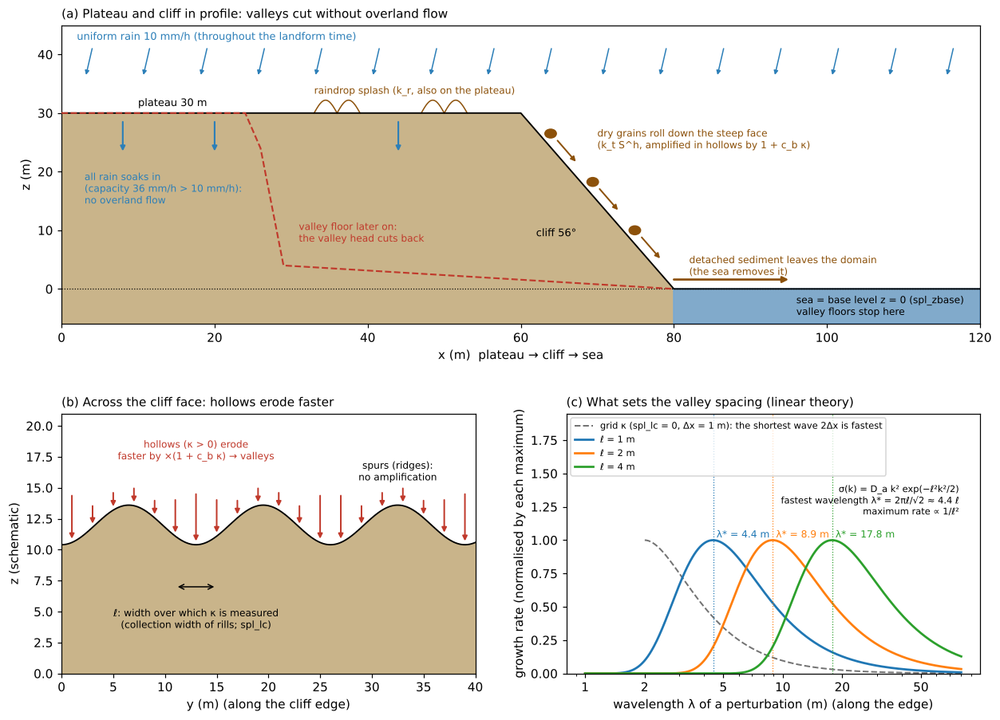
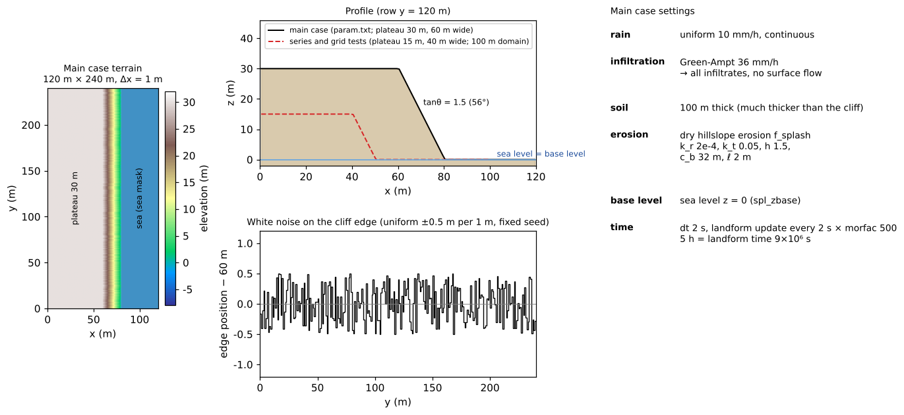
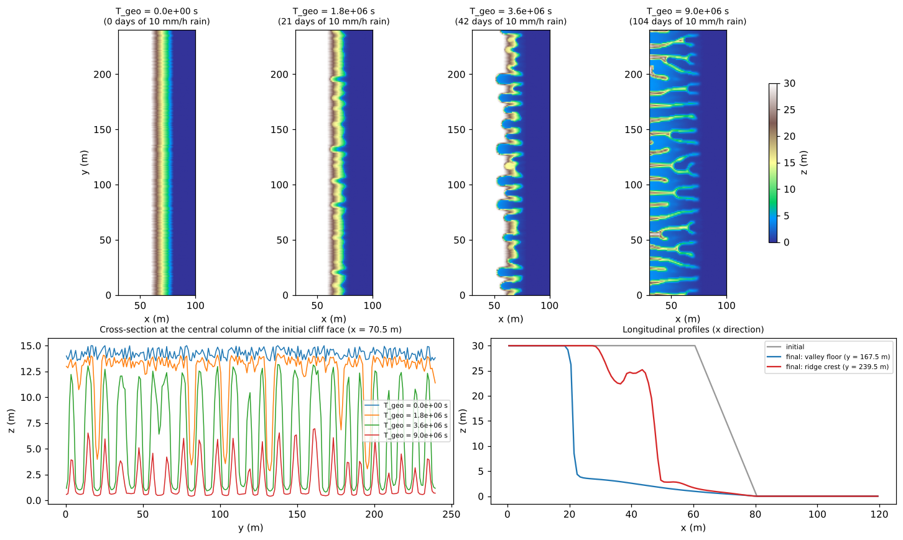
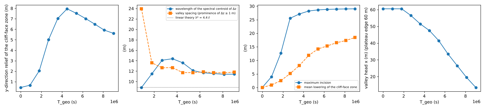
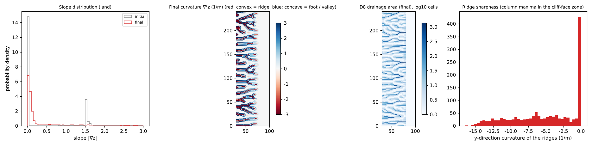
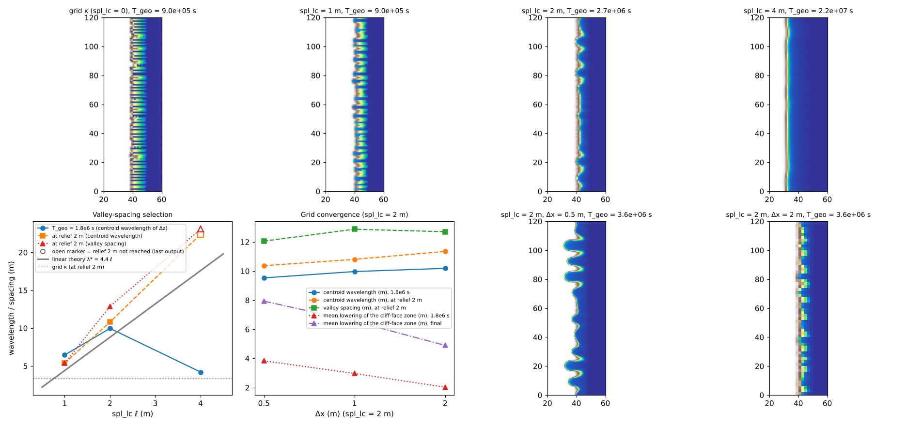

# badland — valleys carved into a cliff without overland flow (badland-type landform evolution by dry-slope erosion)

> English mirror of examples/badland/README.md. The Japanese file is the master copy.

[日本語](../README.md)

This example follows, in a single run, rain falling continuously on a terrain in which a
plateau of highly permeable pyroclastic material drops directly into the sea at a cliff
(for example the margins of the pyroclastic cones in southern Niijima): valleys start at
the cliff edge and grow into deep valleys separated by sharp ridges. All the rain soaks
in and **overland flow never occurs**. The only agent that cuts the valleys is
[dry-slope erosion](../../../docs/en/users_guide/geomorph.md#dry-slope-erosion-f_splash)
(f_splash: raindrop splash, and grains rolling down the dry steep face). The example also
compares what sets the valley spacing (the width over which the curvature is measured,
`spl_lc`) and how the result changes with the grid spacing. The values are schematic,
chosen to make the phenomena visible, and do not reproduce a particular landform.

The erosion law of dry-slope erosion is an **original formulation** by the ENCflow
developer and has not been published as a paper (equation and linear theory in the
[explanation](../../../docs/en/users_guide/sediment.md#6-dry-slope-erosion-f_splash),
verification in [test/splash](../../../test/splash/en/README.md) and others).

## What happens in real badlands

- **Badlands**: terrain with almost no vegetation in which soft deposits (mudstone,
  shale, poorly consolidated pyroclastics and the like) are eroded by rain into steep
  slopes, fine and dense valleys and sharp ridges. The valleys are lined up at nearly
  regular spacing (Perron et al. 2009).
- **In many badlands overland flow cuts the valleys**: on slopes of low-permeability
  mudstone, intense rain runs over the surface and cuts rills and gullies, and the
  valleys grow together with slope failures. The standard landform evolution models
  likewise make valleys from a combination of erosion by overland flow and hillslope
  sediment transport (Howard 1994, 1997).
- **Grains on a slope move even without overland flow**: on a dry steep slope, grains
  roll, bounce and slide down one by one (dry ravel; Gabet 2003). Raindrops falling on a
  dry sand slope become lumps coated with sand grains (sandballs) that roll down the
  slope and carry much more sand than splash alone (Trottet et al. 2025). These dry-slope
  processes act even on cliffs of pyroclastic material so permeable that the rain soaks in.
- **Valley heads retreat into the plateau and the sea at the foot removes the sediment**:
  valleys start at the cliff edge, and their heads cut back into the plateau as
  amphitheatres. Where the cliff drops directly into the sea, the material that falls is
  carried away by the waves, and the valley floors do not go below sea level (the sea is
  the base level of erosion).

## Mechanisms needed for the reproduction



Schematic. (a) Profile of the plateau and the cliff: all the rain soaks in; raindrop
splash erodes the surface on the plateau and dry grains rolling down erode the steep
cliff face. The eroded sediment goes to the sea and the valley floors do not go below sea
level. The dashed line is the valley floor at a later stage (modelled on the result
profile). (b) Section across the cliff face: hollows erode faster and become valleys (the
arrow length is the erosion rate). (c) Growth rate against wavelength of an undulation
along the cliff edge (linear theory): when the curvature is measured over a width ℓ, the
fastest-growing wavelength is fixed at λ* ≈ 4.4 ℓ. With the curvature on the grid, the
shortest wavelength (2Δx) is the fastest.

The mechanisms at work in this example and the settings that carry them:

| Real phenomenon | Mechanism in the model | Setting |
|---|---|---|
| The rain soaks in completely and does not run over the surface | Green-Ampt infiltration (capacity 36 mm/h > rain 10 mm/h). Dry-slope erosion acts only on dry cells without surface water | `f_gwvertical = 2`, `gw_ksv_mmh = 36` |
| Raindrops splash grains away (also on the plateau) | Raindrop term $`P k_r`$ | `spl_kr` |
| Grains roll down a dry steep slope | Slope term $`P k_t S^h`$ (faster on steeper slopes $`S`$) | `spl_kt`, `spl_h` |
| Grains and rills gather in hollows (valleys), which erode faster | Hollow amplification $`1 + c_b \kappa`$ ($`\kappa`$ is the surface curvature, positive in hollows) | `spl_cb` |
| The valley spacing (the width from which rills collect) | The curvature is measured on the surface smoothed over the correlation length ℓ | `spl_lc` |
| The sea at the foot of the cliff carries the eroded sediment away | Detached sediment is not deposited but leaves the domain (the total is printed at the end) | behaviour of `f_splash = 1` |
| The valley floors do not go below sea level | Base level of erosion | `spl_zbase = 0` |
| The landform changes over a long time | Only the landform change is accelerated by morfac (landform time; the main case is 104 days of 10 mm/h rain) | `dt_geomorph`, `morfac` |
| (Supplement) cliff collapse, and a sea cliff whose talus is removed by the waves | [Rockfall and talus](../../../docs/en/users_guide/geomorph.md#rockfall-and-talus-f_rockfall). What falls from a cliff facing the sea leaves the domain | `f_rockfall`, `rf_hc`, `rf_rc` |

The erosion rate is $`E = P\,[k_r + k_t(1 + c_b\kappa)S^h]`$ ($`P`$ is the rainfall
intensity). This erosion law has no term for overland flow (no river erosion set by the
drainage area); the gathering of grains and rills in hollows is applied to the slope
term as an effect at scales below the grid. This is where it differs from existing
landform evolution models that cut valleys with overland flow, and this construction is
the original part of ENCflow. Dry ravel and the sand lumps rolled by raindrops are
examples of the phenomena this law aims to represent; the form of the equation and its
coefficients were not derived from those papers. The coefficients are empirical values
that presuppose calibration.

## Geometry and settings



Left: terrain of the main case (blue = sea mask). Upper middle: profile (solid = main
case, dashed = terrain of the correlation-length series and the grid tests). Lower
middle: white noise given to the position of the cliff edge. Right: summary of the main
case settings.

120 m × 240 m, Δx = 1 m (120 × 240 cells). A plateau 30 m high and 60 m wide drops into the
sea (cells with z ≤ 0 = sea mask) at a cliff with tanθ = 1.5 (56°).

- **White noise on the cliff edge**: only uniform random numbers of ±0.5 m (one per 1 m,
  fixed seed) are given to the position of the cliff edge; no particular wavelength is
  introduced. The positions and the spacing of the valleys are decided by the erosion
  law (self-organisation). The noise is generated on a 1 m reference grid and mapped so
  that the edge has the same shape when the grid spacing changes.
- **Rain and infiltration**: a uniform 10 mm/h falls continuously. The Green-Ampt
  infiltration capacity of 36 mm/h exceeds it, so all the rain soaks in and overland flow
  never occurs (S_surf on the screen is always 0).
- **Erosion**: dry-slope erosion ($`k_r`$ = 2×10⁻⁴, $`k_t`$ = 0.05, $`h`$ = 1.5,
  $`c_b`$ = 32 m, ℓ = 2 m). The base level of erosion is sea level (`spl_zbase = 0`). The
  soil is 100 m thick, much thicker than the cliff (see the notes). No diffusive process
  such as hillslope creep is used.
- **Time**: dt = 2 s; the landform is updated every 2 s and its change is accelerated
  500 times by morfac (landform time T_geo = real time × 500). The 5 hours of the main case
  are T_geo = 9×10⁶ s (104 days of 10 mm/h rain). The ground elevation Z is written every
  30 minutes (T_geo 9×10⁵ s).
- The cap on erosion per update, `spl_dzmax = 0.2` m, is a safety valve (see the notes).

| Case | Settings file | Terrain | ℓ (spl_lc) | Δx | Landform time T_geo | Run time (approx.) |
|---|---|---|---|---|---|---|
| Main case | param.txt | plateau 30 m, 60 m wide (120 × 240 m) | 2 m | 1 m | 9×10⁶ s | about 1 min |
| Grid curvature (control) | param_grid.txt | plateau 15 m, 40 m wide (100 × 240 m) | 0 (curvature on the grid) | 1 m | 5.4×10⁶ s | 10 s to 3 min each |
| Correlation-length series | param_lc1 / lc2 / lc4.txt | same | 1 / 2 / 4 m | 1 m | 5.4×10⁶ s (2.2×10⁷ s for lc4) | same |
| Grid convergence | param_lc2_dx05 / lc2_dx2.txt | same (same noise) | 2 m | 0.5 / 2 m | 5.4×10⁶ s | same |
| Supplement: cliff collapse | param_rockfall.txt | same as the main case | 2 m | 1 m | 9×10⁶ s | about 2 min |

The six control, series and grid cases use a plateau smaller than the main case (15 m
high, 40 m wide) and change only `spl_lc` or Δx (param_grid has `spl_lc = 0`).

## How to run

```
cd examples/badland
make                     # link to the executable and inputs (make_terrain.py writes z_*.txt, sw_*.txt)
make run                 # run the 7 cases in turn (main, grid curvature, 3 correlation lengths, 2 grid spacings; 10 s to 3 min each)
python3 plot_setup.py    # figs/mechanism.png, setup.png (does not use the results)
python3 plot_results.py  # figs/main_*.png, spacing.png and the tables
make supp                # supplement: cliff collapse (param_rockfall.txt, about 2 min)
```

With the argument `en` the figures are drawn with English labels into en/figs/
(`python3 plot_setup.py en`, `python3 plot_results.py en`). Plotting needs Python 3,
NumPy and matplotlib.

## Results

### Main case: from white noise to deep valleys and sharp ridges



Top: evolution of the terrain (T_geo = 0, 1.8×10⁶, 3.6×10⁶, 9×10⁶ s; the days in the titles
are the equivalent duration of 10 mm/h rain). Lower left: evolution of the cross-section
along the central column of the initial cliff face (x = 70.5 m). Lower right: profiles
through a valley floor and a ridge crest of the final terrain (grey = initial).

- **Self-organisation of the valleys**: from a cliff edge with nothing but white noise,
  valleys spaced a little over 10 m apart first form on the cliff face (1.8×10⁶ s). The
  positive feedback by which hollows erode faster lets only a particular wavelength of
  the noise grow.
- **Retreat of the valley heads**: the valley heads cut into the plateau as amphitheatres
  (3.6×10⁶ s) and retreat at an almost constant rate.
- **Dissection of the plateau**: in the end the plateau is dissected into long parallel
  ridges like the teeth of a comb, and the valley floors reach sea level (the base level;
  9×10⁶ s). In plan view, thin branching ridges (bright colours) remain between broad
  valley floors lowered close to sea level (blue).



From the left: y-direction relief (standard deviation) of the cliff-face zone (columns
whose mean elevation lies between the plateau and sea level), wavelength of the spectral
centroid of the landform change Δz and the valley spacing (dotted = linear theory
λ* = 4.4 ℓ), maximum incision and mean lowering of the cliff-face zone, and position of
the valley head (plateau edge 60 m).



Left: distribution of the slope on land (grey = initial, red = final). Centre left:
curvature ∇²z of the final terrain (red = convex = ridge crests, blue = concave = feet of
the ridges and valleys). Centre right: D8 drainage area of the final terrain. Right:
distribution of the y-direction curvature of the ridges (local maxima in each column of the
cliff-face zone; the more negative, the sharper).

| Quantity | Initial | Final (T_geo = 9×10⁶ s) |
|---|---|---|
| y-direction relief of the cliff-face zone (m) | 0.44 | 5.50 (maximum 7.83 at T_geo 4.5×10⁶ s) |
| Valley spacing (m) (prominence of Δz ≥ 1 m) | – | 1.8×10⁶ s: 13.6 ± 8.1 (15 valleys / 240 m), final: 12.2 ± 6.8 (18) |
| Wavelength of the spectral centroid of Δz (m) | – | 1.8×10⁶ s: 11.5, 3.6×10⁶ s: 14.6, final: 12.4 |
| Maximum incision / mean lowering of the cliff-face zone (m) | – | 29.0 / 18.0 |
| Position x of the valley head (m) (plateau edge 60 m) | 60.5 | 12.5 (retreat of 48 m; almost constant rate ≈ 7 m / 10⁶ s after T_geo 3.6×10⁶ s) |
| y-direction curvature of the ridges (1/m): median / minimum | – | −4.2 / −16.5 |
| Fraction of land cells with slope > 1.0 | 0.24 | 0.34 |
| Sediment that left the domain (solid volume, m³) | – | 160,371 (loss of surface volume Σ(z₀ − z)Δx² ≈ 2.7×10⁵ m³ = solid ÷ (1 − porosity 0.4)) |
| Number of times capped by spl_dzmax (cumulative cell-updates) | – | 3.8×10⁴ |

(The table is printed by `python3 plot_results.py`.)

- **Valleys form without overland flow**: overland flow stays zero to the end, and the
  valleys grow only through the hollow feedback of dry-slope erosion. The slope
  distribution changes from the initial two values (plateau 0, cliff 1.5) to a continuous
  distribution of sharp ridges and valley walls.
- **The spacing is set by ℓ**: the valley spacing and the centroid wavelength of Δz are
  fixed at ≈ 5–6 ℓ when the valleys form (linear theory λ* = 4.4 ℓ) and stay stable around
  12 m afterwards.
- **Sharp ridges**: the ridges are 2–4 cells wide, and their crests are also lowered by
  the slopes on both sides.
- **Peak of relief**: the relief grows as the valleys deepen (maximum ≈ 7.8 m) and falls
  as the plateau is dissected.

### What sets the valley spacing



Top: terrain with the grid curvature (spl_lc = 0) and with spl_lc = 1 / 2 / 4 m (at the
time when the relief of the cliff-face zone first exceeds 2 m; growth is slower for
larger ℓ, so the stage of growth is aligned instead of the time). Lower left: the
spacing-selection rule (centroid wavelength of Δz and valley spacing at T_geo = 1.8×10⁶ s
and when the relief reaches 2 m, against ℓ; the grey line is the linear theory
λ* = 4.4 ℓ). Lower centre: grid convergence for spl_lc = 2 m (Δx = 0.5 / 1 / 2 m). Lower
right: terrain for Δx = 0.5 m and 2 m (T_geo = 3.6×10⁶ s). For ℓ = 4 m and Δx = 2 m the
relief does not reach 2 m before the end of the run (final 0.53 m and 1.96 m), so the map
and points "when the relief reaches 2 m" for these two cases are the values at the end
(T_geo = 2.2×10⁷ s and 5.4×10⁶ s).

| Case | ℓ (m) | Δx (m) | T_geo = 1.8×10⁶ s: centroid wavelength of Δz / valley spacing / mean lowering (m) | When relief reaches 2 m (T_geo): centroid wavelength / valley spacing (m) / number / mean lowering (m) | Final: relief / maximum incision / mean lowering / valley head x (m) |
|---|---|---|---|---|---|
| param_grid | 0 | 1 | 3.3 / 3.5 / 7.5 | (9×10⁵ s) 3.4 / 3.5 / 66 / 4.9 | 1.02 / 15.0 / 12.5 / 0.5 (through the plateau) |
| param_lc1 | 1 | 1 | 6.8 / 6.7 / 4.6 | (9×10⁵ s) 5.5 / 6.0 / 39 / 3.0 | 4.10 / 14.8 / 8.1 / 0.5 (through the plateau) |
| param_lc2 | 2 | 1 | 10.1 / 14.5 / 3.0 | (2.7×10⁶ s) 10.9 / 13.2 / 17 / 4.6 | 3.74 / 14.5 / 6.5 / 30.5 |
| param_lc4 (to T_geo 2.2×10⁷ s) | 4 | 1 | 4.2 / – / 1.7 (not yet grown) | (2.2×10⁷ s; end of run, 2 m not reached) 22.5 / 24.5 / 4 / 10.3 | 0.53 / 14.7 / 10.3 / 30.5 |
| param_lc2_dx05 | 2 | 0.5 | 9.6 / 11.8 / 3.8 | (2.7×10⁶ s) 10.4 / 11.8 / 19 / 5.4 | 4.55 / 14.5 / 7.9 / 22.8 |
| param_lc2_dx2 | 2 | 2 | 10.8 / 15.4 / 2.0 | (5.4×10⁶ s; end of run, 2 m not reached) 12.8 / 15.1 / 14 / 4.9 | 1.96 / 13.9 / 4.9 / 37.0 |

The plateau edge is at x = 40 m. The final time is T_geo = 5.4×10⁶ s except for param_lc4.
"When relief reaches 2 m" is the first output at which the relief of the cliff-face zone
exceeds 2 m; for the cases whose relief does not reach 2 m before the end of the run
(param_lc4, param_lc2_dx2), `plot_results.py` uses the last output.

- **With the grid curvature the spacing sticks to the grid**: with spl_lc = 0 the centroid
  wavelength is 3.4 m (≈ 3Δx), a checkerboard of bumps rises and an erosion front two cells
  wide cuts through the plateau. The hollow amplification acts more strongly at shorter
  wavelengths (linearised, the growth rate ∝ k²), so the shortest wavelength grows fastest
  (the same as the "infinite wavenumber" problem of Smith and Bretherton 1972). Adding a
  diffusion term (hillslope creep) does not help: diffusion is also proportional to k²,
  so it only changes whether growth occurs and does not select a spacing.
- **With ℓ the spacing is proportional to ℓ**: the centroid wavelength when the relief
  reaches 2 m is 5.5 / 10.9 m for ℓ = 1 / 2 m (≈ 5–6 ℓ; linear theory λ* = 4.4 ℓ). Growth
  is slower for larger ℓ (maximum growth rate ∝ 1/ℓ²): for ℓ = 4 m the relief is still only
  0.53 m at the end of the run, T_geo = 2.2×10⁷ s (about 8 times the time at which ℓ = 2 m
  reaches a relief of 2 m), and the valleys have not yet grown. The centroid wavelength of
  22.5 m and the valley spacing of 24.5 m (4 valleys) for ℓ = 4 m are values at this end
  time, not at the 2 m stage, and do not compare the same stage of growth as ℓ = 1 / 2 m.
- **Grid convergence**: solving ℓ = 2 m with Δx = 0.5 / 1 / 2 m, the centroid wavelength
  when the valleys form (T_geo = 1.8×10⁶ s) agrees at 9.6 / 10.1 / 10.8 m (the
  spacing-selection rule does not depend on the grid). On the other hand, the mean lowering
  is 3.8 / 3.0 / 2.0 m and finally 7.9 / 6.5 / 4.9 m: once the valleys are deep, they develop
  faster on finer grids and **do not fully converge**. This erosion law has no upper bound
  on the slope, and a valley wall can steepen to a one-cell step (S ≈ Δz/Δx), so the 99th
  percentile of the slope is 11 / 6.5 / 3.3 for Δx = 0.5 / 1 / 2 m, inversely proportional to
  the grid spacing, and the erosion proportional to S^1.5 is faster on finer grids. For
  comparing spacing or early incision, take **ℓ/Δx ≥ 2** as a guide; use the rates in the
  deep-valley stage only for relative comparisons on a fixed grid.

## Supplement: cliff collapse and export to the sea (param_rockfall.txt)

A variant of the main case with
[rockfall and talus](../../../docs/en/users_guide/geomorph.md#rockfall-and-talus-f_rockfall)
`f_rockfall` added. The cliff face collapses where its drop to the lowest point within a
window (radius r_c = 8 m) exceeds the critical height H_c = 15 m, and the debris falling
on land becomes talus (angle of repose 35°, eroded at only 0.1 times the dry-slope
erosion). What collapses from a cliff facing sea cells falls into the sea and leaves the
domain (the limit of a sea cliff whose talus is removed by the waves; "rockfall exported to
sea cells" at the end).

| Quantity (T_geo = 9×10⁶ s) | Main case | With collapse |
|---|---|---|
| Sediment that left the domain by dry-slope erosion (solid m³) | 160,371 | 40,495 |
| Volume moved by collapse (bulk m³, cumulative) / of which into the sea | – | 25,465 / 192 |
| Total talus (m³, final) | – | 754 |
| y-direction relief / mean lowering of the cliff-face zone (m) | 5.50 / 18.0 | 3.37 / 7.8 |
| Position x of the valley head (m) (plateau edge 60 m) | 12.5 | 42.5 |

(The table is printed by `python3 plot_results.py`. The relief and the mean lowering use
the same definitions as the table of the main case, with the cliff-face zone chosen from
the final terrain of each case. The total talus is the sum of the final talus thickness
Ht9998 × Δx².)

- The collapse brings the 56° cliff face (drop within the window > 15 m) down to the angle
  of repose, and the talus covers the face, so the driving force of dry-slope erosion
  (S^1.5 and the hollow amplification) drops: the retreat of the valley head falls from
  48 m to 18 m (from the initial valley head at 60.5 m), the relief of the cliff-face zone
  from 5.50 to 3.37 m, its mean lowering from 18.0 to 7.8 m, and the export by dry-slope
  erosion to a quarter.
- The collapse into the sea is small (192 m³) because in this terrain the foot of the cliff
  meets the sea cells at sea level (z = 0), so the step facing the sea is small (a vertical
  sea cliff placed directly against the sea cells would make the export to the sea dominant).
- The collapse parameters are not calibrated. This example does not decide whether a real
  cliff retreats by collapse or by dry-slope erosion.

## What this model cannot represent (differences from the real phenomenon)

- **The erosion is a summary of processes below the grid scale**: rolling grains, raindrop
  splash and rills are not resolved one by one but represented by one equation combining
  the effects of slope and hollows. The coefficients ($`k_r`$, $`k_t`$, $`c_b`$, ℓ) are
  empirical values that presuppose calibration. To apply them to a real landform, back-
  calculate ℓ ≈ spacing / 5 from the measured valley spacing and fit $`k_t`$ and $`c_b`$ to,
  for example, the retreat rate of the valley heads.
- **Sediment does not accumulate**: detached sediment leaves the domain at once (the limit
  in which the sea at the foot carries it away). Accumulation on valley floors or at the
  foot of the cliff (talus, fans) is not represented unless the rockfall and talus of the
  supplement are added.
- **No diffusive hillslope process**: processes that round the ridges, such as hillslope
  creep, are not used. For rounded ridges see [badland_round](../../badland_round/en/README.md).
- **The rate of the deep-valley stage depends on the grid**: because the slope is set by the
  grid spacing once the valley walls approach vertical (the grid-convergence result). The
  spacing of the valleys, their shape (amphitheatre valley heads → parallel ridges) and
  the early incision do not depend on the grid.
- **Time cannot be converted to real ages**: the coefficients are schematic values chosen to
  show the development of the forms in a short run and are not fitted to real erosion
  rates. T_geo = 9×10⁶ s of the main case is about 25 m of 10 mm/h rain, but it cannot be
  compared with the age of a real landform.
- **Overland flow and changes in rain intensity**: the rain simply falls uniformly; overland
  flow during downpours is not treated ([badland_storm](../../badland_storm/en/README.md) is
  that contrast). Changes of the surface layer by wind, vegetation or repeated wetting and
  drying are not treated either.

## Notes

- **Make the soil much thicker than the cliff**: when the soil `sd0` approaches 0, the
  groundwater capacity falls below the storage, water overflows to the surface and the
  premise of no overland flow breaks down. This is why the base level of erosion is given
  by `spl_zbase` and not by the soil thickness.
- **Cap on erosion per update**: `spl_dzmax = 0.2` m is a safety valve that acts on some
  cells in the stage when the valley heads retreat fastest (3.8×10⁴ cell-updates in total).
  With 0.5 m the time series does not change, but with 0.1 m the final position of the
  valley head becomes 12.5 → 29.5 m, bound by this cap.
- **Slope evaluation**: the slope is evaluated by steepest descent to the eight neighbours
  (`spl_sgrad = 1`, default). With central differences (0), the slopes on both sides
  cancel at a ridge crest and one-cell-wide ridges remain uneroded.
- Valley floors that have reached sea level are not eroded. Once the plateau is completely
  dissected, the terrain approaches a plain at the base level (doubling tt in param.txt,
  the plateau disappears at T_geo = 1.8×10⁷ s).
- There is no overland flow, so the shallow-water settings (roughness, treatment of
  advection) do not affect the result.
- Verification: [test/splash](../../../test/splash/en/README.md) (comparison with the
  analytical solution), [test/splashlc](../../../test/splashlc/en/README.md) (the
  spacing-selection rule), [test/splashslide](../../../test/splashslide/en/README.md)
  (consolidated versus unconsolidated cliffs).

## Starting points for sensitivity experiments

- `spl_lc`: valley spacing (≈ 5–6 ℓ). Keep ℓ/Δx ≥ 2.
- `spl_cb`: strength of the hollow amplification (how fast the valleys grow). `spl_kt`,
  `spl_kr`: erosion rate.
- `SEED` in make_terrain.py (noise on the cliff edge): the positions of the valleys change,
  but the statistics of spacing and growth do not.
- Adding angle-of-repose collapse `f_repose` (checked with φ = 56.3°) bounds the slope of the
  valley walls and reduces the grid dependence, but the collapsed sediment fills the valleys
  (the volume is conserved), so the relief stays at 1–2 m and no deep valleys with sharp
  ridges form. Consolidated pyroclastics keep walls steeper than the angle of repose, so
  this example does not use it.

## References

- Gabet, E. J. (2003): Sediment transport by dry ravel. *J. Geophys. Res.*, 108(B1), 2049.
  doi:10.1029/2001JB001686 (checked against the abstract)
- Howard, A. D. (1994): A detachment-limited model of drainage basin evolution.
  *Water Resour. Res.*, 30(7), 2261–2285.
- Howard, A. D. (1997): Badland morphology and evolution: interpretation using a simulation
  model. *Earth Surf. Process. Landforms*, 22, 211–227.
- Perron, J. T., Kirchner, J. W. and Dietrich, W. E. (2009): Formation of evenly spaced ridges
  and valleys. *Nature*, 460, 502–505.
- Smith, T. R. and Bretherton, F. P. (1972): Stability and the conservation of mass in drainage
  basin evolution. *Water Resour. Res.*, 8, 1506–1529.
- Trottet, B., Noto, D., Jerolmack, D. J. and Ulloa, H. N. (2025): Sandball genesis from
  raindrops. *Proc. Natl. Acad. Sci. USA*, 122(52), e2519392122. doi:10.1073/pnas.2519392122
  (checked against the bibliographic record and press releases)
