# badland_round — 稜線が丸く、低い丘ほど丸くなるバッドランド(移流型の侵食と拡散型のクリープ)

[English](en/README.md)

縞模様の丘が並び、稜線は尖らずに丸く、低い丘ほどドーム状になるバッドランド(米国の
Chinle 層の丘のような膨潤性の粘土の地形)を、二つの型の過程の重ね合わせで再現する例題です。
尖らせる側は[乾式斜面侵食](../../docs/users_guide/geomorph.md#乾式斜面侵食f_splash)
(f_splash。勾配のべき乗で削り、窪みで速い移流型)、丸める側は
[斜面クリープ](../../docs/users_guide/geomorph.md#斜面クリープf_creep)(f_creep。勾配に
比例した流束で土を下ろす拡散型)です。大きさの違う 4 つの丘にクリープの強さを変えて
与え、どの丘がどれだけ丸くなるかを比べます。水平な硬軟の互層(`spl_strata`)で縞と段が
出るかも比べます。[badland](../badland/README.md)(鋭い稜線の深い谷)の対照です。値は
現象を見やすくするための模式値で、特定の地形の再現ではありません。

乾式斜面侵食の侵食則は ENCflow の開発者による**独自の定式化**で、論文としては未発表です
(詳しくは badland の「再現に必要な機構」と
[解説](../../docs/users_guide/sediment.md#6-乾式斜面侵食f_splash))。

## 実際のバッドランドで起きていること

- **膨潤性の粘土のバッドランド**: スメクタイトを多く含む泥岩(米国の Chinle 層・Morrison 層、
  Badlands 国立公園の Chadron 層など)の斜面では、乾湿の繰り返しで粘土が膨潤・収縮し、
  表面にポップコーン状の風化殻ができます。雨の多くはこの殻にしみ込み、表面流が
  生じにくくなります。
- **斜面の土は拡散的に下る**: 風化殻の膨潤・収縮や小さな泥流で、土は勾配に比例した
  流束で斜面を下ります(クリープ)。バッドランドの斜面の後退には、クリープと雨洗
  (雨による地表の侵食)の両方が関わります(Schumm 1956)。
- **拡散型の過程は丸い頂を作る**: 土の移動が勾配に比例すると、丘の頂は上に凸に丸く
  なります(Gilbert 1909。線形拡散のモデルは Culling 1960)。
- **移流型の過程は尖った稜線を作る**: リルや雨滴のように勾配のべき乗で削り、窪みで
  速い過程は、尖った稜線と直線〜凹の側面を作ります(Mancos 層のような鋭いバッドランド)。
- **二つの比が丘の形を決める**: 拡散と移流の強さの比は一つの長さ L を決めます。丘が
  これより小さければ丘全体が拡散に支配されてドームになり、大きければ頂だけが丸く、
  側面は直線のまま刻まれます。**低い(小さい)丘ほど丸いのは、L が同じで丘の大きさが
  違うから**です(移流と拡散の比で地形の尺度が決まるという Perron et al. 2009 の議論と
  同じ型)。
- **縞模様**: 水平な地層の色の違いが縞を作ります。硬い層は削れにくく、段(ベンチ)と
  急な段差を作ることがあります。

## 再現に必要な機構

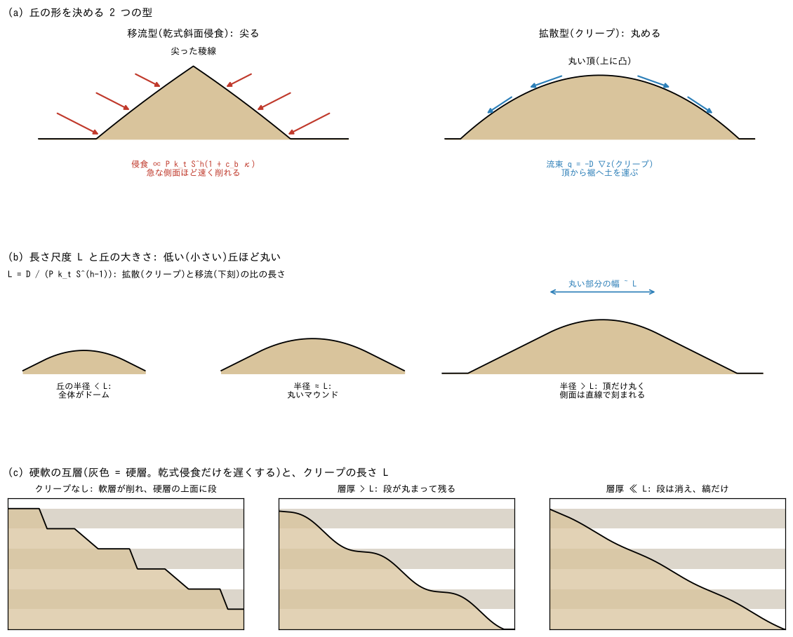

模式図。(a) 丘の形を決める二つの型: 移流型(乾式斜面侵食)は急な側面ほど速く削って
稜線を尖らせ、拡散型(クリープ)は頂から裾へ土を運んで頂を丸める。(b) 長さ尺度 L と
丘の大きさ: L より小さい丘は全体がドーム、大きい丘は頂の幅 L ほどだけが丸い。
(c) 硬軟の互層: クリープがなければ軟層が削れて硬層の上面に段ができ、層厚が L より
厚ければ丸まった段、L よりずっと薄ければ縞だけが残る。

| 実際の現象 | モデルの機構 | 設定 |
|---|---|---|
| 雨が表面を流れない | Green-Ampt の浸透(浸透能 36 mm/h > 雨 10 mm/h)で全量浸透 | `f_gwvertical = 2`、`gw_ksv_mmh = 36` |
| 乾いた斜面の粒子の転落・雨滴のはね(移流型。尖らせる) | 乾式斜面侵食(badland と同じ係数) | `f_splash = 1`、`spl_*` |
| 膨潤・収縮による土の移動(拡散型。丸める) | 線形拡散のクリープ $`\partial z/\partial t = D\nabla^2 z`$(体積を保存する) | `f_creep = 1`、`creep_d` |
| 二つの比が決める長さ | $`L = D/(P k_t S^{h-1})`$(側面の勾配 S = 0.8 で評価) | `creep_d` で L ≈ 0 / 2.4 / 8 / 24 m |
| 硬軟の層の互層(縞) | 水平層理の侵食性倍率(乾式侵食だけに掛かり、クリープには掛からない) | `spl_strata` |
| 平地は削れない | 侵食基準面 | `spl_zbase = 0` |
| 長い時間 | 地形の変化だけを morfac 倍に加速する(地形時間) | `dt_geomorph`、`morfac` |

L は、クリープの流束 $`D S`$ と、幅 L にわたる乾式侵食 $`P k_t S^h L`$ が釣り合う長さです。
L より狭い範囲(丘の頂)では拡散が、広い範囲(長い側面)では移流が勝ちます。クリープは
z だけを動かす線形拡散で、粘土の膨潤・収縮の力学を解くものではありません。

## 幾何と設定

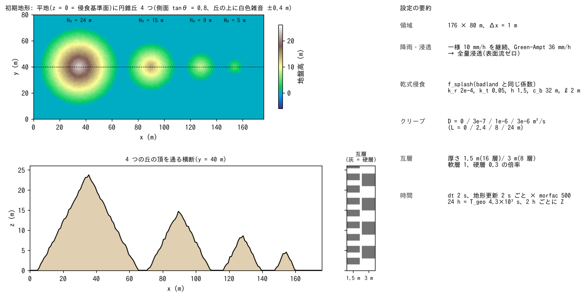

左上: 初期地形(破線 = 横断の位置)。左下: 4 つの丘の頂を通る横断と、互層のケースの
硬層の位置(柱状図)。右: 設定の要約。

176 m × 80 m、Δx = 1 m(176 × 80 セル)。平地(z = 0 = 侵食基準面)の上に、側面の勾配が
共通(tanθ = 0.8 ≈ 39°)で高さの違う円錐丘を 4 つ置きます。

- **丘**: 高さ H₀ = 24 / 15 / 9 / 5 m(底面の半径 30 / 18.75 / 11.25 / 6.25 m)。丘の上にだけ
  白色雑音(一様 ±0.4 m、シード固定)を与えてリルの種にします(特定の波長は持ち込まない)。
- **降雨と浸透**: 一様 10 mm/h を降らせ続けます。Green-Ampt の浸透能 36 mm/h がこれを
  上回るので、雨は全量しみ込み、表面流は生じません。
- **乾式斜面侵食**: badland と同じ係数($`k_r`$ = 2×10⁻⁴、$`k_t`$ = 0.05、$`h`$ = 1.5、
  $`c_b`$ = 32 m、ℓ = 2 m、1 更新の上限 0.2 m、侵食基準面 0)。
- **クリープ**: D = 0 / 3×10⁻⁷ / 1×10⁻⁶ / 3×10⁻⁶ m²/s(L ≈ 0 / 2.4 / 8 / 24 m。丘の半径
  6〜30 m をまたぐように選んだ値)。
- **互層(縞の対照)**: 厚さ 1.5 m の硬軟の互層(軟層の倍率 1、硬層 0.3。z = 0〜24 m で
  16 層)と、厚さ 3 m の互層(8 層)。
- **時間**: dt = 2 s、地形の更新は 2 s ごとで、地形の変化を morfac = 500 倍に加速します。
  24 時間 = T_geo 4.3×10⁷ s(10 mm/h の雨の 120 m 分)。2 時間(T_geo 3.6×10⁶ s)ごとに Z を
  出力します。

| ケース | 設定ファイル | クリープ D (m²/s) | L (m) | 互層 |
|---|---|---|---|---|
| クリープなし | param_d0.txt | 0 | 0 | なし |
| 弱いクリープ | param_d3e-7.txt | 3×10⁻⁷ | 2.4 | なし |
| 中くらいのクリープ | param_d1e-6.txt | 1×10⁻⁶ | 8 | なし |
| 強いクリープ | param_d3e-6.txt | 3×10⁻⁶ | 24 | なし |
| 互層 1.5 m | param_d0_strata.txt / param_d1e-6_strata.txt | 0 / 1×10⁻⁶ | 0 / 8 | 厚さ 1.5 m |
| 互層 3 m | param_d0_strata3.txt / param_d3e-7_strata3.txt / param_d1e-6_strata3.txt | 0 / 3×10⁻⁷ / 1×10⁻⁶ | 0 / 2.4 / 8 | 厚さ 3 m |

計算時間は 1 ケース 2〜4 分(4 スレッド)です。

## 実行方法

```
cd examples/badland_round
make                                         # 実行ファイルへのリンクと入力(make_terrain.py が z.txt を作る)
make run                                     # クリープの 4 ケースを順に計算
python3 plot_setup.py                        # figs/mechanism.png・setup.png(計算結果は使わない)
python3 plot_results.py | tee analysis.txt   # figs/maps・sections・radial・rounding.png と数表
make strata                                  # 互層の 5 ケースを順に計算
python3 plot_results.py strata               # 層厚 1.5 m: figs/*_strata.png
python3 plot_results.py strata3              # 層厚 3 m: figs/*_strata3.png
```

引数 `en` を付けると英語ラベルの図を en/figs/ に描きます(`python3 plot_setup.py en`、
`python3 plot_results.py en`、`python3 plot_results.py strata en` など)。

## 結果

### クリープの強さと丘の形

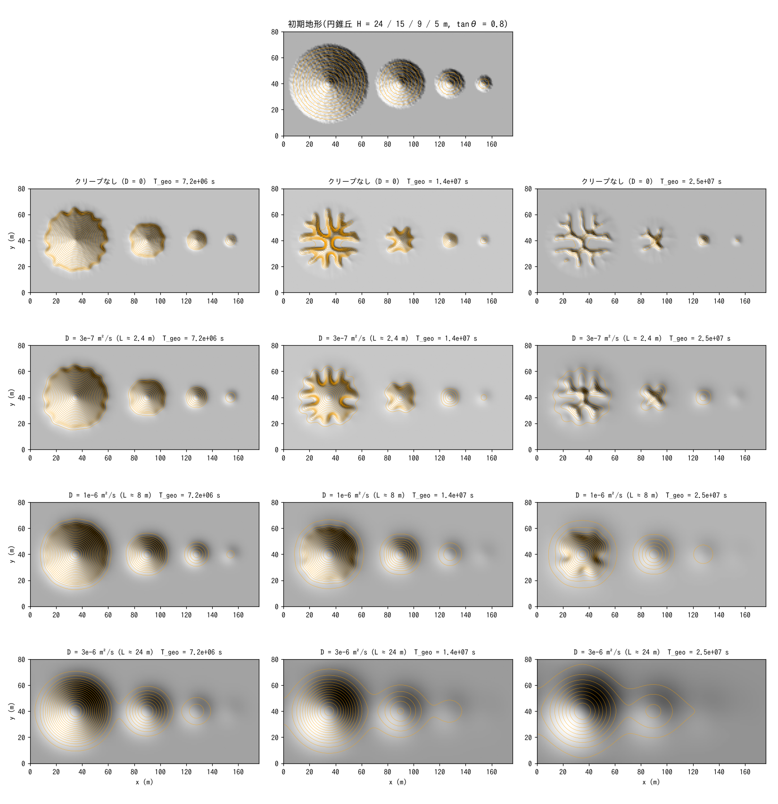

上: 初期地形。下: 4 ケース(行)× 3 時刻(T_geo = 7.2×10⁶、1.4×10⁷、2.5×10⁷ s。列)の陰影図
(等高線つき)。

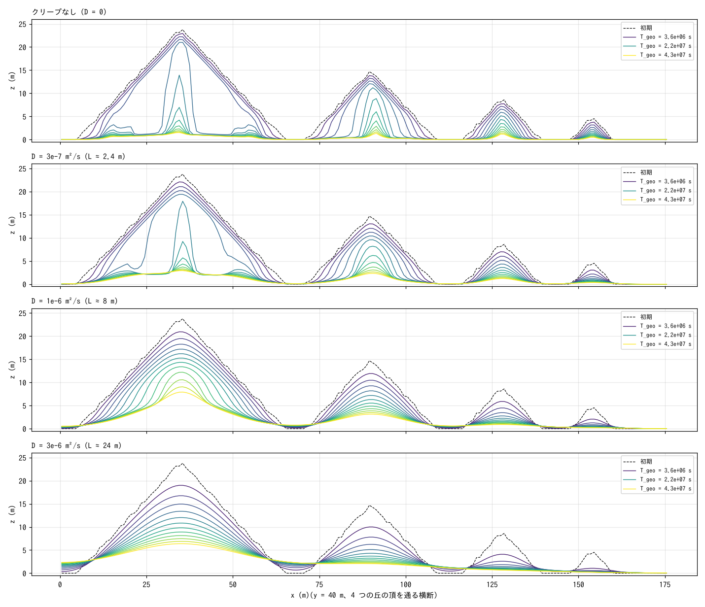

4 つの丘の頂を通る横断(y = 40 m)の時間発展(ケースごと。破線 = 初期)。

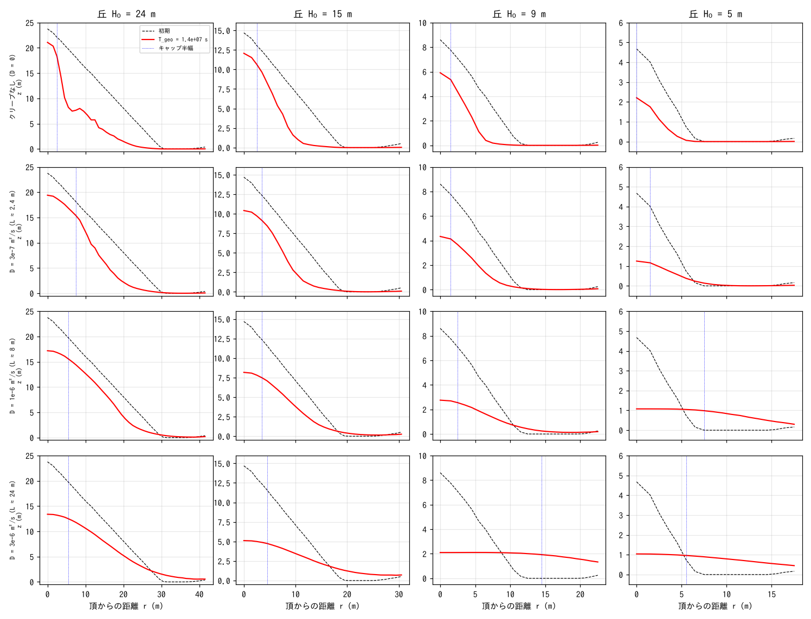

丘ごとの方位平均した半径方向の断面(行 = ケース、列 = 丘。破線 = 初期、赤 = T_geo 1.4×10⁷ s、
点線 = 頂の丸い部分の半幅)。

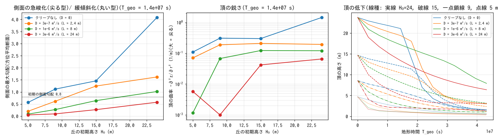

左: 側面の最大勾配と丘の高さ(初期の勾配 0.8 より大きければ急になった = 尖る型)。中: 頂の
曲率 $`-\partial^2 z/\partial r^2`$(大きいほど尖る)。右: 頂の高さの時間変化(線種 = 丘)。

丘ごとの指標(T_geo = 1.44×10⁷ s。方位平均した半径方向の断面から):

| ケース | 丘 H₀ (m) | 頂の高さ (m) | 側面の最大勾配 | 頂の曲率 −∂²z/∂r² (1/m) |
|---|---|---|---|---|
| D = 0 | 24 / 15 / 9 / 5 | 21.1 / 12.1 / 5.9 / 2.2 | 3.80 / 1.51 / 1.11 / 0.56 | 1.27 / 0.27 / 0.31 / 0.11 |
| D = 3×10⁻⁷ | 同 | 19.4 / 10.4 / 4.3 / 1.3 | 1.67 / 1.25 / 0.61 / 0.20 | 0.19 / 0.21 / 0.19 / 0.07 |
| D = 1×10⁻⁶ | 同 | 17.2 / 8.2 / 2.8 / 1.1 | 1.02 / 0.64 / 0.27 / 0.08 | 0.12 / 0.12 / 0.07 / 0.001 |
| D = 3×10⁻⁶ | 同 | 13.4 / 5.1 / 2.1 / 1.0 | 0.57 / 0.27 / 0.09 / 0.05 | 0.065 / 0.042 / 0.001 / 0.006 |

収支の確認(24 時間):

| ケース | 地表の水深の最大 (m) | 地下貯留の最終 (m) | 降雨の累計 (m) | 地表の体積の減少 Σ(z₀−z)Δx² (m³) | 系外へ出た土砂(固体 m³) | 比 |
|---|---|---|---|---|---|---|
| D = 0 | 0 | 0.2400 | 0.2400 | 28169 | 16901 | 1.6667 |
| D = 3×10⁻⁷ | 0 | 0.2400 | 0.2400 | 25503 | 15302 | 1.6667 |
| D = 1×10⁻⁶ | 0 | 0.2400 | 0.2400 | 19725 | 11835 | 1.6667 |
| D = 3×10⁻⁶ | 0 | 0.2400 | 0.2400 | 11531 | 6919 | 1.6667 |

表面流は全期間ゼロで、地下貯留は降雨の累計(10 mm/h × 24 h = 0.24 m)に一致します。地表の
体積の減少は、系外へ出た土砂 ÷ (1 − 空隙率 0.4) に全桁一致し、クリープは体積を変えない
(保存形)ことも同時に確かめられます。

- **クリープなし(移流型だけ)**: 丘は稜線を尖らせたまま縮み、側面はむしろ急になります
  (初期 0.8 → 1.1〜3.8)。T_geo ≈ 1.4×10⁷ s 以降は凹地形のフィードバックでガリーが丘を
  放射状に刻み、中央に尖塔を残して解体されます(Mancos 層型の鋭いバッドランド)。
  ガリーが格子の軸と対角に揃うのは格子の異方性による人工物です。
- **D = 1×10⁻⁶ m²/s(L ≈ 8 m)**: 頂は上に凸の丸いキャップになり、側面は緩みます
  (0.08〜1.0)。**丘が小さいほど頂の曲率が小さく(丸く)**、H₀ = 5 m の丘は全体が平らな
  ドームに、9 m は丸いマウンドに、24 m は丸い頂を持ちつつ側面にガリーの跡が残ります。
  「稜線が丸く、低い丘ほど丸い」型です。裾にはクリープで運ばれた土の緩いエプロンができ、
  丘どうしが裾でつながります。
- **D = 3×10⁻⁶ m²/s(L ≈ 24 m)**: すべての丘が最初からドーム(haystack 型)になり、
  ガリーは生じません。
- 頂の低下はクリープが強いほど初めは速い(頂のキャップを削って側面へ運ぶ)のですが、
  ガリーによる解体が起きないので後には遅く、丘が長く残ります。

### 縞模様(水平層理の硬軟差)を入れる

縞は色の差だけでなく硬さの差でもあります。`spl_strata`(層の下端の標高と侵食性の倍率の
表)で厚さ 1.5 m の硬軟の互層(軟層 1、硬層 0.3 の倍率。z = 0〜24 m の 16 層)を与え、
クリープなし(D = 0)と D = 1×10⁻⁶ m²/s のそれぞれで、層理の有無を比べます。倍率は乾式
侵食にだけ掛かり、クリープには掛かりません。

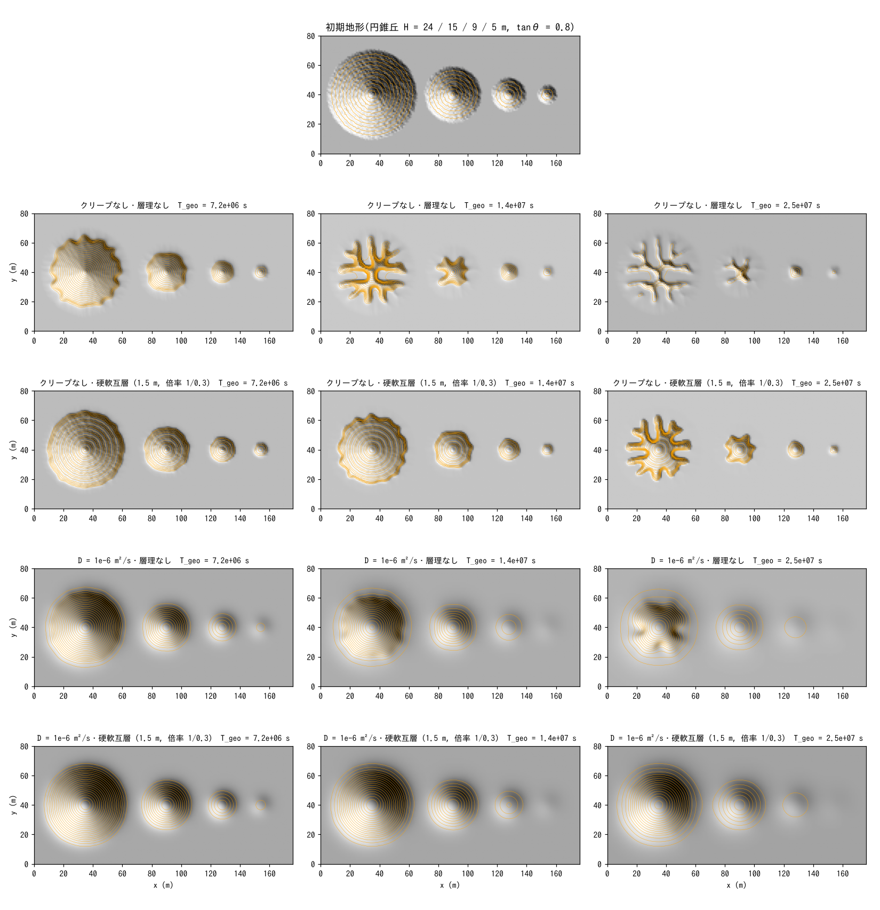

上: 初期地形。下: クリープなし・層理なし、クリープなし・互層、D = 1×10⁻⁶・層理なし、
D = 1×10⁻⁶・互層(行)× 3 時刻(列)の陰影図。

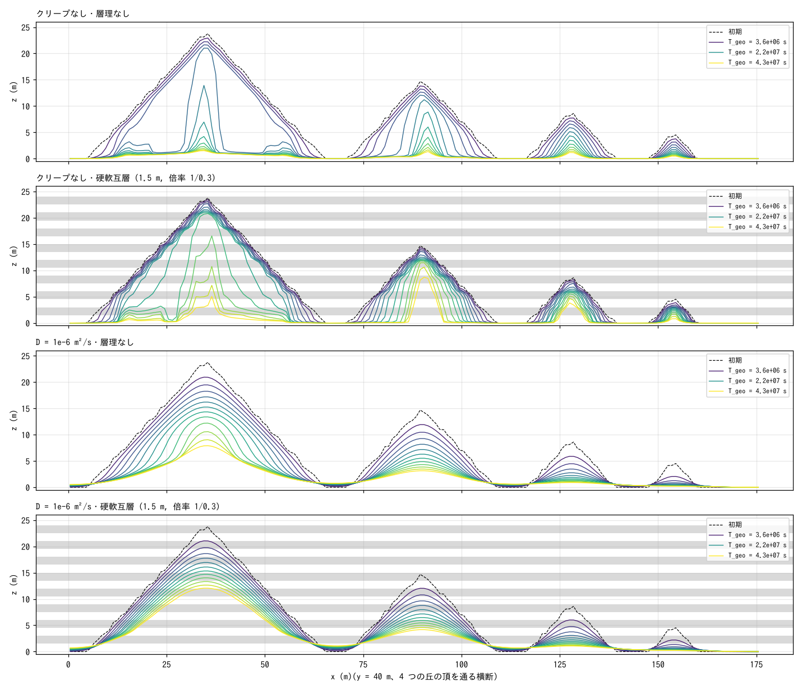

4 つの丘の頂を通る横断の時間発展(灰色の帯 = 硬層)。

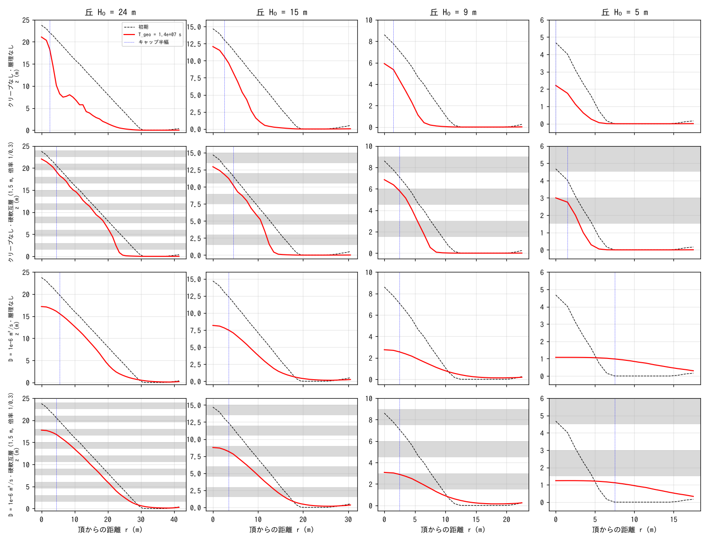

丘ごとの方位平均した半径方向の断面(灰色の帯 = 硬層)。

| 量 | D = 0・層理なし | D = 0・互層 | D = 1×10⁻⁶・層理なし | D = 1×10⁻⁶・互層 |
|---|---|---|---|---|
| 系外へ出た土砂(固体 m³、24 時間) | 16901 | 16650 | 11835 | 8145 |
| 24 m の丘の頂の高さ (m)(T_geo 1.44×10⁷ / 4.3×10⁷ s) | 21.1 / 1.5 | 22.0 / 5.9 | 17.2 / 7.9 | 17.8 / 12.4 |
| 側面の最大勾配(T_geo 1.44×10⁷ s、24 m の丘) | 3.80 | 1.77 | 1.02 | 0.82 |

- **クリープなし + 互層**: 側面が**階段状**になります。軟層は速く削れて下の硬層の上面まで
  下がり、そこに平らな段(ベンチ)ができ、硬層の面が急な段差として残ります(段の高さ =
  層厚 1.5 m)。平面では等高線が硬層の上面に集まる縞になります。硬層が丘の縁を守るため
  ガリーによる解体が遅れ(24 m の丘の頂は 1.44×10⁷ s でも 22 m)、最後は硬層をキャップに
  した台地状の残丘(メサ)になります。
- **クリープ + 互層**: 段はクリープにならされて**緩い起伏の縞**になり、全体の丸い形(凸な
  頂、緩い側面)は保たれます(硬層の位置で勾配がわずかに緩む)。侵食の総量は層理なしの
  7 割に減り、丘は高く残ります(24 m の丘の最終の頂 12.4 m、層理なし 7.9 m)。「縞はあるが
  段にはなっていない丸い丘」はこの組合せに当たります: 硬軟の差が縞を作り、拡散型の過程が
  段を消します。
- 段として見えるかどうかは、段の高さ(層厚)とクリープの長さ L の比で決まります
  (L ≫ 層厚なら段は消える)。次の節で確かめます。

### 層厚 3 m にすると段は出るか

層厚を 3 m(8 層)に倍にして、クリープなし・D = 3×10⁻⁷(L ≈ 2.4 m < 層厚)・
D = 1×10⁻⁶(L ≈ 8 m > 層厚)で比べます(`python3 plot_results.py strata3`)。

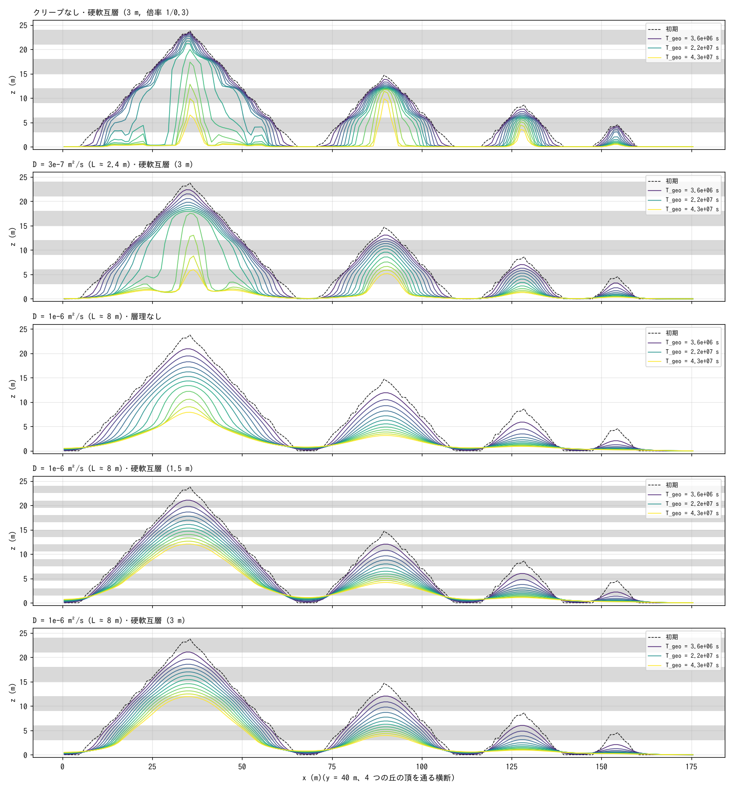

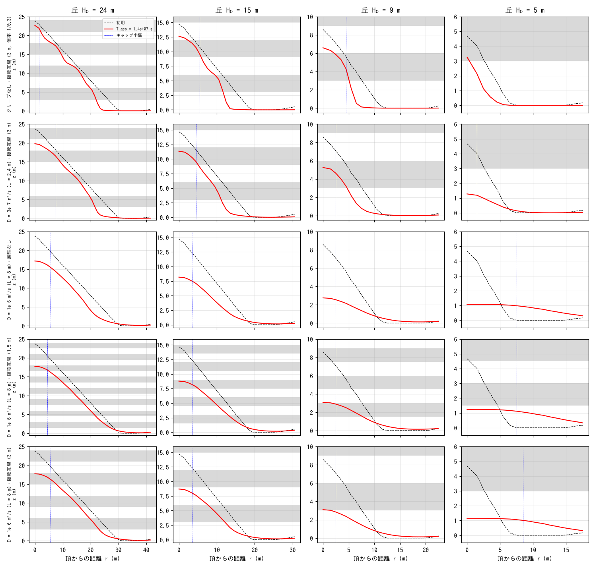

段の指標: 24 m・15 m の丘の方位平均した断面で、裾からの高さが頂の 15〜85 % にある側面の
区間の局所勾配の最大/最小の比と相対変動(段があれば大きい。T_geo = 1.44×10⁷ s):

| ケース | 層厚 (m) | L (m) | 勾配の最大/最小(24 m の丘) | 相対変動(24 m / 15 m の丘) |
|---|---|---|---|---|
| クリープなし・互層 | 3 | 0 | 4.6 | 0.42 / 0.39 |
| D = 3×10⁻⁷・互層 | 3 | 2.4 | 2.5 | 0.28 / 0.22 |
| D = 1×10⁻⁶・層理なし | – | 8 | 1.6 | 0.14 / 0.15 |
| D = 1×10⁻⁶・互層 | 1.5 | 8 | 1.5 | 0.09 / 0.09 |
| D = 1×10⁻⁶・互層 | 3 | 8 | 1.4 | 0.11 / 0.14 |

- **D = 1×10⁻⁶(L ≈ 8 m)では、層厚を 3 m にしても段は出ません**。側面の勾配の変動は
  層理なしと同じ(相対変動 0.11〜0.14)で、断面は滑らかな凸形のままです。硬層の効果は
  侵食の総量(層理なしの 8 割)と丘の残り方にだけ現れます。
- **D = 3×10⁻⁷(L ≈ 2.4 m < 層厚 3 m)では段が出ます**。硬層の上面(z = 6・12・18 m)に
  緩い段(勾配の変曲)が並び、相対変動 0.28 はクリープなし(0.42)と層理なし(0.14)の
  中間です。クリープなしの 3 m の段(平らなベンチと急な段差)が、クリープで丸められた
  形です。
- つまり段が見えるかどうかは層厚と L の比で決まり(層厚 ≳ L で段、層厚 ≪ L で縞だけ)、
  縞があって段がない丘は、層厚がクリープの長さ L より薄い(または硬軟の差が小さい)
  ことを示します。

## このモデルで表せないこと(実際の現象との違い)

- **クリープは z だけを動かす線形拡散**: 粘土の膨潤・収縮や小さな泥流の力学は解かず、
  勾配に比例した流束で地形をならすだけです。層理の倍率はクリープには掛からないので、
  硬い層がクリープの土の供給を絞る効果は、乾式侵食の側の倍率だけで表しています。
- **層理は水平だけ**: 層理は標高だけの関数で、傾いた層や褶曲は表せません。
- **ガリーの向きは格子の人工物を含む**: クリープなしのガリーが格子の軸と対角に揃うのは
  円錐の離散化の異方性で、雑音 ±0.4 m でも残ります。形(鋭い稜線・急になる側面・解体)の
  比較には使えますが、ガリーの本数と向きは物理ではありません。
- **深い段階の速さは格子に依存する**: 乾式斜面侵食の深い段階の速さは格子幅に依存します
  ([badland](../badland/README.md) の格子収束)。この例題は形の比較が目的で、時間は相対
  比較に使ってください。
- **係数は校正値ではない**: 乾式侵食の係数は badland の値、クリープ D は長さ L が丘の大きさ
  をまたぐように選んだ値です。10 mm/h の雨を降らせ続けて地形時間を刻んでいるので、年降水量
  250 mm の乾燥地に換算すると T_geo 4.3×10⁷ s(雨 120 m)は約 480 年、D = 1×10⁻⁶ m²/s は
  ≈ 0.1 m²/yr に当たります。土壌のクリープの文献値(0.001〜0.05 m²/yr。Fernandes and Dietrich
  1997)より大きく、活発な膨潤性の粘土の表層の動きを想定した値です。

## 注意

- 地表の体積の減少と系外へ出た土砂の比が 1/(1 − 0.4) = 1.6667 に全桁一致することで、乾式
  侵食の台帳とクリープの保存(体積を変えない)を同時に確かめられます(上の収支の表)。
- 土層厚 `sd0` は丘の高さより十分厚く(100 m)して、侵食基準面は `spl_zbase` で与えます
  (badland と同じ理由)。
- クリープの安定条件 $`D\,\Delta t_s(1/\Delta x^2 + 1/\Delta y^2) \le 1/2`$(Δt_s = 地形更新
  間隔 × morfac = 1000 s)は D = 3×10⁻⁶ でも満たされます(0.006)。

## 感度実験の入口

- `creep_d`: 長さ L(∝ D)。L が丘の半径をまたぐ範囲で、どの丘から丸くなるかが変わります。
- `spl_strata` の層厚と倍率: 段と縞の出方(層厚と L の比)。
- make_terrain.py の `HILLS`(丘の位置と高さ)と `TANB`(側面の勾配): 丘の大きさの範囲。

## 参考文献

- Culling, W. E. H. (1960): Analytical theory of erosion. *J. Geol.*, 68, 336–344.
- Fernandes, N. F. and Dietrich, W. E. (1997): Hillslope evolution by diffusive processes: The
  timescale for equilibrium adjustments. *Water Resour. Res.*, 33, 1307–1318.
- Gilbert, G. K. (1909): The convexity of hilltops. *J. Geol.*, 17(4), 344–350.
- Perron, J. T., Kirchner, J. W. and Dietrich, W. E. (2009): Formation of evenly spaced ridges
  and valleys. *Nature*, 460, 502–505.
- Schumm, S. A. (1956): The role of creep and rainwash on the retreat of badland slopes.
  *Am. J. Sci.*, 254(11), 693–706. doi:10.2475/ajs.254.11.693(書誌で確認)
