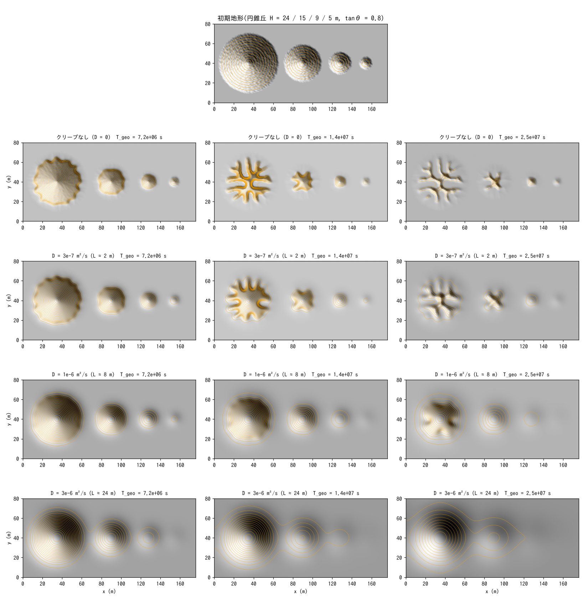
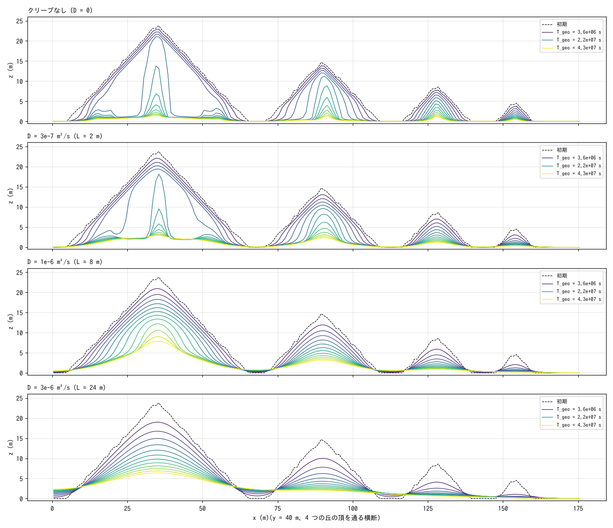
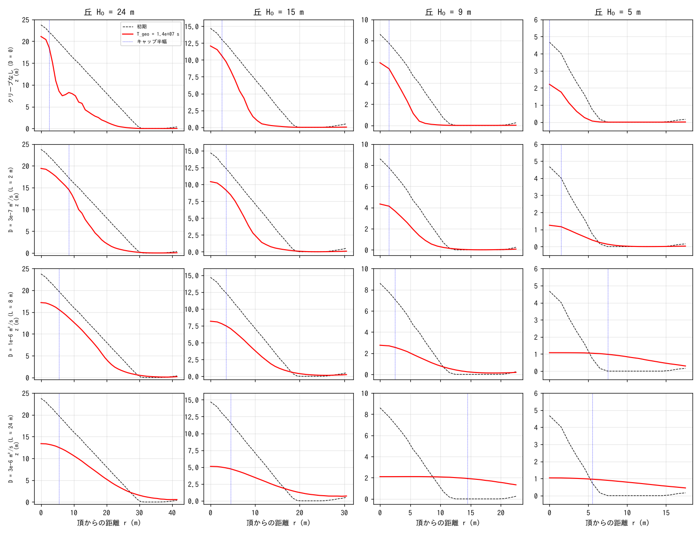
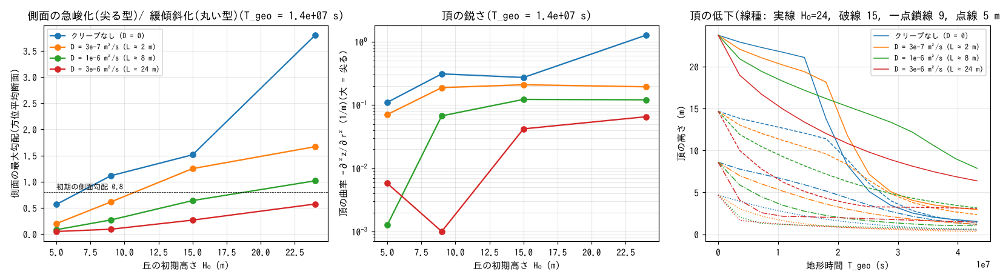
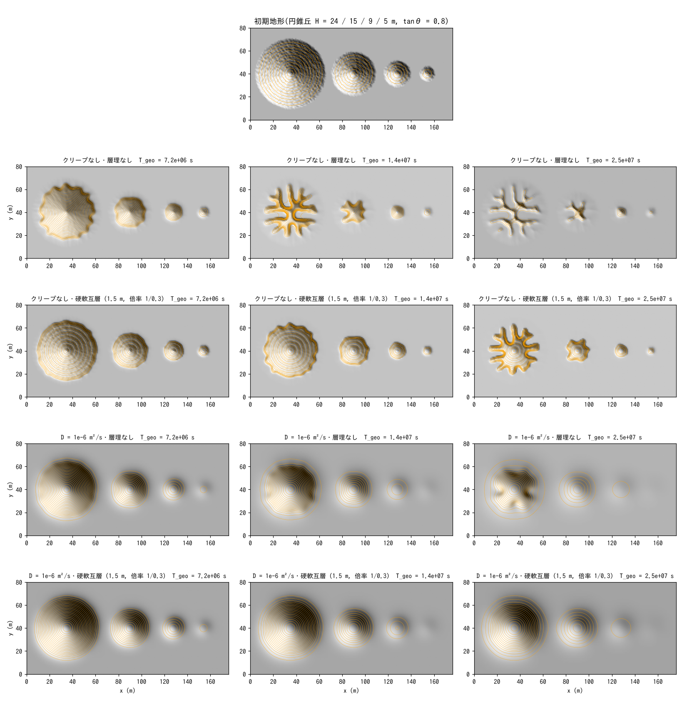
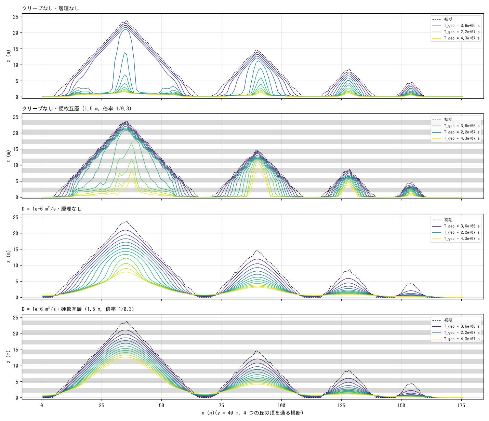
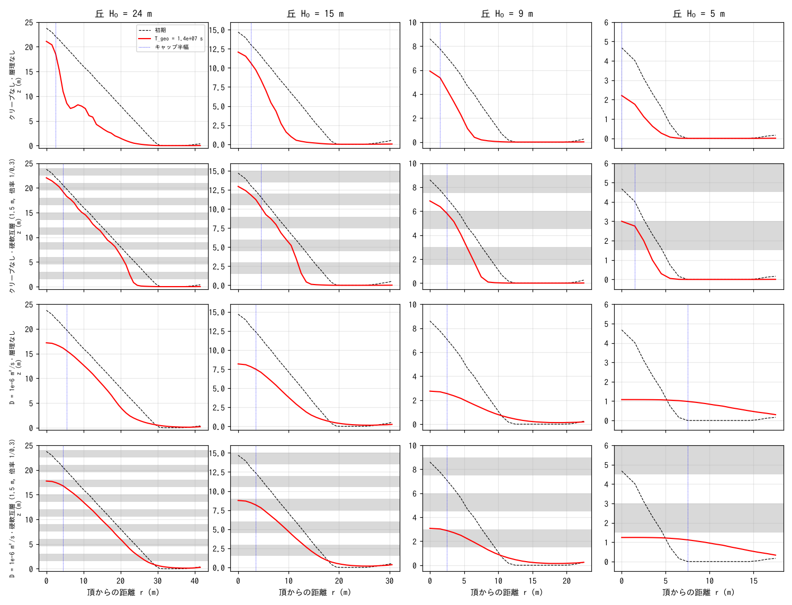
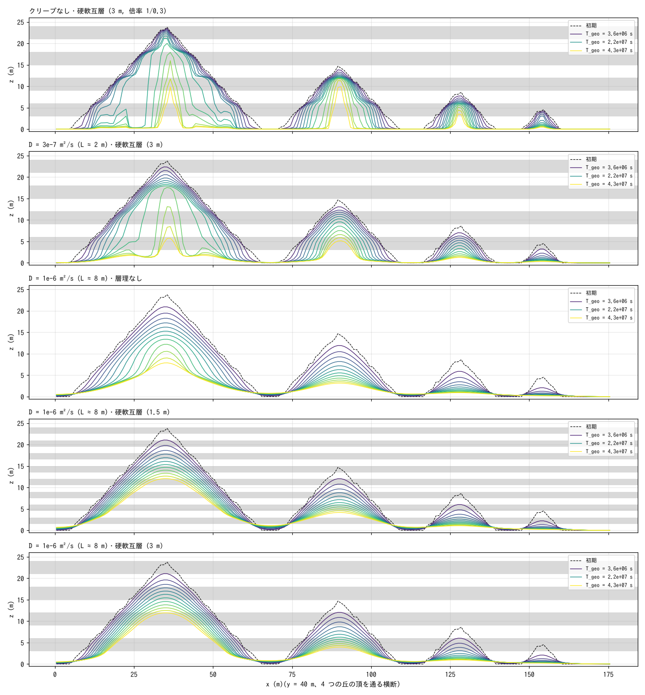
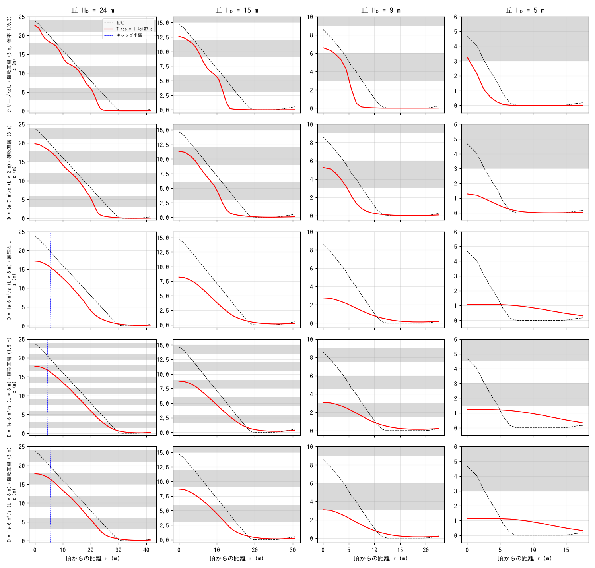

# examples/badland_round — 稜線が尖らず、低い丘ほど丸くなるバッドランドの成因実験

写真(米国 Chinle 層のような縞模様の丘群。稜線は丸く、低い丘ほどドーム状)の
地形型を、ENCflow の **乾式斜面侵食 f_splash(移流型・下刻)** と
**斜面クリープ f_creep(拡散型・丸める)** の重ね合わせで再現する例題です
(examples/badland の「鋭い稜線の深い谷」の対照)。入力はこのディレクトリの
`param_d*.txt` と生成地形 `z.txt` だけです。

## 成因(仮説と文献上の整理)

- 膨潤性粘土(スメクタイト質泥岩: Chinle 層・Morrison 層・Badlands NP の
  Chadron 層など)の斜面は、乾湿の繰り返しで表面が「ポップコーン状」の
  風化殻になり、雨水の多くがそこへ吸われて**表面流がほとんど生じない**。
- 代わりに、風化殻の膨潤・収縮や微小な泥流によって土砂が斜面を**拡散的に**
  (勾配に比例した流束で)下る。拡散型の過程は上に凸の丸い頂部を作る
  (Gilbert の凸形斜面、Culling の線形拡散)。
- リル・雨滴による**移流型**(勾配のべき乗で下刻し、凹地形で加速する)過程は
  尖った稜線と直線〜凹形の側面を作る(Mancos 層型の鋭いバッドランド)。
- 両者の比は長さ尺度 L = D / (P k_t S^(h−1)) を定める。丘の大きさが L より
  小さければ丘全体が拡散に支配されてドームになり、大きければ頂部だけが丸く
  側面は直線のまま刻まれる。**低い(小さい)丘ほど丸いのは、この長さ尺度が
  一定で丘の大きさが違うから**(Perron らのペクレ数の議論と同型)。

## 設定

| 項目 | 値 |
|---|---|
| 領域・格子 | 176 × 80 m、Δx = 1 m |
| 初期地形 | 平地(z = 0 = 侵食基準面)に円錐丘 4 つ: H₀ = 24 / 15 / 9 / 5 m、側面 tanθ = 0.8(≈ 39°)、丘の上に白色雑音 ±0.4 m(シード固定) |
| 降雨・浸透 | 一様 10 mm/h を継続、Green-Ampt 36 mm/h → 全量浸透(表面流ゼロ) |
| 乾式斜面侵食 | f_splash: spl_kr = 2e-4, spl_kt = 0.05, spl_h = 1.5, spl_cb = 32 m, spl_lc = 2 m, spl_dzmax = 0.2, spl_zbase = 0(examples/badland と同じ) |
| クリープ | f_creep: D = 0 / 3e-7 / 1e-6 / 3e-6 m²/s(L ≈ 0 / 2.4 / 8 / 24 m) |
| 水平層理(縞の対照) | param_d0_strata / param_d1e-6_strata.txt: `spl_strata` で厚さ 1.5 m の硬軟互層(倍率 1 / 0.3、16 層)。param_d0_strata3 / d3e-7_strata3 / d1e-6_strata3.txt: 厚さ 3 m(8 層) |
| 時間 | dt = 2 s、地形更新 2 s 毎 × morfac 500。24 h = T_geo 4.3e7 s(10 mm/h の雨 430 m 分)。2 h 毎に Z を出力 |

```
make                                       # ../../bin/encflow へのリンク
python3 make_terrain.py                    # z.txt
for d in d0 d3e-7 d1e-6 d3e-6; do ./encflow param_$d.txt > Screen_$d.log; done   # 各 2〜4 分(4 本並列なら約 4 分)
python3 plot_results.py | tee analysis.txt # figs/*.png + 数表(検算・丘ごとの指標)
for d in d0_strata d1e-6_strata; do ./encflow param_$d.txt > Screen_$d.log; done  # 縞の対照
python3 plot_results.py strata | tee analysis_strata.txt   # figs/*_strata.png
for d in d0_strata3 d3e-7_strata3 d1e-6_strata3; do ./encflow param_$d.txt > Screen_$d.log; done  # 層厚 3 m
python3 plot_results.py strata3 | tee analysis_strata3.txt # figs/*_strata3.png
```

## 検算

| ケース | S_surf 最大 (m) | S_grnd 最終 (m) | 降雨累計 (m) | Σ(z₀−z)Δx² (m³) | splash 排出(固体) (m³) | 比 |
|---|---|---|---|---|---|---|
| D = 0 | 0 | 0.2400 | 0.2400 | 28169 | 16901 | 1.6667 |
| D = 3e-7 | 0 | 0.2400 | 0.2400 | 25503 | 15302 | 1.6667 |
| D = 1e-6 | 0 | 0.2400 | 0.2400 | 19725 | 11835 | 1.6667 |
| D = 3e-6 | 0 | 0.2400 | 0.2400 | 11531 | 6919 | 1.6667 |

表面流は全期間ゼロ(S_surf = 0)、地下貯留は降雨累計 10 mm/h × 24 h = 0.24 m に
一致。地形の体積減少は splash の排出台帳 ÷ (1 − 空隙率 0.4) に全桁一致し、
クリープは保存形(体積を変えない)であることも同時に確認できる。

## 結果









T_geo = 1.44e7 s(8 h)の丘ごとの指標(方位平均した半径方向断面から):

| ケース | 丘 H₀ (m) | 頂高 (m) | 側面最大勾配 | 頂の曲率 −∂²z/∂r² (1/m) |
|---|---|---|---|---|
| D = 0 | 24 / 15 / 9 / 5 | 21.1 / 12.1 / 5.9 / 2.2 | 3.80 / 1.51 / 1.11 / 0.56 | 1.27 / 0.27 / 0.31 / 0.11 |
| D = 3e-7 | 同 | 19.4 / 10.4 / 4.3 / 1.3 | 1.67 / 1.25 / 0.61 / 0.20 | 0.19 / 0.21 / 0.19 / 0.07 |
| D = 1e-6 | 同 | 17.2 / 8.2 / 2.8 / 1.1 | 1.02 / 0.64 / 0.27 / 0.08 | 0.12 / 0.12 / 0.07 / 0.001 |
| D = 3e-6 | 同 | 13.4 / 5.1 / 2.1 / 1.0 | 0.57 / 0.27 / 0.09 / 0.05 | 0.065 / 0.042 / 0.001 / 0.006 |

- **クリープなし(移流型のみ)**: 丘は稜線を尖らせたまま縮み、側面はむしろ
  急峻化する(初期 0.8 → 1.1〜3.8)。T_geo ≈ 1.4e7 s 以降は凹地形フィードバックで
  ガリーが丘を放射状に刻み、中央に尖塔を残して解体される(Mancos 型の鋭い
  バッドランド)。ガリーが格子の軸・対角に揃うのは格子異方性の人工物。
- **D = 1e-6 m²/s(L ≈ 8 m)**: 頂部は上に凸の丸いキャップになり、側面は緩む
  (0.08〜1.0)。**丘が小さいほど頂の曲率が小さく(丸く)**、H₀ = 5 m の丘は
  全体が平らなドームに、9 m は丸いマウンドに、24 m は丸い頂を持ちつつ側面に
  ガリーの痕跡が残る — 写真の「稜線が丸く、下方(低い丘)ほど丸い」型。
  裾にはクリープの堆積による緩いエプロンができ、丘どうしが裾でつながる。
- **D = 3e-6 m²/s(L ≈ 24 m)**: すべての丘が最初からドーム(haystack 型)に
  なり、ガリーは生じない。
- 頂の低下速度はクリープが強いほど初期には速い(頂のキャップを削って側面へ
  運ぶ)が、ガリーによる解体が起きないため後期には遅く、丘が長く残る。

## 縞模様(水平層理の硬軟差)を入れる

写真の縞(水平な層理)は色の差だけでなく硬軟の差でもあります。`spl_strata`
(層の下端標高と侵食性倍率の表。[geomorph.md](../../docs/users_guide/geomorph.md))で
厚さ 1.5 m の硬軟互層(軟層 1、硬層 0.3 の倍率。z = 0〜24 m の 16 層)を与え、
クリープなし(D = 0)と D = 1e-6 m²/s のそれぞれで層理の有無を比べました。
倍率は乾式侵食 E にだけ掛かり、クリープには掛かりません。







(断面図の灰色の帯が硬層。`python3 plot_results.py strata` で描画。)

| 量 | D = 0・層理なし | D = 0・硬軟互層 | D = 1e-6・層理なし | D = 1e-6・硬軟互層 |
|---|---|---|---|---|
| 乾式侵食の系外排出(固体 m³、24 h) | 16901 | 16650 | 11835 | 8145 |
| 24 m の丘の頂高 (m)(T_geo 1.44e7 / 4.3e7 s) | 21.1 / 1.5 | 22.0 / 5.9 | 17.2 / 7.9 | 17.8 / 12.4 |
| 側面の最大勾配(T_geo 1.44e7 s、24 m の丘) | 3.80 | 1.77 | 1.02 | 0.82 |

- **クリープなし + 互層**: 側面が**階段状**になります。軟層は速く削れて下の硬層の
  上面まで下がり、そこに平らな段(ベンチ)ができ、硬層の面が急な段差(ライザー)
  として残る(断面図の 2 段目。段の高さ = 層厚 1.5 m)。平面では等高線が硬層の
  上面に集まる縞になります。硬層が丘の縁を守るため、ガリーによる解体が遅れ
  (24 m の丘の頂は 1.44e7 s でも 22 m)、最終的には硬層をキャップにした台地状の
  残丘(メサ)になります。
- **クリープ + 互層**: 段はクリープにならされて**緩い起伏の縞**になり、全体の
  丸い形(凸な頂、緩い側面)は保たれます(断面図の 4 段目。硬層の位置で勾配が
  わずかに緩む)。侵食の総量は層理なしの 7 割に減り、丘は高く残ります
  (24 m の丘の最終頂高 12.4 m、層理なし 7.9 m)。写真の「縞はあるが段には
  なっていない丸い丘」はこの組合せに対応します: 硬軟差が縞を作り、拡散型の
  過程が段を消す。
- 硬軟差が段として見えるかどうかは、段の高さ(層厚)とクリープの長さ尺度 L の
  比で決まります(L ≫ 層厚なら段は消える)。層厚を厚く、または D を小さくすれば
  段が現れます(次の節で確認)。

### 層厚 3 m にすると段は出るか

層厚を 3 m(8 層)に倍にして、クリープなし・D = 3e-7(L ≈ 2.4 m < 層厚)・
D = 1e-6(L ≈ 8 m > 層厚)で比べました(`python3 plot_results.py strata3`)。





段の指標: 24 m・15 m の丘の方位平均断面で、裾からの高さが頂の 15〜85 % の側面区間の
局所勾配の最大/最小比と相対変動(段があれば大きい。T_geo = 1.44e7 s):

| ケース | 層厚 (m) | L (m) | S 最大/最小(24 m の丘) | 相対変動(24 m / 15 m) |
|---|---|---|---|---|
| クリープなし・互層 | 3 | 0 | 4.6 | 0.42 / 0.39 |
| D = 3e-7・互層 | 3 | 2.4 | 2.5 | 0.28 / 0.22 |
| D = 1e-6・層理なし | – | 8 | 1.6 | 0.14 / 0.15 |
| D = 1e-6・互層 | 1.5 | 8 | 1.5 | 0.09 / 0.09 |
| D = 1e-6・互層 | 3 | 8 | 1.4 | 0.11 / 0.14 |

- **D = 1e-6(L ≈ 8 m)では層厚を 3 m にしても段は出ません**。側面の勾配変動は
  層理なしと同じ(相対変動 0.11〜0.14)で、断面は滑らかな凸形のままです。硬層の
  効果は侵食総量(層理なしの 8 割)と丘の残り方にだけ現れます。
- **D = 3e-7(L ≈ 2.4 m < 層厚 3 m)では段が出ます**。硬層の上面(z = 6・12・18 m)に
  緩い段(勾配の変曲)が並び、相対変動 0.28 はクリープなし(0.42)と層理なし
  (0.14)の中間です。クリープなしの 3 m の段(軟層が硬層上面まで削れた平らな
  ベンチと急なライザー)が、クリープで丸められた形です。
- つまり「段が見えるか」は層厚と L の比で決まり(層厚 ≳ L で段、層厚 ≪ L で縞だけ)、
  写真のように縞があって段がない丘は、層厚がクリープの長さ尺度より薄い
  (または硬軟差が小さい)ことを示します。

## 読み方の注意

- 係数は校正値ではありません。f_splash の係数は examples/badland の値、
  クリープ D は長さ尺度 L が丘の大きさ(半径 6〜30 m)をまたぐように選んだ
  値です。降雨 10 mm/h の連続降雨で地形時間を刻んでいるので、年降水量 250 mm
  の乾燥地に換算すると実時間はおよそ 350 倍(T_geo 4.3e7 s ≈ 480 年)、
  D = 1e-6 m²/s は実時間で ≈ 0.1 m²/yr(土壌クリープの文献域 0.001〜0.05 の
  上側。膨潤粘土の活発な表層移動としては妥当な桁)です。
- f_creep は z だけを動かす線形拡散で、膨潤・収縮の力学モデルではありません
  (developer.md の既知の妥協)。層理の倍率はクリープには掛からないので、
  硬層がクリープの土砂供給を絞る効果は乾式侵食側の倍率だけで表しています。
- 層理は水平(標高だけの関数)です。傾いた層や褶曲は表せません。
- クリープなしのガリーが格子の軸・対角に揃うのは円錐の離散化の異方性で、
  雑音 ±0.4 m でも残ります。形(鋭い稜線・急峻化・解体)の比較には使えますが、
  ガリーの本数・方位は物理ではありません。
- f_splash の深い段階の速さは格子幅に依存します(examples/badland の注意)。
  本実験は形の比較が目的で、時間は相対比較に使ってください。

## 関連

- [examples/badland](../badland/)(台地+急崖の鋭い稜線の深い谷)、
  [examples/badland_storm](../badland_storm/)(豪雨時だけ表面流が出る崖)
- [docs/users_guide/geomorph.md](../../docs/users_guide/geomorph.md) — `f_splash`・`f_creep`、
  [sediment.md](../../docs/users_guide/sediment.md) — 式と既定値の根拠
- 用途集: [docs/users_guide/usecases.md](../../docs/users_guide/usecases.md)「バッドランド・火砕丘の谷形成」
