# badland_round — badlands with rounded crests where lower hills are rounder (advective erosion and diffusive creep)

> English mirror of examples/badland_round/README.md. The Japanese file is the master copy.

[日本語](../README.md)

This example reproduces badlands of banded hills whose crests are rounded rather than
sharp, with lower hills more dome-like (landforms of swelling clay such as the hills of the
Chinle Formation in the USA), by superposing two kinds of process. The sharpening side is
[dry-slope erosion](../../../docs/en/users_guide/geomorph.md#dry-slope-erosion-f_splash)
(f_splash; an advective process that erodes with a power of the slope and faster in
hollows); the rounding side is
[hillslope creep](../../../docs/en/users_guide/geomorph.md#hillslope-creep-f_creep) (f_creep;
a diffusive process that moves soil down with a flux proportional to the slope). Creep of
different strengths is applied to four hills of different size to compare which hills
round off and how much. Whether horizontal alternating hard and soft beds (`spl_strata`)
produce bands and steps is compared too. This is the contrast to
[badland](../../badland/en/README.md) (deep valleys with sharp ridges). The values are
schematic, chosen to make the phenomena visible, and do not reproduce a particular landform.

The erosion law of dry-slope erosion is an **original formulation** by the ENCflow developer
and has not been published as a paper (see "Mechanisms needed for the reproduction" in
badland and the
[explanation](../../../docs/en/users_guide/sediment.md#6-dry-slope-erosion-f_splash)).

## What happens in real badlands

- **Badlands of swelling clay**: on slopes of mudstone rich in smectite (the Chinle and
  Morrison Formations in the USA, the Chadron Formation in Badlands National Park and
  others), repeated wetting and drying makes the clay swell and shrink, forming a
  popcorn-like weathered crust on the surface. Much of the rain soaks into this crust and
  overland flow becomes less likely.
- **Soil on the slopes moves down diffusively**: through the swelling and shrinking of the
  crust and small mudflows, the soil moves down the slope with a flux proportional to the
  slope (creep). Both creep and rainwash (erosion of the surface by rain) take part in the
  retreat of badland slopes (Schumm 1956).
- **Diffusive processes make rounded crests**: when soil moves in proportion to the slope,
  hilltops become convex and rounded (Gilbert 1909; the linear diffusion model is Culling
  1960).
- **Advective processes make sharp crests**: processes that erode with a power of the slope
  and faster in hollows, such as rills and raindrops, make sharp crests and straight to
  concave sides (sharp badlands like those of the Mancos Shale).
- **The ratio of the two sets the shape of the hills**: the ratio of diffusion to advection
  sets one length L. A hill smaller than this is dominated entirely by diffusion and becomes
  a dome; a larger hill has only its top rounded while its sides stay straight and are
  incised. **Lower (smaller) hills are rounder because L is the same while the hills differ
  in size** (the same type of argument as Perron et al. 2009, in which the ratio of advection
  to diffusion sets the scale of the landforms).
- **Bands**: differences in colour between horizontal beds make the bands. Hard beds erode
  less easily and may form steps (benches) and steep risers.

## Mechanisms needed for the reproduction

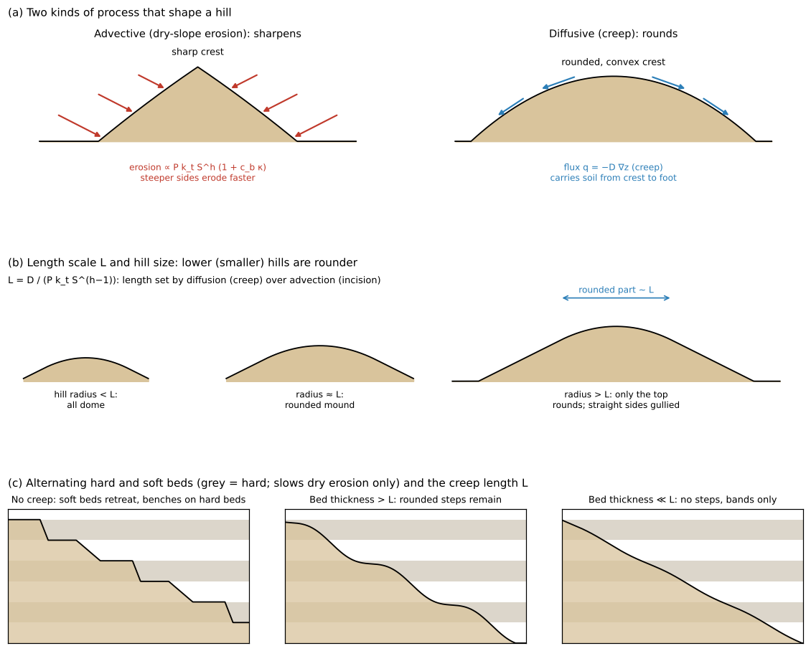

Schematic. (a) Two kinds of process that shape a hill: the advective one (dry-slope erosion)
erodes steeper sides faster and sharpens the crest; the diffusive one (creep) carries soil
from the crest to the foot and rounds the crest. (b) Length scale L and hill size: a hill
smaller than L becomes a dome as a whole; on a larger hill only a part of width about L at
the top is rounded. (c) Alternating hard and soft beds: without creep the soft beds retreat
and steps form on the tops of the hard beds; with beds thicker than L rounded steps remain;
with beds much thinner than L only bands remain.

| Real phenomenon | Mechanism in the model | Setting |
|---|---|---|
| The rain does not run over the surface | All infiltrates by Green-Ampt infiltration (capacity 36 mm/h > rain 10 mm/h) | `f_gwvertical = 2`, `gw_ksv_mmh = 36` |
| Dry grains rolling down slopes and raindrop splash (advective; sharpens) | Dry-slope erosion (same coefficients as badland) | `f_splash = 1`, `spl_*` |
| Soil movement by swelling and shrinking (diffusive; rounds) | Linear-diffusion creep $`\partial z/\partial t = D\nabla^2 z`$ (conserves volume) | `f_creep = 1`, `creep_d` |
| Length set by the ratio of the two | $`L = D/(P k_t S^{h-1})`$ (evaluated at the side slope S = 0.8) | `creep_d` gives L ≈ 0 / 2.4 / 8 / 24 m |
| Alternating hard and soft beds (bands) | Erodibility factor of horizontal strata (applies to dry erosion only, not to creep) | `spl_strata` |
| The plain is not eroded | Base level of erosion | `spl_zbase = 0` |
| A long time | Only the landform change is accelerated by morfac (landform time) | `dt_geomorph`, `morfac` |

L is the length at which the creep flux $`D S`$ balances the dry erosion $`P k_t S^h L`$
over a width L. Diffusion wins over narrower ranges (hilltops) and advection over wider
ranges (long sides). Creep is linear diffusion that moves only z; it does not solve the
mechanics of swelling and shrinking clay.

## Geometry and settings

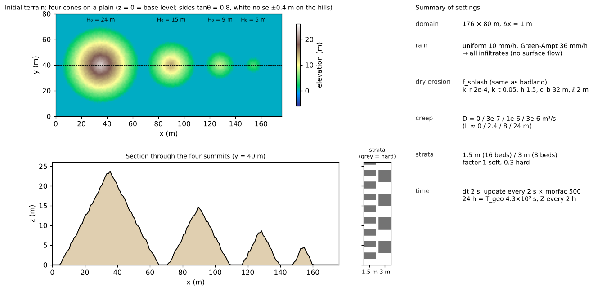

Upper left: initial terrain (dashed = position of the section). Lower left: section through
the four summits and the positions of the hard beds in the strata cases (columns). Right:
summary of the settings.

176 m × 80 m, Δx = 1 m (176 × 80 cells). Four conical hills of different height with a common
side slope (tanθ = 0.8 ≈ 39°) stand on a plain (z = 0 = base level of erosion).

- **Hills**: heights H₀ = 24 / 15 / 9 / 5 m (base radii 30 / 18.75 / 11.25 / 6.25 m). White
  noise (uniform ±0.4 m, fixed seed) is given only on the hills as seeds for rills (no
  particular wavelength is introduced).
- **Rain and infiltration**: a uniform 10 mm/h falls continuously. The Green-Ampt
  infiltration capacity of 36 mm/h exceeds it, so all the rain soaks in and no overland flow
  occurs.
- **Dry-slope erosion**: the same coefficients as badland ($`k_r`$ = 2×10⁻⁴, $`k_t`$ = 0.05,
  $`h`$ = 1.5, $`c_b`$ = 32 m, ℓ = 2 m, cap 0.2 m per update, base level 0).
- **Creep**: D = 0 / 3×10⁻⁷ / 1×10⁻⁶ / 3×10⁻⁶ m²/s (L ≈ 0 / 2.4 / 8 / 24 m; chosen to span the
  hill radii of 6 to 30 m).
- **Strata (contrast for bands)**: alternating hard and soft beds 1.5 m thick (factor 1 for
  soft beds, 0.3 for hard beds; 16 layers over z = 0 to 24 m), and alternating beds 3 m thick
  (8 layers).
- **Time**: dt = 2 s; the landform is updated every 2 s and its change is accelerated 500
  times by morfac. 24 hours = T_geo 4.3×10⁷ s (120 m of 10 mm/h rain). Z is written every 2
  hours (T_geo 3.6×10⁶ s).

| Case | Settings file | Creep D (m²/s) | L (m) | Strata |
|---|---|---|---|---|
| No creep | param_d0.txt | 0 | 0 | none |
| Weak creep | param_d3e-7.txt | 3×10⁻⁷ | 2.4 | none |
| Moderate creep | param_d1e-6.txt | 1×10⁻⁶ | 8 | none |
| Strong creep | param_d3e-6.txt | 3×10⁻⁶ | 24 | none |
| Strata 1.5 m | param_d0_strata.txt / param_d1e-6_strata.txt | 0 / 1×10⁻⁶ | 0 / 8 | 1.5 m thick |
| Strata 3 m | param_d0_strata3.txt / param_d3e-7_strata3.txt / param_d1e-6_strata3.txt | 0 / 3×10⁻⁷ / 1×10⁻⁶ | 0 / 2.4 / 8 | 3 m thick |

Each case takes 2 to 4 minutes (4 threads).

## How to run

```
cd examples/badland_round
make                                         # link to the executable and inputs (make_terrain.py writes z.txt)
make run                                     # run the 4 creep cases in turn
python3 plot_setup.py                        # figs/mechanism.png, setup.png (does not use the results)
python3 plot_results.py | tee analysis.txt   # figs/maps, sections, radial, rounding.png and the tables
make strata                                  # run the 5 strata cases in turn
python3 plot_results.py strata               # beds 1.5 m thick: figs/*_strata.png
python3 plot_results.py strata3              # beds 3 m thick: figs/*_strata3.png
```

With the argument `en` the figures are drawn with English labels into en/figs/
(`python3 plot_setup.py en`, `python3 plot_results.py en`, `python3 plot_results.py strata en`
and so on).

## Results

### Strength of creep and the shape of the hills

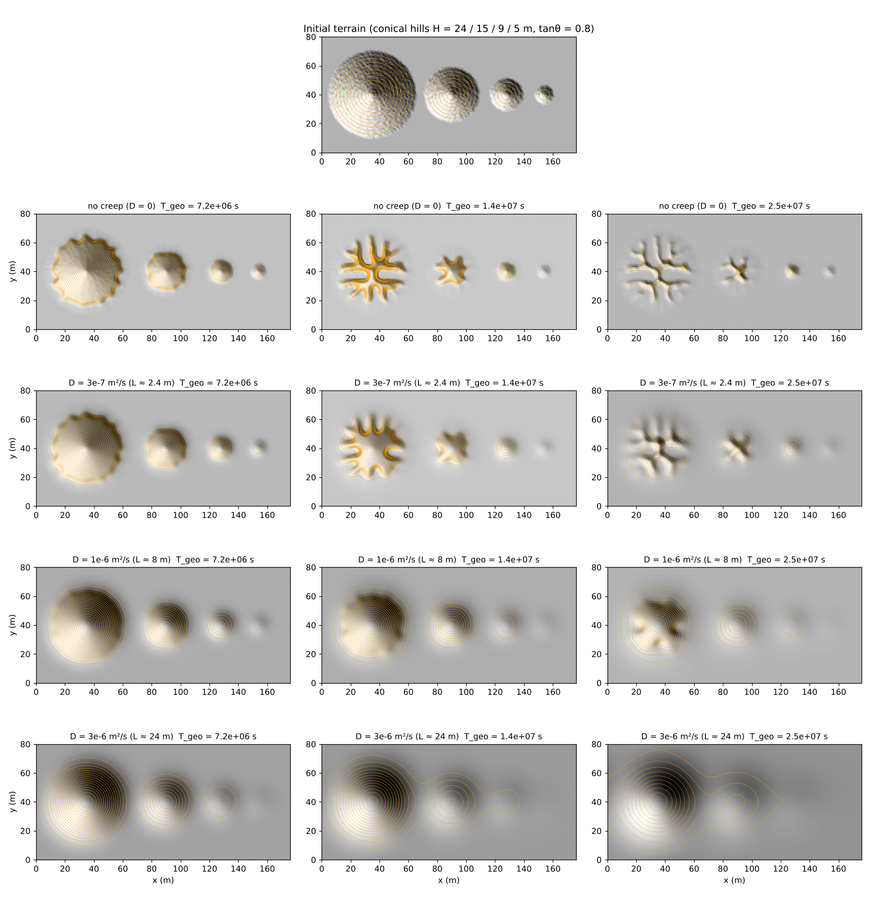

Top: initial terrain. Below: shaded relief (with contours) of the 4 cases (rows) × 3 times
(T_geo = 7.2×10⁶, 1.4×10⁷, 2.5×10⁷ s; columns).

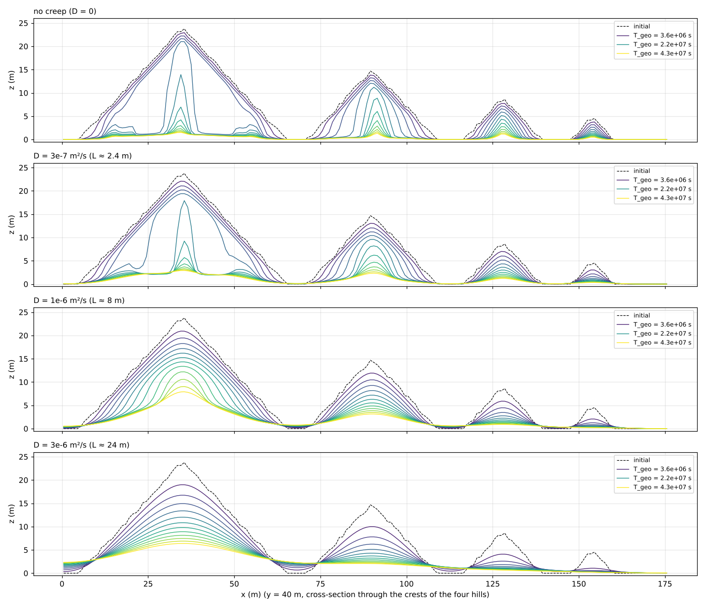

Evolution of the section through the four summits (y = 40 m) for each case (dashed = initial).

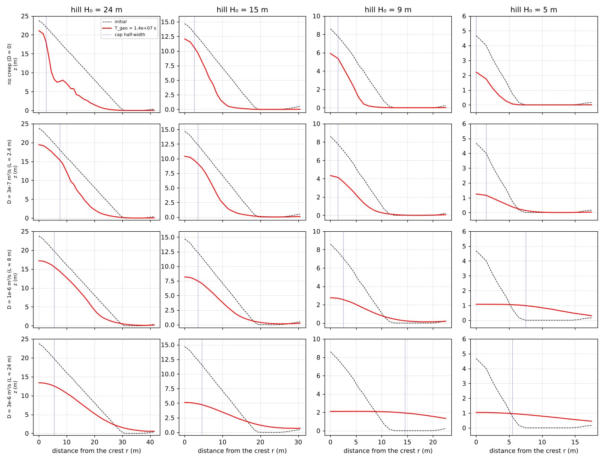

Azimuthally averaged radial profile of each hill (rows = cases, columns = hills; dashed =
initial, red = T_geo 1.4×10⁷ s, dotted = half-width of the rounded top).

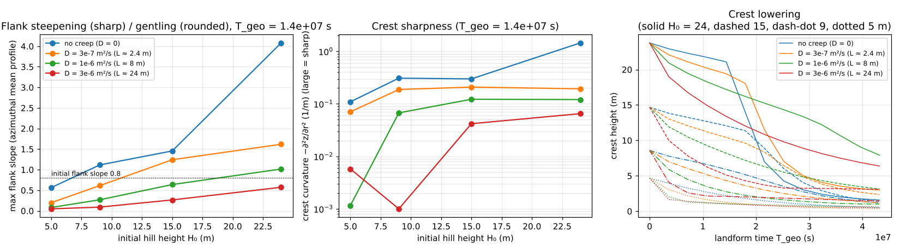

Left: maximum side slope against hill height (larger than the initial slope 0.8 = steepened
= the sharp type). Centre: curvature of the top $`-\partial^2 z/\partial r^2`$ (larger is
sharper). Right: height of the top against time (line style = hill).

Measures for each hill (T_geo = 1.44×10⁷ s, from the azimuthally averaged radial profile):

| Case | Hill H₀ (m) | Top height (m) | Maximum side slope | Top curvature −∂²z/∂r² (1/m) |
|---|---|---|---|---|
| D = 0 | 24 / 15 / 9 / 5 | 21.1 / 12.1 / 5.9 / 2.2 | 3.80 / 1.51 / 1.11 / 0.56 | 1.27 / 0.27 / 0.31 / 0.11 |
| D = 3×10⁻⁷ | same | 19.4 / 10.4 / 4.3 / 1.3 | 1.67 / 1.25 / 0.61 / 0.20 | 0.19 / 0.21 / 0.19 / 0.07 |
| D = 1×10⁻⁶ | same | 17.2 / 8.2 / 2.8 / 1.1 | 1.02 / 0.64 / 0.27 / 0.08 | 0.12 / 0.12 / 0.07 / 0.001 |
| D = 3×10⁻⁶ | same | 13.4 / 5.1 / 2.1 / 1.0 | 0.57 / 0.27 / 0.09 / 0.05 | 0.065 / 0.042 / 0.001 / 0.006 |

Budget check (24 hours):

| Case | Maximum surface water depth (m) | Final groundwater storage (m) | Cumulative rain (m) | Loss of surface volume Σ(z₀−z)Δx² (m³) | Sediment that left the domain (solid m³) | Ratio |
|---|---|---|---|---|---|---|
| D = 0 | 0 | 0.2400 | 0.2400 | 28169 | 16901 | 1.6667 |
| D = 3×10⁻⁷ | 0 | 0.2400 | 0.2400 | 25503 | 15302 | 1.6667 |
| D = 1×10⁻⁶ | 0 | 0.2400 | 0.2400 | 19725 | 11835 | 1.6667 |
| D = 3×10⁻⁶ | 0 | 0.2400 | 0.2400 | 11531 | 6919 | 1.6667 |

Overland flow is zero throughout, and the groundwater storage equals the cumulative rain
(10 mm/h × 24 h = 0.24 m). The loss of surface volume equals the sediment that left the domain
÷ (1 − porosity 0.4) to all digits, which also confirms that creep does not change the volume
(conservative form).

- **No creep (advective only)**: the hills shrink with their crests kept sharp, and the sides
  even steepen (initial 0.8 → 1.1 to 3.8). After T_geo ≈ 1.4×10⁷ s the hollow feedback lets
  gullies cut the hills radially, and the hills are dissected, leaving a pinnacle in the
  centre (sharp badlands of the Mancos type). That the gullies align with the grid axes and
  diagonals is an artefact of grid anisotropy.
- **D = 1×10⁻⁶ m²/s (L ≈ 8 m)**: the tops become convex, rounded caps and the sides become
  gentler (0.08 to 1.0). **The smaller the hill, the smaller (rounder) its top curvature**: the
  H₀ = 5 m hill becomes a flat dome as a whole, the 9 m hill a rounded mound, and the 24 m hill
  keeps traces of gullies on its sides while having a rounded top. This is the "rounded
  crests, rounder for lower hills" type. A gentle apron of soil carried by creep forms at the
  feet, and neighbouring hills join at their feet.
- **D = 3×10⁻⁶ m²/s (L ≈ 24 m)**: all hills become domes (haystack type) from the start, and no
  gullies form.
- The top is lowered faster with stronger creep at first (the cap of the top is shaved and
  carried to the sides), but since no dissection by gullies occurs it is slower later, and the
  hills survive longer.

### Adding bands (hard/soft contrast of horizontal strata)

Bands are not only differences in colour but also in hardness. With `spl_strata` (a table of
the bottom elevation and erodibility factor of each layer), alternating hard and soft beds 1.5
m thick (factor 1 for soft beds, 0.3 for hard beds; 16 layers over z = 0 to 24 m) are given, and
the cases with and without strata are compared for no creep (D = 0) and for D = 1×10⁻⁶ m²/s.
The factor applies only to dry erosion, not to creep.

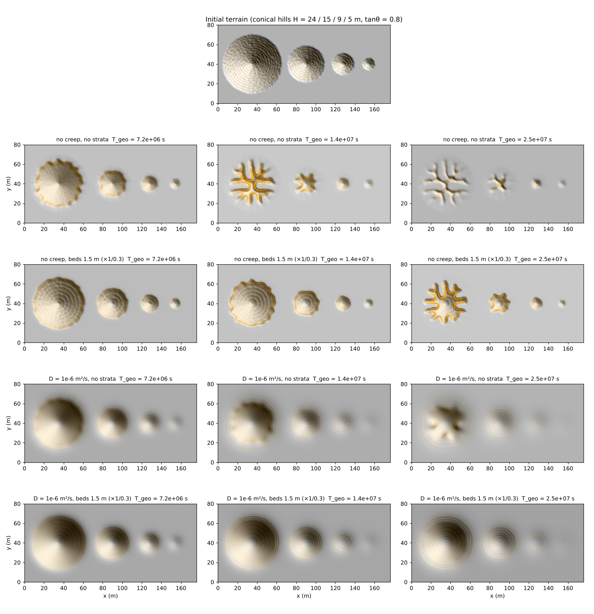

Top: initial terrain. Below: shaded relief of no creep without strata, no creep with strata,
D = 1×10⁻⁶ without strata and D = 1×10⁻⁶ with strata (rows) × 3 times (columns).

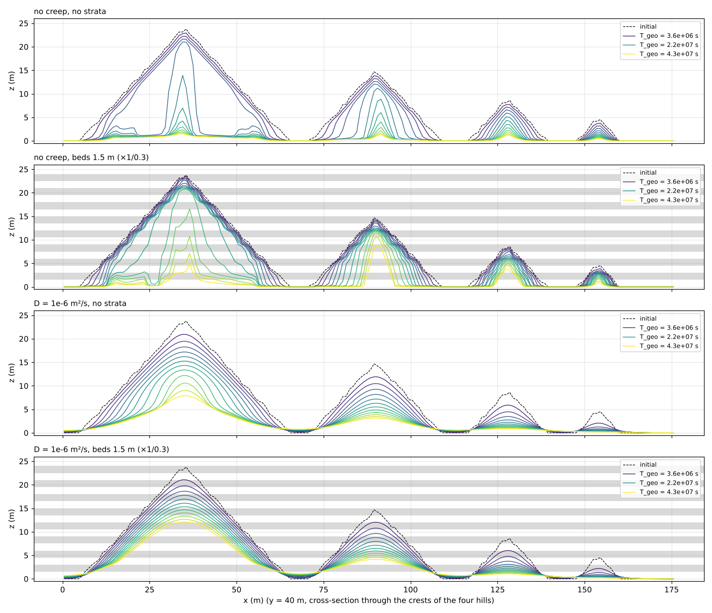

Evolution of the section through the four summits (grey bands = hard beds).

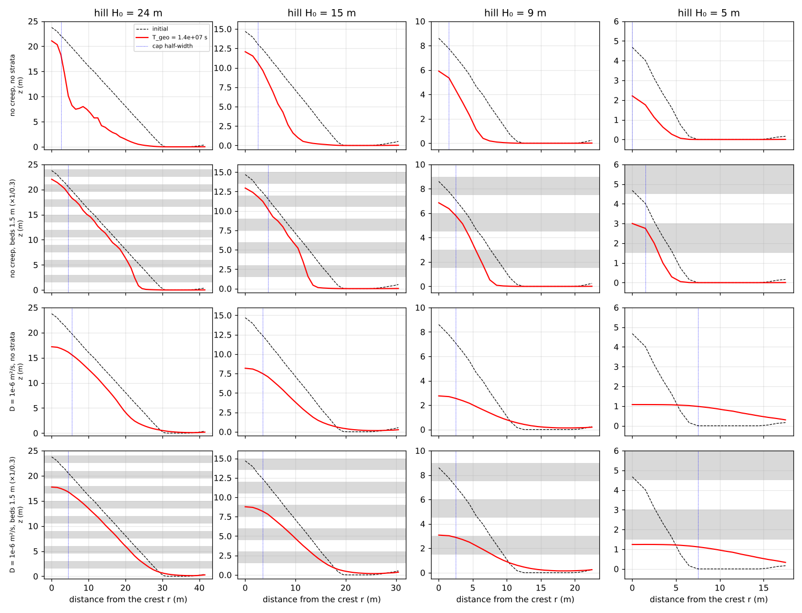

Azimuthally averaged radial profile of each hill (grey bands = hard beds).

| Quantity | D = 0, no strata | D = 0, strata | D = 1×10⁻⁶, no strata | D = 1×10⁻⁶, strata |
|---|---|---|---|---|
| Sediment that left the domain (solid m³, 24 hours) | 16901 | 16650 | 11835 | 8145 |
| Top height of the 24 m hill (m) (T_geo 1.44×10⁷ / 4.3×10⁷ s) | 21.1 / 1.5 | 22.0 / 5.9 | 17.2 / 7.9 | 17.8 / 12.4 |
| Maximum side slope (T_geo 1.44×10⁷ s, 24 m hill) | 3.80 | 1.77 | 1.02 | 0.82 |

- **No creep + strata**: the sides become **stepped**. The soft beds erode quickly down to the
  top of the hard bed below, where a flat step (bench) forms, and the face of the hard bed
  remains as a steep riser (step height = bed thickness 1.5 m). In plan view the contours
  gather at the tops of the hard beds into bands. The hard beds protect the edges of the
  hills, so the dissection by gullies is delayed (the top of the 24 m hill is still 22 m at
  1.44×10⁷ s), and in the end the hill becomes a table-like remnant capped by a hard bed (a
  mesa).
- **Creep + strata**: the steps are smoothed by creep into **gently undulating bands**, while
  the overall rounded form (convex top, gentle sides) is kept (the slope eases slightly at the
  hard beds). The total erosion falls to 70 % of the case without strata, and the hills stay
  higher (final top of the 24 m hill 12.4 m, 7.9 m without strata). "Hills with bands but
  without steps" correspond to this combination: the hard/soft contrast makes the bands and
  the diffusive process erases the steps.
- Whether the beds show as steps is set by the ratio of the step height (bed thickness) to
  the creep length L (the steps disappear for L ≫ bed thickness). The next section checks this.

### Do steps appear with beds 3 m thick?

The bed thickness is doubled to 3 m (8 layers) and no creep, D = 3×10⁻⁷ (L ≈ 2.4 m < bed
thickness) and D = 1×10⁻⁶ (L ≈ 8 m > bed thickness) are compared (`python3 plot_results.py
strata3`).

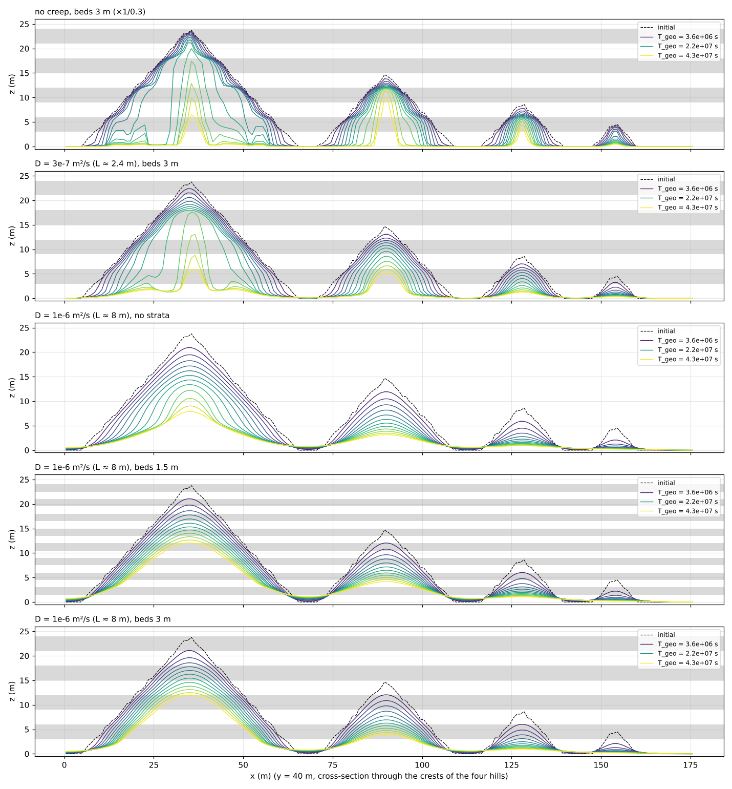

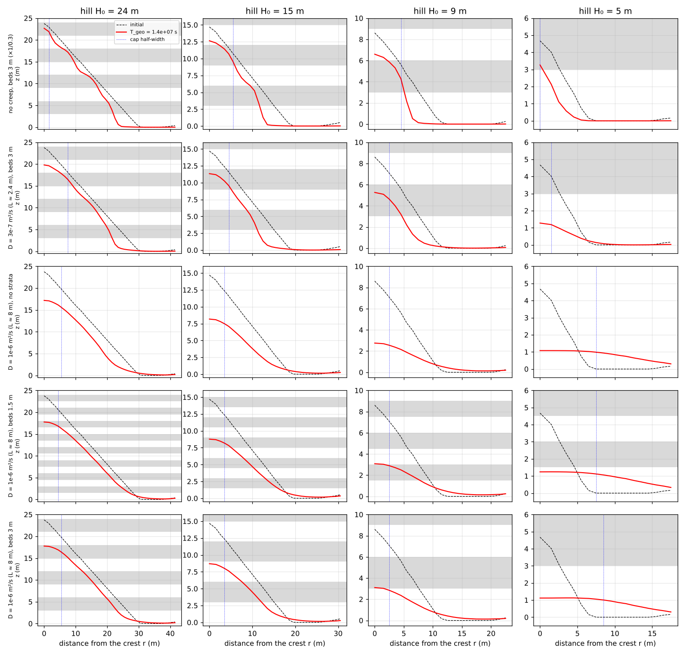

Measure of steps: on the azimuthally averaged profiles of the 24 m and 15 m hills, the
max/min ratio and relative variation of the local slope over the part of the sides between
15 % and 85 % of the top height above the foot (large if steps are present; T_geo =
1.44×10⁷ s):

| Case | Bed thickness (m) | L (m) | Slope max/min (24 m hill) | Relative variation (24 m / 15 m hill) |
|---|---|---|---|---|
| No creep, strata | 3 | 0 | 4.6 | 0.42 / 0.39 |
| D = 3×10⁻⁷, strata | 3 | 2.4 | 2.5 | 0.28 / 0.22 |
| D = 1×10⁻⁶, no strata | – | 8 | 1.6 | 0.14 / 0.15 |
| D = 1×10⁻⁶, strata | 1.5 | 8 | 1.5 | 0.09 / 0.09 |
| D = 1×10⁻⁶, strata | 3 | 8 | 1.4 | 0.11 / 0.14 |

- **With D = 1×10⁻⁶ (L ≈ 8 m), no steps appear even with beds 3 m thick**. The variation of the
  side slope is the same as without strata (relative variation 0.11 to 0.14), and the profile
  stays smoothly convex. The hard beds show only in the total erosion (80 % of the case
  without strata) and in how the hills survive.
- **With D = 3×10⁻⁷ (L ≈ 2.4 m < bed thickness 3 m), steps appear**. Gentle steps (inflections of
  the slope) line up at the tops of the hard beds (z = 6, 12, 18 m), and the relative
  variation of 0.28 lies between no creep (0.42) and no strata (0.14). It is the 3 m steps
  without creep (flat benches and steep risers) rounded by creep.
- So whether steps are visible is set by the ratio of the bed thickness to L (steps for bed
  thickness ≳ L, bands only for bed thickness ≪ L), and hills with bands but no steps
  indicate beds thinner than the creep length L (or a small hard/soft contrast).

## What this model cannot represent (differences from the real phenomenon)

- **Creep is linear diffusion that moves only z**: the mechanics of swelling and shrinking clay
  and of small mudflows are not solved; the terrain is only smoothed with a flux proportional
  to the slope. The strata factor does not apply to creep, so the effect of hard beds
  restricting the supply of soil to creep is represented only through the factor on the dry
  erosion side.
- **Strata are horizontal only**: the strata are a function of elevation only; tilted beds and
  folds cannot be represented.
- **The direction of the gullies includes grid artefacts**: that the gullies without creep align
  with the grid axes and diagonals comes from the anisotropy of the discretised cones and
  remains even with noise of ±0.4 m. The forms (sharp crests, steepening sides, dissection) can
  be compared, but the number and direction of the gullies are not physical.
- **The rate of the deep stage depends on the grid**: the rate of the deep stage of dry-slope
  erosion depends on the grid spacing (grid convergence in [badland](../../badland/en/README.md)).
  This example aims at comparing forms; use the times for relative comparisons.
- **The coefficients are not calibrated**: the dry-erosion coefficients are those of badland, and
  creep D was chosen so that L spans the hill sizes. Since the landform time is driven by
  continuous 10 mm/h rain, converting to an arid region with 250 mm of annual rain makes T_geo
  4.3×10⁷ s (120 m of rain) about 480 years and D = 1×10⁻⁶ m²/s about 0.1 m²/yr. This is larger
  than the published values for soil creep (0.001 to 0.05 m²/yr; Fernandes and Dietrich 1997)
  and assumes active movement of the surface layer of swelling clay.

## Notes

- The ratio of the loss of surface volume to the sediment that left the domain equals
  1/(1 − 0.4) = 1.6667 to all digits, which checks the dry-erosion ledger and the conservation of
  creep (no change of volume) at the same time (the budget table above).
- The soil `sd0` is made much thicker than the hills (100 m) and the base level of erosion is
  given by `spl_zbase` (for the same reason as badland).
- The stability condition of creep $`D\,\Delta t_s(1/\Delta x^2 + 1/\Delta y^2) \le 1/2`$
  (Δt_s = update interval × morfac = 1000 s) is satisfied even for D = 3×10⁻⁶ (0.006).

## Starting points for sensitivity experiments

- `creep_d`: length L (∝ D). Which hills round off first changes within the range where L spans
  the hill radii.
- Bed thickness and factor in `spl_strata`: how steps and bands appear (ratio of bed thickness
  to L).
- `HILLS` (positions and heights of the hills) and `TANB` (side slope) in make_terrain.py: the
  range of hill sizes.

## References

- Culling, W. E. H. (1960): Analytical theory of erosion. *J. Geol.*, 68, 336–344.
- Fernandes, N. F. and Dietrich, W. E. (1997): Hillslope evolution by diffusive processes: The
  timescale for equilibrium adjustments. *Water Resour. Res.*, 33, 1307–1318.
- Gilbert, G. K. (1909): The convexity of hilltops. *J. Geol.*, 17(4), 344–350.
- Perron, J. T., Kirchner, J. W. and Dietrich, W. E. (2009): Formation of evenly spaced ridges
  and valleys. *Nature*, 460, 502–505.
- Schumm, S. A. (1956): The role of creep and rainwash on the retreat of badland slopes.
  *Am. J. Sci.*, 254(11), 693–706. doi:10.2475/ajs.254.11.693 (checked against the bibliographic
  record)
