# badland_storm — 豪雨のときだけ表面流が現れる崖(乾式斜面侵食と湿潤侵食の切り替え)

[English](en/README.md)

[badland](../badland/README.md) の主ケース(高さ 30 m・幅 60 m の台地が 56° の崖で海に落ちる。
乾式斜面侵食 f_splash、ℓ = 2 m、侵食基準面 = 海面)の浸透能を下げて、**豪雨のときだけ
表面流が現れる**雨を与え、濡れた斜面の侵食([斜面浸食](../../docs/users_guide/geomorph.md#斜面浸食f_wash)
f_wash と[浮遊砂](../../docs/users_guide/geomorph.md#浮遊砂f_suspend) f_suspend)を重ねたとき、
地形がどう変わるかを見る例題です。比べる相手は、同じ雨が全量しみ込む構成(表面流なし)です。
湿潤侵食を強くした構成と、そのときガリーの間隔が格子幅で変わるかどうか(と、その対処)も
比べます。値は現象を見やすくするための模式値で、湿潤侵食の係数は校正していません。

乾式斜面侵食の侵食則は ENCflow の開発者による**独自の定式化**で、論文としては未発表です
(badland の「再現に必要な機構」を参照)。

## 実際の崖で起きていること

- **雨の強さが浸透能を超えた分だけが地表を流れる**(Horton 1933): ふだんの雨はしみ込み、
  短い豪雨のときだけ地表に水が流れる斜面があります。浸透能が雨の強さを常に上回る斜面では、
  表面流は生じません。
- **乾いた斜面と濡れた斜面では動き方が違う**: 乾いた急斜面では粒子が一つずつ転がり
  落ちます(dry ravel。Gabet 2003)。表面が濡れていると、粒子は水でつながって転がり
  落ちにくくなり、代わりに雨滴の衝撃と地表を流れる水が粒子をはがして運びます。
- **表面流は谷を刻むことも、斜面をならすこともある**: 集まった流れはリルやガリーを刻み、
  密なガリーの斜面を作ります(表面流の侵食で谷を作る地形発達モデルの標準。Howard 1994)。
  一方、薄く広がった流れは斜面を一様に削ります。
- **リルには幅がある**: リルやガリーは流量に応じた幅(数十 cm〜数 m)を持ちます。格子より
  狭い流れの集中をどう扱うかで、計算されるガリーの間隔が変わります。

## 再現に必要な機構

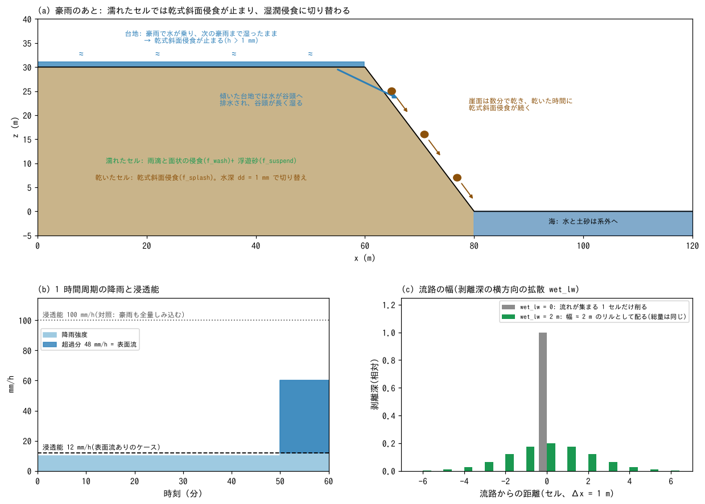

模式図。(a) 豪雨のあとの台地と崖の縦断: 平坦な台地には水が残って次の豪雨まで湿ったままで、
乾式斜面侵食が止まる。崖面は数分で乾き、乾いた時間に乾式斜面侵食が続く。台地を傾けると
水は谷頭から排水され、谷頭が長く湿る。(b) 1 時間周期の降雨と浸透能: 豪雨の浸透能を超えた
分(48 mm/h)だけが表面流になる。(c) 剥離深の横方向の拡散 `wet_lw`: 流れが集まる 1 セルの
剥離を、幅 ≈ ℓ_w のリルとして周りのセルに配る(総量は同じ)。

| 実際の現象 | モデルの機構 | 設定 |
|---|---|---|
| 豪雨のときだけ雨が浸透能を超えて表面流になる | 1 時間周期の降雨(50 分 10 mm/h + 10 分 60 mm/h)と、一定の浸透能(Green-Ampt、`gw_psif = 0`) | `prtype = 1`・`prval`、`gw_ksv_mmh = 12`(対照は 100) |
| 乾いた斜面: 粒子の転落と雨滴のはね | 乾式斜面侵食(水深 h ≤ dd の乾いたセルだけ) | `f_splash`・`spl_*`(badland と同じ係数) |
| 濡れた斜面: 雨滴による剥離、面状の侵食、流れによる運搬 | 斜面浸食(雨滴 + 面状)と浮遊砂(濡れたセルだけ) | `f_wash`・`wash_kr`・`wash_kf`、`f_suspend`・`susp_esa` |
| 乾湿の切り替え | 水深 dd = 1 mm を境に乾式と湿式を切り替える(二重に数えない) | `dd`(既定 1 mm) |
| 台地にたまった水の排水 | 浅水流。台地を崖へ 2 % 傾けると、水は谷頭から排水される | make_terrain.py の `--tilt 0.02` |
| リルの幅 | 剥離深を標準偏差 ℓ_w のガウス核で隣のセルへ配ってから地形に適用する(固体の総量は保存) | `wet_lw`(結果 5) |
| 海が水と土砂を運び去る | 海域マスクのセルには地形の変化も流れもなく、流れ込んだ水と土砂は系外へ | `fn_sw` |
| 長い時間 | 地形の変化だけを morfac 倍に加速する(地形時間) | `dt_geomorph`、`morfac = 50` |

乾いたセルと濡れたセルの侵食は、水深 1 mm の閾値 1 本で切り替わります。湿潤侵食の係数
(`wash_kf`・`susp_esa`)は、急な崖の薄い流れでは掃流力が限界の 10³ 倍にもなるので、既定値
のままでは 1 回の豪雨で数 m 削れて計算が破綻します。結果 1・2 は乾式の侵食の速さ
(≈ 3×10⁻⁷ m/s)と同じ程度の桁に下げた値、結果 3〜5 はさらに谷底を刻む側に振った値です。

## 幾何と設定

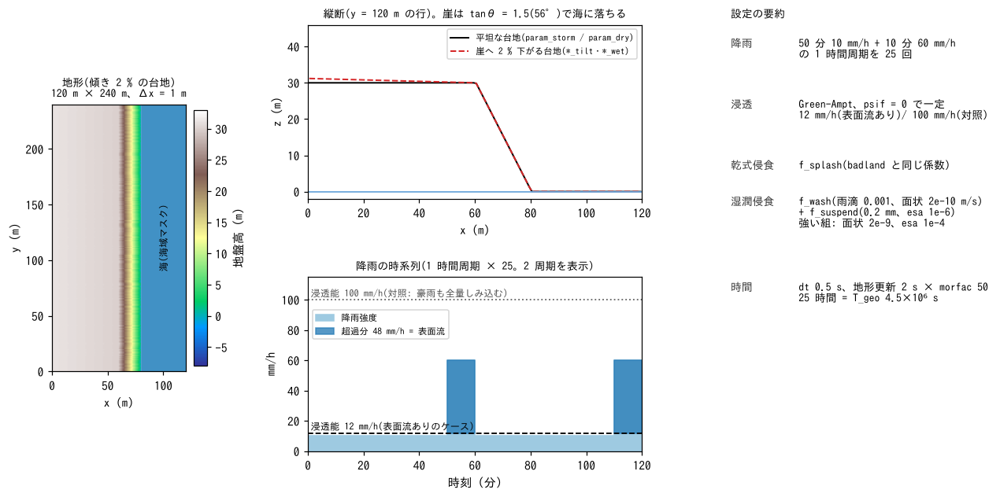

左: 地形(崖へ 2 % 下がる台地。青 = 海域マスク)。中上: 縦断(実線 = 平坦な台地、破線 =
2 % 傾けた台地)。中下: 降雨の時系列と浸透能(2 周期を表示)。右: 設定の要約。

地形は badland の主ケースと同じです(120 m × 240 m、Δx = 1 m。高さ 30 m・幅 60 m の台地が
tanθ = 1.5 の崖で海に落ち、崖縁に白色雑音 ±0.5 m)。台地を崖へ向かって 2 % 傾けた地形も
使います(平坦な台地に水がたまるのは幾何の人工物でもあるため)。

- **降雨**: 1 時間周期で 25 回。50 分は 10 mm/h(浸透能以下 = 全量浸透、乾式斜面侵食が
  働く)、10 分は 60 mm/h(豪雨。浸透能 12 mm/h を超える 48 mm/h が表面流)。時系列は線形
  補間されるので、各区間の両端を与えて階段にしています。
- **浸透**: Green-Ampt で `gw_psif = 0`(浸透能が一定)。表面流ありのケースは 12 mm/h、対照は
  100 mm/h(豪雨も全量しみ込む)。
- **乾式斜面侵食**: badland と同じ係数($`k_r`$ = 2×10⁻⁴、$`k_t`$ = 0.05、$`h`$ = 1.5、
  $`c_b`$ = 32 m、ℓ = 2 m、侵食基準面 0)。
- **湿潤侵食**: 斜面浸食(雨滴 `wash_kr = 0.001`、面状 `wash_kf = 2×10⁻¹⁰` m/s)と浮遊砂
  (粒径 0.2 mm、`susp_esa = 10⁻⁶`)。結果 3〜5 は `wash_kf = 2×10⁻⁹`、`susp_esa = 10⁻⁴`
  (以下「強い湿潤侵食」)。
- **時間**: dt = 0.5 s(表面流のクーラン条件)、地形の更新は 2 s ごとで morfac = 50
  (badland の 500 では、流れの集中の正のフィードバックが 1 回の更新で暴走する)。25 時間 =
  25 周期で T_geo = 4.5×10⁶ s(badland の主ケースの半分 = 谷頭が円形劇場状に台地へ食い込む
  段階)。1 周期ごと(豪雨の終わり)に Z・H・Sd を出力します。

| ケース | 設定ファイル | 浸透能 | 台地 | 湿潤侵食 | Δx | 周期 | 計算時間の目安 |
|---|---|---|---|---|---|---|---|
| 対照(全量浸透) | param_dry.txt | 100 mm/h | 平坦 | (働かない) | 1 m | 25 | 約 8 分 |
| 表面流あり | param_storm.txt | 12 mm/h | 平坦 | 弱い | 1 m | 25 | 約 22 分 |
| 対照・傾き | param_dry_tilt.txt | 100 mm/h | 2 % | (働かない) | 1 m | 25 | |
| 表面流あり・傾き | param_storm_tilt.txt | 12 mm/h | 2 % | 弱い | 1 m | 25 | |
| 表面流の水理だけ・傾き | param_stormnowet_tilt.txt | 12 mm/h | 2 % | なし(f_wash・f_suspend を切る) | 1 m | 25 | |
| 強い湿潤侵食 | param_storm_wet.txt | 12 mm/h | 2 % | 強い | 1 m | 25 | |
| 強い湿潤侵食・格子 | param_storm_wet_dx2.txt / param_storm_wet_dx05.txt | 12 mm/h | 2 % | 強い | 2 / 0.5 m | 10 | 約 3 分 / 約 60 分(2 スレッド) |
| + リルの幅 ℓ_w = 2 m | param_storm_wet_lw_dx2.txt / param_storm_wet_lw.txt / param_storm_wet_lw_dx05.txt | 12 mm/h | 2 % | 強い + `wet_lw = 2` | 2 / 1 / 0.5 m | 10 | |

計算時間は 4 スレッドの目安(空欄は未計測。同じ Δx・周期数のケースと同程度)。Δx = 0.5 m の
2 ケースは計算量のため y 方向を半分(120 m)にし、dt = 0.125 s にしています(注意を参照)。

## 実行方法

```
cd examples/badland_storm
make                              # 実行ファイルへのリンクと入力(make_terrain.py が平坦・傾き・Δx 2 m / 0.5 m の地形を作る)
make run                          # 結果 1・2 の 5 ケースを順に計算
python3 plot_setup.py             # figs/mechanism.png・setup.png(計算結果は使わない)
python3 plot_storm.py             # 結果 1: figs/maps.png・series.png・flow.png と数表
SUF=_tilt python3 plot_storm.py   # 結果 2: figs/*_tilt.png
make wet                          # 結果 3 の強い湿潤侵食(param_storm_wet.txt)
SUF=_wet python3 plot_storm.py    # 結果 3: figs/*_wet.png(対照は result_dry_tilt)
make conv                         # 結果 4・5 の 5 ケース(Δx = 0.5 m は 1 時間前後)
python3 conv_dx.py                # 結果 4: figs/conv_dx.png と数表
SET=lw python3 conv_dx.py         # 結果 5: figs/conv_dx_lw.png と数表
```

引数 `en` を付けると英語ラベルの図を en/figs/ に描きます(`python3 plot_setup.py en`、
`python3 plot_storm.py en`。conv_dx.py の図には日本語がありません)。plot_storm.py と
conv_dx.py は [badland](../badland/README.md) の plot_results.py の解析関数を使います。

## 結果

### 結果 1: 平坦な台地

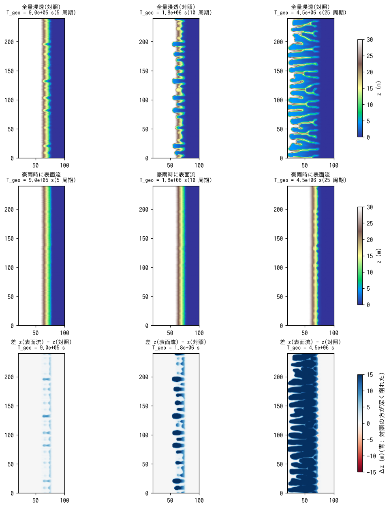

上段: 対照(全量浸透)、中段: 表面流あり、下段: 差 z(表面流) − z(対照)(青 = 対照の方が
深く削れた、赤 = 表面流ありの方が深く削れた)。左から T_geo = 9×10⁵ s(5 周期)、
1.8×10⁶ s(10 周期)、4.5×10⁶ s(25 周期 = 最終)。

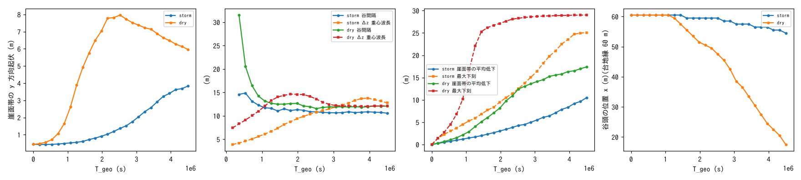

時系列(storm = 表面流あり、dry = 対照)。左から: 崖面帯の起伏、谷間隔と Δz の重心波長、
崖面帯の平均低下と最大下刻、谷頭の位置。

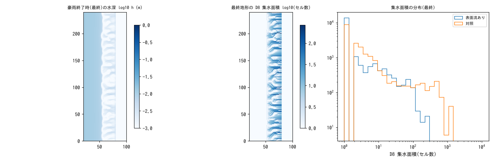

表面流ありの最終時刻(豪雨の終わり)の水深(左)と最終地形の D8 集水面積(中)、集水面積の
分布(右。表面流ありと対照)。

| 量 | 対照(全量浸透) | 豪雨時に表面流 |
|---|---|---|
| 崖面帯の起伏 (m): 最大 / 最終 | 7.97 / 5.96 | 3.78 / 3.78 |
| 谷間隔 (m): T_geo 1.8×10⁶ / 4.5×10⁶ s | 12.6 / 12.1 | 11.2 / 11.1 |
| 谷の本数(最終) | 19 | 21 |
| 崖面帯の平均低下 (m): 1.8×10⁶ / 4.5×10⁶ s | 7.1 / 17.4 | 2.8 / 10.1 |
| 最大下刻 (m)(最終) | 29.0 | 25.2 |
| 谷頭の位置 x (m)(台地縁 60 m): 1.8×10⁶ / 4.5×10⁶ s | 53.5 / 17.5 | 59.5 / 54.5 |
| 台地縁〜内部(初期 30 m のセル)の平均低下 (m) | 12.4(谷頭の後退で解体) | 0.76(縁の切れ込みの分。内部 x < 45 m は 0.2 mm) |
| 勾配の 99 % 点・勾配 > 1 の割合(最終) | 12.2・0.33 | 9.1・0.12 |
| 豪雨の終わりの水深 (m): 陸の中央値 / 最大 | – | 0.010 / 0.012 |
| 乾式斜面侵食で系外へ出た土砂 (m³) | 1.44×10⁵ | 3.5×10⁴ |

**表面流を入れると、谷は深くならず、台地は解体されませんでした。** 対照では谷頭が 25 周期で
台地縁から 42 m 後退して櫛の歯状の尾根に解体されるのに、表面流ありでは 5.5 m しか後退せず、
崖面に浅い切れ込み(起伏 3.8 m。対照 8.0 m)が並ぶだけです。谷間隔(11〜12 m)は変わりません。

原因は「水が乗っているセルでは乾式斜面侵食が働かない」ことです。2 周期を 5 分ごとに出力して
濡れたセルの割合を追うと(param_storm.txt の tt を 7200、dt_file を 300 にした計算):

| 時刻 (分) | 濡れたセルの割合: 陸全体 / 台地 / 崖面 | 平均水深 (mm) |
|---|---|---|
| 0〜50(初回の 10 mm/h) | 0 / 0 / 0 | 0 |
| 55〜60(豪雨) | 0.79〜0.83 / 0.97〜0.98 / 0.25〜0.35 | 3〜5.7 |
| 65〜110(2 周期目の 10 mm/h) | 0.72〜0.75 / 0.95〜0.97 / 0.01〜0.10 | 5.1 → 2.7 |

豪雨で台地に 8 mm の水が乗ると、台地は平坦なので水が抜けず、次の 50 分間も 10 mm/h の雨が
降り続くので正味の浸透は 2 mm/h しかなく、**台地は次の豪雨までずっと濡れたまま**になります
(台地の 95 % 以上)。崖面は数分で乾きます。その結果:

- 台地と、台地から水が流れ込む谷頭(円形劇場)は常に濡れていて、乾式斜面侵食が止まります。
  濡れたセルの侵食は雨滴の項(wash_kr × P)だけで、台地の内部は 25 周期で 1 cm も下がりません。
  谷頭の後退(乾式の凹地形フィードバック)が起きません。
- 崖面は豪雨の間だけ濡れ、乾いた時間に乾式斜面侵食が続くので、崖面の谷はできます(間隔は
  同じ)が、谷頭が台地に食い込めないので深くなりません。
- 豪雨時の表面流による面状の侵食と浮遊砂の輸送(係数を小さくした設定)は谷底をわずかに削る
  程度で、流れの集中による谷の深化は見えません(流れが薄く、10 分しか続かないため)。

つまりこの設定では、表面流は「谷を刻む」のではなく「乾式斜面侵食を止める」方向に働き、
崖は切れ込みの浅い急崖にとどまります。

### 結果 2: 台地に 2 % の傾き

平坦な台地に水がたまるのは幾何の人工物でもある(実際の台地は崖縁へ向かう緩い傾きを持つ)
ので、台地を崖に向かって 2 % 傾け、たまった水が谷頭へ排水される構成で同じ比較をしました。

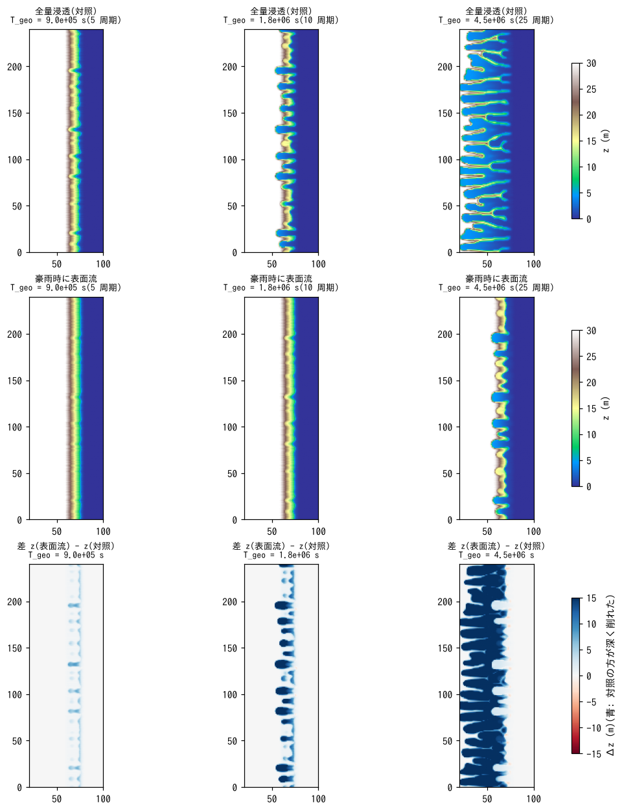

結果 1 の地図と同じ並び(傾けた台地。下段の色の対応も同じ)。

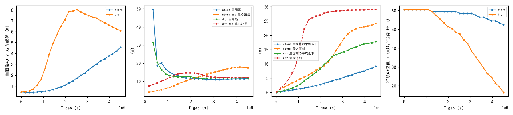

時系列(storm = 表面流あり・傾き、dry = 対照・傾き)。

| 量 | 対照(全量浸透) | 豪雨時に表面流 | 表面流の水理だけ(湿潤侵食なし) |
|---|---|---|---|
| 崖面帯の起伏 (m): 最大 / 最終 | 8.03 / 6.09 | 4.39 / 4.39 | 4.39 / 4.39 |
| 谷間隔 (m): T_geo 1.8×10⁶ / 4.5×10⁶ s | 12.7 / 12.0 | 11.7 / 11.3 | 11.8 / 10.7 |
| 崖面帯の平均低下 (m): 1.8×10⁶ / 4.5×10⁶ s | 7.1 / 17.8 | 2.5 / 9.1 | 2.5 / 10.0 |
| 最大下刻 (m)(最終) | 29.0 | 24.1 | 26.2 |
| 谷頭の位置 x (m)(台地縁 60 m): 1.8×10⁶ / 4.5×10⁶ s | 53.5 / 16.5 | 59.5 / 51.5 | 60.5 / 53.5 |
| 台地縁〜内部(初期 30 m のセル)の平均低下 (m) | 12.8 | 0.81 | 0.69(内部 x < 45 m は 7 mm) |
| 豪雨の終わりの水深 (m): 陸の中央値 / 99 % 点 | – | 0.002 / 0.008 | – |

傾けると台地の水は 20 分ほどで抜けます(同じく 2 周期を 5 分ごとに出力すると、豪雨の終わりに
陸の 85 %・台地の 91 % が濡れていて、10 分後に 5 %、20 分後に 0)。それでも結果は平坦な台地と
ほぼ同じで、**表面流を入れた方が谷の発達が遅く、台地は解体されません**(谷頭の後退 8.5 m、
対照 43.5 m)。

湿潤侵食(f_wash・f_suspend)を切って表面流の水理だけを入れた変種(param_stormnowet_tilt.txt)
も、湿潤侵食ありとほぼ同じ結果でした(谷頭 53.5 m、起伏 4.39 m)。つまり**湿潤侵食の寄与は
ほとんどなく、表面流の効果の正体は「水が乗っている間、乾式斜面侵食が止まる」こと**です。
効き方は 2 段あります。

1. 乾式斜面侵食は降雨強度 P に比例するので、60 mm/h の豪雨 10 分は 10 mm/h の 1 時間分に
   相当し、対照(全量浸透)では乾式斜面侵食の駆動力の半分近く(60 分平均 18.3 mm/h のうち
   10 mm/h 分)を豪雨が担っています。浸透能を下げると、この最も効く雨が表面流になって乾式
   斜面侵食から外れます。
2. 豪雨のあとも、台地の水は谷頭(円形劇場)を通って排水されるので、凹地形フィードバックが
   最も強い谷頭が最も長く濡れ(台地縁の帯は豪雨の終わりから 20 分まで濡れている)、谷頭の
   後退が止まります。崖面は数分で乾くので崖面の谷(間隔は同じ)はできますが、台地に食い
   込めません。

その結果、表面流ありの地形は「崖面に浅い切れ込みが並ぶ急崖」で、対照の「台地が櫛の歯状の
尾根に解体される」地形にはなりません。同じ相対起伏(4 m)に達するのに対照の約 3 倍の時間が
かかります。

湿潤侵食が効かないのは、急な崖の薄い流れが 10 分しか続かず、係数を破綻しない桁まで下げて
いるためです。表面流が谷を刻む(流れの集中による谷底の下刻)側に振るには、wash_kf・
susp_esa を上げて morfac をさらに下げる(実時間を延ばす)必要があり、その場合は谷底の
1 セルへの集中がどこまで現実的かを、格子幅を変えて確かめる必要があります(結果 3〜5)。

### 結果 3: 表面流が谷底を刻む側に振る(湿潤侵食の係数を上げる)

浮遊砂の平衡濃度の係数を既定の susp_esa = 10⁻⁴、面状侵食の係数を wash_kf = 2×10⁻⁹(結果 1・2
の 100 倍・10 倍)に上げた構成(param_storm_wet.txt。台地は傾き 2 %、morfac 50)。

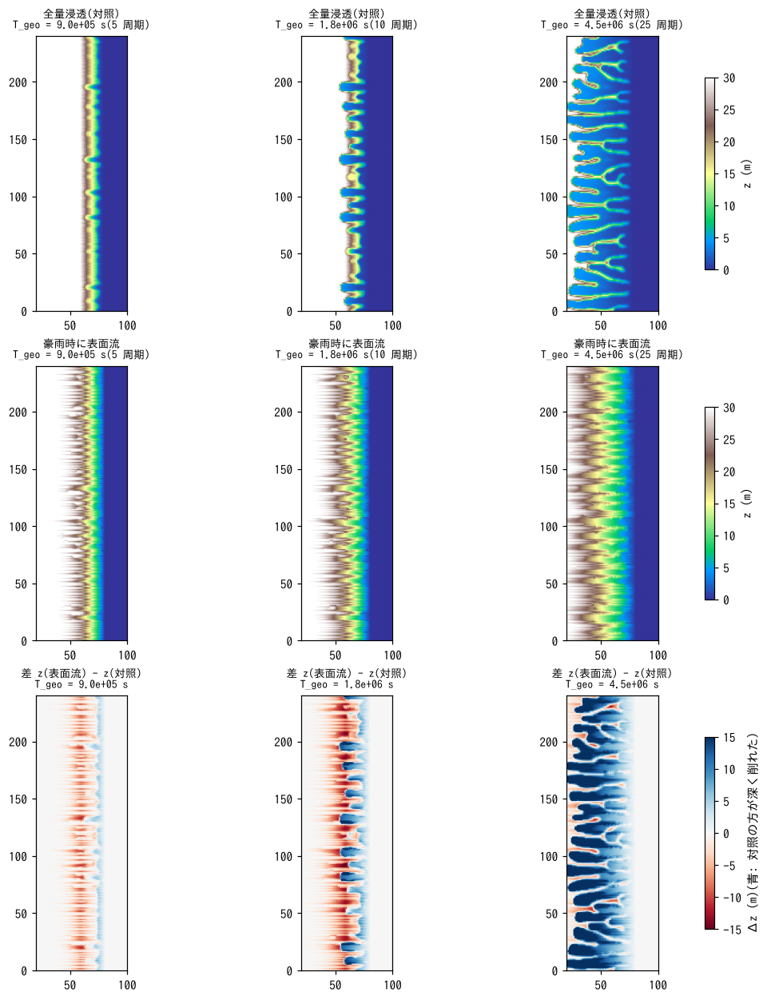

結果 1 の地図と同じ並び(上段の対照は傾けた台地の全量浸透 = result_dry_tilt)。

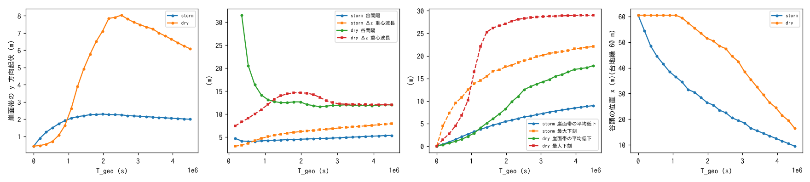

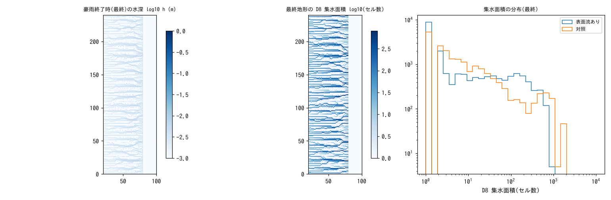

| 量(T_geo 4.5×10⁶ s) | 対照(全量浸透) | 表面流あり・弱い湿潤侵食(結果 2) | 表面流あり・強い湿潤侵食 |
|---|---|---|---|
| 崖面帯の起伏 (m): 最大 / 最終 | 8.0 / 6.1 | 4.4 / 4.4 | 2.7 / 2.0 |
| 谷間隔 (m)(最終)/ 本数 | 12.0 / 19 | 11.3 / 20 | **6.5 / 37** |
| 谷頭の位置 x (m)(台地縁 60 m) | 16.5 | 51.5 | **7.5** |
| 崖面帯の平均低下 (m) | 17.8 | 9.1 | 9.5 |
| 最大下刻 (m) | 29.0 | 24.1 | 22.4 |
| 勾配の中央値 / 90 % 点 / 99 % 点(最終、陸) | 0.12 / 6.2 / 12.4 | – / – / 8.6 | 0.65 / 2.5 / 3.5 |
| x = 30 / 45 / 60 m の列: 平均標高 (m) | 13.9 / 7.7 / 3.8 | – | 24.6 / 17.7 / 10.6 |
| 同: y 方向の起伏(標準偏差) (m) | 10.9 / 6.4 / 4.0 | – | 2.4 / 2.9 / 2.3 |

**地形は一変しました。** 対照(乾式だけ)が「鋭い尾根に挟まれた深い谷が台地を櫛の歯状に
解体する」地形なのに対し、強い湿潤侵食では:

- 谷間隔が半分(6.5 m、37 本)の**密なガリー網**になり、谷頭は 1 周期目から台地に食い込んで
  25 周期で 52 m 後退します(対照 43 m。しかも対照は 6 周期目まで動かない)。
- 谷は浅く(起伏 2〜3 m)、崖は 56° の壁を失って**勾配 0.5〜1 の緩い斜面**にならされます
  (x = 30〜60 m の平均標高が対照より 7〜11 m 高い = 崖が後退するのではなく、台地縁から
  斜面全体が下がる)。
- 豪雨の水は谷底に集まり(豪雨の終わりの水深: 陸の中央値 0.6 mm、99 % 点 6 mm、最大 1.8 cm。
  期間中の最大水深は谷底で 15 cm)、
  D8 の流域網は台地縁に直交する平行なガリーが密に並ぶ形で、対照のような樹枝状の枝分かれは
  少なくなります。

乾式の凹地形フィードバックが「谷頭の円形劇場を深く刻んで尾根を残す」機構なのに対し、表面流
の面状の侵食は「流れが集まる所から順に、斜面全体をならしながら下げる」機構で、同じ出発点から
**密なガリーの斜面**と**鋭い稜線の深い谷**という別の地形に分かれます。このモデルの中では、
鋭い稜線の深い谷ができるのは、表面流がほぼ生じない(浸透能が豪雨を上回る)場合です。

ただし、谷間隔 6.5 m は ℓ = 2 m の選択則(≈ 4.4〜6 ℓ)より短く、表面流の集中(1 セル幅の
流路)が間隔を決めています。格子幅を変えると間隔が変わり、収束しません(結果 4)。

### 結果 4: ガリー間隔の格子収束(Δx = 2 / 1 / 0.5 m)

結果 3 の構成(強い湿潤侵食、台地に傾き)で格子幅だけを変えました
(param_storm_wet_dx2.txt / param_storm_wet.txt / param_storm_wet_dx05.txt)。初期の擾乱は同じ
1 m 格子の白色雑音を各格子に写したもの(make_terrain.py --dx)で、比べる時刻は 5・10 周期目
(T_geo 9×10⁵・1.8×10⁶ s)。本数は 100 m あたりに換算しています。

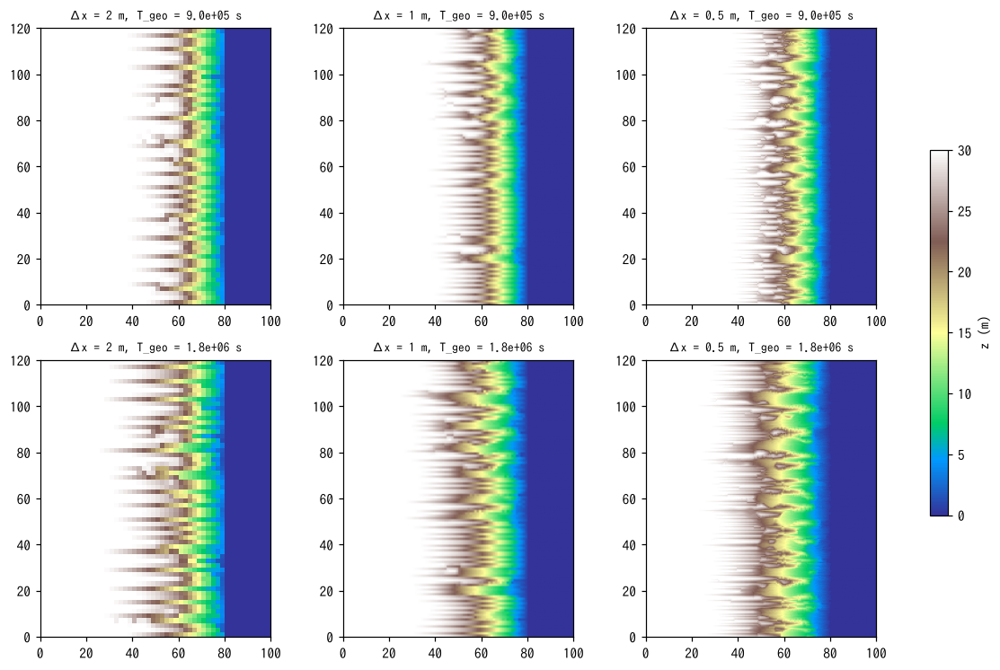

Δx = 2 / 1 / 0.5 m(列)の 5 周期目(上)と 10 周期目(下)の地形(y 方向は 120 m を表示)。

| Δx (m) | T_geo (s) | Δz の重心波長 (m) | 谷間隔 (m) / 本数(100 m あたり) | 間隔 / Δx | 崖面帯の起伏 (m) | 平均低下 / 最大下刻 (m) | 谷頭 x (m) | 勾配の中央値 / 99 % 点 |
|---|---|---|---|---|---|---|---|---|
| 2 | 9.0×10⁵ | 7.0 | 6.9 / 14.2 | 3.5 | 2.36 | 2.0 / 12.4 | 39.0 | 0.08 / 2.7 |
| 2 | 1.8×10⁶ | 8.6 | 7.8 / 12.7 | 3.9 | 3.14 | 3.9 / 16.7 | 25.0 | 0.43 / 3.5 |
| 1 | 9.0×10⁵ | 5.9 | 5.0 / 19.9 | 5.0 | 2.28 | 3.0 / 14.2 | 35.5 | 0.19 / 4.7 |
| 1 | 1.8×10⁶ | 7.2 | 5.6 / 17.8 | 5.6 | 2.69 | 5.5 / 18.0 | 23.5 | 0.62 / 5.2 |
| 0.5 | 9.0×10⁵ | 4.5 | 3.4 / 29.0 | 6.8 | 2.13 | 4.0 / 14.2 | 36.2 | 0.32 / 7.5 |
| 0.5 | 1.8×10⁶ | 5.3 | 3.7 / 27.0 | 7.3 | 1.98 | 6.7 / 18.1 | 25.8 | 0.62 / 6.0 |

**ガリー間隔は格子収束しません。** 10 周期目の谷間隔は 7.8 → 5.6 → 3.7 m(Δx = 2 → 1 →
0.5 m)で、格子を 4 倍細かくすると約半分(≈ Δx^0.5)、Δz の重心波長も 8.6 → 7.2 → 5.3 m と
短くなります。間隔 / Δx は 3.9 → 5.6 → 7.3 セルで一定でもないので、「格子に張り付く(∝ Δx)」
と「物理的な間隔に収束する」の中間です。

- **機構**: 初回の豪雨(10 分)だけで、崖縁〜崖面に **1 セル幅の溝**が 3.5 / 5.2 / 5.3 m
  (Δx = 2 / 1 / 0.5 m)刻まれます。深さは Δx によらず幅は 1 セルなので、溝の壁の勾配が Δx に
  反比例します(勾配の 99 % 点 3.5 / 5.2 / 6.0〜7.5)。面状の侵食も巻き上げも掃流力に比例し、
  流れがセル幅に集中して掃流力を上げる正のフィードバックに、乾式の曲率の平滑化(spl_lc)の
  ような長さのスケールがないため、ガリーの最小の幅が格子で決まります。
- 格子を細かくするほど谷は密で浅くなり(起伏 3.1 → 2.7 → 2.0 m)、斜面全体の平均低下は大きく
  なります(3.9 → 5.5 → 6.7 m)。一方、谷頭の位置(25 / 23.5 / 25.8 m)と最大下刻(16.7 / 18.0 /
  18.1 m)はほぼ格子によりません。結果 3 の定性的な結論(表面流の面状の侵食は「斜面全体を
  ならしながら下げる」)は変わりませんが、谷間隔 6.5 m という数値は格子の産物です。
- 対処として、湿潤侵食に幅のスケール `wet_lw`(剥離深の横方向の拡散)を入れたのが結果 5 です。

### 結果 5: 剥離の横方向拡散 wet_lw = 2 m を入れた格子収束

結果 4 の 3 つの格子に `wet_lw = 2.0`(各セルで評価した剥離深を、標準偏差 2 m のガウス核で
隣のセルに配ってから地形に適用する = 流路は幅 ≈ 2 m のリルから削る。固体の総量は保存)を
加えました(param_storm_wet_lw*.txt。ほかは同じ)。終了時の台帳「solid volume lost to bedrock
floor」は 3 つの格子とも 0 です。

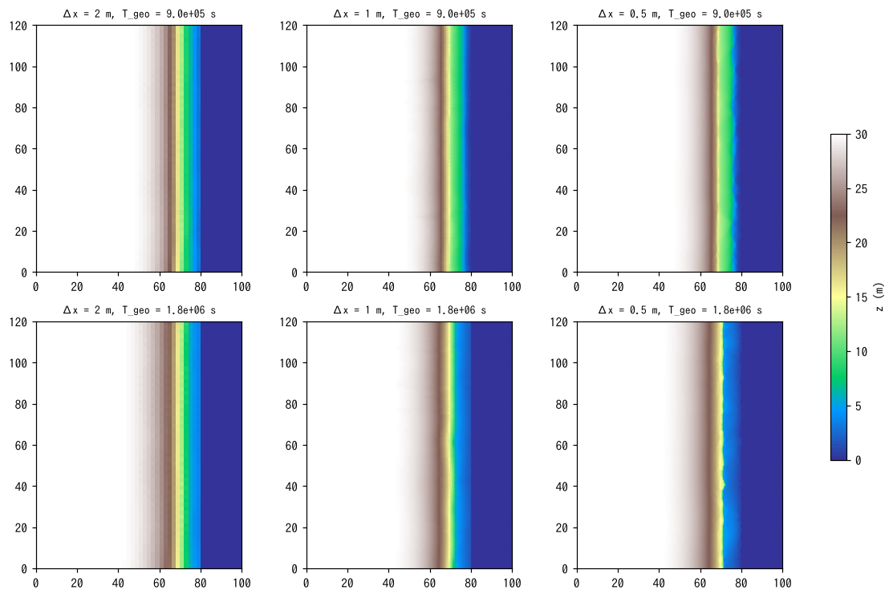

結果 4 の図と同じ並び(wet_lw = 2 m)。

| Δx (m) | T_geo (s) | Δz の重心波長 (m) | 谷間隔 (m) / 本数(100 m あたり) | 間隔 / Δx | 崖面帯の起伏 (m) | 平均低下 / 最大下刻 (m) | 谷頭 x (m) | 勾配の中央値 / 99 % 点 |
|---|---|---|---|---|---|---|---|---|
| 2 | 9.0×10⁵ | 17.2 | 25.3 / 2.7 | 12.7 | 0.47 | 1.2 / 5.9 | 51.0 | 0.05 / 1.9 |
| 2 | 1.8×10⁶ | 19.3 | 28.0 / 2.4 | 14.0 | 0.44 | 2.1 / 9.5 | 45.0 | 0.11 / 2.0 |
| 1 | 9.0×10⁵ | 6.5 | 8.9 / 6.9 | 8.9 | 0.29 | 1.8 / 6.0 | 53.5 | 0.04 / 1.6 |
| 1 | 1.8×10⁶ | 8.2 | 9.8 / 5.3 | 9.8 | 0.34 | 3.1 / 9.3 | 47.5 | 0.10 / 1.5 |
| 0.5 | 9.0×10⁵ | 5.1 | 7.2 / 7.4 | 14.4 | 0.30 | 2.1 / 6.1 | 54.2 | 0.05 / 1.4 |
| 0.5 | 1.8×10⁶ | 5.0 | 8.0 / 5.7 | 16.0 | 0.27 | 3.4 / 8.9 | 49.8 | 0.11 / 1.2 |

**密なガリー網は消え、崖は一様に後退する緩い斜面になります。** 1 セル幅の流路に集中していた
剥離が幅 2 m の帯に配られると、流路の集中の正のフィードバックは格子の規模では働かず、湿潤
侵食は斜面全体をならす面状の低下として働きます。崖面帯の起伏は 0.3 m(結果 4 の 2〜3 m の
1/10)で、「谷」として検出されるのは緩い起伏です。

- **格子収束**: Δx = 1 m と 0.5 m で、起伏 0.34 / 0.27 m、平均低下 3.1 / 3.4 m、最大下刻 9.3 /
  8.9 m、谷頭 47.5 / 49.8 m、起伏の間隔 9.8 / 8.0 m と、地形の量が 10〜20 % 以内で一致します
  (結果 4 では間隔が 5.6 → 3.7 m、平均低下が 5.5 → 6.7 m と系統的に変わっていた)。Δx = 2 m
  (ℓ_w/Δx = 1)は核が格子で解像されず別の結果(間隔 28 m・起伏 0.44 m)になるので、spl_lc と
  同じく **ℓ_w/Δx ≥ 2** が要ります。
- **結果 3 の読み替え**: 「表面流が谷底を刻む側に振ると密なガリー網になる」(間隔 6.5 m、
  37 本)は、1 セル幅の流路への集中という格子の産物でした。幅のスケールを入れた湿潤侵食は、
  乾式の凹地形フィードバックが作る鋭い稜線の深い谷を**ならして消す側**に働きます。このモデル
  で鋭い稜線の深い谷ができるのは表面流がほぼ生じない場合、という結果 3 の結論はむしろ強まり
  ます。
- ℓ_w = 2 m は乾式の相関長 ℓ と同じ値を置いたもので、校正値ではありません。ℓ_w を小さくすれば
  (格子で解像できる範囲で)流路の集中が戻り、ガリーが現れると考えられます。

## このモデルで表せないこと(実際の現象との違い)

- **乾湿の切り替えは水深の閾値 1 本**: 水深 dd = 1 mm を境に乾式と湿式が切り替わるので、
  「1 mm の水膜が乗っているだけで乾式斜面侵食が止まる」扱いが結果を左右します。濡れた粒子が
  転がれない条件としては妥当ですが、閾値への感度は確かめていません。
- **湿潤侵食の係数は校正していない**: 結果 1・2 は安定に計算できる桁に下げた値、結果 3〜5 は
  morfac 50 で破綻しない上限付近の値です。
- **リルの幅は流量によらない**: `wet_lw` は流量によらない一定の幅で、実際のリルのように流量に
  応じて幅が変わることは表しません。
- **雨は一様**: 雨の強さは場所によらず、風による雨の偏りや、乾湿の繰り返しによる表層の変化
  (クラスト・ひび割れ)は扱いません。
- **海に出た水と土砂は戻らない**: 海域マスクのセルには地形の変化も流れもないので、海へ流れ
  込んだ水と土砂は系外へ出ます(崖の脚部に土砂は溜まりません)。
- 乾式斜面侵食の側の限界(格子より小さい過程のまとめ、土砂が溜まらない、深い段階の速さの
  格子依存)は [badland](../badland/README.md) と同じです。

## 注意

- **降雨の時系列は線形補間**: `prtype = 1` の時系列は線形補間されるので、階段にするには各区間の
  両端を与えます(param の `prval`)。
- **morfac**: 50 にしています。badland と同じ 500 では、流れの集中の正のフィードバックが 1 回の
  更新で暴走します。
- **湿潤侵食の係数の上限**: 5 周期の予備計算で、susp_esa = 10⁻³ は破綻し、10⁻⁴ は安定でした。
- **格子を細かくするときの時間刻み**: Δx = 0.5 m は dt = 0.25 s(Δx = 1 m と同じ dt/Δx)だと
  初回の豪雨で破綻します(地形変化なしならクーラン数の最大 0.73 で安定。1 セル幅の溝に集まる
  流れでクーラン数が 1 を超える)。dt = 0.125 s でクーラン数の最大 ≈ 1.0〜1.2 のまま 10 周期
  計算できました。湿潤侵食には 1 回の更新の変化量の上限がないので、細かい格子ほど流れの時間
  刻みで安定を保つことになります。
- 対照の乾式斜面侵食の排出 1.44×10⁵ m³ に対し、表面流ありは 3.5×10⁴ m³ です。差は湿式の輸送
  の分ではなく、乾式斜面侵食が止まった分が大部分です。
- **数値の再現性**: 湿潤侵食を入れたケースは、流れの集中の正のフィードバックで丸め誤差の程度の
  差が増幅されるので、同じ計算でもビルド(最適化)によって数値が少し変わります。2026-11-02 に
  現行のコードで計算し直すと、結果 1 と湿潤侵食のないケースは全桁一致しましたが、結果 2 の表面流
  あり(起伏 4.34 → 4.39 m、平均低下 8.8 → 9.1 m)と結果 3(最大下刻 22.7 → 22.4 m ほか)は少し
  ずれました(結果 2 では 18 周期目の 1 セルの土層厚の 10⁻⁴ m の差から始まる)。計算の内容は
  変わっていません(当時のコードと現行のコードを -O2 で作ると結果がバイト一致する。-O2 では起伏
  4.34 m・平均低下 8.8 m)。表は現行の既定のビルド(-Ofast)の値で、結論は変わりません。

## 感度実験の入口

- `gw_ksv_mmh`(浸透能): 豪雨を全量しみ込ませる(100 mm/h)と badland と同じ型になります。
- 豪雨の強さと長さ(`prval`): 表面流になる雨の量と、濡れている時間。
- `wash_kf`・`susp_esa`: 湿潤侵食の強さ(上げるときは morfac を下げる)。
- `wet_lw`: リルの幅(ℓ_w/Δx ≥ 2 を保つ)。
- `dd`: 乾湿の切り替えの水深。

## 参考文献

- Gabet, E. J. (2003): Sediment transport by dry ravel. *J. Geophys. Res.*, 108(B1), 2049.
  doi:10.1029/2001JB001686(要旨で確認)
- Horton, R. E. (1933): The role of infiltration in the hydrologic cycle. *Trans. Am. Geophys.
  Union*, 14, 446–460.
- Howard, A. D. (1994): A detachment-limited model of drainage basin evolution.
  *Water Resour. Res.*, 30(7), 2261–2285.
