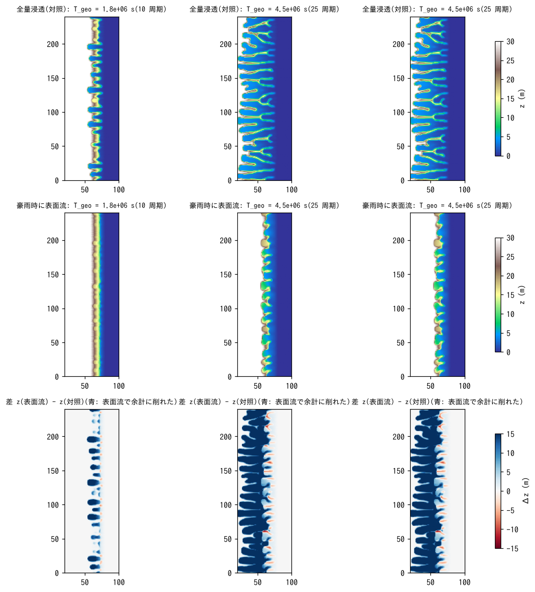
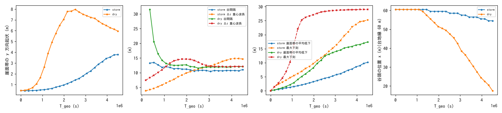
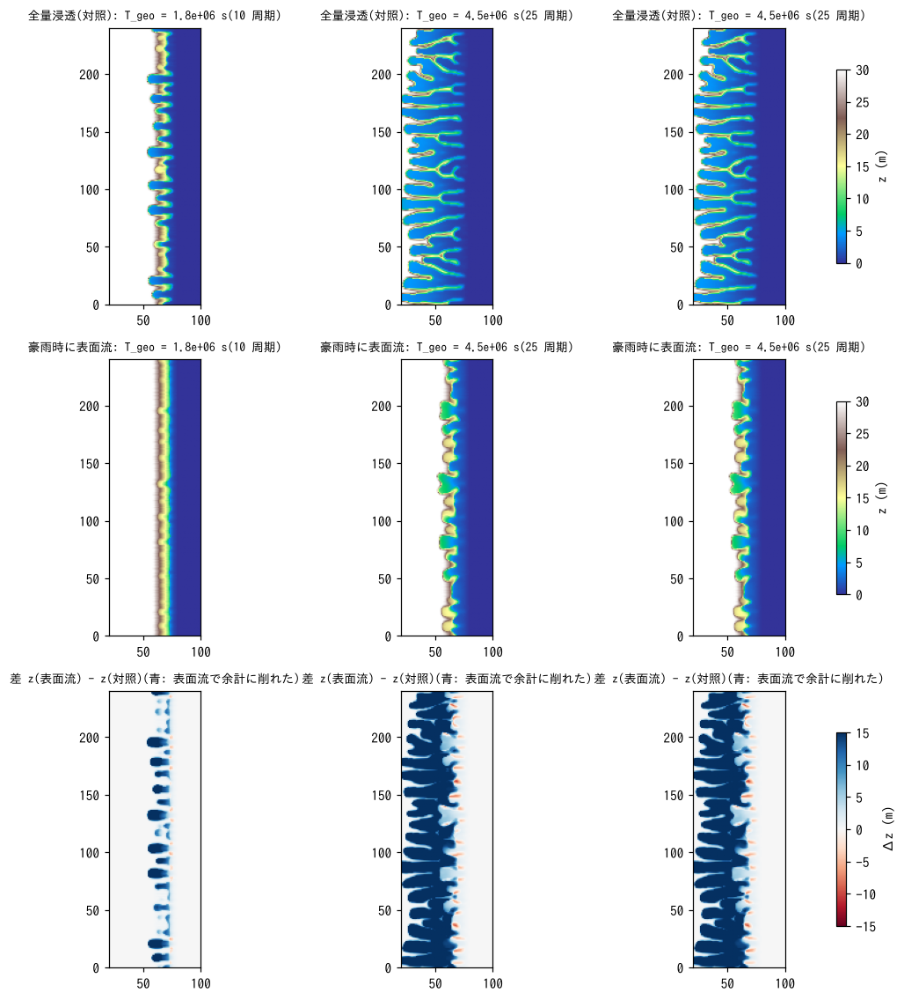
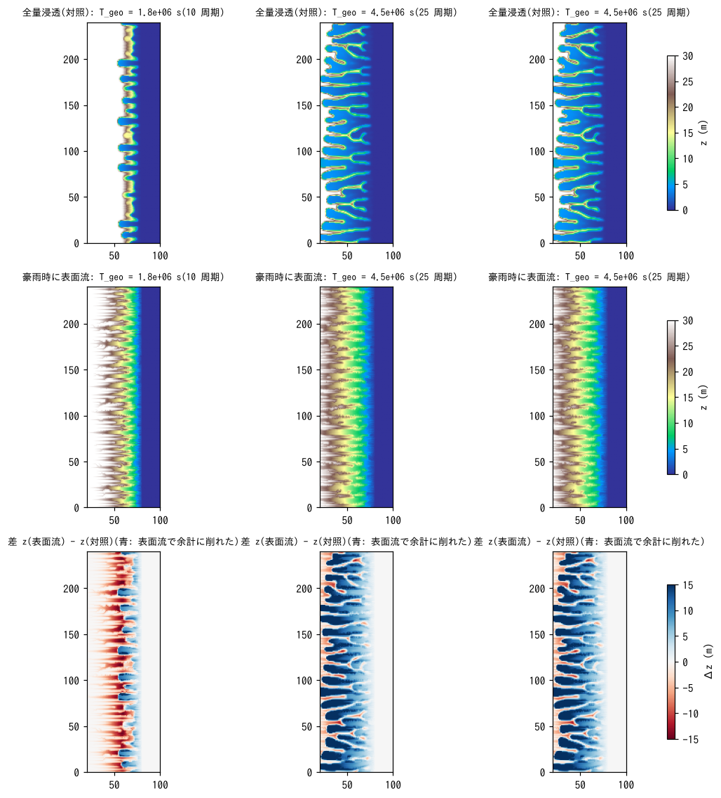
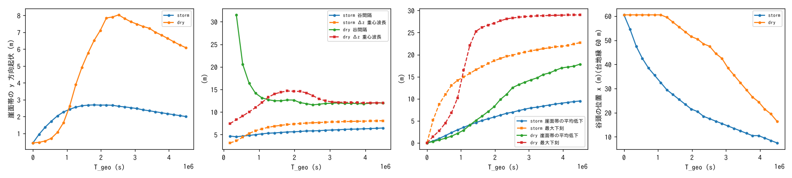

# examples/badland_storm — 豪雨時だけ飽和して表面流が現れる崖の地形発達

examples/badland の主ケース(台地 30 m・幅 60 m、56° の崖が海(z ≤ 0)に落ちる。
乾式斜面侵食 f_splash、相関長 spl_lc = 2 m、侵食基準面 = 海面、クリープなし)
を基に、**浸透能を下げて豪雨時だけ表面流が現れる**降雨を与え、湿潤時の侵食
(f_wash + 浮遊砂 f_suspend)を重ねたときに地形がどう変わるかを見る実験
ケースです。対照は同じ降雨が全量浸透する構成(表面流なし)。

| ケース | ファイル | 浸透能 | 台地 |
|---|---|---|---|
| 表面流あり | param_storm.txt | 12 mm/h(Green-Ampt、psif = 0 で一定) | 平坦 |
| 対照 | param_dry.txt | 100 mm/h(豪雨も全量浸透) | 平坦 |
| 表面流あり・台地に傾き | param_storm_tilt.txt | 12 mm/h | 崖に向かって 2 % 下がる(溜まった水が崖縁へ排水される) |
| 対照・台地に傾き | param_dry_tilt.txt | 100 mm/h | 同上 |
| 表面流の水理だけ(湿潤侵食なし)・傾き | param_stormnowet_tilt.txt | 12 mm/h | 同上。f_wash・f_suspend を切って「湿ると乾式侵食が止まる」効果だけを見る |
| 表面流あり・強い湿潤侵食・傾き | param_storm_wet.txt | 12 mm/h | 同上。susp_esa = 10⁻⁴、wash_kf = 2×10⁻⁹(谷底を刻む側に振った構成。結果 3) |

## 設定

- **降雨**: 1 時間周期 × 25。50 分は 10 mm/h(浸透能以下 = 全量浸透、乾式侵食が
  働く)、10 分は 60 mm/h(豪雨。浸透能 12 mm/h を超える 48 mm/h が表面流)。
  prtype = 1 の時系列は**線形補間**されるので、各区間の両端を与えて階段にする。
- **侵食**: 乾燥セル(h ≤ dd = 1 mm)は f_splash(spl_kt = 0.05、spl_cb = 32、
  spl_h = 1.5、spl_lc = 2 m、spl_zbase = 0)。湿潤セルは f_wash(雨滴 wash_kr = 0.001、
  面状 wash_kf = 2×10⁻¹⁰ m/s)+ f_suspend(d50 = 0.2 mm、susp_esa = 10⁻⁶)。
  急崖の薄い流れは τ*/τ*c が 10³ 級になるため、wash_kf・susp_esa は既定
  (10⁻⁵・10⁻⁴)のままだと 1 豪雨で数 m 削れて発散する。乾式の侵食率
  (≈ 3×10⁻⁷ m/s)と同程度の桁に落とした値で、**校正値ではない**。
- **時間**: dt = 0.5 s(表面流の CFL)、地形更新 2 s 毎、morfac = 50
  (examples/badland の 500 では流れの集中の正帰還が 1 更新で暴走する)。
  25 h = 25 周期で T_geo = 4.5×10⁶ s(examples/badland 主ケースの半分 =
  谷頭が円形劇場状に台地へ食い込む段階)。1 周期毎(豪雨の終了時刻)に
  Z・H・Sd を出力。

```
make                                      # ../../bin/encflow へのリンク
python3 make_terrain.py main              # z_main.txt, sw_main.txt
python3 make_terrain.py main --tilt 0.02  # z_main_tilt.txt, sw_main_tilt.txt
./encflow param_storm.txt                 # 約 22 分(4 スレッド)
./encflow param_dry.txt                   # 約 8 分
./encflow param_storm_tilt.txt; ./encflow param_dry_tilt.txt; ./encflow param_stormnowet_tilt.txt
./encflow param_storm_wet.txt             # 強い湿潤侵食(結果 3)
python3 plot_storm.py                     # figs/maps.png, series.png, flow.png + 数表
SUF=_tilt python3 plot_storm.py           # 傾き版: figs/*_tilt.png
SUF=_wet python3 plot_storm.py            # 強い湿潤侵食: figs/*_wet.png(対照は result_dry_tilt)
```

## 結果 1: 平坦な台地



上段: 対照(全量浸透)、中段: 表面流あり、下段: その差(青 = 対照の方が
深く削れた)。T_geo = 1.8×10⁶ s(10 周期)と 4.5×10⁶ s(25 周期)。



| 量 | 対照(全量浸透) | 豪雨時に表面流 |
|---|---|---|
| 崖面帯の起伏 (m): 最大 / 最終 | 7.97 / 5.96 | 3.78 / 3.78 |
| 谷間隔 (m): T_geo 1.8×10⁶ / 4.5×10⁶ s | 12.6 / 12.1 | 11.2 / 11.1 |
| 谷の本数(最終) | 19 | 21 |
| 崖面帯の平均低下 (m): 1.8×10⁶ / 4.5×10⁶ s | 7.1 / 17.4 | 2.8 / 10.1 |
| 最大下刻 (m)(最終) | 29.0 | 25.2 |
| 谷頭の位置 x (m)(台地縁 60 m): 1.8×10⁶ / 4.5×10⁶ s | 53.5 / 17.5 | 59.5 / 54.5 |
| 台地縁〜内部(初期 30 m のセル)の平均低下 (m) | 12.4(谷頭の後退で解体) | 0.76(縁の切れ込み分。内部 x < 45 m は 8 mm) |
| 勾配の 99 % 点・> 1 の割合(最終) | 12.2・0.33 | 9.1・0.12 |
| 豪雨終了時の水深 (m): 陸の中央値 / 最大 | – | 0.010 / 0.012 |
| 乾式侵食の系外排出 (m³) | 1.44×10⁵ | 3.5×10⁴ |

**表面流を入れると、谷は深くならず、台地が解体されなくなりました。**
対照では谷頭が 25 周期で台地縁から 42 m 後退して櫛の歯状の尾根に解体される
のに、表面流ありでは 5.5 m しか後退せず、崖面に浅い切れ込み(起伏 3.8 m、
対照 8.0 m)が並ぶだけです。谷間隔(11〜12 m)は変わりません。

原因は「水が乗っているセルでは乾式侵食が働かない」ことです。2 周期分を
5 分毎に出力して湿潤セルの割合を追うと(result_wet2):

| 時刻 (min) | 湿潤セルの割合: 陸全体 / 台地 / 崖面 | 平均水深 (mm) |
|---|---|---|
| 0〜50(初回の 10 mm/h) | 0 / 0 / 0 | 0 |
| 55〜60(豪雨) | 0.79〜0.83 / 0.97〜0.98 / 0.25〜0.35 | 3〜5.7 |
| 65〜110(2 周期目の 10 mm/h) | 0.72〜0.75 / 0.95〜0.97 / 0.01〜0.10 | 5.1 → 2.7 |

豪雨で台地に 8 mm の水が乗ると、台地は平坦なので水が抜けず、次の 50 分間も
基底降雨 10 mm/h が降り続けるので正味の浸透は 2 mm/h しかなく、**台地は
次の豪雨までずっと湿ったまま**になります(台地の 95 % 以上)。崖面は
数分で乾きます。その結果:

- 台地と、台地から水が流れ込む谷頭(円形劇場)は常に湿潤で、乾式侵食が
  止まる。湿潤侵食は雨滴項(wash_kr × P)だけで、台地内部は 25 周期で
  1 cm も下がらない。谷頭の後退(= 乾式の κ フィードバック)が起きない。
- 崖面は豪雨の間だけ湿り、乾いた時間に乾式侵食が続くので、崖面の谷は
  できる(間隔は同じ)が、谷頭が台地に食い込めないため深くならない。
- 豪雨時の表面流による面状侵食・浮遊砂輸送(susp_esa・wash_kf を小さく
  した設定)は、谷底をわずかに削る程度で、流れの集中による谷の深化は
  見えない(流れが薄く、10 分しか続かないため)。

つまりこの設定では、表面流は「谷を刻む」のではなく「乾式侵食を止める」
方向に働き、崖は切れ込みの浅いエスカープメントにとどまります。

## 結果 2: 台地に 2 % の傾き

平坦な台地の湛水は幾何の人工物でもある(実際の台地は崖縁へ向かう微傾斜を
持つ)ので、台地を崖に向かって 2 % 傾け、溜まった水が谷頭へ排水される
構成で同じ比較をしました。



| 量 | 対照(全量浸透) | 豪雨時に表面流 | 表面流の水理だけ(湿潤侵食なし) |
|---|---|---|---|
| 崖面帯の起伏 (m): 最大 / 最終 | 8.03 / 6.09 | 4.34 / 4.34 | 4.39 / 4.39 |
| 谷間隔 (m): T_geo 1.8×10⁶ / 4.5×10⁶ s | 12.7 / 12.0 | 11.7 / 11.3 | 11.8 / 10.7 |
| 崖面帯の平均低下 (m): 1.8×10⁶ / 4.5×10⁶ s | 7.1 / 17.8 | 2.5 / 8.8 | 2.5 / 10.0 |
| 最大下刻 (m)(最終) | 29.0 | 24.0 | 26.2 |
| 谷頭の位置 x (m)(台地縁 60 m): 1.8×10⁶ / 4.5×10⁶ s | 53.5 / 16.5 | 59.5 / 51.5 | 60.5 / 53.5 |
| 台地縁〜内部(初期 30 m のセル)の平均低下 (m) | 12.8 | 0.81 | 0.69(内部 x < 45 m は 7 mm) |
| 豪雨終了時の水深 (m): 陸の中央値 / 99 % 点 | – | 0.002 / 0.008 | – |

傾けると台地の水は 20 分ほどで抜けます(2 周期の 5 分毎出力: 豪雨終了時に
陸の 85 %・台地の 91 % が湿潤、10 分後に 5 %、20 分後に 0)。それでも
結果は平坦な台地とほぼ同じで、**表面流を入れた方が谷の発達が遅く、台地は
解体されません**(谷頭の後退 8.5 m、対照 43.5 m)。

湿潤侵食(f_wash・f_suspend)を切って表面流の水理だけを入れた変種
(param_stormnowet_tilt.txt)は、湿潤侵食ありとほぼ同じ結果になりました
(谷頭 53.5 m、起伏 4.39 m)。つまり **湿潤侵食の寄与はほとんどなく、
表面流の効果の正体は「水が乗っている間、乾式侵食が止まる」こと**です。
効き方は 2 段あります。

1. 乾式侵食は降雨強度 P に比例するので、60 mm/h の豪雨 10 分は 10 mm/h の
   1 時間分に相当し、対照(全量浸透)では乾式侵食の駆動力の半分近く
   (60 分平均 18.3 mm/h のうち 10 mm/h 分)を豪雨が担っています。浸透能を
   下げると、この最も効く雨が表面流になって乾式侵食から外れます。
2. 豪雨の後も、台地の水は谷頭(円形劇場)を通って排水されるので、κ
   フィードバックが最も強い谷頭が最も長く湿り(台地縁の帯は豪雨終了後
   20 分まで湿潤)、谷頭の後退が止まります。崖面は数分で乾くので崖面の
   谷(間隔は同じ)はできますが、台地に食い込めません。

その結果、表面流ありの地形は「崖面に浅い切れ込みが並ぶエスカープメント」
で、対照の「台地が櫛の歯状の尾根に解体される」地形にはなりません。
同じ相対起伏(4 m)に達するのに対照の約 3 倍の時間がかかります。

湿潤侵食が効かないのは、急崖の薄い流れが 10 分しか続かず、係数を発散しない
桁まで落としているためです。表面流が谷を刻む(流れの集中による谷底の
下刻)側に振るには、wash_kf・susp_esa を上げて morfac をさらに下げる
(実時間を延ばす)必要があり、その場合は谷底の 1 セルへの集中が
どこまで現実的かを格子幅を変えて確かめる必要があります。


## 結果 3: 表面流が谷底を刻む側に振る(湿潤侵食の係数を上げる)

浮遊砂の平衡濃度係数を既定の susp_esa = 10⁻⁴、面状侵食係数を wash_kf = 2×10⁻⁹
(結果 1・2 の 100 倍・10 倍)に上げた構成(param_storm_wet.txt、台地に傾き、
morfac 50)。5 周期の予備計算で susp_esa = 10⁻³ は発散、10⁻⁴ は安定でした。





| 量(T_geo 4.5×10⁶ s) | 対照(全量浸透) | 表面流あり・弱い湿潤侵食(結果 2) | 表面流あり・強い湿潤侵食 |
|---|---|---|---|
| 崖面帯の起伏 (m): 最大 / 最終 | 8.0 / 6.1 | 4.3 / 4.3 | 2.7 / 2.0 |
| 谷間隔 (m)(最終)/ 本数 | 12.0 / 19 | 11.3 / 20 | **6.5 / 37** |
| 谷頭の位置 x (m)(台地縁 60 m) | 16.5 | 51.5 | **7.5** |
| 崖面帯の平均低下 (m) | 17.8 | 8.8 | 9.5 |
| 最大下刻 (m) | 29.0 | 24.0 | 22.7 |
| 勾配の中央値 / 90 % 点 / 99 % 点(最終、陸) | 0.12 / 6.2 / 12.4 | – / – / 8.7 | 0.65 / 2.5 / 3.5 |
| x = 30 / 45 / 60 m の列: 平均標高 (m) | 13.9 / 7.7 / 3.8 | – | 24.6 / 17.7 / 10.6 |
| 同: y 方向起伏(標準偏差) (m) | 10.9 / 6.4 / 4.0 | – | 2.3 / 3.0 / 2.4 |

**地形は一変しました。** 対照(乾式のみ)が「鋭い尾根に挟まれた深い谷が
台地を櫛の歯状に解体する」地形なのに対し、強い湿潤侵食では

- 谷間隔が半分(6.5 m、37 本)の**密なガリー網**になり、谷頭は 1 周期目から
  台地に食い込んで 25 周期で 52 m 後退します(対照 43 m。しかも対照は
  10 周期までほぼ動かない)。
- 谷は浅く(起伏 2〜3 m)、崖は 56° の壁を失って**勾配 0.5〜1 の緩い斜面**に
  均されます(x = 30〜60 m の平均標高が対照より 7〜11 m 高い = 崖が
  後退するのではなく、台地縁から斜面全体が下がる)。
- 豪雨の水は谷底に集まり(豪雨終了時の水深: 陸の中央値 0、99 % 点 6 mm、
  谷底で最大 13 cm)、D8 の流域網は台地縁に直交する平行なガリーが密に並ぶ
  形で、対照のような樹枝状の枝分かれは少ない。

乾式の κ フィードバックが「谷頭の円形劇場を深く刻んで尾根を残す」機構なのに
対し、表面流の面状侵食は「流れが集まる所から順に、斜面全体を均しながら
下げる」機構で、同じ出発点から**バッドランドの密なガリー斜面**と
**鋭い稜線の深い谷**という別の地形に分かれます。新島南部の地形は後者の型
なので、この比較は「表面流がほぼ生じない(浸透能が豪雨を上回る)ことが
鋭い稜線の深い谷の条件である」という当初の仮説と整合します。

注意: 湿潤侵食の係数は較正値ではなく、morfac 50 で発散しない範囲の上限
付近です。谷間隔 6.5 m は ℓ = 2 m の選択則(≈ 4.4〜6 ℓ)より短く、表面流の
集中(1 セル幅の流路)が間隔を決めている可能性があるので、格子幅を変えた
収束確認が要ります。

## 読み方の注意

- 湿潤侵食の係数(wash_kr・wash_kf・susp_esa)は校正されていません。
  結果 1・2 は安定に走る桁に落とした値、結果 3 は morfac 50 で発散しない
  上限付近の値です(morfac 500 で既定係数のままだと 1 豪雨で数 m 削れて
  発散する)。
- 乾式と湿式の切替は水深 dd = 1 mm の閾値 1 本で決まるので、「1 mm の
  水膜が乗っているだけで乾式侵食が止まる」扱いが結果を左右します。
  sandball が転がれない条件としては妥当ですが、閾値の感度は未確認です。
- 降雨時系列が線形補間されることに注意(階段にするには両端を与える)。
- 海セル(sw)には地形変化が働かず、流れも解かないので、海へ流れ込んだ
  水と土砂は系外へ出ます(対照の乾式排出台帳 1.44×10⁵ m³ に対し、表面流
  ありの乾式排出は 3.5×10⁴ m³。差は湿式の輸送分ではなく、乾式侵食が
  止まった分が大きい)。
