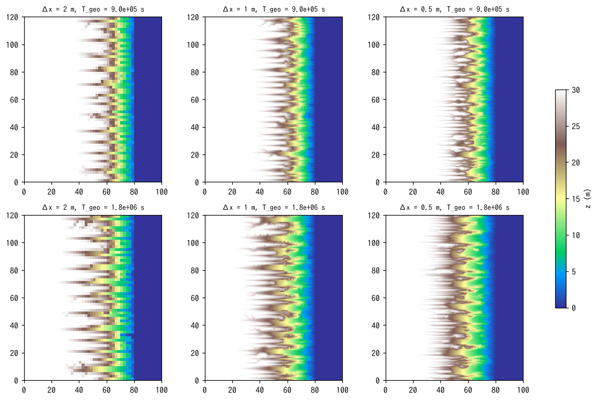
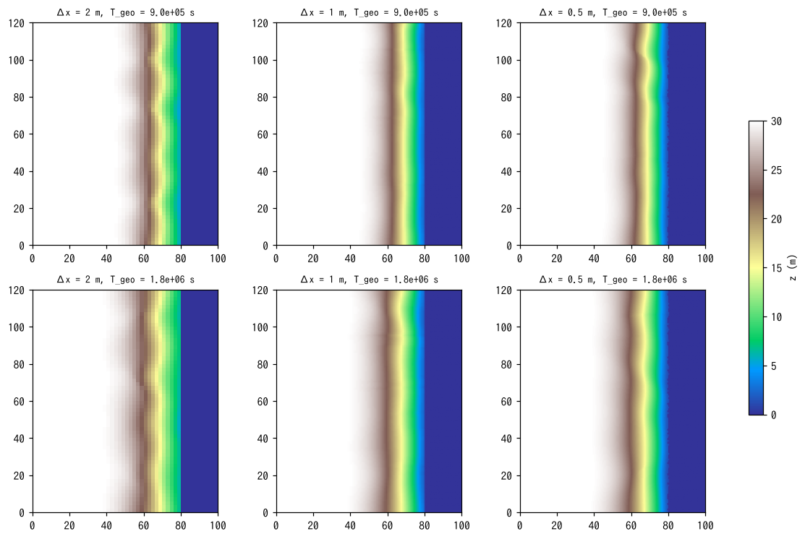

# examples/badland_storm — Landform evolution of a cliff that saturates and produces surface flow only during storms

> English mirror of examples/badland_storm/README.md. The Japanese file is the master copy.

[日本語](../README.md)

This experimental case starts from the main case of examples/badland (a 30 m
plateau, 60 m wide, with a 56° cliff dropping to the sea (z ≤ 0); dry-slope
erosion f_splash, correlation length spl_lc = 2 m, erosion base level = sea
level, no creep), applies rainfall with **a reduced infiltration capacity so
that surface flow appears only during storms**, and examines how the landform
changes when wet-cell erosion (f_wash + suspended sediment f_suspend) is
superposed. The control is a configuration in which the same rainfall
infiltrates completely (no surface flow).

| Case | File | Infiltration capacity | Plateau |
|---|---|---|---|
| With surface flow | param_storm.txt | 12 mm/h (Green-Ampt, constant with psif = 0) | Flat |
| Control | param_dry.txt | 100 mm/h (storms also infiltrate completely) | Flat |
| With surface flow, tilted plateau | param_storm_tilt.txt | 12 mm/h | Falls 2 % toward the cliff (ponded water drains to the cliff edge) |
| Control, tilted plateau | param_dry_tilt.txt | 100 mm/h | Same as above |
| Surface-flow hydraulics only (no wet erosion), tilted | param_stormnowet_tilt.txt | 12 mm/h | Same as above. f_wash and f_suspend are switched off to isolate the effect "dry erosion stops when a cell is wet" |
| With surface flow, strong wet erosion, tilted | param_storm_wet.txt | 12 mm/h | Same as above. susp_esa = 10⁻⁴, wash_kf = 2×10⁻⁹ (a configuration pushed toward incising the valley floors; Result 3) |
| Same, Δx = 2 m / 0.5 m | param_storm_wet_dx2.txt / param_storm_wet_dx05.txt | 12 mm/h | Grid-convergence check (Result 4). The 0.5 m case uses 120 m in y, dt = 0.125 s, 10 cycles |
| Same + lateral spreading of detachment wet_lw = 2 m, Δx = 2 / 1 / 0.5 m | param_storm_wet_lw_dx2.txt / param_storm_wet_lw.txt / param_storm_wet_lw_dx05.txt | 12 mm/h | Grid-convergence check with a width scale (Result 5). 10 cycles |

## Setup

- **Rainfall**: 1-hour cycle × 25. For 50 minutes 10 mm/h (below the
  infiltration capacity = complete infiltration, dry-slope erosion acts), then
  10 minutes at 60 mm/h (storm; the 48 mm/h in excess of the 12 mm/h
  infiltration capacity becomes surface flow). A prtype = 1 time series is
  **linearly interpolated**, so both ends of each interval are given to make
  a step function.
- **Erosion**: dry cells (h ≤ dd = 1 mm) use f_splash (spl_kt = 0.05,
  spl_cb = 32, spl_h = 1.5, spl_lc = 2 m, spl_zbase = 0). Wet cells use f_wash
  (raindrop wash_kr = 0.001, sheet wash_kf = 2×10⁻¹⁰ m/s) + f_suspend
  (d50 = 0.2 mm, susp_esa = 10⁻⁶). In the thin flow on the steep cliff τ*/τ*c
  reaches the order of 10³, so with wash_kf and susp_esa at their defaults
  (10⁻⁵ and 10⁻⁴) several metres are removed in a single storm and the run
  diverges. The values are lowered to the same order as the dry erosion rate
  (≈ 3×10⁻⁷ m/s); **they are not calibrated values**.
- **Time**: dt = 0.5 s (CFL of the surface flow), landform update every 2 s,
  morfac = 50 (with the 500 of examples/badland the positive feedback of flow
  concentration runs away within a single update). 25 h = 25 cycles give
  T_geo = 4.5×10⁶ s (half of the main case of examples/badland = the stage at
  which the valley heads bite into the plateau as amphitheatres). Z, H and Sd
  are output once per cycle (at the end of the storm).

```
make                                      # link to ../../bin/encflow
python3 make_terrain.py main              # z_main.txt, sw_main.txt
python3 make_terrain.py main --tilt 0.02  # z_main_tilt.txt, sw_main_tilt.txt
./encflow param_storm.txt                 # about 22 min (4 threads)
./encflow param_dry.txt                   # about 8 min
./encflow param_storm_tilt.txt; ./encflow param_dry_tilt.txt; ./encflow param_stormnowet_tilt.txt
./encflow param_storm_wet.txt             # strong wet erosion (Result 3)
python3 plot_storm.py                     # figs/maps.png, series.png, flow.png + tables
SUF=_tilt python3 plot_storm.py           # tilted version: figs/*_tilt.png
SUF=_wet python3 plot_storm.py            # strong wet erosion: figs/*_wet.png (control is result_dry_tilt)
python3 make_terrain.py main --tilt 0.02 --dx 2            # z_main2_tilt.txt (for grid convergence)
python3 make_terrain.py main --tilt 0.02 --dx 0.5 --ly 120 # z_main05_tilt.txt
./encflow param_storm_wet_dx2.txt; ./encflow param_storm_wet_dx05.txt  # about 3 min / about 60 min (2 threads)
python3 conv_dx.py                        # figs/conv_dx.png + tables (Result 4)
./encflow param_storm_wet_lw_dx2.txt; ./encflow param_storm_wet_lw.txt; ./encflow param_storm_wet_lw_dx05.txt  # Result 5
SET=lw python3 conv_dx.py                 # figs/conv_dx_lw.png + tables (Result 5)
```

## Result 1: flat plateau


Top row: control (complete infiltration); middle row: with surface flow;
bottom row: their difference (blue = the control eroded deeper).
T_geo = 1.8×10⁶ s (10 cycles) and 4.5×10⁶ s (25 cycles).


| Quantity | Control (complete infiltration) | Surface flow during storms |
|---|---|---|
| Relief of the cliff-face belt (m): maximum / final | 7.97 / 5.96 | 3.78 / 3.78 |
| Valley spacing (m): T_geo 1.8×10⁶ / 4.5×10⁶ s | 12.6 / 12.1 | 11.2 / 11.1 |
| Number of valleys (final) | 19 | 21 |
| Mean lowering of the cliff-face belt (m): 1.8×10⁶ / 4.5×10⁶ s | 7.1 / 17.4 | 2.8 / 10.1 |
| Maximum incision (m) (final) | 29.0 | 25.2 |
| Valley-head position x (m) (plateau edge at 60 m): 1.8×10⁶ / 4.5×10⁶ s | 53.5 / 17.5 | 59.5 / 54.5 |
| Mean lowering from the plateau edge to the interior (cells initially at 30 m) (m) | 12.4 (dismembered by valley-head retreat) | 0.76 (notching of the edge; the interior x < 45 m is 8 mm) |
| Slope: 99th percentile / fraction > 1 (final) | 12.2 / 0.33 | 9.1 / 0.12 |
| Water depth at the end of the storm (m): median over land / maximum | – | 0.010 / 0.012 |
| Dry-erosion export out of the system (m³) | 1.44×10⁵ | 3.5×10⁴ |

**With surface flow, the valleys do not deepen and the plateau is no longer
dismembered.** In the control the valley heads retreat 42 m from the plateau
edge in 25 cycles and the plateau is dismembered into comb-like ridges, whereas
with surface flow they retreat only 5.5 m and the cliff face is merely lined
with shallow notches (relief 3.8 m versus 8.0 m in the control). The valley
spacing (11–12 m) is unchanged.

The cause is that "dry erosion does not act in a cell that carries water".
Tracking the fraction of wet cells with output every 5 minutes over 2 cycles
(result_wet2):

| Time (min) | Fraction of wet cells: all land / plateau / cliff face | Mean water depth (mm) |
|---|---|---|
| 0–50 (first 10 mm/h period) | 0 / 0 / 0 | 0 |
| 55–60 (storm) | 0.79–0.83 / 0.97–0.98 / 0.25–0.35 | 3–5.7 |
| 65–110 (10 mm/h of the 2nd cycle) | 0.72–0.75 / 0.95–0.97 / 0.01–0.10 | 5.1 → 2.7 |

When the storm puts 8 mm of water on the plateau, the water cannot drain
because the plateau is flat, and the base rainfall of 10 mm/h continues for
the next 50 minutes so that the net infiltration is only 2 mm/h; **the plateau
stays wet all the way to the next storm** (more than 95 % of the plateau). The
cliff face dries within minutes. As a result:

- The plateau and the valley heads (amphitheatres) that receive water from
  the plateau are always wet, so dry erosion stops. Wet erosion is only the
  raindrop term (wash_kr × P), and the plateau interior is lowered by less
  than 1 cm in 25 cycles. Valley-head retreat (= the dry κ feedback) does not
  occur.
- The cliff face is wet only during the storm and dry erosion continues while
  it is dry, so valleys do form on the cliff face (with the same spacing) but
  do not deepen because the heads cannot bite into the plateau.
- Sheet erosion and suspended-sediment transport by the storm surface flow
  (with susp_esa and wash_kf reduced) only scrape the valley floors slightly;
  no valley deepening by flow concentration is visible (the flow is thin and
  lasts only 10 minutes).

In this configuration, therefore, surface flow acts not to "incise valleys"
but to "stop dry erosion", and the cliff remains an escarpment with shallow
notches.

## Result 2: plateau tilted by 2 %

Ponding on a flat plateau is partly a geometric artefact (real plateaus have
a gentle slope toward the cliff edge), so the same comparison was made with
the plateau tilted 2 % toward the cliff so that ponded water drains to the
valley heads.


| Quantity | Control (complete infiltration) | Surface flow during storms | Surface-flow hydraulics only (no wet erosion) |
|---|---|---|---|
| Relief of the cliff-face belt (m): maximum / final | 8.03 / 6.09 | 4.34 / 4.34 | 4.39 / 4.39 |
| Valley spacing (m): T_geo 1.8×10⁶ / 4.5×10⁶ s | 12.7 / 12.0 | 11.7 / 11.3 | 11.8 / 10.7 |
| Mean lowering of the cliff-face belt (m): 1.8×10⁶ / 4.5×10⁶ s | 7.1 / 17.8 | 2.5 / 8.8 | 2.5 / 10.0 |
| Maximum incision (m) (final) | 29.0 | 24.0 | 26.2 |
| Valley-head position x (m) (plateau edge at 60 m): 1.8×10⁶ / 4.5×10⁶ s | 53.5 / 16.5 | 59.5 / 51.5 | 60.5 / 53.5 |
| Mean lowering from the plateau edge to the interior (cells initially at 30 m) (m) | 12.8 | 0.81 | 0.69 (the interior x < 45 m is 7 mm) |
| Water depth at the end of the storm (m): median over land / 99th percentile | – | 0.002 / 0.008 | – |

With the tilt the plateau water drains in about 20 minutes (5-minute output
over 2 cycles: at the end of the storm 85 % of the land and 91 % of the
plateau are wet, 5 % after 10 minutes, 0 after 20 minutes). Even so, the
result is almost the same as for the flat plateau: **valley development is
slower with surface flow, and the plateau is not dismembered** (valley-head
retreat 8.5 m versus 43.5 m in the control).

The variant with wet erosion (f_wash, f_suspend) switched off and only the
surface-flow hydraulics (param_stormnowet_tilt.txt) gave almost the same
result as with wet erosion (valley head 53.5 m, relief 4.39 m). That is,
**wet erosion contributes almost nothing, and the real effect of surface flow
is that "dry erosion stops while water sits on the cell"**. It acts in two
stages.

1. Dry erosion is proportional to the rainfall intensity P, so the 10 minutes
   of the 60 mm/h storm are equivalent to one hour at 10 mm/h, and in the
   control (complete infiltration) the storm carries nearly half of the
   driving force of dry erosion (10 mm/h of the 60-minute average of
   18.3 mm/h). Lowering the infiltration capacity turns this most effective
   rain into surface flow and removes it from dry erosion.
2. After the storm, the plateau water still drains through the valley heads
   (amphitheatres), so the valley heads, where the κ feedback is strongest,
   stay wet longest (the belt along the plateau edge remains wet until
   20 minutes after the storm ends) and valley-head retreat stops. The cliff
   face dries within minutes, so cliff-face valleys form (with the same
   spacing) but cannot bite into the plateau.

As a result, the landform with surface flow is an "escarpment lined with
shallow notches on the cliff face" and does not become the control's
"plateau dismembered into comb-like ridges". Reaching the same relative relief
(4 m) takes about three times as long as in the control.

Wet erosion is ineffective because the thin flow on the steep cliff lasts
only 10 minutes and the coefficients have been lowered to an order that does
not diverge. To push the surface flow toward incising valleys (lowering of the
valley floor by flow concentration), wash_kf and susp_esa must be raised and
morfac lowered further (longer real time), in which case how realistic the
concentration into a single valley-floor cell is must be checked by varying
the grid spacing.


## Result 3: pushing surface flow toward incising the valley floors (raising the wet-erosion coefficients)

A configuration with the equilibrium-concentration coefficient of suspended
sediment raised to the default susp_esa = 10⁻⁴ and the sheet-erosion
coefficient to wash_kf = 2×10⁻⁹ (100 and 10 times those of Results 1 and 2)
(param_storm_wet.txt, tilted plateau, morfac 50). In 5-cycle preliminary runs
susp_esa = 10⁻³ diverged and 10⁻⁴ was stable.


| Quantity (T_geo 4.5×10⁶ s) | Control (complete infiltration) | Surface flow, weak wet erosion (Result 2) | Surface flow, strong wet erosion |
|---|---|---|---|
| Relief of the cliff-face belt (m): maximum / final | 8.0 / 6.1 | 4.3 / 4.3 | 2.7 / 2.0 |
| Valley spacing (m) (final) / number | 12.0 / 19 | 11.3 / 20 | **6.5 / 37** |
| Valley-head position x (m) (plateau edge at 60 m) | 16.5 | 51.5 | **7.5** |
| Mean lowering of the cliff-face belt (m) | 17.8 | 8.8 | 9.5 |
| Maximum incision (m) | 29.0 | 24.0 | 22.7 |
| Slope: median / 90th / 99th percentile (final, land) | 0.12 / 6.2 / 12.4 | – / – / 8.7 | 0.65 / 2.5 / 3.5 |
| Columns x = 30 / 45 / 60 m: mean elevation (m) | 13.9 / 7.7 / 3.8 | – | 24.6 / 17.7 / 10.6 |
| Same: relief in y (standard deviation) (m) | 10.9 / 6.4 / 4.0 | – | 2.3 / 3.0 / 2.4 |

**The landform changed completely.** Whereas the control (dry erosion only)
is a landform in which "deep valleys between sharp ridges dismember the
plateau into comb teeth", with strong wet erosion

- the valley spacing is halved (6.5 m, 37 valleys) into a **dense gully
  network**, and the valley heads bite into the plateau from the first cycle
  and retreat 52 m in 25 cycles (control 43 m; moreover the control hardly
  moves until cycle 10).
- the valleys are shallow (relief 2–3 m) and the cliff loses its 56° wall and
  is smoothed into a **gentle slope of gradient 0.5–1** (the mean elevation at
  x = 30–60 m is 7–11 m higher than in the control = rather than the cliff
  retreating, the whole slope is lowered from the plateau edge).
- the storm water collects in the valley floors (depth at the end of the
  storm: median over land 0, 99th percentile 6 mm, up to 13 cm in the valley
  floors), and the D8 drainage network is a dense set of parallel gullies
  perpendicular to the plateau edge, with little of the dendritic branching
  of the control.

Whereas the dry κ feedback is a mechanism that "incises the valley-head
amphitheatres deeply and leaves ridges", sheet erosion by surface flow is a
mechanism that "lowers the whole slope while smoothing it, starting from where
the flow collects"; from the same starting point the two diverge into
different landforms, **a badland slope with dense gullies** and **deep valleys
with sharp crests**. The landform of southern Niijima is of the latter type,
so this comparison is consistent with the original hypothesis that "the near
absence of surface flow (an infiltration capacity exceeding the storm
intensity) is the condition for deep valleys with sharp crests".

Caution: the wet-erosion coefficients are not calibrated values; they are
near the upper limit that does not diverge at morfac 50. The valley spacing
of 6.5 m is shorter than the selection rule for ℓ = 2 m (≈ 4.4–6 ℓ), and the
concentration of surface flow (one-cell-wide channels) sets the spacing
(Result 4: changing the grid spacing changes the spacing, and it does not
converge).

## Result 4: grid convergence of the gully spacing (Δx = 2 / 1 / 0.5 m)

Only the grid spacing was varied in the configuration of Result 3 (strong wet
erosion, tilted plateau) (param_storm_wet_dx2.txt / param_storm_wet.txt /
param_storm_wet_dx05.txt). The initial perturbation is the same white noise on
the 1 m grid mapped onto each grid (make_terrain.py --dx), and the comparison
times are cycles 5 and 10 (T_geo 9×10⁵ and 1.8×10⁶ s). For Δx = 0.5 m the
y extent is halved (120 m) to limit the computation, with dt = 0.125 s (see
below). The number of valleys is converted to per 100 m.



| Δx (m) | T_geo (s) | Centroid wavelength of Δz (m) | Valley spacing (m) / number (per 100 m) | Spacing / Δx | Relief of the cliff-face belt (m) | Mean lowering / maximum incision (m) | Valley head x (m) | Slope: median / 99th percentile |
|---|---|---|---|---|---|---|---|---|
| 2 | 9.0×10⁵ | 7.0 | 6.9 / 14.2 | 3.5 | 2.36 | 2.0 / 12.4 | 39.0 | 0.08 / 2.7 |
| 2 | 1.8×10⁶ | 8.6 | 7.8 / 12.7 | 3.9 | 3.14 | 3.9 / 16.7 | 25.0 | 0.43 / 3.5 |
| 1 | 9.0×10⁵ | 5.9 | 5.0 / 19.9 | 5.0 | 2.28 | 3.0 / 14.2 | 35.5 | 0.19 / 4.7 |
| 1 | 1.8×10⁶ | 7.2 | 5.6 / 17.8 | 5.6 | 2.69 | 5.5 / 18.0 | 23.5 | 0.62 / 5.2 |
| 0.5 | 9.0×10⁵ | 4.5 | 3.4 / 29.0 | 6.8 | 2.13 | 4.0 / 14.2 | 36.2 | 0.32 / 7.5 |
| 0.5 | 1.8×10⁶ | 5.3 | 3.7 / 27.0 | 7.3 | 1.98 | 6.7 / 18.1 | 25.8 | 0.62 / 6.0 |

**The gully spacing does not converge with the grid.** The valley spacing at
cycle 10 is 7.8 → 5.6 → 3.7 m (Δx = 2 → 1 → 0.5 m): refining the grid 4-fold
roughly halves it (≈ Δx^0.5), and the centroid wavelength of Δz also
shortens, 8.6 → 7.2 → 5.3 m. Spacing/Δx is 3.9 → 5.6 → 7.3 cells and is not
constant either, so the behaviour lies between "locked to the grid (∝ Δx)"
and "converging to a physical spacing".

- **Mechanism**: the first storm (10 minutes) alone cuts **one-cell-wide
  grooves** 3.5 / 5.2 / 5.3 m deep (Δx = 2 / 1 / 0.5 m) from the cliff edge
  down the cliff face. The depth is independent of Δx while the width is one
  cell, so the slope of the groove walls is inversely proportional to Δx
  (99th-percentile slope 3.5 / 5.2 / 6.0–7.5). Both sheet erosion and
  entrainment are proportional to τ*/τ*c, and the positive feedback in which
  the flow concentrates into a cell width and raises τ* has no length scale
  like the dry κ smoothing (spl_lc), so the minimum gully width is set by the
  grid.
- The finer the grid, the denser and shallower the valleys (relief
  3.1 → 2.7 → 2.0 m) and the larger the mean lowering of the whole slope
  (3.9 → 5.5 → 6.7 m). On the other hand the valley-head position
  (25 / 23.5 / 25.8 m) and the maximum incision (16.7 / 18.0 / 18.1 m) are
  almost grid-independent. The qualitative conclusion of Result 3 (sheet
  erosion by surface flow "lowers the whole slope while smoothing it") stands,
  but the number 6.5 m for the valley spacing is an artefact of the grid.
- **Numerics**: Δx = 0.5 m diverges in the first storm with dt = 0.25 s (the
  same dt/Δx as Δx = 1 m) (without landform change it is stable at
  Cn_max 0.73; the flow collecting in the one-cell-wide grooves reaches
  Cn > 1). With dt = 0.125 s it ran for 10 cycles with Cn_max ≈ 1.0–1.2. Wet
  erosion has no cap on the change per update (the counterpart of spl_dzmax
  and fluv_dzmax), so on finer grids stability has to be maintained through
  the flow time step.
- **Remedy**: Result 5 adds a width scale `wet_lw` (lateral spreading of the
  detachment depth; developer.md §84.16) to wet erosion.

## Result 5: grid convergence with lateral spreading of detachment wet_lw = 2 m

`wet_lw = 2.0` was added to the three grids of Result 4 (the detachment depth
evaluated in each cell is distributed to the neighbouring cells with a
Gaussian kernel of standard deviation 2 m before it is applied to the bed =
channels erode from rills about 2 m wide; the total solid volume is conserved)
(param_storm_wet_lw*.txt, otherwise identical). The ledger entry "solid volume
lost to bedrock floor" at the end is 0 on all three grids.



| Δx (m) | T_geo (s) | Centroid wavelength of Δz (m) | Valley spacing (m) / number (per 100 m) | Spacing / Δx | Relief of the cliff-face belt (m) | Mean lowering / maximum incision (m) | Valley head x (m) | Slope: median / 99th percentile |
|---|---|---|---|---|---|---|---|---|
| 2 | 9.0×10⁵ | 17.2 | 25.3 / 2.7 | 12.7 | 0.47 | 1.2 / 5.9 | 51.0 | 0.05 / 1.9 |
| 2 | 1.8×10⁶ | 19.3 | 28.0 / 2.4 | 14.0 | 0.44 | 2.1 / 9.5 | 45.0 | 0.11 / 2.0 |
| 1 | 9.0×10⁵ | 6.5 | 8.9 / 6.9 | 8.9 | 0.29 | 1.8 / 6.0 | 53.5 | 0.04 / 1.6 |
| 1 | 1.8×10⁶ | 8.2 | 9.8 / 5.3 | 9.8 | 0.34 | 3.1 / 9.3 | 47.5 | 0.10 / 1.5 |
| 0.5 | 9.0×10⁵ | 5.1 | 7.2 / 7.4 | 14.4 | 0.30 | 2.1 / 6.1 | 54.2 | 0.05 / 1.4 |
| 0.5 | 1.8×10⁶ | 5.0 | 8.0 / 5.7 | 16.0 | 0.27 | 3.4 / 8.9 | 49.8 | 0.11 / 1.2 |

**The dense gully network disappears and the cliff becomes a gentle slope
that retreats uniformly.** Once the detachment that was concentrated in
one-cell-wide channels is distributed over a 2 m wide band, the positive
feedback of channel concentration no longer works at the grid scale, and wet
erosion acts as a sheet-like lowering that smooths the whole slope. The relief
of the cliff-face belt is 0.3 m (one tenth of the 2–3 m of Result 4), and what
is detected as "valleys" is gentle undulation.

- **Grid convergence**: between Δx = 1 m and 0.5 m the landform quantities
  agree within 10–20 %: relief 0.34 / 0.27 m, mean lowering 3.1 / 3.4 m,
  maximum incision 9.3 / 8.9 m, valley head 47.5 / 49.8 m, spacing of the
  undulation 9.8 / 8.0 m (in Result 4 the spacing changed systematically,
  5.6 → 3.7 m, and the mean lowering 5.5 → 6.7 m). Δx = 2 m (ℓ_w/Δx = 1) gives
  a different result (spacing 28 m, relief 0.44 m) because the kernel is not
  resolved by the grid, so, as with spl_lc, **ℓ_w/Δx ≥ 2** is required.
- **Reinterpretation of Result 3**: "pushing surface flow toward incising the
  valley floors produces a dense gully network" (spacing 6.5 m, 37 valleys)
  was an artefact of the grid, namely concentration into one-cell-wide
  channels. Wet erosion with a width scale acts to **smooth away** the deep
  valleys with sharp crests that the dry κ feedback creates, so the hypothesis
  that "the near absence of surface flow is the condition for deep valleys
  with sharp crests" is if anything strengthened.
- **Caution**: ℓ_w = 2 m was simply set equal to the dry correlation length ℓ
  and is not a calibrated value. Reducing ℓ_w (within the range the grid can
  resolve) should bring back channel concentration and gullies. Together with
  the fact that the width is a fixed value independent of discharge, how to
  specify ℓ_w remains a future task (docs/splash_plan.md §6.9).

## Notes on interpretation

- The wet-erosion coefficients (wash_kr, wash_kf, susp_esa) are not
  calibrated. Results 1 and 2 use values lowered to an order that runs
  stably; Result 3 uses values near the upper limit that does not diverge at
  morfac 50 (at morfac 500 with the default coefficients several metres are
  removed in a single storm and the run diverges).
- The switch between dry and wet erosion is a single depth threshold
  dd = 1 mm, so the treatment "dry erosion stops as soon as a 1 mm water film
  is present" governs the results. It is reasonable as the condition under
  which sand balls cannot roll, but the sensitivity to the threshold has not
  been checked.
- Note that the rainfall time series is linearly interpolated (give both ends
  of each interval to make a step function).
- Sea cells (sw) undergo no landform change and the flow is not solved there,
  so water and sediment that enter the sea leave the system (the dry-erosion
  export ledger is 1.44×10⁵ m³ for the control versus 3.5×10⁴ m³ with surface
  flow; the difference is mostly the halted dry erosion rather than the wet
  transport).
