# badland_storm — a cliff where overland flow appears only during downpours (switching between dry-slope and wet erosion)

> English mirror of examples/badland_storm/README.md. The Japanese file is the master copy.

[日本語](../README.md)

This example takes the main case of [badland](../../badland/en/README.md) (a plateau 30 m high
and 60 m wide dropping into the sea at a 56° cliff; dry-slope erosion f_splash, ℓ = 2 m, base
level = sea level), lowers the infiltration capacity so that **overland flow appears only
during downpours**, adds the erosion of wet slopes
([hillslope erosion](../../../docs/en/users_guide/geomorph.md#hillslope-erosion-f_wash) f_wash
and [suspended sediment](../../../docs/en/users_guide/geomorph.md#suspended-sediment-f_suspend)
f_suspend), and looks at how the landform changes. The comparison is a set-up in which the
same rain soaks in completely (no overland flow). A set-up with stronger wet erosion, whether
the gully spacing then changes with the grid spacing, and a remedy for that are also compared.
The values are schematic, chosen to make the phenomena visible, and the coefficients of the
wet erosion are not calibrated. The figures of the results have Japanese labels (shared
with the Japanese version).

The erosion law of dry-slope erosion is an **original formulation** by the ENCflow developer
and has not been published as a paper (see "Mechanisms needed for the reproduction" in badland).

## What happens on real cliffs

- **Only the rain exceeding the infiltration capacity runs over the surface** (Horton 1933):
  on some slopes ordinary rain soaks in and water runs over the surface only during short
  downpours. On slopes whose infiltration capacity always exceeds the rainfall intensity, no
  overland flow occurs.
- **Dry and wet slopes move differently**: on a dry steep slope, grains roll down one by one
  (dry ravel; Gabet 2003). When the surface is wet, the grains are held together by water and
  roll down less easily; instead, the impact of raindrops and water running over the surface
  detach and carry grains.
- **Overland flow can cut valleys or smooth the slope**: concentrated flow cuts rills and
  gullies and makes slopes of dense gullies (the standard of landform evolution models that make
  valleys by overland-flow erosion; Howard 1994). On the other hand, thin, spread-out flow erodes
  the slope uniformly.
- **Rills have a width**: rills and gullies have widths (tens of centimetres to a few metres)
  that depend on the discharge. How flow concentration narrower than the grid is treated changes
  the computed gully spacing.

## Mechanisms needed for the reproduction

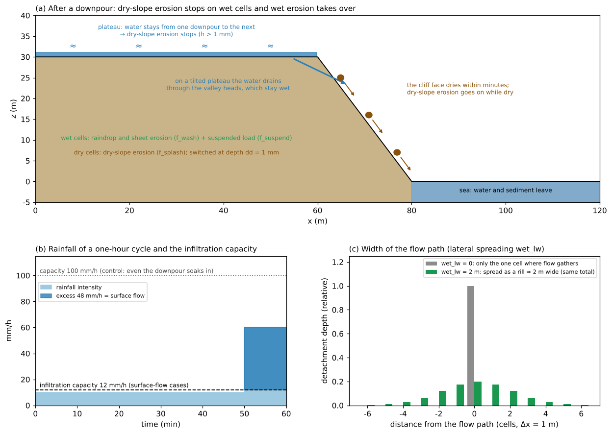

Schematic. (a) Profile of the plateau and the cliff after a downpour: water remains on a flat
plateau, which stays wet until the next downpour, and dry-slope erosion stops there. The cliff
face dries within minutes, and dry-slope erosion goes on while it is dry. On a tilted plateau
the water drains through the valley heads, which stay wet longest. (b) Rainfall of a one-hour
cycle and the infiltration capacity: only the part of the downpour above the capacity (48 mm/h)
becomes overland flow. (c) Lateral spreading of the detachment depth, `wet_lw`: the detachment of
the one cell where flow gathers is distributed to the surrounding cells as a rill of width
≈ ℓ_w (the total is the same).

| Real phenomenon | Mechanism in the model | Setting |
|---|---|---|
| The rain exceeds the infiltration capacity and becomes overland flow only during downpours | Rainfall with a one-hour cycle (50 min at 10 mm/h + 10 min at 60 mm/h) and a constant infiltration capacity (Green-Ampt, `gw_psif = 0`) | `prtype = 1`, `prval`, `gw_ksv_mmh = 12` (100 for the control) |
| Dry slopes: rolling grains and raindrop splash | Dry-slope erosion (only on dry cells with water depth h ≤ dd) | `f_splash`, `spl_*` (same coefficients as badland) |
| Wet slopes: detachment by raindrops, sheet erosion, transport by the flow | Hillslope erosion (raindrop + sheet) and suspended sediment (only on wet cells) | `f_wash`, `wash_kr`, `wash_kf`, `f_suspend`, `susp_esa` |
| Switching between dry and wet | Dry and wet erosion are switched at the water depth dd = 1 mm (no double counting) | `dd` (default 1 mm) |
| Drainage of water ponded on the plateau | Shallow-water flow. When the plateau is tilted 2 % towards the cliff, the water drains through the valley heads | `--tilt 0.02` of make_terrain.py |
| Width of rills | The detachment depth is spread to neighbouring cells with a Gaussian kernel of standard deviation ℓ_w before it is applied to the terrain (the total solid volume is conserved) | `wet_lw` (result 5) |
| The sea carries water and sediment away | Sea-mask cells have no landform change and no flow; water and sediment flowing into them leave the domain | `fn_sw` |
| A long time | Only the landform change is accelerated by morfac (landform time) | `dt_geomorph`, `morfac = 50` |

The erosion of dry and wet cells is switched by a single threshold of 1 mm water depth. The
coefficients of the wet erosion (`wash_kf`, `susp_esa`) would, at their defaults, erode several
metres in one downpour and break the computation, because the thin flow on a steep cliff has a
shear stress as large as 10³ times the critical value. Results 1 and 2 use values lowered to the
same order as the rate of dry erosion (≈ 3×10⁻⁷ m/s); results 3 to 5 use values pushed further
towards cutting the valley floors.

## Geometry and settings

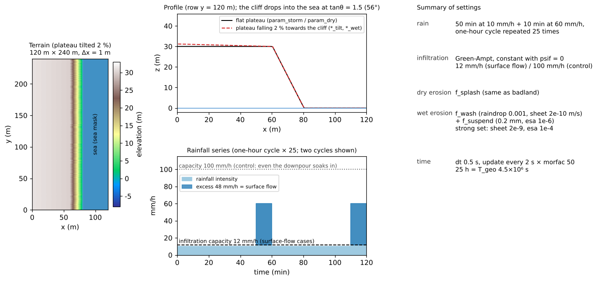

Left: terrain (plateau falling 2 % towards the cliff; blue = sea mask). Upper middle: profile
(solid = flat plateau, dashed = plateau tilted 2 %). Lower middle: rainfall series and
infiltration capacities (two cycles shown). Right: summary of the settings.

The terrain is the same as the main case of badland (120 m × 240 m, Δx = 1 m; a plateau 30 m
high and 60 m wide drops into the sea at a cliff with tanθ = 1.5, with white noise ±0.5 m on the
cliff edge). A terrain whose plateau is tilted 2 % towards the cliff is also used (water ponding
on a flat plateau is partly an artefact of the geometry).

- **Rain**: a one-hour cycle repeated 25 times. 50 minutes at 10 mm/h (below the infiltration
  capacity = all infiltrates; dry-slope erosion acts) and 10 minutes at 60 mm/h (downpour; the
  48 mm/h above the capacity of 12 mm/h becomes overland flow). The series is interpolated
  linearly, so both ends of each interval are given to make steps.
- **Infiltration**: Green-Ampt with `gw_psif = 0` (constant capacity). 12 mm/h for the cases
  with overland flow and 100 mm/h for the control (even the downpour soaks in).
- **Dry-slope erosion**: the same coefficients as badland ($`k_r`$ = 2×10⁻⁴, $`k_t`$ = 0.05,
  $`h`$ = 1.5, $`c_b`$ = 32 m, ℓ = 2 m, base level 0).
- **Wet erosion**: hillslope erosion (raindrop `wash_kr = 0.001`, sheet `wash_kf = 2×10⁻¹⁰` m/s)
  and suspended sediment (grain size 0.2 mm, `susp_esa = 10⁻⁶`). Results 3 to 5 use
  `wash_kf = 2×10⁻⁹` and `susp_esa = 10⁻⁴` ("strong wet erosion" below).
- **Time**: dt = 0.5 s (Courant condition of the surface flow); the landform is updated every
  2 s with morfac = 50 (with badland's 500, the positive feedback of flow concentration runs
  away within one update). 25 hours = 25 cycles = T_geo 4.5×10⁶ s (half of badland's main case =
  the stage at which the valley heads cut into the plateau as amphitheatres). Z, H and Sd are
  written every cycle (at the end of each downpour).

| Case | Settings file | Infiltration capacity | Plateau | Wet erosion | Δx | Cycles | Run time (approx.) |
|---|---|---|---|---|---|---|---|
| Control (all infiltrates) | param_dry.txt | 100 mm/h | flat | (does not act) | 1 m | 25 | about 8 min |
| With overland flow | param_storm.txt | 12 mm/h | flat | weak | 1 m | 25 | about 22 min |
| Control, tilted | param_dry_tilt.txt | 100 mm/h | 2 % | (does not act) | 1 m | 25 | |
| With overland flow, tilted | param_storm_tilt.txt | 12 mm/h | 2 % | weak | 1 m | 25 | |
| Hydraulics of overland flow only, tilted | param_stormnowet_tilt.txt | 12 mm/h | 2 % | none (f_wash and f_suspend off) | 1 m | 25 | |
| Strong wet erosion | param_storm_wet.txt | 12 mm/h | 2 % | strong | 1 m | 25 | |
| Strong wet erosion, grids | param_storm_wet_dx2.txt / param_storm_wet_dx05.txt | 12 mm/h | 2 % | strong | 2 / 0.5 m | 10 | about 3 min / about 60 min (2 threads) |
| + rill width ℓ_w = 2 m | param_storm_wet_lw_dx2.txt / param_storm_wet_lw.txt / param_storm_wet_lw_dx05.txt | 12 mm/h | 2 % | strong + `wet_lw = 2` | 2 / 1 / 0.5 m | 10 | |

The run times are for 4 threads (blank = not measured; similar to the cases with the same Δx and
number of cycles). The two cases with Δx = 0.5 m use half the y extent (120 m) to save
computation and dt = 0.125 s (see the notes).

## How to run

```
cd examples/badland_storm
make                              # link to the executable and inputs (make_terrain.py writes flat, tilted and Δx 2 m / 0.5 m terrains)
make run                          # run the 5 cases of results 1 and 2 in turn
python3 plot_setup.py             # figs/mechanism.png, setup.png (does not use the results)
python3 plot_storm.py             # result 1: figs/maps.png, series.png, flow.png and the table
SUF=_tilt python3 plot_storm.py   # result 2: figs/*_tilt.png
make wet                          # strong wet erosion of result 3 (param_storm_wet.txt)
SUF=_wet python3 plot_storm.py    # result 3: figs/*_wet.png (the control is result_dry_tilt)
make conv                         # the 5 cases of results 4 and 5 (about an hour for Δx = 0.5 m)
python3 conv_dx.py                # result 4: figs/conv_dx.png and the table
SET=lw python3 conv_dx.py         # result 5: figs/conv_dx_lw.png and the table
```

With the argument `en` the figures are drawn with English labels into en/figs/
(`python3 plot_setup.py en`, `python3 plot_storm.py en`; the figures of conv_dx.py have no
Japanese). plot_storm.py and conv_dx.py use the analysis functions of plot_results.py in
[badland](../../badland/en/README.md).

## Results

### Result 1: flat plateau

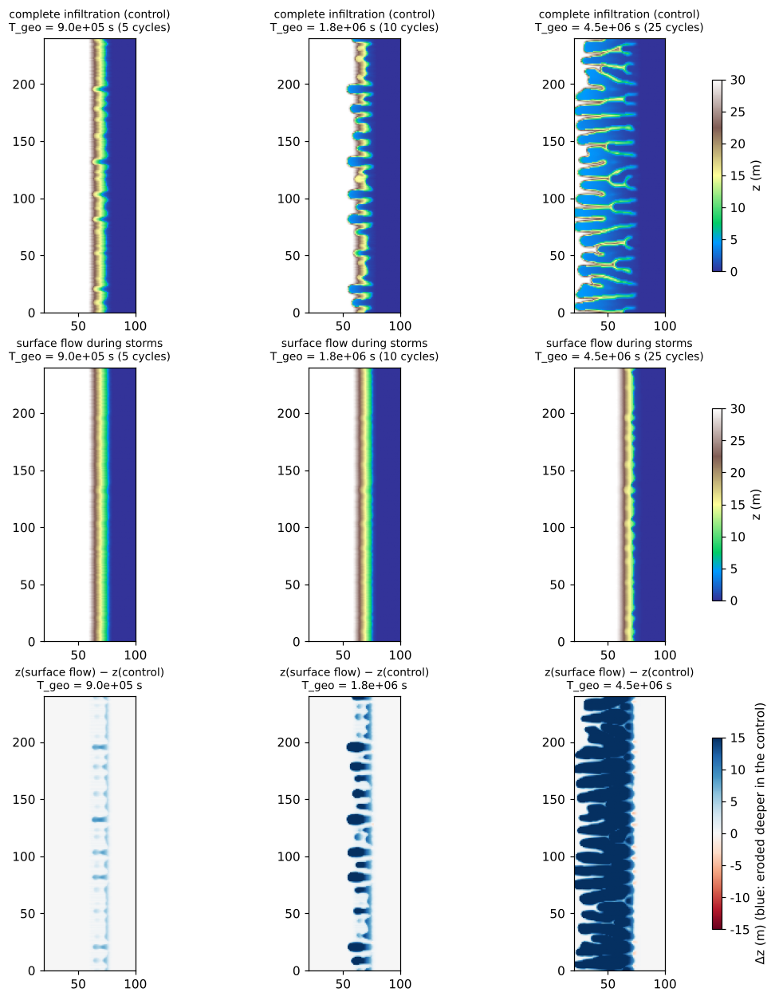

Top row: control (all infiltrates), middle row: with overland flow, bottom row: difference
z(overland flow) − z(control) (blue = eroded deeper in the control, red = eroded deeper with
overland flow). From the left: T_geo = 9×10⁵ s (5 cycles), 1.8×10⁶ s (10 cycles) and
4.5×10⁶ s (25 cycles = final).

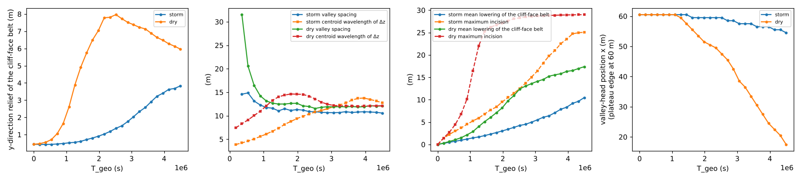

Time series (storm = with overland flow, dry = control). From the left: relief of the cliff-face
zone, valley spacing and centroid wavelength of Δz, mean lowering of the cliff-face zone and
maximum incision, position of the valley head.

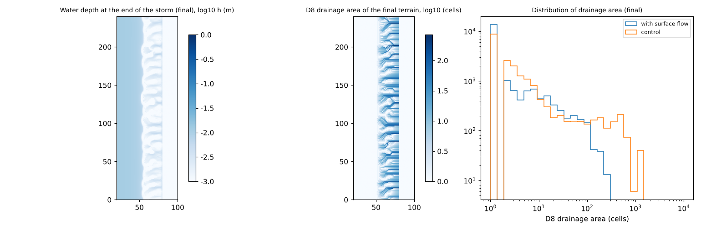

Water depth at the final time (end of a downpour) with overland flow (left), D8 drainage area of
the final terrain (middle) and distribution of the drainage area (right; with overland flow and
control).

| Quantity | Control (all infiltrates) | Overland flow during downpours |
|---|---|---|
| Relief of the cliff-face zone (m): maximum / final | 7.97 / 5.96 | 3.83 / 3.83 |
| Valley spacing (m): T_geo 1.8×10⁶ / 4.5×10⁶ s | 12.6 / 12.1 | 11.1 / 10.6 |
| Number of valleys (final) | 19 | 22 |
| Mean lowering of the cliff-face zone (m): 1.8×10⁶ / 4.5×10⁶ s | 7.1 / 17.4 | 2.7 / 10.5 |
| Maximum incision (m) (final) | 29.0 | 25.1 |
| Position x of the valley head (m) (plateau edge 60 m): 1.8×10⁶ / 4.5×10⁶ s | 53.5 / 17.5 | 59.5 / 54.5 |
| Mean lowering of the plateau edge to interior (cells initially at 30 m) (m) | 12.4 (dissected by the retreat of the valley heads) | 0.74 (the notches at the edge; 0.2 mm in the interior x < 45 m) |
| 99th percentile of slope, fraction with slope > 1 (final) | 12.2, 0.33 | 9.4, 0.13 |
| Water depth at the end of a downpour (m): median on land / maximum | – | 0.011 / 0.012 |
| Sediment that left the domain by dry-slope erosion (m³) | 1.44×10⁵ | 3.5×10⁴ |

**With overland flow, the valleys do not deepen and the plateau is not dissected.** In the
control the valley heads retreat 42.5 m from the plateau edge in 25 cycles and the plateau is
dissected into comb-like ridges, whereas with overland flow they retreat only 5.5 m and the
cliff face has only a row of shallow notches (relief 3.8 m; control 6.0 m final, 8.0 m
maximum). The valley spacing (11 to 12 m) hardly changes.

The cause is that "dry-slope erosion does not act on cells covered with water". Writing two cycles
every 5 minutes and following the fraction of wet cells (a run of param_storm.txt with tt = 7200
and dt_file = 300):

| Time (min) | Fraction of wet cells: all land / plateau / cliff face | Mean depth (mm) |
|---|---|---|
| 0 to 50 (first 10 mm/h) | 0 / 0 / 0 | 0 |
| 55 to 60 (downpour) | 0.79–0.83 / 0.97–0.98 / 0.27–0.36 | 3 to 5.7 |
| 65 to 110 (10 mm/h of the second cycle) | 0.72–0.75 / 0.96–0.97 / 0.01–0.10 | 5.1 → 2.7 |

When the downpour leaves 8 mm of water on the plateau, the water cannot drain because the plateau
is flat, and since the 10 mm/h rain keeps falling for the next 50 minutes the net infiltration is
only 2 mm/h, so **the plateau stays wet until the next downpour** (over 95 % of the plateau). The
cliff face dries within minutes. As a result:

- The plateau and the valley heads (amphitheatres) into which the plateau water flows are always
  wet, and dry-slope erosion stops there. The erosion of wet cells is only the raindrop term
  (wash_kr × P), and the interior of the plateau does not go down even 1 cm in 25 cycles. The
  retreat of the valley heads (the dry hollow feedback) does not occur.
- The cliff face is wet only during the downpours and dry-slope erosion goes on while it is dry,
  so valleys form on the cliff face (with the same spacing), but they do not deepen because the
  valley heads cannot cut into the plateau.
- Sheet erosion and transport of suspended sediment by the overland flow during downpours (with
  the reduced coefficients) only scrape the valley floors slightly, and no deepening of valleys by
  flow concentration is seen (the flow is thin and lasts only 10 minutes).

So in this set-up the overland flow works not to "cut valleys" but to "stop dry-slope erosion",
and the cliff stays a steep scarp with shallow notches.

### Result 2: plateau tilted 2 %

Water ponding on a flat plateau is partly an artefact of the geometry (real plateaus slope gently
towards the cliff edge), so the same comparison is also made with the plateau tilted 2 % towards the
cliff, so that ponded water drains to the valley heads.

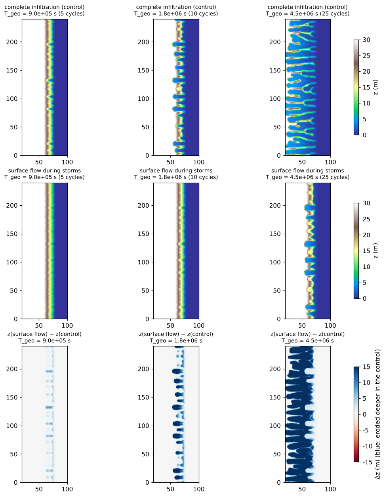

Same layout as the maps of result 1 (tilted plateau; same colour key in the bottom row).

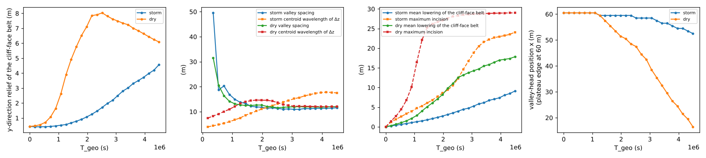

Time series (storm = with overland flow, tilted; dry = control, tilted).

| Quantity | Control (all infiltrates) | Overland flow during downpours | Hydraulics of overland flow only (no wet erosion) |
|---|---|---|---|
| Relief of the cliff-face zone (m): maximum / final | 8.03 / 6.09 | 4.57 / 4.57 | 4.34 / 4.34 |
| Valley spacing (m): T_geo 1.8×10⁶ / 4.5×10⁶ s | 12.7 / 12.0 | 11.9 / 11.6 | 12.8 / 10.6 |
| Mean lowering of the cliff-face zone (m): 1.8×10⁶ / 4.5×10⁶ s | 7.1 / 17.8 | 2.4 / 9.1 | 2.4 / 9.4 |
| Maximum incision (m) (final) | 29.0 | 24.1 | 26.1 |
| Position x of the valley head (m) (plateau edge 60 m): 1.8×10⁶ / 4.5×10⁶ s | 53.5 / 16.5 | 59.5 / 52.5 | 60.5 / 53.5 |
| Mean lowering of the plateau edge to interior (cells initially at 30 m) (m) | 12.8 | 0.78 | 0.61 (7 mm in the interior x < 45 m) |
| Water depth at the end of a downpour (m): median on land / 99th percentile | – | 0.003 / 0.009 | – |

With the tilt, the water on the plateau drains in about 20 minutes (with the same 5-minute output
of two cycles: at the end of a downpour 87 % of the land and 92 % of the plateau are wet, 7 % ten
minutes later and 0 twenty minutes later). Still, the result is almost the same as for the flat
plateau: **with overland flow the valleys develop more slowly and the plateau is not dissected**
(retreat of the valley head 7.5 m; control 43.5 m).

A variant with the hydraulics of overland flow only, with the wet erosion (f_wash, f_suspend) off
(param_stormnowet_tilt.txt), gives almost the same result as the case with wet erosion (valley head
53.5 m, relief 4.34 m). So **the wet erosion contributes almost nothing; the effect of overland
flow is that "dry-slope erosion stops while water covers the surface"**. It works in two steps.

1. Dry-slope erosion is proportional to the rainfall intensity P, so a 10-minute downpour of
   60 mm/h is equivalent to one hour of 10 mm/h; in the control (all infiltrates) the downpour
   carries a little over half of the driving force of dry-slope erosion (10 mm/h of the
   60-minute mean of 18.3 mm/h). Lowering the infiltration capacity turns this most effective
   rain into overland flow and removes it from dry-slope erosion.
2. After a downpour, the water on the plateau drains through the valley heads (amphitheatres), so
   the valley heads, where the hollow feedback is strongest, stay wet longest (the band along the
   plateau edge is wet until 20 minutes after the end of the downpour), and the retreat of the
   valley heads stops. The cliff face dries within minutes, so valleys form on it (with the same
   spacing), but they cannot cut into the plateau.

As a result, the landform with overland flow is "a scarp with a row of shallow notches on the
cliff face", not the control's "plateau dissected into comb-like ridges". It takes about three
times as long as the control to reach the same relative relief (4 m).

The wet erosion is ineffective because the thin flow on the steep cliff lasts only 10 minutes and
the coefficients have been lowered to an order that does not break the computation. To push
overland flow towards cutting valleys (incision of the valley floors by concentrated flow),
wash_kf and susp_esa must be raised and morfac lowered further (longer real time), and then one
has to check, by changing the grid spacing, how realistic the concentration on a single cell of
the valley floor is (results 3 to 5).

### Result 3: pushing overland flow towards cutting the valley floors (larger wet-erosion coefficients)

A set-up with the coefficient of the equilibrium concentration of suspended sediment raised to the
default susp_esa = 10⁻⁴ and the sheet-erosion coefficient to wash_kf = 2×10⁻⁹ (100 and 10 times
those of results 1 and 2) (param_storm_wet.txt; plateau tilted 2 %, morfac 50).

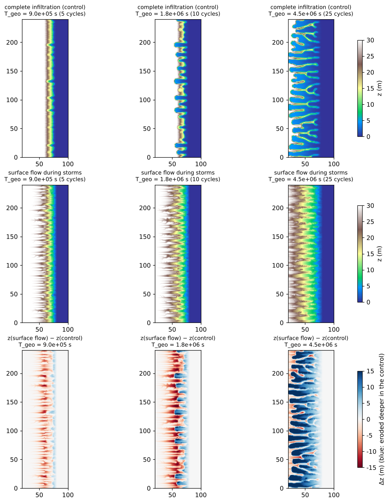

Same layout as the maps of result 1 (the control in the top row is the tilted plateau with all
rain infiltrating = result_dry_tilt).

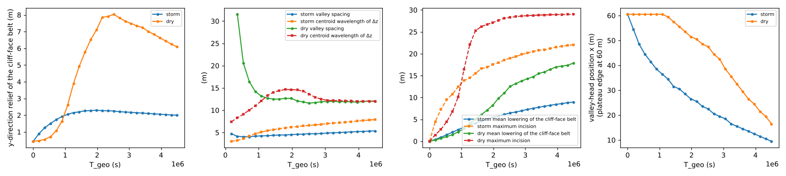

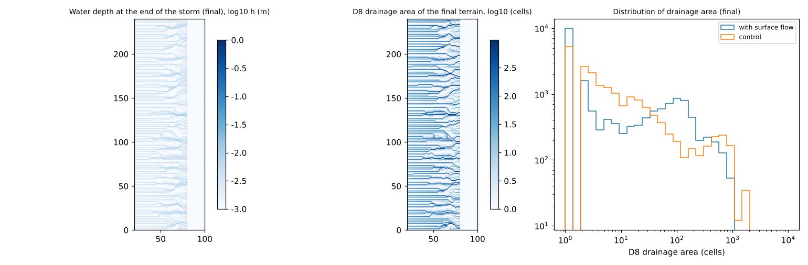

| Quantity (T_geo 4.5×10⁶ s) | Control (all infiltrates) | Overland flow, weak wet erosion (result 2) | Overland flow, strong wet erosion |
|---|---|---|---|
| Relief of the cliff-face zone (m): maximum / final | 8.0 / 6.1 | 4.6 / 4.6 | 2.3 / 2.0 |
| Valley spacing (m) (final) / number | 12.0 / 19 | 11.6 / 20 | **5.4 / 44** |
| Position x of the valley head (m) (plateau edge 60 m) | 16.5 | 52.5 | **9.5** |
| Mean lowering of the cliff-face zone (m) | 17.8 | 9.1 | 9.0 |
| Maximum incision (m) | 29.0 | 24.1 | 22.1 |
| Slope median / 90th / 99th percentile (final, land) | 0.12 / 6.2 / 12.4 | – / – / 8.5 | 0.61 / 2.1 / 3.5 |
| Columns at x = 30 / 45 / 60 m: mean elevation (m) | 13.9 / 7.7 / 3.8 | – | 26.6 / 19.2 / 11.3 |
| Same: y-direction relief (standard deviation) (m) | 10.9 / 6.4 / 4.0 | – | 2.0 / 2.8 / 2.3 |

**The landform changes completely.** Whereas the control (dry only) is "deep valleys between sharp
ridges dissecting the plateau like the teeth of a comb", with strong wet erosion:

- The valley spacing is less than halved (5.4 m, 44 valleys) into a **dense gully network**, and the
  valley heads cut into the plateau from the first cycle and retreat 50.5 m in 25 cycles (control
  43.5 m, and the control does not move until the 6th cycle).
- The valleys are shallow (relief about 2 m), and the cliff loses its 56° wall and is smoothed into
  a **gentle slope of gradient 0.5 to 1** (the mean elevation at x = 30 to 60 m is 7 to 13 m
  higher than the control = rather than the cliff retreating, the whole slope is lowered from the
  plateau edge).
- The water of the downpours gathers in the valley floors (water depth at the end of a downpour:
  median on land 0.3 mm, 99th percentile 6 mm, maximum 2.5 cm; the maximum depth over the run
  is 10 cm in valley floors), and the D8 network is a
  dense row of parallel gullies perpendicular to the plateau edge, with less branching than in the
  control.

The dry hollow feedback is a mechanism that "cuts deep amphitheatres at the valley heads and leaves
ridges", whereas sheet erosion by overland flow is a mechanism that "lowers the whole slope while
smoothing it, starting from where the flow gathers"; from the same start, they lead to different
landforms: **slopes of dense gullies** and **deep valleys with sharp ridges**. Within this model,
deep valleys with sharp ridges form only when almost no overland flow occurs (the infiltration
capacity exceeds the downpours).

However, the spacing of 5.4 m is shorter than the selection rule for ℓ = 2 m (≈ 4.4 to 6 ℓ): the
concentration of overland flow (flow paths one cell wide) sets the spacing. When the grid
spacing changes, the spacing changes and does not converge (result 4).

### Result 4: grid convergence of the gully spacing (Δx = 2 / 1 / 0.5 m)

With the set-up of result 3 (strong wet erosion, tilted plateau), only the grid spacing is changed
(param_storm_wet_dx2.txt / param_storm_wet.txt / param_storm_wet_dx05.txt). The initial
perturbation is the same white noise on a 1 m grid mapped onto each grid (make_terrain.py --dx),
and the comparison times are the 5th and 10th cycles (T_geo 9×10⁵ and 1.8×10⁶ s). The numbers of
valleys are per 100 m.

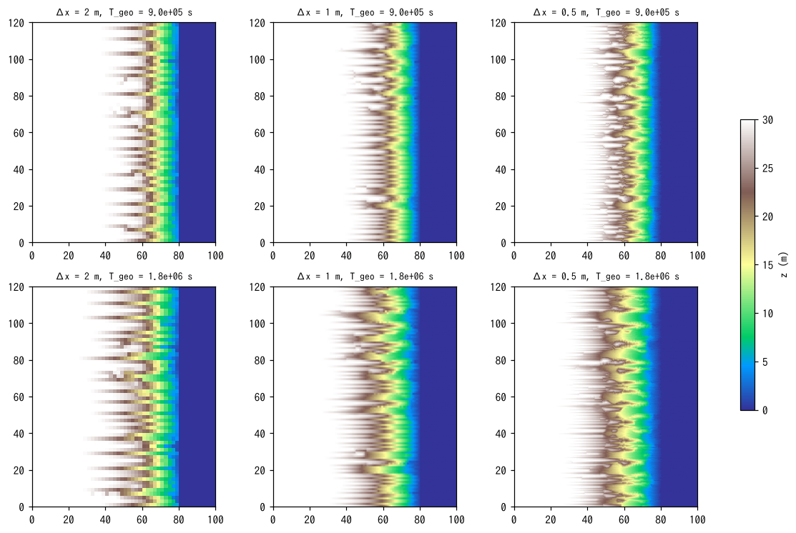

Terrain at the 5th (top) and 10th (bottom) cycles for Δx = 2 / 1 / 0.5 m (columns; 120 m shown in y).

| Δx (m) | T_geo (s) | Centroid wavelength of Δz (m) | Valley spacing (m) / number (per 100 m) | Spacing / Δx | Relief of the cliff-face zone (m) | Mean lowering / maximum incision (m) | Valley head x (m) | Slope median / 99th percentile |
|---|---|---|---|---|---|---|---|---|
| 2 | 9.0×10⁵ | 6.3 | 6.2 / 15.8 | 3.1 | 2.17 | 1.7 / 11.2 | 39.0 | 0.08 / 2.5 |
| 2 | 1.8×10⁶ | 7.1 | 6.3 / 15.5 | 3.2 | 2.76 | 3.5 / 16.5 | 29.0 | 0.34 / 3.2 |
| 1 | 9.0×10⁵ | 4.7 | 4.2 / 23.6 | 4.2 | 1.92 | 2.7 / 12.5 | 38.5 | 0.13 / 4.2 |
| 1 | 1.8×10⁶ | 6.0 | 4.5 / 22.2 | 4.5 | 2.28 | 5.0 / 16.9 | 28.5 | 0.47 / 4.9 |
| 0.5 | 9.0×10⁵ | 4.2 | 3.1 / 32.2 | 6.2 | 1.92 | 3.6 / 13.0 | 37.2 | 0.25 / 6.9 |
| 0.5 | 1.8×10⁶ | 5.0 | 3.3 / 29.7 | 6.7 | 1.88 | 6.2 / 17.6 | 25.8 | 0.62 / 5.8 |

**The gully spacing does not converge with the grid.** The valley spacing at the 10th cycle is
6.3 → 4.5 → 3.3 m (Δx = 2 → 1 → 0.5 m): making the grid 4 times finer roughly halves it
(≈ Δx^0.5), and the centroid wavelength of Δz also shortens, 7.1 → 6.0 → 5.0 m. Spacing / Δx is
3.2 → 4.5 → 6.7 cells, not constant either, so it lies between "stuck to the grid (∝ Δx)" and
"converging to a physical spacing".

- **Mechanism**: the first downpour (10 minutes) alone cuts **grooves one cell wide** 3.2 / 4.5 /
  4.8 m deep (Δx = 2 / 1 / 0.5 m) from the cliff edge into the cliff face. The depth does not
  depend on Δx while the width is one cell, so the slope of the groove walls is inversely
  proportional to Δx (99th percentile of slope 3.2 / 4.9 / 5.8 to 6.9). Both sheet erosion and
  entrainment are proportional to the shear stress, and the positive feedback by which flow
  concentrates into the cell width and raises the shear stress has no length scale like the
  smoothing of the curvature in dry erosion (spl_lc), so the minimum width of the gullies is set
  by the grid.
- The finer the grid, the denser and shallower the valleys (relief 2.8 → 2.3 → 1.9 m) and the
  larger the mean lowering of the whole slope (3.5 → 5.0 → 6.2 m). On the other hand, the position
  of the valley head (29 / 28.5 / 25.8 m) and the maximum incision (16.5 / 16.9 / 17.6 m) hardly
  depend on the grid. The qualitative conclusion of result 3 (sheet erosion by overland flow
  "lowers the whole slope while smoothing it") does not change, but the spacing of 5.4 m is a
  product of the grid.
- As a remedy, result 5 adds a width scale to the wet erosion, `wet_lw` (lateral spreading of the
  detachment depth).

### Result 5: grid convergence with lateral spreading of detachment wet_lw = 2 m

`wet_lw = 2.0` is added to the three grids of result 4 (the detachment depth evaluated in each
cell is distributed to the neighbouring cells with a Gaussian kernel of standard deviation 2 m
before it is applied to the terrain = the flow path erodes as a rill about 2 m wide; the total
solid volume is conserved) (param_storm_wet_lw*.txt; otherwise the same). The ledger "solid volume
lost to bedrock floor" at the end is 0 for all three grids.

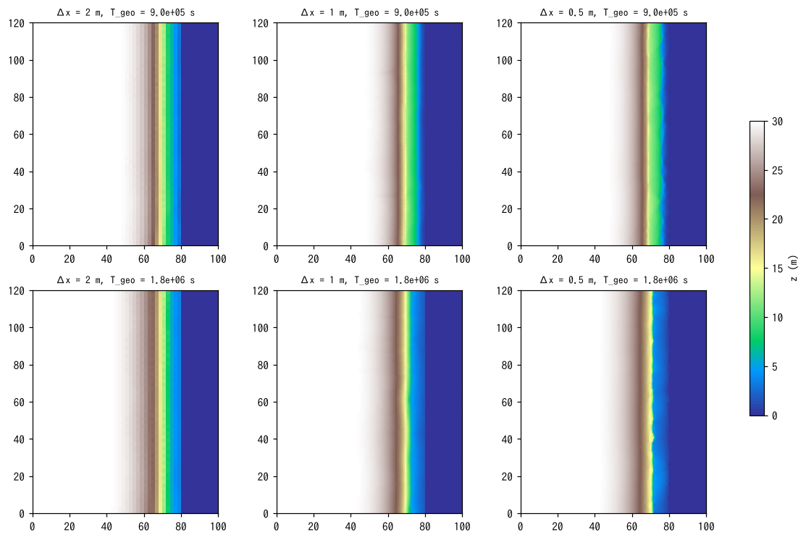

Same layout as the figure of result 4 (wet_lw = 2 m).

| Δx (m) | T_geo (s) | Centroid wavelength of Δz (m) | Valley spacing (m) / number (per 100 m) | Spacing / Δx | Relief of the cliff-face zone (m) | Mean lowering / maximum incision (m) | Valley head x (m) | Slope median / 99th percentile |
|---|---|---|---|---|---|---|---|---|
| 2 | 9.0×10⁵ | 13.9 | 22.4 / 3.0 | 11.2 | 0.37 | 1.1 / 5.1 | 53.0 | 0.04 / 1.7 |
| 2 | 1.8×10⁶ | 16.4 | 25.5 / 2.5 | 12.8 | 0.38 | 1.9 / 7.2 | 49.0 | 0.08 / 1.8 |
| 1 | 9.0×10⁵ | 4.4 | 7.8 / 8.2 | 7.8 | 0.17 | 1.6 / 5.2 | –* | 0.04 / 1.4 |
| 1 | 1.8×10⁶ | 4.8 | 8.4 / 6.9 | 8.4 | 0.18 | 2.7 / 7.4 | –* | 0.08 / 1.3 |
| 0.5 | 9.0×10⁵ | 3.4 | 6.3 / 9.6 | 12.7 | 0.16 | 1.8 / 5.4 | –* | 0.04 / 1.5 |
| 0.5 | 1.8×10⁶ | 3.4 | 7.0 / 7.5 | 14.0 | 0.15 | 3.0 / 7.8 | –* | 0.09 / 1.3 |

(* The relief of the cliff-face zone is below the threshold for detecting the valley head (standard
deviation of a column 0.2 m), so no valley head is detected; conv_dx.py prints 67.5 to 79.8 m, the
position of the lower cliff.)

**The dense gully network disappears, and the cliff becomes a gentle slope retreating uniformly.**
When the detachment that was concentrated on a flow path one cell wide is distributed over a band
2 m wide, the positive feedback of flow concentration does not act at the scale of the grid, and
the wet erosion works as a sheet-like lowering that smooths the whole slope. The relief of the
cliff-face zone is about 0.2 m (1/10 of the 2 to 3 m in result 4), and what is detected as "valleys" is a
gentle undulation.

- **Grid convergence**: for Δx = 1 m and 0.5 m, relief 0.18 / 0.15 m, mean lowering 2.7 / 3.0 m,
  maximum incision 7.4 / 7.8 m and spacing of the undulation 8.4 / 7.0 m agree within 5 to 20 %
  (in result 4 the spacing changes systematically 4.5 → 3.3 m and the mean lowering 5.0 → 6.2 m). Δx = 2 m (ℓ_w/Δx = 1) does not resolve the kernel on the grid and gives a
  different result (spacing 26 m, relief 0.38 m), so as with spl_lc, **ℓ_w/Δx ≥ 2** is needed.
- **Reinterpreting result 3**: "pushing overland flow towards cutting the valley floors makes a
  dense gully network" (spacing 5.4 m, 44 valleys) is a product of the grid: concentration on flow
  paths one cell wide. Wet erosion with a width scale works **to smooth away** the deep valleys with
  sharp ridges that the dry hollow feedback makes. The conclusion of result 3, that within this
  model deep valleys with sharp ridges form only when almost no overland flow occurs, becomes
  stronger.
- ℓ_w = 2 m is set to the same value as the dry correlation length ℓ and is not calibrated. A
  smaller ℓ_w (within what the grid can resolve) would bring back the flow concentration, and
  gullies would be expected to reappear.

## What this model cannot represent (differences from the real phenomenon)

- **Switching between dry and wet is a single depth threshold**: dry and wet erosion switch at the
  water depth dd = 1 mm, so treating "dry-slope erosion stops as soon as a 1 mm film of water
  covers the cell" governs the result. It is reasonable as a condition under which wet grains
  cannot roll, but the sensitivity to the threshold has not been checked.
- **The wet-erosion coefficients are not calibrated**: results 1 and 2 use values lowered to an
  order that can be computed stably; results 3 to 5 use values near the upper limit that does not
  break the computation with morfac 50.
- **The rill width does not depend on discharge**: `wet_lw` is a constant width that does not depend
  on discharge; it does not represent widths changing with discharge as real rills do.
- **Uniform rain**: the rain intensity does not vary in space; uneven rain due to wind and changes of
  the surface layer by repeated wetting and drying (crusts, cracks) are not treated.
- **Water and sediment that reach the sea do not come back**: sea-mask cells have no landform change
  and no flow, so water and sediment flowing into the sea leave the domain (no sediment accumulates
  at the foot of the cliff).
- The limitations on the dry-slope erosion side (a summary of processes below the grid scale, no
  accumulation of sediment, grid dependence of the rate in the deep stage) are the same as in
  [badland](../../badland/en/README.md).

## Notes

- **The rainfall series is interpolated linearly**: the `prtype = 1` series is interpolated linearly,
  so to make steps both ends of each interval are given (`prval` in the param files).
- **morfac**: set to 50. With badland's 500, the positive feedback of flow concentration runs away
  within one update.
- **Upper limit of the wet-erosion coefficients**: with susp_esa = 10⁻³ the run breaks down
  within 5 cycles, and with 10⁻⁴ it is stable.
- **Time step for finer grids**: for Δx = 0.5 m, dt = 0.25 s (the same dt/Δx as Δx = 1 m) breaks
  down in the first downpour (without landform change it is stable with a maximum Courant number of
  0.73; flow gathering into one-cell grooves exceeds a Courant number of 1). With dt = 0.125 s it runs
  10 cycles with a maximum Courant number of ≈ 1.0 to 1.2. Wet erosion has no cap on the change per
  update, so finer grids keep their stability through the time step of the flow.
- The export by dry-slope erosion is 1.44×10⁵ m³ in the control and 3.5×10⁴ m³ with overland flow.
  The difference is mostly not transport by wet erosion but the dry erosion that stopped.
- **Reproducibility of the numbers**: in the cases with wet erosion, differences of the size of
  rounding errors are amplified by the positive feedback of flow concentration, so the same
  computation gives numbers a few percent different with different builds (optimization). The
  tables give values computed with an -Ofast build.

## Starting points for sensitivity experiments

- `gw_ksv_mmh` (infiltration capacity): letting the downpours soak in completely (100 mm/h) gives
  the same type as badland.
- Intensity and duration of the downpours (`prval`): the amount of rain that becomes overland flow,
  and how long the surface stays wet.
- `wash_kf`, `susp_esa`: strength of the wet erosion (lower morfac when raising them).
- `wet_lw`: rill width (keep ℓ_w/Δx ≥ 2).
- `dd`: water depth at which dry and wet are switched.

## References

- Gabet, E. J. (2003): Sediment transport by dry ravel. *J. Geophys. Res.*, 108(B1), 2049.
  doi:10.1029/2001JB001686 (checked against the abstract)
- Horton, R. E. (1933): The role of infiltration in the hydrologic cycle. *Trans. Am. Geophys.
  Union*, 14, 446–460.
- Howard, A. D. (1994): A detachment-limited model of drainage basin evolution.
  *Water Resour. Res.*, 30(7), 2261–2285.
