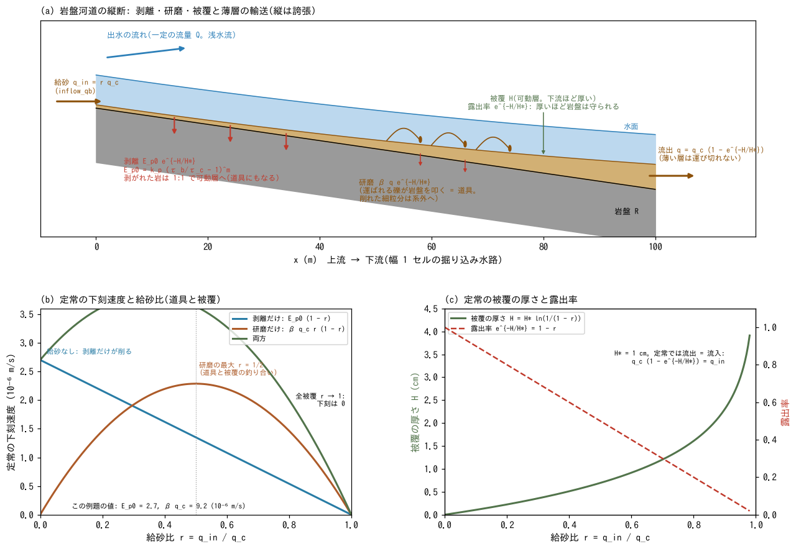
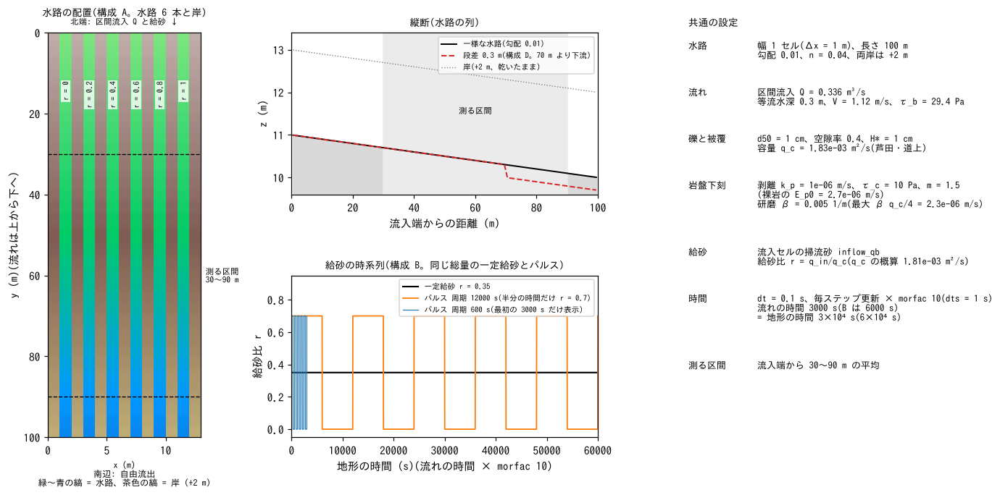
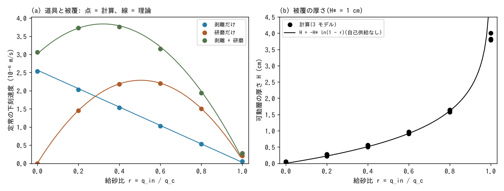
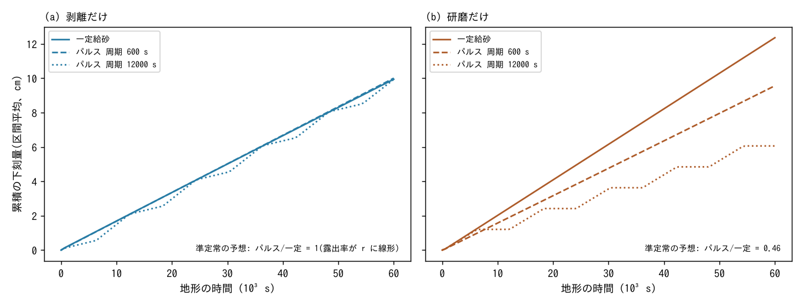
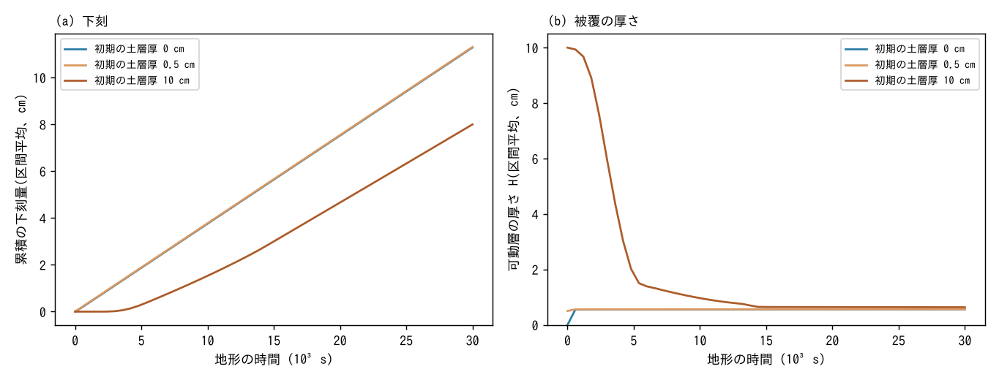
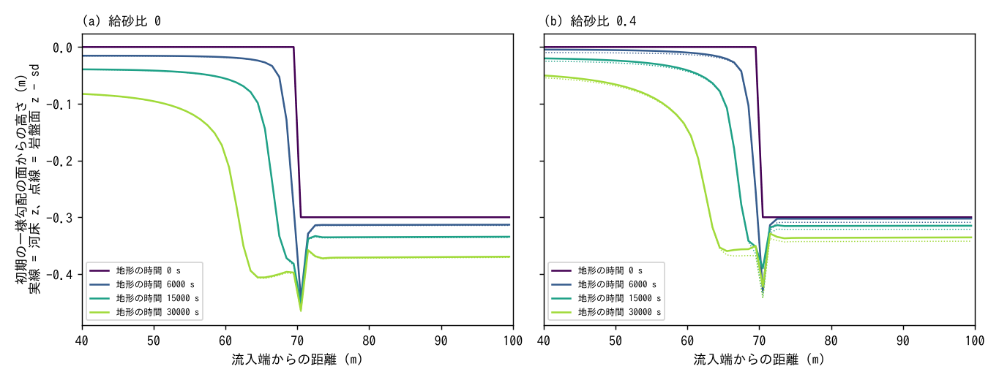

# bedrock_cover — 岩盤河道の被覆効果: 給砂の量と時期が下刻を決める

[English](en/README.md)

山地渓流の岩盤河道では、流れが運ぶ礫は岩盤を削る道具(研磨)にもなり、岩盤を覆って守る
被覆にもなります(Sklar & Dietrich 2004 の「道具と被覆」)。この例題は、幅 1 セルの掘り込み
水路を並べ、上流からの**給砂の量**、**給砂の時期**(同じ総量の一定給砂とパルス給砂)、
**初期の被覆**、**段差(遷急点)の後退**で岩盤の下刻がどう変わるかを比べます。使うのは
地形変化モジュールの流水による岩盤下刻 `f_rockinc`(剥離・被覆・研磨。
[ユーザーガイド](../../docs/users_guide/geomorph.md#流水による岩盤下刻f_rockinc)、式と出典は
[解説](../../docs/users_guide/sediment.md))と掃流砂 `f_fluvial` です。値は現象を見やすくする
ための模式値で、特定の河川の再現ではありません。

## 実際の岩盤河道で起きていること

- **岩盤河道**: 山地の渓流には、河床の土砂が薄く岩盤が露出した区間が多くあります。河道は、
  流水が割れ目に沿って岩塊を剥がす「剥離」と、流れが運ぶ礫が岩盤にぶつかって削る「研磨」で
  下がります。岩盤河道の侵食速度を出水時の底面せん断応力で表すのが基本的な形です
  (Howard & Kerby 1983)。
- **道具と被覆**: 運ばれる礫は岩盤を削る道具ですが、河床に留まれば岩盤を覆って守る被覆に
  なります。給砂が少なければ道具がなく、多ければ岩盤が被覆されるので、研磨による下刻は
  給砂が運搬容量の半分ほどのときに最も速く、給砂がないときと全被覆のときに 0 になります
  (Sklar & Dietrich 2004 の saltation–abrasion 模型。被覆の効き方は給砂と容量の比で表され、
  同論文は水路実験から線形、Turowski ら 2007 は指数形を提案しています)。
- **給砂が河道の勾配を決める**: 隆起に釣り合う岩盤河道の定常の勾配は、礫が動き出す勾配に、
  給砂を運ぶための増分と下刻のための増分を足したものになります。最も効くのは礫径、次が
  給砂で、下刻そのものは硬い岩や速い隆起でだけ効きます(Sklar & Dietrich 2006)。
- **被覆の形は 2 次元**: 幅のある岩盤河道の数値実験では、給砂が容量に近いと交互砂州状の
  被覆が下流へ移りながら岩盤を一様に削り、給砂が容量の 0.2 倍では岩盤に縦溝が刻まれて
  被覆は溝に溜まります(Inoue ら 2016。石狩川の現地実験から研磨係数 β ≈ 0.001 /m)。
- **段差(遷急点)は上流へ後退する**: 基準面の低下や硬い岩でできた段差は、段の面とその
  直下で侵食が速く、上流へ後退しながら緩んでいきます。
- **削れるのは出水のときだけ**: 礫が動いて岩盤が削れるのは出水の間だけで、長期の下刻速度は
  代表の出水が年に流れる時間の割合で決まります(Sklar & Dietrich 2004 の基準地点では、出水中の
  下刻 20.5 mm/年が年平均では約 0.9 mm/年)。

## 再現に必要な機構



模式図。(a) 岩盤河道の縦断: 露出した岩盤を流水が剥がし(剥離)、運ばれる礫が岩盤を叩いて
削り(研磨)、河床に留まる礫(可動層 H)が岩盤を覆って守る。剥がれた岩は可動層に加わって
道具にもなる。(b) 定常の下刻速度と給砂比: 剥離は被覆の分だけ直線的に遅くなり、研磨は
道具と被覆の釣り合う給砂比 1/2 で最大になる山形。(c) 定常の被覆の厚さと露出率。

| 実際の現象 | ENCflow での表し方 | 設定 |
|---|---|---|
| 出水が一定の流量で流れる | 浅水流。北端の区間流入 Q(初期水深は等流水深)、南辺は自由流出 | `&list_bound_inflow`、`fn_hinit`、`f_bc_s = 1` |
| 露出した岩盤を流水が剥がす(剥離) | 底面せん断の超過形 E_p0 = k_p (τ_b/τ_c − 1)^m に露出率 e^{−H/H*} を掛ける。剥がれた岩は同じ厚さの可動層(礫)になる | `f_rockinc = 1`、`rock_kp`・`rock_tauc`・`rock_m` |
| 運ばれる礫が岩盤を削る(研磨 = 道具) | β × そのセルを出る掃流砂 × 露出率。削れた分は細粒分として系外へ出す | `rock_beta` |
| 河床の礫が岩盤を覆って守る(被覆) | 可動層の厚さ H で露出率 e^{−H/H*}(H* は被覆の長さ)。薄い層は運び切れない(流出に利用可能率 1 − e^{−H/H*} を掛ける) | `rock_hstar` |
| 礫が流れで運ばれる | 掃流砂(芦田・道上の式。運搬容量 q_c) | `f_fluvial = 1`、`fluv_d50` |
| 上流から礫が供給される | 流入セルの掃流砂の時系列(一定、またはパルス) | `inflow_qb` |
| 段差(遷急点) | 地形の段 | `fn_z`(make_init.py が作る) |
| 長い時間の地形変化 | 地形の変化だけを morfac 倍に加速する(地形の時間) | `morfac`、`dt_geomorph` |

**定常の被覆と下刻**: 可動層の厚さ H に対し、岩盤の露出率は e^{−H/H*}、掃流砂の流出に掛かる
利用可能率は 1 − e^{−H/H*} です。定常では流出 = 流入なので、掃流砂の流砂量 q に対して
1 − e^{−H/H*} = q/q_c、つまり被覆の厚さは H = H* ln(1/(1 − q/q_c))、露出率は 1 − q/q_c となり、
下刻速度は

  E = (1 − q/q_c)(E_p0 + β q)

です(第 1 項が剥離、第 2 項が研磨。研磨は被覆率 q/q_c と露出率の積に比例する山形)。剥離した
岩は 1:1 で可動層に入って下流の q を増やす(研磨の細粒分は系外へ出る)ので、
q(x) = q_c − (q_c − q_in) exp(−(1 − λ) E_p0 x / q_c) です(自己供給)。結果の図の理論線は、計算の
等流の水理から求めた E_p0 と q_c でこれを測る区間で平均したものです。

## 幾何と設定



左: 水路の配置(構成 A。濃い縞が水路、淡い縞が岸)。中上: 水路の縦断(一様な水路と段差)。
中下: 構成 B の給砂の時系列(一定とパルス)。右: 共通の設定。

幅 1 セル(Δx = 1 m)、長さ 100 m、勾配 0.01、粗度 n = 0.04 の掘り込み水路で、両岸は +2 m の
乾いた地盤です。水路を東西に 2〜6 本並べ、水路ごとに給砂か初期の土層厚だけを変えて一つの
計算で比べます(水路は岸で隔てられ、互いに影響しません)。

- **流れ**: 北端の区間流入 Q = 0.336 m³/s(等流水深 0.3 m、V = 1.12 m/s、底面せん断
  τ_b = 29.4 Pa)。南辺は自由流出。
- **礫と被覆**: d50 = 1 cm(τ* ≈ 0.18 で動く)、空隙率 0.4、被覆の長さ H* = 1 cm。等流の掃流砂の
  容量は q_c = 1.83×10⁻³ m²/s(芦田・道上の式)。
- **岩盤下刻**: 剥離は k_p = 10⁻⁶ m/s、τ_c = 10 Pa、m = 1.5(裸岩の剥離速度
  E_p0 = 2.7×10⁻⁶ m/s)。研磨は β = 0.005 1/m(研磨による下刻速度の最大 β q_c/4 =
  2.3×10⁻⁶ m/s)。短い計算で下刻を見せるための値で、実際の岩の値ではありません。
- **給砂**: 流入セルの掃流砂 `inflow_qb`。給砂比 r = q_in/q_c(q_in は q_c の概算
  1.81×10⁻³ m²/s の r 倍)で表します。
- **時間**: dt = 0.1 s、毎ステップの地形更新 × morfac 10(dts = 1 s)。流れの時間 3000 s(B は
  6000 s)= 地形の時間 3×10⁴ s(6×10⁴ s)。
- **測る区間**: 入口と出口の影響を避け、流入端から 30〜90 m の平均を使います。

| 構成 | 設定ファイル | 水路 | 内容 |
|---|---|---|---|
| A 給砂の量 | param_A_p.txt・A_a・A_pa | 6 本 | 剥離だけ・研磨だけ・両方の 3 モデル × 一定給砂 r = 0, 0.2, 0.4, 0.6, 0.8, 1.0。裸岩から |
| B 給砂の時期 | param_B_p.txt・B_a | 3 本 | 剥離だけ・研磨だけ。平均の給砂比 0.35 の一定給砂と、半分の時間だけ r = 0.7 で給砂するパルス(周期 600 s・12000 s。地形の時間) |
| C 初期の被覆 | param_C_pa.txt | 3 本 | 両方のモデル、r = 0.4。初期の土層厚 0・0.5 cm・10 cm |
| D 段差の後退 | param_D_p.txt | 2 本 | 剥離だけ。流入端から 70 m より下流を 0.3 m 下げた段差(遷急点)。r = 0 と 0.4 |

## 実行方法

```
cd examples/bedrock_cover
make                     # リンクと入力(make_init.py が地形・初期水深・土層厚と param_*.txt を作る)
make run                 # 7 構成を順に計算(合わせて約 5 分)
python3 plot_setup.py    # figs/mechanism.png・setup.png(計算結果は使わない)
python3 plot_results.py  # figs/*.png と数表(引数 en で英語版を en/figs/ に)
```

引数 `en` を付けると英語ラベルの図を en/figs/ に描きます(`python3 plot_setup.py en`、
`python3 plot_results.py en`)。図化には Python 3・NumPy・matplotlib が要ります。

## 結果

(数表は 2026-11-02 に現行の既定(f_opening_dynamic = 3 と、運動量保存形移流の側方面の修正後)で
再計算して確かめた値。図はそれより前の計算のもので、表示の桁では見分けがつきません。
developer.md §68.41〜§68.43)

### 給砂の量: 道具と被覆



- **剥離だけ**: 被覆の分だけ直線的に遅くなります(1 − r)。給砂がなくても、剥離した礫が
  薄い被覆(0.5 mm)を作ります。
- **研磨だけ**: 山形です。給砂がなければ道具がなく削れず、r = 0.4〜0.6 で最大、r → 1 で
  全被覆になります。
- **両方**: r = 0 でも剥離した礫が道具になって研磨が起き(3.06×10⁻⁶ m/s。剥離だけの
  2.53×10⁻⁶ より速い)、最大は r ≈ 0.3 です。
- 定常の下刻速度は理論と 2.3 % 以内で一致し(0 < r < 1)、被覆の厚さも H* ln(1/(1 − r)) に
  一致します。r = 1 は全被覆へ向かう途中です(被覆が厚くなり続け、下刻速度は 0 に向かう)。

### 給砂の時期: 同じ総量の一定給砂とパルス



| モデル | 一定給砂 | パルス 周期 600 s | パルス 周期 12000 s | 準定常の予想(パルス/一定) |
|---|---|---|---|---|
| 剥離だけ | 9.94 cm | 10.01 cm(1.01 倍) | 9.94 cm(1.00 倍) | 1 |
| 研磨だけ | 12.36 cm | 9.57 cm(0.77 倍) | 6.06 cm(0.49 倍) | 0.46 |

- **研磨だけ**: 下刻速度が q について上に凸(山形)なので、同じ総量なら一定給砂が最もよく
  削れます。周期 12000 s のパルスは準定常の予想(給砂中の r = 0.7 の速度の半分)に近く、
  周期 600 s では水路を流れる間にパルスがならされて一定給砂に近づきます。
- **剥離だけ**: 露出率 1 − r が r に線形なので、準定常では時期の効果がありません(3 つとも
  1 % 以内。周期 12000 s の階段は、被覆の厚さの変化が給砂の切り替えに遅れる分)。
- 給砂の時期の効果は、研磨(道具)が効く岩盤ほど大きく、パルスの周期と被覆の応答時間
  (被覆が水路を伝わる時間)の比で決まる、というのがこの模型の答えです。

### 初期の被覆



- 0.5 cm の薄い被覆は裸岩と同じ結果になります(被覆はすぐに平衡の 0.56 cm になる)。
- 10 cm の厚い被覆は、容量と給砂の差で上流から剥がされるまで(約 1.5×10⁴ s)下刻を抑え、
  3×10⁴ s の累積下刻は 8.0 cm です(裸岩は 11.3 cm)。初期の被覆の影響は、被覆が平衡に
  戻ったあと下刻速度からは消えますが、遅れた分の下刻は取り戻しません。

### 段差(遷急点)の後退



| 給砂比 | 段差の位置(落差の中間の点。流入端から) | 上流の区間(流入端から 40 m)の下刻 | 下流の区間(90 m)の下刻 |
|---|---|---|---|
| 0 | 70.0 → 68.8 → 66.0 → 60.8 m(6000・15000・30000 s) | 8.2 cm | 7.0 cm |
| 0.4 | 70.0 → 68.9 → 66.4 → 61.6 m | 5.0 cm | 3.6 cm |

- 剥離は段差の面とその直下(流速が最大)で速く、段差は上流へ後退しながら緩みます
  (最大勾配 0.31 → 0.08)。段差の直下には深掘れ(滝壺に似た穴)ができます。
- 給砂(r = 0.4)の被覆は一様な区間の下刻を約 0.6 倍(1 − r)に遅くしますが、段差の後退は
  ほとんど変えません(急な面では容量が大きく、被覆が残らない)。段差の直下の穴には礫が
  溜まります。

## このモデルで表せないこと(実際の現象との違い)

- **横断方向の形**: 幅 1 セルの水路は 1 次元の連鎖として振る舞い、横断方向の河床の差は
  表しません。幅のある水路では河床の差が横断方向に育つことがあり(test/rockinc の所見)、
  Inoue ら(2016)の計算にある岩盤の縦溝と、溝に溜まる被覆のような 2 次元の現象はこの例題の
  範囲外です。
- **剥離・研磨は式にまとめた概算**: 礫の跳躍の軌跡(衝突の頻度と速さ)、岩の強さや割れ目の
  間隔、浮遊の閾値は解かず、底面せん断の超過形と流砂量に比例する研磨の 2 本の式で表します。
  係数 k_p・τ_c・β は校正を前提とした値で、この例題の β = 0.005 1/m は短い計算で下刻を見せる
  ための大きい値です(岩の弾性係数と引張強さからの目安は[解説](../../docs/users_guide/sediment.md))。
- **滑らかな岩盤**: 給砂と容量の比で書いた被覆は粗い岩盤の実験には合いますが、滑らかな床には
  合わないと報告されています(Mishra & Inoue 2020)。被覆が河床の粗度を変えて流れを遅くし、
  さらに堆積を招く正帰還は入れていません。
- **段差の流れ**: 浅水流(静水圧)の近似で、落下流や跳水の細部、滝壺の形成の過程は表しません。
  深掘れと後退速度は定性的な目安です。
- **粒径**: 礫は 1 種類の粒径です。剥がれた岩塊と礫の粒径の違いや、運ばれる間の摩耗による
  細粒化は表しません(研磨の細粒分は系外へ出すだけ)。
- **時間**: 一定の代表出水を morfac で加速した地形の時間で、出水の繰り返しや暦の時間への
  換算(間欠係数)はこの例題では行いません(暦の時間への換算は
  [examples/mountain_valley](../mountain_valley/README.md))。

## 注意

- **更新間隔**: 1 回の地形更新の地形の時間 dts = dt × morfac は、薄い被覆の排出の目安
  (終了時の「max thin-layer drainage rate x dts」が 0.5 を十分下回る)に合わせます(この例題は
  dts = 1 s)。
- **急勾配の底面せん断**: 急勾配の流れでは底面せん断が格子に依存して大きめに出ます
  (developer.md §89.4。勾配 0.01 のこの例題では 1 % 程度)。
- **給砂比の基準**: 給砂比 r の基準にした q_c は概算(1.81×10⁻³ m²/s)で、計算の等流の容量
  (1.83×10⁻³ m²/s)と 1 % 違います。図の理論線は計算の水理から求めた値を使います。
- 検証は [test/rockinc](../../test/rockinc/README.md)(解析解・保存則・リスタート・MPI)。
  設計の経緯は docs/mountain_stream_plan.md。

## 感度実験の入口

make_init.py の定数を変えて `python3 make_init.py` を実行すると、入力と param_*.txt が書き直されます。

- `R_SWEEP`(構成 A の給砂比の系列): r ≥ 1 では全被覆に向かい、堆積が続きます。
- `R_MEAN`・`R_ON`・`P_SHORT`・`P_LONG`(構成 B の平均の給砂比、パルスの給砂比と周期): 周期と
  被覆の応答時間の比が時期の効果を決めます。
- `SD_INIT`(構成 C の初期の土層厚)、`J_STEP`・`DZ_STEP`(構成 D の段差の位置と落差)。
- `KP`・`TAUC`・`BETA`・`HSTAR`(侵食則の係数と被覆の長さ): 剥離と研磨の比が変わります。
  `S`・`H0`(勾配と等流水深): τ_b と q_c が変わり、剥離の閾値との差と道具の量が動きます。

## 参考文献

- Howard, A. D. and Kerby, G. (1983): Channel changes in badlands. *Geol. Soc. Am. Bull.*, 94,
  739–752.(岩盤河道の侵食速度を出水時の底面せん断で表す。要旨で確認)
- Inoue, T., Iwasaki, T., Parker, G., Shimizu, Y., Izumi, N., Stark, C. P. and Funaki, J. (2016):
  Numerical simulation of effects of sediment supply on bedrock channel morphology. *J. Hydraul.
  Eng.*, 142(7), 04016014. doi:10.1061/(ASCE)HY.1943-7900.0001124(本文で確認: 給砂が容量に近いと
  交互砂州状の被覆が下流へ移りながら岩盤を一様に削り、容量の 0.2 倍では岩盤に複数の縦溝が
  刻まれて被覆は溝に溜まる)
- Mishra, J. and Inoue, T. (2020): Alluvial cover on bedrock channels: applicability of existing
  models. *Earth Surf. Dynam.*, 8, 695–716. doi:10.5194/esurf-8-695-2020(要旨で確認)
- Sklar, L. S. and Dietrich, W. E. (2004): A mechanistic model for river incision into bedrock by
  saltating bed load. *Water Resour. Res.*, 40, W06301. doi:10.1029/2003WR002496
- Sklar, L. S. and Dietrich, W. E. (2006): The role of sediment in controlling steady-state bedrock
  channel slope: Implications of the saltation–abrasion incision model. *Geomorphology*, 82, 58–83.
  doi:10.1016/j.geomorph.2005.08.019
- Turowski, J. M., Lague, D. and Hovius, N. (2007): Cover effect in bedrock abrasion. *J. Geophys.
  Res.*, 112, F04006. doi:10.1029/2006JF000697
