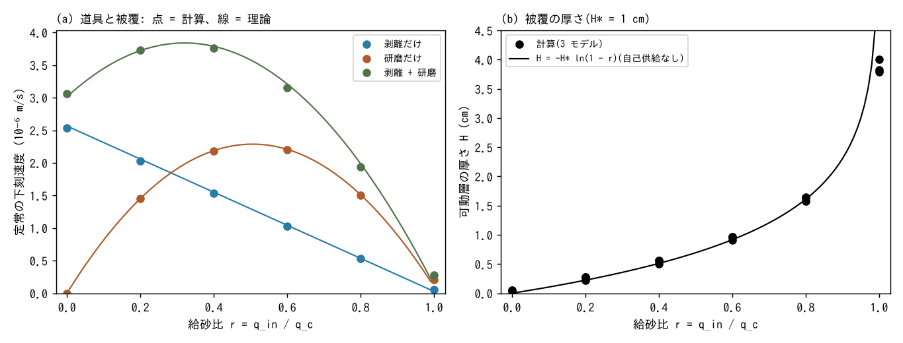
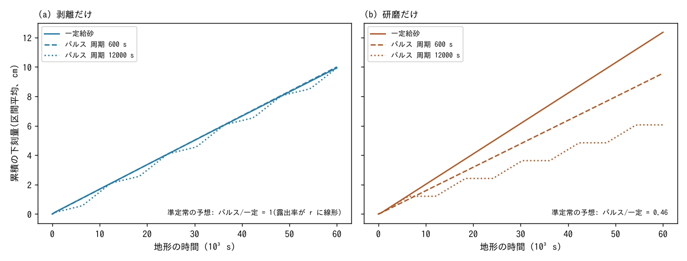
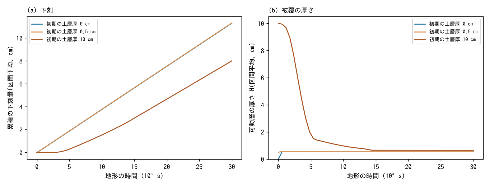
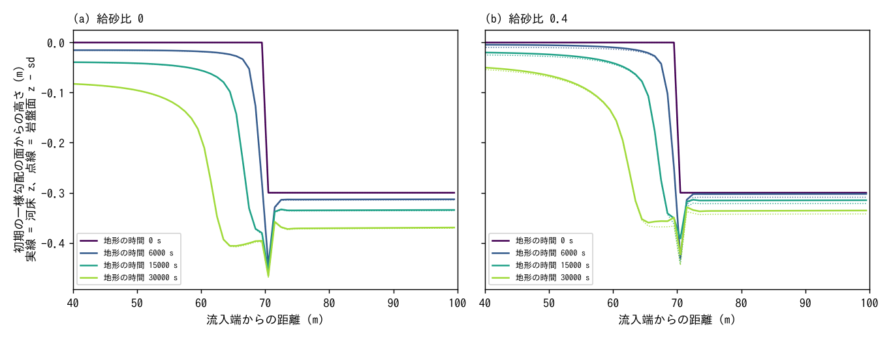

# examples/bedrock_cover — 岩盤河道の被覆効果: 給砂の量と時期が下刻を決める

[English](en/README.md)

山地渓流の岩盤河道では、流れが運ぶ礫は岩盤を削る道具(研磨)にもなり、岩盤を覆って
守る被覆にもなります(Sklar & Dietrich 2004 の「道具と被覆」)。この例題は、地形変化
モジュールの流水による岩盤下刻 `f_rockinc`(剥離・被覆・研磨。
[ユーザーガイド](../../docs/users_guide/geomorph.md#流水による岩盤下刻f_rockinc)、
式と出典は[解説](../../docs/users_guide/sediment.md))で、幅 1 セルの掘り込み水路を並べ、
**給砂の量**(A)、**給砂の時期**(B。同じ総量の一定給砂とパルス給砂)、**初期の被覆**(C)、
**段差(遷急点)の後退**(D)を比べます。値は説明用で、特定の河川の校正値ではありません。

## 設定

| 項目 | 値 |
|---|---|
| 水路 | 幅 1 セル(Δx = 1 m)、長さ 100 m、勾配 0.01、n = 0.04。両岸は +2 m の乾いた地盤。水路を東西に 2〜6 本並べ、水路ごとに給砂か初期の土層厚だけを変える(岸で隔てられ、互いに影響しない) |
| 流れ | 北端の区間流入 Q = 0.336 m³/s(等流水深 0.3 m、V = 1.12 m/s、底面せん断 τ_b = 29.4 Pa)、南辺は自由流出 |
| 礫と被覆 | d50 = 1 cm(τ* ≈ 0.18 で動く)、空隙率 0.4、被覆の長さ H* = 1 cm。等流の掃流砂の容量 q_c = 1.83e-3 m²/s(芦田・道上の式) |
| 岩盤下刻 | 剥離: k_p = 1e-6 m/s、τ_c = 10 Pa、m = 1.5(裸岩の剥離速度 E_p0 = 2.7e-6 m/s)。研磨: β = 0.005 1/m(研磨による下刻速度の最大 β q_c/4 = 2.3e-6 m/s) |
| 給砂 | 流入セルの掃流砂 `inflow_qb`。給砂比 r = q_in/q_c(q_in は q_c の概算 1.81e-3 m²/s の r 倍) |
| 時間 | dt = 0.1 s、毎ステップの地形更新 × morfac 10(dts = 1 s)。流れの時間 3000 s(B は 6000 s)= 地形の時間 3e4 s(6e4 s) |
| 測る区間 | 流入端から 30〜90 m の平均(入口と出口の影響を避ける) |

| 構成 | 水路 | 内容 |
|---|---|---|
| `param_A_p.txt`・`A_a`・`A_pa` | 6 本 | 剥離だけ・研磨だけ・両方の 3 モデル × 一定給砂 r = 0, 0.2, 0.4, 0.6, 0.8, 1.0。裸岩から |
| `param_B_p.txt`・`B_a` | 3 本 | 剥離だけ・研磨だけ。平均の給砂比 0.35 の一定給砂と、半分の時間だけ r = 0.7 で給砂するパルス(周期 600 s・12000 s。地形の時間) |
| `param_C_pa.txt` | 3 本 | 両方のモデル、r = 0.4。初期の土層厚 0・0.5 cm・10 cm |
| `param_D_p.txt` | 2 本 | 剥離だけ。流入端から 70 m より下流を 0.3 m 下げた段差(遷急点)。r = 0 と 0.4 |

| ファイル | 内容 |
|---|---|
| `make_init.py` | 地形・初期水深・土層厚と `param_*.txt` を書く(定数は `plot_results.py` と対) |
| `plot_results.py` | 図 `figs/*.png`(`en` で `en/figs/`)と数表(標準出力) |

## 実行

```bash
make                                   # ../../bin/ の実行ファイルへのリンク
python3 make_init.py                   # 地形・初期水深・土層厚(param_*.txt も書き直す。同梱のものと同じ)
for c in A_p A_a A_pa B_p B_a C_pa D_p; do ./encflow param_$c.txt > Screen_$c.log; done   # 7 構成で約 5 分(4 並列なら約 2 分)
python3 plot_results.py | tee analysis.txt   # 図と数表(python3 plot_results.py en で英語版の図)
```

## 定常の被覆と下刻(理論)

可動層の厚さ H に対し、岩盤の露出率は e^{−H/H*}、掃流砂の流出に掛かる利用可能率は
1 − e^{−H/H*} です(ユーザーガイド)。定常では流出 = 流入なので、掃流砂の流砂量 q に対して
1 − e^{−H/H*} = q/q_c、つまり被覆の厚さ H = H* ln(1/(1 − q/q_c))、露出率 1 − q/q_c と
なり、下刻速度は

  E = (1 − q/q_c)(E_p0 + β q)

です(第 1 項が剥離、第 2 項が研磨。研磨は被覆率 q/q_c と露出率の積に比例する山形)。
剥離した岩は 1:1 で可動層に入って下流の q を増やすので(研磨の細粒分は系外へ出る)、
q(x) = q_c − (q_c − q_in) exp(−(1 − λ) E_p0 x / q_c) です(自己供給)。図の理論線は、
計算の等流の水理から求めた E_p0 と q_c でこれを区間で平均したものです。

## 結果

2026-10-28 に区間流入の流入面の水深の床を直した後(developer.md §89.25。この水路の流入は
Fr 0.65 で、以前は流入面の流速が 0.74 倍に抑えられていました)に回し直しました。下の数値は
表示の桁で変わりません(測る区間は流入端から 30 m より下流。図は変更前の計算のもので、
見分けがつきません)。

### A 給砂の量: 道具と被覆



- **剥離だけ**: 被覆の分だけ直線的に遅くなる(1 − r)。給砂がなくても、剥離した礫が
  薄い被覆(0.5 mm)を作る。
- **研磨だけ**: 山形。給砂がなければ道具がなく削れず、r = 0.4〜0.6 で最大、r → 1 で全被覆。
- **両方**: r = 0 でも剥離した礫が道具になって研磨が起き(3.06e-6 m/s。剥離だけの 2.53e-6 より
  速い)、最大は r ≈ 0.3。
- 定常の下刻速度は理論と 2.3 % 以内で一致(0 < r < 1)、被覆の厚さも H* ln(1/(1 − r)) に
  一致します。r = 1 は全被覆へ向かう途中(被覆が厚くなり続け、下刻速度は 0 に向かう)。

### B 給砂の時期: 同じ総量の一定給砂とパルス



| モデル | 一定給砂 | パルス 周期 600 s | パルス 周期 12000 s | 準定常の予想(パルス/一定) |
|---|---|---|---|---|
| 剥離だけ | 9.94 cm | 10.01 cm(1.01 倍) | 9.94 cm(1.00 倍) | 1 |
| 研磨だけ | 12.36 cm | 9.57 cm(0.77 倍) | 6.06 cm(0.49 倍) | 0.46 |

- **研磨だけ**: 下刻速度が q について上に凸(山形)なので、同じ総量なら一定給砂が最もよく
  削れる。周期 12000 s のパルスは準定常の予想(給砂中の r = 0.7 の速度の半分)に近く、
  周期 600 s では水路を流れる間にパルスがならされて一定給砂に近づく。
- **剥離だけ**: 露出率 1 − r が r に線形なので、準定常では時期の効果がない(3 つとも 1 % 以内。
  周期 12000 s の階段は、被覆の厚さの変化が給砂の切り替えに遅れる分)。
- 給砂の時期の効果は、研磨(道具)が効く岩盤ほど大きく、パルスの周期と被覆の応答時間
  (被覆が水路を伝わる時間)の比で決まる、というのがこの模型の答えです。

### C 初期の被覆



- 0.5 cm の薄い被覆は裸岩と同じ結果になる(被覆はすぐに平衡の 0.56 cm になる)。
- 10 cm の厚い被覆は、容量と給砂の差で上流から剥がされるまで(約 1.5e4 s)下刻を抑え、
  3e4 s の累積下刻は 8.0 cm(裸岩は 11.3 cm)。初期の被覆の影響は、被覆が平衡に戻ったあと
  下刻速度からは消えるが、遅れた分の下刻は取り戻さない。

### D 段差(遷急点)の後退



| 給砂比 | 段差の位置(落差の中間の点。流入端から) | 上流の区間(流入端から 40 m)の下刻 | 下流の区間(90 m)の下刻 |
|---|---|---|---|
| 0 | 70.0 → 68.8 → 66.0 → 60.8 m(6000・15000・30000 s) | 8.2 cm | 7.0 cm |
| 0.4 | 70.0 → 68.9 → 66.4 → 61.6 m | 5.0 cm | 3.6 cm |

- 剥離は段差の面とその直下(流速が最大)で速く、段差は上流へ後退しながら緩む
  (最大勾配 0.31 → 0.08)。段差の直下には深掘れ(滝壺に似た穴)ができる。
- 給砂(r = 0.4)の被覆は一様な区間の下刻を約 0.6 倍(1 − r)に遅くするが、段差の後退は
  ほとんど変えない(急な面では容量が大きく、被覆が残らない)。段差の直下の穴には礫が溜まる。

## 注意(この例題の範囲)

- 幅 1 セルの水路は 1 次元の連鎖として振る舞い、横断方向の河床の差は表しません。幅の
  ある水路では河床の差が横断方向に育つことがあり(test/rockinc の所見)、Inoue ら
  (2016)の計算にある岩盤の溝と、溝に溜まる被覆のような 2 次元の現象はこの例題の範囲外です。
- 段差の流れは浅水流(静水圧)の近似で、落下流や跳水の細部、滝壺の形成の過程は
  表しません。D の深掘れと後退速度は定性的な目安です。
- 急勾配の流れでは底面せん断が格子に依存して大きめに出ます(developer.md §89.4。勾配
  0.01 のこの例題では 1 % 程度)。
- 流量は一定の代表出水で、時間は地形の時間(morfac = 10 で加速)です。

## 関連文書

- [ユーザーガイド: 流水による岩盤下刻](../../docs/users_guide/geomorph.md#流水による岩盤下刻f_rockinc)、
  [解説](../../docs/users_guide/sediment.md)(式・出典。Sklar & Dietrich 2004、Turowski ら 2007 ほか)
- [test/rockinc](../../test/rockinc/README.md)(解析解・保存則・リスタート・MPI の検定)
- docs/mountain_stream_plan.md(設計の検討。§4.3 の定常解、§4.9 の例題の構想)、developer.md §89
- Sklar, L. S. and Dietrich, W. E. (2004): A mechanistic model for river incision into bedrock by
  saltating bed load. *Water Resour. Res.*, 40, W06301. doi:10.1029/2003WR002496
- Inoue, T., Iwasaki, T., Parker, G., Shimizu, Y., Izumi, N., Stark, C. P. and Funaki, J. (2016):
  Numerical simulation of effects of sediment supply on bedrock channel morphology. *J. Hydraul.
  Eng.*, 142(7), 04016014. doi:10.1061/(ASCE)HY.1943-7900.0001124(本文で確認: 給砂が容量に近いと
  交互砂州状の被覆が下流へ移りながら岩盤を一様に削り、容量の 0.2 倍では岩盤に複数の縦溝が
  刻まれて被覆は溝に溜まる)
