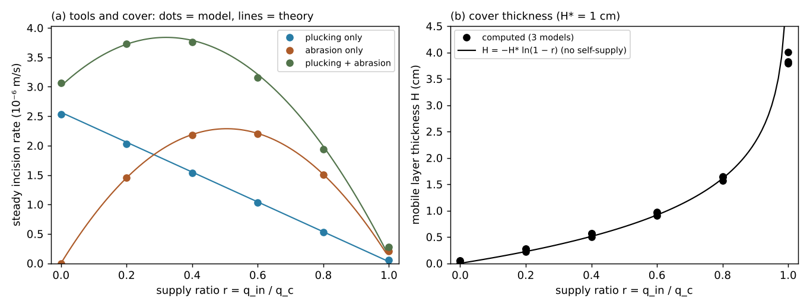
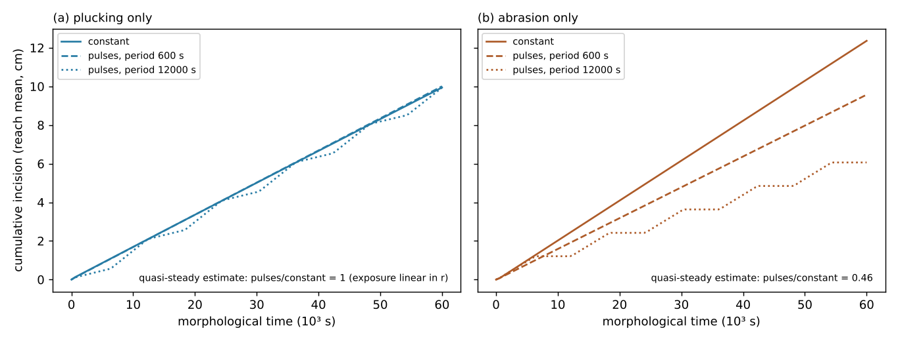
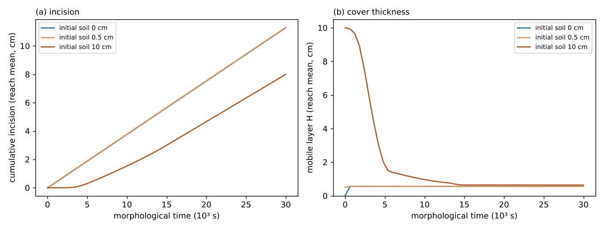
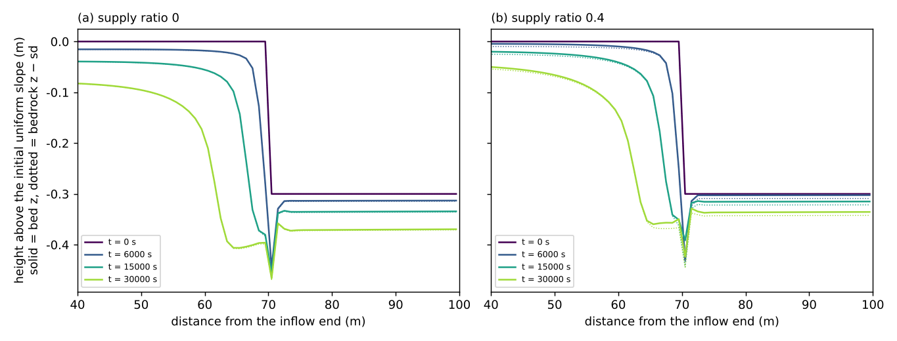

# examples/bedrock_cover — Cover effect in bedrock channels: how the amount and timing of sediment supply control incision

> English mirror of examples/bedrock_cover/README.md. The Japanese file is the master copy.

[日本語](../README.md)

In the bedrock channels of mountain streams, the gravel carried by the flow is
both the tool that wears the bedrock (abrasion) and the cover that protects it
(the "tools and cover" of Sklar & Dietrich 2004). This example uses bedrock
incision by flowing water, `f_rockinc`, of the landform evolution module
(plucking, cover and abrasion;
[users guide](../../../docs/en/users_guide/geomorph.md#bedrock-incision-by-flowing-water-f_rockinc),
equations and sources in the [supplement](../../../docs/en/users_guide/sediment.md)).
It places incised channels one cell wide side by side and compares **the amount
of sediment supply** (A), **the timing of supply** (B; constant supply versus
pulses with the same total), **the initial cover** (C) and **the retreat of a
step (knickpoint)** (D). The values are illustrative, not calibrated for a
particular river.

## Setup

| Item | Value |
|---|---|
| Channels | One cell wide (Δx = 1 m), 100 m long, slope 0.01, n = 0.04. Dry ground at +2 m on both banks. 2 to 6 channels side by side from west to east; each channel differs only in its supply or initial soil depth (separated by the banks, they do not affect each other) |
| Flow | Segment inflow Q = 0.336 m³/s at the north end (uniform-flow depth 0.3 m, V = 1.12 m/s, bed shear stress τ_b = 29.4 Pa); free outflow at the south edge. The dynamic reassignment of blocked openings is `f_opening_dynamic = 3` (blockage measured above the local plane; [shallow water chapter](../../../docs/en/users_guide/swflow.md), developer.md §68.41, in Japanese). In a one-cell channel with high banks the results are bit-identical to those with the default 2 (checked on 2026-10-29) |
| Gravel and cover | d50 = 1 cm (moves with τ* ≈ 0.18), porosity 0.4, cover length H* = 1 cm. Bedload capacity of the uniform flow q_c = 1.83e-3 m²/s (Ashida–Michiue formula) |
| Bedrock incision | Plucking: k_p = 1e-6 m/s, τ_c = 10 Pa, m = 1.5 (plucking rate of bare rock E_p0 = 2.7e-6 m/s). Abrasion: β = 0.005 1/m (largest incision rate by abrasion β q_c/4 = 2.3e-6 m/s) |
| Supply | Bedload at the inflow cell, `inflow_qb`. Supply ratio r = q_in/q_c (q_in is r times the estimate 1.81e-3 m²/s of q_c) |
| Time | dt = 0.1 s, landform update every step × morfac 10 (dts = 1 s). Flow time 3000 s (6000 s for B) = morphological time 3e4 s (6e4 s) |
| Measured reach | Mean over 30 to 90 m from the inflow end (avoiding the effects of the inlet and the outlet) |

| Configuration | Channels | Contents |
|---|---|---|
| `param_A_p.txt`, `A_a`, `A_pa` | 6 | 3 models (plucking only, abrasion only, both) × constant supply r = 0, 0.2, 0.4, 0.6, 0.8, 1.0. Starting from bare rock |
| `param_B_p.txt`, `B_a` | 3 | Plucking only, abrasion only. Constant supply with mean supply ratio 0.35, and pulses supplying r = 0.7 half of the time (periods 600 s and 12000 s; morphological time) |
| `param_C_pa.txt` | 3 | Both processes, r = 0.4. Initial soil depth 0, 0.5 cm and 10 cm |
| `param_D_p.txt` | 2 | Plucking only. A step made by lowering everything downstream of 70 m from the inflow end by 0.3 m (knickpoint). r = 0 and 0.4 |

| File | Contents |
|---|---|
| `make_init.py` | Writes the terrain, initial depth, soil depth and `param_*.txt` (constants paired with `plot_results.py`) |
| `plot_results.py` | Figures `figs/*.png` (`en/figs/` with `en`) and tables (standard output) |

## Running

```bash
make                                   # links to the executables in ../../bin/
python3 make_init.py                   # terrain, initial depth, soil depth (also rewrites param_*.txt, identical to the bundled ones)
for c in A_p A_a A_pa B_p B_a C_pa D_p; do ./encflow param_$c.txt > Screen_$c.log; done   # about 5 minutes for the 7 configurations (about 2 minutes with 4 in parallel)
python3 plot_results.py en | tee analysis.txt   # figures and tables (python3 plot_results.py for the Japanese figures)
```

## Steady cover and incision (theory)

For a mobile layer of thickness H, the exposed fraction of bedrock is
e^{−H/H*} and the availability that multiplies the bedload outflow is
1 − e^{−H/H*} (users guide). In a steady state outflow = inflow, so for the
bedload transport rate q, 1 − e^{−H/H*} = q/q_c; that is, the cover thickness
H = H* ln(1/(1 − q/q_c)), the exposed fraction 1 − q/q_c, and the incision
rate is

  E = (1 − q/q_c)(E_p0 + β q)

(the first term is plucking and the second abrasion; abrasion is proportional
to the product of the cover fraction q/q_c and the exposed fraction, a hump).
Plucked rock enters the mobile layer 1:1 and increases q downstream (the fines
of abrasion leave the system), so q(x) = q_c − (q_c − q_in) exp(−(1 − λ)
E_p0 x / q_c) (self-supply). The theory lines in the figures average this over
the reach with E_p0 and q_c obtained from the computed uniform-flow hydraulics.

## Results

Rerun on 2026-10-28 after the fix of the depth floor of the segment-inflow
face (developer.md §89.25, in Japanese; the inflow of these channels has
Fr 0.65, and the face velocity used to be held at 0.74 times); the numbers
below did not change at the digits shown (the reach measured starts 30 m
below the inflow end; the figures are from the earlier run and look the
same).

### A Amount of supply: tools and cover



- **Plucking only**: slower in proportion to the cover (1 − r). Even without
  supply, the plucked gravel forms a thin cover (0.5 mm).
- **Abrasion only**: a hump. Without supply there are no tools and nothing is
  worn; the maximum is at r = 0.4–0.6, and the bed is fully covered as r → 1.
- **Both**: even at r = 0 the plucked gravel serves as tools and abrasion
  occurs (3.06e-6 m/s, faster than the 2.53e-6 of plucking only); the maximum
  is at r ≈ 0.3.
- The steady incision rate agrees with the theory within 2.3 % (0 < r < 1),
  and the cover thickness also agrees with H* ln(1/(1 − r)). r = 1 is on the
  way to full cover (the cover keeps thickening and the incision rate tends
  to 0).

### B Timing of supply: constant supply versus pulses with the same total



| Model | Constant | Pulses, period 600 s | Pulses, period 12000 s | Quasi-steady estimate (pulses/constant) |
|---|---|---|---|---|
| Plucking only | 9.94 cm | 10.01 cm (1.01×) | 9.94 cm (1.00×) | 1 |
| Abrasion only | 12.36 cm | 9.57 cm (0.77×) | 6.06 cm (0.49×) | 0.46 |

- **Abrasion only**: the incision rate is concave in q (a hump), so for the
  same total the constant supply wears the most. The pulses with a period of
  12000 s are close to the quasi-steady estimate (half the rate at r = 0.7
  during supply); with a period of 600 s the pulses are smoothed while
  travelling down the channel and approach the constant supply.
- **Plucking only**: the exposed fraction 1 − r is linear in r, so in the
  quasi-steady limit the timing has no effect (all three within 1 %; the steps
  of the 12000 s period are the delay of the cover thickness behind the
  switching of the supply).
- The answer of this model is that the effect of the timing of supply is
  larger for bedrock where abrasion (tools) matters, and is set by the ratio
  of the pulse period to the response time of the cover (the time for the
  cover to propagate along the channel).

### C Initial cover



- A thin cover of 0.5 cm gives the same result as bare rock (the cover soon
  reaches its equilibrium of 0.56 cm).
- A thick cover of 10 cm suppresses incision until it is stripped from
  upstream by the difference between capacity and supply (about 1.5e4 s); the
  cumulative incision over 3e4 s is 8.0 cm (11.3 cm for bare rock). The
  effect of the initial cover disappears from the incision rate once the cover
  is back in equilibrium, but the incision lost in the delay is not recovered.

### D Retreat of a step (knickpoint)



| Supply ratio | Position of the step (the mid-height point of the drop; from the inflow end) | Incision of the upstream reach (40 m from the inflow end) | Incision of the downstream reach (90 m) |
|---|---|---|---|
| 0 | 70.0 → 68.8 → 66.0 → 60.8 m (6000, 15000, 30000 s) | 8.2 cm | 7.0 cm |
| 0.4 | 70.0 → 68.9 → 66.4 → 61.6 m | 5.0 cm | 3.6 cm |

- Plucking is fast on the face of the step and just below it (where the
  velocity is largest), and the step retreats upstream while relaxing
  (largest slope 0.31 → 0.08). A scour hole (like a plunge pool) forms just
  below the step.
- The cover of the supply (r = 0.4) slows the incision of the uniform reaches
  to about 0.6 times (1 − r), but hardly changes the retreat of the step (on
  the steep face the capacity is large and no cover stays). Gravel collects
  in the hole below the step.

## Caveats (scope of this example)

- A channel one cell wide behaves as a one-dimensional chain and does not
  represent cross-channel differences of the bed. In a wider channel the bed
  differences can grow across the channel (findings of test/rockinc), and
  two-dimensional phenomena such as the bedrock grooves with cover collecting
  in them in the computations of Inoue et al. (2016) are outside the scope of
  this example.
- The flow over the step is the shallow-water (hydrostatic) approximation and
  does not represent the details of the falling jet, the hydraulic jump or
  the formation of a plunge pool. The scour hole and the retreat rate of D are
  qualitative guides.
- On steep slopes the bed shear stress comes out larger depending on the grid
  (developer.md §89.4; about 1 % at the slope 0.01 of this example).
- The discharge is a constant representative flood, and time is
  morphological time (accelerated by morfac = 10).

## Related documents

- [Users guide: bedrock incision by flowing water](../../../docs/en/users_guide/geomorph.md#bedrock-incision-by-flowing-water-f_rockinc),
  [supplement](../../../docs/en/users_guide/sediment.md) (equations and sources: Sklar & Dietrich 2004, Turowski et al. 2007 and others)
- [test/rockinc](../../../test/rockinc/en/README.md) (checks against analytical solutions, conservation, restart and MPI)
- docs/mountain_stream_plan.md (design study; the steady solution of §4.3 and the example plan of §4.9) and developer.md §89 (in Japanese)
- Sklar, L. S. and Dietrich, W. E. (2004): A mechanistic model for river incision into bedrock by
  saltating bed load. *Water Resour. Res.*, 40, W06301. doi:10.1029/2003WR002496
- Inoue, T. et al. (2016): Numerical simulation of effects of sediment supply on bedrock channel
  morphology. *J. Hydraul. Eng.*, 142(7). doi:10.1061/(ASCE)HY.1943-7900.0001124 (checked against the abstract)
