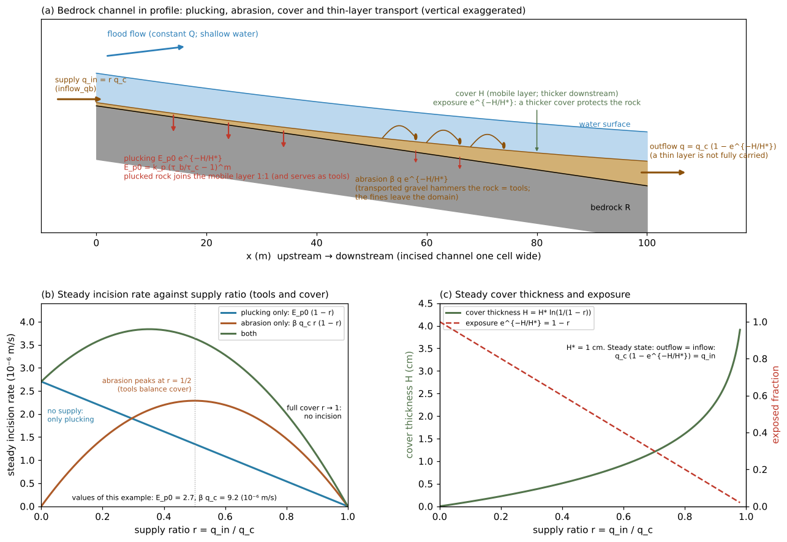
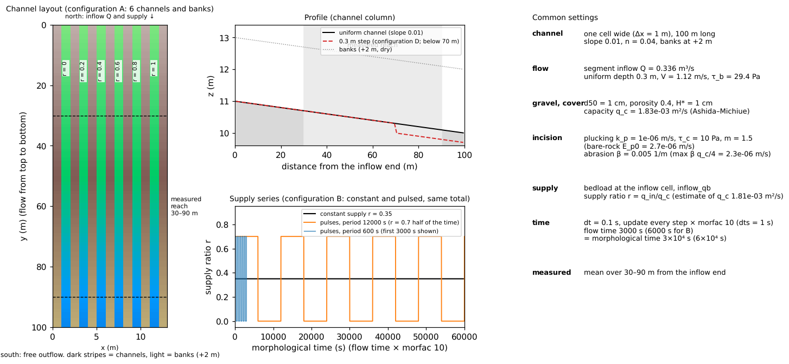
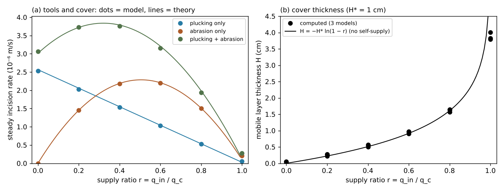
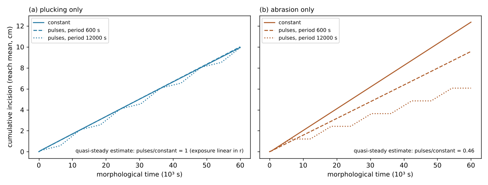
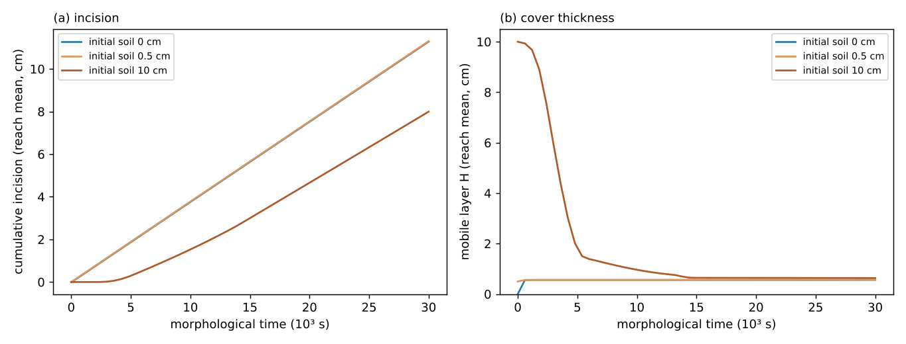
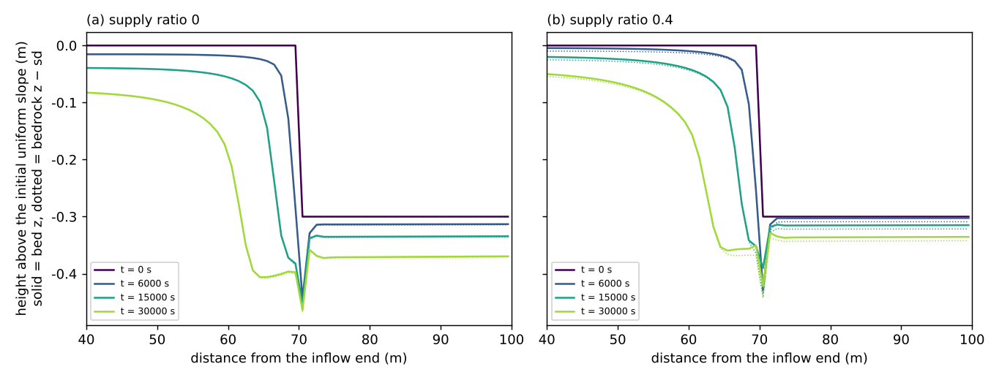

# bedrock_cover — Cover effect in bedrock channels: the amount and timing of sediment supply control incision

> English mirror of examples/bedrock_cover/README.md. The Japanese file is the master copy.

[日本語](../README.md)

In the bedrock channels of mountain streams, the gravel carried by the flow is both the tool
that wears the bedrock (abrasion) and the cover that protects it (the "tools and cover" of
Sklar & Dietrich 2004). This example places incised channels one cell wide side by side and
compares how bedrock incision changes with **the amount of sediment supply** from upstream,
**the timing of supply** (constant supply versus pulses with the same total), **the initial
cover** and **the retreat of a step (knickpoint)**. It uses bedrock incision by flowing water,
`f_rockinc`, of the landform evolution module (plucking, cover and abrasion;
[users guide](../../../docs/en/users_guide/geomorph.md#bedrock-incision-by-flowing-water-f_rockinc),
equations and sources in the [supplement](../../../docs/en/users_guide/sediment.md)) and
bedload `f_fluvial`. The values are illustrative, chosen to make the phenomena easy to see,
not a reproduction of any particular river.

## What happens in a real bedrock channel

- **Bedrock channels**: mountain streams have many reaches where the bed sediment is thin and
  the bedrock is exposed. The channel lowers by "plucking", in which the flow pries blocks out
  along fractures, and by "abrasion", in which the gravel carried by the flow strikes and wears
  the rock. Expressing the erosion rate of a bedrock channel by the bed shear stress during
  floods is the basic form (Howard & Kerby 1983).
- **Tools and cover**: the transported gravel is the tool that wears the rock, but gravel that
  stays on the bed covers and protects it. With little supply there are no tools, and with much
  supply the rock is covered, so incision by abrasion is fastest when the supply is about half of
  the transport capacity and is zero with no supply and with full cover (the saltation–abrasion
  model of Sklar & Dietrich 2004; the effect of cover is expressed by the ratio of supply to
  capacity, linear in their flume experiments, exponential in Turowski et al. 2007).
- **Sediment supply sets the channel slope**: the steady slope of a bedrock channel that balances
  uplift is the slope at which the gravel starts to move plus an increment to carry the supply
  and an increment for the incision. Grain size matters most, supply next, and the incision
  itself only for hard rock or fast uplift (Sklar & Dietrich 2006).
- **The shape of the cover is two-dimensional**: in numerical experiments on wide bedrock
  channels, cover shaped like alternate bars migrates downstream and wears the rock uniformly when
  the supply is close to capacity, while at 0.2 times capacity longitudinal grooves are cut into
  the rock and the cover collects in them (Inoue et al. 2016; abrasion coefficient
  β ≈ 0.001 /m from a field experiment on the Ishikari River).
- **Steps (knickpoints) retreat upstream**: a step made by a base-level fall or by hard rock
  erodes fastest on its face and just below it, and retreats upstream while relaxing.
- **Erosion happens only during floods**: gravel moves and rock wears only during floods, so the
  long-term incision rate is set by the fraction of the year in which the representative flood
  flows (at the reference site of Sklar & Dietrich 2004, an incision of 20.5 mm/yr during floods
  is about 0.9 mm/yr as an annual mean).

## Mechanisms needed for the reproduction



Schematic. (a) Bedrock channel in profile: the flow pries the exposed rock (plucking), the
transported gravel hammers and wears the rock (abrasion), and the gravel that stays on the bed
(mobile layer H) covers and protects the rock. Plucked rock joins the mobile layer and also
serves as tools. (b) Steady incision rate against supply ratio: plucking slows linearly with
the cover, while abrasion is a hump peaking at the supply ratio 1/2 where tools balance cover.
(c) Steady cover thickness and exposure.

| Real phenomenon | Representation in ENCflow | Settings |
|---|---|---|
| A flood flows at a constant discharge | Shallow water. Segment inflow Q at the north end (initial depth = uniform-flow depth), free outflow at the south edge | `&list_bound_inflow`, `fn_hinit`, `f_bc_s = 1` |
| The flow pries the exposed rock (plucking) | Excess-shear form E_p0 = k_p (τ_b/τ_c − 1)^m multiplied by the exposure e^{−H/H*}. Plucked rock becomes a mobile layer (gravel) of the same thickness | `f_rockinc = 1`, `rock_kp`, `rock_tauc`, `rock_m` |
| Transported gravel wears the rock (abrasion = tools) | β × the bedload leaving the cell × exposure. The worn material leaves the domain as fines | `rock_beta` |
| Gravel on the bed covers and protects the rock (cover) | Exposure e^{−H/H*} from the thickness H of the mobile layer (H* is the cover length). A thin layer is not fully carried (the outflow is multiplied by the availability 1 − e^{−H/H*}) | `rock_hstar` |
| Gravel is carried by the flow | Bedload (Ashida–Michiue formula; transport capacity q_c) | `f_fluvial = 1`, `fluv_d50` |
| Gravel is supplied from upstream | Bedload time series at the inflow cell (constant or pulsed) | `inflow_qb` |
| A step (knickpoint) | A step in the terrain | `fn_z` (made by make_init.py) |
| Landform change over a long time | Only the landform change is accelerated by morfac (morphological time) | `morfac`, `dt_geomorph` |

**Steady cover and incision**: for a mobile layer of thickness H, the exposed fraction of
bedrock is e^{−H/H*} and the availability that multiplies the bedload outflow is 1 − e^{−H/H*}.
In a steady state outflow = inflow, so for the bedload transport rate q, 1 − e^{−H/H*} = q/q_c;
that is, the cover thickness is H = H* ln(1/(1 − q/q_c)), the exposed fraction 1 − q/q_c, and
the incision rate is

  E = (1 − q/q_c)(E_p0 + β q)

(the first term is plucking and the second abrasion; abrasion is proportional to the product of
the cover fraction q/q_c and the exposed fraction, a hump). Plucked rock enters the mobile layer
1:1 and increases q downstream (the fines of abrasion leave the system), so
q(x) = q_c − (q_c − q_in) exp(−(1 − λ) E_p0 x / q_c) (self-supply). The theory lines in the result
figures average this over the measured reach with E_p0 and q_c obtained from the computed
uniform-flow hydraulics.

## Geometry and settings



Left: channel layout (configuration A; dark stripes are channels, light stripes banks). Upper
middle: channel profile (uniform channel and the step). Lower middle: supply series of
configuration B (constant and pulsed). Right: common settings.

Incised channels one cell wide (Δx = 1 m), 100 m long, slope 0.01, roughness n = 0.04, with dry
ground at +2 m on both banks. Two to six channels are placed side by side from west to east, and
each channel differs only in its supply or initial soil depth, so that one run compares them (the
channels are separated by the banks and do not affect each other).

- **Flow**: segment inflow Q = 0.336 m³/s at the north end (uniform-flow depth 0.3 m,
  V = 1.12 m/s, bed shear stress τ_b = 29.4 Pa). Free outflow at the south edge.
- **Gravel and cover**: d50 = 1 cm (moves at τ* ≈ 0.18), porosity 0.4, cover length H* = 1 cm.
  The bedload capacity of the uniform flow is q_c = 1.83×10⁻³ m²/s (Ashida–Michiue formula).
- **Bedrock incision**: plucking with k_p = 10⁻⁶ m/s, τ_c = 10 Pa, m = 1.5 (plucking rate of
  bare rock E_p0 = 2.7×10⁻⁶ m/s). Abrasion with β = 0.005 1/m (largest incision rate by
  abrasion β q_c/4 = 2.3×10⁻⁶ m/s). These values show incision within a short run and are not
  those of real rock.
- **Supply**: bedload at the inflow cell, `inflow_qb`, expressed as the supply ratio
  r = q_in/q_c (q_in is r times the estimate 1.81×10⁻³ m²/s of q_c).
- **Time**: dt = 0.1 s, landform update every step × morfac 10 (dts = 1 s). Flow time 3000 s
  (6000 s for B) = morphological time 3×10⁴ s (6×10⁴ s).
- **Measured reach**: the mean over 30 to 90 m from the inflow end, avoiding the effects of the
  inlet and the outlet.

| Configuration | Parameter files | Channels | Contents |
|---|---|---|---|
| A amount of supply | param_A_p.txt, A_a, A_pa | 6 | 3 models (plucking only, abrasion only, both) × constant supply r = 0, 0.2, 0.4, 0.6, 0.8, 1.0. From bare rock |
| B timing of supply | param_B_p.txt, B_a | 3 | Plucking only, abrasion only. Constant supply with mean supply ratio 0.35, and pulses supplying r = 0.7 half of the time (periods 600 s and 12000 s; morphological time) |
| C initial cover | param_C_pa.txt | 3 | Both processes, r = 0.4. Initial soil depth 0, 0.5 cm and 10 cm |
| D retreat of a step | param_D_p.txt | 2 | Plucking only. A step made by lowering everything downstream of 70 m from the inflow end by 0.3 m (knickpoint). r = 0 and 0.4 |

## How to run

```
cd examples/bedrock_cover
make                     # links and inputs (make_init.py writes the terrain, initial depth, soil depth and param_*.txt)
make run                 # the 7 configurations in turn (about 5 minutes in total)
python3 plot_setup.py    # figs/mechanism.png and setup.png (no results needed)
python3 plot_results.py  # figs/*.png and the tables (argument en for the English figures in en/figs/)
```

With the argument `en`, the figures are drawn with English labels into en/figs/
(`python3 plot_setup.py en`, `python3 plot_results.py en`). Plotting needs Python 3, NumPy and
matplotlib.

## Results

(The tables are values recomputed and confirmed on 2026-11-02 with the current defaults
(f_opening_dynamic = 3 and the correction of the lateral faces of the momentum-conserving
advection). The figures are from an earlier run and are indistinguishable at the digits shown.
developer.md §68.41–§68.43, in Japanese)

### Amount of supply: tools and cover



- **Plucking only**: slower in proportion to the cover (1 − r). Even without supply, the plucked
  gravel forms a thin cover (0.5 mm).
- **Abrasion only**: a hump. Without supply there are no tools and nothing is worn; the maximum
  is at r = 0.4–0.6, and the bed is fully covered as r → 1.
- **Both**: even at r = 0 the plucked gravel serves as tools and abrasion occurs (3.06×10⁻⁶ m/s,
  faster than the 2.53×10⁻⁶ of plucking only); the maximum is at r ≈ 0.3.
- The steady incision rate agrees with the theory within 2.3 % (0 < r < 1), and the cover
  thickness also agrees with H* ln(1/(1 − r)). r = 1 is on the way to full cover (the cover keeps
  thickening and the incision rate tends to 0).

### Timing of supply: constant supply versus pulses with the same total



| Model | Constant | Pulses, period 600 s | Pulses, period 12000 s | Quasi-steady estimate (pulses/constant) |
|---|---|---|---|---|
| Plucking only | 9.94 cm | 10.01 cm (1.01×) | 9.94 cm (1.00×) | 1 |
| Abrasion only | 12.36 cm | 9.57 cm (0.77×) | 6.06 cm (0.49×) | 0.46 |

- **Abrasion only**: the incision rate is concave in q (a hump), so for the same total the
  constant supply wears the most. The pulses with a period of 12000 s are close to the
  quasi-steady estimate (half the rate at r = 0.7 during supply); with a period of 600 s the
  pulses are smoothed while travelling down the channel and approach the constant supply.
- **Plucking only**: the exposed fraction 1 − r is linear in r, so in the quasi-steady limit the
  timing has no effect (all three within 1 %; the steps of the 12000 s period are the delay of
  the cover thickness behind the switching of the supply).
- The answer of this model is that the effect of the timing of supply is larger for bedrock where
  abrasion (tools) matters, and is set by the ratio of the pulse period to the response time of
  the cover (the time for the cover to propagate along the channel).

### Initial cover



- A thin cover of 0.5 cm gives the same result as bare rock (the cover soon reaches its
  equilibrium of 0.56 cm).
- A thick cover of 10 cm suppresses incision until it is stripped from upstream by the difference
  between capacity and supply (about 1.5×10⁴ s); the cumulative incision over 3×10⁴ s is 8.0 cm
  (11.3 cm for bare rock). The effect of the initial cover disappears from the incision rate once
  the cover is back in equilibrium, but the incision lost in the delay is not recovered.

### Retreat of a step (knickpoint)



| Supply ratio | Position of the step (the mid-height point of the drop; from the inflow end) | Incision of the upstream reach (40 m from the inflow end) | Incision of the downstream reach (90 m) |
|---|---|---|---|
| 0 | 70.0 → 68.8 → 66.0 → 60.8 m (6000, 15000, 30000 s) | 8.2 cm | 7.0 cm |
| 0.4 | 70.0 → 68.9 → 66.4 → 61.6 m | 5.0 cm | 3.6 cm |

- Plucking is fast on the face of the step and just below it (where the velocity is largest),
  and the step retreats upstream while relaxing (largest slope 0.31 → 0.08). A scour hole (like
  a plunge pool) forms just below the step.
- The cover of the supply (r = 0.4) slows the incision of the uniform reaches to about 0.6 times
  (1 − r), but hardly changes the retreat of the step (on the steep face the capacity is large
  and no cover stays). Gravel collects in the hole below the step.

## What this model cannot represent (differences from real phenomena)

- **Cross-channel form**: a channel one cell wide behaves as a one-dimensional chain and does not
  represent cross-channel differences of the bed. In a wider channel the bed differences can grow
  across the channel (findings of test/rockinc), and two-dimensional phenomena such as the
  longitudinal grooves with cover collecting in them in the computations of Inoue et al. (2016)
  are outside the scope of this example.
- **Plucking and abrasion are lumped into equations**: the saltation trajectories of the gravel
  (frequency and speed of impacts), the strength of the rock and the spacing of its fractures,
  and the threshold of suspension are not solved; the two equations are an excess-shear form and
  an abrasion proportional to the transport rate. The coefficients k_p, τ_c and β are meant to be
  calibrated, and the β = 0.005 1/m of this example is a large value chosen to show incision in a
  short run (a guide from the elastic modulus and tensile strength of the rock is in the
  [supplement](../../../docs/en/users_guide/sediment.md)).
- **Smooth bedrock**: cover written with the ratio of supply to capacity fits experiments on rough
  bedrock but not on smooth beds (Mishra & Inoue 2020). The positive feedback in which cover
  changes the bed roughness, slows the flow and invites further deposition is not included.
- **Flow over the step**: the shallow-water (hydrostatic) approximation does not represent the
  details of the falling jet, the hydraulic jump or the formation of a plunge pool. The scour hole
  and the retreat rate are qualitative guides.
- **Grain size**: the gravel has one grain size. Differences between the size of the plucked
  blocks and the gravel, and the fining by wear during transport, are not represented (the fines
  of abrasion simply leave the domain).
- **Time**: morphological time of a constant representative flood accelerated by morfac; the
  repetition of floods and the conversion to calendar time (intermittency) are not done in this
  example (for the conversion to calendar time see
  [examples/mountain_valley](../../mountain_valley/en/README.md)).

## Notes

- **Update interval**: the morphological time of one landform update, dts = dt × morfac, should
  satisfy the guide for the drainage of a thin cover ("max thin-layer drainage rate x dts" at the
  end of the run well below 0.5; dts = 1 s in this example).
- **Bed shear stress on steep slopes**: on steep slopes the bed shear stress comes out larger
  depending on the grid (developer.md §89.4, in Japanese; about 1 % at the slope 0.01 of this
  example).
- **Reference of the supply ratio**: the q_c used as the reference of the supply ratio r is an
  estimate (1.81×10⁻³ m²/s) and differs by 1 % from the capacity of the computed uniform flow
  (1.83×10⁻³ m²/s). The theory lines in the figures use the values from the computed hydraulics.
- The checks are in [test/rockinc](../../../test/rockinc/en/README.md) (analytical solutions,
  conservation, restart and MPI). The design record is docs/mountain_stream_plan.md (in Japanese).

## Starting points for sensitivity tests

Change the constants in make_init.py and run `python3 make_init.py` to rewrite the inputs and
param_*.txt.

- `R_SWEEP` (supply ratios of configuration A): for r ≥ 1 the bed heads for full cover and
  deposition continues.
- `R_MEAN`, `R_ON`, `P_SHORT`, `P_LONG` (mean supply ratio, and the supply ratio and periods of the
  pulses of configuration B): the ratio of the period to the response time of the cover sets the
  effect of the timing.
- `SD_INIT` (initial soil depths of configuration C), `J_STEP` and `DZ_STEP` (position and drop of
  the step of configuration D).
- `KP`, `TAUC`, `BETA`, `HSTAR` (coefficients of the erosion laws and the cover length): the share of
  plucking and abrasion changes. `S` and `H0` (slope and uniform-flow depth): τ_b and q_c change,
  moving the margin above the plucking threshold and the amount of tools.

## References

- Howard, A. D. and Kerby, G. (1983): Channel changes in badlands. *Geol. Soc. Am. Bull.*, 94,
  739–752. (erosion rate of bedrock channels expressed by the bed shear stress during floods;
  checked from the abstract)
- Inoue, T., Iwasaki, T., Parker, G., Shimizu, Y., Izumi, N., Stark, C. P. and Funaki, J. (2016):
  Numerical simulation of effects of sediment supply on bedrock channel morphology. *J. Hydraul.
  Eng.*, 142(7), 04016014. doi:10.1061/(ASCE)HY.1943-7900.0001124 (checked against the full text:
  with a supply close to capacity, cover shaped like alternate bars migrates downstream and erodes
  the bedrock uniformly; at 0.2 times capacity, several longitudinal grooves are cut into the
  bedrock and the cover collects in them)
- Mishra, J. and Inoue, T. (2020): Alluvial cover on bedrock channels: applicability of existing
  models. *Earth Surf. Dynam.*, 8, 695–716. doi:10.5194/esurf-8-695-2020 (checked from the abstract)
- Sklar, L. S. and Dietrich, W. E. (2004): A mechanistic model for river incision into bedrock by
  saltating bed load. *Water Resour. Res.*, 40, W06301. doi:10.1029/2003WR002496
- Sklar, L. S. and Dietrich, W. E. (2006): The role of sediment in controlling steady-state bedrock
  channel slope: Implications of the saltation–abrasion incision model. *Geomorphology*, 82, 58–83.
  doi:10.1016/j.geomorph.2005.08.019
- Turowski, J. M., Lague, D. and Hovius, N. (2007): Cover effect in bedrock abrasion. *J. Geophys.
  Res.*, 112, F04006. doi:10.1029/2006JF000697
