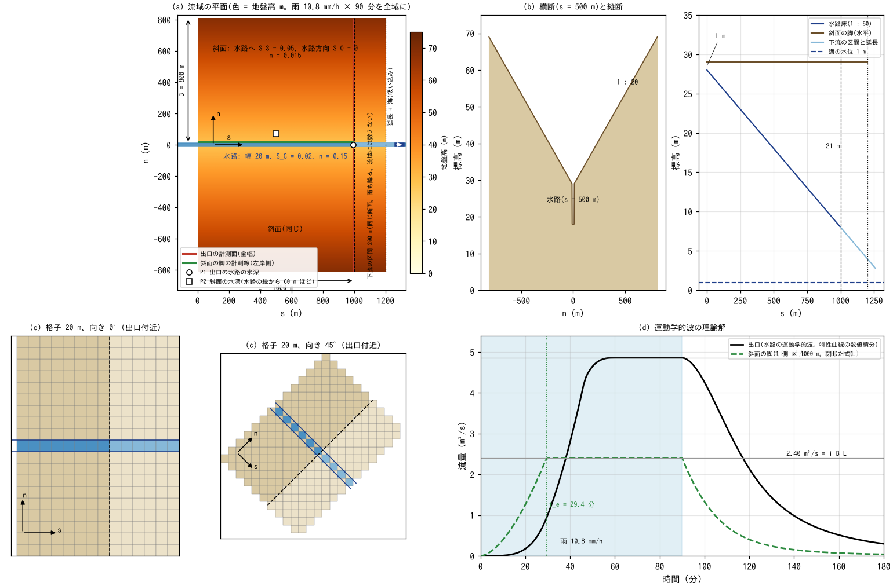
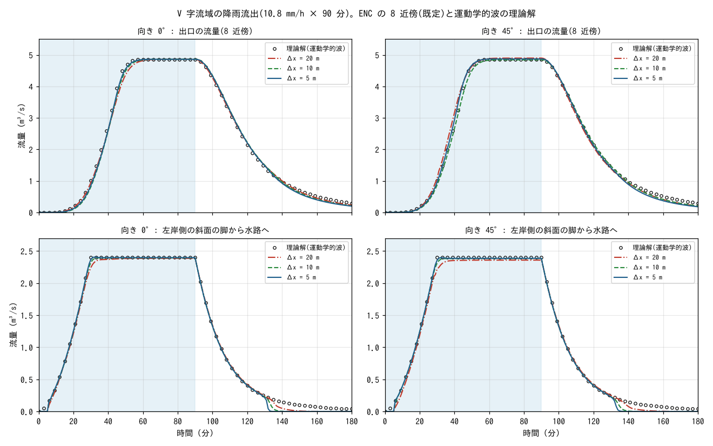
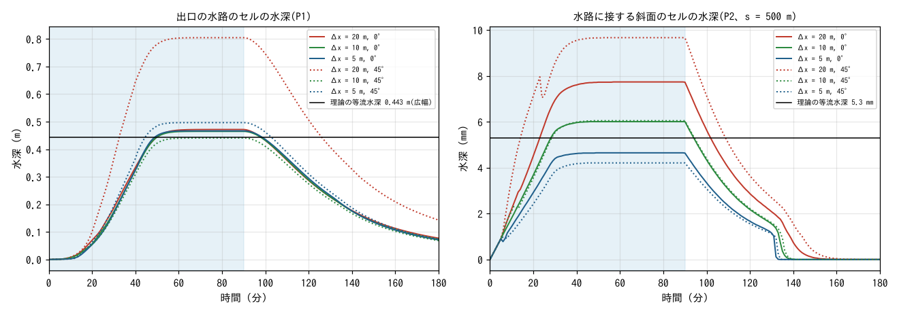
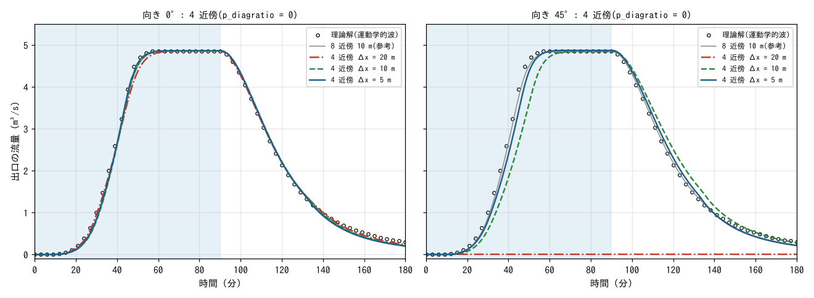
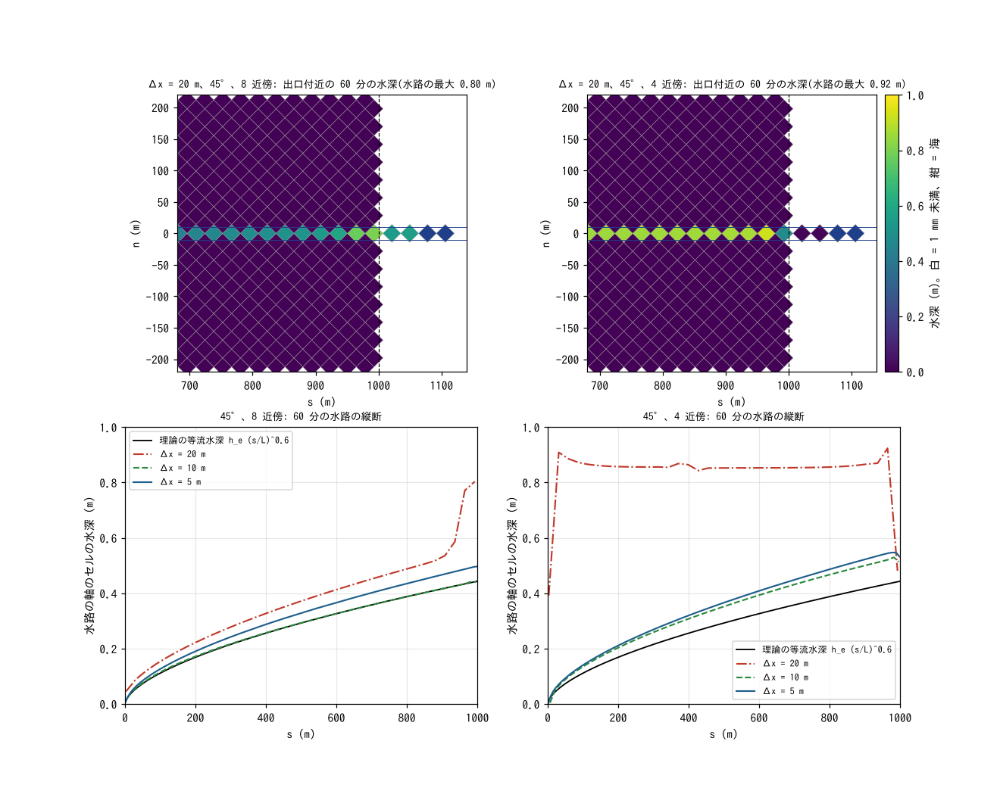
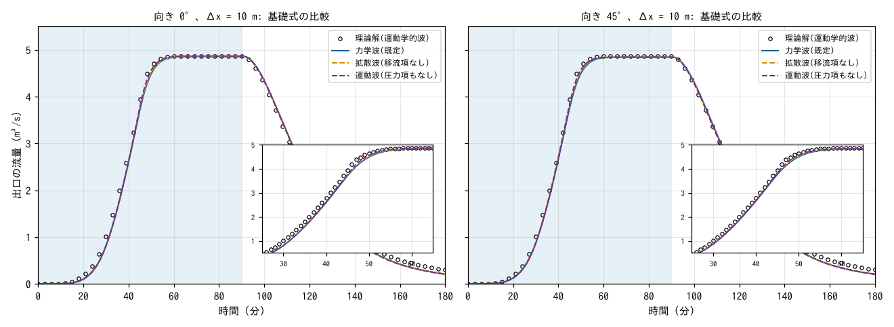
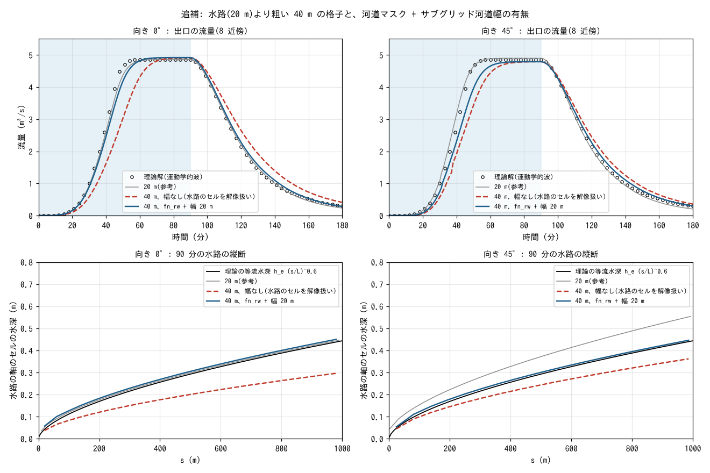

# benchmark/v-shaped — V 字流域の降雨流出(運動学的波の理論解との比較。格子の向きと 8 近傍・4 近傍)

[English](en/README.md)

幅 20 m の水路に両側 800 m の斜面が集まる長さ 1000 m の V 字流域に、10.8 mm/h の雨を 90 分
降らせ、出口の流量を運動学的波の理論解と比べます。Overton & Brakensiek (1973) と
Di Giammarco ら (1996) 以来、2 次元の降雨流出モデルの検証に広く使われてきた標準問題で
(Xia ら 2017、Hou ら 2018、Chang ら 2022 など)、ENC 格子の原論文 Tada (2026) もこの問題で
格子の向きと格子間隔への依存を調べています。ここでは浅水流の設定をすべて既定値のままにし、
格子間隔 20・10・5 m、格子に対する流域の向き 0° と 45°、ENC の 8 近傍(既定)と 4 近傍
(`p_diagratio = 0`)を比べます。補足として基礎式(力学波・拡散波・運動波)の違いを、追補として
水路(20 m)より粗い 40 m の格子でのサブグリッド河道幅の効果を見ます。

**この例題で分かること**

- **理論解との一致**: 8 近傍では、出口の流量の理論解からの差(最大流量で割った二乗平均平方根
  誤差 NRMSE)が格子 20・10・5 m、向き 0°・45° のどれでも 0.016〜0.020 で、ピークは格子に乗せた
  流域の面積から期待される値に 0.1 % 以内、立ち上がり(理論のピークの半分に達する時刻)は理論の
  39 分に対し 37〜40 分です。斜面の脚から水路へ入る流量も閉じた式に NRMSE 0.02〜0.025 で重なります。
- **向きに依らない**: 45° に傾けた格子でも結果は 0° と同じ水準で、水路が斜めの 1 列のセルに
  なる 20 m でも流量は理論に重なります(水深は水路の幅が Δx/√2 に見えるぶん 1.3 倍になります)。
- **4 近傍との違い**: 4 近傍は 0° では 8 近傍と同じですが、45° の 20 m では水路のセルどうしが
  角でしかつながらないため、水路のセルの 4 つの隣がすべて 1〜21 m 高い斜面になり、流出は
  3 時間の間に 0 のままです(Tada 2026 のスタガード格子と同じ結果)。10 m(水路が 3 列)では立ち上がりが
  5 分遅れて NRMSE 0.080、5 m(5 列)では 3 分遅れて 0.033 と、格子を細かくすると 8 近傍に近づきます。
- **基礎式の違いは小さい**: 10 m では力学波・拡散波・運動波の出口の流量の差は最大 0.09 m³/s(ピークの
  2 %)で、立ち上がりの時刻は同じです。運動波が理論にいちばん近い(NRMSE 0.018 対 力学波 0.020)ものの
  差はわずかで、理論との残りの差は圧力項・移流項の物理ではなく離散化によるものです。
- **解像度以下の水路もラスタのまま表せます**(追補): 1 次元の河道モデルを結合せず、河道セルに幅の分布を
  与えるだけで、40 m の格子でも幅 20 m の水路の流出の立ち上がりと水深が理論に重なります(幅を与えないと
  立ち上がりが 5〜7 分遅れ、水深は理論の 0.7〜0.8 倍。与えると遅れは 1〜2 分、水深は 1.03〜1.05 倍)。

## 設定



(a) 流域の座標 (s, n) で見た平面。s は水路に沿って下流へ、n は水路の軸から横断方向(正の側を
左岸側と呼びます)。赤の線が出口の計測面、緑の線が斜面の脚の計測線、P1・P2 が水深のプローブ(P2 は
斜面の水路の縁から 60 m ほど)。出口(破線)の先に同じ断面の区間が点線まで 200 m 続き(流域には数えません)、
その先が水路の延長と海です。(b) 横断(s = 500 m)と縦断。斜面の脚は水平で、水路は上流端で 1 m、
出口で 21 m 掘り込まれています。(c) 格子 20 m を流域に 0° と 45° で重ねたときの出口付近のセル。
45° では水路(青)は斜めの 1 列で、隣り合う水路のセルは角だけで接します。黒の破線が出口で、その先の
薄い色が下流の区間。(d) 運動学的波の理論解。入力と式から描いた図で、計算結果ではありません。

| 項目 | 値 |
|---|---|
| 斜面 | 幅 B = 800 m × 2 側、水路へ向かう勾配 S_S = 0.05、水路方向の勾配 S_O = 0、マニングの n = 0.015 |
| 水路 | 長さ L = 1000 m、幅 W = 20 m、縦断勾配 S_C = 0.02、n = 0.15。床は上流端で斜面の脚より 1 m、出口で 21 m 低い |
| 雨 | 10.8 mm/h(3 × 10⁻⁶ m/s)を全域に 90 分。計算は 3 時間 |
| 格子 | Δx = 20・10・5 m(追補は 40 m)。流域の長方形と下流の区間の外は領域外(壁)。向き 0°(水路が格子の軸に沿う)と 45° |
| 時間刻み | dt = 0.1 Δx(2・1・0.5 s。40 m は 4 s)。クーラン数の最大は 0.3 以下 |
| 出口 | 出口の計測面は s = L。流域の下流に同じ断面の区間(斜面と水路。雨も降る)を 200 m 続け、その先に水路だけの延長 3 セルと海域マスク 3 セル(標高 0 m・水深 1 m に固定された吸い込み)を置く。出口の水路床の標高は 8 m |
| 計測 | 出口: 流域の下流端の列を尾根から尾根まで横切る測線(エッジ流量方式。全幅)。斜面の脚: 左岸側の斜面の水路に接する列(上流端〜出口)。水深: 出口の水路のセル(P1)と、s = 500 m の斜面の、水路の縁から 60 m ほどの列のセル(P2。水路に接する 1〜2 列は分布出力で見る) |
| 浅水流 | すべて既定値: 力学波、急勾配の重力補正 2、移流の運動量保存形 + MUSCL、開口の振り替え 3、適応的ルンゲクッタ、`p_diagratio` = 2/(2+√2)(8 本の通過幅が等しい)。4 近傍の比較ケースだけ `p_diagratio = 0` |

地形・粗度・マスクは、流域の座標の式を各格子のセル中心で評価して与えます(補間せず、セルは
水路か斜面に丸ごと割り当てる。Tada 2026 と同じ)。45° では、水路の軸がセル中心を通り、出口の
計測面がセル中心の斜めの列に重なるように格子の原点を置くので、水路は 20 m で 1 列、10 m で
3 列、5 m で 5 列の斜めのセルの列になり、格子に乗せた流域の面積は 1.62 km² に対して +0.8 %
(20 m)、−0.3 %(10 m)、+0.2 %(5 m)です。

出口の下流に同じ断面の区間を 200 m 続けるのは、斜面が終わって水路の軸のセルの隣が領域外(壁)に
なる所の手前の数セル(20 m・45° で 3 セル、40 m で 2 セル)で、水路の水深が理論の 1.8 倍まで
上がるためです。この盛り上がりは落差への背水ではなく斜面の終わりに付くもので(水路だけを延長しても
場所は動きません)、斜面ごと 200 m 続けて計測面と出口のプローブ P1 をその上流に置きます。区間に
降った雨の流出は計測面の下流で水路に入り、出口の流量には数えられません。吸い込みに海セルを使う
のは、45° では出口が領域の内部にあって辺の境界条件が使えないためです。海セルは標高 0 m・水深 1 m
(水位 1 m)に固定され、入った水は消えます。延長の末端の床(20 m で 3.0 m)は水位より高いので背水は
なく、海セルに水深があることで、落差の辺の水深が上流側の水深で決まります(海の水深が 0 だと両側
平均の頭打ちで辺の水深が半分に絞られ、落差の手前に水が溜まります)。出口の計測面を全幅にするのは、
水路だけを横切る短い測線では、出口の角の斜めのエッジが測線の範囲の外になって数えられないためです。

## 理論解(運動学的波)

`analytic.py` が `data/analytic.csv` に 1 分ごとの値を書きます(`make` が呼びます)。

- **斜面**(幅 B、勾配 S_S、一様な雨 i): 単位幅流量 q = α h^m(α = √S_S / n_S、m = 5/3)。立ち上がりは
  q(B, t) = α (i t)^m、平衡到達時刻 t_e = (B / (α i^(m−1)))^(1/m) = 29.4 分、平衡 q_e = i B =
  2.4 × 10⁻³ m²/s(1000 m で 2.40 m³/s)、脚の等流水深 5.3 mm。雨が止んだ後は特性曲線に沿って
  h が一定なので、脚の水深は B − α h^m / i = m α h^(m−1) (t − t_r) の解です(Overton & Brakensiek
  1973)。閉じた式です。
- **水路**(幅 W、勾配 S_C、側方流入 q_L(t) = 2 q(B, t) + i W): 運動学的波 ∂A/∂t + ∂Q/∂x = q_L、
  Q = (√S_C / n_C) W h R^(2/3) を特性曲線 dx/dt = dQ/dA、dh/dt = q_L / W に沿って数値積分します
  (Di Giammarco ら 1996 の解法)。径深 R は h(広幅)です。ENCflow の水路のセルも底面の摩擦だけで
  岸の摩擦を持たないので、これに合わせます(矩形の径深 R = Wh/(W + 2h) にすると立ち上がりが
  最大 2 % 遅くなります。`python3 analytic.py --rect`)。出口のピーク 4.86 m³/s = i (2BL + WL) は
  水路の式によらず、理論のピークの半分に達するのは 39 分、等流水深は 0.443 m です。
- 運動学的波は水面の勾配を地盤の勾配で代用する近似で、浅水方程式の厳密解ではありません。
  平衡の流量と立ち上がりの時刻の目安を与えるもので、下の比較で「理論解」と呼ぶのはこの近似解です。

## 実行

```bash
cd examples/benchmark/v-shaped
make                     # リンク、入力 data_dx*/、設定 param_*.txt、理論解 data/analytic.csv
make run                 # 全 23 ケース(40 分ほど。5 m の 5 ケースが大半)
make main                # 8 近傍の主ケース 6 つだけ(17 分ほど)
make supp                # 追補の 4 ケース(40 m。河道マスク + サブグリッド河道幅の有無。各 3 秒)
python3 check.py         # 理論解との差と水収支の表(主ケースは合否つき)
python3 plot_results.py  # 図 figs/*.png(引数 en で英語版を en/figs/ に)
python3 plot_setup.py    # 設定の図 figs/setup.png(計算の前に描ける)
```

| ケース | 内容 |
|---|---|
| `dx20_r0` `dx10_r0` `dx5_r0` `dx20_r45` `dx10_r45` `dx5_r45` | 主ケース(8 近傍・既定)。`dx10_r0` が注釈付きの雛形 `param.txt` で、ほかは `make_inputs.py` が格子・時間刻み・計測・入出力の行を差し替えて書く |
| `*_4nb` | 4 近傍(`p_diagratio = 0`)。6 格子すべて |
| `dx10_r0_dif` `dx10_r45_dif` / `*_kin` | 拡散波(`f_govequation = 1`。移流項なし)/ 運動波(`= 2`。圧力項もなし) |
| `dx20_r0_od2` `dx10_r0_od2` `dx5_r0_od2` | 開口の振り替えの旧既定 `f_opening_dynamic = 2`([通過幅の調整](../../../docs/users_guide/passage_width.md)の表の値) |
| `dx40_r0` `dx40_r45` / `*_sgc` | 追補: 水路(20 m)より粗い 40 m の格子。`_sgc` は河道マスク `fn_rw` とサブグリッド河道幅 `fn_width`(水路のセルに 20 m)を与える([河道の章](../../../docs/users_guide/channel.md)) |

1 ケースの計算時間は 40 m で 2 秒、20 m で 8 秒、10 m で 1 分、5 m で 5〜8 分です。
出力は全ケースで 120 MB ほどです(`make clean` で消せます)。

## 結果

### 8 近傍と理論解



上: 出口の流量、下: 左岸側の斜面の脚から水路へ入る流量。左が 0°、右が 45°。丸が理論解。

`check.py` の表(主ケース)。NRMSE は理論のピーク(出口 4.86、斜面 2.40 m³/s)で割った二乗平均
平方根誤差、格子比は格子に乗せた流域の面積 × 降雨強度に対するピークの比、t50 は理論のピークの
半分に初めて達する時刻(理論 39 分)、水深比は 80 分の水深 / その位置の理論の等流水深(出口 0.443 m、
斜面の P2 は尾根から 725〜740 m で 5.0 mm)、収支は(出口を通った水量 + 終了時に流域に残る水量)/
流域に降った雨です。

| ケース | NRMSE 出口 | ピーク比 | 格子比 | t50 (分) | NRMSE 斜面 | 水深比 出口 (P1) | 水深比 斜面 (P2) | 収支 | 判定 |
|---|---|---|---|---|---|---|---|---|---|
| 20 m・0° | 0.019 | 1.000 | 1.000 | 40 | 0.021 | 1.01 | 1.01 | 0.998 | PASS |
| 10 m・0° | 0.020 | 1.000 | 1.000 | 40 | 0.022 | 1.04 | 1.00 | 0.999 | PASS |
| 5 m・0° | 0.018 | 1.000 | 1.000 | 40 | 0.024 | 1.04 | 1.00 | 1.002 | PASS |
| 20 m・45° | 0.020 | 1.008 | 1.000 | 37 | 0.025 | 1.25 | 1.02 | 0.999 | PASS |
| 10 m・45° | 0.016 | 0.997 | 1.000 | 39 | 0.021 | 1.00 | 1.00 | 1.000 | PASS |
| 5 m・45° | 0.016 | 1.002 | 1.000 | 38 | 0.023 | 1.12 | 1.00 | 1.000 | PASS |

合否の目安は NRMSE ≤ 0.04、|格子比 − 1| ≤ 0.01、|t50 − 理論| ≤ 3 分、|収支 − 1| ≤ 0.01 です。

- **流量は理論に重なります**。出口の NRMSE は 0.016〜0.020 で、格子を細かくしても大きくは
  変わりません。差は、0° では立ち上がりが理論より 1〜2 分遅く(45 分の流量が 3.6〜3.8 対 3.9 m³/s)、
  45° の 20・5 m では 1〜2 分早いこと(4.1 m³/s)と、平衡に達する角が丸く、逓減の初めが少し遅いことに
  よるものです。基礎式を運動波に切り替えても(下の補足)差の大きさは変わらないので、残りの差は圧力項・
  移流項の物理ではなく、斜面から水路へ入る脚のセルの貯留や格子上の水路の表現(水深が理論より 2〜5 %
  深い)などの離散化と、理論側の近似(水面の勾配を地盤の勾配で代用)によるものです。斜面の脚の流量も
  立ち上がり・平衡・逓減が閉じた式に重なり(NRMSE 0.021〜0.025)、平衡は理論の 0.98〜1.00 倍です
  (計測線の下流端のセルから下流の区間へ向かう斜めのエッジが線の範囲の外になるぶん、わずかに低い)。
- **ピークは雨の量どおり**です。45° では格子に乗せた流域の面積が 1.62 km² から最大 0.8 % ずれ、
  ピークはそれに比例します(格子比 1.000)。水収支は 0.2 % 以内で閉じます。
- **立ち上がりの時刻**は理論の 39 分に対して 37〜40 分です。



左: 出口の水路のセルの水深(P1)、右: 斜面の水路の縁から 60 m ほどのセル(P2、s = 500 m)の水深。黒の線が
運動学的波の理論の時系列(右は 20 m の P2 の位置、尾根から 730 m で評価。ほかの格子の P2 は尾根から
725〜740 m で、平衡の水深は ±1 %)。

- **水路の水深は、格子に乗せた水路の幅で決まります**。水路に沿う水深(s = 200〜800 m の平均)は
  理論の等流水深 h_e (s/L)^0.6 に対して、0° では 1.02〜1.05 倍、45° では 20 m(斜めの 1 列 = 幅
  Δx/√2 = 14.1 m)で 1.28 倍、10 m(3 列 = 21.2 m)で 1.00 倍、5 m(5 列 = 17.7 m)で 1.12 倍です。
  出口のセル(P1)の水深も同じ値です(0° で 1.01〜1.04 倍、45° の 20 m で 1.25 倍)。流量は正しく、水深は
  格子に依存します。
- **斜面の水深は、水路に接する 1〜2 列を除いて理論に重なります**。P2(水路の縁から 60〜75 m)は理論の
  1.00〜1.02 倍で、90 分の分布で見ても水路の縁から 30 m より遠い列は 0.97〜1.05 倍です。水路に接する
  脚の 1 列目だけは理論の 0.8〜1.9 倍(0° で 1.49・1.16・0.90、45° で 1.87・1.17・0.83)、2 列目も 45° と
  5 m の 0° で 1.1 倍です。斜面(n 0.015)と水路(n 0.15)の間のエッジの粗度は両側の平均 0.0825 なので、
  脚のセルから水路へ落ちる辺の流速が斜面の等流より遅く(0.3 m/s)、その分だけ脚のセルに水が溜まる
  ものです。流量には効きません(`check.py` の表の「水深比 脚(1 列目)」の列)。
- 斜面の脚の流量は 130 分ごろに 0 に落ちます。限界水深 dd = 1 mm を切った薄い水は流れないためで、
  運動学的波の長い裾(180 分で 0.04 m³/s)は出ません。`&list_sysparam` の dd と摩擦項の水深の下限 dv を
  0.1 mm にすると(20 m・0°)、逓減は 180 分まで続いて理論の裾に重なり(150 分で 0.11 対 理論 0.10 m³/s、
  180 分で 0.045 対 0.039)、斜面の NRMSE は 0.021 から 0.015 になります(出口は 0.019 のまま)。
  dd だけを 0.1 mm にすると裾は出ますが、1 mm 未満の水の摩擦が dv = 1 mm の水深で評価されるため逓減が
  遅く、150 分で理論の 1.5 倍(0.15 m³/s)です。

### 格子の向きと 4 近傍



4 近傍(`p_diagratio = 0`。斜めのエッジを使わない)の出口の流量。灰色の線は 8 近傍の 10 m。



上: 45°・20 m の出口付近から海までのセルの 60 分の水深(左が 8 近傍、右が 4 近傍。流域の座標に戻して描く。
破線が出口の計測面、点線が下流の区間の終わり、紺は海セル。8 近傍で下流の区間の末端の数セルが深いのは、斜面が
終わる所の手前の盛り上がりです)。下: 流域の水路の軸に沿う 60 分の水深の縦断(45° の 20・10・5 m。上流端から
出口まで)と理論の等流水深 h_e (s/L)^0.6。

| ケース | NRMSE 出口 | ピーク比 | t50 (分) | 流出高比 | 収支 |
|---|---|---|---|---|---|
| 20 m・0° | 0.019 | 1.000 | 39 | 0.985 | 0.998 |
| 10 m・0° | 0.019 | 1.000 | 40 | 0.984 | 0.999 |
| 5 m・0° | 0.017 | 1.000 | 39 | 0.984 | 1.002 |
| 20 m・45° | 0.619 | 0.000 | — | −0.007 | 0.998 |
| 10 m・45° | 0.080 | 0.998 | 44 | 0.969 | 1.001 |
| 5 m・45° | 0.033 | 1.003 | 41 | 0.984 | 1.001 |

- **0° では 4 近傍も 8 近傍と同じ**です(NRMSE 0.017〜0.019 対 0.018〜0.020、t50 39〜40 分)。流れが格子の
  軸に沿うので斜めのエッジの有無は効きません。
- **45° の 20 m では 4 近傍の流出は 0 のまま**です。水路のセルどうしが角でしかつながらず、
  各水路のセルの 4 つの隣はすべて斜面(脚の標高は上流端で 1 m、出口で 21 m 高い)なので、
  水路は深い窪地の列になります。雨は 90 分で 2.6 万 m³ ですが、窪地の容積は 16 万 m³ あり、
  満たせません。Tada (2026) のスタガード格子の 20 m と同じ結果です(流出高比がわずかに負なのは、下流の
  区間の斜面に降った雨が 4 近傍の階段状の経路で計測面を上流側へ横切り、流域側の窪地に入るためです)。
- **45° の 10 m**(水路が 3 列)では流出は止まりませんが、水路が斜めの階段をたどるため遅れます: t50 は
  44 分(8 近傍 39 分)、理論のピークの 90 % に達するのは 55 分(49 分)、180 分までの流出量は雨の 0.93 倍
  (8 近傍 0.94 倍)、水路の水深は理論の 1.21 倍(8 近傍 1.00 倍)、NRMSE は 0.080 です。**5 m**(5 列)
  では t50 41 分、NRMSE 0.033、水路の水深 1.25 倍(8 近傍 1.12 倍)と差は縮みますが、8 近傍の 20 m
  (0.020)より大きいままです。
- 8 近傍は斜めのエッジで水路のセルを直接つなぐので、水路の幅が格子より細くても流出は止まりません。

### 基礎式の比較(補足。10 m)



| ケース | NRMSE 出口 | ピーク比 | t50 (分) | 水深比 出口 |
|---|---|---|---|---|
| 10 m・0°・力学波(既定) | 0.020 | 1.000 | 40 | 1.04 |
| 10 m・0°・拡散波 | 0.019 | 1.000 | 40 | 1.03 |
| 10 m・0°・運動波 | 0.018 | 1.000 | 40 | 1.03 |
| 10 m・45°・力学波(既定) | 0.016 | 0.997 | 39 | 1.00 |
| 10 m・45°・拡散波 | 0.014 | 0.997 | 39 | 0.97 |
| 10 m・45°・運動波 | 0.014 | 0.997 | 39 | 1.00 |

- 3 つの基礎式の出口の流量の差は最大 0.09 m³/s(ピークの 2 %)で、t50 は同じです。斜面の流れは薄く
  遅い(水深 5 mm、流速 0.4 m/s)ので慣性と圧力の項が小さく、水路でも流れは等流に近いためです。運動波は
  理論(同じ運動学的波)にいちばん近いですが、理論との差 NRMSE 0.014〜0.018 は残ります。この残差が
  離散化によるものです(上の 8 近傍の節)。
- 拡散波・運動波は比較用の設定です。乾湿を含む氾濫・遡上では力学波(既定)を使ってください
  ([浅水流の章](../../../docs/users_guide/swflow.md))。

### 開口の振り替え 2 との比較(補足。0°)

`f_opening_dynamic = 2`(開口の振り替えの前の既定)にすると、出口の NRMSE は 20・10・5 m で 0.017・0.027・
0.028 になります(既定の 3 では 0.019・0.020・0.018)。2 は斜面の流れが速すぎて立ち上がりが理論より
1〜2 分早く(t50 37〜38 分。3 は 40 分)、斜面の脚の流量の NRMSE は 0.034〜0.045(3 は 0.021〜0.024)
です。最も粗い 20 m では 2 の方が出口の誤差が小さく、格子を細かくすると 2 の誤差は増え、3 は減ります。
この値を[通過幅の調整](../../../docs/users_guide/passage_width.md)の表に載せています。

## 追補: 水路より粗い格子でのサブグリッド河道幅(40 m)

上の比較は、水路の幅 20 m をセル幅以下の格子(20・10・5 m)で解像したものです。実際の流域では、流域全体を
覆う格子の幅より狭い川がふつうにあります。ENCflow はこれを 1 次元の河道モデルや河道網のベクトル表現で扱わず、
ラスタのまま扱います。河道セルに幅の分布(`fn_width`)を与えると、そのセルの通水と貯留はセル内の幅の部分だけで
計算され、流れの式は斜面と同じ 2 次元の浅水方程式、隣のセルとの水のやり取りも同じセルの辺です(別のモデルも
その結合もありません。川幅がセル幅を跨いでもモデルの切り替えはなく、細流から大河まで 1 枚の幅の分布で
つながります。[河道の章](../../../docs/users_guide/channel.md))。ここでは、水路より粗い 40 m の格子に同じ
流域を乗せ、8 近傍・既定の設定のまま、河道マスク `fn_rw`(水路と延長のセル)とサブグリッド河道幅 `fn_width`
(河道セルに 20 m)を与えた場合と与えない場合を比べ、幅 20 m の水路の流れを 40 m のセルで表せることを
見ます(`make supp`。ケース `dx40_r0` `dx40_r45` と `*_sgc`)。幅を与えないと、
水路のセルは 0° では 40 m、45° では斜めの 1 列が Δx/√2 = 28.3 m の幅の水路として流れます。幅を与えると、
通水と貯留がセル内の幅 20 m の部分だけで計算されます(堤防は置かないので自然河岸。水路の掘り込みは
地盤高に含めたまま)。0° では水路の軸がセル中心に乗るように格子の原点を置き(水路は 1 行。格子に乗せた
流域の面積は 1.64 km² で +1.2 %)、45° は 20 m と同じ規則です(1 列。1.60 km² で −1.4 %)。dt = 4 s。



上: 出口の流量(左 0°、右 45°。灰色は 20 m の 8 近傍)、下: 90 分の水路の軸に沿う水深と理論の等流水深。

| ケース | NRMSE 出口 | 格子比 | t50 (分) | 90 % 到達 (分) | NRMSE 斜面 | 水深比 水路 | 水深比 出口 (P1) | 収支 |
|---|---|---|---|---|---|---|---|---|
| 40 m・0°・幅なし | 0.115 | 1.000 | 46 | 61 | 0.031 | 0.69 | 0.67 | 0.999 |
| 40 m・0°・fn_rw + 幅 20 m | 0.033 | 1.000 | 40 | 52 | 0.033 | 1.05 | 1.01 | 0.999 |
| 40 m・45°・幅なし | 0.086 | 1.000 | 44 | 59 | 0.061 | 0.84 | 0.82 | 1.000 |
| 40 m・45°・fn_rw + 幅 20 m | 0.047 | 1.000 | 41 | 55 | 0.060 | 1.03 | 1.01 | 1.000 |

理論の t50 は 39 分、ピークの 90 % に達するのは 47 分です(20 m の 8 近傍は 37〜40 分と 47〜51 分)。

- **幅を与えないと流出が遅れ、水深が浅くなります**。水路が 2 倍(0°)・1.4 倍(45°)の幅に見えるので、
  同じ流量の水深が理論の 0.69・0.84 倍と浅く流速が遅く、立ち上がりは理論より 7 分(0°)・5 分(45°)
  遅れ(45 分の流量が 2.3・2.7 対 3.9 m³/s)、NRMSE は 0.115・0.086 と主ケースの目安 0.04 を超えます。
- **幅 20 m を与えると、水深は理論の 1.05・1.03 倍になり、立ち上がりの遅れは 1〜2 分に縮みます**。NRMSE は
  0.033・0.047 と 20 m の格子(0.019・0.020)に近づきます。ピーク(格子比)と水収支は幅の有無によらず、
  斜面の脚の流量も変わりません(NRMSE 斜面は 0° で 0.03。45° の 0.06 は、計測線の端で下流の区間へ向かう
  斜めのエッジを落とすぶんが 40 m では大きいためです)。45° の方が残る差が大きいのは、水路に接する斜面の
  1〜2 列(40 m では縁から 50 m まで)に溜まる水が 0° より多く(脚の 1 列目の水深比 2.3 対 1.8)、立ち上がりが
  その分遅れるためです。
- **解像度以下の水路を、ラスタのまま表せています**。40 m のセルで幅 20 m の水路の立ち上がりと水深が理論に
  重なるのは、河道の幅をセルの属性として持ち、斜面と同じ格子・同じ式で解いているためです。斜めの水路でも
  8 近傍の斜めのエッジがつなぐので、0° と 45° で同じように効きます。河道網をベクトルで持たないので、前処理は
  幅の分布をラスタに塗るだけです。適用の条件は、川が格子の解像度で滑らかに走ること(1 セルの中で蛇行する川
  には向きません。[河道の章](../../../docs/users_guide/channel.md))。
- **幅が効くのは、格子に乗せた水路が実際の水路より広いときだけです**。幅がセル幅以上のセルは解像河道と
  同じ扱いになるので、20 m 以下の格子に幅 20 m を与えても結果はほぼ変わりません(20 m で確かめると、
  出口の流量の差は最大でピークの 0.2 %、水深の差は 3 mm 以下)。45° では水路が N Δx/√2 の幅に見え
  (N = 水路の斜めの列の数 = 2⌊14.1 m / Δx⌋ + 1。20 m で
  14.1、10 m で 21.2、5 m で 17.7、40 m で 28.3 m)、幅の機構は通水幅を狭める方向にしか働かないので、
  見かけの幅が 20 m より狭い 1 列の格子(14.1 < Δx ≤ 28.3 m)の水深(20 m で 1.28 倍)は直せません。
  この帯の中で水深が最も深くなるのは Δx が 14.1 m の直上(見かけの幅 10 m)で、28.3 m でちょうど 20 m です。

## できないこと・精度の限界

- 理論解は運動学的波の近似で、浅水方程式の厳密解ではありません。NRMSE 0.02 の差には理論側の
  近似(平衡に達する角の鋭さ、逓減の形)が含まれ、モデルの誤差だけではありません。
- 水深は格子に依存します。斜めの 1 列のセルで表した水路の水深は理論の 1.3 倍、水路に接する斜面の
  1 列目のセルの水深は 0.8〜1.9 倍です。流量の比較には効きませんが、水深を読むときは水路を横断方向に
  3 セル以上で解像してください(水路より粗い格子ではサブグリッド河道幅で水深が理論に近づきます。上の追補)。
- 限界水深 dd = 1 mm 未満の薄い水は流れないので、逓減の末期(斜面で 130 分以降)は理論より早く
  0 になります(dd と dv を 0.1 mm にすれば裾まで理論に重なります。上の結果の節)。
- 斜面の脚と水路の間のエッジの粗度は両側の平均です。粗度が大きく違う境を流れが横切る所では、
  境の 1 セルの水深が等流の値からずれます。
- 流域の下流端で斜面が終わる所の手前の数セルでは水路の水深が上がります(その影響を計測面から離すために
  下流の区間を置いています)。領域の縁に接する水路の水深はこのように縁の扱いに依存します。
- 浸透・遮断・構造物は使いません。河道の機能は追補のサブグリッド河道幅だけです。実際の流域の観測との
  比較は含みません。
- 回帰テストの reference は持ちません。`check.py` の合否は上の目安によるもので、丸めや機種による差で
  末尾の桁は変わります(20 m の 2 ケースは test/vshaped が同じ目安で CI の検定にしています)。

## 関連

- [test/vshaped](../../../test/vshaped/README.md): この例題の 20 m の 2 ケース(0°・45°)を、標準ライブラリだけの
  独立した実装で合否つきの検定にしたもの(CI で回る)。
- [test/hillslope](../../../test/hillslope/README.md): 一様平面斜面の運動学的波との比較と、100 m・10 m の
  粗い格子の V 字集水域(移流スキームの比較)。
- [通過幅の調整](../../../docs/users_guide/passage_width.md): 開口の振り替え 2 と 3 の検定の一覧(この例題の
  `_od2` の値を使う)。[斜めの配分比](../../../docs/users_guide/diagratio.md): `p_diagratio` の意味と 4 近傍。
  [河道](../../../docs/users_guide/channel.md): 追補で使う河道マスクとサブグリッド河道幅。
- [examples/debris_fan](../../debris_fan/README.md)・[tutorials/chichibu](../../../tutorials/chichibu/README.md) の補足:
  土石流と実地形での 8 近傍と 4 近傍の比較。

## 参考文献

- Tada, T. (2026): An eight-neighborhood connected collocated grid scheme for overland flow simulation. *Hydrological Research Letters*, 20(2), 113–118. doi:10.3178/hrl.25-00052.(ENC 格子の原論文。この問題で格子の向きと格子間隔への依存をスタガード格子と比べる)
- Overton, D. E. and Brakensiek, D. L. (1973): A kinematic model of surface runoff response. *Proc. Symp. on the Results of Research on Representative and Experimental Basins*, IAHS Publ. 96.(斜面の運動学的波の閉じた式)
- Di Giammarco, P., Todini, E. and Lamberti, P. (1996): A conservative finite elements approach to overland flow: the control volume finite element formulation. *Journal of Hydrology*, 175, 267–291. doi:10.1016/S0022-1694(96)80014-X.(この V 字流域の問題と運動学的波の解)
- Stephenson, D. and Meadows, M. E. (1986): *Kinematic Hydrology and Modelling*. Elsevier.(運動学的波の理論)
- Xia, X., Liang, Q., Ming, X. and Hou, J. (2017): An efficient and stable hydrodynamic model with novel source term discretization schemes for overland flow and flood simulations. *Water Resources Research*, 53, 3730–3759. doi:10.1002/2016WR020055.
- Hou, J., Wang, T., Li, P., Li, Z., Zhang, X., Zhao, J. and Hinkelmann, R. (2018): An implicit friction source term treatment for overland flow simulation using shallow water flow model. *Journal of Hydrology*, 564, 357–366. doi:10.1016/j.jhydrol.2018.07.027.
- Chang, T.-J., Yu, H.-L., Wang, C.-H. and Chen, A. S. (2022): Dynamic-wave cellular automata framework for shallow water flow modeling. *Journal of Hydrology*, 613, 128449. doi:10.1016/j.jhydrol.2022.128449.(以上 3 編は同じ問題で 2 次元モデルを検証した例)
