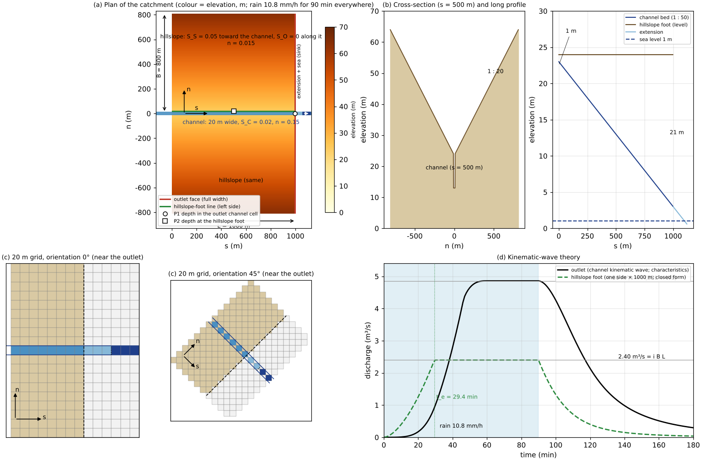
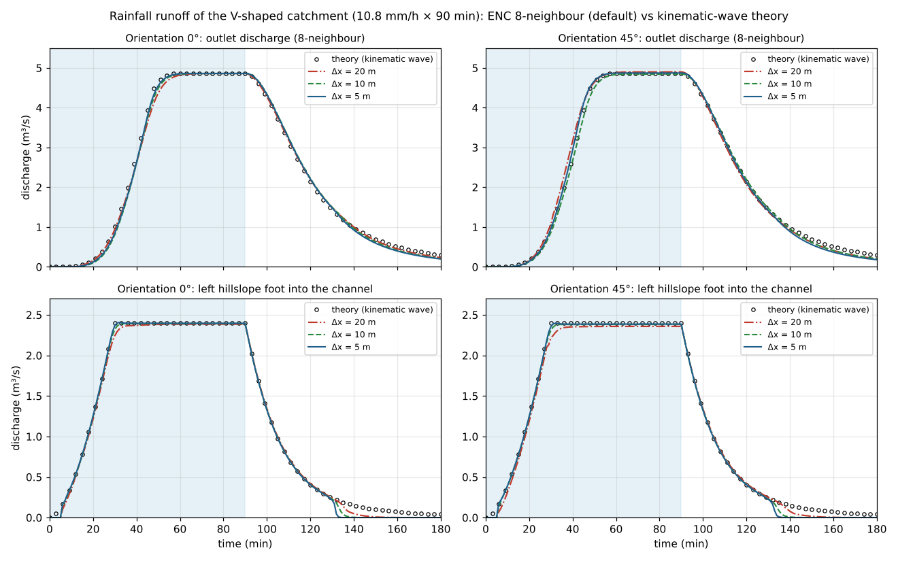
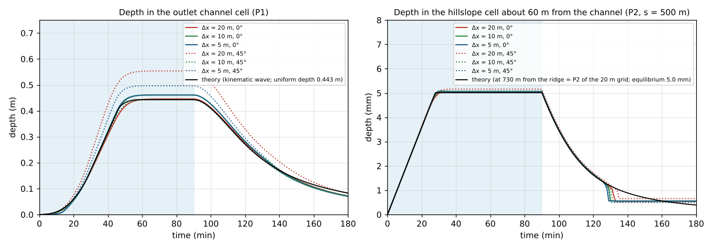
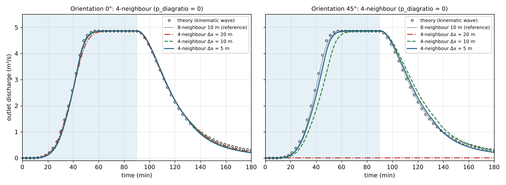
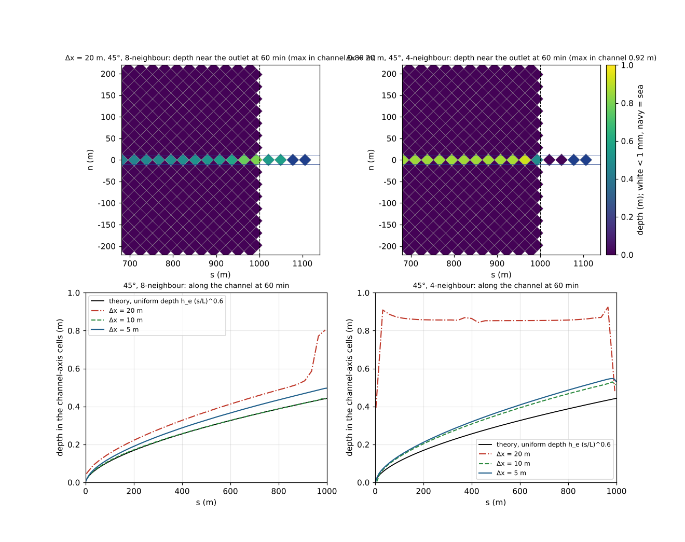
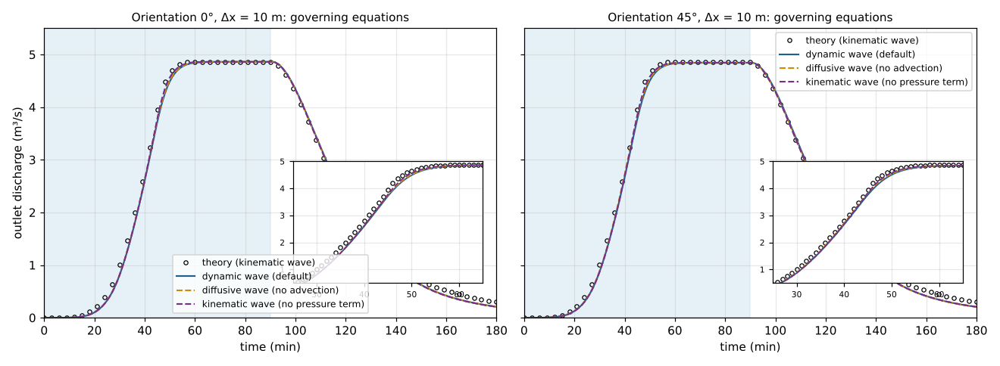

# benchmark/v-shaped — rainfall runoff of a V-shaped catchment (comparison with the kinematic-wave theory; grid orientation and eight vs four neighbours)

> English mirror of examples/benchmark/v-shaped/README.md. The Japanese file is the master copy.

[日本語](../README.md)

A V-shaped catchment 1000 m long, in which two 800 m hillslopes drain into a 20 m wide channel,
receives 10.8 mm/h of rain for 90 min, and the outlet discharge is compared with the kinematic-wave
theory. The problem has been a standard test of two-dimensional rainfall-runoff models since
Overton & Brakensiek (1973) and Di Giammarco et al. (1996) (Xia et al. 2017, Hou et al. 2018,
Chang et al. 2022 among others), and the original paper of the ENC grid, Tada (2026), uses it to
examine the dependence on grid orientation and spacing. Here all shallow-water settings stay at
their defaults, and grid spacings of 20, 10 and 5 m, catchment orientations of 0° and 45° to the
grid, and the ENC eight neighbours (default) versus four neighbours (`p_diagratio = 0`) are
compared. As a supplement the governing equations (dynamic, diffusive and kinematic wave) are
compared too.

**What this example shows**

- **Agreement with the theory**: with eight neighbours the difference of the outlet discharge from the
  theory (root-mean-square error divided by the peak, NRMSE) is 0.016 to 0.020 for every grid (20, 10,
  5 m) and orientation (0°, 45°), the peak is within 0.1 % of the value expected from the catchment area
  on the grid, and the rise (the time at which half of the theoretical peak is reached) is 38 to 40 min
  against the theoretical 39 min. The discharge from the hillslope foot into the channel also follows
  the closed-form solution with an NRMSE of 0.02.
- **Independent of orientation**: on the grid rotated by 45° the results are at the same level as at 0°,
  and even on the 20 m grid, where the channel becomes a single diagonal row of cells, the discharge
  follows the theory (the depth is 1.8 times larger because the channel looks Δx/√2 wide).
- **Difference from four neighbours**: with four neighbours the results at 0° are the same as with eight,
  but on the 20 m grid at 45° the channel cells touch only at corners, so the four neighbours of every
  channel cell are hillslope cells 1 to 21 m higher, and the runoff stays zero for the whole 3 hours (the
  same result as the staggered grid of Tada 2026). At 10 m 〔TBD〕, and at 5 m 〔TBD〕.
- **The governing equations differ little**: at 10 m the outlet discharges of the dynamic, diffusive and
  kinematic waves differ by 〔TBD〕; the kinematic wave is closest to the theory, showing that the
  advection and pressure terms contribute little in the thin flow on the hillslopes.

## Set-up



(a) Plan in the catchment coordinates (s, n): s runs down the channel, n across it from the channel axis
(the positive side is called the left side). The red line is the outlet face, the green line the
hillslope-foot line, P1 and P2 the depth probes. (b) Cross-section (s = 500 m) and long profile. The
hillslope foot is level; the channel is cut 1 m below it at the upstream end and 21 m at the outlet.
(c) Cells near the outlet when the 20 m grid is laid over the catchment at 0° and 45°. At 45° the channel
(blue) is a single diagonal row, and neighbouring channel cells touch only at their corners. The black
dashed line is the outlet, the dotted line the boundary between the extension and the sea. (d) The
kinematic-wave theory. Drawn from the inputs and the equations; not a computed result.

| Item | Value |
|---|---|
| Hillslopes | width B = 800 m on both sides, slope S_S = 0.05 toward the channel, slope S_O = 0 along it, Manning's n = 0.015 |
| Channel | length L = 1000 m, width W = 20 m, bed slope S_C = 0.02, n = 0.15. The bed is 1 m below the hillslope foot at the upstream end and 21 m at the outlet |
| Rain | 10.8 mm/h (3 × 10⁻⁶ m/s) everywhere for 90 min. The computation runs for 3 hours |
| Grids | Δx = 20, 10 and 5 m. Outside the rectangle of the catchment is outside the domain (wall). Orientations 0° (channel along a grid axis) and 45° |
| Time step | dt = 0.1 Δx (2, 1, 0.5 s). The maximum Courant number is 0.28 to 0.30 |
| Outlet | the channel is extended by 3 cells, and the 3 cells beyond are sea cells (a sink fixed at elevation 0 m and depth 1 m) |
| Measurement | outlet: a transect across the downstream row of the catchment from ridge to ridge (edge-flux method; full width). Hillslope foot: the row of left-side hillslope cells next to the channel (upstream end to outlet). Depths: the outlet channel cell (P1) and the foot cell at s = 500 m (P2) |
| Shallow water | all defaults: dynamic wave, steep-slope gravity correction 2, momentum-conserving advection with MUSCL, opening reassignment 3, adaptive Runge-Kutta, `p_diagratio` = 2/(2+√2) (equal passage widths of the eight edges). Only the four-neighbour cases set `p_diagratio = 0` |

Terrain, roughness and masks are given by evaluating the equations in the catchment coordinates at
the cell centres of each grid (no interpolation; a cell is assigned wholly to the channel or to a
hillslope, as in Tada 2026). At 45° the grid origin is placed so that the channel axis passes through
cell centres and the outlet face coincides with a diagonal row of cell centres; the channel then becomes
a diagonal row of cells 1 cell wide at 20 m, 3 at 10 m and 5 at 5 m, and the catchment area on the grid
differs from 1.62 km² by +0.8 % (20 m), −0.3 % (10 m) and +0.2 % (5 m).

Sea cells are used as the sink because at 45° the outlet lies inside the domain and an edge boundary
condition cannot be used. A sea cell is fixed at elevation 0 m and depth 1 m (water level 1 m), and
water that enters it disappears. The bed at the end of the extension (1.8 m at 20 m) is above the sea
level, so there is no backwater, and because the sea cells hold water, the depth on the edge at the
drop is set by the upstream depth (with a dry sea the cap by the two-sided average would halve the edge
depth and water would pile up before the drop). The outlet face spans the full width because a short
transect across the channel alone would leave the diagonal edges at the corners of the outlet outside
its range and not count them.

## Theory (kinematic wave)

`analytic.py` writes the values at 1-minute intervals to `data/analytic.csv` (called by `make`).

- **Hillslope** (width B, slope S_S, uniform rain i): unit-width discharge q = α h^m (α = √S_S / n_S,
  m = 5/3). The rise is q(B, t) = α (i t)^m, the time to equilibrium t_e = (B / (α i^(m−1)))^(1/m) =
  29.4 min, the equilibrium q_e = i B = 2.4 × 10⁻³ m²/s (2.40 m³/s over 1000 m), and the uniform depth
  at the foot 5.3 mm. After the rain stops h is constant along characteristics, so the depth at the foot
  solves B − α h^m / i = m α h^(m−1) (t − t_r) (Overton & Brakensiek 1973). These are closed forms.
- **Channel** (width W, slope S_C, lateral inflow q_L(t) = 2 q(B, t) + i W): the kinematic wave
  ∂A/∂t + ∂Q/∂x = q_L, Q = (√S_C / n_C) W h R^(2/3), is integrated numerically along the
  characteristics dx/dt = dQ/dA, dh/dt = q_L / W (the method of Di Giammarco et al. 1996). The hydraulic
  radius R is h (wide channel), matching the ENCflow channel cells, which have bed friction only and no
  bank friction (the rectangular radius R = Wh/(W + 2h) delays the rise by at most 2 %;
  `python3 analytic.py --rect`). The outlet peak 4.86 m³/s = i (2BL + WL) does not depend on the channel
  equation; half of the theoretical peak is reached at 39 min and the uniform depth is 0.443 m.
- The kinematic wave replaces the water-surface slope by the bed slope and is not an exact solution of
  the shallow-water equations. It gives the equilibrium discharge and the timing of the rise; the
  "theory" in the comparisons below means this approximate solution.

## Running

```bash
cd examples/benchmark/v-shaped
make                     # links, inputs data_dx*/, parameter files param_*.txt, theory data/analytic.csv
make run                 # all 19 cases (about 40 min with 4 threads; the five 5 m cases take most of it)
make main                # only the 6 main cases with eight neighbours (about 20 min)
python3 check.py         # tables of the differences from the theory and of the water balance (pass/fail for the main cases)
python3 plot_results.py  # figures figs/*.png (the argument en writes the English versions to en/figs/)
python3 plot_setup.py    # set-up figure figs/setup.png (can be drawn before computing)
```

| Case | Contents |
|---|---|
| `dx20_r0` `dx10_r0` `dx5_r0` `dx20_r45` `dx10_r45` `dx5_r45` | main cases (eight neighbours, defaults). `dx10_r0` is the annotated template `param.txt`; for the others `make_inputs.py` replaces the lines of grid, time step, measurement and input/output |
| `*_4nb` | four neighbours (`p_diagratio = 0`), all six grids |
| `dx10_r0_dif` `dx10_r45_dif` / `*_kin` | diffusive wave (`f_govequation = 1`, no advection term) / kinematic wave (`= 2`, no pressure term either) |
| `dx20_r0_od2` `dx10_r0_od2` `dx5_r0_od2` | former default of the opening reassignment `f_opening_dynamic = 2` (the values in the table of [Passage-width adjustment](../../../../docs/en/users_guide/passage_width.md)) |

One case takes 7 s at 20 m, 1 to 1.5 min at 10 m and 7 to 10 min at 5 m (gfortran 13.3, 4 threads).
The output of all cases is about 250 MB (`make clean` removes it).

## Results (gfortran 13.3, serial with 4 threads)

### Eight neighbours and the theory



Top: outlet discharge; bottom: discharge from the left hillslope foot into the channel. Left 0°, right 45°.
Circles are the theory.

Table of `check.py` (main cases). NRMSE is the root-mean-square error divided by the theoretical peak
(outlet 4.86, hillslope 2.40 m³/s); the grid ratio is the peak divided by rainfall intensity × catchment
area on the grid; t50 is the time at which half of the theoretical peak is first reached (theory 39 min);
the depth ratios are the depths at 80 min divided by the theoretical uniform depths (outlet 0.443 m, foot
5.3 mm); the balance is (water through the outlet + water left in the catchment at the end) / rain on the
catchment.

| Case | NRMSE outlet | peak ratio | grid ratio | t50 (min) | NRMSE hillslope | depth ratio outlet | depth ratio foot | balance | verdict |
|---|---|---|---|---|---|---|---|---|---|
| 20 m, 0° | 0.020 | 1.000 | 1.000 | 40 | 0.021 | 1.06 | 1.46 | 0.998 | PASS |
| 10 m, 0° | 0.020 | 1.000 | 1.000 | 40 | 0.022 | 1.05 | 1.13 | 1.000 | PASS |
| 5 m, 0° | 0.018 | 1.000 | 1.000 | 40 | 0.024 | 1.05 | 0.88 | 1.002 | PASS |
| 20 m, 45° | 0.016 | 1.008 | 1.000 | 38 | 0.023 | 1.82 | 1.83 | 0.999 | PASS |
| 10 m, 45° | 0.016 | 0.997 | 1.000 | 39 | 0.021 | 0.99 | 1.14 | 1.000 | PASS |
| 5 m, 45° | 〔TBD〕 | | | | | | | | |

The guide values for passing are NRMSE ≤ 0.04, |grid ratio − 1| ≤ 0.01, |t50 − theory| ≤ 3 min and
|balance − 1| ≤ 0.01.

- **The discharge follows the theory.** The NRMSE at the outlet is 0.016 to 0.020 and hardly changes with
  grid refinement. Most of the difference comes from the theory being a kinematic wave (the water-surface
  slope replaced by the bed slope): the shallow-water solution rounds the corner at equilibrium and
  recedes slightly faster at first. The discharge at the hillslope foot also follows the closed form in
  its rise, equilibrium and recession (NRMSE 0.021 to 0.024), with an equilibrium of 0.99 to 1.00 times
  the theory (slightly low because the diagonal edge from the downstream end of the line toward the
  extension lies outside the range of the line).
- **The peak equals the rain.** At 45° the catchment area on the grid differs from 1.62 km² by up to
  0.8 %, and the peak scales with it (grid ratio 1.000). The water balance closes within 0.2 %.
- **The timing of the rise** is 38 to 40 min against the theoretical 39 min.



Left: depth in the outlet channel cell (P1); right: depth in the hillslope cell next to the channel
(P2, s = 500 m). The black line is the theoretical uniform depth.

- **The outlet depth** is 0.99 to 1.06 times the theory at 0° and at 10 m, 45°, but **1.8 times at
  20 m, 45°**. The channel is represented by a single diagonal row of cells and behaves as a channel
  Δx/√2 = 14.1 m wide, so it is deeper for the same discharge. The discharge is right; the depth depends
  on the grid.
- **The depth in the hillslope-foot cell** is 0.9 to 1.5 times the theory (1.8 at 20 m, 45°), and only
  that one cell is deeper. The roughness on the edge between the hillslope (n 0.015) and the channel
  (n 0.15) is the average of the two, 0.0825, so the velocity on the edge from the foot cell into the
  channel is slower than the hillslope uniform flow (0.3 m/s), and water pools in the foot cell by that
  much. From the second cell on, the depth follows the theoretical profile (5.1 to 5.2 mm), and the
  discharge is unaffected.
- The hillslope discharge drops to zero at about 130 min. Water thinner than the limit depth dd = 1 mm
  does not flow, so the long tail of the kinematic wave (0.03 m³/s at 180 min) does not appear.

### Grid orientation and four neighbours



Outlet discharge with four neighbours (`p_diagratio = 0`, no diagonal edges). The grey line is eight
neighbours at 10 m.



Depth at 60 min at 45° (log scale). Top 20 m, bottom 10 m; left eight neighbours, right four.

| Case | NRMSE outlet | peak ratio | t50 (min) | volume ratio | balance |
|---|---|---|---|---|---|
| 〔TBD: the 6 four-neighbour cases〕 | | | | | |

- **At 0° four neighbours give the same result as eight** (〔TBD〕). The flow follows the grid axes, so
  the diagonal edges do not matter.
- **At 20 m, 45° the four-neighbour runoff stays zero.** The channel cells touch only at corners and the
  four neighbours of every channel cell are hillslope cells (the foot is 1 m higher at the upstream end
  and 21 m at the outlet), so the channel is a row of deep depressions. The rain in 3 hours is 16,000 m³,
  while the depressions hold 220,000 m³ and never fill. This is the same result as the 20 m staggered grid
  of Tada (2026).
- **At 10 m, 45°** (channel 3 cells wide) 〔TBD〕; **at 5 m** (5 cells) 〔TBD〕.
- Eight neighbours connect the channel cells directly through the diagonal edges, so the runoff does not
  stop even when the channel is narrower than the grid.

### Governing equations (supplement, 10 m)



| Case | NRMSE outlet | peak ratio | t50 (min) | depth ratio outlet |
|---|---|---|---|---|
| 〔TBD: the 4 cases〕 | | | | |

- 〔TBD〕

### Comparison with opening reassignment 2 (supplement, 0°)

With `f_opening_dynamic = 2` (the default until October 2026) the NRMSE at the outlet is 〔TBD〕 at 20, 10
and 5 m (0.020, 0.020 and 0.018 with 3). 〔TBD〕

## What it cannot do and the limits of accuracy

- The theory is the kinematic-wave approximation, not an exact solution of the shallow-water equations.
  The NRMSE of 0.02 includes the approximation on the theory side (the sharp corner at equilibrium, the
  shape of the recession) and is not purely a model error.
- The depth depends on the grid. The depth in a channel represented by a single diagonal row of cells is
  1.8 times the theory, and that of the single hillslope cell next to the channel 1.1 to 1.5 times. These
  do not affect the comparison of discharge, but when depths are to be read, resolve the channel with
  three or more cells across.
- Water thinner than the limit depth dd = 1 mm does not flow, so the end of the recession (after about
  130 min on the hillslopes) reaches zero earlier than the theory.
- The roughness on the edge between the hillslope foot and the channel is the average of the two sides.
  Where a flow crosses a boundary between very different roughnesses, the depth of the one cell at the
  boundary departs from the uniform-flow value.
- Infiltration, interception, the channel features (fn_channel) and structures are not used. There is no
  comparison with observations of a real catchment.
- There is no regression reference. The verdict of `check.py` follows the guide values above, and the
  last digits change with rounding and the machine.

## Related

- [test/hillslope](../../../../test/hillslope/en/README.md): comparison of a uniform plane slope with the
  kinematic wave, and the V-shaped catchment on coarse 100 m and 10 m grids (comparison of advection schemes).
- [Passage-width adjustment](../../../../docs/en/users_guide/passage_width.md): the list of checks of opening
  reassignment 2 and 3 (uses the `_od2` values of this example). [Diagonal share](../../../../docs/en/users_guide/diagratio.md):
  the meaning of `p_diagratio` and four neighbours.
- The supplements of [examples/debris_fan](../../../debris_fan/en/README.md) and
  [tutorials/chichibu](../../../../tutorials/chichibu/en/README.md): eight versus four neighbours for a debris
  flow and on real terrain.

## References

- Tada, T. (2026): An eight-neighborhood connected collocated grid scheme for overland flow simulation. *Hydrological Research Letters*, 20(2), 113–118. doi:10.3178/hrl.25-00052. (The original paper of the ENC grid; uses this problem to compare the dependence on grid orientation and spacing with a staggered grid.)
- Overton, D. E. and Brakensiek, D. L. (1973): A kinematic model of surface runoff response. *Proc. Symp. on the Results of Research on Representative and Experimental Basins*, IAHS Publ. 96. (The closed-form kinematic wave on a plane.)
- Di Giammarco, P., Todini, E. and Lamberti, P. (1996): A conservative finite elements approach to overland flow: the control volume finite element formulation. *Journal of Hydrology*, 175, 267–291. doi:10.1016/S0022-1694(96)80014-X. (This V-shaped catchment problem and its kinematic-wave solution.)
- Stephenson, D. and Meadows, M. E. (1986): *Kinematic Hydrology and Modelling*. Elsevier. (Kinematic-wave theory.)
- Xia, X., Liang, Q., Ming, X. and Hou, J. (2017): An efficient and stable hydrodynamic model with novel source term discretization schemes for overland flow and flood simulations. *Water Resources Research*, 53, 3730–3759. doi:10.1002/2016WR020055.
- Hou, J., Wang, T., Li, P., Li, Z., Zhang, X., Zhao, J. and Hinkelmann, R. (2018): An implicit friction source term treatment for overland flow simulation using shallow water flow model. *Journal of Hydrology*, 564, 357–366. doi:10.1016/j.jhydrol.2018.07.027.
- Chang, T.-J., Yu, H.-L., Wang, C.-H. and Chen, A. S. (2022): Dynamic-wave cellular automata framework for shallow water flow modeling. *Journal of Hydrology*, 613, 128449. doi:10.1016/j.jhydrol.2022.128449. (The last three are examples of two-dimensional models validated on the same problem.)
