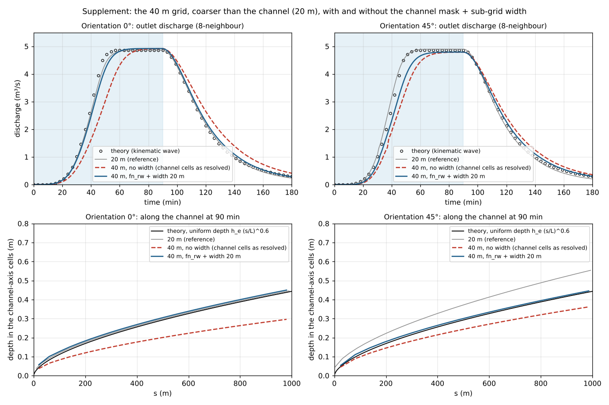

# benchmark/v-shaped — rainfall runoff of a V-shaped catchment (comparison with the kinematic-wave theory; grid orientation and eight vs four neighbours)

> English mirror of examples/benchmark/v-shaped/README.md. The Japanese file is the master copy.

[日本語](../README.md)

A V-shaped catchment 1000 m long, in which two 800 m hillslopes drain into a 20 m wide channel,
receives 10.8 mm/h of rain for 90 min, and the outlet discharge is compared with the kinematic-wave
theory. The problem has been a standard test of two-dimensional rainfall-runoff models since
Overton & Brakensiek (1973) and Di Giammarco et al. (1996) (Xia et al. 2017, Hou et al. 2018,
Chang et al. 2022 among others), and the original paper of the ENC grid, Tada (2026), uses it to
examine the dependence on grid orientation and spacing. Here all shallow-water settings stay at
their defaults, and grid spacings of 20, 10 and 5 m, catchment orientations of 0° and 45° to the
grid, and the ENC eight neighbours (default) versus four neighbours (`p_diagratio = 0`) are
compared. As a supplement the governing equations (dynamic, diffusive and kinematic wave; for the
meaning of the words see the primer
[The shallow water equations and the dynamic, diffusion and kinematic waves](../../../../docs/en/users_guide/shallow_water.md)) are
compared, and an addendum shows the effect of the sub-grid channel width on a 40 m grid, coarser
than the channel (20 m).

**What this example shows**

- **Agreement with the theory**: with eight neighbours the difference of the outlet discharge from the
  theory (root-mean-square error divided by the peak, NRMSE) is 0.016 to 0.020 for every grid (20, 10,
  5 m) and orientation (0°, 45°), the peak is within 0.1 % of the value expected from the catchment area
  on the grid, and the rise (the time at which half of the theoretical peak is reached) is 37 to 40 min
  against the theoretical 39 min. The discharge from the hillslope foot into the channel also follows
  the closed-form solution with an NRMSE of 0.02 to 0.025.
- **Independent of orientation**: on the grid rotated by 45° the results are at the same level as at 0°,
  and even on the 20 m grid, where the channel becomes a single diagonal row of cells, the discharge
  follows the theory (the depth is 1.3 times larger because the channel looks Δx/√2 wide).
- **Difference from four neighbours**: with four neighbours the results at 0° are the same as with eight,
  but on the 20 m grid at 45° the channel cells touch only at corners, so the four neighbours of every
  channel cell are hillslope cells 1 to 21 m higher, and the runoff stays zero for the whole 3 hours (the
  same result as the staggered grid of Tada 2026). At 10 m (channel 3 cells wide) the rise is 5 min late
  with an NRMSE of 0.080, and at 5 m (5 cells) 3 min late with 0.033, approaching eight neighbours as the
  grid is refined.
- **The governing equations differ little**: at 10 m the outlet discharges of the dynamic, diffusive and
  kinematic waves differ by at most 0.09 m³/s (2 % of the peak) and the timing of the rise is the same. The
  kinematic wave is closest to the theory (NRMSE 0.018 against 0.020 for the dynamic wave), but only
  slightly, so the remaining difference from the theory comes from the discretisation, not from the
  physics of the pressure and advection terms.
- **A channel narrower than the grid can be represented while staying raster** (addendum): without
  coupling a one-dimensional channel model, giving the channel cells a width distribution is enough for
  the rise and the depth of a 20 m wide channel to follow the theory even on a 40 m grid (without the
  width the rise is 5 to 7 min late and the depth 0.7 to 0.8 times the theory; with it the delay is 1 to
  2 min and the depth 1.03 to 1.05 times).

## Set-up


(a) Plan in the catchment coordinates (s, n): s runs down the channel, n across it from the channel axis
(the positive side is called the left side). The red line is the outlet face, the green line the
hillslope-foot line, P1 and P2 the depth probes (P2 is on the hillslope about 60 m from the channel).
Beyond the outlet (dashed line) the same cross-section continues for 200 m up to the dotted line (not
counted in the catchment), followed by the channel extension and the sea. (b) Cross-section (s = 500 m)
and long profile. The hillslope foot is level; the channel is cut 1 m below it at the upstream end and
21 m at the outlet. (c) Cells near the outlet when the 20 m grid is laid over the catchment at 0° and
45°. At 45° the channel (blue) is a single diagonal row, and neighbouring channel cells touch only at
their corners. The black dashed line is the outlet; the lighter cells beyond it are the downstream
section. (d) The kinematic-wave theory. Drawn from the inputs and the equations; not a computed result.

| Item | Value |
|---|---|
| Hillslopes | width B = 800 m on both sides, slope S_S = 0.05 toward the channel, slope S_O = 0 along it, Manning's n = 0.015 |
| Channel | length L = 1000 m, width W = 20 m, bed slope S_C = 0.02, n = 0.15. The bed is 1 m below the hillslope foot at the upstream end and 21 m at the outlet |
| Rain | 10.8 mm/h (3 × 10⁻⁶ m/s) everywhere for 90 min. The computation runs for 3 hours |
| Grids | Δx = 20, 10 and 5 m (40 m in the addendum). Outside the rectangles of the catchment and the downstream section is outside the domain (wall). Orientations 0° (channel along a grid axis) and 45° |
| Time step | dt = 0.1 Δx (2, 1, 0.5 s; 4 s at 40 m). The maximum Courant number is at most 0.3 |
| Outlet | the outlet face is at s = L. Downstream of the catchment the same cross-section (hillslopes and channel, rained on) continues for 200 m, followed by 3 cells of channel extension and 3 sea cells (a sink fixed at elevation 0 m and depth 1 m). The channel bed at the outlet is at 8 m |
| Measurement | outlet: a transect across the downstream row of the catchment from ridge to ridge (edge-flux method; full width). Hillslope foot: the row of left-side hillslope cells next to the channel (upstream end to outlet). Depths: the outlet channel cell (P1) and the hillslope cell in the row about 60 m from the channel at s = 500 m (P2; the one or two rows next to the channel are read from the distributed output) |
| Shallow water | all defaults: [dynamic wave](../../../../docs/en/users_guide/shallow_water.md), steep-slope gravity correction 2, momentum-conserving advection with MUSCL, opening reassignment 3, adaptive Runge-Kutta, `p_diagratio` = 2/(2+√2) (equal passage widths of the eight edges). Only the four-neighbour cases set `p_diagratio = 0` |

Terrain, roughness and masks are given by evaluating the equations in the catchment coordinates at
the cell centres of each grid (no interpolation; a cell is assigned wholly to the channel or to a
hillslope, as in Tada 2026). At 45° the grid origin is placed so that the channel axis passes through
cell centres and the outlet face coincides with a diagonal row of cell centres; the channel then becomes
a diagonal row of cells 1 cell wide at 20 m, 3 at 10 m and 5 at 5 m, and the catchment area on the grid
differs from 1.62 km² by +0.8 % (20 m), −0.3 % (10 m) and +0.2 % (5 m).

The same cross-section continues for 200 m downstream of the outlet because the channel depth rises to
1.8 times the theory in the few cells (3 cells at 20 m, 45°; 2 cells at 40 m) before the place where the
hillslopes end and the neighbours of the channel-axis cells become walls (outside the domain). This rise
is not a backwater from the drop but belongs to the end of the hillslopes (extending the channel alone
does not move it), so the hillslopes are continued for 200 m and the outlet face and the outlet probe P1
stay upstream of it. The runoff of the rain on that section enters the channel downstream of the face
and is not counted in the outlet discharge. Sea cells are used as the sink because at 45° the outlet
lies inside the domain and an edge boundary condition cannot be used. A sea cell is fixed at elevation
0 m and depth 1 m (water level 1 m), and water that enters it disappears. The bed at the end of the
extension (3.0 m at 20 m) is above the sea level, so there is no backwater, and because the sea cells
hold water, the depth on the edge at the drop is set by the upstream depth (with a dry sea the cap by
the two-sided average would halve the edge depth and water would pile up before the drop). The outlet
face spans the full width because a short transect across the channel alone would leave the diagonal
edges at the corners of the outlet outside its range and not count them.

## Theory (kinematic wave)

`analytic.py` writes the values at 1-minute intervals to `data/analytic.csv` (called by `make`).

- **Hillslope** (width B, slope S_S, uniform rain i): unit-width discharge q = α h^m (α = √S_S / n_S,
  m = 5/3). The rise is q(B, t) = α (i t)^m, the time to equilibrium t_e = (B / (α i^(m−1)))^(1/m) =
  29.4 min, the equilibrium q_e = i B = 2.4 × 10⁻³ m²/s (2.40 m³/s over 1000 m), and the uniform depth
  at the foot 5.3 mm. After the rain stops h is constant along characteristics, so the depth at the foot
  solves B − α h^m / i = m α h^(m−1) (t − t_r) (Overton & Brakensiek 1973). These are closed forms.
- **Channel** (width W, slope S_C, lateral inflow q_L(t) = 2 q(B, t) + i W): the kinematic wave
  ∂A/∂t + ∂Q/∂x = q_L, Q = (√S_C / n_C) W h R^(2/3), is integrated numerically along the
  characteristics dx/dt = dQ/dA, dh/dt = q_L / W (the method of Di Giammarco et al. 1996). The hydraulic
  radius R is h (wide channel), matching the ENCflow channel cells, which have bed friction only and no
  bank friction (the rectangular radius R = Wh/(W + 2h) delays the rise by at most 2 %;
  `python3 analytic.py --rect`). The outlet peak 4.86 m³/s = i (2BL + WL) does not depend on the channel
  equation; half of the theoretical peak is reached at 39 min and the uniform depth is 0.443 m.
- The kinematic wave ([section 6 of the primer](../../../../docs/en/users_guide/shallow_water.md#wave-models)) replaces the water-surface slope by the bed slope and is not an exact solution of
  the shallow-water equations. It gives the equilibrium discharge and the timing of the rise; the
  "theory" in the comparisons below means this approximate solution.

## Running

```bash
cd examples/benchmark/v-shaped
make                     # links, inputs data_dx*/, parameter files param_*.txt, theory data/analytic.csv
make run                 # all 23 cases (about 40 min; the five 5 m cases take most of it)
make main                # only the 6 main cases with eight neighbours (about 17 min)
make supp                # the 4 addendum cases (40 m; with and without the channel mask + sub-grid width; 3 s each)
python3 check.py         # tables of the differences from the theory and of the water balance (pass/fail for the main cases)
python3 plot_results.py  # figures figs/*.png (the argument en writes the English versions to en/figs/)
python3 plot_setup.py    # set-up figure figs/setup.png (can be drawn before computing)
```

| Case | Contents |
|---|---|
| `dx20_r0` `dx10_r0` `dx5_r0` `dx20_r45` `dx10_r45` `dx5_r45` | main cases (eight neighbours, defaults). `dx10_r0` is the annotated template `param.txt`; for the others `make_inputs.py` replaces the lines of grid, time step, measurement and input/output |
| `*_4nb` | four neighbours (`p_diagratio = 0`), all six grids |
| `dx10_r0_dif` `dx10_r45_dif` / `*_kin` | diffusive wave (`f_govequation = 1`, no advection term; the local term remains, so strictly the local inertia equation) / kinematic wave (`= 2`, no depth-gradient part of the pressure term either) |
| `dx20_r0_od2` `dx10_r0_od2` `dx5_r0_od2` | former default of the opening reassignment `f_opening_dynamic = 2` (the values in the table of [Passage-width adjustment](../../../../docs/en/users_guide/passage_width.md)) |
| `dx40_r0` `dx40_r45` / `*_sgc` | addendum: the 40 m grid, coarser than the channel (20 m). `_sgc` gives the channel mask `fn_rw` and the sub-grid channel width `fn_width` (20 m on the channel cells) ([channel chapter](../../../../docs/en/users_guide/channel.md)) |

One case takes 2 s at 40 m, 8 s at 20 m, 1 min at 10 m and 5 to 8 min at 5 m.
The output of all cases is about 120 MB (`make clean` removes it).

## Results

### Eight neighbours and the theory


Top: outlet discharge; bottom: discharge from the left hillslope foot into the channel. Left 0°, right 45°.
Circles are the theory.

Table of `check.py` (main cases). NRMSE is the root-mean-square error divided by the theoretical peak
(outlet 4.86, hillslope 2.40 m³/s); the grid ratio is the peak divided by rainfall intensity × catchment
area on the grid; t50 is the time at which half of the theoretical peak is first reached (theory 39 min);
the depth ratios are the depths at 80 min divided by the theoretical uniform depth at that position
(outlet 0.443 m; the hillslope P2 lies 725 to 740 m from the ridge, 5.0 mm); the balance is (water through
the outlet + water left in the catchment at the end) / rain on the catchment.

| Case | NRMSE outlet | peak ratio | grid ratio | t50 (min) | NRMSE hillslope | depth ratio outlet (P1) | depth ratio hillslope (P2) | balance | verdict |
|---|---|---|---|---|---|---|---|---|---|
| 20 m, 0° | 0.019 | 1.000 | 1.000 | 40 | 0.021 | 1.01 | 1.01 | 0.998 | PASS |
| 10 m, 0° | 0.020 | 1.000 | 1.000 | 40 | 0.022 | 1.04 | 1.00 | 0.999 | PASS |
| 5 m, 0° | 0.018 | 1.000 | 1.000 | 40 | 0.024 | 1.04 | 1.00 | 1.002 | PASS |
| 20 m, 45° | 0.020 | 1.008 | 1.000 | 37 | 0.025 | 1.25 | 1.02 | 0.999 | PASS |
| 10 m, 45° | 0.016 | 0.997 | 1.000 | 39 | 0.021 | 1.00 | 1.00 | 1.000 | PASS |
| 5 m, 45° | 0.016 | 1.002 | 1.000 | 38 | 0.023 | 1.12 | 1.00 | 1.000 | PASS |

The guide values for passing are NRMSE ≤ 0.04, |grid ratio − 1| ≤ 0.01, |t50 − theory| ≤ 3 min and
|balance − 1| ≤ 0.01.

- **The discharge follows the theory.** The NRMSE at the outlet is 0.016 to 0.020 and hardly changes with
  grid refinement. The difference consists of a rise 1 to 2 min later than the theory at 0° (3.6 to 3.8
  against 3.9 m³/s at 45 min) and 1 to 2 min earlier at 45° on the 20 and 5 m grids (4.1 m³/s), a rounded
  corner at equilibrium and a slightly later start of the recession. Switching to the kinematic wave
  equation (supplement below) leaves the size of the difference unchanged, so the remainder is not the
  physics of the pressure and advection terms but the discretisation (the storage in the foot cells where
  the hillslopes enter the channel, the representation of the channel on the grid with a depth 2 to 5 %
  above the theory) together with the approximation on the theory side (water-surface slope replaced by
  the bed slope). The discharge at the hillslope foot also follows the closed form in its rise,
  equilibrium and recession (NRMSE 0.021 to 0.025), with an equilibrium of 0.98 to 1.00 times the theory
  (slightly low because the diagonal edge from the downstream end of the line toward the downstream
  section lies outside the range of the line).
- **The peak equals the rain.** At 45° the catchment area on the grid differs from 1.62 km² by up to
  0.8 %, and the peak scales with it (grid ratio 1.000). The water balance closes within 0.2 %.
- **The timing of the rise** is 37 to 40 min against the theoretical 39 min.


Left: depth in the outlet channel cell (P1); right: depth in the hillslope cell about 60 m from the channel
(P2, s = 500 m). The black line is the time series of the kinematic-wave theory (on the right evaluated at
the P2 position of the 20 m grid, 730 m from the ridge; the P2 of the other grids lies 725 to 740 m from
the ridge, where the equilibrium depth differs by ±1 %).

- **The channel depth is set by the width of the channel on the grid.** The depth along the channel
  (average over s = 200 to 800 m) relative to the theoretical uniform depth h_e (s/L)^0.6 is 1.02 to 1.05
  at 0°, and at 45° 1.28 at 20 m (a single diagonal row = Δx/√2 = 14.1 m wide), 1.00 at 10 m (3 rows =
  21.2 m) and 1.12 at 5 m (5 rows = 17.7 m). The depth in the outlet cell (P1) has the same values (1.01
  to 1.04 at 0°, 1.25 at 20 m, 45°). The discharge is right; the depth depends on the grid.
- **The hillslope depth follows the theory except in the one or two rows next to the channel.** P2 (60 to
  75 m from the channel) is 1.00 to 1.02 times the theory, and in the distributed output at 90 min every row
  more than 30 m from the channel is 0.97 to 1.05 times. Only the first row next to the channel, the foot,
  is 0.8 to 1.9 times the theory (1.49, 1.16 and 0.90 at 0°; 1.87, 1.17 and 0.83 at 45°), and the second
  row is 1.1 times at 45° and at 5 m, 0°. The roughness on the edge between the hillslope (n 0.015) and
  the channel (n 0.15) is the average of the two, 0.0825, so the velocity on the edge from the foot cell
  into the channel is slower than the hillslope uniform flow (0.3 m/s), and water pools in the foot cell
  by that much. The discharge is unaffected (the column "depth ratio foot (1st row)" of `check.py`).
- The hillslope discharge drops to zero at about 130 min. Water thinner than the limit depth dd = 1 mm
  does not flow, so the long tail of the kinematic wave (0.04 m³/s at 180 min) does not appear. With dd
  and the depth floor of the friction term dv in `&list_sysparam` set to 0.1 mm (20 m, 0°), the recession
  continues to 180 min and follows the theoretical tail (0.11 against 0.10 m³/s at 150 min, 0.045 against
  0.039 at 180 min), and the hillslope NRMSE goes from 0.021 to 0.015 (the outlet stays at 0.019). With dd
  alone at 0.1 mm the tail appears but recedes more slowly, 1.5 times the theory at 150 min (0.15 m³/s),
  because the friction of water thinner than 1 mm is evaluated at the depth dv = 1 mm.

### Grid orientation and four neighbours


Outlet discharge with four neighbours (`p_diagratio = 0`, no diagonal edges). The grey line is eight
neighbours at 10 m.


Top: depth at 60 min in the cells from near the outlet to the sea at 45°, 20 m (left eight neighbours, right
four; drawn in the catchment coordinates; dashed line = outlet face, dotted line = end of the downstream section,
navy = sea cells. With eight neighbours the few cells at the end of the downstream section are deep: the rise
before the place where the hillslopes end). Bottom: depth along the channel axis of the catchment at 60 min
(45°; 20, 10 and 5 m; from the upstream end to the outlet) and the theoretical uniform depth h_e (s/L)^0.6.

| Case | NRMSE outlet | peak ratio | t50 (min) | volume ratio | balance |
|---|---|---|---|---|---|
| 20 m, 0° | 0.019 | 1.000 | 39 | 0.985 | 0.998 |
| 10 m, 0° | 0.019 | 1.000 | 40 | 0.984 | 0.999 |
| 5 m, 0° | 0.017 | 1.000 | 39 | 0.984 | 1.002 |
| 20 m, 45° | 0.619 | 0.000 | — | −0.007 | 0.998 |
| 10 m, 45° | 0.080 | 0.998 | 44 | 0.969 | 1.001 |
| 5 m, 45° | 0.033 | 1.003 | 41 | 0.984 | 1.001 |

- **At 0° four neighbours give the same result as eight** (NRMSE 0.017 to 0.019 against 0.018 to 0.020,
  t50 39 to 40 min). The flow follows the grid axes, so the diagonal edges do not matter.
- **At 20 m, 45° the four-neighbour runoff stays zero.** The channel cells touch only at corners and the
  four neighbours of every channel cell are hillslope cells (the foot is 1 m higher at the upstream end
  and 21 m at the outlet), so the channel is a row of deep depressions. The rain in 90 min is 26,000 m³,
  while the depressions hold 160,000 m³ and never fill. This is the same result as the 20 m staggered grid
  of Tada (2026). (The volume ratio is slightly negative because rain on the hillslopes of the downstream
  section crosses the outlet face upstream along the four-neighbour staircase paths and ends in the
  depressions on the catchment side.)
- **At 10 m, 45°** (channel 3 cells wide) the runoff is not blocked but delayed, because the channel flow
  follows a diagonal staircase: t50 is 44 min (eight neighbours 39 min), 90 % of the theoretical peak is
  reached at 55 min (49 min), the runoff volume by 180 min is 0.93 of the rain (0.94 with eight
  neighbours), the channel depth is 1.21 times the theory (1.00) and the NRMSE is 0.080. **At 5 m**
  (5 cells) the difference shrinks to t50 41 min, NRMSE 0.033 and a channel depth of 1.25 times (1.12 with
  eight neighbours), but stays larger than eight neighbours at 20 m (0.020).
- Eight neighbours connect the channel cells directly through the diagonal edges, so the runoff does not
  stop even when the channel is narrower than the grid.

### Governing equations (supplement, 10 m)


| Case | NRMSE outlet | peak ratio | t50 (min) | depth ratio outlet |
|---|---|---|---|---|
| 10 m, 0°, dynamic (default) | 0.020 | 1.000 | 40 | 1.04 |
| 10 m, 0°, diffusive | 0.019 | 1.000 | 40 | 1.03 |
| 10 m, 0°, kinematic | 0.018 | 1.000 | 40 | 1.03 |
| 10 m, 45°, dynamic (default) | 0.016 | 0.997 | 39 | 1.00 |
| 10 m, 45°, diffusive | 0.014 | 0.997 | 39 | 0.97 |
| 10 m, 45°, kinematic | 0.014 | 0.997 | 39 | 1.00 |

- The outlet discharges of the three equations differ by at most 0.09 m³/s (2 % of the peak) and t50 is
  the same. The hillslope flow is thin and slow (depth 5 mm, velocity 0.4 m/s), so the inertia and
  pressure terms are small, and in the channel the flow is close to uniform. The kinematic wave is closest
  to the theory (the same kinematic wave), but a difference of NRMSE 0.014 to 0.018 remains; this
  remainder is due to the discretisation (see the eight-neighbour section above).
- What is written "diffusive wave" here is `f_govequation = 1` (no advection term). The term for the time
  change of the velocity (the local term) remains, so strictly it is not the diffusion wave but the local
  inertia equation. In a thin, slowly varying flow like that of this catchment the local term is about a
  thousandth of the gravity and friction terms, so no difference from the diffusion wave is expected (for
  the meaning of each term and the differences between the approximations see
  [The shallow water equations and the dynamic, diffusion and kinematic waves](../../../../docs/en/users_guide/shallow_water.md#encflow)).
- The diffusive and kinematic waves are settings for comparison. For inundation and run-up with wetting
  and drying, use the dynamic wave (default) ([Shallow-water chapter](../../../../docs/en/users_guide/swflow.md)).

### Comparison with opening reassignment 2 (supplement, 0°)

With `f_opening_dynamic = 2` (the default before the opening reassignment) the NRMSE at the outlet becomes
0.017, 0.027 and 0.028 at 20, 10 and 5 m (0.019, 0.020 and 0.018 with the default 3). With 2 the hillslope
flow is too fast, the rise comes 1 to 2 min earlier than the theory (t50 37 to 38 min; 40 min with 3) and
the NRMSE of the hillslope-foot discharge is 0.034 to 0.045 (0.021 to 0.024 with 3). On the coarsest grid,
20 m, the outlet error of 2 is smaller; refining the grid increases the error of 2 and decreases that of 3.
These values appear in the table of [Passage-width adjustment](../../../../docs/en/users_guide/passage_width.md).

## Addendum: the sub-grid channel width on a grid coarser than the channel (40 m)

The comparisons above resolve the 20 m wide channel on grids no coarser than the channel (20, 10, 5 m).
In real catchments, rivers narrower than the grid that covers the whole catchment are the rule. ENCflow
handles them without a one-dimensional channel model or a vector representation of the channel network:
it stays raster. When the channel cells are given a width distribution (`fn_width`), the conveyance and
storage of such a cell are computed for the channel part of the cell only, while the flow equations are
the same two-dimensional shallow-water equations as on the hillslopes and the exchange with the
neighbouring cells goes through the same cell edges (there is no other model and no coupling; when the
river width crosses the cell size there is no switch of model, and one width distribution connects the
headwater rills to the large river; [channel chapter](../../../../docs/en/users_guide/channel.md)).

Here the same catchment is laid on a 40 m grid, coarser than the channel, and with the eight-neighbour
default settings the cases with and without the channel mask `fn_rw` (channel and extension cells) plus
the sub-grid channel width `fn_width` (20 m on the channel cells) are compared, to show that the flow of
a 20 m wide channel can be represented by 40 m cells (`make supp`; cases `dx40_r0`, `dx40_r45` and
`*_sgc`). Without the width the channel cells flow as a channel 40 m wide at 0° and, at 45°, as a single
diagonal row Δx/√2 = 28.3 m wide. With the width, conveyance and storage are computed for the
20 m wide part of the cell only (no levee, so natural banks; the incision of the channel stays in the
elevation). At 0° the grid origin is placed so that the channel axis passes through cell centres (the
channel is one row; the catchment area on the grid is 1.64 km², +1.2 %), and at 45° the rule is the same
as at 20 m (one row; 1.60 km², −1.4 %). dt = 4 s.



Top: outlet discharge (left 0°, right 45°; grey is eight neighbours at 20 m); bottom: depth along the
channel axis at 90 min and the theoretical uniform depth.

| Case | NRMSE outlet | grid ratio | t50 (min) | 90 % reached (min) | NRMSE hillslope | depth ratio channel | depth ratio outlet (P1) | balance |
|---|---|---|---|---|---|---|---|---|
| 40 m, 0°, no width | 0.115 | 1.000 | 46 | 61 | 0.031 | 0.69 | 0.67 | 0.999 |
| 40 m, 0°, fn_rw + width 20 m | 0.033 | 1.000 | 40 | 52 | 0.033 | 1.05 | 1.01 | 0.999 |
| 40 m, 45°, no width | 0.086 | 1.000 | 44 | 59 | 0.061 | 0.84 | 0.82 | 1.000 |
| 40 m, 45°, fn_rw + width 20 m | 0.047 | 1.000 | 41 | 55 | 0.060 | 1.03 | 1.01 | 1.000 |

The theoretical t50 is 39 min and 90 % of the peak is reached at 47 min (eight neighbours at 20 m: 37 to
40 min and 47 to 51 min).

- **Without the width the runoff is late and the depth shallow.** The channel looks 2 times (0°) or
  1.4 times (45°) too wide, so the depth for the same discharge is 0.69 and 0.84 times the theory and the
  velocity lower; the rise is 7 min (0°) and 5 min (45°) later than the theory (2.3 and 2.7 against
  3.9 m³/s at 45 min) and the NRMSE, 0.115 and 0.086, exceeds the guide value 0.04 of the main cases.
- **With a width of 20 m the depth becomes 1.05 and 1.03 times the theory and the delay of the rise shrinks
  to 1 to 2 min.** The NRMSE, 0.033 and 0.047, approaches that of the 20 m grid (0.019 and 0.020). The
  peak (grid ratio) and the water balance do not depend on the width, nor does the discharge at the
  hillslope foot (hillslope NRMSE 0.03 at 0°; the 0.06 at 45° is the diagonal edge toward the downstream
  section dropped at the end of the line, which weighs more at 40 m). The remaining difference is larger
  at 45° because more water pools in the one or two hillslope rows next to the channel (up to 50 m from
  the channel at 40 m; depth ratio of the foot row 2.3 against 1.8 at 0°), which delays the rise by that
  much.
- **A channel below the resolution is represented while staying raster.** The rise and the depth of the
  20 m wide channel follow the theory in 40 m cells because the channel width is a property of the cell,
  solved on the same grid with the same equations as the hillslopes. A diagonal channel is connected by
  the diagonal edges of the eight neighbours, so the width works alike at 0° and 45°. Since the channel
  network is not held as vectors, the preprocessing is only painting the width distribution on the raster.
  The condition is that the river runs smoothly at the resolution of the grid (it is not suited to a river
  that meanders within one cell; [channel chapter](../../../../docs/en/users_guide/channel.md)).
- **The width works only where the channel on the grid is wider than the real one.** A cell whose width
  is not smaller than the cell size is treated as a resolved channel, so giving a width of 20 m on grids
  of 20 m or finer changes almost nothing (checked at 20 m: the outlet discharge differs by at most 0.2 %
  of the peak, the depth by 3 mm or less). At 45° the channel looks N Δx/√2 wide (N = number of diagonal
  rows of channel cells = 2⌊14.1 m / Δx⌋ + 1: 14.1 m at 20 m, 21.2 at 10 m,
  17.7 at 5 m, 28.3 at 40 m), and because the width mechanism can only narrow the conveyance, the depth
  on the single-row grids whose apparent width is narrower than 20 m (14.1 < Δx ≤ 28.3 m; 1.28 times at
  20 m) cannot be corrected. Within that band the depth is largest just above Δx = 14.1 m (apparent width
  10 m) and exact at 28.3 m, where the row is exactly 20 m wide.

## What it cannot do and the limits of accuracy

- The theory is the kinematic-wave approximation, not an exact solution of the shallow-water equations.
  The NRMSE of 0.02 includes the approximation on the theory side (the sharp corner at equilibrium, the
  shape of the recession) and is not purely a model error.
- The depth depends on the grid. The depth in a channel represented by a single diagonal row of cells is
  1.3 times the theory, and that of the first hillslope cell next to the channel 0.8 to 1.9 times. These
  do not affect the comparison of discharge, but when depths are to be read, resolve the channel with
  three or more cells across (on a grid coarser than the channel the sub-grid channel width brings the
  depth close to the theory; see the addendum above).
- Water thinner than the limit depth dd = 1 mm does not flow, so the end of the recession (after about
  130 min on the hillslopes) reaches zero earlier than the theory (setting dd and dv to 0.1 mm recovers the
  tail; see the results section).
- The roughness on the edge between the hillslope foot and the channel is the average of the two sides.
  Where a flow crosses a boundary between very different roughnesses, the depth of the one cell at the
  boundary departs from the uniform-flow value.
- In the few cells before the place where the hillslopes end at the downstream end of the domain, the
  channel depth rises (the downstream section keeps that effect away from the outlet face). The depth of
  a channel that touches the edge of the domain depends in this way on how the edge is treated.
- Infiltration, interception and structures are not used; of the channel features only the sub-grid
  channel width of the addendum. There is no comparison with observations of a real catchment.
- There is no regression reference. The verdict of `check.py` follows the guide values above, and the
  last digits change with rounding and the machine (the two 20 m cases are checked in CI by test/vshaped
  with the same guide values).

## Related

- [test/vshaped](../../../../test/vshaped/en/README.md): the two 20 m cases of this example (0°, 45°) as a pass/fail
  check with an independent standard-library implementation (run in CI).
- [test/hillslope](../../../../test/hillslope/en/README.md): comparison of a uniform plane slope with the
  kinematic wave, and the V-shaped catchment on coarse 100 m and 10 m grids (comparison of advection schemes).
- [Passage-width adjustment](../../../../docs/en/users_guide/passage_width.md): the list of checks of opening
  reassignment 2 and 3 (uses the `_od2` values of this example). [Diagonal share](../../../../docs/en/users_guide/diagratio.md):
  the meaning of `p_diagratio` and four neighbours. [Channel](../../../../docs/en/users_guide/channel.md): the channel
  mask and the sub-grid channel width used in the addendum.
- The supplements of [examples/debris_fan](../../../debris_fan/en/README.md) and
  [tutorials/chichibu](../../../../tutorials/chichibu/en/README.md): eight versus four neighbours for a debris
  flow and on real terrain.

## References

- Tada, T. (2026): An eight-neighborhood connected collocated grid scheme for overland flow simulation. *Hydrological Research Letters*, 20(2), 113–118. doi:10.3178/hrl.25-00052. (The original paper of the ENC grid; uses this problem to compare the dependence on grid orientation and spacing with a staggered grid.)
- Overton, D. E. and Brakensiek, D. L. (1973): A kinematic model of surface runoff response. *Proc. Symp. on the Results of Research on Representative and Experimental Basins*, IAHS Publ. 96. (The closed-form kinematic wave on a plane.)
- Di Giammarco, P., Todini, E. and Lamberti, P. (1996): A conservative finite elements approach to overland flow: the control volume finite element formulation. *Journal of Hydrology*, 175, 267–291. doi:10.1016/S0022-1694(96)80014-X. (This V-shaped catchment problem and its kinematic-wave solution.)
- Stephenson, D. and Meadows, M. E. (1986): *Kinematic Hydrology and Modelling*. Elsevier. (Kinematic-wave theory.)
- Xia, X., Liang, Q., Ming, X. and Hou, J. (2017): An efficient and stable hydrodynamic model with novel source term discretization schemes for overland flow and flood simulations. *Water Resources Research*, 53, 3730–3759. doi:10.1002/2016WR020055.
- Hou, J., Wang, T., Li, P., Li, Z., Zhang, X., Zhao, J. and Hinkelmann, R. (2018): An implicit friction source term treatment for overland flow simulation using shallow water flow model. *Journal of Hydrology*, 564, 357–366. doi:10.1016/j.jhydrol.2018.07.027.
- Chang, T.-J., Yu, H.-L., Wang, C.-H. and Chen, A. S. (2022): Dynamic-wave cellular automata framework for shallow water flow modeling. *Journal of Hydrology*, 613, 128449. doi:10.1016/j.jhydrol.2022.128449. (The last three are examples of two-dimensional models validated on the same problem.)
