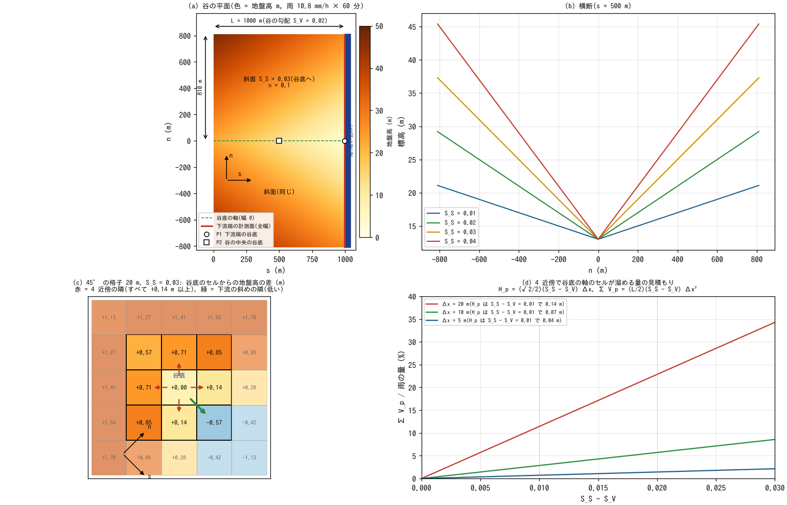
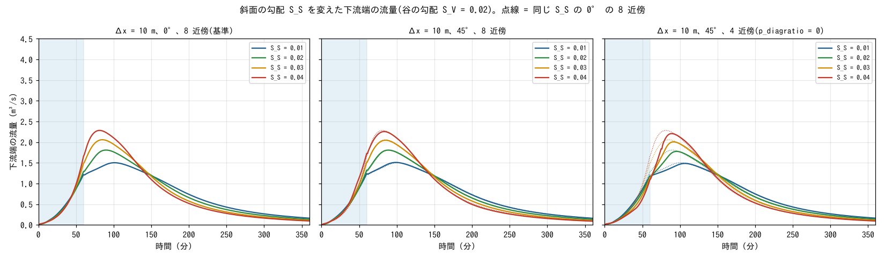
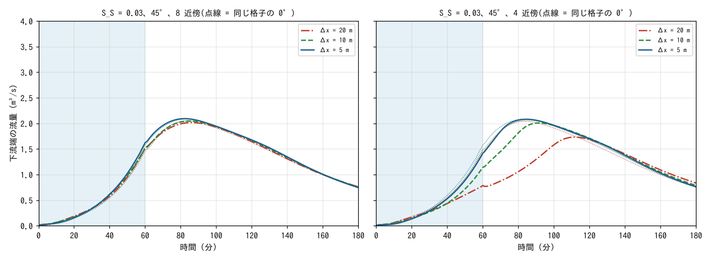
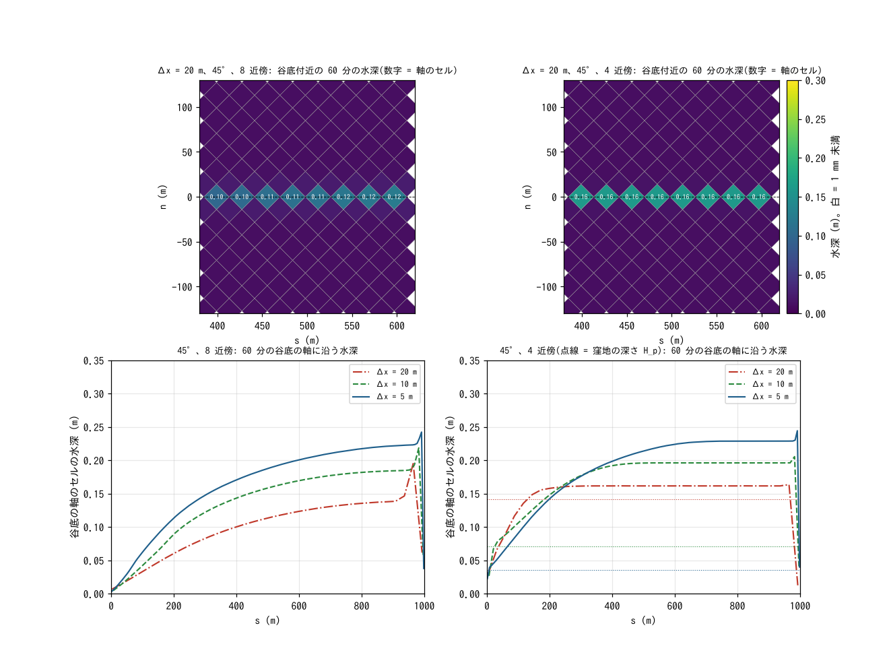

# benchmark/v-valley — 水路のない V 字谷の降雨流出(格子に斜めの谷底にできる疑似窪地。8 近傍と 4 近傍)

[English](en/README.md)

谷の勾配 S_V = 0.02 の V 字谷(長さ 1000 m、幅 1620 m、水路なし、マニングの n = 0.1)に
10.8 mm/h の雨を 60 分降らせ、下流端の流量を比べます。谷底が格子の軸と 45° をなすとき、
斜面の勾配 S_S が谷の勾配より急いと、4 近傍の格子では谷底のセルの 4 つの隣がすべて高くなります。
こうしてできる**疑似的な窪地**(深さ (√2/2)(S_S − S_V) Δx)に水が溜まり、流出が遅れます。
ENC の 8 近傍では斜めのエッジが谷底のセルを直接つなぐので、この窪地は生じません。斜面の
勾配(0.01〜0.04)と格子間隔(20・10・5 m)を変え、向き 0° の結果を基準に、45° に傾けた格子の
8 近傍(既定)と 4 近傍(`p_diagratio = 0`)を比べます。理論解はなく、0° の結果(向きによらない
はずの答え)との差を見る例題です。

**この例題で分かること**

- **8 近傍は向きに依らない**: 45° に傾けた格子の下流端の流量は、どの斜面の勾配・格子間隔でも
  0° と NRMSE 〔TBD〕 以内で重なります。
- **4 近傍は S_S > S_V で遅れ、粗い格子ほど大きい**: 〔TBD〕
- **窪地の見積もり**: 〔TBD〕

## 設定



(a) 谷の座標 (s, n) で見た平面(S_S = 0.03)。s は谷を下る向き、n は谷底の軸からの横断距離。赤の線が
下流端の計測面、P1・P2 が水深のプローブ。(b) 横断(s = 500 m)。(c) 45° に傾けた 20 m の格子の、谷底の
セルとその周りの地盤高(谷底のセルからの差)。4 近傍の隣(赤)はすべて +0.14 m 以上で、下流の斜めの隣
(緑)だけが低い。(d) 4 近傍で谷底の軸のセルが溜める量の見積もり。入力と式から描いた図で、計算結果では
ありません。

| 項目 | 値 |
|---|---|
| 地形 | z = 3 + S_V (L − s) + S_S \|n\|。L = 1000 m、幅 2 × 810 m、S_V = 0.02、S_S = 0.01・0.02・0.03・0.04。谷底は幅 0 の線 |
| 粗度 | マニングの n = 0.1(一様) |
| 雨 | 10.8 mm/h を全域に 60 分。計算は 3 時間 |
| 格子 | Δx = 10 m で S_S の 4 通り、S_S = 0.03 で Δx = 20・5 m。向き 0° と 45°。谷の長方形の外は領域外(壁) |
| 時間刻み | dt = 0.1 Δx(2・1・0.5 s) |
| 出口 | 下流端(s = L)の全幅の先 2 セルを海域マスク(標高 0 m・水深 1 m に固定された吸い込み)にする |
| 計測 | 下流端の列を右岸側の尾根から左岸側の尾根まで横切る測線(エッジ流量方式。全幅)。水深: 下流端の谷底のセル(P1)と s = 500 m の谷底のセル(P2) |
| 浅水流 | すべて既定値(力学波、急勾配の重力補正 2、移流の運動量保存形 + MUSCL、開口の振り替え 3、適応的ルンゲクッタ、`p_diagratio` = 2/(2+√2))。4 近傍のケースだけ `p_diagratio = 0` |

地形とマスクは谷の座標の式を各格子のセル中心で評価して与えます(補間しない)。45° では谷底の軸が
セル中心を通るように格子の原点を置くので、谷底は斜めの 1 列のセルになります(v-shaped と同じ置き方)。
出口は v-shaped と同じ海セルの吸い込みで、下流端の全幅が開いています(谷底だけでなく斜面の下流端からも
水が出ます)。

### 疑似窪地の仕組み

45° に傾けた格子で、谷底の軸のセルの 4 つの隣(格子の軸方向)は、谷の座標で (±Δx/√2, ±Δx/√2) の
位置にあります。その地盤高の差は、下流側の 2 つが (Δx/√2)(S_S − S_V)、上流側の 2 つが (Δx/√2)(S_S + S_V)
なので、S_S > S_V なら 4 つとも谷底のセルより高く、谷底のセルは深さ

H_p = (√2/2)(S_S − S_V) Δx

の窪地になります(S_S ≤ S_V なら窪地はできません)。谷底の軸のセルは √2 Δx おきに L/(√2 Δx) 個
並ぶので、谷全体で溜まる量の見積もりは Σ V_p = (L/2)(S_S − S_V) Δx² です(S_S = 0.03 では 20 m で
2000 m³、10 m で 500 m³、5 m で 125 m³。雨の総量 17,500 m³ の 11・2.9・0.7 %)。4 近傍では、谷底の
セルに集まった水が窪地を満たし、さらに縁の薄い水の流れで隣の(高い)セルへ越えて次の谷底のセルへ
落ちる、という階段状の流下になります。8 近傍では下流の斜めの隣(地盤高の差 −(Δx/√2)(S_S + S_V))へ
直接流れるので、窪地はありません。

## 実行

```bash
cd examples/benchmark/v-valley
make                     # リンク、入力 data_s*/、設定 param_*.txt
make run                 # 全 19 ケース(4 スレッドで 25 分ほど。5 m の 3 ケースが大半)
python3 check.py         # 0° との差・残留・窪地の見積もり・水収支の表(45° の 8 近傍は合否つき)
python3 plot_results.py  # 図 figs/*.png(引数 en で英語版を en/figs/ に)
python3 plot_setup.py    # 設定と仕組みの図 figs/setup.png(計算の前に描ける)
```

| ケース | 内容 |
|---|---|
| `s01_dx10_r0` … `s04_dx10_r0` | 0° の 8 近傍(基準)。`s03_dx10_r0` が注釈付きの雛形 `param.txt` |
| `s0?_dx10_r45` / `s0?_dx10_r45_4nb` | 45° の 8 近傍 / 4 近傍 |
| `s03_dx20_*` `s03_dx5_*` | S_S = 0.03 の 20・5 m(0°、45° の 8 近傍、45° の 4 近傍) |
| `s03_dx10_r0_4nb` | 0° の 4 近傍(向きが揃っていれば 4 近傍でも変わらないことの確認) |

ケース名は `s<S_S × 100>_dx<Δx>_r<向き>[_4nb]`。

## 結果(gfortran 13.3、逐次 4 スレッド)

### 斜面の勾配(格子 10 m)



左: 0° の 8 近傍(基準)、中: 45° の 8 近傍、右: 45° の 4 近傍。点線は同じ S_S の基準。

`check.py` の表。NRMSE は基準(同じ S_S・Δx の 0°・8 近傍)との差を基準のピークで割った二乗平均
平方根誤差、残留は終了時(180 分)に谷に残る水量 / 雨、窪地は上の見積もり Σ V_p / 雨、収支は
(流出量 + 残留)/ 雨です。

| ケース | ピーク (m³/s) | ピーク時刻 (分) | NRMSE | ピーク比 | ピーク時刻の差 | 流出比 | 残留 | 窪地 | 収支 | 判定 |
|---|---|---|---|---|---|---|---|---|---|---|
| 〔TBD〕 | | | | | | | | | | |

- 〔TBD〕

### 格子間隔(S_S = 0.03)



| ケース | ピーク (m³/s) | ピーク時刻 (分) | NRMSE | ピーク比 | ピーク時刻の差 | 流出比 | 残留 | 窪地 | 収支 | 判定 |
|---|---|---|---|---|---|---|---|---|---|---|
| 〔TBD〕 | | | | | | | | | | |



- 〔TBD〕

## できないこと・精度の限界

- 理論解はありません。基準は同じ格子の 0° の計算で、0° の結果そのものの格子依存(20・10・5 m のピークの
  違い 〔TBD〕)は別に見ます。
- 下流端の全幅が開いた吸い込みなので、斜面の下流端からも水が出ます。流域の出口が 1 点の実際の谷とは
  違います。
- 疑似窪地の見積もり Σ V_p は谷底の軸のセルだけの量で、窪地の縁を越える薄い流れの遅れは含みません。
  4 近傍の流出の遅れは Σ V_p より大きくなります。
- 浸透・遮断・河道の機能・構造物は使いません。回帰テストの reference は持たず、`check.py` の合否は目安です。

## 関連

- [v-shaped](../v-shaped/README.md): 同じ置き方で理論解と比べる V 字流域(水路あり)。
- [斜めの配分比](../../../docs/users_guide/diagratio.md): `p_diagratio` の意味と 4 近傍。
  [通過幅の調整](../../../docs/users_guide/passage_width.md): 開口の振り替え。
- [examples/debris_fan](../../debris_fan/README.md)・[tutorials/chichibu](../../../tutorials/chichibu/README.md) の補足:
  土石流と実地形での 8 近傍と 4 近傍。
- Tada, T. (2026): An eight-neighborhood connected collocated grid scheme for overland flow simulation. *Hydrological Research Letters*, 20(2), 113–118. doi:10.3178/hrl.25-00052.(谷底の疑似窪地と 8 近傍の動機)
