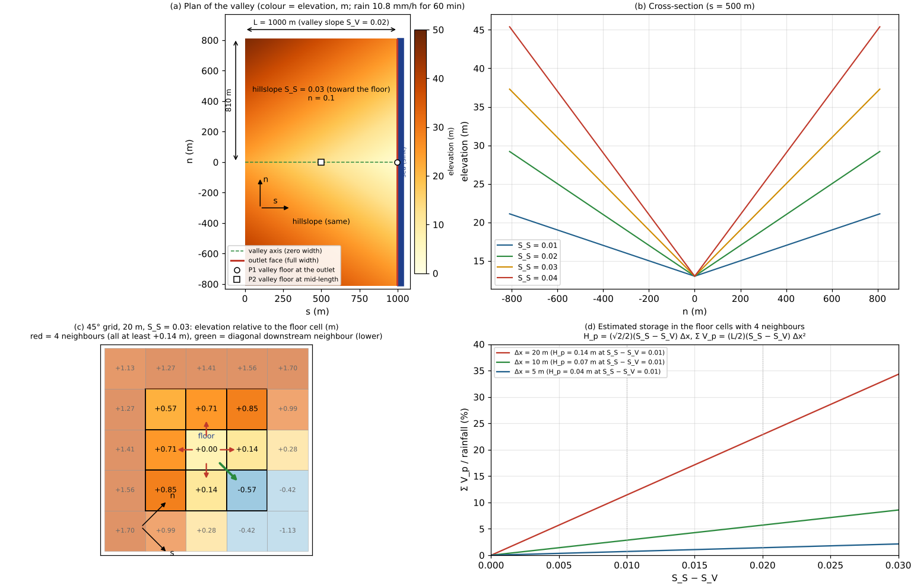
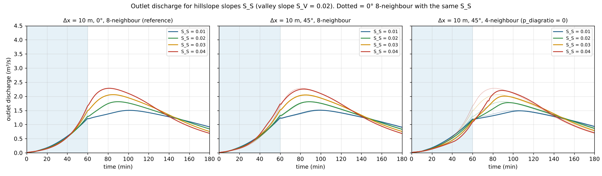
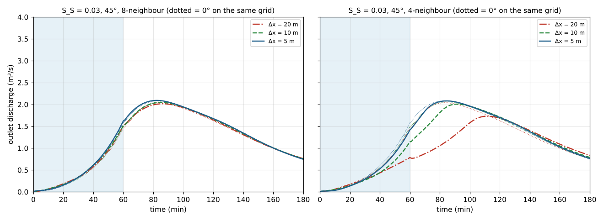
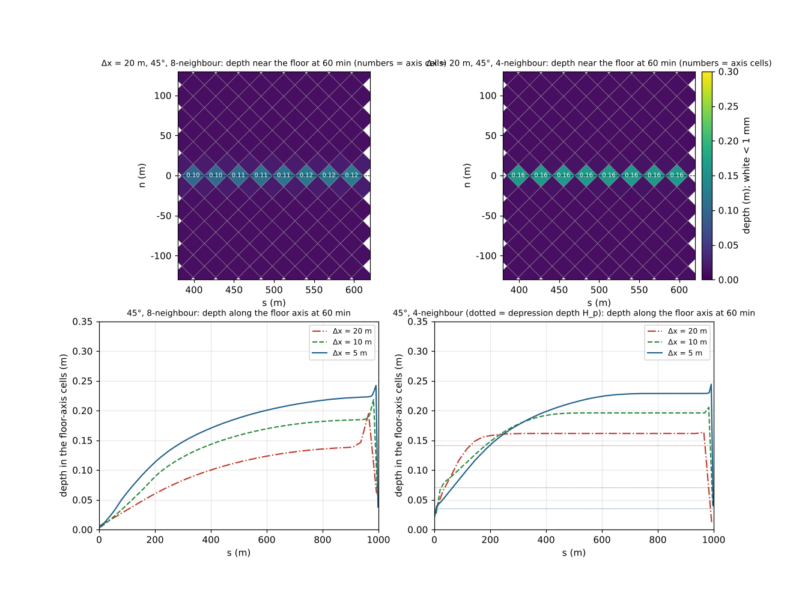

# benchmark/v-valley — rainfall runoff of a V-shaped valley without a channel (pseudo-depressions on a valley floor oblique to the grid; eight vs four neighbours)

> English mirror of examples/benchmark/v-valley/README.md. The Japanese file is the master copy.

[日本語](../README.md)

A V-shaped valley with valley slope S_V = 0.02 (1000 m long, 1620 m wide, no channel, Manning's
n = 0.1) receives 10.8 mm/h of rain for 60 min, and the discharge at the downstream end is compared.
When the valley floor runs at 45° to the grid axes and the hillslope slope S_S is steeper than the
valley slope, the four neighbours of every floor cell on a four-neighbour grid are all higher. Water
collects in the **pseudo-depressions** formed this way (depth (√2/2)(S_S − S_V) Δx) and the runoff is
delayed. With the ENC eight neighbours the diagonal edges connect the floor cells directly, and the
depressions do not arise. The hillslope slope (0.01 to 0.04) and the grid spacing (20, 10, 5 m) are
varied, and eight neighbours (default) and four neighbours (`p_diagratio = 0`) on the grid rotated by
45° are compared with the 0° result as the reference. There is no theoretical solution; the example
looks at the difference from the 0° result, which the answer should not depend on.

**What this example shows**

- **Eight neighbours do not depend on orientation**: the outlet discharge on the grid rotated by 45°
  follows the 0° result within an NRMSE of 〔TBD〕 for every hillslope slope and grid spacing.
- **Four neighbours are delayed when S_S > S_V, the more so the coarser the grid**: 〔TBD〕
- **Estimate of the depressions**: 〔TBD〕

## Set-up



(a) Plan in the valley coordinates (s, n) (S_S = 0.03). s runs down the valley, n is the distance across
from the valley axis. The red line is the outlet face, P1 and P2 the depth probes. (b) Cross-section
(s = 500 m). (c) The floor cell of the 20 m grid rotated by 45° and the elevations of the surrounding
cells (relative to the floor cell). The four neighbours (red) are all at least +0.14 m higher; only the
diagonal downstream neighbour (green) is lower. (d) Estimate of the volume stored in the floor cells
with four neighbours. Drawn from the inputs and the equations; not a computed result.

| Item | Value |
|---|---|
| Terrain | z = 3 + S_V (L − s) + S_S \|n\|. L = 1000 m, width 2 × 810 m, S_V = 0.02, S_S = 0.01, 0.02, 0.03, 0.04. The valley floor is a line of zero width |
| Roughness | Manning's n = 0.1 (uniform) |
| Rain | 10.8 mm/h everywhere for 60 min. The computation runs for 3 hours |
| Grids | Δx = 10 m for the four values of S_S; Δx = 20 and 5 m for S_S = 0.03. Orientations 0° and 45°. Outside the rectangle of the valley is outside the domain (wall) |
| Time step | dt = 0.1 Δx (2, 1, 0.5 s) |
| Outlet | the 2 cells beyond the downstream end (s = L), over the full width, are sea cells (a sink fixed at elevation 0 m and depth 1 m) |
| Measurement | a transect across the downstream row from ridge to ridge (edge-flux method; full width). Depths: the floor cell at the downstream end (P1) and the floor cell at s = 500 m (P2) |
| Shallow water | all defaults (dynamic wave, steep-slope gravity correction 2, momentum-conserving advection with MUSCL, opening reassignment 3, adaptive Runge-Kutta, `p_diagratio` = 2/(2+√2)). Only the four-neighbour cases set `p_diagratio = 0` |

The terrain and masks are given by evaluating the equations in the valley coordinates at the cell
centres of each grid (no interpolation). At 45° the grid origin is placed so that the valley axis passes
through cell centres, so the floor is a single diagonal row of cells (the same placement as v-shaped).
The outlet is the same sea-cell sink as in v-shaped, open over the full width of the downstream end
(water leaves from the downstream ends of the hillslopes as well as from the floor).

### How the pseudo-depressions arise

On the grid rotated by 45°, the four neighbours of a floor cell (along the grid axes) lie at
(±Δx/√2, ±Δx/√2) in the valley coordinates. Their elevations differ from the floor cell by
(Δx/√2)(S_S − S_V) for the two downstream ones and (Δx/√2)(S_S + S_V) for the two upstream ones, so
when S_S > S_V all four are higher, and the floor cell is a depression of depth

H_p = (√2/2)(S_S − S_V) Δx

(no depression when S_S ≤ S_V). The floor cells on the axis lie every √2 Δx, L/(√2 Δx) of them, so the
estimated volume stored in the whole valley is Σ V_p = (L/2)(S_S − S_V) Δx² (for S_S = 0.03: 2000 m³ at
20 m, 500 m³ at 10 m and 125 m³ at 5 m, or 11, 2.9 and 0.7 % of the total rain of 17,500 m³). With four
neighbours the water collected in a floor cell fills the depression and then spills as a thin flow over
its rim into the (higher) neighbouring cell and drops into the next floor cell, a staircase descent. With
eight neighbours the water flows directly to the diagonal downstream neighbour (elevation difference
−(Δx/√2)(S_S + S_V)), and there is no depression.

## Running

```bash
cd examples/benchmark/v-valley
make                     # links, inputs data_s*/, parameter files param_*.txt
make run                 # all 19 cases (about 25 min with 4 threads; the three 5 m cases take most of it)
python3 check.py         # tables of the difference from 0°, the residual, the depression estimate and the water balance (pass/fail for 45° with eight neighbours)
python3 plot_results.py  # figures figs/*.png (the argument en writes the English versions to en/figs/)
python3 plot_setup.py    # set-up and mechanism figure figs/setup.png (can be drawn before computing)
```

| Case | Contents |
|---|---|
| `s01_dx10_r0` … `s04_dx10_r0` | 0°, eight neighbours (reference). `s03_dx10_r0` is the annotated template `param.txt` |
| `s0?_dx10_r45` / `s0?_dx10_r45_4nb` | 45°, eight / four neighbours |
| `s03_dx20_*` `s03_dx5_*` | S_S = 0.03 at 20 and 5 m (0°; 45° with eight neighbours; 45° with four) |
| `s03_dx10_r0_4nb` | 0° with four neighbours (to confirm that four neighbours change nothing when the valley is aligned) |

The case names are `s<S_S × 100>_dx<Δx>_r<orientation>[_4nb]`.

## Results (gfortran 13.3, serial with 4 threads)

### Hillslope slope (10 m grid)



Left: 0°, eight neighbours (reference); middle: 45°, eight neighbours; right: 45°, four neighbours. Dotted
lines are the reference with the same S_S.

Table of `check.py`. NRMSE is the root-mean-square difference from the reference (0°, eight neighbours,
same S_S and Δx) divided by the reference peak; the residual is the water left in the valley at the end
(180 min) divided by the rain; depressions is the estimate Σ V_p / rain above; the balance is
(runoff volume + residual) / rain.

| Case | peak (m³/s) | time of peak (min) | NRMSE | peak ratio | shift of peak | volume ratio | residual | depressions | balance | verdict |
|---|---|---|---|---|---|---|---|---|---|---|
| 〔TBD〕 | | | | | | | | | | |

- 〔TBD〕

### Grid spacing (S_S = 0.03)



| Case | peak (m³/s) | time of peak (min) | NRMSE | peak ratio | shift of peak | volume ratio | residual | depressions | balance | verdict |
|---|---|---|---|---|---|---|---|---|---|---|
| 〔TBD〕 | | | | | | | | | | |



- 〔TBD〕

## What it cannot do and the limits of accuracy

- There is no theoretical solution. The reference is the 0° computation on the same grid, and the grid
  dependence of the 0° results themselves (the peaks at 20, 10 and 5 m differ by 〔TBD〕) is looked at
  separately.
- The sink is open over the full width of the downstream end, so water leaves from the downstream ends of
  the hillslopes too. This differs from a real valley whose outlet is a single point.
- The estimate Σ V_p counts only the floor cells on the axis and not the delay of the thin flow over the
  rims of the depressions. The delay of the four-neighbour runoff is larger than Σ V_p suggests.
- Infiltration, interception, the channel features and structures are not used. There is no regression
  reference; the verdict of `check.py` follows guide values.

## Related

- [v-shaped](../../v-shaped/en/README.md): the V-shaped catchment with a channel, laid out the same way and compared with a theory.
- [Diagonal share](../../../../docs/en/users_guide/diagratio.md): the meaning of `p_diagratio` and four neighbours.
  [Passage-width adjustment](../../../../docs/en/users_guide/passage_width.md): opening reassignment.
- The supplements of [examples/debris_fan](../../../debris_fan/en/README.md) and
  [tutorials/chichibu](../../../../tutorials/chichibu/en/README.md): eight versus four neighbours for a debris flow and on real terrain.
- Tada, T. (2026): An eight-neighborhood connected collocated grid scheme for overland flow simulation. *Hydrological Research Letters*, 20(2), 113–118. doi:10.3178/hrl.25-00052. (The pseudo-depressions of valley floors as the motivation of the eight neighbours.)
