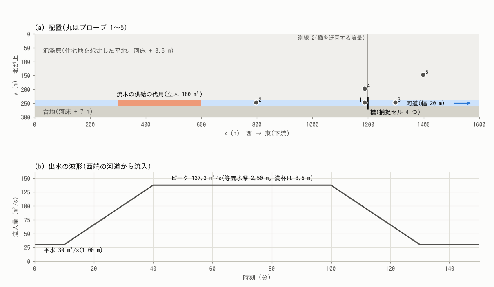
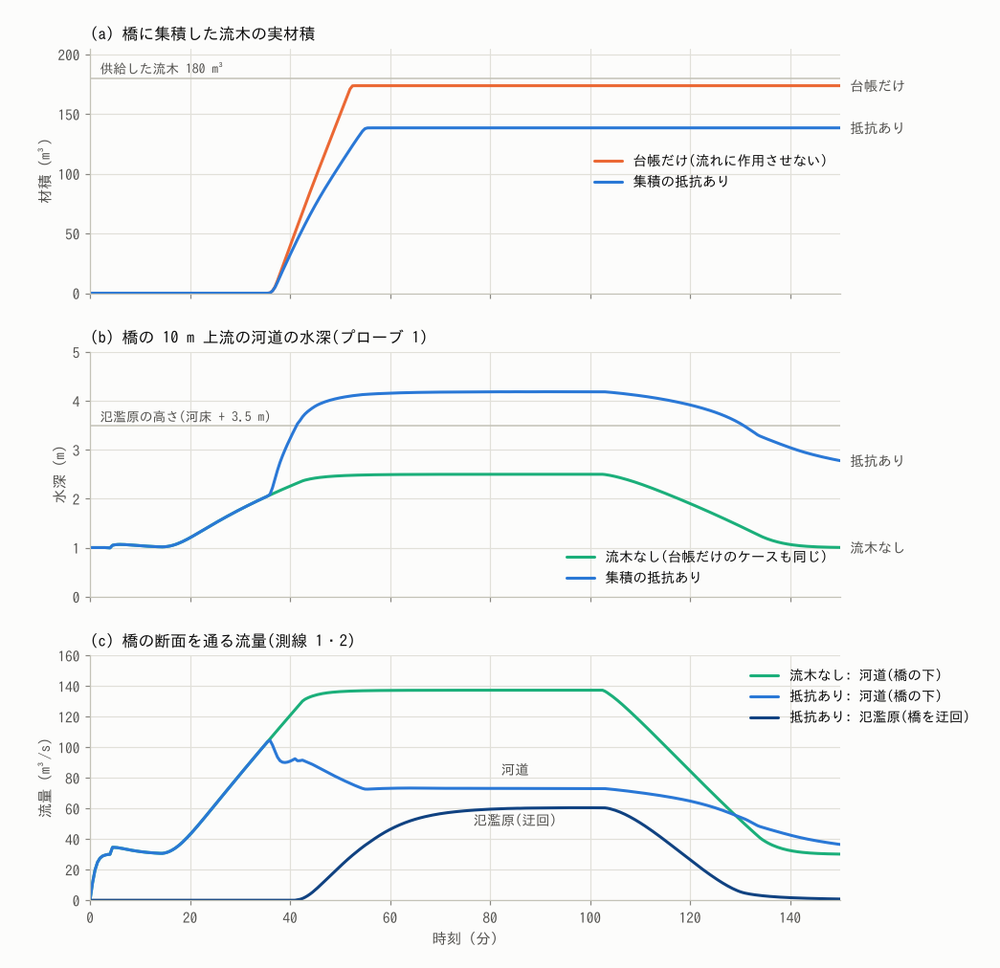
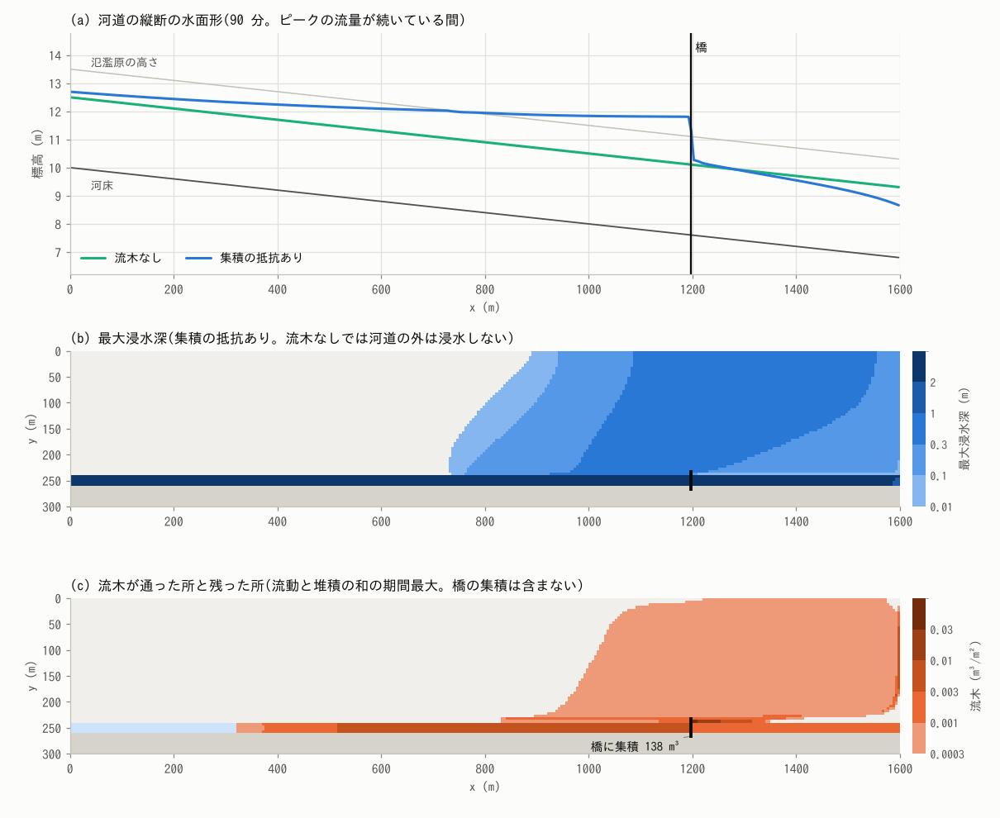
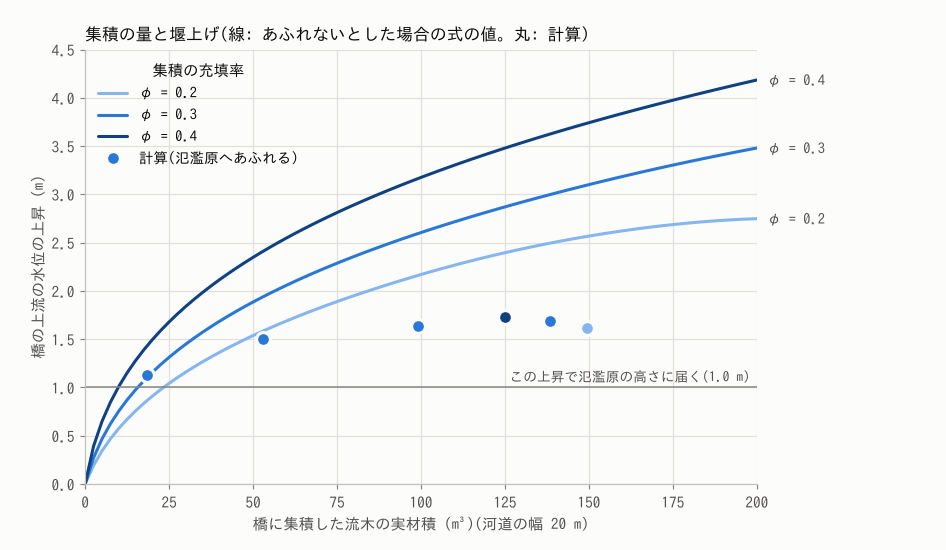
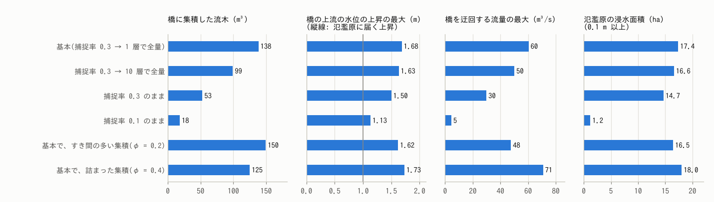

# bridge_wood_jam — 橋に詰まった流木による堰上げと迂回氾濫

[English](en/README.md)

出水で流れてきた流木が橋に掛かって溜まると、川の水が橋をくぐりにくくなって上流の水位が上がり、
あふれた水が橋を迂回して周りの土地を流れます。この例題は、流木の発生と輸送、橋での集積、集積に
よる堰上げ、氾濫原への氾濫を一つの計算で解き、流木がない場合、流木は橋に溜まるが流れに作用させない
場合、集積が流れを妨げる場合の 3 ケースを比べます。あわせて、与件である捕捉率と、校正値である集積の
抵抗の係数を変えて、結果の幅を見ます。地形・流量・流木の量は現象を見やすくするための模式値で、
特定の川や橋の再現ではありません。

## 実際の洪水で起きていること

- 山地の豪雨では、斜面の崩壊や渓岸の侵食で立木が流木になり、洪水とともに流れ下ります。流木は
  橋脚や桁に掛かり、後から来る流木を巻き込んで橋の開口を塞ぎます。
- 塞がった橋の上流では水位が上がり、河道からあふれた水が橋を迂回して流れます。流木の集積による
  橋の閉塞と、橋を迂回する氾濫流の流量を調べた水路実験があります(岡本ら 2018)。
- 集積による堰上げは、集積の量と詰まり方、近づく流れの速さで変わることが、水路実験で調べられて
  います(Schalko ら 2018、Follett ら 2020)。

## 再現に必要な機構

| 実際の現象 | ENCflow での表し方 | 設定 |
|---|---|---|
| 出水で上流から流木が流れてくる | 上流の区間の河道に置いた立木ストックが、水深と流速が閾値を超えると流動流木に変わる(上流からの供給の代用) | `fn_dwstock`、`dw_hrec`、`dw_vrec`、`dw_wrec` |
| 流木は流れに乗って運ばれる | 流動流木の量を、水と同じ流れで運ぶ | (自動) |
| 橋に流木が掛かる | 橋の位置で河道を横断するセルを捕捉セルにし、そこを通る流木のうち捕捉率 E の割合を、動かない集積流木に移す。掛かるかどうかは解かない(E は与件) | `fn_dwtrap` |
| 掛かり始めると、後から来る流木も次々に掛かる | 捕捉率を、捕捉セルの集積量に比例して E から 1 へ上げる。集積量が与えた量に達したセルは、届いた流木をすべて止める | `dw_jamgrow` |
| 集積が水の流れを妨げる | 集積を多孔質の障害物として、集積したセルの辺に抗力を足す。集積が増えるほど抵抗が増える | `f_dwjam`、`dw_jamcd`、`dw_jamphi` |
| 水が河道からあふれ、橋を迂回する | 浅水流の計算そのもの(氾濫原は地形) | `fn_z` |
| 浅い所で流木が止まる | 喫水より浅い所で、流動流木を堆積流木に変える | `dw_wstop` |

式と係数の根拠は、[流木の章](../../docs/users_guide/driftwood.md)の「構造物での捕捉と集積」と
[流木モデルの解説](../../docs/users_guide/driftwood_models.md) §6 にあります。捕捉の規則と抗力の
離散化は ENCflow 独自の簡略化で、捕捉率・抗力係数・充填率は与件・校正値です。

## 幾何と設定



(a) 配置。西(左)から東へ流れます。(b) 西端の河道から入れる出水の波形。最初の 10 分は、静止した
初期の水が平水の等流になるまでの助走です。

| 項目 | 値 |
|---|---|
| 領域・格子 | 1600 m × 300 m、320 × 60 セル(Δx = 5 m)。北が上 |
| 河道 | 幅 20 m(4 セル)、勾配 1/500、粗度 0.03、満杯水深 3.5 m の掘り込み河道(堤防なし) |
| 氾濫原 | 河道の北の幅 240 m。河床 + 3.5 m、粗度 0.05。住宅地を想定した平地(建物は置かない) |
| 南の台地 | 河床 + 7 m(浸水しない) |
| 出水 | 平水 30 m³/s(等流水深 1.00 m)→ 40 分にピーク 137.3 m³/s(2.50 m)→ 100 分から減って 130 分に平水 |
| 境界 | 西端の河道 4 セルから流入、東辺は自由流出、北辺と南辺は壁 |
| 流木の供給 | x = 300〜600 m の河道に立木ストック 0.03 m³/m²(180 m³)。水深 2 m・流速 1 m/s を超えると、1000 秒で全量が流木になる |
| 橋 | x = 1200 m。河道を横断する 4 セルが捕捉セル。捕捉率は 0.3 から、集積が進むほど上がり、0.09 m³/m²(流木 1 層ぶん = 充填率 0.3 × 直径 0.3 m。1 セル 2.25 m³)に達したセルは全量を捕捉。桁・橋脚・取付道路は持たない |
| 流木の諸元 | 代表直径 0.3 m、材比重 0.5(喫水 0.15 m) |
| 集積の抵抗 | 抗力係数 1.0、充填率 0.3(既定。係数 κ₀ = 6.19 m⁻¹) |
| 格子の設定 | 既定 |
| 時間 | dt = 0.2 s、150 分 |

流木がなければ、ピークの流量は水深 2.50 m で河道に収まり、氾濫原は浸水しません。

## ケース

| ケース | 設定ファイル | 内容 |
|---|---|---|
| `nowood` | `param_nowood.txt` | 流木なし(比較の基準) |
| `ledger` | `param_ledger.txt` | 流木は橋に集積するが、流れに作用させない(`f_dwjam = 0`) |
| `jam` | `param.txt` | 集積の抵抗あり(基本) |
| `slow` | `param_slow.txt` | 捕捉率がゆっくり上がる(流木 10 層ぶんの 0.9 m³/m² で全量) |
| `e03` | `param_e03.txt` | 捕捉率 0.3 のまま(`dw_jamgrow` なし) |
| `e01` | `param_e01.txt` | 捕捉率 0.1 のまま(`dw_jamgrow` なし) |
| `loose` | `param_loose.txt` | 基本で、すき間の多い集積(充填率 0.2。κ₀ = 4.1 m⁻¹) |
| `dense` | `param_dense.txt` | 基本で、枝葉などで詰まった集積(充填率 0.4。κ₀ = 9.8 m⁻¹) |

## 実行

```bash
make            # 実行ファイルへのリンクと、入力(data/)の生成
make run        # 基本の 3 ケース(nowood・ledger・jam。4 スレッドで合わせて約 6 分)
make sens       # 捕捉の仮定と係数を変えた 5 ケース(約 14 分)
python3 plot_results.py         # figs/*.png(引数 en で英語版を en/figs/ に)
python3 plot_results.py table   # 下の数表
```

## 結果

### 閉塞の成長、堰上げ、迂回



- **流木の供給と集積**: 上流の区間の水深が 2 m を超える 31 分から、立木が流木になり始め、
  49 分までに 180 m³ の全量が流れ出します。流木は 36 分ごろに橋へ届き始め、橋の集積は 45 分ごろに
  最終の量の半分に達します。集積は動かないので、出水が引いた後も残ります。
- **流れに作用させないケース(`ledger`)**: 橋には 174 m³ が集積しますが、水深と流量は流木なしと
  同じです(出力はバイト一致)。運ばれて溜まる量だけを見るケースです。
- **集積の抵抗あり(`jam`)**: 橋の 10 m 上流の水深は、流木なしの 2.50 m に対して 4.19 m まで
  上がります。水位は 42 分ごろに氾濫原の高さ(3.5 m)を超え、43 分ごろから氾濫原の流れが橋を
  迂回し始め、ピークの流量が続く間は、137 m³/s のうち 60 m³/s が氾濫原を回り、73 m³/s が橋の下を
  通ります(2 本の測線の合計は 133 m³/s で、残りは測線の継ぎ目の河岸を通る分)。
  集積は 138 m³ で、`ledger` より少なくなります。氾濫原へ回った流木が橋を通らないためです。
- **出水が引いた後**: 150 分(流量は平水の 30 m³/s)でも、橋の上流の水深は 2.78 m あります
  (流木なしは 1.01 m)。集積が残るので、平水でも堰上げが続きます。

### 水面形、浸水の範囲、流木の行き先



- **(a) 縦断の水面形**: 橋で水面が 1.5 m 落ち、堰上げは上流へ長く延びます。橋の 400 m 上流で
  3.54 m(氾濫原の高さを少し超える)、上流端(橋の 1200 m 上流)でも流木なしより 0.20 m 高くなります。
  河道からあふれるのは、橋から上流へ 430 m ほどの区間です。
- **(b) 最大浸水深**: 氾濫原 38.4 ha のうち 17.3 ha が 0.1 m 以上、10.0 ha が 0.3 m 以上浸水します。
  最大は橋のすぐ上流の河岸の 0.69 m で、河道から 45 m 離れた橋の横(プローブ 4)は最大 0.50 m・
  流速 0.76 m/s、橋の 200 m 下流(プローブ 5)は最大 0.32 m です。あふれた水は氾濫原を東へ流れ、
  橋の下流で河道へ戻りながら東辺から出ます。
- **(c) 流木の行き先**: 流木になった 180 m³ のうち、138 m³ が橋に集積し、23 m³ が氾濫原の浅い所に
  堆積し、19 m³ が領域の外へ出ます。

| ケース | 流木になった量 (m³) | 橋に集積 (m³) | 氾濫原に堆積 (m³) | 領域の外へ (m³) |
|---|---:|---:|---:|---:|
| 台帳だけ (`ledger`) | 180 | 174 | 0 | 6 |
| 集積の抵抗あり(基本) (`jam`) | 180 | 138 | 23 | 19 |
| 10 層で全量 (`slow`) | 180 | 99 | 15 | 66 |
| 捕捉率 0.3 のまま (`e03`) | 180 | 53 | 8 | 119 |
| 捕捉率 0.1 のまま (`e01`) | 180 | 18 | 0 | 162 |
| すき間の多い集積(φ = 0.2) (`loose`) | 180 | 150 | 20 | 11 |
| 詰まった集積(φ = 0.4) (`dense`) | 180 | 125 | 28 | 27 |

### 集積の量と堰上げ



線は、ピークの流量の全量が橋の下を通り、河道からあふれないとした場合の堰上げです(集積の抵抗を
足した漸変流の式を、集積の区間について積分した値。計算結果を使わない)。丸は計算の値です。

- 捕捉率 0.1 のケース(集積 18 m³)は、ほとんどあふれないので、式の値(1.10 m)と計算(1.13 m)が
  ほぼ一致します。18 m³ でも、水位は氾濫原の高さに届きます。
- 集積が増えると、計算の堰上げは 1.5〜1.7 m で頭打ちになります。あふれた水が氾濫原へ逃げ、橋の下を
  通る流量が減るためです。基本のケースの 138 m³ は、あふれなければ 3.0 m の堰上げ(水深 5.5 m)に
  あたります。
- 橋の前後の水位の差は、計算の中の流量と下流の水深を使うと、式の値と合います(基本のケースの
  90 分で、計算 1.57 m、式 1.48 m)。

### 捕捉の仮定と係数による幅



| ケース | 橋に集積 (m³) | 橋の 10 m 上流の最大水深 (m) | 迂回が始まる時刻 | 迂回流量の最大 (m³/s) | 氾濫原の浸水面積 (ha) | 氾濫原の最大浸水深 (m) |
|---|---:|---:|---:|---:|---:|---:|
| 流木なし (`nowood`) | — | 2.50 | — | 0 | 0.0 | 0.00 |
| 台帳だけ (`ledger`) | 174 | 2.50 | — | 0 | 0.0 | 0.00 |
| 集積の抵抗あり(基本) (`jam`) | 138 | 4.19 | 43 分 | 60 | 17.3 | 0.69 |
| 10 層で全量 (`slow`) | 99 | 4.13 | 45 分 | 50 | 16.6 | 0.64 |
| 捕捉率 0.3 のまま (`e03`) | 53 | 4.00 | 46 分 | 30 | 14.6 | 0.51 |
| 捕捉率 0.1 のまま (`e01`) | 18 | 3.63 | 56 分 | 4 | 1.1 | 0.29 |
| すき間の多い集積(φ = 0.2) (`loose`) | 150 | 4.12 | 44 分 | 48 | 16.4 | 0.63 |
| 詰まった集積(φ = 0.4) (`dense`) | 125 | 4.23 | 42 分 | 71 | 18.0 | 0.74 |

- **捕捉の仮定が結果を大きく変えます。** 基本のケースは、捕捉率が 0.3 から、集積が流木 1 層ぶんに
  達するまでに 1 へ上がります。これを 10 層ぶんで全量(`slow`)にすると、集積は 99 m³、迂回流量は
  50 m³/s です。捕捉率を 0.3 のまま(橋を通る流木の 3 割が掛かり続ける)にすると集積は 53 m³ で、
  迂回流量は基本の半分の 30 m³/s です。0.1 のままでは 18 m³ で、迂回は 4 m³/s、浸水はほとんど
  河岸だけです。掛かるかどうかはこのモデルでは解かないので、初めの捕捉率と、集積が進むと
  掛かりやすくなる速さ(`dw_jamgrow`)の与え方が、そのまま結果の幅になります。
- **抵抗の係数の違いは、それより小さく出ます。** 充填率を 0.2〜0.4(係数 κ₀ は 4.1〜9.8 m⁻¹ で
  2.4 倍)に変えると、最大水深は 4.12〜4.23 m、迂回流量は 48〜71 m³/s、浸水面積は 16.4〜18.0 ha
  です。あふれ始めた後は、水位が氾濫原への越流で決まるためです。あふれない条件(堤防が高い河道
  など)では、上の図の線のように、係数の違いがそのまま水位の違いになります。

## 組み方の要点

- **橋は捕捉セルの列で表します。** 橋の位置で河道を横断するセルに捕捉率を与えます(`fn_dwtrap`。
  ほかのセルは 0)。斜めに抜ける道ができないよう、列は 4 近傍でつなぎます。橋そのものの抵抗(橋脚)は
  粗度で、橋台や取付道路は地形で与えます(この例題では置いていません)。
- **捕捉率は与件です。** 実績や実験の知見から決めるか、この例題のように仮定を変えた複数のケースで
  幅を示します。`dw_jamgrow` は「溜まり始めると後続が次々に掛かる」効果の近似で、捕捉率を集積量に
  比例して 1 へ上げます。充填率 × 代表直径(この例題で 0.09 m³/m²)が流木 1 層ぶんの目安で、何層で
  全量になるかも与件です。
- **3 ケースを比べます。** 流木なし、`f_dwjam = 0`(運ぶが流れに作用させない)、`f_dwjam = 1`
  (閉塞が成長する)を同じ設定で比べると、閉塞の効果を切り分けられます。
- **上流からの流木の供給**は、流入境界から流木を入れる機能がないので、上流の区間に置いた立木
  ストックで代用します。`dw_hrec` を平水の水深より大きくすると、出水のピーク前後に流れ出します。
- **読む出力**: 橋の集積は `driftwood.csv` の `vol_jam_m3` と分布 `Wj0001…`、橋の上流の水位は
  プローブ、橋の下と氾濫原の流量は測線、浸水の範囲は `H9999` です。

## 精度の限界・できないこと

- **掛かるかどうかは解きません。** 捕捉率は与件です。流木の長さ、橋の径間や桁下の余裕との関係は
  見ません。
- **集積の抵抗の係数は校正値です。** 抗力係数 1.0・充填率 0.3 は仮の置き値で、実測の堰上げとの
  照合はまだありません。集積の形(上流へ伸びる、水面に浮く、桁の下へ潜る)、集積の崩壊や橋の流失、
  桁による圧力流れと桁の上の越流、流木が水を押しのける効果は表しません。
- **橋の下流の河道の水深は 0.2〜0.3 m 深く出ます。** 河岸のセルが濡れると、接する河道の流れが
  遅くなる数値的な性質があります(既定の 8 近傍の格子で出る。斜めの河道について
  [移流項の解説](../../docs/users_guide/advection_donor.md) §7 が挙げる「側方面の減速」と同じ系統と
  みられますが、原因は特定していません)。4 近傍にした対照計算(`&list_enc` に `p_diagratio = 0.0` を
  足す)では、橋の 10 m 下流の水深が 2.66 m から 2.32 m に下がりますが、橋の上流の最大水深
  (4.19 → 4.22 m)と迂回流量の最大(60 → 59 m³/s)はほとんど変わりません。0.1 m 以上の浸水面積は、
  橋の周り(x > 800 m)で 17.3 ha から 15.8 ha になります(4 近傍の計算は、上流端の流入の近くに
  別の乱れが出るので、その範囲を除いて比べた値)。あふれるかどうかの境目に近い条件(捕捉率 0.1 の
  ケース)では、この差が結果を左右しえます。
- **エッジ水深の頭打ちを `f_dry_head_cap = 1`(`&list_enc`。受け手のセルが乾いているときだけ掛ける)に
  すると、橋から離れた上流の河岸に沿って、計算上の浸水の筋が出ます。** 1 の頭打ちは受け手のセルが
  乾いているときだけ掛かるので、河岸のセルがいったん濡れると、それより水位の低い河道の水が河岸の
  セルへ移れてしまいます(この区間の河道の水位は河岸より 0.2〜0.9 m 低く、実際の越水では
  ありません)。1 では、最大浸水深の図に深さ 0.1〜0.2 m の細い筋と上流端のにじみが出て(0.1 m 以上の
  浸水面積のうち 0.25 ha)、上流端の堰上げも 0.46 m と大きめになります。橋の上流の最大水深
  (4.19 m)、迂回流量の最大(60 m³/s)、浸水面積(17.4 ha)はほとんど同じです。既定の 2 は、濡れた
  受け手にも、その地盤が送り手の水位より高ければ頭打ちを掛けるので、筋は出ません
  ([移流項の解説](../../docs/users_guide/advection.md) §5。検定は
  [test/bankcap](../../test/bankcap/))。
- **流入境界**は流量を与える境界で、堰上げは上流端まで届いています。上流端の水位は計算で決まり、
  結果は上流の区間の長さに少し依ります。
- **氾濫原に建物はありません。** 住宅地の浸水や家屋への作用を見るには、建物の空隙率
  (`fn_gv`)や家屋破壊を足します([levee_breach](../levee_breach/) が例)。
- 値は模式的な設定で、実際の川に使うときは、地形・流量・流木の量と諸元をその川のものに置き換え、
  捕捉率と係数の幅を付けて読んでください。

## ファイル

| ファイル | 内容 |
|---|---|
| `make_terrain.py` | 入力の生成(`data/` に標高・初期水深・粗度・立木ストック・捕捉率の分布) |
| `param.txt` | 基本のケース `jam` |
| `param_nowood.txt`・`param_ledger.txt` | 流木なし・台帳だけ |
| `param_slow.txt`・`param_e03.txt`・`param_e01.txt`・`param_loose.txt`・`param_dense.txt` | 捕捉の仮定と係数を変えたケース |
| `plot_results.py` | 図と数表 |

## 関連文書

- [流木の章](../../docs/users_guide/driftwood.md)(構造物での捕捉と集積、できないこと)、
  [流木モデルの解説](../../docs/users_guide/driftwood_models.md) §6(式と係数の根拠)
- 検定: [test/driftwood](../../test/driftwood/)(集積の抵抗による堰上げと漸変流の式の解の一致、
  捕捉率、材積保存)、[test/bankcap](../../test/bankcap/)(濡れた河岸へ河道の水が登らないこと)
- 高潮と材木の例題: [timberyard](../timberyard/)、津波と家屋・流木の例題: [tsunami_town](../tsunami_town/)

## 参考文献

- 岡本・竹林・鈴木・山上・戸田 (2018): 流木集積による橋梁閉塞と迂回流の氾濫流量に関する実験的研究.
  自然災害科学, 36(4), 447–461.(原文は未照合)
- Schalko, I., Schmocker, L., Weitbrecht, V. and Boes, R. M. (2018): Backwater rise due to large wood
  accumulations. *J. Hydraul. Eng.*, 144(9), 04018056.(原文は未照合)
- Follett, E., Schalko, I. and Nepf, H. (2020): Momentum and energy predict the backwater rise generated
  by a large wood jam. *Geophys. Res. Lett.*, 47(17), e2020GL089346.(原文は未照合)
