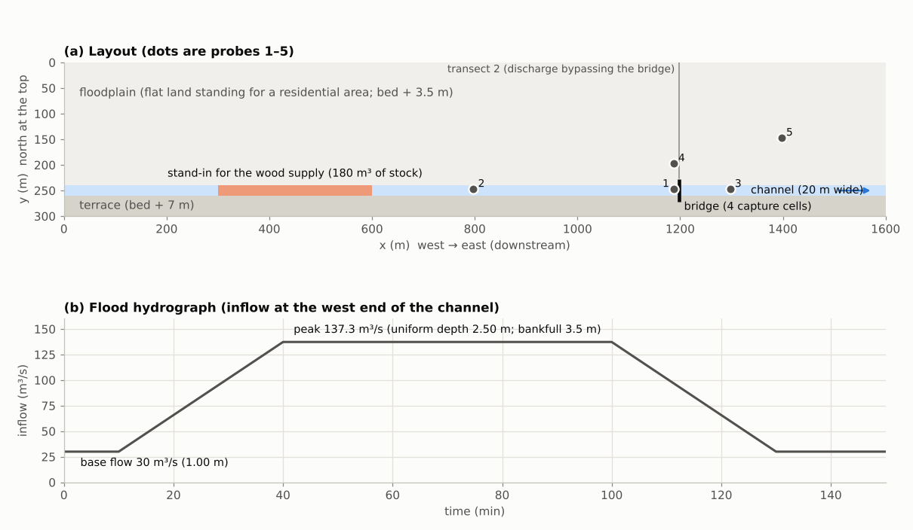
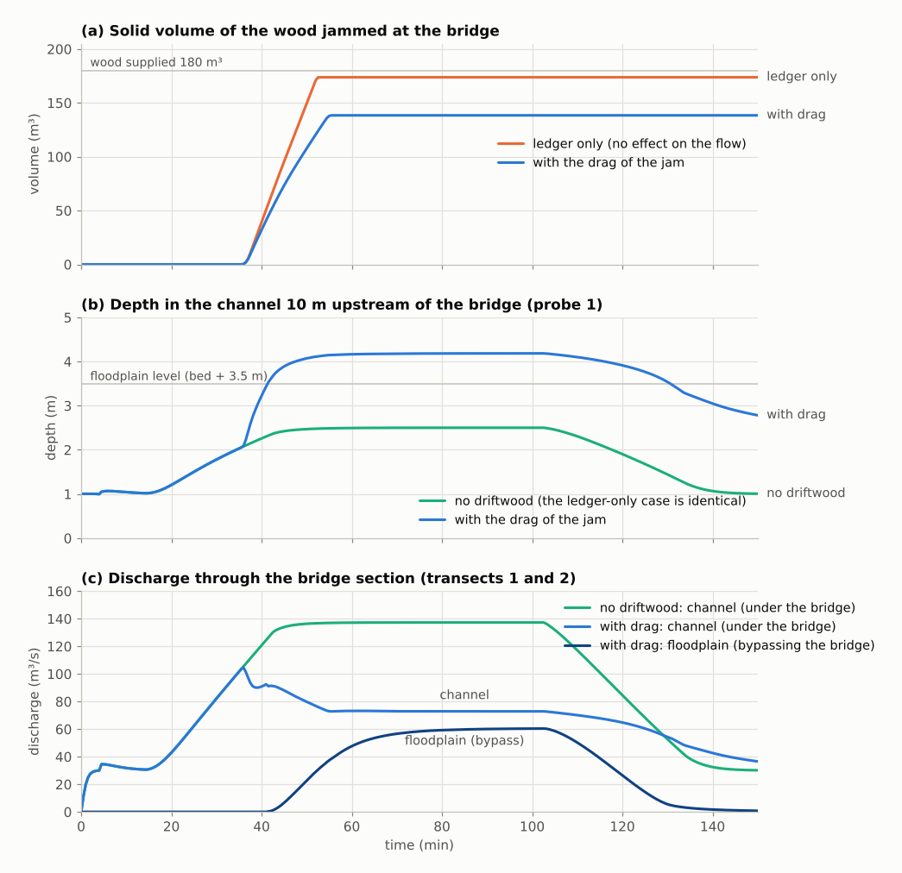
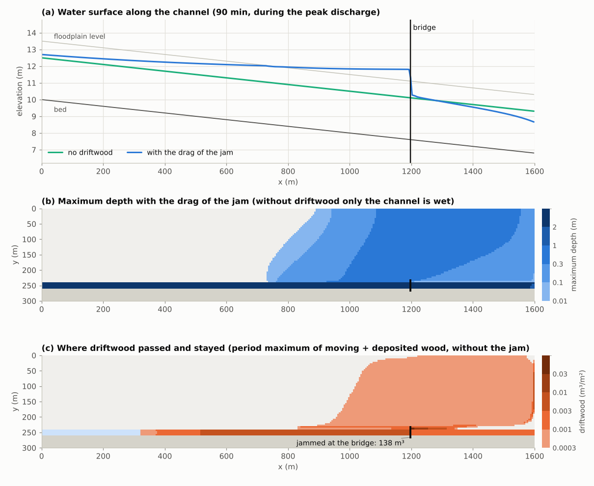
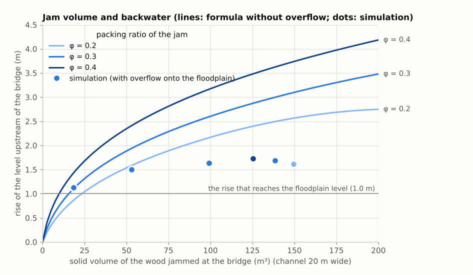
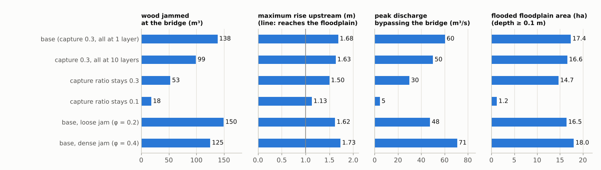

# bridge_wood_jam — backwater and bypass flooding caused by driftwood jammed at a bridge

> English mirror of examples/bridge_wood_jam/README.md. The Japanese file is the master copy.

[日本語](../README.md)

When driftwood carried by a flood gets caught and piles up at a bridge, the river passes under the
bridge less easily, the water level upstream rises, and the water that spills out flows around the
bridge over the surrounding land. This example solves the recruitment and transport of driftwood,
its jamming at a bridge, the backwater caused by the jam and the flooding of the floodplain in a
single run, and compares three cases: no driftwood, wood that jams at the bridge without acting on
the flow, and a jam that obstructs the flow. It also varies the capture ratio, which is a given, and
the drag coefficient of the jam, which is a calibration value, to show the spread of the results.
The terrain, the discharge and the amount of wood are schematic values chosen to make the
phenomenon easy to see; they do not reproduce any particular river or bridge.

## What happens in real floods

- In heavy rain in mountain areas, slope failures and bank erosion turn standing trees into
  driftwood, which travels downstream with the flood. The wood gets caught on bridge piers and
  decks, entangles the wood that follows and blocks the opening of the bridge.
- Upstream of a blocked bridge the water level rises, and the water that leaves the channel flows
  around the bridge. Flume experiments have examined the blockage of a bridge by a driftwood jam
  and the discharge of the flood flow bypassing the bridge (Okamoto et al. 2018).
- Flume experiments show that the backwater caused by a jam changes with the amount of wood, how
  densely it is packed and the speed of the approaching flow (Schalko et al. 2018, Follett et al.
  2020).

## Mechanisms needed to reproduce it

| Real phenomenon | How ENCflow represents it | Settings |
|---|---|---|
| A flood brings driftwood from upstream | Standing stock placed in the channel of an upstream reach turns into moving driftwood when the depth and the velocity exceed thresholds (a stand-in for the supply from upstream) | `fn_dwstock`, `dw_hrec`, `dw_vrec`, `dw_wrec` |
| Driftwood is carried by the flow | The amount of moving driftwood is transported with the same flow as the water | (automatic) |
| Driftwood gets caught at the bridge | The cells crossing the channel at the bridge are capture cells; the share E (capture ratio) of the wood passing them is transferred to immobile jammed wood. Whether a log gets caught is not solved (E is a given) | `fn_dwtrap` |
| Once wood starts to catch, the following wood catches one after another | The capture ratio rises from E to 1 in proportion to the jammed amount of the capture cell; cells whose jammed amount has reached the given amount stop all arriving wood | `dw_jamgrow` |
| The jam obstructs the flow | The jam is treated as a porous obstruction and a drag is added on the edges of the cells that hold it; the more wood, the larger the drag | `f_dwjam`, `dw_jamcd`, `dw_jamphi` |
| Water leaves the channel and bypasses the bridge | The shallow-water computation itself (the floodplain is terrain) | `fn_z` |
| Driftwood stops in shallow water | Moving driftwood becomes deposited driftwood where the water is shallower than the draft | `dw_wstop` |

The formulas and the basis of the coefficients are in "Capture and jamming at structures" of
[the driftwood chapter](../../../docs/en/users_guide/driftwood.md) and in
[Driftwood models explained](../../../docs/en/users_guide/driftwood_models.md) §6. The capture rule
and the discretization of the drag are ENCflow's own simplifications, and the capture ratio, the
drag coefficient and the packing ratio are givens and calibration values.

## Geometry and settings



(a) Layout. The flow goes from the west (left) to the east. (b) Flood hydrograph given at the west
end of the channel. The first 10 minutes are a run-up in which the initially still water becomes
the uniform base flow.

| Item | Value |
|---|---|
| Domain and grid | 1600 m × 300 m, 320 × 60 cells (Δx = 5 m); north at the top |
| Channel | 20 m wide (4 cells), slope 1/500, roughness 0.03, an incised channel with a bankfull depth of 3.5 m (no levees) |
| Floodplain | 240 m wide on the north side of the channel; bed + 3.5 m, roughness 0.05; flat land standing for a residential area (no buildings are placed) |
| Terrace on the south | bed + 7 m (never flooded) |
| Flood | base flow 30 m³/s (uniform depth 1.00 m) → peak 137.3 m³/s (2.50 m) at 40 min → falling from 100 min, back to the base flow at 130 min |
| Boundaries | inflow at the 4 channel cells of the west end, free outflow on the east edge, walls on the north and south edges |
| Wood supply | standing stock of 0.03 m³/m² (180 m³) in the channel at x = 300–600 m; above a depth of 2 m and a velocity of 1 m/s all of it becomes driftwood within 1000 s |
| Bridge | x = 1200 m; the 4 cells crossing the channel are capture cells; the capture ratio starts at 0.3 and rises as the jam grows; cells whose jammed amount has reached 0.09 m³/m² (one layer of logs = packing ratio 0.3 × diameter 0.3 m; 2.25 m³ per cell) capture everything; no deck, piers or approach embankments |
| Wood properties | representative diameter 0.3 m, specific gravity 0.5 (draft 0.15 m) |
| Drag of the jam | drag coefficient 1.0, packing ratio 0.3 (defaults; coefficient κ₀ = 6.19 m⁻¹) |
| Grid settings | defaults |
| Time | dt = 0.2 s, 150 min |

Without driftwood the peak discharge stays in the channel at a depth of 2.50 m, and the floodplain
is not flooded.

## Cases

| Case | Parameter file | Contents |
|---|---|---|
| `nowood` | `param_nowood.txt` | no driftwood (reference) |
| `ledger` | `param_ledger.txt` | wood jams at the bridge but does not act on the flow (`f_dwjam = 0`) |
| `jam` | `param.txt` | with the drag of the jam (base) |
| `slow` | `param_slow.txt` | the capture ratio rises slowly (everything at 0.9 m³/m², ten layers of logs) |
| `e03` | `param_e03.txt` | capture ratio stays 0.3 (no `dw_jamgrow`) |
| `e01` | `param_e01.txt` | capture ratio stays 0.1 (no `dw_jamgrow`) |
| `loose` | `param_loose.txt` | base with a loose jam (packing ratio 0.2; κ₀ = 4.1 m⁻¹) |
| `dense` | `param_dense.txt` | base with a jam packed with branches and leaves (packing ratio 0.4; κ₀ = 9.8 m⁻¹) |

## Running

```bash
make            # links to the executables and the inputs (data/)
make run        # the three base cases (nowood, ledger, jam; about 6 minutes in total on 4 threads)
make sens       # the five cases with other capture assumptions and coefficients (about 14 minutes)
python3 plot_results.py en      # en/figs/*.png (without the argument, the Japanese version goes to figs/)
python3 plot_results.py table en  # the tables below
```

## Results

### Growth of the blockage, backwater and bypass



- **Wood supply and jam**: from 31 min, when the depth in the upstream reach exceeds 2 m, the
  standing trees start to become driftwood, and all 180 m³ is released by 49 min. The wood starts to
  reach the bridge at about 36 min, and the jam at the bridge reaches half of its final volume at
  about 45 min.
  The jam does not move, so it remains after the flood has receded.
- **The case without effect on the flow (`ledger`)**: 174 m³ jams at the bridge, but the depth
  and the discharge are the same as without driftwood (the outputs are byte-identical). This case
  shows only how much wood is carried and retained.
- **With the drag of the jam (`jam`)**: the depth 10 m upstream of the bridge rises to 4.18 m,
  against 2.50 m without driftwood. The level exceeds the floodplain level (3.5 m) at about 42 min,
  the flow over the floodplain starts to bypass the bridge at about 43 min, and while the peak
  discharge lasts, 60 m³/s of the 137 m³/s goes around over the floodplain and 73 m³/s passes under
  the bridge (the two transects add up to 133 m³/s; the rest passes over the bank at the joint of
  the two transects). The jam is 138 m³, less than in `ledger`, because the wood that goes around
  over the floodplain does not pass the bridge.
- **After the flood has receded**: at 150 min (the discharge is the base flow of 30 m³/s) the
  depth upstream of the bridge is still 2.78 m (1.01 m without driftwood). The jam remains, so the
  backwater continues at the base flow.

### Water surface profile, extent of flooding and where the wood went



- **(a) Water surface profile**: the water surface drops by 1.5 m at the bridge, and the backwater
  extends far upstream. The depth is 3.54 m (slightly above the floodplain level) 400 m upstream of
  the bridge, and even at the upstream end (1200 m upstream of the bridge) the level is 0.20 m higher
  than without driftwood. The water leaves the channel over a reach of about 430 m upstream of the
  bridge.
- **(b) Maximum depth**: of the 38.4 ha of floodplain, 17.4 ha is flooded by 0.1 m or more and
  10.0 ha by 0.3 m or more. The maximum is 0.69 m on the bank just upstream of the bridge; beside the
  bridge, 45 m from the channel (probe 4), the maximum is 0.50 m with a velocity of 0.76 m/s, and
  200 m downstream of the bridge (probe 5) it is 0.32 m. The water that has left the channel flows
  east over the floodplain and leaves through the east edge while returning to the channel
  downstream of the bridge.
- **(c) Where the wood went**: of the 180 m³ of driftwood, 138 m³ jams at the bridge, 23 m³ is
  deposited in the shallow parts of the floodplain and 19 m³ leaves the domain.

| Case | Recruited (m³) | Jammed at the bridge (m³) | Deposited on the floodplain (m³) | Left the domain (m³) |
|---|---:|---:|---:|---:|
| ledger only (`ledger`) | 180 | 174 | 0 | 6 |
| with the drag of the jam (base) (`jam`) | 180 | 138 | 23 | 19 |
| all at 10 layers (`slow`) | 180 | 99 | 15 | 66 |
| capture ratio stays 0.3 (`e03`) | 180 | 53 | 8 | 119 |
| capture ratio stays 0.1 (`e01`) | 180 | 18 | 0 | 162 |
| loose jam (φ = 0.2) (`loose`) | 180 | 150 | 20 | 11 |
| dense jam (φ = 0.4) (`dense`) | 180 | 125 | 28 | 27 |

### Jam volume and backwater



The lines are the backwater when the whole peak discharge passes under the bridge and nothing
leaves the channel (the gradually-varied-flow equation with the drag of the jam, integrated over the
jam section; no simulation results are used). The dots are the simulation.

- The case with a capture ratio of 0.1 (jam of 18 m³) hardly overflows, so the formula (1.10 m) and
  the simulation (1.13 m) almost agree. Even 18 m³ brings the level up to the floodplain level.
- With more wood, the simulated backwater levels off at 1.5–1.7 m, because the water that leaves
  the channel escapes over the floodplain and the discharge under the bridge falls. The 138 m³ of
  the base case would correspond to a backwater of 3.0 m (a depth of 5.5 m) without overflow.
- The difference of the levels across the bridge agrees with the formula when the discharge and the
  downstream depth of the simulation are used (base case at 90 min: simulation 1.57 m, formula
  1.48 m).

### Spread from the capture assumption and the coefficient



| Case | Jammed at the bridge (m³) | Max depth 10 m upstream of the bridge (m) | Bypass starts | Peak bypass discharge (m³/s) | Flooded floodplain area (ha) | Max depth on the floodplain (m) |
|---|---:|---:|---:|---:|---:|---:|
| no driftwood (`nowood`) | — | 2.50 | — | 0 | 0.0 | 0.00 |
| ledger only (`ledger`) | 174 | 2.50 | — | 0 | 0.0 | 0.00 |
| with the drag of the jam (base) (`jam`) | 138 | 4.18 | 43 min | 60 | 17.4 | 0.69 |
| all at 10 layers (`slow`) | 99 | 4.13 | 45 min | 50 | 16.6 | 0.64 |
| capture ratio stays 0.3 (`e03`) | 53 | 4.00 | 46 min | 30 | 14.7 | 0.51 |
| capture ratio stays 0.1 (`e01`) | 18 | 3.63 | 57 min | 5 | 1.2 | 0.28 |
| loose jam (φ = 0.2) (`loose`) | 150 | 4.12 | 44 min | 48 | 16.5 | 0.63 |
| dense jam (φ = 0.4) (`dense`) | 125 | 4.23 | 42 min | 71 | 18.0 | 0.74 |

- **The capture assumption changes the results greatly.** In the base case the capture ratio rises
  from 0.3 to 1 by the time the jam reaches one layer of logs. If everything is caught only at ten
  layers (`slow`), the jam is 99 m³ and the bypass discharge is 50 m³/s. With the capture ratio kept
  at 0.3 (three tenths of the wood passing the bridge keep getting caught) the jam is 53 m³ and the
  bypass discharge is 30 m³/s, half of the base case. Kept at 0.1, the jam is 18 m³, the bypass is
  5 m³/s and the flooding is almost confined to the bank. Whether a log gets caught is not solved in
  this model, so the way the initial capture ratio and the speed at which wood catches more easily
  as the jam grows (`dw_jamgrow`) are given is directly the spread of the results.
- **The drag coefficient matters less.** Changing the packing ratio from 0.2 to 0.4 (κ₀ from 4.1 to
  9.8 m⁻¹, a factor of 2.4) gives maximum depths of 4.12–4.23 m, bypass discharges of 48–71 m³/s
  and flooded areas of 16.5–18.0 ha. Once the water has started to leave the channel, the level is
  set by the overflow onto the floodplain. Where the water cannot leave the channel (a channel with
  high levees, for example), the difference of the coefficient becomes directly a difference of the
  level, as the lines in the figure above show.

## Key points of the set-up

- **The bridge is a row of capture cells.** Give the capture ratio on the cells crossing the
  channel at the bridge (`fn_dwtrap`; 0 elsewhere). Connect the row by four-neighbour links so that
  no diagonal path is left open. The resistance of the bridge itself (piers) is given by the
  roughness, and abutments and approach embankments by the terrain (none are placed in this
  example).
- **The capture ratio is a given.** Decide it from observations or experimental knowledge, or show
  a range with several cases under different assumptions, as in this example. `dw_jamgrow`
  approximates "once wood starts to pile up, the following wood gets caught one after another" by
  raising the capture ratio to 1 in proportion to the jammed amount. The packing ratio times the
  representative diameter (0.09 m³/m² in this example) is a guide for one layer of logs; how many
  layers it takes to stop everything is also a given.
- **Compare three cases.** Comparing no driftwood, `f_dwjam = 0` (wood carried without acting on the
  flow) and `f_dwjam = 1` (a growing blockage) with the same settings isolates the effect of the
  blockage.
- **The wood supply from upstream** is replaced by standing stock placed in an upstream reach,
  because there is no function to feed driftwood through an inflow boundary. With `dw_hrec` larger
  than the base-flow depth, the wood is released around the flood peak.
- **Outputs to read**: the jam at the bridge from `vol_jam_m3` of `driftwood.csv` and the field
  `Wj0001...`, the level upstream of the bridge from a probe, the discharges under the bridge and
  over the floodplain from transects, and the extent of flooding from `H9999`.

## Limits of accuracy and what it cannot do

- **Whether a log gets caught is not solved.** The capture ratio is a given. The log length and its
  relation to the span and the clearance of the bridge are not considered.
- **The drag coefficients of the jam are calibration values.** The drag coefficient 1.0 and the
  packing ratio 0.3 are provisional, and the model has not yet been compared with measured
  backwater. The shape of the jam (growing upstream, floating at the surface, diving under the
  deck), the collapse of the jam and the loss of the bridge, pressure flow under the deck and
  overflow over it, and the displacement of water by the wood are not represented.
- **The depth in the channel downstream of the bridge comes out 0.2–0.3 m too deep.** When the bank
  cells are wet, the flow in the adjacent channel slows down numerically (it appears with the
  default eight-neighbour grid; it seems to be of the same family as the "side-face deceleration"
  that [the advection explanation](../../../docs/en/users_guide/advection_donor.md) §7 lists for
  oblique channels, but the cause has not been identified). In a control run with four neighbours
  (`p_diagratio = 0.0` added to `&list_enc`) the depth 10 m downstream of the bridge falls from
  2.66 m to 2.32 m, while the maximum depth upstream of the bridge (4.18 → 4.22 m) and the peak
  bypass discharge (60 → 58 m³/s) hardly change. The area flooded by 0.1 m or more around the
  bridge (x > 800 m) goes from 17.3 ha to 15.8 ha (the four-neighbour run has another disturbance
  near the inflow at the upstream end, so that part is excluded from the comparison). Under
  conditions close to the threshold of overflow (the case with a capture ratio of 0.1), this
  difference can decide the outcome.
- **With the edge-depth cap set to `f_dry_head_cap = 1` (`&list_enc`; applied only while the
  receiving cell is dry), a numerical strip of inundation appears along the bank far upstream of
  the bridge.** The cap of 1 is applied only while the receiving cell is dry, so once a bank cell is
  wet, water from the channel can move onto it even though the channel level is lower (in this
  reach the channel level is 0.2–0.9 m below the bank; this is not a real overflow). With 1, the
  map of the maximum depth shows a thin strip 0.1–0.2 m deep and a patch at the upstream end
  (0.25 ha of the area flooded by 0.1 m or more), and the backwater at the upstream end is
  somewhat too large at 0.46 m. The maximum depth upstream of the bridge (4.19 m), the peak bypass
  discharge (60 m³/s) and the flooded area (17.4 ha) are almost the same. The default 2 also caps
  toward a wet receiver whose bed is above the water level of the sender, so the strip does not
  appear ([Advection schemes](../../../docs/en/users_guide/advection.md) §5; verified in
  [test/bankcap](../../../test/bankcap/en/README.md)).
- **The inflow boundary** prescribes the discharge, and the backwater reaches the upstream end. The
  level at the upstream end is a result of the computation, and the results depend slightly on the
  length of the upstream reach.
- **There are no buildings on the floodplain.** To look at the flooding of a residential area or
  the action on houses, add the building porosity (`fn_gv`) or house destruction
  ([levee_breach](../../levee_breach/en/README.md) is an example).
- The values are schematic. For a real river, replace the terrain, the discharge and the amount and
  properties of the wood with those of the river, and read the results with a range of capture
  ratios and coefficients.

## Files

| File | Contents |
|---|---|
| `make_terrain.py` | writes the inputs (elevation, initial depth, roughness, standing stock and capture-ratio maps in `data/`) |
| `param.txt` | the base case `jam` |
| `param_nowood.txt`, `param_ledger.txt` | no driftwood, ledger only |
| `param_slow.txt`, `param_e03.txt`, `param_e01.txt`, `param_loose.txt`, `param_dense.txt` | cases with other capture assumptions and coefficients |
| `plot_results.py` | figures and tables |

## Related documents

- [The driftwood chapter](../../../docs/en/users_guide/driftwood.md) (capture and jamming at
  structures, what it cannot do) and
  [Driftwood models explained](../../../docs/en/users_guide/driftwood_models.md) §6 (formulas and the
  basis of the coefficients)
- Verification: [test/driftwood](../../../test/driftwood/en/README.md) (agreement of the backwater
  from the drag of the jam with the solution of the gradually-varied-flow equation, the capture
  ratio, volume conservation); [test/bankcap](../../../test/bankcap/en/README.md) (channel water
  does not climb onto a wet bank)
- Storm surge and timber: [timberyard](../../timberyard/en/README.md); tsunami, houses and
  driftwood: [tsunami_town](../../tsunami_town/en/README.md)

## References

- Okamoto, Takebayashi, Suzuki, Yamagami and Toda (2018): An experimental study on the blockage of
  a bridge by a driftwood jam and the discharge of the bypassing flood flow (in Japanese; title
  translated here). *Shizen Saigai Kagaku (Journal of Japan Society for Natural Disaster Science)*,
  36(4), 447–461. (original text not checked)
- Schalko, I., Schmocker, L., Weitbrecht, V. and Boes, R. M. (2018): Backwater rise due to large wood
  accumulations. *J. Hydraul. Eng.*, 144(9), 04018056. (original text not checked)
- Follett, E., Schalko, I. and Nepf, H. (2020): Momentum and energy predict the backwater rise generated
  by a large wood jam. *Geophys. Res. Lett.*, 47(17), e2020GL089346. (original text not checked)
