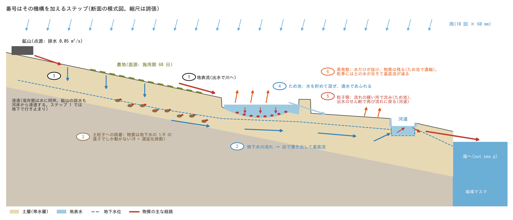
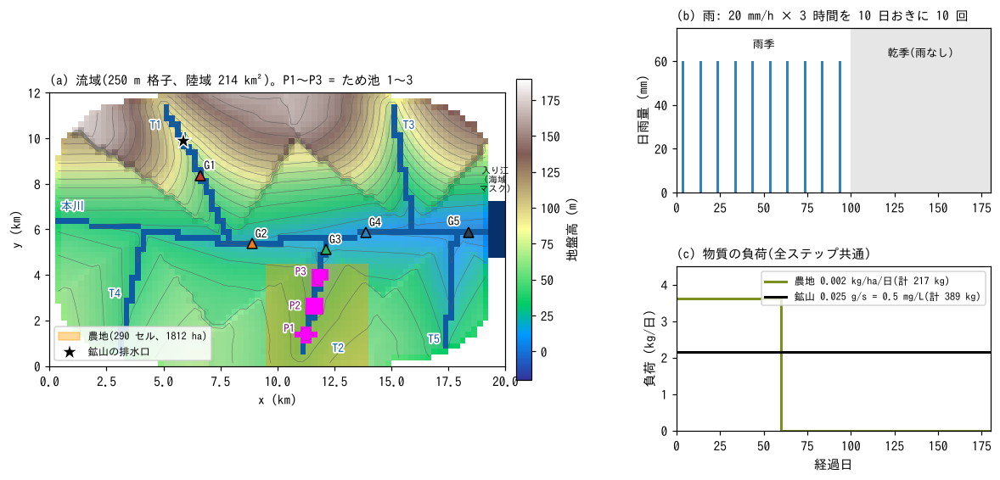
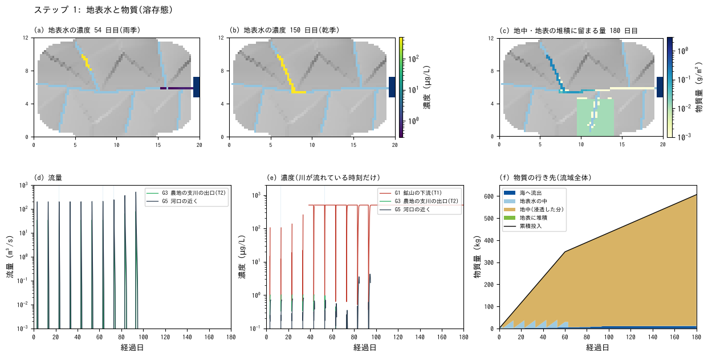
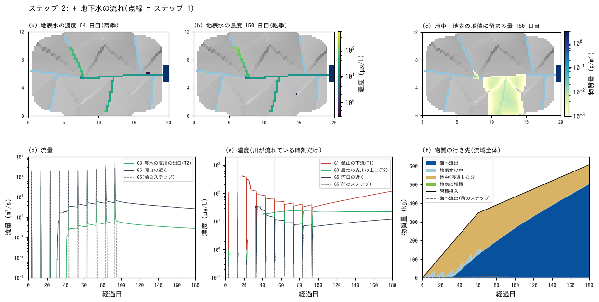
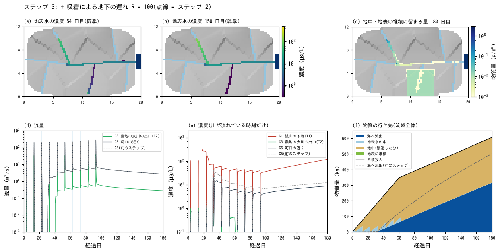
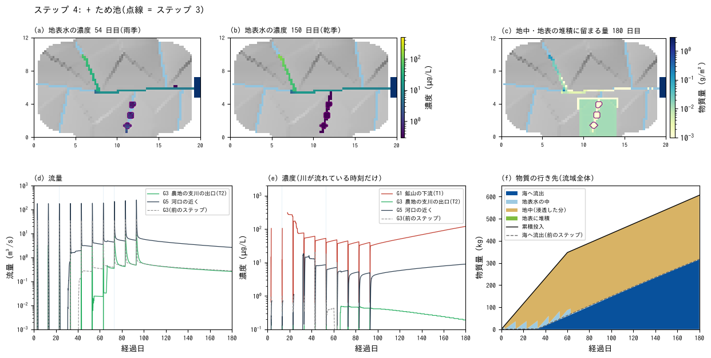
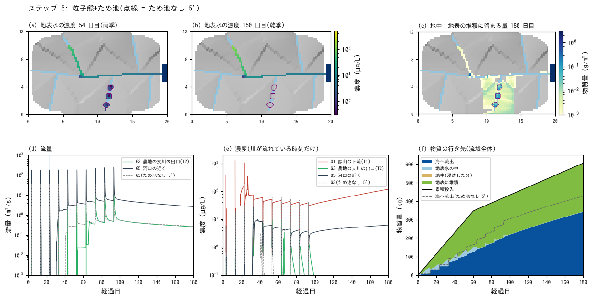
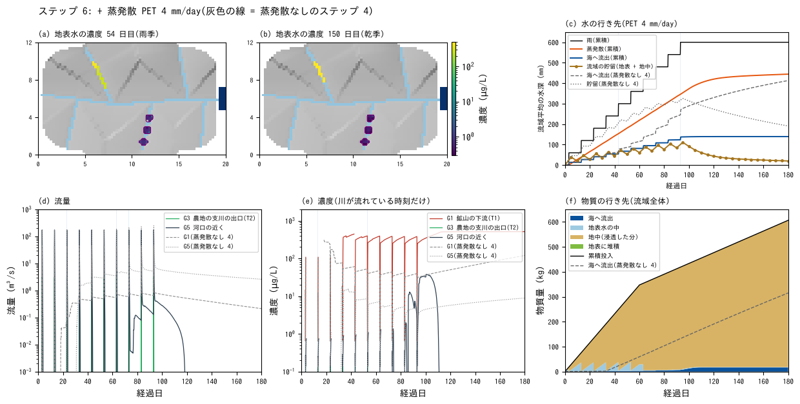
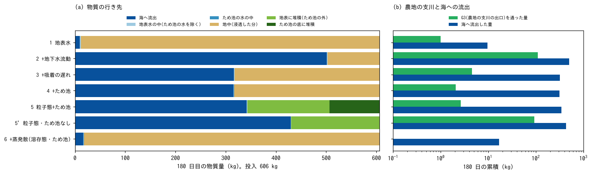

# catchment_metal — 流域の重金属: 地表水・地下水・ため池を一段ずつ加える

[English](en/README.md)

流域全体の川の水質の分布を、地表水・地下水・物質の輸送まで含めて計算したいとき、
どの機構が結果を左右するのかを、理想化した流域で一段ずつ確かめる例題です。重金属を
念頭に、鉱山の排水(点源)と農地(面源)から入る物質が、雨季と乾季を通じてどこへ
行くかを追います。地表水と物質だけの最も簡単な構成から始めて、地下水の流れ、土への
吸着による地下の遅れ、ため池、粒子態(沈降と再懸濁)の順に機構を一つずつ加え、川の
濃度と物質の行き先の変わり方を比べます。「ため池は無視できるか」に、物質の形
(溶存態・粒子態)ごとに答えます。最後に蒸発散を加えて、乾季の川の水質がどう変わるかを
見ます。値は現象を見やすくするための模式値で、特定の流域の再現ではありません。

## 実際の流域で起きていること

- **発生源**: 重金属は、鉱山の坑内水や選鉱くず、工場の排水(点源)、農地の肥料・
  農薬(リン酸肥料のカドミウム、銅系の殺菌剤の銅など。面源)、大気からの沈着、
  岩石の風化(地質由来)から入ります(Alloway 2013、Younger ら 2002)。鉱山の
  排水は晴天の日も流れ続けます。
- **溶存態と粒子態**: 水の中の重金属は、水に溶けた溶存態と、土の粒子・鉄やマンガンの
  酸化物・有機物に付いた粒子態に分かれます。分かれ方は金属の種類と水質(pH など)で
  桁が変わり、鉛は粒子態が主、亜鉛やカドミウムは溶存態の割合が比較的高くなります
  (Horowitz 1991、Allison & Allison 2005)。
- **溶存態の経路**: 雨は地表を流れるか、土にしみ込みます。溶存態は水と一緒に動くので、
  しみ込む水に乗って地下へ入り、地下水の流れで谷へ運ばれて、晴天の日の川の水
  (基底流)として戻ります。ただし重金属は土の粒子に吸着しやすく、地下では水より
  ずっと遅くしか動きません(Freeze & Cherry 1979)。
- **水を失う川**: 雨の少ない地域の川は、川底から地下へ水を失うことがよくあります
  (Winter ら 1998)。晴天の日の小さな流れは、下流へ届く前に川底へしみ込みます。
- **粒子態の経路**: 粒子態は流れの緩い所(池・湛水域・緩い勾配の河道)で沈み、出水の
  強い流れで再び巻き上げられます。
- **ため池**: 雨の少ない地域には、谷をせき止めた小さなため池が数多くあり、上の池から
  あふれた水が下の池へ入る列(カスケード)になっていることも多くあります(南アジアの
  ため池群など。Panabokke ら 2002)。ため池は水を貯めて混ぜ、満水になるとあふれます。
  流れが止まるので、土砂とそれに付いた物質を捕らえます(Brune 1953)。
- **蒸発散**: 雨の一部は、土や水面からの蒸発と植物の蒸散(合わせて蒸発散)で大気へ
  戻ります。大気が求める量(可能蒸発散)は気温・日射・風・湿度で決まり、熱帯では
  1 日数 mm になります(Allen ら 1998)。雨の少ない地域では蒸発散が水収支の大きな
  部分を占め、乾季には土の水が減って川の流れが細ります。蒸発では水だけが抜けるので、
  ため池などに残った水の物質は濃くなります。

## 再現に必要な機構



断面の模式図(縮尺は誇張)。番号はその機構を加えるステップです。

**ステップと加える機構**: 地表水と物質(ステップ 1)から始めて、機構を一つずつ
加えます。ステップ 2〜4 は前のステップに機構を一つ足したものです。ステップ 5 は
物質の性質を溶存態から粒子態に置き換え、ため池のある場合(step5)とない場合
(step5_notank)を比べます。ステップ 6 は、ステップ 4(溶存態・ため池)に蒸発散を加え、
蒸発散なしのステップ 4 と比べます。

| ステップ | 加える機構 | 主な設定 | 見ること | ケース |
|---|---|---|---|---|
| 1 | 地表水と物質: 雨 → 地表流 → 河道 → 海。しみ込んだ水は土に貯まるだけ。物質は溶存態の保存性物質 | 浅水流、降雨、Green-Ampt の浸透(`f_gwvertical = 2`)、海域マスク `fn_sw`、サブグリッド河道幅 `fn_width`、水質 `fn_wq`(点源 `wq_pt_*`・面源 `wq_ar_*`) | 物質の大部分はどこへ行くか。晴天の日の川 | step1 |
| 2 | 地下水の流れ: しみ込んだ水が地下を流れて谷で湧き出し、基底流になる。地下へ入った物質も一緒に動いて川へ戻る | `f_gwlateral = 1`(`gw_ksh_mmh`) | 乾季の川の水と濃度 | step2 |
| 3 | 土への吸着による地下の遅れ | `wq_rg = 100` | 地下経由の物質がどれだけ遅れるか。地中に残る量 | step3 |
| 4 | ため池(地形で表した 3 基の直列) | 地形 `z_tank`、河道 `rw_tank`、池底の浸透能 `fn_gw_ksv` | 溶存態に対するため池の効果 | step4 |
| 5 | 粒子態: 沈降と再懸濁(しみ込む水には乗らない) | `f_wq_infil = 0`、`wq_vs`、`f_wq_settle = 1`、`wq_wash_kf`・`wq_wash_tauc` | 粒子態に対するため池の効果(ため池なしと比べる) | step5・step5_notank |
| 6 | 蒸発散: 地表の水(ため池・川の水面)と地下水から、可能蒸発散の分をあるだけ引く。蒸発では水だけが抜け、物質は残る | `fn_evap`、`&list_evap`(`f_evmodel = 1`、`evap0 = 4`) | 水の行き先、乾季の流量と濃度、ため池の水位と濃度(ステップ 4 と比べる) | step6 |

**現象と機構の対応**:

| 実際の現象 | ENCflow での表し方 | 設定 |
|---|---|---|
| 雨が地表を流れて河道に集まり、海へ出る | 浅水流(全域の面的な流れ。河道は幅 8〜15 m のサブグリッド河道)。出口は海域マスク(海面 0 m)。海へ出た物質は台帳 wq.csv の `out_sea_g` に積まれる | `fn_sw`、`fn_width` |
| 雨が土にしみ込む | Green-Ampt の浸透(一定浸透能 10 mm/h)。土層 4 m × 有効間隙率 0.1 = 0.4 m まで貯まる | `f_gwvertical = 2`、`gw_ksv_mmh`、`sd0`・`sy0` |
| 溶存態がしみ込む水に乗って地下へ入る | 浸透同伴(地表の物質を浸透量の割合で地下のプールへ) | `f_wq_infil = 1`(既定) |
| 地下水が斜面を流れ、谷で湧き出す | 地下水の側方流動(非線形 Boussinesq)と飽和湧出。地下の物質も同じ流れで運ばれ、湧出に乗って地表へ戻る | `f_gwlateral = 1`、`gw_ksh_mmh` |
| 土への吸着で物質が地下水より遅く動く | 遅延化係数 R: 地下の物質は地下水の 1/R の速さで動き、湧き出す水の濃度も 1/R | `wq_rg` |
| ため池が水を貯め、満水であふれる | 地形の窪地と堤(堤の 1 セルがあふれ口)。池の水は浅水流で解き、セルごとに完全混合 | 地盤高 z |
| 池底が堆積で目詰まりして水を通しにくい | 池の底のセルの浸透能を下げる | `fn_gw_ksv` |
| 粒子態が流れの緩い所で沈み、出水で巻き上げられる | 単相の沈降(全量を沈降速度で沈める)と、沈んだ分を貯める地表の蓄積プール、流れのせん断による洗い出し | `wq_vs`、`f_wq_settle = 1`、`wq_wash_kf`・`wq_wash_tauc` |
| 粒子態は土にしみ込まない | 浸透同伴を切る | `f_wq_infil = 0` |
| 土や水面から水が蒸発し、植物が蒸散する(物質は残る) | 蒸発散: 一定の可能蒸発散 PET を、毎ステップ地表水 → 地下水の順に、あるだけ引く(土の乾き具合による抑制はない)。河道幅のセルでは、河道の水面が河道の水から、陸の部分が地下水から蒸発する | `fn_evap`、`f_evmodel = 1`、`evap0` |

各機構の設定と式は、ユーザーガイドの[水質](../../docs/users_guide/wq.md)と
[水質モデルの解説](../../docs/users_guide/wq_models.md)、[地下水](../../docs/users_guide/gwflow.md)、
[河道](../../docs/users_guide/channel.md)(サブグリッド河道幅)、[地理情報](../../docs/users_guide/geoinfo.md)
(海域マスク)、[気象強制](../../docs/users_guide/forcing.md)(蒸発散)にあります。

## 幾何と設定



(a) 流域(上が北)。(b) 雨。(c) 物質の負荷。

- **流域**: 20 km × 12 km の範囲の流域(陸域 214 km²)、格子 250 m(80 × 48 セル)。
  本川が西から東へ流れて東端の入り江(海域マスク、海面 0 m)に注ぎます。北の丘陵から
  2 本(T1・T3)、南の低地から 3 本(T2・T4・T5)の支川が合流します。地盤高は河道から
  離れるほど上がる斜面で作り、北の丘陵ほど急です(最高 177 m)。河道セルは 1.5 m
  掘り込み、サブグリッド河道幅を本川 15 m、支川 8 m とします。河口の河床は海面より
  0.6 m 高くしています。
- **土と地下水**: 土層 4 m、有効間隙率 0.1(貯められる水は 0.4 m)。浸透能(鉛直飽和
  透水係数)10 mm/h(砂壌土。河床も同じ)。地下水の側方の透水係数 1e-3 m/s(ステップ
  2 以降。砂礫混じりの風化層で、180 日で斜面の地下水が谷へ届く速さにするための値)。
  最初は乾いた土と空の帯水層から始めます。蒸発散はステップ 6 だけに入れます(可能
  蒸発散 PET を全域・全期間で一定 4 mm/day。熱帯の基準蒸発散としてありうる大きさの
  模式値)。
- **雨**: 3 日目から 10 日おきに 10 回、20 mm/h × 3 時間 = 60 mm(全域一様。計 600 mm)。
  100 日目以降は雨のない乾季です。
- **鉱山**: T1 の中流のセル (24, 9) に坑内排水 0.05 m³/s を入れ(内部ソース)、
  同じセルに物質 0.025 g/s(濃度 0.5 mg/L = 500 µg/L)を点源で与えます(180 日で
  389 kg)。
- **農地**: T2 の流域の低地 290 セル(1812 ha)に、最初の 60 日だけ 0.002 kg/ha/日を
  面源で与えます(計 217 kg)。乾いた地表に置かれた物質は、次の雨の水に溶けて動きます。
- **ため池(ステップ 4・5)**: T2 に 3 基を直列に置きます(上流から 1・2・3)。各約
  100 万 m³(8〜9 セル、満水時の最大水深 2.5 m)。堤は満水位より 1 m 高く、堤の中央の
  1 セル(幅 8 m の河道)があふれ口です。池底の浸透能は 0.3 mm/h(堆積による目詰まり)。
  最初は空です。
- **観測**: G1(鉱山の 1.5 km 下流、T1)、G2(T1 合流後の本川)、G3(T2 の出口)、
  G4(T2 合流後の本川)、G5(河口の近く)と、ため池 1〜3 の最深部(P1〜P3)。各点の
  水深・濃度(プローブ)と、川を横切る測線の流量・負荷を 1 時間ごとに記録します。
- dt = 10 s、180 日。所要時間は gfortran・4 スレッドで、ステップ 1 が 16 分、地下水の流れを
  入れたステップ 2〜5 が 1 ケース 20 分前後、ステップ 6 が 15 分です(ステップ 1・4・6 で実測。
  7 ケースで 2 時間 15 分前後)。
  結果はスレッド数によらず同じです(1 スレッドと 4 スレッドでビット一致を確認)。

| ケース | 設定ファイル | 地下水の流れ | 遅延化係数 R | ため池 | 物質の形 | 蒸発散 |
|---|---|---|---|---|---|---|
| step1 | param_step1.txt | なし | — | なし | 溶存態 | なし |
| step2 | param_step2.txt | あり | 1 | なし | 溶存態 | なし |
| step3 | param_step3.txt | あり | 100 | なし | 溶存態 | なし |
| step4 | param_step4.txt | あり | 100 | あり | 溶存態 | なし |
| step5 | param_step5.txt | あり | —(地下へ入らない) | あり | 粒子態(沈降 1 m/日、再懸濁) | なし |
| step5_notank | param_step5_notank.txt | あり | — | なし | 粒子態 | なし |
| step6 | param_step6.txt | あり | 100 | あり | 溶存態 | PET 4 mm/day |

共通の設定(浅水流・内部ソース・降雨・計測)は param_common.txt にまとめ、各 param が
fn_enc・fn_boundary・fn_precip・fn_record で同じファイルを指します。物質の単位は
質量 g・濃度 mg/L です(図では µg/L)。

## 実行方法

```bash
cd examples/catchment_metal
make                     # 実行ファイルへのリンクと入力(data/。gen_data.py)
make run                 # 7 ケースを順に計算(4 スレッドで 1 ケース 15〜20 分。計 2 時間 15 分前後)
make step3               # 1 ケースだけ計算するとき
python3 plot_results.py  # figs/*.png と数表(引数 en で英語版を en/figs/ に)
```

図化には Python 3 と NumPy・matplotlib が要ります。

## 結果

各ステップの図は同じ形にそろえています。(a)(b) 地表水の濃度(54 日目 = 6 回目の雨の翌日、
150 日目 = 乾季。水深 1 mm 以上のセル。灰色の陰影が地形、水色の線が河道)。(c) 180 日目に地中と
地表の堆積に留まっている物質量。(d) 流量と (e) 濃度の時系列(濃度は川が流れている時刻だけ。
縦の帯は雨)。(f) 流域全体の物質の行き先(累積)。点線は比べる相手のケースです。

数表と図は 2026-11-03 の版(地下と地表の水の受け渡しの修正 developer.md §26.1 の後)で計算した
値です。

### ステップ 1: 地表水と物質 — 物質の大部分は地下へ消える



- **物質の 98 % が地下へ**: 180 日の投入 606 kg のうち、海へ出たのは 9.6 kg(1.6 %)で、
  595 kg(98 %)がしみ込む水に乗って地下へ入り、そのまま留まります。農地の物質は、乾いた
  地表に置かれた後、次の雨の降り始めの水に溶けて、ほとんどがしみ込みます。
- **川は雨のときしか流れない**: 河口近く(G5)の流れは雨の後 1〜2 日で止まり、乾季は
  干上がります。土が水で満ちていくので、出水のピークは雨ごとに大きくなります(200 →
  510 m³/s)。
- **水を失う川**: 鉱山の排水 0.05 m³/s は川底からしみ込んで下流へ届きません。川底の下の
  土層が満ちるにつれて流れが先へ延び、44 日目から G1、141 日目から T1 の合流点の G2 まで
  届きます(濃度は排水そのものの 500 µg/L)。
- 地表水だけを解くと、物質の行き先の大部分(地下)と、晴天の日の川(基底流)が見えません。

### ステップ 2: + 地下水の流れ — 地下へ入った物質が基底流で川へ戻る



- **基底流が現れる**: しみ込んだ水は地下を流れて谷底で湧き出し、4 回目の雨(33 日目)の後
  からは雨の合間も川が流れ続けます(河口近くで 100 日目に 5.7 m³/s、180 日目に 2.6 m³/s)。
- **地下の物質が川へ戻る**: 地下へ入った 320 kg のうち 217 kg が湧き水に乗って川へ戻り、
  海への流出は 9.6 kg から 502 kg(投入の 83 %)に増えます。乾季の河口近くの濃度は平均
  10 µg/L、農地の支川の出口(G3)は 22 µg/L で、乾季の川の水質は地下水を経由した負荷で
  決まります。
- 鉱山の下流(G1)の濃度は、基底流に薄められて 95 日目に 32 µg/L まで下がり、乾季に
  基底流が減るにつれて上がります(180 日目に 119 µg/L)。

### ステップ 3: + 吸着による地下の遅れ — 物質が地中に溜まる



- **地中に残る**: R = 100 では地下の物質は地下水の 1/100 の速さでしか動かず、湧き水で
  川へ戻るのは 7 kg です(ステップ 2 は 217 kg)。農地に施した 217 kg のうち 211 kg が
  180 日後も農地の土の中に残り、鉱山の下流の川底の下にも溜まります(図 (c))。
- **海への流出は 317 kg(52 %)**: ほとんどが、鉱山の排水が川を流れて運ぶ分です。乾季の
  農地の支川の出口(G3)の濃度はほぼ 0、河口近くは平均 7 µg/L(ステップ 2 は 10 µg/L)
  になります。
- 乾季の川はきれいになりますが、物質は消えたわけではありません。地中に溜まった物質は
  何年もかけて少しずつ出てきます(この 180 日の計算には現れません)。

### ステップ 4: + ため池(溶存態) — 支川の負荷は半分、流域全体はほぼ同じ



点線はステップ 3(ため池なし)の G3 です。

- **流域全体ではほとんど変わらない**: 海への流出は 316.6 kg から 315.2 kg。ステップ 3 で
  農地の物質が土の中に留まるので、ため池を通る物質がもともと少ないためです。
- **ため池のある支川の負荷は半分**: 農地の支川の出口(G3)を通った量は 4.6 kg から
  2.1 kg に減ります。空から始まったため池は 70 日目ごろまで満水にならず、7 回目の雨
  (63 日目)で初めてあふれます。それまでの出水の水と物質はため池に貯まり、ため池より
  上流の水は出口に届きません(図 (d) の G3 の流量)。
- **負荷をならす**: 満水になった後、ため池は貯めた物質を乾季に少しずつ出すので、乾季の
  G3 の濃度はため池がある方が高くなります(平均 0.27 µg/L、ため池なしは 0.02 µg/L)。
  溶存態にとってのため池は、負荷を貯めて遅らせ、ならす働きが主で、取り除く働きは小さい
  (池底からしみ込む分だけ)と読めます。

### ステップ 5: 粒子態(沈降と再懸濁) — ため池が捕らえる



点線はため池のない場合(step5_notank)です。

- **粒子態は地下へ入らない**: 物質は地表に残り、出水で運ばれて、流れの緩い所に沈みます。
  180 日目の地表の堆積は 264 kg(ため池なしは 176 kg)です。
- **ため池が捕らえる**: 農地の支川の出口(G3)を通った量は、ため池なしの 93 kg に対して
  ため池ありでは 2.6 kg(97 % 減)で、ため池の底に 99 kg が堆積します。出水時の G3 の
  濃度のピークも 20〜80 µg/L から 2〜10 µg/L に下がり、流域全体の海への流出は 430 kg
  から 342 kg に 2 割減ります。
- **鉱山の下流の最初の出水**: 晴天の日に排水が川底からしみ込んでいた区間には、粒子態の
  物質が地表に残っていて、最初の 3 回の出水で洗い流されます(G1 の濃度のピーク
  390〜1,240 µg/L。溶存態のステップ 3 では 100〜240 µg/L)。川が流れ続けるようになると、
  ピークは溶存態と同じ程度(40〜75 µg/L)になります。
- 農地の上には、出水の流れの弱い斜面に 104 kg が堆積したまま残ります(ため池の有無に
  よりません)。

### ステップ 6: + 蒸発散 — 乾季の川が干上がり、物質は地中に留まる



灰色の線は蒸発散なしのステップ 4 です。(c) は水の行き先(流域平均の水深。入るのは雨
600 mm と鉱山の排水 3.6 mm)。

- **雨の 4 分の 3 が蒸発散で抜ける**: 180 日の蒸発散は 444 mm(雨の 74 %)、海への流出は
  139 mm(ステップ 4 は 413 mm)、180 日目の流域の貯留は 20 mm(同 191 mm)です。
  蒸発散の 97 % は地下水から引かれます。雨季は 1 日 3.7 mm と可能蒸発散(4 mm)に
  近い速さで蒸発しますが、乾季に入ると土の水が尽きて、1 日 1.5 mm(100〜140 日目)、
  0.3 mm(140〜180 日目)に落ちます。
- **乾季の川が干上がる**: 基底流がなくなり、本川は乾季に入って 20 日ほどで流れなく
  なります(河口近くの G5 は 118 日目、T1 合流後の G2 は 122 日目に途切れる)。晴天の
  日に流れるのは鉱山の排水だけで、T1 を約 3 km 下ったところで川底へしみ込むか
  蒸発して消えます。鉱山の 1.5 km 下流(G1)の流量は 0.014 m³/s(排水の 3 割)、
  濃度は 510 µg/L 前後で、排水(500 µg/L)が少し濃くなった水そのものです(ステップ 4
  は基底流に薄められて 81 µg/L)。
- **ため池の水が残る**: 3 基のため池は乾季に水位が 0.4 m ほど下がりますが、水の中の
  物質の濃度は保たれ、下流の 2 基では 1 割ほど上がります(蒸発では水だけが抜ける)。
  ステップ 4 では乾季も上流から地下水が流れ込んで入れ替わり、濃度は 2〜5 分の 1 に
  下がります。最下流のため池は
  満水にならずあふれないので、農地の支川の出口(G3)を通った物質は 0.01 kg
  (ステップ 4 は 2.1 kg)です。
- **物質は地中に留まる**: 海への流出は 17 kg(投入の 2.8 %。ステップ 4 は 315 kg)で、
  588 kg(97 %)が地中に残ります。しみ込んだ水は、地下水の流れで谷へ届く前に
  蒸発散で抜け、物質だけが土に残ります。
- **読み方**: この蒸発散には、土が乾くと蒸発散が減る仕組みがなく、4 m の土層の水を
  最後まで可能蒸発散の速さで引けます。乾季の流量は少なめ側の端で、蒸発散なしの
  ステップ 4(多め側の端)と挟んで読んでください。実際の乾季の流量はその間にあり、
  晴天の日の流量の観測で確かめます。どちらの端でも、乾季の川の濃度は薄める水
  (基底流)の量で決まり、点源のすぐ下流では排水の濃度に近づきます。

### まとめ: 物質の行き先と、ため池は無視できるか



(a) 180 日目の物質の行き先。(b) 農地の支川の出口 G3 を通った量と、海へ流出した量
(対数目盛)。

| ステップ | 海へ流出 (kg。投入比) | 地中 (kg) | 地表の堆積 (kg。うちため池) | G3 を通った量 (kg) | 乾季の河口近くの濃度 (µg/L) |
|---|---:|---:|---:|---:|---:|
| 1 地表水 | 9.6(1.6 %) | 594.6 | 0 | 1.0 | —(川が干上がる) |
| 2 + 地下水の流れ | 501.6(82.7 %) | 103.3 | 0 | 108.7 | 10.1 |
| 3 + 吸着の遅れ | 316.6(52.2 %) | 288.5 | 0 | 4.6 | 7.3 |
| 4 + ため池 | 315.2(52.0 %) | 289.6 | 0 | 2.1 | 7.3 |
| 5 粒子態 + ため池 | 341.9(56.4 %) | 0 | 263.5(99.4) | 2.6 | 5.3 |
| 5' 粒子態・ため池なし | 429.7(70.9 %) | 0 | 175.7(—) | 92.9 | 5.3 |
| 6 + 蒸発散(溶存態・ため池) | 16.8(2.8 %) | 588.2 | 0 | 0.01 | —(川が干上がる) |

投入は 7 ケースとも 606 kg(鉱山 389 kg、農地 217 kg)。180 日目に地表の水の中にある量は
1〜2 kg です。表は `python3 plot_results.py` が出力します(収支の残差は 1e-2 g 以下)。

- **地下水は無視できない**: 地下水の流れを入れるかどうかで、海への流出は 1.6 % から 83 % まで
  変わり、乾季の川の水質(基底流)が初めて現れます。溶存態では、地下水と、土への吸着に
  よる遅れ R が結果を最も大きく左右します。R は金属と土で 10〜10⁴ と桁で変わるので、
  文献値や土壌の分析から幅を決め、上下の値で挟んで計算するのが実務的です。
- **ため池は物質の形しだい**:
  - 溶存態: 流域全体の流出はほとんど変わりませんが、ため池のある支川の負荷は半分になり、
    時間的にならされます(出水の負荷を貯めて乾季に出す)。
  - 粒子態: ため池は支川の出口の負荷の 97 % を捕らえ、流域全体の流出を 2 割減らします。
    粒子態が主の金属(鉛など)や、土砂と一緒に動く負荷を見るなら、ため池は無視できません。
    この結果は、ため池を地形で表して池の中の沈降を解いたときのものです(格子より小さい
    ため池の表し方の注意は「実際の流域に当てはめるとき」)。ため池の底に溜まった物質は、
    浚渫や干上がりのときに再び動く可能性があります(この例題では扱いません)。
- **蒸発散は乾季の川を決める**: 蒸発散を入れると雨の 4 分の 3 が大気へ戻り、乾季の基底流が
  なくなって本川は干上がります(ステップ 6)。物質の 97 % は地中に留まり、海への流出は
  315 kg から 17 kg に減ります。乾季の川の量と水質を見るなら、蒸発散と、それを抑える
  土の乾き具合(この例題にはない)が、地下水の流れと同じくらい結果を左右します。
- **点源と面源**: 鉱山の排水は晴天の日も流れ続けるので、乾季の川の濃度を決めます。農地の
  負荷は、出水時の地表流と、地下水を経由した基底流(R が小さいとき)で川に出ます。

## 実際の流域に当てはめるとき

- **格子と計算時間**: この例題は 214 km²・250 m 格子(3,430 セル)で、180 日に 1 ケース
  16〜20 分(4 スレッド)です。1,000〜1,500 km² の流域を 250 m 格子にすると 2 万セル前後、
  100 m 格子なら 10 万セル以上になります。計算時間はセル数にほぼ比例するので、MPI の
  並列([並列計算](../../docs/users_guide/parallel.md))を併用してください。
- **河道**: 河道網(fn_rw)と川幅(fn_width)は地形と合わせて前処理で作ります。
  格子より細い川はサブグリッド河道幅で表せます(この例題の 8〜15 m)。
- **ため池**: 格子で解像できる大きさのため池は、この例題のように堤とあふれ口を地形に
  焼き込みます。ため池の湛水域がセル 1 つ以上になる細かさの格子にすれば、池の中の混合・
  沈降・あふれがこの例題と同じ仕組みで解かれます(250 m 格子のセル 1 つは 6.25 ha、100 m
  格子なら 1 ha)。格子より小さいため池が多数ある場合は、ため池の容量(fn_rscap)や、
  ダム・湖沼の構造物で表す方法もありますが、**どちらでもステップ 5 の結果(ため池が粒子態を
  沈めて捕らえる)は再現できません**([水質](../../docs/users_guide/wq.md)の「貯水池・
  ため池の扱い」)。
  - fn_rscap は、満水になるまでセルに来た水と物質をすべて吸い込み、満水後はあふれた水を
    そのまま流します。吸い込んだ分は地表へ戻らないので、溶存態も粒子態も、満水までは全量を
    捕らえ、満水後は何も捕らえない扱いになります。
  - ダム・湖沼の構造物は池を完全混合で扱い、池の中の沈降をまだ実装していません。粒子態は
    池で沈まずに放流されるので、放流の濃度は高めに、捕捉は少なめに出ます。
- **物質の形**: 実際の重金属は溶存態と粒子態に分かれます。分配係数 Kd(`wq_kd`)で
  平衡二相として扱えますが、浮遊砂(`f_suspend`)を同時に解く必要があります
  ([水質](../../docs/users_guide/wq.md)の「吸着性物質の二相分配」)。この例題は、溶存態
  だけ(ステップ 1〜4)と粒子態だけ(ステップ 5)の両端で挟んでいます。
- **パラメータ**: 遅延化係数 R・沈降速度・再懸濁の係数・浸透能・側方の透水係数は、
  どれも流域ごとに桁で変わる量です。河川の濃度と流量の観測(晴天時と出水時の両方)、
  懸濁態と溶存態の比、土壌の分析値で校正してください。
- **蒸発散**: 雨の少ない地域では、ため池や湿った土からの蒸発が水収支を大きく左右し、
  乾季の川の水質を決めます(ステップ 6)。この例題の PET は一定の模式値です。実際の
  流域では、観測(パン蒸発計や、気象観測から Penman–Monteith 式で求めた基準蒸発散。
  Allen ら 1998)の月別値を [&list_evap](../../docs/users_guide/forcing.md) の
  `f_evmodel = 2`(暦 `date0_c` が要る)で与え、乾季の流量の観測で `evap_kc` を
  校正してください。

## このモデルで表せないこと(実際の現象との違い)

- **化学**: pH・酸化還元・錯形成・沈殿と溶解など、重金属の形を変える化学は解きません。
  物質は 1 種類で、溶存態か粒子態のどちらか(またはその平衡分配)として動きます。
- **吸着の遅れ**: 地下の遅れは一定の遅延化係数 R でまとめて与えます。吸着の飽和や、
  脱着の遅れ(履歴)はありません。
- **地下の分散**: 地下の物質は地下水と同じ経路を 1/R の速さで動き、物理的な分散は
  数値的な広がりでしか表しません(帯水層は 1 層)。
- **作物と土壌**: 作物による吸収、耕起による土の混合、土壌への長期の蓄積と溶出は
  ありません。
- **ため池の利用**: ため池からの取水(灌漑)と田への配水、池の水位の操作、浚渫は
  ありません。
- **雨と時間**: 雨は全域一様の模式的な時系列で、180 日の計算です。年単位の蓄積や、
  雨季と乾季の繰り返しを見るには、長い計算と再開([再開](../../docs/users_guide/restart.md))を
  使ってください。
- **蒸発散**: 土の乾き具合で蒸発散が減る仕組み(根の深さ、土の水分による抑制)は
  なく、4 m の土層の水すべてを可能蒸発散の速さで引けます。乾季の流量は少なめ側で、
  ステップ 6 は「蒸発散なし」のステップ 4 と両端で挟む一方の端です。水面も陸面も同じ
  PET を使います。蒸発では物質が残りますが、溶けられる量の上限や沈殿はありません。
- **値**: 地形・負荷・物性はすべて模式値です。濃度の大きさそのものではなく、機構を
  加えたときの変わり方を読んでください。

## 注意

- **台帳の閉合**: 物質の収支は `result_*/wq.csv` で確かめられます。投入(`in_point_g`・
  `in_area_g`)= 海への流出(`out_sea_g`)+ 地表(`mass_surface_g`)+ 地中(`mass_gw_g`)+
  地表の蓄積プール(`mass_pool_g`)が、どのケースでも出力の桁(相対 1e-8 程度)で
  成り立ちます(plot_results.py の数表の最後の列)。
- **河道幅と地下水**: サブグリッド河道幅のセルで地下から湧き出す水は、2026-11-03 の
  修正(developer.md §26.1)の前は河道幅の割合しか地表に出ず、湧き水の濃度も高く
  見えていました。それより前の実行ファイルでこの例題を計算しないでください。
- 濃度の地図は日ごとの出力(`dt_file_c = "1d"`)で、出水のピークの時刻は捉えて
  いません。出水中の濃度は観測点の時系列(1 時間ごと)で見てください。

## 参考文献

- Allen, R. G., Pereira, L. S., Raes, D. and Smith, M. (1998): *Crop Evapotranspiration:
  Guidelines for Computing Crop Water Requirements*. FAO Irrigation and Drainage Paper 56,
  Food and Agriculture Organization of the United Nations.
- Allison, J. D. and Allison, T. L. (2005): *Partition Coefficients for Metals in Surface
  Water, Soil, and Waste*. EPA/600/R-05/074, U.S. Environmental Protection Agency.
- Alloway, B. J. (ed.) (2013): *Heavy Metals in Soils: Trace Metals and Metalloids in Soils
  and their Bioavailability*, 3rd ed. Springer.
- Brune, G. M. (1953): Trap efficiency of reservoirs. *Transactions, American Geophysical
  Union*, 34(3), 407–418.
- Freeze, R. A. and Cherry, J. A. (1979): *Groundwater*. Prentice-Hall.
- Horowitz, A. J. (1991): *A Primer on Sediment-Trace Element Chemistry*, 2nd ed. Lewis
  Publishers.
- Panabokke, C. R., Sakthivadivel, R. and Weerasinghe, A. D. (2002): *Evolution, Present
  Status and Issues Concerning Small Tank Systems in Sri Lanka*. International Water
  Management Institute.
- Winter, T. C., Harvey, J. W., Franke, O. L. and Alley, W. M. (1998): *Ground Water and
  Surface Water: A Single Resource*. U.S. Geological Survey Circular 1139.
- Younger, P. L., Banwart, S. A. and Hedin, R. S. (2002): *Mine Water: Hydrology, Pollution,
  Remediation*. Kluwer Academic Publishers.
