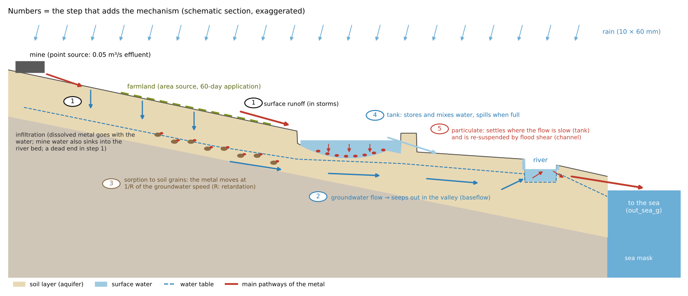
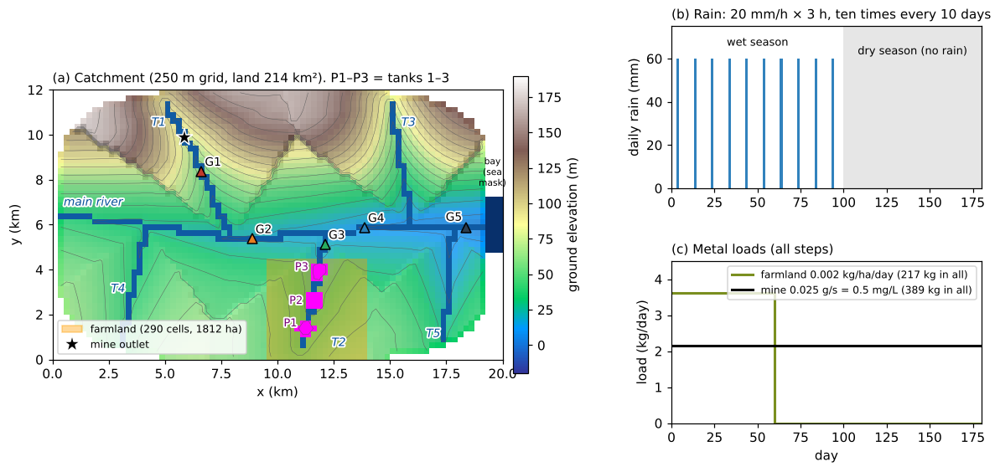
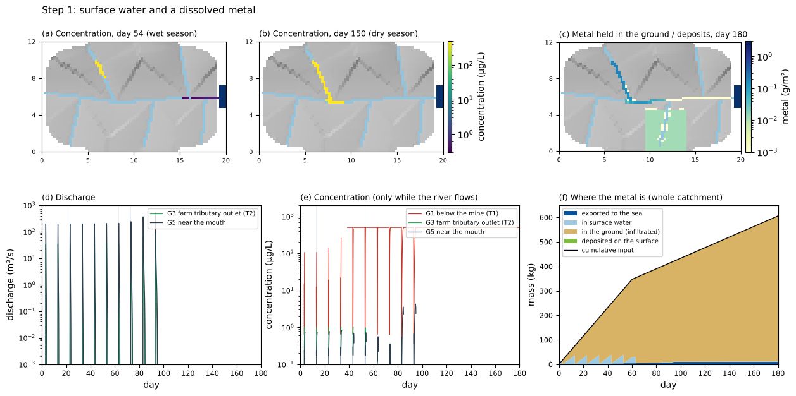
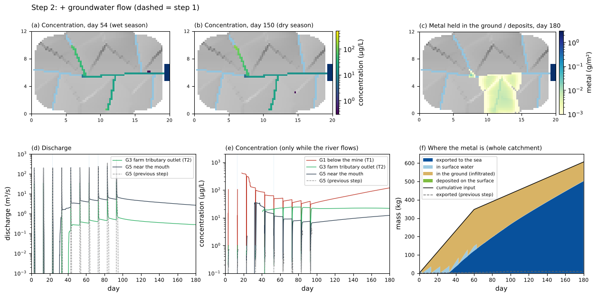
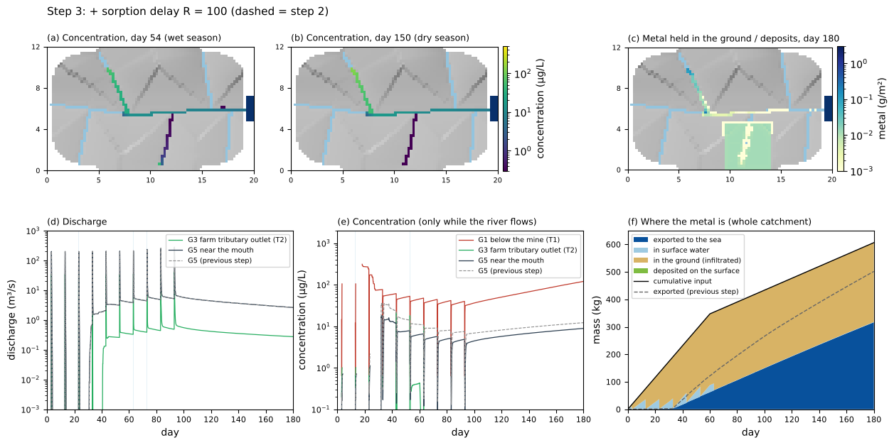
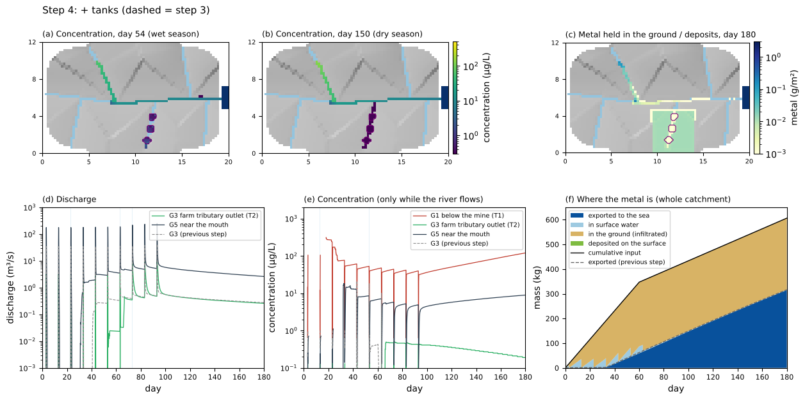
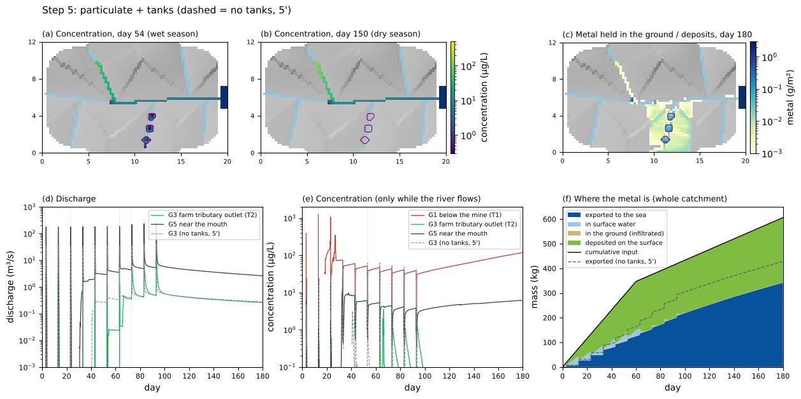
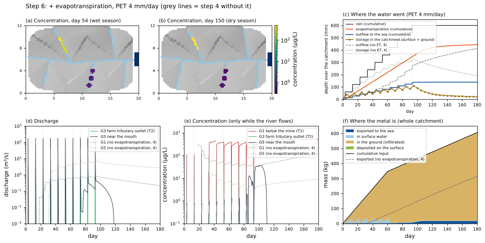
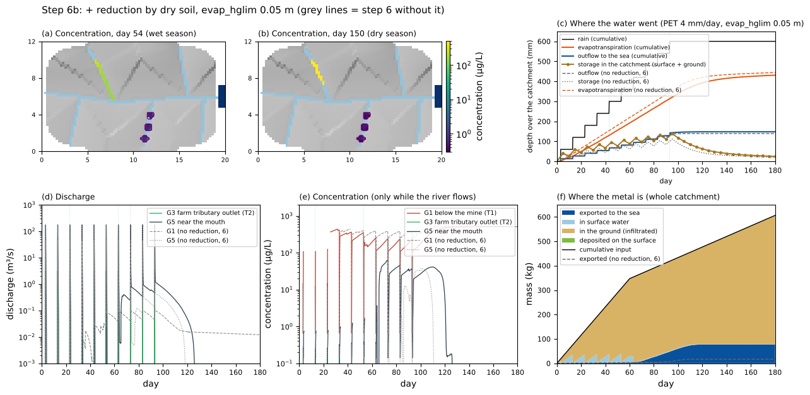
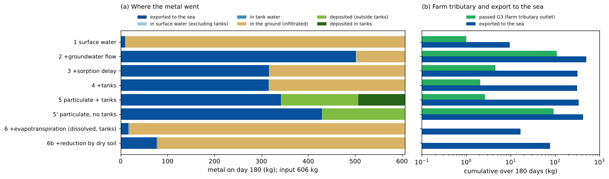

# catchment_metal — Heavy metals in a catchment: adding surface water, groundwater and tanks one step at a time

> English mirror of examples/catchment_metal/README.md. The Japanese file is the master copy.

[日本語](../README.md)

When you want to compute the distribution of river water quality over a
whole catchment, including surface water, groundwater and the transport of
a substance, which mechanisms control the result? This example checks them
one step at a time on an idealised catchment. With heavy metals in mind, it
follows where a substance entering from a mine effluent (point source) and
from farmland (area source) goes through a wet season and a dry season.
Starting from the simplest setup with only surface water and the substance,
it adds one mechanism at a time — groundwater flow, the delay of transport
underground by sorption to soil, tanks, and the particulate form (settling
and re-suspension) — and compares how the river concentration and the fate
of the substance change. It answers "can tanks be ignored?" for each form
of the substance (dissolved and particulate). Finally it adds
evapotranspiration and looks at how the water quality of the river in the
dry season changes (also comparing with and without a mechanism that
reduces evapotranspiration as the soil dries). The values are schematic, chosen to make the phenomena
easy to see; they do not reproduce any particular catchment.

## What happens in a real catchment

- **Sources**: heavy metals enter from mine water and mill tailings and
  from industrial effluents (point sources), from fertilisers and
  agrochemicals on farmland (cadmium in phosphate fertilisers, copper in
  copper fungicides, and so on; area sources), from atmospheric deposition,
  and from the weathering of rocks (geogenic) (Alloway 2013; Younger et al.
  2002). Mine effluent keeps flowing on dry days too.
- **Dissolved and particulate forms**: heavy metals in water are split
  between a dissolved form and a particulate form attached to soil
  particles, iron and manganese oxides and organic matter. The split
  changes by orders of magnitude with the metal and the water chemistry
  (pH and so on): lead is mostly particulate, while zinc and cadmium have a
  relatively high dissolved fraction (Horowitz 1991; Allison & Allison
  2005).
- **Pathway of the dissolved form**: rain either runs off over the surface
  or infiltrates into the soil. The dissolved form moves with the water, so
  it enters the ground with the infiltrating water, is carried to the
  valleys by groundwater flow, and returns as the river water of dry days
  (baseflow). Heavy metals, however, sorb readily to soil particles and
  move far more slowly than the water underground (Freeze & Cherry 1979).
- **Rivers that lose water**: in dry regions, rivers often lose water
  through their beds to the ground (Winter et al. 1998). The small flow of
  dry days seeps into the bed before it reaches downstream.
- **Pathway of the particulate form**: the particulate form settles where
  the flow is slow (ponds, impounded reaches, gently sloping channels) and
  is lifted again by the strong flow of floods.
- **Tanks**: dry regions have many small tanks that dam valleys, often in
  chains (cascades) in which the overflow of an upper tank enters the next
  one (for example the tank systems of South Asia; Panabokke et al. 2002).
  Tanks store and mix water and spill when full. Because the flow stops in
  them, they trap sediment and the substances attached to it (Brune 1953).
- **Evapotranspiration**: part of the rain returns to the atmosphere by
  evaporation from soil and water surfaces and by transpiration of plants
  (together, evapotranspiration). The amount the atmosphere demands
  (potential evapotranspiration) is set by temperature, radiation, wind and
  humidity and reaches a few millimetres per day in the tropics (Allen et
  al. 1998). In dry regions evapotranspiration takes a large part of the
  water balance, and in the dry season the soil water decreases and the
  rivers dwindle. Evaporation removes only water, so the substance in the
  water left in tanks and similar places becomes more concentrated.

## Mechanisms needed for the reproduction



Schematic section (exaggerated scale). The numbers are the steps that add
each mechanism.

**Steps and the mechanisms they add**: starting from surface water and the
substance (step 1), one mechanism is added at a time. Steps 2–4 each add
one mechanism to the previous step. Step 5 replaces the dissolved
substance with a particulate one and compares the cases with tanks (step5)
and without tanks (step5_notank). Step 6 adds evapotranspiration to step 4
(dissolved, with tanks) and compares it with step 4 without
evapotranspiration.

| Step | Mechanism added | Main settings | What to look at | Case |
|---|---|---|---|---|
| 1 | Surface water and the substance: rain → surface runoff → channels → sea. Infiltrated water only accumulates in the soil. The substance is a dissolved conservative substance | shallow-water flow, rain, Green-Ampt infiltration (`f_gwvertical = 2`), sea mask `fn_sw`, subgrid channel width `fn_width`, water quality `fn_wq` (point source `wq_pt_*`, area source `wq_ar_*`) | where most of the substance goes; the river on dry days | step1 |
| 2 | Groundwater flow: infiltrated water flows underground, seeps out in the valleys and becomes baseflow. Substance that entered the ground moves with it and returns to the river | `f_gwlateral = 1` (`gw_ksh_mmh`) | river water and concentration in the dry season | step2 |
| 3 | Delay of transport underground by sorption to soil | `wq_rg = 100` | how much the substance going underground is delayed; how much stays in the ground | step3 |
| 4 | Tanks (three in series, represented in the terrain) | terrain `z_tank`, channels `rw_tank`, infiltration capacity of tank beds `fn_gw_ksv` | the effect of tanks on the dissolved form | step4 |
| 5 | Particulate form: settling and re-suspension (not carried by infiltrating water) | `f_wq_infil = 0`, `wq_vs`, `f_wq_settle = 1`, `wq_wash_kf`, `wq_wash_tauc` | the effect of tanks on the particulate form (compared with no tanks) | step5, step5_notank |
| 6 | Evapotranspiration: the potential evapotranspiration is taken, as far as there is water, from surface water (tank and river surfaces) and groundwater; evaporation removes only water and the substance stays | `fn_evap`, `&list_evap` (`f_evmodel = 1`, `evap0 = 4`) | where the water goes, dry-season discharge and concentration, tank level and concentration (compared with step 4) | step6 |
| 6b | Reduction of evapotranspiration by the dryness of the soil: when the subsurface storage is small, less evapotranspiration is taken from groundwater | `evap_hglim = 0.05` | dry-season discharge and where the substance goes (compared with step 6) | step6b |

**Phenomena and mechanisms**:

| Real phenomenon | Representation in ENCflow | Settings |
|---|---|---|
| Rain flows over the surface, gathers in the channels and leaves to the sea | shallow-water flow (areal flow over the whole domain; the channels are subgrid channels 8–15 m wide). The outlet is a sea mask (sea level 0 m); the substance leaving to the sea is accumulated in the `out_sea_g` column of the ledger wq.csv | `fn_sw`, `fn_width` |
| Rain infiltrates into the soil | Green-Ampt infiltration (constant capacity 10 mm/h); up to soil depth 4 m × effective porosity 0.1 = 0.4 m is stored | `f_gwvertical = 2`, `gw_ksv_mmh`, `sd0`, `sy0` |
| The dissolved form enters the ground with infiltrating water | transport with infiltration (the surface substance moves to the subsurface pool in proportion to the infiltration) | `f_wq_infil = 1` (default) |
| Groundwater flows down the slopes and seeps out in the valleys | lateral groundwater flow (nonlinear Boussinesq) and saturation seepage; the subsurface substance is carried by the same flow and returns to the surface with the seepage | `f_gwlateral = 1`, `gw_ksh_mmh` |
| Sorption to soil makes the substance move slower than groundwater | retardation factor R: the subsurface substance moves at 1/R of the groundwater speed, and the concentration of the seeping water is also 1/R | `wq_rg` |
| Tanks store water and spill when full | terrain hollows with bunds (one bund cell is the spillway); the tank water is solved by shallow-water flow, fully mixed in each cell | ground elevation z |
| Tank beds are clogged by sediment and pass little water | lower infiltration capacity in the tank-bed cells | `fn_gw_ksv` |
| The particulate form settles where the flow is slow and is lifted by floods | single-phase settling (the whole amount settles at the settling velocity), a surface buildup pool holding the settled part, and wash-off by flow shear | `wq_vs`, `f_wq_settle = 1`, `wq_wash_kf`, `wq_wash_tauc` |
| The particulate form does not infiltrate into the soil | transport with infiltration switched off | `f_wq_infil = 0` |
| Water evaporates from soil and water surfaces and plants transpire (the substance stays) | evapotranspiration: a constant potential evapotranspiration PET is taken every step, as far as there is water, from surface water and then groundwater. On channel-width cells the channel's water surface evaporates from the channel water and the land part from the groundwater | `fn_evap`, `f_evmodel = 1`, `evap0` |
| As the soil dries, roots take up water less easily and evapotranspiration decreases | the evapotranspiration of the groundwater stage is reduced to the fraction hg/evap_hglim while the subsurface storage hg is smaller than evap_hglim (the form of the FAO-56 water stress coefficient) | `evap_hglim` |

The settings and equations of each mechanism are in the users guide:
[water quality](../../../docs/en/users_guide/wq.md),
[water quality models](../../../docs/en/users_guide/wq_models.md),
[groundwater](../../../docs/en/users_guide/gwflow.md),
[channels](../../../docs/en/users_guide/channel.md) (subgrid channel width),
[geographic information](../../../docs/en/users_guide/geoinfo.md) (sea mask) and
[meteorological forcing](../../../docs/en/users_guide/forcing.md)
(evapotranspiration).

## Geometry and settings



(a) Catchment (north up). (b) Rain. (c) Loads of the substance.

- **Catchment**: a catchment within a 20 km × 12 km area (land 214 km²),
  250 m grid (80 × 48 cells). The main river flows from west to east into a
  bay at the east end (sea mask, sea level 0 m). Two tributaries from the
  northern hills (T1, T3) and three from the southern lowland (T2, T4, T5)
  join it. The ground rises with distance from the channels, more steeply
  in the northern hills (up to 177 m). Channel cells are incised by 1.5 m,
  with subgrid channel widths of 15 m on the main river and 8 m on the
  tributaries. The river bed at the mouth is 0.6 m above sea level.
- **Soil and groundwater**: soil depth 4 m, effective porosity 0.1 (0.4 m of
  water can be stored). Infiltration capacity (vertical saturated hydraulic
  conductivity) 10 mm/h (sandy loam; the same in the river beds). Lateral
  hydraulic conductivity of groundwater 1e-3 m/s (from step 2; a weathered
  layer with sand and gravel, a value chosen so that hillslope groundwater
  reaches the valleys within 180 days). The run starts from dry soil and an
  empty aquifer. Evapotranspiration is included only in steps 6 and 6b (a
  potential evapotranspiration PET of a constant 4 mm/day over the whole
  domain and period; a schematic value of a plausible size for the reference
  evapotranspiration in the tropics). Step 6b also adds the reduction by the
  dryness of the soil with evap_hglim = 0.05 m (a schematic value: the FAO-56
  estimate (1 − p)·TAW for a soil with a rooting depth of 1 m and available
  water of 0.1, with a depletion fraction p = 0.5; Allen et al. 1998).
- **Rain**: ten times every 10 days from day 3, 20 mm/h × 3 hours = 60 mm
  (uniform over the domain; 600 mm in all). From day 100 on it is a dry
  season without rain.
- **Mine**: mine water of 0.05 m³/s enters cell (24, 9) in the middle of T1
  (internal source), and the same cell receives 0.025 g/s of the substance
  as a point source (concentration 0.5 mg/L = 500 µg/L; 389 kg in
  180 days).
- **Farmland**: 290 cells (1812 ha) in the lowland of the T2 basin receive
  0.002 kg/ha/day as an area source during the first 60 days only (217 kg in
  all). The substance placed on the dry surface dissolves in the water of
  the next rain and moves with it.
- **Tanks (steps 4 and 5)**: three tanks in series on T2 (1, 2 and 3 from
  upstream), each about 1 million m³ (8–9 cells, maximum depth 2.5 m when
  full). The bunds are 1 m above the full supply level, and the middle cell
  of each bund (a channel 8 m wide) is the spillway. The infiltration
  capacity of the tank beds is 0.3 mm/h (clogged by sediment). The tanks
  start empty.
- **Monitoring**: G1 (1.5 km below the mine, T1), G2 (main river below
  T1), G3 (outlet of T2), G4 (main river below T2), G5 (near the mouth),
  and the deepest points of tanks 1–3 (P1–P3). Depth and concentration at
  each point (probes) and discharge and load on transects across the
  rivers are recorded every hour.
- dt = 10 s, 180 days. With gfortran and 4 threads, step 1 takes 16 minutes,
  steps 2–5, which include groundwater flow, about 20 minutes per case, and
  steps 6 and 6b about 15 minutes (measured for steps 1, 4 and 6; about
  2 hours 30 minutes for the eight cases). The
  results do not depend on the number of threads (bit-identical with 1 and
  4 threads).

| Case | Settings file | Groundwater flow | Retardation R | Tanks | Form of the substance | Evapotranspiration |
|---|---|---|---|---|---|---|
| step1 | param_step1.txt | no | — | no | dissolved | no |
| step2 | param_step2.txt | yes | 1 | no | dissolved | no |
| step3 | param_step3.txt | yes | 100 | no | dissolved | no |
| step4 | param_step4.txt | yes | 100 | yes | dissolved | no |
| step5 | param_step5.txt | yes | — (does not enter the ground) | yes | particulate (settling 1 m/day, re-suspension) | no |
| step5_notank | param_step5_notank.txt | yes | — | no | particulate | no |
| step6 | param_step6.txt | yes | 100 | yes | dissolved | PET 4 mm/day |
| step6b | param_step6b.txt | yes | 100 | yes | dissolved | PET 4 mm/day + reduction by dry soil (evap_hglim 0.05 m) |

The common settings (shallow-water flow, internal source, rain,
monitoring) are collected in param_common.txt, and each param file points
fn_enc, fn_boundary, fn_precip and fn_record at it. The units of the
substance are mass in g and concentration in mg/L (µg/L in the figures).

## How to run

```bash
cd examples/catchment_metal
make                     # links to the executables and the inputs (data/, gen_data.py)
make run                 # compute the eight cases in turn (15–20 minutes each with 4 threads; about 2 hours 30 minutes in all)
make step3               # to compute only one case
python3 plot_results.py  # figs/*.png and the tables (with the argument en, English figures in en/figs/)
```

Plotting needs Python 3 with NumPy and matplotlib.

## Results

The figures of all steps have the same layout. (a)(b) Concentration in
surface water (day 54 = the day after the 6th storm, and day 150 = dry
season; cells deeper than 1 mm; grey shading is the terrain, light blue
lines are the channels). (c) Metal held in the ground and in surface
deposits on day 180. Time series of (d) discharge and (e) concentration
(concentration only while the river flows; the vertical bands are the
storms). (f) Where the metal is in the whole catchment (cumulative). Dashed
lines are the case being compared.

The tables and figures were computed with the version of 2026-11-03 (after
the fix of the water exchange between the subsurface and the surface,
developer.md §26.1).

### Step 1: surface water and the substance — most of the substance disappears underground



- **98 % goes underground**: of the 606 kg put in over 180 days, 9.6 kg
  (1.6 %) leaves to the sea and 595 kg (98 %) enters the ground with the
  infiltrating water and stays there. The substance from the farmland lies
  on the dry surface, dissolves in the first water of the next rain, and
  mostly infiltrates.
- **The rivers flow only when it rains**: the flow near the mouth (G5)
  stops 1–2 days after each storm, and the river is dry in the dry season.
  As the soil fills with water, the flood peaks grow storm by storm (200 →
  510 m³/s).
- **A river that loses water**: the mine effluent of 0.05 m³/s seeps into
  the river bed and does not reach downstream. As the soil under the bed
  fills, the flow extends further, reaching G1 from day 44 and G2 at the
  confluence of T1 from day 141 (the concentration is that of the effluent
  itself, 500 µg/L).
- Solving the surface water alone hides most of the fate of the substance
  (underground) and the river of dry days (baseflow).

### Step 2: + groundwater flow — the substance that went underground returns to the river with the baseflow



- **Baseflow appears**: infiltrated water flows underground and seeps out
  on the valley floors; after the 4th storm (day 33) the rivers keep
  flowing between storms (near the mouth, 5.7 m³/s on day 100 and 2.6 m³/s
  on day 180).
- **The subsurface substance returns to the river**: of the 320 kg that
  entered the ground, 217 kg returns to the rivers with the seepage, and
  the export to the sea rises from 9.6 kg to 502 kg (83 % of the input).
  In the dry season the concentration near the mouth averages 10 µg/L and
  that at the outlet of the farm tributary (G3) 22 µg/L: the dry-season
  river quality is set by loads coming through the groundwater.
- Below the mine (G1), the concentration is diluted by the baseflow down to
  32 µg/L on day 95, and rises again as the baseflow declines in the dry
  season (119 µg/L on day 180).

### Step 3: + delay underground by sorption — the substance accumulates in the ground



- **It stays in the ground**: with R = 100 the subsurface substance moves
  at only 1/100 of the groundwater speed, and only 7 kg returns to the
  rivers with the seepage (217 kg in step 2). Of the 217 kg applied to the
  farmland, 211 kg is still in the farmland soil after 180 days, and the
  substance also accumulates under the river bed below the mine
  (figure (c)).
- **Export to the sea is 317 kg (52 %)**: mostly what the mine effluent
  carries down the river. In the dry season the concentration at the
  outlet of the farm tributary (G3) is nearly 0, and near the mouth it
  averages 7 µg/L (10 µg/L in step 2).
- The dry-season river becomes cleaner, but the substance has not
  disappeared. What accumulates in the ground comes out little by little
  over years (which this 180-day run does not show).

### Step 4: + tanks (dissolved form) — half the load of the tributary, little change for the whole catchment



The dashed lines are G3 of step 3 (no tanks).

- **Little change for the whole catchment**: the export to the sea goes
  from 316.6 kg to 315.2 kg, because in step 3 the substance of the
  farmland stays in the soil, so little passes through the tanks in the
  first place.
- **Half the load of the tributary with the tanks**: the amount passing the
  outlet of the farm tributary (G3) drops from 4.6 kg to 2.1 kg. The tanks
  start empty and are not full until about day 70; they spill for the
  first time in the 7th storm (day 63). Until then they store the water and
  substance of the floods, and water from above the tanks does not reach
  the outlet (discharge of G3 in figure (d)).
- **Smoothing of the load**: once full, the tanks release the stored
  substance little by little in the dry season, so the dry-season
  concentration at G3 is higher with the tanks (average 0.27 µg/L, against
  0.02 µg/L without tanks). For the dissolved form, tanks mainly store,
  delay and smooth the load; they remove little (only what seeps through
  the tank beds).

### Step 5: particulate form (settling and re-suspension) — the tanks trap it



The dashed lines are the case without tanks (step5_notank).

- **The particulate form does not enter the ground**: the substance stays
  at the surface, is carried by floods and settles where the flow is slow.
  The surface deposits on day 180 are 264 kg (176 kg without tanks).
- **The tanks trap it**: the amount passing the outlet of the farm
  tributary (G3) is 2.6 kg with the tanks against 93 kg without (97 % less),
  and 99 kg is deposited on the tank beds. The concentration peaks at G3
  during floods drop from 20–80 µg/L to 2–10 µg/L, and the export of the
  whole catchment to the sea falls by a fifth, from 430 kg to 342 kg.
- **The first floods below the mine**: in the reach where the effluent
  seeped into the bed on dry days, particulate substance remains on the
  surface and is washed out by the first three floods (concentration peaks
  at G1 of 390–1,240 µg/L, against 100–240 µg/L for the dissolved form in
  step 3). Once the river flows continuously, the peaks are similar to
  those of the dissolved form (40–75 µg/L).
- On the farmland, 104 kg stays deposited on slopes where the flood flow is
  weak (with or without tanks).

### Step 6: + evapotranspiration — the river dries up in the dry season and the substance stays in the ground



The grey lines are step 4 without evapotranspiration. (c) shows where the
water went (depth over the catchment; the inputs are 600 mm of rain and
3.6 mm of mine effluent).

- **Three quarters of the rain leave as evapotranspiration**: over 180 days the
  evapotranspiration is 444 mm (74 % of the rain), the outflow to the sea
  139 mm (413 mm in step 4) and the storage in the catchment on day 180
  20 mm (191 mm). 97 % of the evapotranspiration is taken from the
  groundwater. In the wet season it evaporates at 3.7 mm per day, close to
  the potential evapotranspiration (4 mm), but in the dry season the soil
  water runs out and the rate falls to 1.5 mm per day (days 100–140) and
  0.3 mm per day (days 140–180).
- **The river dries up in the dry season**: the baseflow disappears and the
  main river stops flowing about 20 days into the dry season (G5 near the
  mouth stops on day 118, G2 below the T1 confluence on day 122). On dry
  days only the mine effluent flows; about 3 km down T1 it has seeped into
  the bed or evaporated. At G1, 1.5 km below the mine, the discharge is
  0.014 m³/s (about 30 % of the effluent) and the concentration is about
  510 µg/L, the effluent itself (500 µg/L) slightly concentrated (in step 4
  the baseflow dilutes it to 81 µg/L).
- **Water stays in the tanks**: the level of the three tanks falls by about
  0.4 m in the dry season, but the concentration of the substance in their
  water is kept and rises by about 10 % in the lower two (evaporation removes
  only water). In step 4 groundwater from upstream keeps flowing in and
  replacing the water in the dry season, and the concentration falls to
  between a half and a fifth. The lowest tank never
  fills and does not spill, so only 0.01 kg passes the outlet of the farm
  tributary (G3) (2.1 kg in step 4).
- **The substance stays in the ground**: the export to the sea is 17 kg
  (2.8 % of the input; 315 kg in step 4) and 588 kg (97 %) remains in the
  ground. The infiltrated water leaves as evapotranspiration before
  groundwater flow brings it to the valleys, and only the substance stays
  in the soil.
- **How to read it**: the evapotranspiration of step 6 is set not to
  decrease as the soil dries (no evap_hglim), so it can take the water of the
  4 m soil layer to the end at the rate of the potential evapotranspiration.
  The dry-season discharge is the low end; read it together with step 4
  without evapotranspiration (the high end) as a bracket. The real
  dry-season discharge lies between them; check it against observed
  discharges on dry days. At either end the dry-season concentration in the
  river is set by the amount of diluting water (baseflow), and just below a
  point source it approaches the concentration of the effluent.

### Step 6b: + reduction by the dryness of the soil — the drying up comes only a week later



The grey lines are step 6 without the reduction. The evapotranspiration
taken from groundwater is reduced to the fraction hg/0.05 while the
subsurface storage hg is smaller than evap_hglim = 0.05 m.

- **Evapotranspiration decreases little**: over 180 days the
  evapotranspiration is 431 mm (444 mm in step 6), only 3 % less. In the wet
  season it is 3.4 mm per day (3.7 mm), 10 % less, and in the early dry
  season it is even larger (1.9 mm per day on days 100–140; 1.5 mm), because
  the water left in the soil in the wet season is taken over a longer time
  in the dry season. The outflow to the sea is 148 mm (139 mm; 413 mm in
  step 4).
- **The drying up comes a week later**: the main river stops flowing on days
  126–128, only about a week later than in step 6. At G1, 1.5 km below the
  mine, the dry-season discharge is 0.019 m³/s (0.014) and the concentration
  is about 505 µg/L; the river in the dry season is the effluent itself.
- **The export to the sea is four times larger**: because the baseflow
  continues from the end of the wet season into the early dry season, more
  substance reaches the sea: 77 kg (13 % of the input; 17 kg in step 6 and
  315 kg in step 4), and 528 kg remains in the ground.
- **How to read it**: with evap_hglim = 0.05 m, the time constant with which
  the soil water decreases without recharge, evap_hglim/PET = 12.5 days, is
  much shorter than the dry season (80 days), so the soil water runs out
  within the dry season and the result is close to the low end (step 6). The
  time constant is proportional to evap_hglim, so the larger evap_hglim is
  (deep roots, a soil that holds water well), the longer the dry-season
  baseflow lasts. evap_hglim is given data of the soil and vegetation, to be
  calibrated against observed dry-season discharges.

### Summary: where the substance goes, and can tanks be ignored?



(a) Where the substance is on day 180. (b) Amount passing the outlet of the
farm tributary G3 and amount exported to the sea (logarithmic scale).

| Step | Exported to the sea (kg; share of input) | In the ground (kg) | Surface deposits (kg; of which in tanks) | Passed G3 (kg) | Dry-season concentration near the mouth (µg/L) |
|---|---:|---:|---:|---:|---:|
| 1 surface water | 9.6 (1.6 %) | 594.6 | 0 | 1.0 | — (the river dries up) |
| 2 + groundwater flow | 501.6 (82.7 %) | 103.3 | 0 | 108.7 | 10.1 |
| 3 + sorption delay | 316.6 (52.2 %) | 288.5 | 0 | 4.6 | 7.3 |
| 4 + tanks | 315.2 (52.0 %) | 289.6 | 0 | 2.1 | 7.3 |
| 5 particulate + tanks | 341.9 (56.4 %) | 0 | 263.5 (99.4) | 2.6 | 5.3 |
| 5' particulate, no tanks | 429.7 (70.9 %) | 0 | 175.7 (—) | 92.9 | 5.3 |
| 6 + evapotranspiration (dissolved, tanks) | 16.8 (2.8 %) | 588.2 | 0 | 0.01 | — (the river dries up) |
| 6b + reduction by dry soil | 77.1 (12.7 %) | 527.8 | 0 | 0.01 | — (dry for most of the dry season) |

The input is 606 kg in all eight cases (mine 389 kg, farmland 217 kg). On
day 180, 1–2 kg is in the surface water. The table is printed by
`python3 plot_results.py` (the residual of the balance is below 1e-2 g).

- **Groundwater cannot be ignored**: whether groundwater flow is included
  changes the export to the sea from 1.6 % to 83 %, and only with it does
  the dry-season river quality (baseflow) appear. For the dissolved form,
  groundwater and the delay by sorption to soil, R, control the result the
  most. R varies by orders of magnitude (10 to 10⁴) with the metal and the
  soil, so it is practical to set a range from the literature or soil
  analyses and bracket the result with its upper and lower values.
- **Tanks depend on the form of the substance**:
  - Dissolved: the export of the whole catchment hardly changes, but the
    load of the tributary with tanks is halved and smoothed in time (the
    load of floods is stored and released in the dry season).
  - Particulate: the tanks trap 97 % of the load at the tributary outlet
    and reduce the export of the whole catchment by a fifth. When looking
    at metals that are mainly particulate (such as lead) or at loads that
    move with sediment, tanks cannot be ignored. This result holds when the
    tanks are represented in the terrain and settling in them is solved
    (see "Applying this to a real catchment" for the representation of
    tanks smaller than a cell). What accumulates on tank beds may move
    again when they are dredged or dry out (not treated in this example).
- **Evapotranspiration sets the river in the dry season**: with
  evapotranspiration, three quarters of the rain return to the atmosphere, the
  dry-season baseflow disappears and the main river dries up (step 6). 97 %
  of the substance stays in the ground and the export to the sea falls from
  315 kg to 17 kg. With the reduction by the dryness of the soil (step 6b,
  evap_hglim 0.05 m) the drying up comes only a week later and the export to
  the sea is 77 kg. To see the amount and quality of river water in the dry
  season, evapotranspiration and the amount of soil water that limits it
  (evap_hglim) control the result as much as groundwater flow.
- **Point and area sources**: the mine effluent keeps flowing on dry days,
  so it sets the river concentration in the dry season. The load from the
  farmland reaches the rivers with surface runoff during floods and, when
  R is small, with the baseflow through the groundwater.

## Applying this to a real catchment

- **Grid and computing time**: this example is 214 km² on a 250 m grid
  (3,430 cells), 16–20 minutes per case for 180 days (4 threads). A
  1,000–1,500 km² catchment on a 250 m grid has around 20 thousand cells,
  and more than 100 thousand on a 100 m grid. Computing time is roughly
  proportional to the number of cells, so use MPI parallelism as well
  ([parallel execution](../../../docs/en/users_guide/parallel.md)).
- **Channels**: prepare the channel network (fn_rw) and the river widths
  (fn_width) together with the terrain. Rivers narrower than the grid are
  represented by the subgrid channel width (8–15 m in this example).
- **Tanks**: tanks large enough to be resolved by the grid are burned into
  the terrain with their bunds and spillways, as in this example. With a
  grid fine enough for the water area of each tank to cover at least one
  cell, mixing, settling and spilling in the tank are solved by the same
  mechanisms as in this example (one cell is 6.25 ha on a 250 m grid and
  1 ha on a 100 m grid). Where there are many tanks smaller than a cell,
  they can also be represented by a tank capacity (fn_rscap) or by the dam
  and lake structures, but **neither reproduces the result of step 5
  (tanks trapping the particulate form by settling)** (section
  "Reservoirs and retention ponds" of
  [water quality](../../../docs/en/users_guide/wq.md)).
  - fn_rscap absorbs all the water and substance reaching the cell until
    the tank is full, and lets the spilled water pass afterwards. What is
    absorbed never returns to the surface, so both forms are trapped
    completely until the tank is full and not at all afterwards.
  - The dam and lake structures treat the pond as fully mixed, and settling
    in the pond is not implemented yet. The particulate form is released
    without settling in the pond, so the release concentration comes out
    too high and the trapping too low.
- **Form of the substance**: real heavy metals are split between dissolved
  and particulate forms. With the partition coefficient Kd (`wq_kd`) they
  can be treated as an equilibrium of two phases, but suspended sediment
  (`f_suspend`) must be solved at the same time (section "Two-phase
  partitioning of sorbing substances" of
  [water quality](../../../docs/en/users_guide/wq.md)). This example
  brackets the two ends: dissolved only (steps 1–4) and particulate only
  (step 5).
- **Parameters**: the retardation factor R, settling velocity,
  re-suspension coefficients, infiltration capacity and lateral hydraulic
  conductivity all vary by orders of magnitude between catchments.
  Calibrate them with observed river concentrations and discharges (both
  on dry days and during floods), the ratio of suspended to dissolved
  forms, and soil analyses.
- **Evapotranspiration**: in dry regions, evaporation from tanks and wet
  soil strongly controls the water balance and sets the water quality of
  the river in the dry season (step 6). The PET of this example is a
  constant schematic value. In a real catchment, give monthly values from
  observations (an evaporation pan, or the reference evapotranspiration
  computed from weather observations with the Penman–Monteith equation;
  Allen et al. 1998) with `f_evmodel = 2` of
  [&list_evap](../../../docs/en/users_guide/forcing.md) (it needs the
  calendar `date0_c`), and calibrate `evap_kc` and `evap_hglim` (how much
  evapotranspiration decreases as the soil dries; it can be estimated from
  the available water of the root zone and the depletion fraction) against
  observed dry-season discharges.

## What this model cannot represent (differences from real phenomena)

- **Chemistry**: chemistry that changes the form of heavy metals — pH,
  redox, complexation, precipitation and dissolution — is not solved. There
  is one substance, which moves either as a dissolved or as a particulate
  form (or as an equilibrium split between them).
- **Sorption delay**: the delay underground is given as a constant
  retardation factor R. There is no saturation of sorption and no delayed
  desorption (hysteresis).
- **Subsurface dispersion**: the substance underground moves along the same
  paths as the groundwater at 1/R of its speed; physical dispersion is
  represented only by numerical spreading (a single aquifer layer).
- **Crops and soil**: uptake by crops, mixing of the soil by tillage, and
  long-term accumulation in and release from the soil are not included.
- **Use of tanks**: withdrawal from the tanks (irrigation) and distribution
  to the fields, operation of tank levels, and dredging are not included.
- **Rain and time**: the rain is a schematic series, uniform over the
  domain, and the run covers 180 days. To see accumulation over years or
  repeated wet and dry seasons, use long runs and restarts
  ([restart](../../../docs/en/users_guide/restart.md)).
- **Evapotranspiration**: the only mechanism that reduces
  evapotranspiration as the soil dries is the linear reduction by the
  subsurface storage (evap_hglim; step 6b). It does not represent the
  rooting depth or the vertical distribution of soil water, nor a state in
  which only the surface layer is wet just after rain. Without evap_hglim
  (step 6), all the water of the 4 m soil layer can be taken at the rate of
  the potential evapotranspiration. Water surfaces and land use the same
  PET. Evaporation leaves the substance behind, but there is no upper limit
  of solubility and no precipitation.
- **Values**: terrain, loads and properties are all schematic. Read how the
  results change as mechanisms are added, not the magnitudes of the
  concentrations themselves.

## Notes

- **Closure of the ledger**: the mass balance of the substance can be
  checked in `result_*/wq.csv`. Input (`in_point_g`, `in_area_g`) = export
  to the sea (`out_sea_g`) + surface (`mass_surface_g`) + ground
  (`mass_gw_g`) + surface buildup pool (`mass_pool_g`) holds in every case
  to the output precision (relative about 1e-8) (last column of the table
  printed by plot_results.py).
- **Channel width and groundwater**: before the fix of 2026-11-03
  (developer.md §26.1), water seeping out of the ground on subgrid channel
  width cells reached the surface only in the channel-width fraction, and
  the seepage water looked too concentrated. Do not compute this example
  with an executable older than that.
- The concentration maps are daily outputs (`dt_file_c = "1d"`) and do not
  catch the times of flood peaks. Look at concentrations during floods in
  the time series at the gauges (hourly).

## References

- Allen, R. G., Pereira, L. S., Raes, D. and Smith, M. (1998): *Crop Evapotranspiration:
  Guidelines for Computing Crop Water Requirements*. FAO Irrigation and Drainage Paper 56,
  Food and Agriculture Organization of the United Nations.
- Allison, J. D. and Allison, T. L. (2005): *Partition Coefficients for Metals in Surface
  Water, Soil, and Waste*. EPA/600/R-05/074, U.S. Environmental Protection Agency.
- Alloway, B. J. (ed.) (2013): *Heavy Metals in Soils: Trace Metals and Metalloids in Soils
  and their Bioavailability*, 3rd ed. Springer.
- Brune, G. M. (1953): Trap efficiency of reservoirs. *Transactions, American Geophysical
  Union*, 34(3), 407–418.
- Freeze, R. A. and Cherry, J. A. (1979): *Groundwater*. Prentice-Hall.
- Horowitz, A. J. (1991): *A Primer on Sediment-Trace Element Chemistry*, 2nd ed. Lewis
  Publishers.
- Panabokke, C. R., Sakthivadivel, R. and Weerasinghe, A. D. (2002): *Evolution, Present
  Status and Issues Concerning Small Tank Systems in Sri Lanka*. International Water
  Management Institute.
- Winter, T. C., Harvey, J. W., Franke, O. L. and Alley, W. M. (1998): *Ground Water and
  Surface Water: A Single Resource*. U.S. Geological Survey Circular 1139.
- Younger, P. L., Banwart, S. A. and Hedin, R. S. (2002): *Mine Water: Hydrology, Pollution,
  Remediation*. Kluwer Academic Publishers.
