# chichibu_flood — 山地の流域の洪水を、入力と設定を変えて読み解く

[English](en/README.md)

**この例題は、実際の山地流域での流出を、地表の流れだけで表すモデルです。** 雨水は地表を流れて川に集まる
ものとして計算し、土の中を通って川へ出る流れは扱いません。実際の山地では、降った雨の多くは土にしみこみ、
土層の中を斜面の下へ流れて、谷の飽和した所から川に出ます。この実際の流出の過程と、それを地表の流れだけで
表したときの違いに興味のある方は、[examples/source_area](../source_area/README.md) を見てください。

荒川上流の秩父流域に 1 時間の豪雨を降らせ、雨水が斜面から川に集まり、洪水として流れ下る様子を計算します。
そのうえで、地形の前処理、雨の損失、流域出口の境界、格子の解像度と 8 方向の交換、移流項の扱いを
一つずつ変えて、洪水波がどう変わるかを見ます。流域・雨・計測の位置は、教材
[tutorials/chichibu](../../tutorials/chichibu/README.md) と同じです。計算の手順を一つずつ追うのは教材、
同じ流域の回帰テストは [test/chichibu](../../test/chichibu/README.md) です。

## 流域と入力

流域は約 715 km² で、ほとんどが急な山地です。南西の主稜線には 2,500 m 級の山々が並び、北東の隅が
流域の出口です。基本の格子は 200 m で、格子の解像度を比べるために 100 m・50 m の格子も使います。

| データ | 内容 |
|---|---|
| `Chichibu_200m_filled` | 地盤高。GIS で D8 の窪地除去(fill)をしたもの |
| `Chichibu_200m_cond` | 地盤高。窪地除去済みの標高の、河道セルの高さ(河床)を整えたもの。基本ケースで使う |
| `Chichibu_200m_raw` | 地盤高。窪地除去をしていない元のデータ(GeoTIFF だけ) |
| `Chichibu_200m_basin` | 流域マスク(1: 流域内) |
| `Chichibu_200m_river_flowline` | 河道マスク(1: 河道セル)。河道網を幅 1 セルの線として与える |

200 m のデータは教材の `tutorials/chichibu/data_chichibu/`、100 m・50 m のデータは
`test/chichibu/data_chichibu*/` のものを参照します(複製しません)。

- **データの由来**: 標高は国土地理院の基盤地図情報数値標高モデル、河道は国土数値情報の河川データから作られた
  河道位数データ([DOI:10.3178/jjshwr.36.1812](https://doi.org/10.3178/jjshwr.36.1812))から作りました。
  河川の線をラスタにしただけの河道は、標高の谷線から 1 セルずれる所があるので、
  [utils/river_flowline](../../utils/river_flowline/README.md) で標高の落水線に載せ直しています。
- **河床を整えた標高**: 窪地除去は「水が出口まで流れ下れること」を保証するだけで、窪地を埋めた跡が、
  同じ高さのセルが続く平坦な区間と、その下流端の段差として河道に残ります。加えて、200 m のセルの標高は
  セルの中の平均的な高さなので、細い谷底を流れる山地の川では、実際の河床より高くなります。
  `Chichibu_200m_cond` は、河道セルの高さだけを、同じ範囲の 10 m 格子の標高から読んだ谷底の高さに替え、
  下流へ向かって同じか低くなるように整えたものです。手順は[データの README](../../test/chichibu/data_chichibu/README.md)
  の「河床を整えた標高」にあります。

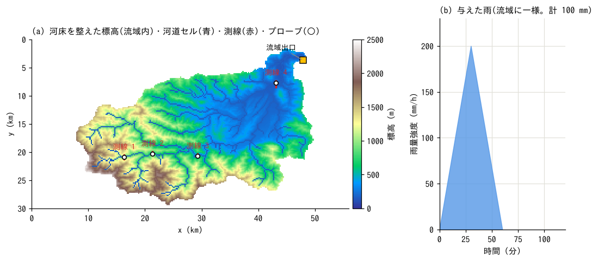

本川に沿って 2 つの標高を比べると、窪地除去済みの標高は平坦な区間と段差が階段のように並び、整えた河床は
谷底の高さまで下がって、なめらかに下ります。平坦な区間は、貯水池などの水面とみられる所を除いて
なくなります。河床が谷底の高さになるので、河道セルは両脇のセルより深く切れ込みます。

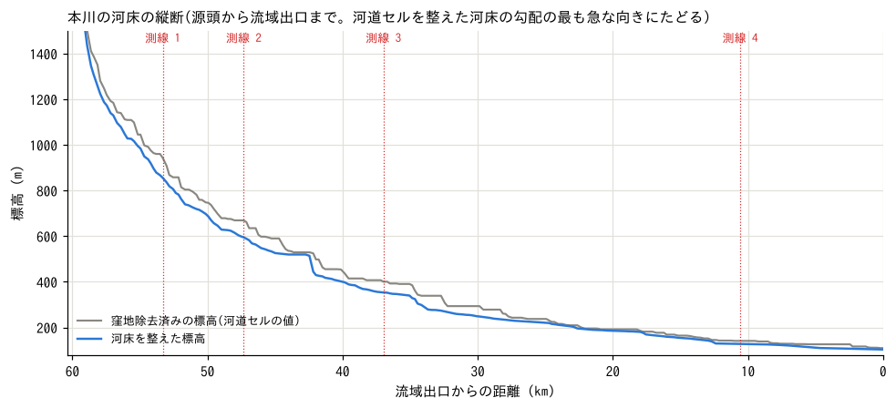

## 基本ケース

| 項目 | 値 |
|---|---|
| 格子 | 280 × 150 セル(Δx = 200 m)。流域マスクの内側の 17,885 セルだけを計算する |
| 地形 | 河床を整えた標高 `Chichibu_200m_cond` |
| 粗度 | 斜面 0.05、河道セル 0.04(山地の河道の目安の下限) |
| 雨 | 流域に一様。0 分に 0、30 分に 200 mm/h、60 分に 0 の三角形(計 100 mm)。損失なし |
| 境界 | 流域出口の河道セルとその隣のセルを、水位を河床より低くした水位規定セル(完全排水口)にする。外縁は壁 |
| 計算 | 動的波(移流項は既定の運動量保存形)、ENC の 8 方向の交換、dt = 6 s、6 時間 |
| 記録 | 本川の 4 本の測線の流量と、測線が河道を横切るセルの 4 つのプローブの水深(1 分ごと) |

設定は `param.txt`(200 m)・`param_100m.txt`・`param_50m.txt` で、変えて比べる計算(下の表)は
`run_cases.sh` がこれらから作ります。

| 計算 | 変えるもの | 解像度 |
|---|---|---|
| 基本 | — | 200・100・50 m |
| `raw`・`filled` | 地形を元の DEM・窪地除去済みの標高にする | `raw` は 200 m、`filled` は 200・100 m |
| `loss` | 降雨遮断(遮断率 0.2)と地下浸透(浸透能 5 mm/h のバケツモデル)を足す | 200 m |
| `closed` | 流域出口を閉じる(外縁と同じ壁) | 200 m |
| `w50` | 河道に幅 50 m のサブグリッド河道を与える | 200・100・50 m |
| `4nb` | 対角方向の交換を閉じる(4 近傍。`p_diagratio = 0.0`) | 200・100・50 m |
| `noadv`・`s1u`・`s1`・`s1f` | 移流項を省く(拡散波)、旧スキーム 1(風上化指数 0.1・0.5・1.0) | 200・100・50 m |
| `n02`・`n02_noadv` | 河道の粗度を 0.02 にする、さらに移流項を省く | 200・100 m |
| `filled_noadv` | 窪地除去済みの標高で移流項を省く | 200・100 m |

## 実行

```bash
make                      # 実行ファイルへのリンク
./run_cases.sh 200m       # 200 m 格子の計算だけ(4 コアで 10 分あまり)
./run_cases.sh            # 200 m・100 m・50 m の全部(4 コアで 6〜7 時間。50 m 格子が大半)
python3 plot_results.py   # figs/*.png(引数 en で英語版を en/figs/ に)
```

`run_cases.sh` は計算済みの `result_*` を飛ばすので、止めても続きから回せます。図は、結果のそろった
ものだけを描きます。

## 洪水波の基本の形

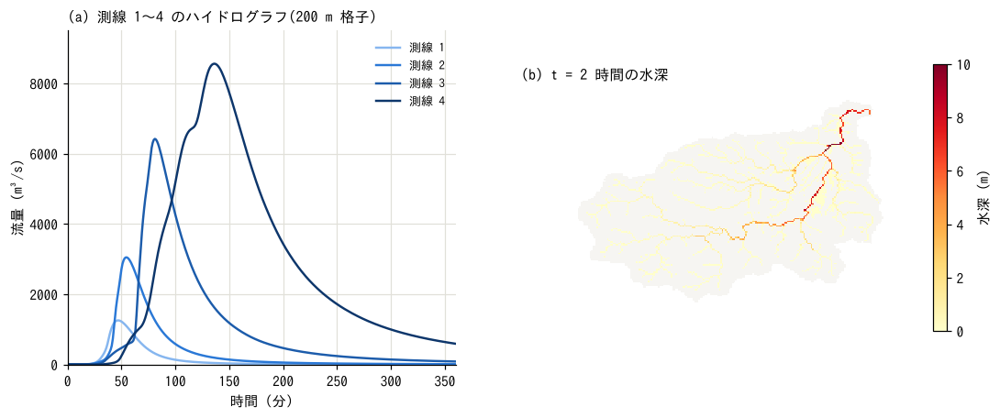

| 測線 | 位置 | ピーク流量 | ピークの時刻 |
|---|---|---|---|
| 1 | 本川の上流 | 約 1,300 m³/s | 47 分 |
| 2 | 測線 1 の少し下流 | 約 3,000 m³/s | 54 分 |
| 3 | 峡谷の下流端 | 約 6,400 m³/s | 81 分 |
| 4 | 流域出口の約 10 km 上流 | 約 8,600 m³/s | 136 分 |

- 洪水波は、下流へ進むほど遅れて大きくなります。上流の測線は雨のピークのすぐ後に、最下流の測線 4 は
  雨が止んでから 1 時間あまり後にピークを迎えます。支川を集めるたびに流量が増え、遠くから集まる水ほど
  遅れて届くためです。
- 測線 4 の立ち上がりに見える肩は、測線の少し上流で合流する大きな支川のピークが、本川のピークより先に
  届くために出ます。
- 雨の水は 6 時間のうちに 8 割あまりが流域出口から出て、残りは逓減中の河道と斜面にあります。

## 地形の前処理

### 窪地除去

地形の扱いだけを変えて、6 時間後の水深を比べます。

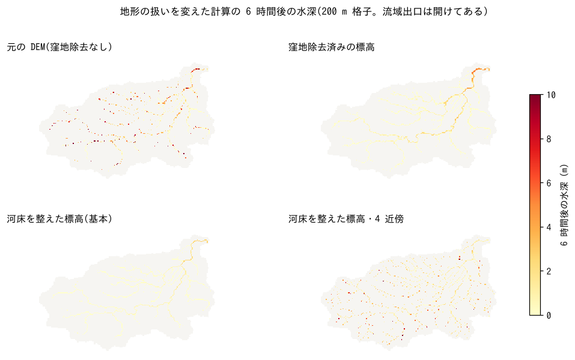

- **元の DEM(窪地除去なし)** では、雨水が途中の窪地に捕まって、出口にほとんど届きません。6 時間たっても、
  降った雨のほぼ全部が流域に残り、あちこちの窪地に深く溜まったままです。標高データの階段状の段差が水深より
  大きいと、水の流れは止まってしまいます。**流出計算には、事前の窪地除去が欠かせません。**
- 深い湛水は、計算の安定性にも響きます。浅水方程式の波速は水深とともに大きくなるので、窪地に水が深く溜まると、
  流れが止まっていてもクーラン数 Cn が下がりません。この計算でも、6 時間後の画面の Cn_max は、窪地除去した
  計算より大きいままです。水が溜まり続ける所があると、Cn は増え続けて、いずれ安定条件(Cn ≲ 1)を破ります
  ([クーラン数と時間刻みの決め方](../../docs/users_guide/courant.md#wave-speed))。計算が発散したら、
  まず「どこかで水が溜まり続けていないか」を、画面の Cn_max 列と最大水深の分布で確かめるのが定石です。
- **窪地除去済みの標高** では河道網がつながって、水が出口へ流れ下ります。ただし、窪地を埋めた跡の平坦な
  区間に水が溜まるので、河道に水が残り、流域から出ていくのが遅れます(次の節)。
- ENC 格子は 8 方向に水をやり取りするので、GIS の D8 法(8 方向の流下)で窪地除去した標高をそのまま使えます。
  対角方向の交換を閉じた **4 近傍** では、同じ標高でも斜めの流路で水が止まり、元の DEM と同じように、
  水が流域のあちこちに取り残されます(「8 方向の交換と 4 近傍」の節)。

### 河床を整えた効果

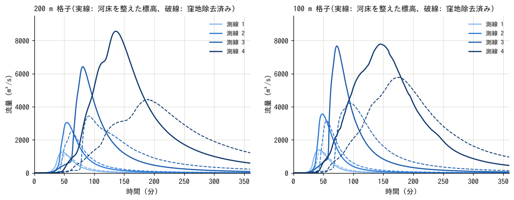

| 測線 | 200 m・窪地除去済み | 200 m・整えた河床 | 100 m・窪地除去済み | 100 m・整えた河床 |
|---|---|---|---|---|
| 3 | 約 3,400 m³/s・91 分 | 約 6,400・81 分 | 約 4,200・95 分 | 約 7,700・73 分 |
| 4 | 約 4,500 m³/s・190 分 | 約 8,600・136 分 | 約 5,800・175 分 | 約 7,800・145 分 |

- 窪地除去済みの標高では、河道の平坦な区間に水が溜まって、洪水波は遅れ、低く長くなります。
  河床を整えると、下流の測線ほどピークが大きく早くなり、200 m 格子の測線 4 では、ピークが約 2 倍になって
  1 時間近く早まります。100 m 格子でも、同じ向きに変わります。
- 河床を整えると、格子による違いも小さくなります。整えた河床は、どの格子でも同じ 10 m 格子の標高の
  谷底をたどるので、河床の高さの与え方が格子の間でそろうためとみています。
- **河道の高さの与え方だけで、下流のピークは 2 倍近く変わります。** どちらが実際の川に近いかは、観測流量と
  照合していないので分かりません。河道の断面は、どちらも「セル幅の矩形」のままで、粗度も目安の値です。

## 降雨遮断と地下浸透

基本ケースに、最も簡単な 2 つの損失を足します。樹冠による遮断は、降った雨の一定の割合(ここでは 2 割)を
除きます。地下浸透は、地表の水を一定の速さ(浸透能)で地下の貯留(バケツ)へ移し、貯留が満杯になるまで
続きます。

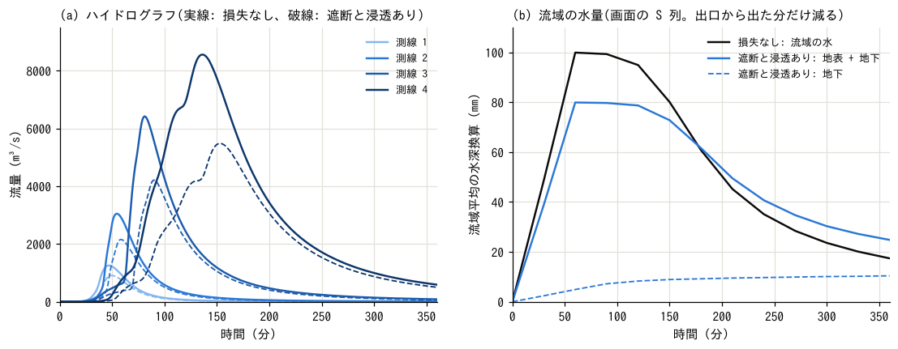

- 立ち上がりが大きく下がり、最下流の測線 4 のピークは 3 分の 1 ほど小さくなって、20 分ほど遅れます。
  遮断は雨の総量を削り、浸透は斜面に薄く広がる水を吸い続けるので、雨の降り始めほど効きます。
  6 時間に測線 4 を通る水の量は、3 割ほど減ります。
- 損失を足すと、画面の水量の表示は 1 列から 3 列(地表 `S_surf`・地下 `S_grnd`・合計 `S_total`)になります。
  雨が止んだとき、合計は降った雨から遮断の分を除いた量に等しく、その後は出口から出た分だけ減ります。
  地下の水は、浸透が続く間、増え続けます。地表と地下の間で水が移っても、合計は保存されます。

## 流域出口の境界

流域出口は計算領域の外縁ではなく、内側にあります。基本ケースでは、出口の河道セルとその隣のセルを、
水位を河床より低くした水位規定セルにして、届いた水をすぐに系外へ除く「完全排水口」にしています。
この設定を外して、出口を閉じた計算と比べます。

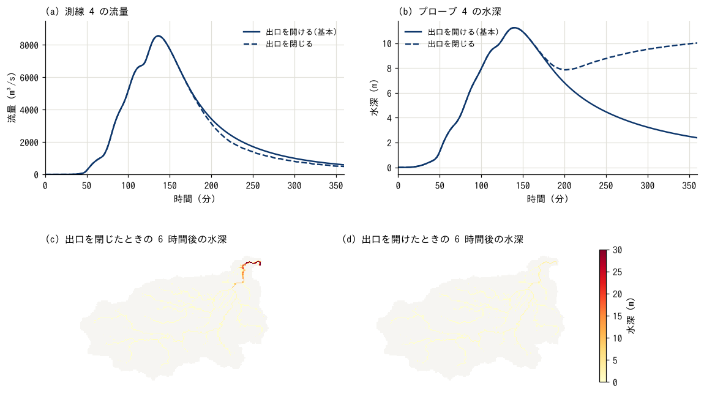

- 出口を閉じると、流域は出口のない器になり、流れ出た水が出口の手前に溜まって、30 m を超える深い湛水が
  育ちます。湛水は、河道に沿って上流へ伸びます。
- 最下流の測線 4 では、ピークまでは同じで、ピークの後から違いが出ます。出口を閉じた計算では、湛水の水面が
  上がってきて(背水)、測線 4 の水深は逓減の途中から増えに転じ、流量は開けた計算より最大で 2 割ほど小さく
  なります。
- **出口に近い場所の水位と流量は、出口の境界条件で変わります。** 計測を置く場所が境界の影響を受けていないかは、
  このように境界を変えて確かめるのが確実です。時系列で水位を与えれば(`stage_val`)、下流の河川の水位や潮位を
  与える開境界にもなります([境界条件の章](../../docs/users_guide/boundary.md))。

## 格子の解像度

同じ条件を、100 m・50 m 格子に移して比べます。4 本の測線とプローブは、どの格子でも同じ場所を、それぞれの
格子のセル番号で指定し直しています。解像度が変わると河道マスクの線も引き直されるので、測線が河道を 1 回だけ
横切り、プローブが河道セルに乗っていることを、図で確かめておきます。

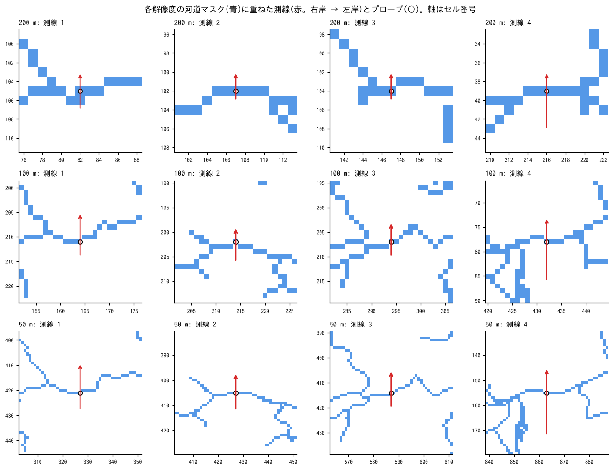

### 時間刻みと計算量

格子を細かくすると、河道が狭く深くなり、急な支川の谷筋も解像されて、最大流速が上がります。このため、
時間刻みは格子の比より強く縮める必要があり、200 m の 6 s に対して、100 m では 1.5 s、50 m では 0.75 s に
しています。**計算量は「セル数 × ステップ数」の比以上に増えます**。時間刻みの決め方は
[クーラン数と時間刻みの決め方](../../docs/users_guide/courant.md#choose-dt)を参照してください。

| 格子 | 計算するセル数 | dt | 1 本の計算時間の目安(4 スレッド) |
|---|---|---|---|
| 200 m | 17,885 | 6 s | 40 秒ほど |
| 100 m | 71,486 | 1.5 s | 8 分ほど |
| 50 m | 285,843 | 0.75 s | 1 時間弱の見積もり |

### 結果

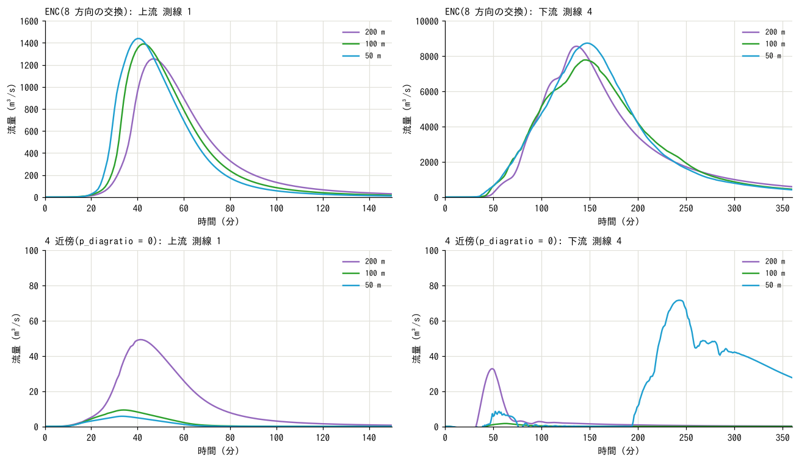

| 測線 | 200 m | 100 m | 50 m |
|---|---|---|---|
| 1 | 約 1,300 m³/s・47 分 | 約 1,400・43 分 | 約 1,400・40 分 |
| 2 | 約 3,000・54 分 | 約 3,600・48 分 | 約 3,700・47 分 |
| 3 | 約 6,400・81 分 | 約 7,700・73 分 | 約 7,600・77 分 |
| 4 | 約 8,600・136 分 | 約 7,800・145 分 | 約 8,700・147 分 |

- **上流(測線 1・2)** では、格子が細かいほどピークが大きく早くなります。200 m から 100 m へは 1〜2 割
  変わりますが、50 m へ細かくしてもわずかしか変わらず、100 m 以下でほぼ収束しています。200 m のセルでは
  谷底と斜面が 1 つのセルに混ざって、斜面から河道へ水が集まるのが鈍り、短い支川は 1〜2 セルに潰れるためと
  みています(河道幅を与えても、200 m 格子の上流のピークはわずかしか増えません)。
- **峡谷の下流端の測線 3** では、200 m 格子のピークが小さく遅くなります。ラスタでは河道の幅がセルの幅になるので、
  粗い格子ほど河道が広く浅くなり、谷底の狭い峡谷では、流れが遅くなりすぎるためです(次の河道幅の比較)。
- **最下流の測線 4** では、200 m と 50 m 格子のピークは近い一方、100 m 格子だけが 1 割ほど低くなります。
  測線 4 の少し上流で入る大きな支川の出方の違いによるとみています。合流の上下に測線を足して流量を測ると、
  100 m 格子では、支川からの出水が早く鋭く出て、本川のピークが来るころには引いているのに対し、50 m 格子では、
  支川の出水が遅く幅広く出て、本川のピークと重なります。合流より上流の本川のピークは、2 つの格子でほとんど
  変わりません([developer.md](../../docs/developer.md) §113.8)。支川の中のどこで違いが生じるかは、調べていません。
- 細かい格子ほど逓減が早く進み、6 時間の終わりに流域に残る水が少なくなります。

### 河道幅をそろえると

ラスタの河道は幅がセルの幅になるので、格子によって河道の幅が違います。サブグリッド河道
([河道の章](../../docs/users_guide/channel.md))で、200 m・100 m 格子の河道の幅を 50 m 格子と同じ 50 m に
そろえて比べます(200 m 格子は、流れが細い河道に集まって速くなるので、dt を 4 s にします。幅を与えない
200 m 格子を dt 4 s で回しても、結果はほとんど変わりません)。

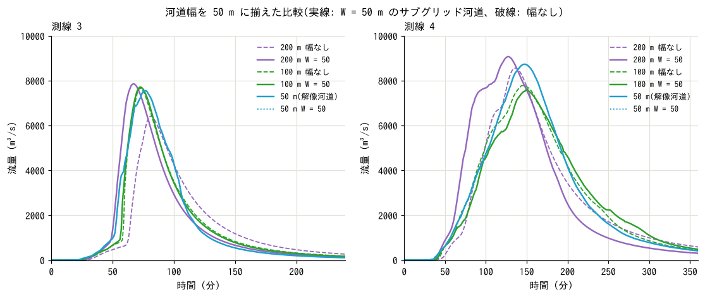

- **峡谷の測線 3 は、河道幅をそろえるとそろいます。** 200 m 格子のピークは大きく早くなって、3 つの格子の
  差が小さくなります。測線 3 までの本川は谷底の幅が数十 m の峡谷で、セル幅の河道は広すぎたということです。
- **最下流の測線 4 は、逆にばらつきます。** 測線 3 より下流の谷底は 100 m を超える幅で、幅 50 m の河道は狭すぎます。
  200 m 格子では、河道の両脇のセルが河床よりずっと高いので、水が細い溝の中を速く流れ、100 m 格子では、
  両脇のセルが低いので、あふれて遅くなるとみています。
- つまり、**河道幅 = セル幅も、一様な 50 m も、流域全体には合いません**。水位とともに広がる谷の断面を、
  1 つの幅で表すことの限界です。河道幅は、`fn_width` でセルごとに与えられます(区間ごとに幅を変えた比較は
  していません)。
- 50 m 格子に幅 50 m(= セル幅)を与えた計算は、解像した河道の計算とほぼ重なります。幅がセル幅に等しいとき、
  サブグリッド河道は設計どおり、解像した河道の表現に戻ります。

## 8 方向の交換と 4 近傍

対角方向の交換を閉じた 4 近傍で、同じ計算をします(上の「格子の解像度」の図の下段。縦軸の範囲は、上段より
ずっと小さくしてあります)。

- 最下流の測線 4 に届く流量は、どの格子でも ENC の 1% にも届きません。6 時間たっても、降った雨のほぼ全部が
  流域に残ります。**格子を細かくしても、4 近傍では河道網が寸断されたまま**です。軸に沿った区間は水を通し、
  斜めの区間で水が止まるので、流量が出るかどうかは、解像度ではなく河道の向きで決まります。
- 多くの構造格子のモデルは軸方向の交換が基本で、幅 1 セルの河道を斜めに通せないため、河道網を別の
  1 次元河道モデルとして結合します。ENC 格子は 8 方向の交換で河道網をラスタのまま流せるので、200 m の
  粗い格子でも、窪地除去した標高と河道マスクだけで流域の計算が成り立ちます
  ([通過幅の調整](../../docs/users_guide/passage_width.md))。

## 移流項の扱い

ここまでは既定の運動量保存形の移流スキーム(スキーム 3)でした。同じ 3 つの格子を、移流項を省いた拡散波
(厳密には局所慣性方程式。[入門ページ](../../docs/users_guide/shallow_water.md))と、旧スキーム 1
(非保存形・風上重み。風上化指数 0.1・0.5・1.0)でも計算します。

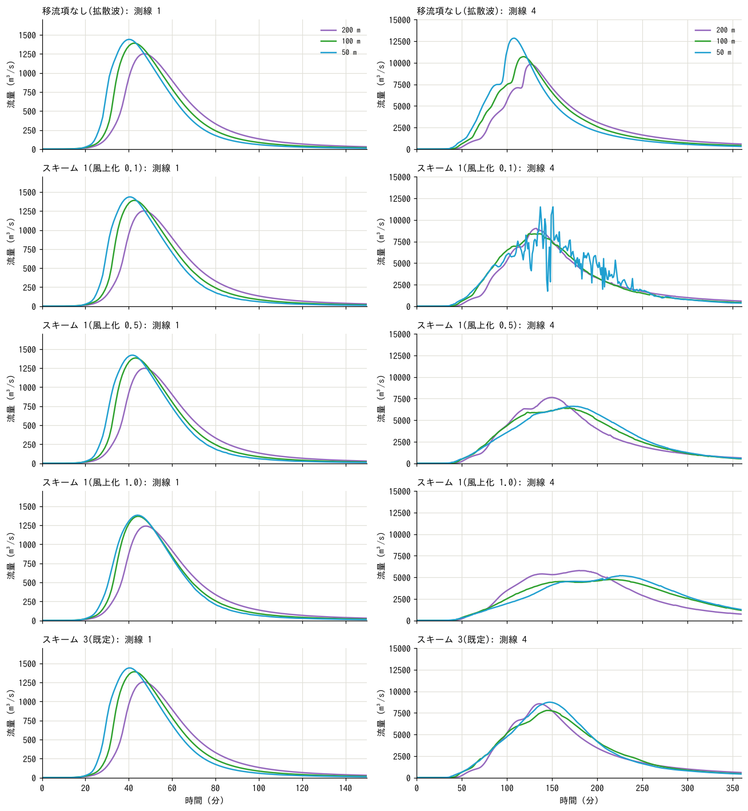

| 移流項 | 200 m | 100 m | 50 m |
|---|---|---|---|
| なし(拡散波) | 1.15 倍・早い | 1.4 倍・早い | 1.5 倍・早い |
| スキーム 1(風上化 0.1) | 1.05 倍 | 1.1 倍 | 激しく振動する |
| スキーム 1(風上化 0.5) | 0.9 倍・遅い | 0.8 倍・遅い | 0.75 倍・遅い |
| スキーム 1(風上化 1.0) | 0.7 倍・遅い | 0.6 倍・遅い | 0.6 倍・遅い |

(最下流の測線 4 のピークの、同じ格子のスキーム 3 に対する比。上流の測線 1 のピークは、どの扱いでも
ほとんど変わりません)

### 移流項を省くと、下流のピークが大きく早くなる

移流項を省くと、最下流の測線 4 のピークは大きく早くなり、その差は格子が細かいほど広がります。一方、上流の
測線 1・2 は、ほとんど変わりません。**移流項が効くのは、流量の大きい下流です。** 理由を順に追います。

1. **拡散波の流速は、その場の水面勾配と摩擦の釣り合いだけで決まります。** 加速に時間がかかることや、速い水が
   遅い水と混ざって減速することが、計算に入りません。
2. **急で一様な流れでは、慣性の出番がありません。** 移流項は、流速が場所によって変わる所で働きます。上流の
   急な河道では、流れは河床勾配と摩擦の釣り合いに近く、流速が流下方向にあまり変わらないので、流れが速くても
   移流項は小さいままです。
3. **差が出るのは、流れが短い距離で変わる所です。** 勾配の変わり目や段差、屈曲、支川の合流、河道の水が両脇の
   セルへ広がる所では、流速が数セルの間に変わります。移流項があれば、加速に距離が要り、速い水が遅い水に入る所
   (跳水)や横から入る水と混ざる所で、流れはエネルギーを失います。移流項がないと、流速は水面勾配に瞬時に
   追随し、この損失もないので、洪水波は速く進み、前面が切り立って、ピークが大きくなります。
4. **差の大きさは、河道の粗度で大きく変わります**(下の図)。河道の粗度を 0.04 から 0.02 に下げると、移流項の
   ない洪水波は、測線 4 に届くまでに段波(切り立った波の前面)になり、ピークはスキーム 3 の 2 倍を超えます。
   深い水ほど速く進むので、前面は下流へ行くほど切り立ち、切り立った前面はさらに流れを速めるという、自己強化が
   起きます。現実には跳水や乱れがこの加速を散逸させますが、移流項のない方程式には、それを表す項がありません。
   段波のピークの値は、時間刻みや格子で変わり、収束した値ではありません。スキーム 3 は、粗度 0.02 でも段波に
   ならず、ピークは粗度 0.04 のときより 2〜5 割大きくなるだけです。一方、河床を整える前の窪地除去済みの
   標高に戻しても、粗度が 0.04 のままなら、移流項を省いたときの変わり方は、ほとんど同じです(`filled_noadv`)。
5. **格子を細かくすると、差が広がります。** 河道セルが狭く深くなって、同じ流量での流速が上がることと、離散化の
   数値拡散が減って、波の前面がより鋭く表されることによるとみています。

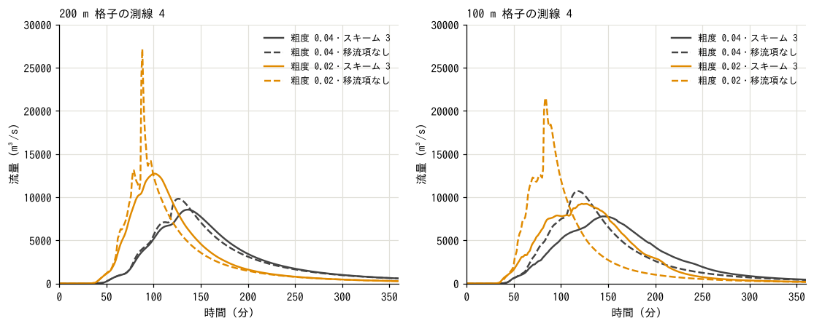

つまり、移流項を省いた計算の結果は、河道の粗度と、「流れの急な変化と、切り立つ波の前面を、どこまで解像したか」に
強く左右されます。既往の拡散波・キネマティックウェーブの流域モデルは、この分を**解像度ごとに校正した粗度係数**に
吸収させて使うのが普通です。移流項があれば、流れの急な変化での加速は、跳水に相当する散逸と、横から入る水・
谷底との運動量のやり取りで抑えられ、粗度や格子を変えたときの変化が小さくなります。

### 移流項は何を減速させているのか

このケースで移流項が波を遅く小さくしている中身として、次の 3 つが考えられます(どれがどれだけ効いているかは、
切り分けていません)。

1. **流れの急な変化での散逸**: 移流項(運動量保存形)は、段差や勾配の変わり目で跳水に相当する散逸を与えます。
   1 セル幅の水路の階段状の河床([test/bendloss](../../test/bendloss/README.md) の stair3)では、移流項を省くと
   段差ごとに流速が過大になって、洪水波が段波に育ち、ピークは移流項のある計算の 2 倍を超えます。河床を整えた
   標高にも、勾配の変わり目と、格子の大きさの段差は残ります。
2. **横から入る水による減速**: 降雨流出では、河道の流量の大半が斜面や支川から横に入り、流下方向の運動量を
   持ちません。運動量保存形は、この水を混ぜて河道の水を減速させる効果を自然に含みます
   (空間変化流の解析解とよく一致します。[test/bendloss](../../test/bendloss/README.md))。
3. **浸水した谷底との運動量のやり取り**: 洪水時の本流の断面は、河道マスクの 1 セルを超えて両脇の谷底の
   セルに広がり、その遅い水が、屈曲や合流で本流の運動量を奪います。ほとんど水を運ばない河岸の薄い水膜が
   本流を減速させる人工的な分は、既定の扱いで除いてあります
   ([1 セル幅の河道と移流項の風上供給元](../../docs/users_guide/advection_donor.md))。

### 「山地の流出では移流項の効果は小さい」と言われる理由

急な河道では、運動方程式の中で河床勾配が水面勾配の変化や速度水頭の変化より圧倒的に大きいため、区間の
スケールの波の伝わり方は、キネマティックウェーブや拡散波で十分に再現できる、というのが根拠です。
Woolhiser & Liggett (1967) の kinematic flow number や Ponce ら (1978) の判定が知られていて、急な勾配で、
波の時間スケールが長い山地の流出は、これを満たします(判定式の読み方は、入門ページの
[使い分けの目安](../../docs/users_guide/shallow_water.md#phenomena))。この例題でも、
急な上流の測線 1・2 は、移流項の有無でほとんど変わりませんでした。ただしこれは、河床と流れを区間のスケールで
なめらかに見たときの話です。格子のスケールでは、段差や勾配の変わり目・屈曲・合流で、流れは局所的に急変し、
慣性が無視できなくなります(この例題では、流量の大きい下流と、河道の粗度を小さくした計算)。
「移流項の効果は小さい」は波の運動学の話で、局所のエネルギーの収支の話ではない、と区別するのがよいと
考えます。既往のモデルは、この局所の散逸を粗度係数に含めて扱っており、それは工学的に妥当なやり方です。

### 1 次元河道モデルとの関係

1 次元河道モデルでも、移流項を省いた解析はよく行われます。横から入る水の運動量の項を加えれば、上の 2 の分は
取り込めますが、1 の散逸と 3 の谷底とのやり取りは、断面を与えた 1 次元モデルでは別の形(粗度、局所損失係数、
複断面の運動量交換)で与えることになります。横から入る水の運動量を入れた 1 次元モデルは、ENCflow の移流項
つきの結果に近づくが同じにはならない、と予想しています(確かめていません)。

### スキーム 1 と風上化指数

旧スキーム 1 は非保存形で、横から入る水や谷底との運動量のやり取りを一貫して表せず、風上重み
(`p_adv_upwind_index`)による数値粘性を持ちます。この風上化指数で、結果が大きく変わります。

- **風上化を弱くすると(0.1)**、200 m・100 m 格子ではスキーム 3 に近い値になりますが、50 m 格子では最大流速が
  異常に大きくなり、最下流の流量が 1 分ごとに激しく上下します。風上化の弱い非保存形のスキームが、細かい格子の
  速い流れで不安定になるものとみています。
- **風上化を強くするほど(0.5、1.0)**、数値粘性が増えて、洪水波は遅く小さくなります。風上化 1.0 では、
  上流の測線 2 にも差が出はじめます。
- 風上重みの両端では、最下流のピークが 1.5 倍以上違います。風上重みの数値粘性は格子の幅と流速に比例するので、
  格子を細かくすれば差は縮まるはずですが、縮まりません(原因は調べていません)。

つまり、スキーム 1 は、風上重みの選び方で結果が大きく動く、校正パラメータを 1 つ余計に抱えたスキームです。
ENCflow が既定にしているのは、校正パラメータを増やさない運動量保存形のスキームの方です。

### 解像度依存が小さければ現実に近いと言えるか

言えません。格子を細かくしても答えが大きく動かないこと(収束)は、物理に基づくモデルに望まれる性質ですが、
収束した先が観測に合う保証はありません。この例題でも、200 m 格子の最下流のピークは、河道の粗度を半分に
するだけで 1.5 倍ほどになり、河床の高さの与え方を変えると 2 倍近く変わります。粗度も河床も、観測に合わせて校正した
ものではありません。スキーム 3 の結果も、最下流のピークは 100 m 格子だけが低く、峡谷の測線 3 は 200 m と
100 m で大きく違って、収束したとは言えません。この流域には観測との照合がなく、**現実に近いかどうかは
確かめていません**。一方、拡散波でも解像度ごとに粗度を校正すれば、観測に合わせることはできるでしょう。
それでも、解像度を変えるたびに校正し直さなくてよいモデルは、粗い格子で全体をつかんでから必要な所だけ細かく
する、という使い方ができる点で**「便利」**です。「便利」であって「正しい」ではない、という区別は残しておいて
ください。

### このケースの特殊性

このケースは、1 時間に 100 mm の雨を損失なしで流し、流域出口の近くで毎秒 8,000 m³ を超えるという、極端な
流量です。流れの急な変化での散逸も、横から入る水も、流量とともに効くので、一般的な出水より移流項の影響が
大きく出ていると思われます。穏やかな出水では、移流項の扱いによる差はもっと小さいはずです。設定の雨を変えて
`run_cases.sh` を回せば、確かめられます。

## まとめ: ENC 格子の特性として

- **格子を変えると、上流と峡谷のピークに加えて、流域出口の近くのピークも 1 割前後変わります。** 上流は 100 m
  以下でほぼ収束し、峡谷はセル幅の河道が広すぎる分だけ粗い格子で小さく、最下流は大きな支川の出方が格子で
  変わる分だけ違います。洪水波の到達時刻と、流域全体の流れのつながりをつかむなら 200 m 格子で用が足り、
  ピーク流量の値まで欲しいときは、格子を変えた計算や、河道幅を与えた計算と比べて、値の幅を確かめる、
  という使い分けになります。
- **格子よりも、入力の与え方の方が結果を大きく変えます。** 最下流のピークは、河床の高さの与え方や河道の粗度で、
  格子による違いより大きく変わります。河床と粗度は、観測と照合して決めてください。
- **粗い解像度でも、流れが阻害されません。** 8 方向の交換で、幅 1 セルの河道網をラスタのまま流せるので、
  1 次元河道モデルや流下方向のデータを足さなくても、流域の計算が成り立ちます。
- **解像度の代償は計算量です。** 格子の幅を半分にすると、セル数は 4 倍、ステップ数は流速の増加に合わせて
  2〜4 倍になり、計算時間は 1 桁ほど増えます。まず 200 m 程度で全体の挙動をつかみ、必要な場所と目的に応じて
  細かくしていくのが実務的です。

## 精度の限界・できないこと

- **観測と照合していません。** 河床の高さ・河道の幅・粗度は目安の値で、結果は「設定を変えるとどう変わるか」を
  見るためのものです。実際の洪水の再現には、観測流量での照合が要ります。
- **河道の断面は、セル幅の矩形です**(サブグリッド河道は、一様な幅での比較だけ)。水位とともに広がる谷の
  断面や、堤防・構造物は表していません。
- **流出は地表の流れだけです。** 土の中を通って川へ出る流れは扱わず、雨は流域に一様で、損失は最も簡単な
  2 つのモデルだけです。土層の中の流れと、谷の飽和した所からの流出は、[examples/source_area](../source_area/README.md)
  で扱っています。雨の分布や浸透の時間変化は、[ユーザーガイド](../../docs/users_guide.md)の各章のモデルで足せます。
- **移流項の規則には限界があります。** 1 セル幅の河道と、脇の濡れたセルの間の運動量のやり取りを、格子の連結
  ごとの規則で数えるので、階段状の河道の角のセルが水に浸かる区間では、水位が高めに出ることがあります
  ([移流項のスキーム](../../docs/users_guide/advection.md) §4.4 の限界)。
- 50 m 格子の計算は、1 本に 4 コアで 1 時間ほどかかります。

## ファイル

| ファイル | 内容 |
|---|---|
| `param.txt` | 200 m 格子の基本ケース(この例題の基準) |
| `param_100m.txt`・`param_50m.txt` | 100 m・50 m 格子の基本ケース |
| `run_cases.sh` | 比べる計算をまとめて回す(変えた設定を `wrk_*.txt` に作り、結果を `result_*` に置く) |
| `plot_results.py` | 図(`figs/`。引数 en で英語版を `en/figs/` に) |

## 関連文書

- [tutorials/chichibu](../../tutorials/chichibu/README.md) — 同じ流域で、計算の組み立てを一つずつ学ぶ教材
- [examples/source_area](../source_area/README.md) — 雨が土層を通って、谷の飽和した所から川に出る過程を、秩父の
  地形から切り出した源流域で計算する例題。地表の流れだけで代えたときとの比較もある
- [test/chichibu](../../test/chichibu/README.md)・[test/chichibu_cond](../../test/chichibu_cond/README.md) —
  同じ流域の回帰テスト(100 m 格子)
- [移流項のスキーム](../../docs/users_guide/advection.md)、[通過幅の調整](../../docs/users_guide/passage_width.md)、
  [河道の章](../../docs/users_guide/channel.md)、[境界条件の章](../../docs/users_guide/boundary.md)、
  [クーラン数と時間刻みの決め方](../../docs/users_guide/courant.md)
- [examples/debris_fan](../debris_fan/README.md) — 別の現象(谷を下って扇状地へ広がる土石流)で、格子の間隔と
  格子に対する谷の向きを変えても、到達範囲と到達時刻がそろうことを確かめた例題。4 近傍との比較もある
- [developer.md](../../docs/developer.md) §111(河床を整えた標高)、§113.8(100 m 格子の最下流のピークの調査)
