# chichibu_flood — reading a mountain-catchment flood by changing the inputs and settings

> English mirror of examples/chichibu_flood/README.md. The Japanese file is the master copy.

[日本語](../README.md)

**This example is a model that represents the runoff of a real mountain catchment by surface flow only.** Rainwater
is computed as flowing over the ground and gathering in the rivers; flow that reaches the rivers through the soil is
not treated. In real mountains, most of the rain that falls soaks into the soil, flows downslope inside the soil
layer, and comes out into the rivers where the valleys are saturated. If you are interested in this actual runoff
process, and in how it differs when represented by surface flow only, see
[examples/source_area](../../source_area/en/README.md).

A one-hour heavy rainstorm falls on the Chichibu catchment in the upper Arakawa River, and we compute how the
rainwater gathers from the slopes into the rivers and runs down as a flood. Then we change, one at a time, the
terrain preprocessing, the rainfall losses, the boundary at the catchment outlet, the grid resolution and the
eight-direction exchange, and the treatment of the advection term, and see how the flood wave changes. The
catchment, the rain and the measurement locations are the same as in the tutorial
[tutorials/chichibu](../../../tutorials/chichibu/en/README.md). The tutorial follows the computation step by step;
the regression case for the same catchment is [test/chichibu](../../../test/chichibu/en/README.md).

## The catchment and the inputs

The catchment covers about 715 km², almost all of it steep mountains. Peaks of the 2,500 m class line the main
ridge in the south-west, and the north-east corner is the catchment outlet. The basic grid is 200 m; to compare
resolutions we also use 100 m and 50 m grids.

| Data | Contents |
|---|---|
| `Chichibu_200m_filled` | Ground elevation, with D8 depression filling (fill) applied in GIS |
| `Chichibu_200m_cond` | Ground elevation: the depression-filled elevation with the height of the channel cells (the bed) conditioned. Used in the base case |
| `Chichibu_200m_raw` | Ground elevation: the original data without depression filling (GeoTIFF only) |
| `Chichibu_200m_basin` | Catchment mask (1: inside the catchment) |
| `Chichibu_200m_river_flowline` | Channel mask (1: channel cell). Gives the channel network as lines one cell wide |

The 200 m data are those of the tutorial in `tutorials/chichibu/data_chichibu/`, and the 100 m and 50 m data
those in `test/chichibu/data_chichibu*/`; they are referenced, not copied.

- **Data sources**: the elevation was made from the Digital Elevation Model of the Fundamental Geospatial Data by
  the Geospatial Information Authority of Japan (GSI), and the channels from stream-order data
  ([DOI:10.3178/jjshwr.36.1812](https://doi.org/10.3178/jjshwr.36.1812)) built from the river data of National
  Land Numerical Information. A channel made by simply rasterizing the river lines is in places one cell off the
  valley line of the elevation, so it is moved onto the flow lines of the elevation with
  [utils/river_flowline](../../../utils/river_flowline/en/README.md).
- **Conditioned bed**: depression filling only guarantees that water can flow down to the outlet; the traces of
  the filled depressions remain in the channel as flat stretches of cells at the same height, with a step at their
  downstream end. In addition, the elevation of a 200 m cell is the average height within the cell, so for a
  mountain river flowing in a narrow valley bottom it is higher than the real bed. `Chichibu_200m_cond` replaces
  only the height of the channel cells with the valley-bottom height read from the 10 m grid elevation of the same
  area, conditioned so that it stays level or descends downstream. The procedure is in "Elevation with a
  conditioned channel bed" of the [data README](../../../test/chichibu/en/data_chichibu/README.md).

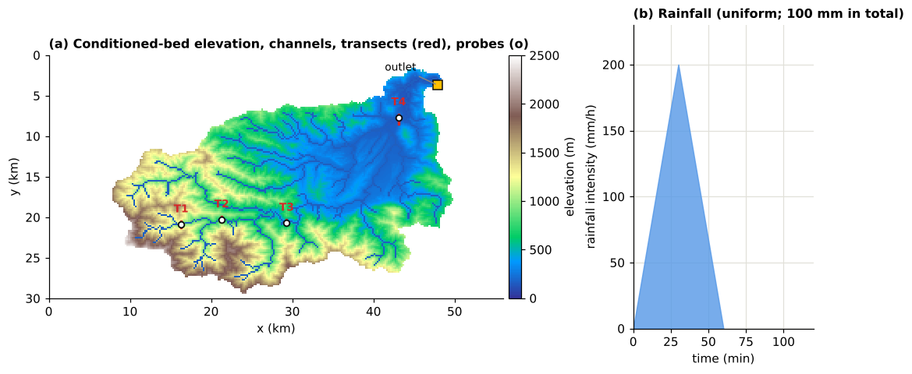

Comparing the two elevations along the main river, the depression-filled elevation is a staircase of flat
stretches and steps, while the conditioned bed drops to the height of the valley bottom and descends smoothly.
The flat stretches disappear, except where they appear to be the water surface of reservoirs and the like.
Because the bed is at the height of the valley bottom, the channel cells are cut deeper than the cells on either
side.

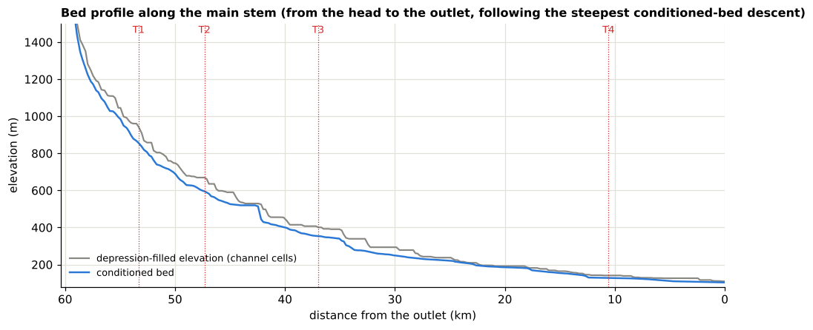

## Base case

| Item | Value |
|---|---|
| Grid | 280 × 150 cells (Δx = 200 m). Only the 17,885 cells inside the catchment mask are computed |
| Terrain | Conditioned-bed elevation `Chichibu_200m_cond` |
| Roughness | Slopes 0.05, channel cells 0.04 (the lower end of the usual range for mountain channels) |
| Rain | Uniform over the catchment. A triangle: 0 at 0 min, 200 mm/h at 30 min, 0 at 60 min (100 mm in total). No losses |
| Boundary | The channel cell at the catchment outlet and its neighbour are stage cells with the water level below the bed (a free outfall). The outer edge is a wall |
| Computation | Dynamic wave (advection term in the default momentum-conservative form), eight-direction exchange of the ENC grid, dt = 6 s, 6 hours |
| Records | Discharge across 4 transects on the main river, and water depth at 4 probes in the cells where the transects cross the channel (every minute) |

The settings are `param.txt` (200 m), `param_100m.txt` and `param_50m.txt`; `run_cases.sh` makes the variant
computations (table below) from them.

| Run | What changes | Resolutions |
|---|---|---|
| base | — | 200, 100, 50 m |
| `raw`, `filled` | terrain set to the original DEM / the depression-filled elevation | `raw` 200 m; `filled` 200 and 100 m |
| `loss` | adds rainfall interception (interception ratio 0.2) and subsurface infiltration (bucket model with an infiltration capacity of 5 mm/h) | 200 m |
| `closed` | closes the catchment outlet (a wall like the outer edge) | 200 m |
| `w50` | gives the channel a 50 m wide subgrid channel | 200, 100, 50 m |
| `4nb` | closes the diagonal exchange (4 neighbours, `p_diagratio = 0.0`) | 200, 100, 50 m |
| `noadv`, `s1u`, `s1`, `s1f` | drops the advection term (diffusion wave); old scheme 1 (upwind index 0.1, 0.5, 1.0) | 200, 100, 50 m |
| `n02`, `n02_noadv` | channel roughness 0.02; additionally without the advection term | 200, 100 m |
| `filled_noadv` | depression-filled elevation without the advection term | 200, 100 m |

## Running

```bash
make                         # links to the executables
./run_cases.sh 200m          # the 200 m computations only (a little over 10 minutes on 4 cores)
./run_cases.sh               # all of 200 m, 100 m and 50 m (6–7 hours on 4 cores, mostly the 50 m grid)
python3 plot_results.py en   # en/figs/*.png (without the argument, the Japanese version goes to figs/)
```

`run_cases.sh` skips the `result_*` that already exist, so you can stop it and resume. The figures are drawn only
for the results that exist.

## The basic shape of the flood wave

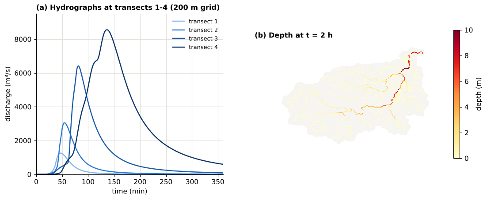

| Transect | Location | Peak discharge | Time of the peak |
|---|---|---|---|
| 1 | upper main river | about 1,300 m³/s | 47 min |
| 2 | a little downstream of transect 1 | about 3,000 m³/s | 54 min |
| 3 | downstream end of the gorge | about 6,400 m³/s | 81 min |
| 4 | about 10 km upstream of the catchment outlet | about 8,600 m³/s | 136 min |

- The flood wave is delayed and grows as it travels downstream. The upstream transects peak just after the rainfall
  peak, and the most downstream transect 4 a little over an hour after the rain stops. The discharge increases each
  time a tributary joins, and water gathered from farther away arrives later.
- The shoulder on the rising limb at transect 4 appears because the peak of a large tributary that joins a little
  upstream of the transect arrives before the peak of the main river.
- A little over 80 % of the rainwater leaves through the catchment outlet within the 6 hours; the rest is in the
  receding channels and on the slopes.

## Terrain preprocessing

### Depression filling

Changing only the treatment of the terrain, we compare the water depth after 6 hours.

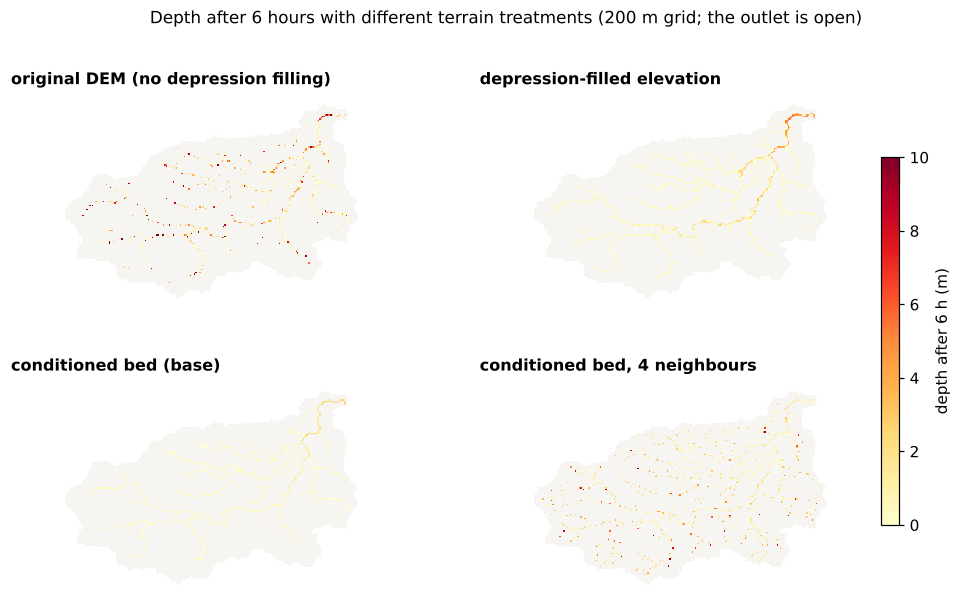

- With the **original DEM (no depression filling)**, the rainwater is caught in depressions on the way and hardly
  reaches the outlet. Even after 6 hours, almost all the rain that fell remains in the catchment, ponded deep in
  depressions here and there. When the stair-like steps of the elevation data are larger than the water depth, the
  flow stops. **Depression filling beforehand is indispensable for runoff computations.**
- Deep ponding also affects the stability of the computation. The wave speed of the shallow water equations
  increases with the depth, so when water ponds deep in depressions, the Courant number Cn does not drop even after
  the flow has stopped. In this computation too, Cn_max on the screen after 6 hours stays larger than in the
  depression-filled computation. Where water keeps accumulating, Cn keeps increasing and eventually breaks the
  stability condition (Cn ≲ 1)
  ([Courant number and how to choose the time step](../../../docs/en/users_guide/courant.md#wave-speed)). When a
  computation diverges, the standard first step is to check "is water accumulating somewhere?" with the Cn_max
  column on the screen and the distribution of the maximum depth.
- With the **depression-filled elevation**, the channel network is connected and the water flows down to the outlet.
  However, water ponds in the flat stretches left where depressions were filled, so water stays in the channels and
  leaves the catchment later (next section).
- The ENC grid exchanges water in eight directions, so an elevation depression-filled with the D8 method
  (eight-direction flow) of GIS can be used as it is. With **4 neighbours**, where the diagonal exchange is closed,
  water stops in the diagonal flow paths even on the same elevation, and as with the original DEM, water is left
  behind all over the catchment (section "Eight-direction exchange and 4 neighbours").

### Effect of the conditioned bed

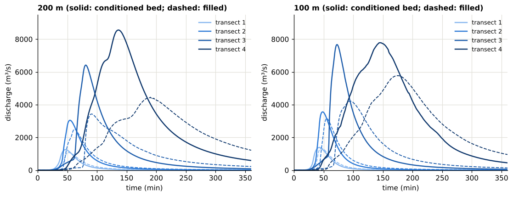

| Transect | 200 m, depression-filled | 200 m, conditioned bed | 100 m, depression-filled | 100 m, conditioned bed |
|---|---|---|---|---|
| 3 | about 3,400 m³/s, 91 min | about 6,400, 81 min | about 4,200, 95 min | about 7,700, 73 min |
| 4 | about 4,500 m³/s, 190 min | about 8,600, 136 min | about 5,800, 175 min | about 7,800, 145 min |

- With the depression-filled elevation, water ponds in the flat stretches of the channel, and the flood wave is
  delayed, lower and longer. Conditioning the bed makes the peaks larger and earlier, the more so the farther
  downstream the transect; at transect 4 on the 200 m grid the peak about doubles and comes nearly an hour earlier.
  The 100 m grid changes in the same direction.
- Conditioning the bed also reduces the differences between the grids. On every grid the conditioned bed follows
  the valley bottom of the same 10 m grid elevation, so we think the way the bed height is given becomes consistent
  across the grids.
- **The way the channel height is given alone changes the downstream peak by nearly a factor of two.** Which one is
  closer to the real river is unknown, since neither has been checked against observed discharge. In both, the
  channel cross-section remains a "rectangle as wide as the cell", and the roughness is a typical value.

## Rainfall interception and subsurface infiltration

We add the two simplest losses to the base case. Interception by the canopy removes a fixed fraction of the rain
that falls (here 20 %). Subsurface infiltration moves surface water at a fixed rate (the infiltration capacity)
into subsurface storage (the bucket), until the storage is full.

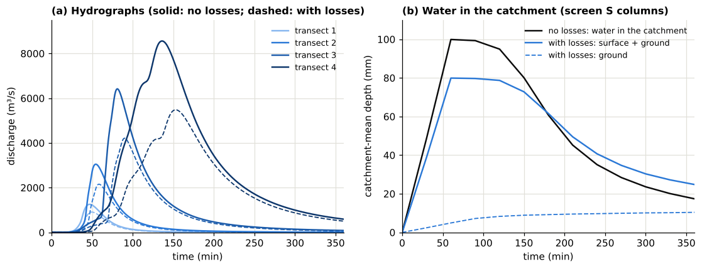

- The rising limb drops a lot, and the peak at the most downstream transect 4 becomes about a third smaller and
  about 20 minutes later. Interception cuts the total rain, and infiltration keeps absorbing the water spread thinly
  over the slopes, so the losses work most at the start of the rain. The volume passing transect 4 in the 6 hours
  decreases by about 30 %.
- With the losses, the water-volume display on the screen goes from one column to three (surface `S_surf`,
  subsurface `S_grnd`, total `S_total`). When the rain stops, the total equals the rain that fell minus the
  intercepted part, and afterwards it decreases only by what leaves through the outlet. The subsurface water keeps
  increasing while infiltration continues. Water moving between the surface and the subsurface leaves the total
  unchanged: the total is conserved.

## Boundary at the catchment outlet

The catchment outlet is not on the outer edge of the domain but inside it. In the base case, the channel cell at the
outlet and its neighbour are stage cells with the water level below the bed: a "free outfall" that removes arriving
water from the system at once. We remove this setting and compare with a computation with the outlet closed.

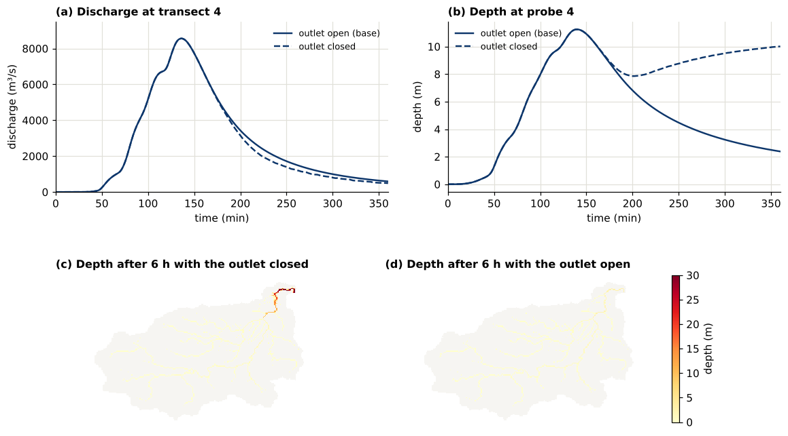

- Closing the outlet turns the catchment into a vessel without an outlet: the water that flows down ponds in front
  of the outlet, and a deep pond of more than 30 m develops. The pond extends upstream along the channel.
- At the most downstream transect 4, the two computations are the same up to the peak and differ after it. With the
  outlet closed, the water surface of the pond rises toward the transect (backwater), the depth at transect 4 turns
  to increase partway through the recession, and the discharge becomes up to about 20 % smaller than with the
  outlet open.
- **The water level and discharge near the outlet change with the boundary condition at the outlet.** Whether a
  measurement location is affected by the boundary is best checked by changing the boundary like this. Giving the
  water level as a time series (`stage_val`) turns it into an open boundary that gives the water level of a
  downstream river or the tide ([Boundary conditions](../../../docs/en/users_guide/boundary.md)).

## Grid resolution

We move the same conditions to 100 m and 50 m grids and compare. The 4 transects and probes are specified again, at
the same places on every grid, with the cell numbers of that grid. When the resolution changes, the lines of the
channel mask are redrawn too, so we check in the figure that each transect crosses the channel exactly once and each
probe sits on a channel cell.

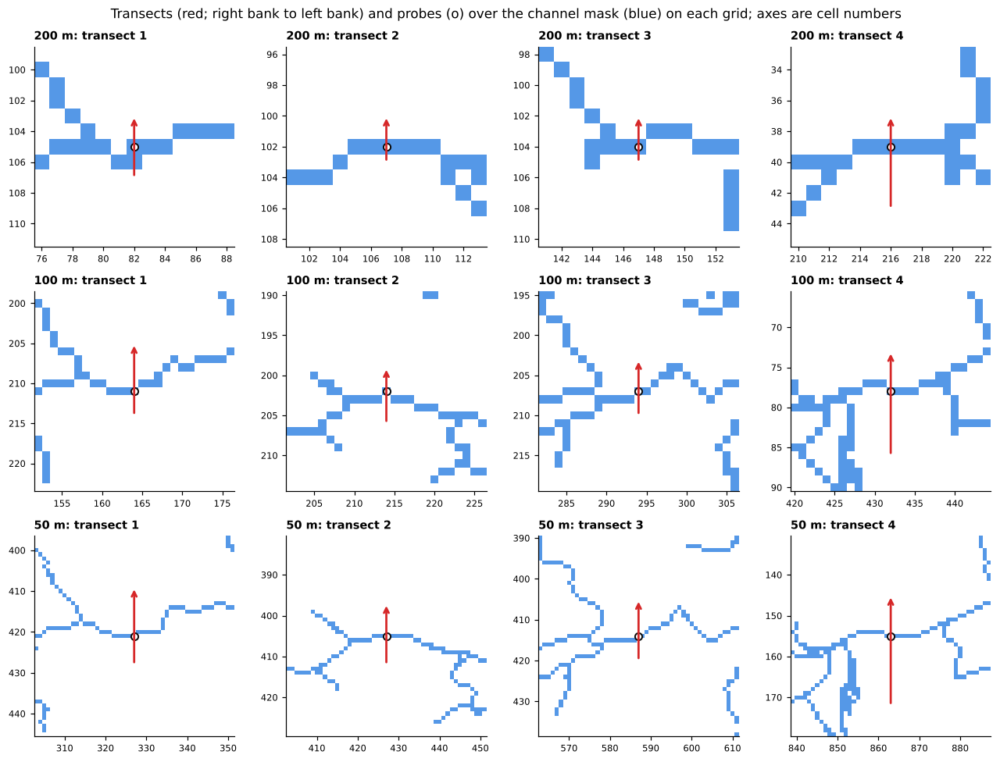

### Time step and computational cost

A finer grid makes the channel narrower and deeper and also resolves the steep tributary valleys, so the maximum
velocity increases. Therefore the time step has to shrink more than the grid ratio: against 6 s for 200 m, we use
1.5 s for 100 m and 0.75 s for 50 m. **The computational cost grows faster than the ratio of "cells × steps".** For
choosing the time step, see
[Courant number and how to choose the time step](../../../docs/en/users_guide/courant.md#choose-dt).

| Grid | Cells computed | dt | Time for one run (4 threads) |
|---|---|---|---|
| 200 m | 17,885 | 6 s | about 40 seconds |
| 100 m | 71,486 | 1.5 s | about 8 minutes |
| 50 m | 285,843 | 0.75 s | a little under an hour (estimate) |

### Results

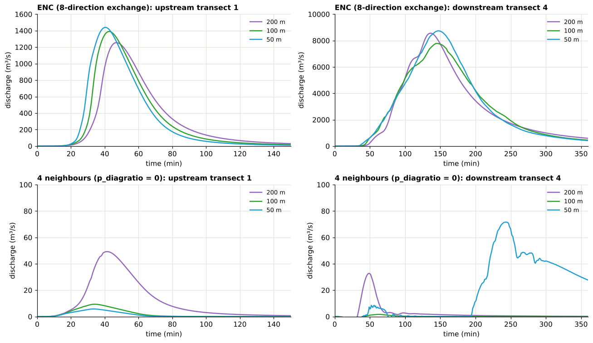

| Transect | 200 m | 100 m | 50 m |
|---|---|---|---|
| 1 | about 1,300 m³/s, 47 min | about 1,400, 43 min | about 1,400, 40 min |
| 2 | about 3,000, 54 min | about 3,600, 48 min | about 3,700, 47 min |
| 3 | about 6,400, 81 min | about 7,700, 73 min | about 7,600, 77 min |
| 4 | about 8,600, 136 min | about 7,800, 145 min | about 8,700, 147 min |

- **Upstream (transects 1 and 2)**, the finer the grid, the larger and earlier the peak. From 200 m to 100 m it
  changes by 10–20 %, but refining to 50 m changes it only slightly: it has nearly converged at 100 m and below. We
  think that in a 200 m cell the valley bottom and the slopes mix in one cell, which blunts the gathering of water
  from the slopes into the channel, and that short tributaries are squashed into one or two cells (even with a
  channel width given, the upstream peaks of the 200 m grid increase only slightly).
- At **transect 3 at the downstream end of the gorge**, the peak of the 200 m grid is smaller and later. On a raster
  the channel is as wide as the cell, so the coarser the grid, the wider and shallower the channel, and in a gorge
  with a narrow valley bottom the flow becomes too slow (see the channel-width comparison next).
- At **the most downstream transect 4**, the peaks of the 200 m and 50 m grids are close, while only the 100 m grid
  is about 10 % lower. We think this comes from a difference in how a large tributary that joins a little upstream
  of transect 4 delivers its flood. Measuring the discharge with extra transects above and below the confluence, on
  the 100 m grid the flood from the tributary comes early and sharp and has receded by the time the main-river peak
  arrives, whereas on the 50 m grid the tributary's flood comes late and broad and overlaps the main-river peak. The
  main-river peak above the confluence hardly differs between the two grids
  ([developer.md](../../../docs/developer.md) §113.8, in Japanese). Where in the tributary the difference arises has
  not been investigated.
- The finer the grid, the faster the recession proceeds and the less water remains in the catchment at the end of
  the 6 hours.

### Matching the channel width

A raster channel is as wide as the cell, so the channel width differs between the grids. With a subgrid channel
([Channels](../../../docs/en/users_guide/channel.md)), we set the channel width of the 200 m and 100 m grids to
50 m, the same as on the 50 m grid, and compare (on the 200 m grid the flow concentrates in the narrow channel and
becomes faster, so dt is 4 s; running the 200 m grid without a width at dt 4 s changes the results hardly at all).

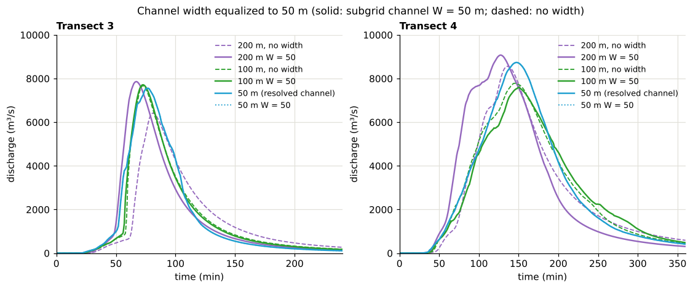

- **Transect 3 in the gorge lines up when the channel widths are matched.** The peak of the 200 m grid becomes
  larger and earlier, and the differences among the three grids become small. The main river down to transect 3
  is a gorge whose valley bottom is a few tens of metres wide, so the cell-wide channel was too wide.
- **The most downstream transect 4, conversely, scatters.** Below transect 3 the valley bottom is more than 100 m
  wide, and a 50 m wide channel is too narrow. We think that on the 200 m grid the cells on either side of the
  channel are far higher than the bed, so the water runs fast inside a narrow trench, while on the 100 m grid the
  side cells are lower, so the water spills over and slows down.
- In short, **neither channel width = cell width nor a uniform 50 m suits the whole catchment**. This is the limit
  of representing a valley cross-section that widens with the water level by a single width. The channel width can
  be given cell by cell with `fn_width` (a comparison with widths varied by reach has not been made).
- The computation of the 50 m grid with a 50 m width (= the cell width) nearly coincides with the computation with
  the resolved channel. When the width equals the cell width, the subgrid channel returns, as designed, to the
  representation of a resolved channel.

## Eight-direction exchange and 4 neighbours

We do the same computations with 4 neighbours, closing the diagonal exchange (bottom row of the figure in "Grid
resolution" above; its vertical axes are much smaller than in the top row).

- The discharge reaching the most downstream transect 4 is less than 1 % of ENC on every grid. Even after 6 hours,
  almost all the rain that fell remains in the catchment. **Even on a finer grid, the channel network stays cut up
  with 4 neighbours.** Reaches aligned with the axes pass water and diagonal reaches stop it, so whether discharge
  comes out is decided by the direction of the channel, not by the resolution.
- Many structured-grid models exchange basically along the axes and cannot pass a one-cell-wide channel
  diagonally, so they couple the channel network as a separate one-dimensional channel model. The ENC grid lets the
  channel network flow as a raster through the eight-direction exchange, so even on a coarse 200 m grid a catchment
  computation works with just a depression-filled elevation and a channel mask
  ([Passage-width adjustment](../../../docs/en/users_guide/passage_width.md)).

## Treatment of the advection term

So far we used the default momentum-conservative advection scheme (scheme 3). We also compute the same three grids
with the diffusion wave that drops the advection term (strictly the local inertial equation;
[primer](../../../docs/en/users_guide/shallow_water.md)) and with old scheme 1 (non-conservative with upwind
weighting; upwind index 0.1, 0.5 and 1.0).

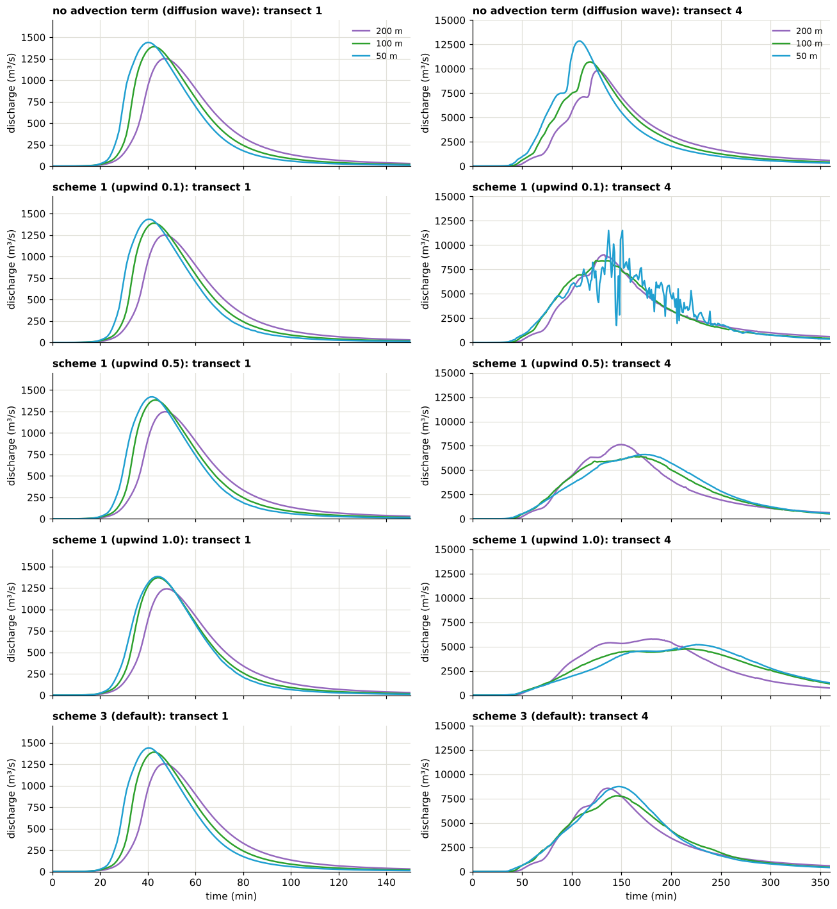

| Advection term | 200 m | 100 m | 50 m |
|---|---|---|---|
| none (diffusion wave) | 1.15 times, earlier | 1.4 times, earlier | 1.5 times, earlier |
| scheme 1 (upwind 0.1) | 1.05 times | 1.1 times | oscillates violently |
| scheme 1 (upwind 0.5) | 0.9 times, later | 0.8 times, later | 0.75 times, later |
| scheme 1 (upwind 1.0) | 0.7 times, later | 0.6 times, later | 0.6 times, later |

(Ratio of the peak at the most downstream transect 4 to that of scheme 3 on the same grid. The peak at the upstream
transect 1 hardly changes with any treatment.)

### Dropping the advection term makes the downstream peak larger and earlier

Dropping the advection term makes the peak at the most downstream transect 4 larger and earlier, and the difference
widens as the grid becomes finer. The upstream transects 1 and 2, on the other hand, hardly change. **The advection
term matters downstream, where the discharge is large.** We follow the reasons in order.

1. **The velocity of the diffusion wave is decided only by the balance between the local water-surface slope and
   friction.** That acceleration takes time, and that fast water mixing with slow water decelerates, do not enter
   the computation.
2. **In steep, uniform flow, inertia has no role.** The advection term acts where the velocity varies from place to
   place. In the steep upstream channels the flow is close to the balance between the bed slope and friction, and the
   velocity changes little along the flow, so the advection term stays small even when the flow is fast.
3. **The difference arises where the flow changes over a short distance.** At changes in slope and steps, bends,
   tributary confluences, and where the channel water spreads to the side cells, the velocity changes within a few
   cells. With the advection term, acceleration needs distance, and the flow loses energy where fast water enters
   slow water (a hydraulic jump) and where it mixes with water entering from the side. Without it, the velocity
   follows the water-surface slope instantly and this loss is absent, so the flood wave travels faster, its front
   steepens, and the peak becomes larger.
4. **The size of the difference depends strongly on the channel roughness** (figure below). Lowering the channel
   roughness from 0.04 to 0.02 turns the flood wave without the advection term into a bore (a steep wave front) by
   the time it reaches transect 4, and the peak exceeds twice that of scheme 3. Deeper water travels faster, so the
   front steepens as it goes downstream, and the steepened front speeds up the flow further: a self-reinforcement.
   In reality hydraulic jumps and turbulence dissipate this acceleration, but the equation without the advection
   term has no term to represent it. The peak value of the bore changes with the time step and the grid and is not a
   converged value. Scheme 3 does not form a bore even with roughness 0.02; its peak is only 20–50 % larger than with
   roughness 0.04. On the other hand, going back to the depression-filled elevation from before the bed
   conditioning, with the roughness kept at 0.04, the change from dropping the advection term is almost the same
   (`filled_noadv`).
5. **A finer grid widens the difference.** We think this is because the channel cells become narrower and deeper,
   which raises the velocity at the same discharge, and because the numerical diffusion of the discretization
   decreases, so the wave front is represented more sharply.

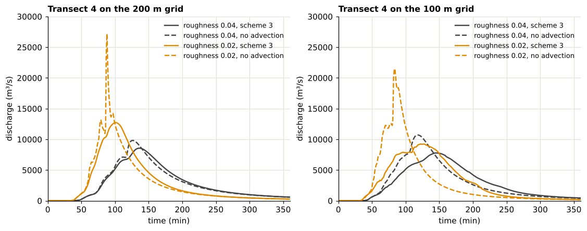

In short, the results of computations without the advection term are strongly affected by the channel roughness
and by "how far the abrupt changes of the flow and the steepening wave front are resolved". Existing
diffusion-wave and kinematic-wave catchment models usually absorb this into **roughness coefficients calibrated for
each resolution**. With the advection term, the acceleration at abrupt changes of the flow is held back by
dissipation equivalent to hydraulic jumps and by the exchange of momentum with the water entering from the side and
with the valley bottom, and the changes with the roughness and the grid become smaller.

### What is the advection term decelerating?

As the content of how the advection term slows and lowers the wave in this case, three things can be considered
(how much each contributes has not been separated).

1. **Dissipation at abrupt changes of the flow**: the advection term (momentum-conservative form) gives dissipation
   equivalent to a hydraulic jump at steps and changes in slope. On a stair-like bed in a one-cell-wide channel
   (stair3 of [test/bendloss](../../../test/bendloss/en/README.md)), dropping the advection term makes the velocity
   excessive at each step, the flood wave grows into a bore, and the peak exceeds twice that of the computation with
   the advection term. Changes in slope and grid-size steps remain in the conditioned-bed elevation too.
2. **Deceleration by water entering from the side**: in rainfall runoff, most of the channel discharge enters from
   the side, from the slopes and tributaries, and carries no momentum in the downstream direction. The
   momentum-conservative form naturally includes the effect of mixing in this water and decelerating the channel
   water (it agrees well with the analytical solution of spatially varied flow;
   [test/bendloss](../../../test/bendloss/en/README.md)).
3. **Exchange of momentum with the flooded valley bottom**: in a flood, the cross-section of the main stream spreads
   beyond the single cell of the channel mask into the valley-bottom cells on either side, and their slow water takes
   momentum from the main stream at bends and confluences. The artificial part, in which a thin film on the banks
   that carries almost no water decelerates the main stream, is removed by the default treatment
   ([One-cell-wide channels and the upwind donors of the advection term](../../../docs/en/users_guide/advection_donor.md)).

### Why it is said that advection matters little in mountain runoff

In steep channels the bed slope dominates the variation of the water-surface slope and of the velocity head in the
momentum equation, so the propagation of waves at the scale of a reach can be reproduced well by kinematic or
diffusion waves; that is the reasoning. The kinematic flow number of Woolhiser & Liggett (1967) and the criterion of
Ponce et al. (1978) are known, and mountain runoff, with steep slopes and long wave time scales, satisfies them (how
to read the criteria:
[which equations are used for which phenomena](../../../docs/en/users_guide/shallow_water.md#phenomena) in the
primer). In this example too, the steep upstream transects 1 and 2 hardly changed with or without the advection
term. But this holds when the bed and the flow are viewed smoothly at the scale of a reach. At the grid scale the
flow changes abruptly and locally at steps, changes in slope, bends and confluences, and inertia can no longer be
neglected (in this example: downstream, where the discharge is large, and in the computations with a lower channel
roughness). We think it is better to read "advection matters little" as a statement about wave kinematics, not
about the local energy balance. Existing models treat this local dissipation by including it in the roughness
coefficient, which is a sound engineering approach.

### Relation to one-dimensional channel models

Analyses without the advection term are common in one-dimensional channel models too. Adding the momentum term of
lateral inflow captures item 2 above, but the dissipation of item 1 and the exchange with the valley bottom of item 3
have to be given in other forms in a one-dimensional model with given cross-sections (roughness, local loss
coefficients, momentum exchange in compound sections). We expect that a one-dimensional model with the momentum of
lateral inflow approaches, but does not equal, the ENCflow results with the advection term (not checked).

### Scheme 1 and the upwind index

Old scheme 1 is non-conservative: it cannot consistently represent the exchange of momentum with the water entering
from the side or with the valley bottom, and it carries numerical viscosity from upwind weighting
(`p_adv_upwind_index`). The results change greatly with this upwind index.

- **With weak upwinding (0.1)**, the 200 m and 100 m grids give values close to scheme 3, but on the 50 m grid the
  maximum velocity becomes abnormally large and the most downstream discharge swings up and down violently every
  minute. We think a non-conservative scheme with weak upwinding becomes unstable in fast flow on a fine grid.
- **The stronger the upwinding (0.5, 1.0)**, the more numerical viscosity, and the flood wave becomes later and
  smaller. With upwinding 1.0, differences start to appear even at the upstream transect 2.
- Between the two ends of the upwind weighting, the most downstream peak differs by a factor of more than 1.5. The
  numerical viscosity of upwind weighting is proportional to the grid spacing and the velocity, so the difference
  should shrink on a finer grid, but it does not (the cause has not been investigated).

In short, scheme 1 is a scheme whose results move greatly with the choice of upwind weighting, carrying one extra
calibration parameter. What ENCflow uses as the default is the momentum-conservative scheme, which adds no
calibration parameter.

### Does weak resolution dependence mean closeness to reality?

No. That the answer does not move much when the grid is refined (convergence) is a property desired of a physically
based model, but there is no guarantee that what it converges to matches observations. In this example too, the
most downstream peak of the 200 m grid becomes about 1.5 times larger just by halving the channel roughness, and
changes by nearly a factor of two when the way the bed height is given is changed. Neither the roughness nor the bed
has been calibrated against observations. The results of scheme 3 also cannot be called converged: the most
downstream peak is low only on the 100 m grid, and the gorge transect 3 differs greatly between 200 m and 100 m.
There is no comparison with observations for this catchment, and **whether it is close to reality has not been
checked**. On the other hand, a diffusion wave could probably also be fitted to observations by calibrating the
roughness for each resolution. Still, a model that does not need recalibration each time the resolution changes is
**"convenient"**, in that it allows grasping the whole on a coarse grid first and then refining only where needed.
Please keep the distinction: "convenient", not "correct".

### What is special about this case

This case runs 100 mm of rain in one hour without losses and reaches more than 8,000 m³ per second near the
catchment outlet, an extreme discharge. Both the dissipation at abrupt changes of the flow and the water entering
from the side grow with the discharge, so the effect of the advection term probably appears larger than in an
ordinary flood. In a milder flood, the difference due to the treatment of the advection term should be smaller. You
can check this by changing the rain in the settings and running `run_cases.sh`.

## Summary: as properties of the ENC grid

- **Changing the grid changes the peaks by around 10 %, not only upstream and in the gorge but also near the
  catchment outlet.** Upstream it nearly converges at 100 m and below; in the gorge the peak is smaller on the
  coarse grid by the amount that the cell-wide channel is too wide; at the most downstream point it differs by how
  the large tributary's flood comes on each grid. To grasp the arrival times of the flood wave and the connectivity
  of the flow over the whole catchment, the 200 m grid is enough; when you also want the value of the peak
  discharge, compare with computations on other grids or with a channel width given, and check the range of values.
- **The way the inputs are given changes the results more than the grid.** The most downstream peak changes more
  with the way the bed height is given and with the channel roughness than with the grid. Decide the bed and the
  roughness by comparison with observations.
- **Even at coarse resolution, the flow is not obstructed.** The eight-direction exchange lets a one-cell-wide
  channel network flow as a raster, so a catchment computation works without adding a one-dimensional channel model
  or flow-direction data.
- **The price of resolution is computational cost.** Halving the grid spacing multiplies the cells by 4 and the steps
  by 2–4 following the increase in velocity, and the computing time grows by about an order of magnitude. A practical
  way is to grasp the overall behaviour first at around 200 m and then refine according to the places and purposes
  that need it.

## Accuracy limits and what this example cannot do

- **Not compared with observations.** The bed height, channel width and roughness are typical values; the results
  are for seeing "how things change when the settings change". Reproducing a real flood requires comparison with
  observed discharge.
- **The channel cross-section is a rectangle as wide as the cell** (the subgrid channel appears only in a comparison
  with a uniform width). Valley cross-sections that widen with the water level, levees and structures are not
  represented.
- **Runoff is surface flow only.** Flow that reaches the rivers through the soil is not treated, the rain is uniform
  over the catchment, and the losses are only the two simplest models. Flow inside the soil layer and runoff from
  the saturated parts of the valleys are treated in [examples/source_area](../../source_area/en/README.md). A
  rainfall distribution and time variation of infiltration can be added with the models in the chapters of the
  [users guide](../../../docs/en/users_guide.md).
- **The rules of the advection term have limits.** The exchange of momentum between a one-cell-wide channel and the
  wet cells beside it is counted by rules per grid connection, so in reaches where the corner cells of a stair-like
  channel are submerged, the water level can come out high
  ([Advection schemes](../../../docs/en/users_guide/advection.md) §4.4, limits).
- A 50 m grid computation takes about an hour per run on 4 cores.

## Files

| File | Contents |
|---|---|
| `param.txt` | base case on the 200 m grid (the reference of this example) |
| `param_100m.txt`, `param_50m.txt` | base cases on the 100 m and 50 m grids |
| `run_cases.sh` | runs the comparison computations together (writes the changed settings to `wrk_*.txt` and puts the results in `result_*`) |
| `plot_results.py` | figures (`figs/`; with the argument en, the English version in `en/figs/`) |

## Related documents

- [tutorials/chichibu](../../../tutorials/chichibu/en/README.md) — the tutorial that builds up the computation step
  by step on the same catchment
- [examples/source_area](../../source_area/en/README.md) — an example that computes, on a headwater catchment cut out
  of the Chichibu terrain, how rain passes through the soil layer and comes out into the rivers where the valleys are
  saturated; it also compares this with surface flow only
- [test/chichibu](../../../test/chichibu/en/README.md), [test/chichibu_cond](../../../test/chichibu_cond/en/README.md)
  — regression cases of the same catchment (100 m grid)
- [Advection schemes](../../../docs/en/users_guide/advection.md),
  [Passage-width adjustment](../../../docs/en/users_guide/passage_width.md),
  [Channels](../../../docs/en/users_guide/channel.md), [Boundary conditions](../../../docs/en/users_guide/boundary.md),
  [Courant number and how to choose the time step](../../../docs/en/users_guide/courant.md)
- [examples/debris_fan](../../debris_fan/en/README.md) — an example for another phenomenon (a debris flow running down
  a valley and spreading on a fan) confirming that the runout area and arrival times line up when the grid spacing
  and the orientation of the valley relative to the grid are changed; it includes a comparison with 4 neighbours
- [developer.md](../../../docs/developer.md) (in Japanese) §111 (conditioned-bed elevation), §113.8 (investigation of
  the most downstream peak on the 100 m grid)
