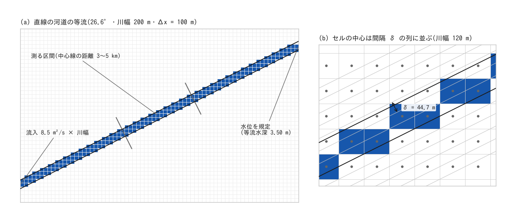
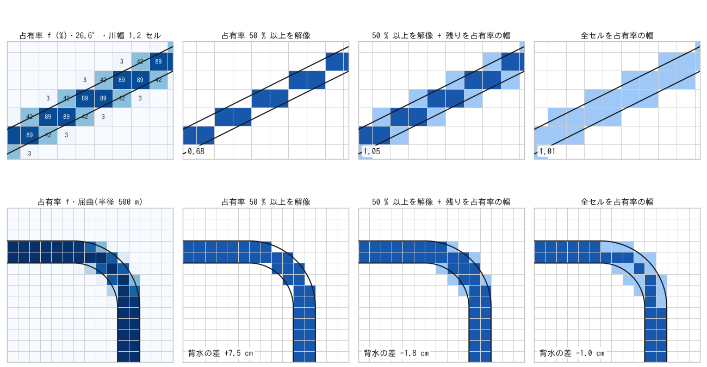
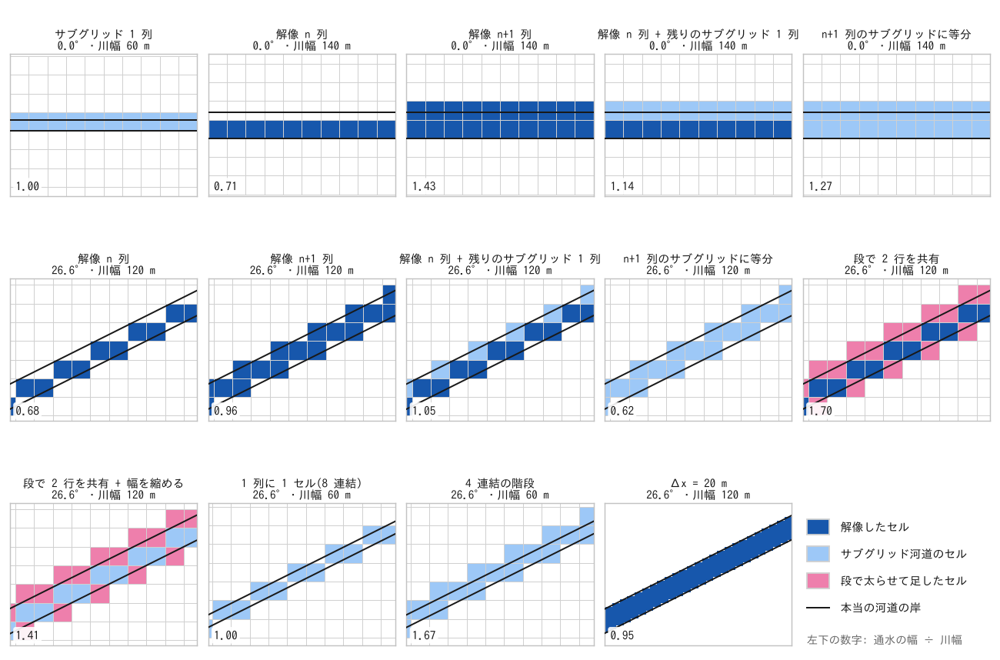
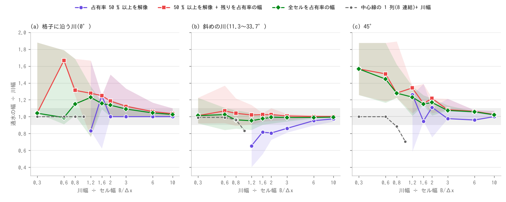
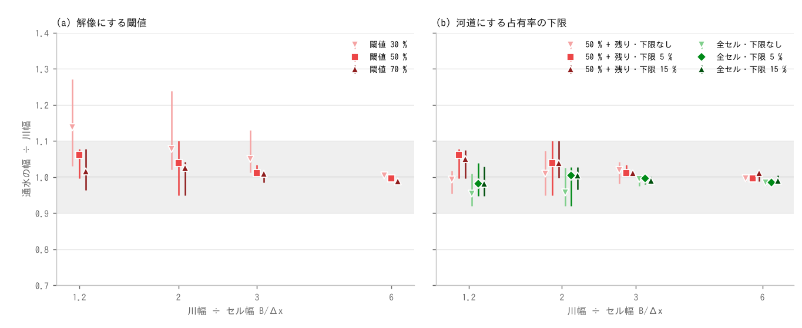
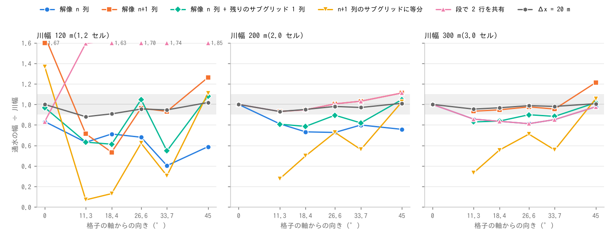
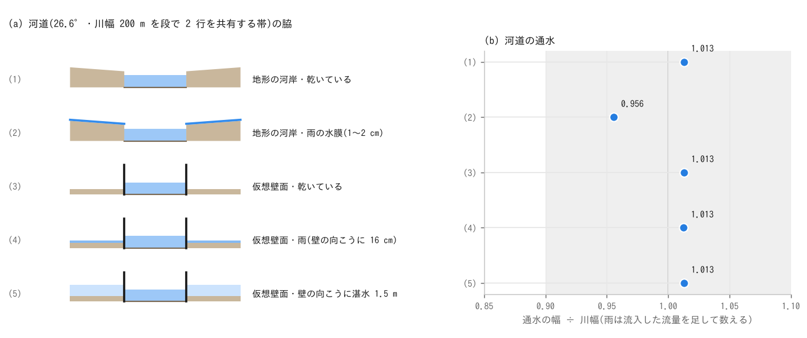
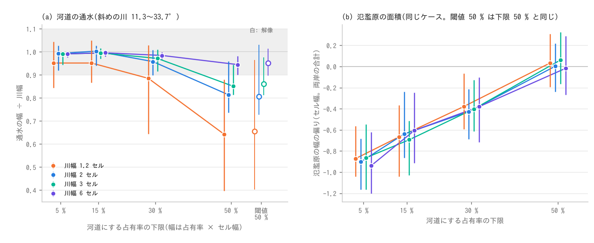

# examples/coarse_channel — 粗い格子で川を表す: 河道マスクの作り方と通水の精度

[English](en/README.md)

粗い格子(この例題では Δx = 100 m)で川を計算するときは、川をセルのラスタで表します。実務では、河道のポリゴンや
高解像度の河道マスクから、粗いセルごとに河道が占める面積の割合(占有率 f)を求め、河道マスク(`fn_rw`)とサブグリッド
河道の幅(`fn_width`)を作ります。同じ川でも、この作り方で河道が流せる水の量(通水能)が変わります。

この例題は、占有率から機械的に作る作り方を中心に、直線の河道の定常の等流から逆算した「通水の幅」で、川幅・格子に
対する向き・格子との位置のずれ・屈曲・河道マスクの連結・河道の脇の水による違いと、河道にする占有率の下限による
川沿いの氾濫原の面積との兼ね合いを比べます(合わせて 1,203 ケース)。
中心線から格子の上の帯を組み立てる作り方(セルの中心の列・段の太らせ)も比べ、なぜそうなるかの説明に使います。

## 要点

| 問い | 答え | 図 |
|---|---|---|
| 河道のポリゴンや高解像度のマスクから、粗い河道マスクをどう作るか | 占有率 f が 5 % 以上のセルをすべて河道にし、サブグリッド河道の幅を f·Δ にする(f がほぼ 1 のセルは解像)。斜めの川で川幅 1.6〜3 セルなら通水の幅が川幅の 0.90〜1.03 倍、6 セル以上なら 0.98〜1.00 倍。屈曲も太らせずに、細かい格子との背水の差が 1 cm 以内 | [occ](#1-占有率で作る河道マスク) |
| 占有率の小さいセルまで河道にしてよいか | 下限を付けた方がよい。計算本体は、比べる側の幅の 5 % 未満の幅のセルを開口の振り替えと通水率で計算の外と同じに数えるので、数 % のセルまで入れても斜めの川(川幅 1.2〜3 セル)で 0.92〜1.03 倍に収まるが、下限 5 % の結果とは最大 0.07 違う。下限 5 % と 15 % はほぼ同じ | [sens](#2-解像にする閾値と河道にする占有率の下限) |
| 閾値(50 %)で河道・非河道を分けるだけでよいか | 足りない。斜めの川で 0.40〜1.03 倍(川幅 1.2〜3 セル)、屈曲で背水 +7.5 cm。50 % 以上を解像して残りを占有率の幅にすると、斜めの川では全セルとほぼ同じだが、屈曲で背水が 2〜4 cm 小さく出る | [occ](#1-占有率で作る河道マスク)・[bend](#3-屈曲) |
| 川幅 1 セル未満は | 中心線を 1 列に 1 セル(8 連結)のセルにし、川幅をそのまま与える(0.6 セルまで 0.99〜1.00 倍)。占有率で作ると川が隣のセルに分かれて 0.84〜1.88 倍。4 連結の階段も 26.6〜45° で 1.4〜2.7 倍になる | [mask](#4-川幅-1-セル未満-中心線の-1-列と河道マスクの連結) |
| 格子に沿う川・45° の川は | 占有率の作り方は、半端なセルが横に並ぶ所で多めに流す。川幅 2 セルで、格子に沿う川は岸の位置で 1.00〜1.20 倍、45° は 1.02〜1.22 倍。6 セルで +7 %・+6 % まで。格子に沿う区間は、列ごとに解像したセル + 残りの幅のセル 1 つに詰め直すと 0.97〜1.14 倍 | [occ](#1-占有率で作る河道マスク)・[side](#横に並んだ河道のセル) |
| 川幅 6〜10 セルの岸の階段は | 占有率の全セルの作り方で 0.98〜1.00 倍(斜めの川)。閾値だけで作ると、岸の階段で 0.14〜0.40 セル分の幅を失って 0.90〜1.01 倍 | [occ](#1-占有率で作る河道マスク)・[wide](#岸の階段) |
| 屈曲は太らせるか | 占有率の全セルの作り方なら要らない(背水の差 −1.0〜−0.1 cm)。閾値だけの帯は急な屈曲で +7.5 cm。帯を中心線から組み立てるなら、段で 2 行を共有するように太らせる(−3.6〜−1.5 cm) | [bend](#3-屈曲) |
| 河道の脇の非河道セルに薄い水があっても大丈夫か | 仮想壁面(`fn_bank`)で区切った河道は、壁の向こうが乾いていても、雨で 16 cm たまっても、1.5 m 湛水しても同じ。地形で表した河岸(壁なし)に雨の水膜(1〜2 cm)があると、1.013 → 0.956 倍に落ちる | [wet](#6-河道の脇の水) |
| 河道のセルの中の氾濫原は | 河道のセルは堤内地を持たないので、下限 5 % の作り方では、川沿いの氾濫原が川 1 本あたり約 0.9 セル幅(両岸の合計)狭くなる。下限を 15 % にすると通水をほとんど変えずに 0.65 セル幅、30 % で 0.4 セル幅(斜めの川 2〜3 セルの通水 0.90〜1.01 倍)。閾値 50 % で解像すると偏りはなくなるが、通水は 0.73〜1.03 倍(2 セル) | [fmin](#7-河道のセルの中の氾濫原-下限を上げる作り方) |

数字は 通水の幅 ÷ 川幅 です。1 なら川幅どおりに流れ、1 より小さいと河道の水位が高く出ます(マニング式で、通水の幅が
1 割少ないと水深は約 6.5 % 深い)。範囲は、向きと格子との位置のずれを変えた全ケースの最小〜最大です。

## 確かめ方



直線で一様な河道(勾配 1/1000、粗度 0.03、長さ 8 km)の上流端から、川幅 1 m あたり 8.5 m³/s の流量を入れ(区間流入)、
下流端に等流水深の水位を与えて、定常になるまで計算します(粗い格子 8 時間、細かい格子 4 時間)。中ほどの 2 km(中心線の
距離 3〜5 km)の河道セルの水深の平均 h と、水位を中心線の距離に当てはめた直線の傾き I(水面勾配)から、広い矩形断面の
マニング式で通水の幅を逆算し、川幅 B で割ります。

```math
B_\mathrm{eff} = \frac{n\,Q}{h^{5/3}\sqrt{I}}
```

マニングの等流水深は 3.50 m です。粗い格子は Δx = 100 m、比べる細かい格子は Δx = 20 m です。河道の外のセルは計算せず
(領域マスクの外)、河道のセルには越流しない仮想壁面の堤防(河床 + 10 m)を置きます(河道の脇の水の系列を除く)。

河道の向きは、格子の軸に対する勾配 p/q で与えます(0、1:5、1:3、1:2、2:3、1:1 = 0°、11.3°、18.4°、26.6°、33.7°、45°)。
占有率の作り方では、中心線の位置を格子に対して 0・0.25・0.5 セルずらした 3 通りを計算します(実際の川の位置は格子に
そろわないため)。

## 河道マスクの作り方

### 占有率で作る



占有率 f は、粗いセルの面積のうち本当の河道(中心線から ±B/2 の帯)が占める割合です(1 セルを 64 × 64 点、屈曲は
24 × 24 点で数える)。f が 5 % 未満のセルは河道にしません。

| 作り方 | 河道にするセル | 幅 |
|---|---|---|
| 占有率 50 % 以上を解像 | f ≥ 50 % | 解像(閾値だけ) |
| 50 % 以上を解像 + 残りを占有率の幅 | f ≥ 5 % | f ≥ 50 % は解像、それより小さいセルは f·Δ のサブグリッド河道 |
| 全セルを占有率の幅 | f ≥ 5 % | f·Δ のサブグリッド河道(f ≈ 1 は解像) |
| 全セルを占有率の幅・下限 15・30・50 %(7 節) | f ≥ 15・30・50 % | f·Δ のサブグリッド河道(f ≈ 1 は解像) |

感度を見るため、解像にする閾値を 30・70 % に、下限を 0・15 % にした作り方も計算します。河道マスクが途切れる(流入口
から流出口まで 8 連結でつながらない)ケースは作りません(閾値だけの作り方の、川幅 1 セル未満の 35 ケース)。

上の段の数字は 通水の幅 ÷ 川幅、下の段は細かい格子との背水の差です。

### 中心線から帯を組み立てる(仕組みを見るため)



向きを勾配 p/q で与えると、セルの中心は中心線からの距離が δ = Δx/√(p² + q²) おきの「列」に並びます(0° で 100 m、
11.3° で 19.6 m、18.4° で 31.6 m、26.6° で 44.7 m、33.7° で 27.7 m、45° で 70.7 m)。この列を選んで帯を作ります。

| 作り方 | 河道にするセル |
|---|---|
| サブグリッド 1 列 | 格子に沿う 1 行のセルに幅 B を与える(B ≥ Δx なら解像したセル) |
| 解像 n 列 | 中心が川幅に収まる n = floor(B/δ) 列のセルを解像する |
| 解像 n+1 列 | もう 1 列足して解像する |
| 解像 n 列 + 残りのサブグリッド 1 列 | n 列を解像し、外側の 1 列を残りの幅 B − nδ のサブグリッド河道にする |
| n+1 列のサブグリッドに等分 | n+1 列のすべてを幅 B/(n+1) のサブグリッド河道にする |
| 段で 1 行・2 行を共有 | 解像 n 列の帯を、隣り合う列の境目で、中心線に最も近い 1 行・2 行が両方の列の解像セルになるように太らせる(屈曲では、向きが縦に近い区間は行の境目で同じことをする) |
| 段で 2 行を共有 + 幅を縮める | 2 行を共有するように太らせた帯の全セルを、表す面積が川幅と同じになる幅のサブグリッド河道にする |
| 1 列に 1 セル(8 連結) | 各列で中心線に最も近い 1 セルに幅 B を与える(D8 の落水線と同じ型) |
| 4 連結の階段 | 中心線からの距離が Δx(cos θ + sin θ)/2 以内のセルに幅 B を与える(段で 2 セルが横に並ぶ) |
| Δx = 20 m | 細かい格子で round(B/δ) 列を解像する(表した幅 round(B/δ) δ で割る) |

縮図の濃い青は解像したセル、薄い青はサブグリッド河道のセル、桃色は太らせて足したセル、黒い線は本当の河道の岸です。

## 結果

### 1. 占有率で作る河道マスク



線は中央値、帯は最小〜最大です(格子との位置のずれ 3 通り。斜めの川は向き 4 つも含む)。灰色の破線は、中心線を
1 列に 1 セルのセルにして川幅を与えた作り方です(川幅 1 セル以下)。

- **全セルを占有率の幅にする作り方が、どの向きでもいちばん安定する**: 斜めの川で、川幅 1.2 セルは 0.84〜1.04 倍、
  1.6〜3 セルは 0.90〜1.03 倍、6・10 セルは 0.98〜1.00 倍です。表す面積は川幅とほぼ同じです(下限で捨てる分だけ
  少ない)。
- **閾値だけの作り方は、斜めの川で足りない**: 1.2 セルで 0.40〜0.96 倍、2 セルで 0.73〜1.03 倍、6 セルでも 0.90〜1.01 倍。
  帯のくびれと岸の階段のためで、中心線から組み立てた「解像 n 列」と同じ性質です(5 節)。川幅 1 セル未満では、
  河道マスクが途切れるケースが多くなります。
- **50 % 以上を解像して残りを占有率の幅にすると、斜めの川では全セルとほぼ同じ**: 1.6〜3 セルで 0.94〜1.10 倍、
  6・10 セルで 0.99〜1.02 倍。ただし格子に沿う川で、岸がセルの真ん中に来ると半端なセルまで解像になって多くなり
  (2 セルで 1.50 倍)、屈曲では背水が細かい格子より 2〜4 cm 小さく出ます(3 節)。
- **格子に沿う川と 45° の川は多めに出る**: 半端なセル(サブグリッド)が、解像したセルや別の半端なセルと横に並ぶ所で、
  斜めの辺でもつながって通水が増えます(5 節)。全セルの作り方で、格子に沿う川は 1.00〜1.20 倍(2 セル)、1.00〜1.04 倍
  (10 セル)、45° は 1.02〜1.22 倍(2 セル)、1.02〜1.04 倍(10 セル)。格子に沿う川は、岸がセルの境に近ければ正確です。
- **川幅 1 セル未満は、占有率で作らない**: 川が中心線の両側のセルに分かれ、横に並んだサブグリッドのセルで多く流れます
  (0.84〜1.88 倍)。中心線の 1 列に川幅を与える作り方なら 0.99〜1.00 倍です(4 節)。

### 2. 解像にする閾値と、河道にする占有率の下限



斜めの川(11.3〜33.7°)、格子との位置のずれ 0 の 4 つの向きの中央値と最小〜最大です。

- **閾値は 50〜70 % ならほぼ同じ**: 閾値 30 % は、半分以上が河道でないセルまで解像して多めになります(1.2 セルで
  1.03〜1.27 倍)。
- **下限は付けた方がよい**: 下限なしで占有率が数 % のセルまで河道にすると、全セルの作り方で 1.2 セル 0.92〜1.01 倍、
  2 セル 0.92〜1.03 倍、3 セル 0.97〜1.00 倍で、下限 5 % の結果と最大 0.07 違います(50 % 以上を解像 + 残りの作り方では
  0.10)。下限 5 % と 15 % の差は 0.01 以内です。屈曲の背水は、全セルの作り方で下限なし 3.2 / 2.8 / 3.0 cm、下限 5 % で
  1.5 / 2.7 / 2.5 cm です(細かい格子 2.5 / 2.9 / 2.6 cm)。
- 占有率が数 % のセルは、河道の縁が角をかすめるだけの細片で、その幅のキャップで流れはほぼ止まります。開口の動的な振り替え
  (`&list_enc` の `f_opening_dynamic`。既定 3)は、斜めの辺の角のセルが計算の外なら、塞がった開口として、その分の通過幅を
  近くの開いた辺へ回します。計算本体は、比べる側のセルの幅の 5 % 未満の幅の河道セルを、この振り替えと、河道内の流速の
  正規化(通水率)で、計算の外と同じに数えます(開発記録 §137)。それでも移流項はこのセルを濡れた隣として数えるので、
  下限 5 % の結果とは少し違います。

### 3. 屈曲


西から東へ流れる直線(3 km)、半径 R で 90° 右に曲がる円弧、南へ流れる直線(3.6 km)の河道です。川幅は 200 m(粗い格子で
2 セル)、半径は 500・1,000・1,500 m(川幅の 2.5・5・7.5 倍)。前後の直線は格子の軸に沿うので、上流の直線区間(中心線の
距離 1〜2.5 km)の水位が等流の水位より高い分(背水)は、屈曲が作る損失の大きさです。

| 作り方 | 細かい格子との背水の差(半径 500 / 1,000 / 1,500 m) |
|---|---|
| 全セルを占有率の幅 | −1.0 / −0.2 / −0.1 cm |
| 50 % 以上を解像 + 残りを占有率の幅 | −1.8 / −3.0 / −3.7 cm |
| 占有率 50 % 以上を解像(= 解像 n 列・段で 1 行を共有) | +7.5 / +3.3 / +1.7 cm |
| 段で 2 行を共有 | −1.5 / −3.6 / −3.0 cm |

- **細かい格子では、屈曲の上流の背水は 2.5〜2.9 cm**(半径によらない)。
- **全セルを占有率の幅にすれば、太らせなくても細かい格子と 1 cm 以内で合う**: 円弧の段の所の半端なセルが、区間どうしを
  つなぎます。
- **閾値だけの帯は、急な屈曲で背水が大きい**: 帯は円弧の所で 2 セルの階段になり、段の所で区間どうしが 1 セルの重なり
  でしかつながらないくびれができます(図 (a)・(c))。
- **中心線から帯を組み立てるなら、段で 2 行を共有するように太らせる**: 足すセルは円弧の 2 か所だけで(図 (b)・(d) の
  桃色)、急な屈曲の差が +7.5 → −1.5 cm になります。緩い屈曲では逆に背水が 3 cm 前後小さく出ます。1 行の共有では
  2 セル幅の帯は変わりません。
- 屈曲の中の水位(図 (f))は、閾値だけの帯で 30 cm 前後、細かい格子で 8 cm 高くなります(200 m ごとの河道セルの平均。
  外岸の盛り上がりを含む)。

### 4. 川幅 1 セル未満: 中心線の 1 列と河道マスクの連結


中心線をセルの 1 列にして、川幅 0.3〜1.0 セルの幅を与えます(1.0 は解像したセル)。

- **1 列に 1 セル(8 連結)なら、サブグリッドの幅がそのまま通水の幅になる**: 川幅 0.6 セルまでは、どの向きでも 0.99〜1.00 倍
  です。斜めの段は、隣の列のセルへ斜めの辺でつながります。この辺の幅の絞りは「幅 ÷ 斜めの辺の自然の幅(71 m)」で、1 本の
  流れの通り道としては川幅どおりになります。中心線の線分を、1 列に 1 セルになる 8 連結の線(Bresenham の線分描画など)で
  セルに置けば、機械的に作れます。
- **斜めに並ぶ 1 列のセルには、流せる幅の上限がある**: 1 セルの幅(解像したセル)を与えても、45° で 0.71 セル分、33.7° で
  0.76、26.6° で 0.82、18.4° で 0.85、11.3° で 0.89 セル分しか流れません。川幅がこの上限に近いと不足し、0.8 セルでは
  0.88〜0.97 倍です。
- **4 連結の階段は合わない**: 段の所で、横に並んだ 2 つのサブグリッドのセルが、直交の辺に加えて斜めの辺でも下流のセルと
  つながります。斜めの辺の絞り(幅 ÷ 71 m)は直交の辺(幅 ÷ 100 m)より緩いので、26.6〜45° で 1.4〜2.7 倍(川幅 0.3〜0.8 セル)、
  段の少ない 11.3〜18.4° では 0.78〜0.95 倍です。

### 5. なぜそうなるか: 格子の上の帯の形

中心線から帯を組み立てる作り方で、川幅・向きと通水の関係を切り分けます。

#### くびれ




- **川幅 1.2 セルの帯は、どの作り方でも合わない**(0.07〜1.85 倍)。この幅の帯は、横に並んだ数セルの区間が、1 セルの
  重なりか角だけで次の区間につながる「くびれ」を持ち、通水はくびれの形で決まります。解像 n 列は、18.4°・26.6°・45° で
  区間どうしが角だけでつながり、11.3° では 1 セルの重なりで、33.7° では重なりと角が交互につながります。
- 段で 2 行を共有するように太らせると、くびれは消えますが、面積が川幅の 1.8 倍前後に膨らんで 1.60〜1.85 倍になります。
- 川幅 2〜3 セルなら、1 列多く取る(解像 n+1 列)と 0.93〜1.03 倍です(45° を除く)。
- **占有率の作り方では、くびれの所の半端なセルが区間どうしをつなぐ**ので、閾値だけで捨てなければ同じ問題は起きません。

#### 岸の階段


- 川幅 6・10 セルの帯にはくびれがなく、段で行を共有する太らせは何も変えません。
- **不足は岸の階段で幅が失われるため**: 表した面積の幅から通水の幅を引くと、11.3〜33.7° で 0.14〜0.40 セル分です
  (図 (c)。川幅によらずほぼ同じで、向きが格子の軸に近いほど大きい)。45° では 0.04〜0.15 セル分です。
- 細かい格子(Δx = 20 m)でも、同じセル数の川で 0.22〜0.72 セル分を失います(水深 ÷ セル幅が 0.035 と 0.175 で違うため、
  失う幅は格子の幅に比例しない)。
- **占有率の作り方では、岸の半端なセルが階段を埋める**ので、川幅 6・10 セルの斜めの川が 0.98〜1.00 倍になります。

#### 横に並んだ河道のセル


- 格子に沿う川で、解像したセルの横に残りの幅のサブグリッドのセルを並べると 0.97〜1.14 倍、同じ幅のサブグリッドのセルに
  等分すると 1.07〜1.37 倍になります。横に並んだ河道のセルは、直交の辺のほかに斜めの辺でも下流のセルとつながり、
  斜めの辺の絞り(幅 ÷ 71 m)が直交の辺(幅 ÷ 100 m)より緩いためです。サブグリッド河道の前提(1 セル幅の線の河道)の
  外です。
- **占有率の作り方で、格子に沿う川と 45° の川が多めに出るのも同じ理由**です。斜めの川(11.3〜33.7°)では、半端なセルの
  並び方が区間ごとに変わり、ほぼ打ち消し合います。

### 6. 河道の脇の水



26.6° の直線の河道(川幅 200 m)を、段で 2 行を共有するように太らせた帯で表し、両側 300 m に次の 5 つの構成を置きます。
雨のケースは全域に 20 mm/h の一定の雨で、通水の幅は、上流端の流量に、測る区間の中ほどより上流で河道に入る雨を足して
数えます。

| 構成 | 河道の脇 | 通水の幅 ÷ 川幅 | 河道の水深 |
|---|---|---:|---:|
| (1) 地形の河岸・乾いている | 河床 + 4 m(水面より 0.5 m 高い)、河道へ 2 % の横断勾配 | 1.013 | 3.474 m |
| (2) 地形の河岸・雨 | 同じ河岸に雨。河岸の水膜は河道の脇で 1〜2 cm | 0.956 | 3.623 m |
| (3) 仮想壁面・乾いている | 河道のセルに仮想壁面(河床 + 10 m)、壁の向こうは水平な地盤 | 1.013 | 3.474 m |
| (4) 仮想壁面・雨 | 同じ構成に雨。壁の向こうに 16 cm たまる(河道には入らない) | 1.013 | 3.482 m |
| (5) 仮想壁面・湛水 | 壁の向こうに水深 1.5 m の静かな池 | 1.013 | 3.474 m |

- **仮想壁面で区切った河道は、壁の向こうの水に影響されない**: 移流項は、仮想壁面の向こうのセルを、濡れていても乾いた
  セルと同じに数えません([移流項のスキーム](../../docs/users_guide/advection.md) §4.4)。(3)〜(5) の通水は同じです。
- **地形で表した河岸の薄い水膜は、河道の通水を 5.6 % 減らす**: 壁がないと、移流項は濡れた河岸のセルを数えます。
  雨の流入で水深が深くなる分(流量 1.05 % 増で 0.6 %)を除いても、水深が 3.6 % 深くなります(13 cm)。移流項の既定の
  規則は、河岸の薄い水膜を代表させない扱いを持ちますが(test/wetbank)、この帯の形では残ります。
- (1) と (3) が 1.005(5 節の同じ帯)でなく 1.013 なのは、河道の外のセルを計算するか(この節)、領域の外にするか
  (ほかの節)の違いです。

### 7. 河道のセルの中の氾濫原: 下限を上げる作り方



(a) 斜めの川(11.3〜33.7°)の通水の幅 ÷ 川幅(中央値と最小〜最大。ずれ 3 つと向き 4 つ)。白の印は閾値 50 % で解像
する作り方(閾値だけ)。(b) 同じケースの氾濫原の幅の偏り(計算の氾濫原の幅 − 本当の氾濫原の幅。セル幅で、両岸の
合計。平均と最小〜最大)。

河道のセルは堤内地を持ちません(利用者ガイドの[河道](../../docs/users_guide/channel.md#サブグリッド河道幅))。占有率の
作り方では、河道のセルの中にある氾濫原は計算から消え、河道でないセルの中にある河道の切れ端は氾濫原として計算されます。
測る区間でこの 2 つを帯の幾何から数え(浸水の計算ではありません)、河道にする占有率の下限を 5 %(1 節の全セルの
作り方)から 15・30・50 % に上げた作り方の通水と比べます(系列 fmin。向き 6 つ × 川幅 1.2〜10 セル × ずれ 3 つ)。

| 下限 | 氾濫原の幅の偏り(セル幅) | 表した河道の面積 | 通水の幅 ÷ 川幅(斜めの川)<br>1.2 / 2 / 3 / 6 セル | 屈曲の背水の差 (cm) |
|---|---:|---:|---|---:|
| 5 % | −0.86〜−0.94 | 0〜−1 % | 0.95 / 0.99 / 0.99 / 0.99(最小 0.84) | −1.0〜−0.1 |
| 15 % | −0.60〜−0.77 | 0〜−3 % | 0.95 / 1.00 / 1.00 / 1.00(最小 0.87) | −1.7〜−0.8 |
| 30 % | −0.35〜−0.43 | −1〜−8 % | 0.89 / 0.96 / 0.97 / 0.98(最小 0.64) | −1.7〜+0.2 |
| 50 % | −0.03〜+0.06 | −2〜−22 % | 0.64 / 0.81 / 0.85 / 0.95(最小 0.40) | +6.0〜+8.1 |
| 閾値 50 % を解像 | −0.03〜+0.06 | −3〜+2 % | 0.66 / 0.81 / 0.86 / 0.95(最小 0.40) | +1.7〜+7.5 |

氾濫原の幅の偏りと河道の面積は、斜めの川の川幅ごとの平均の範囲(川幅 1.2〜10 セル)です。通水は中央値、屈曲は
半径 500〜1,500 m の範囲です。

- **下限 5 % の作り方では、川沿いの氾濫原が川 1 本あたり約 0.9 セル幅(両岸の合計)狭くなる**: 川幅によりません。
  格子に沿う川と 45° の川も同じ程度で、岸の位置で 0〜1.8 セル幅です。氾濫原の幅が 20 セルなら約 5 %、5 セルなら
  約 20 % にあたります。
- **下限を上げると氾濫原が戻り、河道が細る**: 15 % で約 0.65、30 % で約 0.4 セル幅の偏りに減り、50 % でほぼなく
  なります。その分、河道でないセルに残る河道の切れ端が増え、表した河道の面積は狭い川ほど小さくなります。
- **15 % は通水をほとんど変えない**: 斜めの川の中央値は 5 % と 0.01 以内です。45° の川の多めの通水が少し増え
  (川幅 1.6〜3 セルで +0.04)、屈曲の背水が 1 cm 前後小さく出ます。
- **30 % は、川幅 2 セル以上なら通水 0.90〜1.01 倍**: 川幅 1.2〜1.6 セルの川では帯にくびれが戻り、0.64〜1.03 倍に
  下がります。格子に沿う川の多めの通水は消えます(川幅 2〜10 セルで 1.00。横に並んだ半端なセルが河道でなくなるため)。
- **50 % まで上げるなら、幅を占有率にせず解像に**: 氾濫原の勘定は同じで、表した河道の面積は平均で偏らず、斜めの川の
  通水も同じか少し良くなります。それでも斜めの川は 0.66〜0.86 倍(川幅 1.2〜3 セル)で、河道の水位は高く出ます。

## 河道マスクの作り方の選び方

| 川幅 | 作り方 | この例題で測った 通水の幅 ÷ 川幅 |
|---|---|---|
| 1 セル未満 | 中心線を 1 列に 1 セル(8 連結)のセルにし、川幅をサブグリッド河道の幅に与える | 0.99〜1.00(0.6 セルまで)。斜めの 1 列が流せるのは 0.71〜0.89 セル分まで |
| 1 セル以上 | 占有率 5 % 以上の全セルを河道にし、幅を f·Δ にする(f ≈ 1 は解像) | 斜めの川: 0.84〜1.04(1.2 セル)、0.90〜1.03(1.6〜3 セル)、0.98〜1.00(6・10 セル)。格子に沿う川: 1.00〜1.20(2 セル)、1.00〜1.04(10 セル)。45°: 1.02〜1.22(2 セル)、1.02〜1.04(10 セル) |
| 屈曲 | 同じ(太らせは要らない) | 背水の差 −1.0〜−0.1 cm(川幅 2 セル、半径 = 川幅の 2.5〜7.5 倍) |
| 格子に沿う区間で岸がセルの途中にある所 | 列ごとに占有率を足し、中心線に近いセルから「解像したセル + 残りの幅のセル 1 つ」に詰め直す | 0.97〜1.14(川幅 1.2〜2.5 セル。5 節「横に並んだ河道のセル」) |
| 氾濫原の面積を残したいとき(河道の水位の誤差を受け入れる) | 下限を 30 % に上げる(川幅 2 セル以上)。偏りをなくすなら閾値 50 % で解像 | 氾濫原の幅の偏りは −0.4 / 0 セル幅(下限 5 % で −0.9)。通水は斜めの川 2 セルで 0.90〜1.01 / 0.73〜1.03(7 節) |

- 占有率は、河道のポリゴンを粗いセルで切り取った面積か、高解像度の河道マスクのセルの数から求めます。下限(5 %)を
  忘れても、斜めの川(川幅 1.2〜3 セル)で 0.92〜1.03 倍に収まりますが、下限 5 % の結果とは最大 0.07 違います。
- 川幅 1〜2 セルの川、格子に沿う区間、45° に近い区間は誤差が大きめです。水位の精度が要る区間は、格子を細かくするか、
  観測水位で確かめてください。
- 格子に沿う区間の詰め直しは、狭窄部・橋・堰のように水位を決める区間がそこに来るとき特に効きます。
  [confluence_backwater](../confluence_backwater/README.md) の補足 1 では、セルの境目を中心にした幅 120 m の狭窄部が
  占有率で 60 m × 2 セルになり、合流点の水位が細かい格子より 0.53 m 低く出ましたが、100 m + 20 m に詰め直すと
  0.05 m の差になりました。
- 下限 5 % の作り方は、河道の通水を優先した作り方です。河道のセルは堤内地を持たないので、川沿いの氾濫原は川 1 本
  あたり約 0.9 セル幅狭くなります。河道からあふれる氾濫(越水・溢水・背水の氾濫)を見るなら、あふれる量は河道の水位に
  敏感なので下限は低いままにします。氾濫原そのもの(内水、雨の湛水、河道の水位を境界で与えた浸水の広がり)を見るなら、
  下限を上げることを考えます(7 節)。
- 作り方の手順と誤差の目安は、利用者ガイドの[河道](../../docs/users_guide/channel.md#河道マスクと河道幅の作り方粗い格子)に
  まとめています。

## 数表

<details>
<summary>全ケースの通水の幅 ÷ 川幅(<code>python3 plot_results.py</code> が書く表)</summary>

占有率で作る河道マスク(中央値 [最小〜最大]。格子との位置のずれ 3 通り。斜めの川は向き 4 つも含む):

| 向き | 作り方 | 0.3 | 0.6 | 0.8 | 1.2 | 1.6 | 2 | 3 | 6 | 10 |
|---|---|---:|---:|---:|---:|---:|---:|---:|---:|---:|
| 0° | 占有率 50 % 以上を解像 | — | 1.67 | 1.25 | 0.83 [0.83〜1.67] | 1.25 [0.62〜1.25] | 1.00 [1.00〜1.50] | 1.00 [1.00〜1.33] | 1.00 [1.00〜1.17] | 1.00 [1.00〜1.10] |
| 0° | 50 % 以上を解像 + 残りを占有率の幅 | 1.04 [1.04〜1.88] | 1.67 [1.67〜1.79] | 1.31 [1.25〜1.69] | 1.28 [0.76〜1.67] | 1.25 [1.17〜1.25] | 1.18 [1.00〜1.50] | 1.12 [1.00〜1.33] | 1.06 [1.00〜1.17] | 1.04 [1.00〜1.10] |
| 0° | 全セルを占有率の幅 | 1.04 [1.04〜1.88] | 0.99 [0.91〜1.79] | 1.15 [1.02〜1.69] | 1.23 [0.76〜1.36] | 1.16 [1.09〜1.17] | 1.14 [1.00〜1.20] | 1.09 [1.00〜1.14] | 1.04 [1.00〜1.07] | 1.03 [1.00〜1.04] |
| 11.3〜33.7° | 占有率 50 % 以上を解像 | — | 1.36 [1.27〜1.36] | 1.02 [0.95〜1.12] | 0.66 [0.40〜0.96] | 0.82 [0.56〜0.95] | 0.81 [0.73〜1.03] | 0.86 [0.81〜0.98] | 0.95 [0.90〜1.01] | 0.97 [0.94〜1.01] |
| 11.3〜33.7° | 50 % 以上を解像 + 残りを占有率の幅 | 1.01 [0.92〜1.23] | 1.07 [0.92〜1.37] | 1.04 [0.89〜1.22] | 1.02 [0.91〜1.14] | 1.02 [0.94〜1.04] | 1.03 [0.95〜1.10] | 1.01 [0.96〜1.03] | 1.00 [0.99〜1.02] | 1.00 [0.99〜1.02] |
| 11.3〜33.7° | 全セルを占有率の幅 | 1.01 [0.92〜1.23] | 1.02 [0.84〜1.11] | 0.96 [0.86〜1.08] | 0.95 [0.84〜1.04] | 0.98 [0.90〜1.01] | 0.99 [0.92〜1.03] | 0.99 [0.94〜1.00] | 0.99 [0.98〜1.00] | 1.00 [0.98〜1.00] |
| 45° | 占有率 50 % 以上を解像 | — | 1.18 | 0.88 [0.88〜1.89] | 1.26 [0.59〜1.26] | 0.95 [0.95〜1.39] | 1.11 [0.76〜1.11] | 0.98 [0.98〜1.21] | 0.96 [0.96〜1.08] | 1.00 [1.00〜1.07] |
| 45° | 50 % 以上を解像 + 残りを占有率の幅 | 1.57 [1.26〜1.88] | 1.51 [1.18〜1.88] | 1.28 [1.22〜1.89] | 1.34 [1.04〜1.36] | 1.16 [1.15〜1.39] | 1.22 [1.04〜1.22] | 1.08 [1.08〜1.21] | 1.06 [1.05〜1.08] | 1.03 [1.02〜1.07] |
| 45° | 全セルを占有率の幅 | 1.57 [1.26〜1.88] | 1.45 [1.17〜1.88] | 1.28 [1.22〜1.62] | 1.23 [1.01〜1.36] | 1.15 [1.13〜1.25] | 1.17 [1.02〜1.22] | 1.07 [1.07〜1.13] | 1.06 [1.04〜1.06] | 1.02 [1.02〜1.04] |

閾値だけの作り方の — は、河道マスクが途切れて計算しないケース(ずれによって一部が途切れる幅は、残りのケースの値)。

閾値と下限(斜めの川 11.3〜33.7°、ずれ 0。中央値 [最小〜最大]):

| B/Δx | 閾値 30 % | 閾値 50 % | 閾値 70 % | 50 %・下限なし | 50 %・下限 15 % | 全セル・下限なし | 全セル・下限 5 % | 全セル・下限 15 % |
|---:|---:|---:|---:|---:|---:|---:|---:|---:|
| 1.2 | 1.14 [1.03〜1.27] | 1.06 [1.00〜1.08] | 1.02 [0.96〜1.08] | 0.99 [0.95〜1.02] | 1.05 [1.00〜1.07] | 0.95 [0.92〜1.01] | 0.98 [0.95〜1.04] | 0.98 [0.95〜1.03] |
| 2 | 1.08 [1.02〜1.24] | 1.04 [0.95〜1.10] | 1.03 [0.95〜1.04] | 1.01 [0.95〜1.07] | 1.04 [1.00〜1.10] | 0.96 [0.92〜1.03] | 1.01 [0.92〜1.03] | 1.01 [0.97〜1.03] |
| 3 | 1.05 [1.01〜1.13] | 1.01 [1.01〜1.03] | 1.01 [0.99〜1.01] | 1.02 [0.98〜1.04] | 1.01 [1.01〜1.02] | 1.00 [0.97〜1.00] | 1.00 [0.98〜1.00] | 0.99 [0.98〜1.00] |
| 6 | 1.00 [1.00〜1.01] | 1.00 [0.99〜1.00] | 0.99 [0.98〜0.99] | 1.00 [0.99〜1.00] | 1.01 [0.99〜1.02] | 0.99 [0.98〜0.99] | 0.99 [0.98〜0.99] | 0.99 [0.98〜1.00] |

閾値 30・50・70 % は、残りのセルを占有率の幅にする作り方(下限 5 %)。

屈曲(上流の直線区間の背水 cm。細かい格子は 2.5 / 2.9 / 2.6 cm):

| 半径 | 解像 n 列 | 段で 1 行を共有 | 段で 2 行を共有 | 50 % 以上を解像 | 50 % + 残り | 全セル | 50 % + 残り・下限なし | 全セル・下限なし | 50 % + 残り・下限 15 % | 全セル・下限 15 % |
|---|---:|---:|---:|---:|---:|---:|---:|---:|---:|---:|
| 500 m | 10.0 | 10.0 | 1.0 | 10.0 | 0.7 | 1.5 | 2.4 | 3.2 | −0.1 | 0.8 |
| 1,000 m | 6.2 | 6.2 | −0.7 | 6.2 | −0.1 | 2.7 | −0.3 | 2.8 | −1.6 | 1.3 |
| 1,500 m | 4.3 | 4.3 | −0.4 | 4.3 | −1.1 | 2.5 | −1.3 | 3.0 | −2.5 | 1.8 |

屈曲の下限を上げる作り方(全セル。背水 cm、500 / 1,000 / 1,500 m): 下限 30 % は 0.8 / 1.9 / 2.8、下限 50 % は
10.6 / 8.9 / 9.2。

中心線から組み立てる帯・格子に沿う川(B/Δx):

| B/Δx | サブグリッド 1 列 | 解像 n 列 | 解像 n+1 列 | 解像 n 列 + 残り | 等分 |
|---:|---:|---:|---:|---:|---:|
| 0.2 | 1.00 | — | 4.97 | — | — |
| 0.4 | 1.00 | — | 2.50 | — | — |
| 0.6 | 1.00 | — | 1.67 | — | — |
| 0.8 | 1.00 | — | 1.25 | — | — |
| 1.0 | 1.00 | 1.00 | — | — | — |
| 1.2 | 0.83 | 0.83 | 1.67 | 0.97 | 1.37 |
| 1.4 | 0.71 | 0.71 | 1.43 | 1.14 | 1.27 |
| 1.6 | 0.62 | 0.62 | 1.25 | 1.12 | 1.16 |
| 1.8 | 0.55 | 0.55 | 1.11 | 1.07 | 1.07 |
| 2.0 | 0.50 | 1.00 | — | — | — |
| 2.5 | 0.40 | 0.80 | 1.20 | 1.08 | 1.14 |
| 3.0 | 0.33 | 1.00 | — | — | — |

中心線から組み立てる帯・斜めの川(川幅 120 / 200 / 300 m):

| 向き | 解像 n 列 | 解像 n+1 列 | 解像 n 列 + 残り | 等分 | 段で 1 行を共有 | 段で 2 行を共有 | 2 行 + 幅を縮める | Δx = 20 m |
|---|---:|---:|---:|---:|---:|---:|---:|---:|
| 0° | 0.83 / 1.00 / 1.00 | 1.67 / — / — | 0.97 / — / — | 1.37 / — / — | — | — | — | 1.00 / 1.00 / 1.00 |
| 11.3° | 0.63 / 0.81 / 0.86 | 0.71 / 0.93 / 0.93 | 0.63 / 0.81 / 0.83 | 0.07 / 0.27 / 0.33 | 0.63 / 0.81 / 0.86 | 1.60 / 0.93 / 0.86 | 1.27 / 0.91 / 0.86 | 0.88 / 0.93 / 0.95 |
| 18.4° | 0.71 / 0.73 / 0.84 | 0.53 / 0.95 / 0.95 | 0.61 / 0.79 / 0.84 | 0.13 / 0.50 / 0.55 | 0.53 / 0.73 / 0.84 | 1.63 / 0.95 / 0.84 | 1.29 / 0.93 / 0.84 | 0.91 / 0.95 / 0.97 |
| 26.6° | 0.68 / 0.73 / 0.81 | 0.96 / 1.01 / 0.98 | 1.05 / 0.89 / 0.90 | 0.62 / 0.73 / 0.71 | 0.96 / 0.73 / 0.81 | 1.70 / 1.01 / 0.81 | 1.41 / 1.00 / 0.81 | 0.95 / 0.98 / 0.99 |
| 33.7° | 0.40 / 0.80 / 0.85 | 0.93 / 1.03 / 0.96 | 0.55 / 0.82 / 0.88 | 0.30 / 0.56 / 0.56 | 0.93 / 0.80 / 0.85 | 1.74 / 1.03 / 0.85 | 1.43 / 1.02 / 0.85 | 0.95 / 0.97 / 0.98 |
| 45° | 0.59 / 0.76 / 0.98 | 1.26 / 1.11 / 1.21 | 1.08 / 1.05 / 1.02 | 1.11 / 1.02 / 1.06 | 1.26 / 0.76 / 0.98 | 1.85 / 1.11 / 0.98 | 1.54 / 1.09 / 0.98 | 1.02 / 1.01 / 1.01 |

中心線から組み立てる帯・広い川(川幅 600 / 1,000 m。段で 1 行・2 行を共有は、どの向きでも解像 n 列と同じ値):

| 向き | 解像 n 列 | 解像 n+1 列 | 解像 n 列 + 残り |
|---|---:|---:|---:|
| 0° | 1.00 / 1.00 | — | — |
| 11.3° | 0.92 / 0.94 | 0.95 / 0.96 | 0.91 / 0.95 |
| 18.4° | 0.90 / 0.95 | 0.95 / 0.98 | 0.93 / 0.96 |
| 26.6° | 0.94 / 0.97 | 1.01 / 1.01 | 0.95 / 0.97 |
| 33.7° | 0.94 / 0.98 | 0.99 / 1.01 | 0.94 / 0.98 |
| 45° | 0.96 / 1.00 | 1.08 / 1.07 | 1.03 / 1.00 |

1 セル幅の河道マスク(1 列に 1 セル / 4 連結の階段):

| 向き | 川幅 0.3 セル | 0.6 セル | 0.8 セル | 1.0 セル(解像) |
|---|---:|---:|---:|---:|
| 0° | 1.00 | 1.00 | 1.00 | 1.00 |
| 11.3° | 0.99 / 0.91 | 0.99 / 0.90 | 0.97 / 0.84 | 0.89 / 0.80 |
| 18.4° | 0.99 / 0.95 | 0.99 / 0.93 | 0.96 / 0.78 | 0.85 / 0.69 |
| 26.6° | 1.00 / 1.87 | 1.00 / 1.67 | 0.96 / 1.39 | 0.82 / 1.16 |
| 33.7° | 0.99 / 1.93 | 0.99 / 1.66 | 0.92 / 1.38 | 0.76 / 1.14 |
| 45° | 1.00 / 2.66 | 1.00 / 2.22 | 0.88 / 1.83 | 0.71 / 1.51 |

下限を上げる作り方(系列 fmin。通水の幅 ÷ 川幅。中央値 [最小〜最大]。ずれ 3 つ、斜めの川は向き 4 つも込み。5 % は
全セルを占有率の幅、閾値 50 % は占有率 50 % 以上を解像):

| 向き | B/Δx | 5 % | 15 % | 30 % | 50 % | 閾値 50 % を解像 |
|---|---:|---:|---:|---:|---:|---:|
| 0° | 1.2 | 1.23 [0.76〜1.36] | 1.23 [0.83〜1.36] | 1.23 [0.83〜1.36] | 0.83 [0.70〜1.36] | 0.83 [0.83〜1.67] |
| 0° | 1.6 | 1.16 [1.09〜1.17] | 1.16 [1.09〜1.17] | 1.09 [0.62〜1.16] | 1.09 [0.62〜1.16] | 1.25 [0.62〜1.25] |
| 0° | 2 | 1.14 [1.00〜1.20] | 1.14 [1.00〜1.20] | 1.00 [0.95〜1.20] | 1.00 [0.95〜1.20] | 1.00 [1.00〜1.50] |
| 0° | 3 | 1.09 [1.00〜1.14] | 1.09 [1.00〜1.14] | 1.00 [0.97〜1.14] | 1.00 [0.97〜1.14] | 1.00 [1.00〜1.33] |
| 0° | 6 | 1.04 [1.00〜1.07] | 1.04 [1.00〜1.07] | 1.00 [0.98〜1.07] | 1.00 [0.98〜1.07] | 1.00 [1.00〜1.17] |
| 0° | 10 | 1.03 [1.00〜1.04] | 1.03 [1.00〜1.04] | 1.00 [0.99〜1.04] | 1.00 [0.99〜1.04] | 1.00 [1.00〜1.10] |
| 11.3〜33.7° | 1.2 | 0.95 [0.84〜1.04] | 0.95 [0.87〜1.05] | 0.89 [0.64〜1.03] | 0.64 [0.40〜0.88] | 0.66 [0.40〜0.96] |
| 11.3〜33.7° | 1.6 | 0.98 [0.90〜1.01] | 0.98 [0.90〜1.06] | 0.89 [0.87〜1.03] | 0.76 [0.60〜0.89] | 0.82 [0.56〜0.95] |
| 11.3〜33.7° | 2 | 0.99 [0.92〜1.03] | 1.00 [0.94〜1.03] | 0.96 [0.90〜1.01] | 0.81 [0.74〜0.96] | 0.81 [0.73〜1.03] |
| 11.3〜33.7° | 3 | 0.99 [0.94〜1.00] | 1.00 [0.97〜1.02] | 0.97 [0.92〜1.01] | 0.85 [0.81〜0.95] | 0.86 [0.81〜0.98] |
| 11.3〜33.7° | 6 | 0.99 [0.98〜1.00] | 1.00 [0.98〜1.00] | 0.98 [0.97〜1.00] | 0.95 [0.90〜0.98] | 0.95 [0.90〜1.01] |
| 11.3〜33.7° | 10 | 1.00 [0.98〜1.00] | 1.00 [0.99〜1.00] | 0.99 [0.97〜1.00] | 0.97 [0.94〜0.99] | 0.97 [0.94〜1.01] |
| 45° | 1.2 | 1.23 [1.01〜1.36] | 1.23 [1.22〜1.36] | 1.22 [1.14〜1.36] | 1.14 [0.59〜1.22] | 1.26 [0.59〜1.26] |
| 45° | 1.6 | 1.15 [1.13〜1.25] | 1.20 [1.15〜1.25] | 1.20 [0.94〜1.25] | 0.94 [0.92〜1.25] | 0.95 [0.95〜1.39] |
| 45° | 2 | 1.17 [1.02〜1.22] | 1.17 [1.08〜1.22] | 1.08 [1.06〜1.22] | 1.06 [0.76〜1.08] | 1.11 [0.76〜1.11] |
| 45° | 3 | 1.07 [1.07〜1.13] | 1.11 [1.07〜1.13] | 1.11 [0.97〜1.13] | 0.97 [0.96〜1.13] | 0.98 [0.98〜1.21] |
| 45° | 6 | 1.06 [1.04〜1.06] | 1.06 [1.04〜1.06] | 1.04 [0.96〜1.06] | 0.96 [0.96〜1.06] | 0.96 [0.96〜1.08] |
| 45° | 10 | 1.02 [1.02〜1.04] | 1.03 [1.02〜1.04] | 1.03 [1.00〜1.04] | 1.00 [1.00〜1.04] | 1.00 [1.00〜1.07] |

面積の勘定(斜めの川 11.3〜33.7°、ずれ 3 つの平均。氾濫原の幅の偏り(セル幅、両岸の合計)/ 表した河道の面積 ÷ 本当の
河道の面積 − 1):

| B/Δx | 5 % | 15 % | 30 % | 50 % | 閾値 50 % を解像 |
|---:|---:|---:|---:|---:|---:|
| 1.2 | −0.87 / −1 % | −0.67 / −2 % | −0.38 / −8 % | +0.03 / −22 % | +0.03 / −3 % |
| 1.6 | −0.91 / 0 % | −0.77 / −1 % | −0.35 / −6 % | −0.03 / −14 % | −0.03 / +2 % |
| 2 | −0.90 / 0 % | −0.64 / −2 % | −0.43 / −4 % | 0.00 / −12 % | 0.00 / 0 % |
| 3 | −0.86 / 0 % | −0.69 / −1 % | −0.40 / −3 % | +0.06 / −9 % | +0.06 / −2 % |
| 6 | −0.94 / 0 % | −0.60 / −1 % | −0.38 / −1 % | −0.02 / −4 % | −0.02 / 0 % |
| 10 | −0.94 / 0 % | −0.63 / 0 % | −0.40 / −1 % | 0.00 / −2 % | 0.00 / 0 % |

</details>

## 実行方法

```bash
cd examples/coarse_channel
make                 # ../../bin/encflow へのリンクと、全ケースの入力(runs/)
make run             # 全系列を計算する(4 コアで 60 分前後。NP=2 で並列数を変える)
make figs            # 図(figs/ と en/figs/)と数表
```

系列ごとに `make occ`・`make axis`・`make oblique`・`make wide`・`make mask`・`make bend`・`make wet`・`make fmin` でも計算できます。粗い
格子のケース(1 ケース数秒〜十数秒)は 1 ケース 1 スレッドで並列に、細かい格子のケース(Δx = 20 m。1 ケース 4 スレッドで
30 秒〜2 分)は 1 ケースずつ回します。計算済みのケースは飛ばします。`plot_results.py` は、計算していない系列の図を飛ばします。

## ファイル

| ファイル | 内容 |
|---|---|
| `make_cases.py` | 全ケースの入力(地盤・粗度・マスク・初期水深・河道マスク・幅・天端・境界の表)と設定 `runs/param_<ケース>.txt` を書く。占有率の数え方と、河道マスクの作り方はここにある |
| `run_series.sh` | 系列のケースを `runs/` で計算する |
| `analyze.py` | 結果から通水の幅(屈曲は背水)を読み取る。占有率の作り方の面積の勘定(7 節)もここにある |
| `plot_results.py` | 図と数表(引数 `en` で英語の図を `en/figs/` に描く) |

## この例題で確かめていないこと

- **実際の河道のポリゴンや高解像度マスク**: 占有率は、まっすぐな帯と円弧から点を数えて求めました。川幅の変わる区間、
  蛇行、中州、合流([confluence_backwater](../confluence_backwater/README.md))、河道網のつながり方は確かめていません。
- **定常の等流だけ**: 洪水波の遅れと減衰は、河道が貯める水の量で変わります。全セルを占有率の幅にする作り方は、表す
  面積が川幅とほぼ同じですが、50 % 以上を解像する作り方や、中心線から組み立てた帯(n+1 列・太らせ)は面積が川幅より
  大きくなります。
- **氾濫原の浸水**: 7 節の氾濫原の面積は帯の幾何から数えたもので、河道からあふれた水の広がりや深さは計算していません
  (浸水を計算した例は [confluence_backwater](../confluence_backwater/README.md) の補足 1)。
- **1 つの流れの強さだけ**: 水深 3.50 m・水深 ÷ セル幅 0.035 の 1 つの条件です。
- **移流項と開口の振り替えの既定の構成だけ**: 同じ帯の通水は、移流項の構成で数 % 変わります(開発記録 §134.10)。
  開口の動的な振り替えを切ると、占有率の作り方の通水は 0.65〜0.87 倍に落ちます(開発記録 §135.6)。
- **格子に沿う川と 45° の川の多めの通水**は、横に並んだサブグリッドのセルの斜めの辺の扱い(計算本体の規則)によります。
  格子に沿う区間は詰め直しで直せますが、45° の川は作り方では直せていません。
- **細かい格子も収束していない**: Δx = 20 m でも、11.3° の 6 セルの川は 0.88 倍です。
- **MPI で回していない**。

関連: [河道](../../docs/users_guide/channel.md)(サブグリッド河道幅・堤防)、
[河道の解説](../../docs/users_guide/channel_models.md) §2(サブグリッド河道幅の定式と精度の限界)、
[移流項のスキーム](../../docs/users_guide/advection.md)(仮想壁面と河岸の水膜の扱い)。
