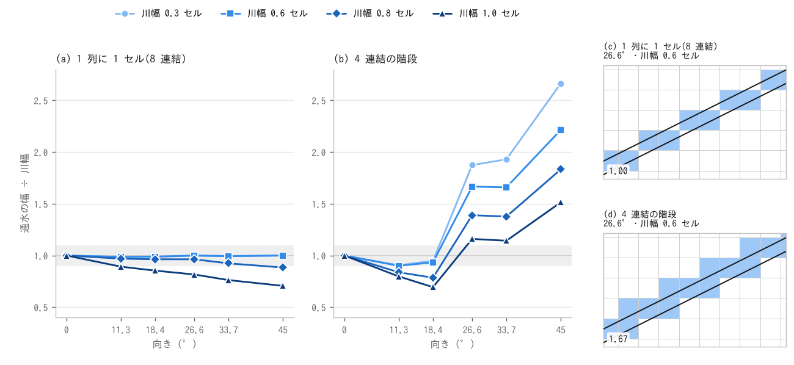
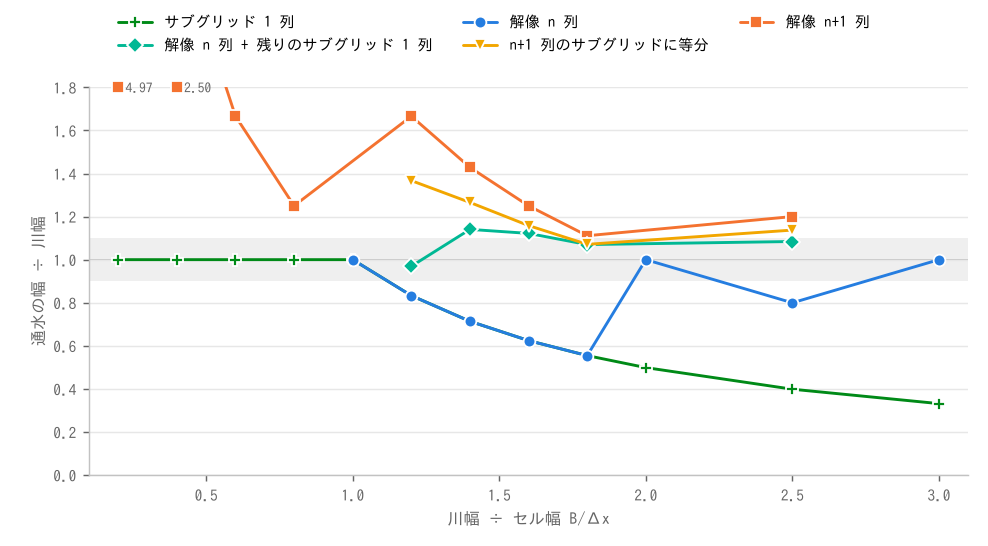
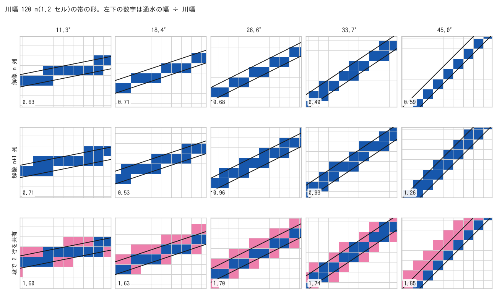
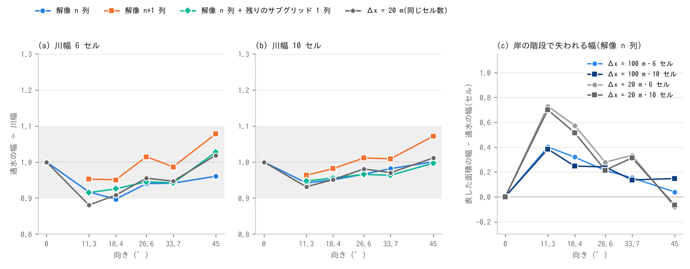
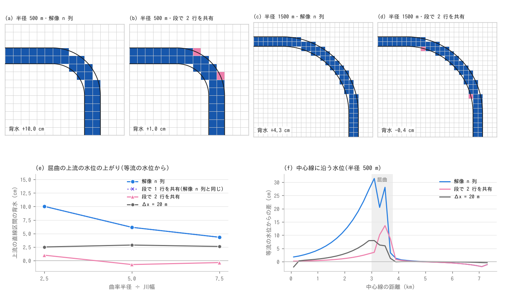

# examples/coarse_channel — 粗い格子で川を表す: 川幅・向き・屈曲・河道マスクの形と通水の精度

[English](en/README.md)

粗い格子(この例題では Δx = 100 m)で川を計算するときは、川をセルのラスタで表します。河道にするセル(河道マスク
`fn_rw`)と、セルより狭い川に与える幅(サブグリッド河道 `fn_width`)の選び方で、同じ川幅でも河道が流せる水の量
(通水能)が変わります。この例題は、直線の河道の定常の等流から「通水の幅」を逆算し、川幅・格子に対する向き・
河道マスクの連結・屈曲・河道の脇の水を変えた 6 つの系列(合わせて 281 ケース)で、表し方による違いを比べます。
川をラスタにする前処理で、どの表し方を選び、どれだけの誤差を見込むかの判断材料です。

## 要点

| 問い | 答え | 図 |
|---|---|---|
| 川幅 1 セル未満はサブグリッド河道でよいか | よい。1 列に 1 セル(8 連結)の河道マスクに川幅をそのまま与えると、どの向きでも通水の幅が川幅の 0.99〜1.00 倍(川幅 0.6 セルまで)。ただし斜めに並ぶ 1 列のセルが流せる幅には上限があり(45° で 0.71 セル分、11.3° で 0.89 セル分)、川幅がそれに近いと不足する(0.8 セルで 0.88〜0.97 倍) | [mask](#1-川幅-1-セル未満-サブグリッド河道と河道マスクの連結) |
| 河道マスクは 4 連結がよいか | よくない。4 連結の階段では、段で横に並ぶ 2 つのサブグリッドのセルが斜めの辺でもつながり、26.6〜45° で通水が 1.4〜2.7 倍になる(11.3〜18.4° では 0.78〜0.95 倍)。1 セル幅の川は 8 連結にする | [mask](#1-川幅-1-セル未満-サブグリッド河道と河道マスクの連結) |
| 格子に沿う直線の川は | 川幅がセルの整数倍なら、解像したセルだけで川幅どおり(1.00)。端数の幅は次の行 | [axis](#2-格子に沿う川) |
| 川幅 1〜2 セルの中途半端な幅は「1 セル + 端数のサブグリッド」か | 格子に沿う川では、等分(1.07〜1.37 倍)より 1 セル + 端数(0.97〜1.14 倍)がよい。斜めの川ではどちらも合わない(0.55〜1.08 倍と 0.07〜1.11 倍)。この幅の斜めの川を ±10 % で表すラスタの表し方は見つからなかった | [axis](#2-格子に沿う川)・[oblique](#3-斜めの川) |
| 斜めの直線の川は、角度でどう変わるか | 川幅 2〜3 セルなら、セルの中心の列を 1 列多く取る(解像 n+1 列)と 0.93〜1.03 倍。45° だけは 1.11〜1.21 倍に増えるので、n 列 + 残りのサブグリッド(1.02〜1.05 倍)にする。川幅 1.2 セルでは表し方と向きで 0.07〜1.85 倍とばらつく | [oblique](#3-斜めの川) |
| 川幅 6〜10 セルでも岸の階段で不足する。屈曲のような太らせは効くか | 効かない(広い帯にはくびれがない)。不足は、岸の階段で幅が 0.14〜0.40 セル分失われるため。1 列多く取ると 0.95〜1.01 倍(45° は 1.07〜1.08 倍になるので n 列のまま) | [wide](#4-広い川と細かい格子) |
| 屈曲は太らせるか。太らせ方は | 2 セル幅の帯は、隣り合う列(行)の境目で中心線に最も近い 2 行(列)を両方の河道セルにする。急な屈曲(半径 = 川幅の 2.5 倍)で、上流の背水の細かい格子との差が +7.5 → −1.5 cm。1 行の共有では 2 セルの帯は変わらない。緩い屈曲(川幅の 5〜7.5 倍)では、太らせないと +3.3・+1.7 cm、太らせると −3.6・−3.0 cm | [bend](#5-屈曲) |
| 河道の脇の非河道セルに薄い水があっても大丈夫か | 仮想壁面(`fn_bank`)で区切った河道は、壁の向こうが乾いていても、雨で 16 cm たまっても、1.5 m 湛水しても同じ(1.013 倍)。地形で表した河岸(壁なし)に雨の水膜(1〜2 cm)があると、1.013 → 0.956 倍に落ちる | [wet](#6-河道の脇の水) |

通水の幅 ÷ 川幅の値です。1 なら川幅どおりに流れ、1 より小さいと河道の水位が高く出ます(マニング式で、通水の幅が 1 割
少ないと水深は約 6.5 % 深い)。

## 確かめ方


直線で一様な河道(勾配 1/1000、粗度 0.03、長さ 8 km)の上流端から、川幅 1 m あたり 8.5 m³/s の流量を入れ(区間流入)、
下流端に等流水深の水位を与えて、定常になるまで計算します(粗い格子 8 時間、細かい格子 4 時間)。中ほどの 2 km(中心線の
距離 3〜5 km)の河道セルの水深の平均 h と、水位を中心線の距離に当てはめた直線の傾き I(水面勾配)から、広い矩形断面の
マニング式で通水の幅を逆算し、川幅 B で割ります。

```math
B_\mathrm{eff} = \frac{n\,Q}{h^{5/3}\sqrt{I}}
```

マニングの等流水深は 3.50 m です。粗い格子は Δx = 100 m、比べる細かい格子は Δx = 20 m です。河道の外のセルは計算せず
(領域マスクの外)、河道のセルには越流しない仮想壁面の堤防(河床 + 10 m)を置きます(河道の脇の水の系列を除く)。

河道の向きは、格子の軸に対する勾配 p/q で与えます(0、1:5、1:3、1:2、2:3、1:1 = 0°、11.3°、18.4°、26.6°、33.7°、45°)。
このとき、セルの中心は中心線からの距離が δ = Δx/√(p² + q²) おきの「列」に並びます(図 (b)。0° で 100 m、11.3° で 19.6 m、
18.4° で 31.6 m、26.6° で 44.7 m、33.7° で 27.7 m、45° で 70.7 m)。帯で川を表す表し方は、この列を選んで作ります。

## 表し方


| 表し方 | 作り方 |
|---|---|
| サブグリッド 1 列 | 格子に沿う 1 行のセルに幅 B を与える(B ≥ Δx なら解像したセル) |
| 解像 n 列 | 中心が川幅に収まる n = floor(B/δ) 列のセルを解像する |
| 解像 n+1 列 | もう 1 列足して解像する |
| 解像 n 列 + 残りのサブグリッド 1 列 | n 列を解像し、外側の 1 列を残りの幅 B − nδ のサブグリッド河道にする |
| n+1 列のサブグリッドに等分 | n+1 列のすべてを幅 B/(n+1) のサブグリッド河道にする |
| 段で 1 行・2 行を共有 | 解像 n 列の帯を、隣り合う列の境目で、中心線に最も近い 1 行・2 行が両方の列の解像セルになるように太らせる(屈曲では、向きが縦に近い区間は行の境目で同じことをする) |
| 段で 2 行を共有 + 幅を縮める | 2 行を共有するように太らせた帯の全セルを、表す面積が川幅と同じになる幅のサブグリッド河道にする |
| 1 列に 1 セル(8 連結) | 各列で中心線に最も近い 1 セルに幅 B を与える(D8 の落水線と同じ型) |
| 4 連結の階段 | 中心線からの距離が Δx(cos θ + sin θ)/2 以内のセルに幅 B を与える(段で 2 セルが横に並ぶ) |
| Δx = 20 m | 細かい格子で round(B/δ) 列を解像する(表した幅 round(B/δ) δ で割る) |

縮図の濃い青は解像したセル、薄い青はサブグリッド河道のセル、桃色は太らせて足したセル、黒い線は本当の河道の岸です。
左下の数字が通水の幅 ÷ 川幅です。

## 結果

### 1. 川幅 1 セル未満: サブグリッド河道と河道マスクの連結



1 セル幅の河道マスクに、川幅 0.3〜1.0 セルの幅を与えます(1.0 は解像したセル)。

- **1 列に 1 セル(8 連結)なら、サブグリッドの幅がそのまま通水の幅になる**: 川幅 0.6 セルまでは、どの向きでも 0.99〜1.00 倍
  です。斜めの段は、隣の列のセルへ斜めの辺でつながります。この辺の幅の絞りは「幅 ÷ 斜めの辺の自然の幅(71 m)」で、1 本の
  流れの通り道としては川幅どおりになります。
- **斜めに並ぶ 1 列のセルには、流せる幅の上限がある**: 1 セルの幅(解像したセル)を与えても、45° で 0.71 セル分、33.7° で
  0.76、26.6° で 0.82、18.4° で 0.85、11.3° で 0.89 セル分しか流れません(45° は斜めの辺の自然の幅そのもの)。川幅がこの上限に
  近いと不足し、川幅 0.8 セルでは 0.88〜0.97 倍です。
- **4 連結の階段は合わない**: 段の所で、横に並んだ 2 つのサブグリッドのセルが、直交の辺に加えて斜めの辺でも下流のセルと
  つながります。斜めの辺の絞り(幅 ÷ 71 m)は直交の辺(幅 ÷ 100 m)より緩いので、並んだ通り道の分だけ通水が増え、26.6〜45° で
  1.4〜2.7 倍(川幅 0.3〜0.8 セル)です。段の少ない 11.3〜18.4° では、逆に 0.78〜0.95 倍に減ります。
- 格子に沿う川(0°)は、どちらの型でも同じ 1 行のセルで、1.00 倍です。

### 2. 格子に沿う川



- **川幅がセルの整数倍なら、解像したセルだけで川幅どおり**: 川幅 1・2・3 セルは 1.00 倍です。
- **川幅 1 セル未満は、サブグリッド 1 列で川幅どおり**(1.00 倍)。1 行の解像したセルにすると、1 セル分の幅で流れて
  通水が川幅の Δx/B 倍(0.2 セルの川で 5 倍)になります。
- **端数の幅は、1 セル + 端数のサブグリッドが等分よりよい**: 川幅 1.2〜1.8・2.5 セルで、解像 n 列 + 残りのサブグリッドは
  0.97〜1.14 倍、等分は 1.07〜1.37 倍です。どちらも多めになるのは、横に並んだ河道のセルが斜めの辺でもつながるためで、
  サブグリッドのセルが広いほど(等分)その分が大きくなります。並んだ河道のセルは、サブグリッド河道の前提(1 セル幅の線の
  河道)の外です。

### 3. 斜めの川


- **川幅 1.2 セルの川は、どの表し方でも合わない**: 向きと表し方で 0.07〜1.85 倍とばらつきます。この幅の帯は、横に並んだ
  数セルの区間が、1 セルの重なりか角だけで次の区間につながる「くびれ」を持ち(下の図)、通水はくびれの形で決まります。
  段で 2 行を共有するように太らせると、くびれは消えますが、面積が川幅の 1.8 倍前後に膨らんで 1.60〜1.85 倍になります。
  幅を縮めて面積を川幅にそろえても 1.27〜1.54 倍です(サブグリッドのセルが横に並ぶため)。
- **川幅 2〜3 セルなら、1 列多く取ると合う**: 解像 n+1 列は 0.93〜1.03 倍です(45° を除く)。川幅 2 セルでは、段で 2 行を共有
  するように太らせた帯は n+1 列の帯とほぼ同じ形になり(違いは流入口などの 1 セル)、同じ値です。川幅 3 セルの帯にはもともとくびれがなく、太らせても変わり
  ません。解像 n 列は 0.73〜0.86 倍で足りません。
- **45° は別**: 45° の帯は岸の階段で幅を失わず(次の節)、n+1 列では 1.11〜1.21 倍と多すぎます。解像 n 列 + 残りの
  サブグリッドが 1.02〜1.05 倍で合います。
- **等分は合わない**: n+1 列を同じ幅のサブグリッドにすると、0.27〜1.06 倍です。
- **細かい格子(Δx = 20 m)でも、岸の階段で少し不足する**: 川幅 6 セル(120 m)で 0.88〜0.95 倍、10 セル(200 m)で
  0.93〜0.98 倍、15 セル(300 m)で 0.95〜0.99 倍(11.3〜33.7°。0° と 45° は 1.00〜1.02 倍)。



川幅 1.2 セルの帯の形です。解像 n 列は、18.4°・26.6°・45° で区間どうしが角だけでつながり、11.3° では 1 セルの重なりで
つながり、33.7° では 1 セルの重なりと角が交互に並びます。解像 n+1 列は、18.4° で区間が 1 セルずつ重なる形になって、かえって少なくなります(0.71 → 0.53)。
段で 2 行を共有すると、どの向きでも帯が 2〜3 セルの厚さになります。

### 4. 広い川と細かい格子



- **段で行を共有する太らせは、広い帯では何も変えない**: 川幅 6・10 セルの帯にはくびれがなく、中心線に最も近い行はもともと
  両方の列の河道セルです(図 (a)・(b) の解像 n 列と同じ値)。
- **不足は岸の階段で幅が失われるため**: 表した面積の幅から通水の幅を引くと、11.3〜33.7° で 0.14〜0.40 セル分です(図 (c)。
  川幅 6 セルと 10 セルでほぼ同じで、向きが格子の軸に近いほど大きい)。不足の割合は、この幅 ÷ 川幅なので、広い川ほど
  小さくなります(解像 n 列で、6 セル 0.90〜0.96 倍、10 セル 0.94〜1.00 倍)。45° では失われる幅が小さい(0.04〜0.15 セル分)。
- **1 列多く取ると補える**: 解像 n+1 列は、6 セルで 0.95〜1.01 倍、10 セルで 0.96〜1.01 倍です(11.3〜33.7°)。45° では
  1.07〜1.08 倍と多すぎるので、n 列(0.96・1.00 倍)か n 列 + 残り(1.03・1.00 倍)のままにします。
- **細かい格子の方が、セルの数で見ると多く失う**: 同じ 6・10 セルの川を Δx = 20 m で表すと、失われる幅は 0.22〜0.72 セル分
  です(11.3〜33.7°)。水深 ÷ セル幅が違う(Δx = 100 m で 0.035、20 m で 0.175)ので、失われる幅は格子の幅に比例しません。

### 5. 屈曲



西から東へ流れる直線(3 km)、半径 R で 90° 右に曲がる円弧、南へ流れる直線(3.6 km)の河道です。川幅は 200 m(粗い格子で
2 セル)、半径は 500・1,000・1,500 m(川幅の 2.5・5・7.5 倍)。前後の直線は格子の軸に沿うので、上流の直線区間(中心線の
距離 1〜2.5 km)の水位が等流の水位より高い分(背水)は、屈曲が作る損失の大きさです。

- **細かい格子では、屈曲の上流の背水は 2.5〜2.9 cm**(半径によらない)。
- **太らせない粗い格子の帯は、急な屈曲で背水が大きい**: 半径 500 m で 10.0 cm、1,000 m で 6.2 cm、1,500 m で 4.3 cm。
  帯は円弧の所で 2 セルの階段になり、段の所で区間どうしが 1 セルの重なりでしかつながらないくびれができます(図 (a)・(c))。
- **段で 2 行を共有するように太らせると、急な屈曲の背水が細かい格子に近づく**: 半径 500 m で 1.0 cm(細かい格子との差
  +7.5 → −1.5 cm)。足すセルは円弧の 2 か所だけです(図 (b)・(d) の桃色)。
- **緩い屈曲では、太らせると逆に少なくなる**: 半径 1,000・1,500 m で −0.7・−0.4 cm(細かい格子との差 −3.6・−3.0 cm)。
  太らせないときの差(+3.3・+1.7 cm)と同じくらいの大きさです。
- **1 行の共有では、2 セル幅の帯は変わらない**: 中心線に最も近い行は、もともと両方の列の河道セルです。
- 屈曲の中の水位(図 (f))は、太らせない帯で 30 cm 前後、太らせた帯で 14 cm、細かい格子で 8 cm 高くなります(200 m ごとの
  河道セルの平均。外岸の盛り上がりを含む)。

### 6. 河道の脇の水


26.6° の直線の河道(川幅 200 m)を、段で 2 行を共有するように太らせた帯で表し、両側 300 m に次の 5 つの構成を置きます。
雨のケースは全域に 20 mm/h の一定の雨で、通水の幅は、上流端の流量に、測る区間の中ほどより上流で河道に入る雨を足して
数えます。

| 構成 | 河道の脇 | 通水の幅 ÷ 川幅 | 河道の水深 |
|---|---|---:|---:|
| (1) 地形の河岸・乾いている | 河床 + 4 m(水面より 0.5 m 高い)、河道へ 2 % の横断勾配 | 1.013 | 3.474 m |
| (2) 地形の河岸・雨 | 同じ河岸に雨。河岸の水膜は河道の脇で 1〜2 cm | 0.956 | 3.623 m |
| (3) 仮想壁面・乾いている | 河道のセルに仮想壁面(河床 + 10 m)、壁の向こうは水平な地盤 | 1.013 | 3.474 m |
| (4) 仮想壁面・雨 | 同じ構成に雨。壁の向こうに 16 cm たまる(河道には入らない) | 1.013 | 3.482 m |
| (5) 仮想壁面・湛水 | 壁の向こうに水深 1.5 m の静かな池 | 1.013 | 3.474 m |

- **仮想壁面で区切った河道は、壁の向こうの水に影響されない**: 移流項は、仮想壁面の向こうのセルを、濡れていても乾いた
  セルと同じに数えません([移流項のスキーム](../../docs/users_guide/advection.md) §4.4)。(3)〜(5) の通水は同じです。
- **地形で表した河岸の薄い水膜は、河道の通水を 5.6 % 減らす**: 壁がないと、移流項は濡れた河岸のセルを数えます。
  雨の流入で水深が深くなる分(流量 1.05 % 増で 0.6 %)を除いても、水深が 3.6 % 深くなります(13 cm)。移流項の既定の
  規則は、河岸の薄い水膜を代表させない扱いを持ちますが(test/wetbank)、この帯の形では残ります。
- (1) と (3) が 1.005(斜めの川の節の同じ帯)でなく 1.013 なのは、河道の外のセルを計算するか(この節)、領域の外にするか
  (ほかの節)の違いです。

## 表し方の選び方

| 川幅 | 格子に沿う川 | 斜めの川(11〜34°) | 45° に近い川 |
|---|---|---|---|
| 1 セル未満 | サブグリッド 1 列(1.00) | 1 列に 1 セル(8 連結)のサブグリッド(0.6 セルまで 0.99〜1.00。上限 0.71〜0.89 セル分) | 同じ(上限 0.71 セル分) |
| 1〜2 セル | 解像 1 列 + 残りのサブグリッド(0.97〜1.14) | 合う表し方がない(細かい格子か、観測水位で合わせる) | 解像 n 列 + 残り(1.05〜1.08) |
| 2〜3 セル | 整数倍は解像だけ(1.00)、端数は解像 + 残り(1.08) | 解像 n+1 列(0.93〜1.03) | 解像 n 列 + 残り(1.02〜1.05) |
| 6〜10 セル | 解像(1.00) | 解像 n+1 列(0.95〜1.01) | 解像 n 列(0.96〜1.00) |
| 屈曲(2 セル) | — | 半径が川幅の 2.5 倍の急な屈曲は、段で 2 行を共有するように太らせる(背水の差 +7.5 → −1.5 cm)。5 倍以上では、太らせても太らせなくても差は 4 cm 以内 | — |

括弧の中は、この例題で測った通水の幅 ÷ 川幅です。帯の幅を決めるときは、列の間隔 δ(格子に対する向きで決まる)を見て
選びます。

## 数表

<details>
<summary>全ケースの通水の幅 ÷ 川幅(<code>python3 plot_results.py</code> が書く表)</summary>

格子に沿う川:

| B/Δx | サブグリッド 1 列 | 解像 n 列 | 解像 n+1 列 | 解像 n 列 + 残り | 等分 |
|---:|---:|---:|---:|---:|---:|
| 0.2 | 1.00 | — | 4.97 | — | — |
| 0.4 | 1.00 | — | 2.50 | — | — |
| 0.6 | 1.00 | — | 1.67 | — | — |
| 0.8 | 1.00 | — | 1.25 | — | — |
| 1.0 | 1.00 | 1.00 | — | — | — |
| 1.2 | 0.83 | 0.83 | 1.67 | 0.97 | 1.37 |
| 1.4 | 0.71 | 0.71 | 1.43 | 1.14 | 1.27 |
| 1.6 | 0.62 | 0.62 | 1.25 | 1.12 | 1.16 |
| 1.8 | 0.55 | 0.55 | 1.11 | 1.07 | 1.07 |
| 2.0 | 0.50 | 1.00 | — | — | — |
| 2.5 | 0.40 | 0.80 | 1.20 | 1.08 | 1.14 |
| 3.0 | 0.33 | 1.00 | — | — | — |

斜めの川(川幅 120 / 200 / 300 m):

| 向き | 解像 n 列 | 解像 n+1 列 | 解像 n 列 + 残り | 等分 | 段で 1 行を共有 | 段で 2 行を共有 | 2 行 + 幅を縮める | Δx = 20 m |
|---|---:|---:|---:|---:|---:|---:|---:|---:|
| 0° | 0.83 / 1.00 / 1.00 | 1.67 / — / — | 0.97 / — / — | 1.37 / — / — | — | — | — | 1.00 / 1.00 / 1.00 |
| 11.3° | 0.63 / 0.81 / 0.86 | 0.71 / 0.93 / 0.93 | 0.55 / 0.78 / 0.83 | 0.07 / 0.27 / 0.33 | 0.63 / 0.81 / 0.86 | 1.60 / 0.93 / 0.86 | 1.27 / 0.91 / 0.86 | 0.88 / 0.93 / 0.95 |
| 18.4° | 0.71 / 0.73 / 0.84 | 0.53 / 0.95 / 0.95 | 0.61 / 0.79 / 0.84 | 0.13 / 0.50 / 0.55 | 0.53 / 0.73 / 0.84 | 1.63 / 0.95 / 0.84 | 1.29 / 0.93 / 0.84 | 0.91 / 0.95 / 0.97 |
| 26.6° | 0.68 / 0.73 / 0.81 | 0.96 / 1.01 / 0.98 | 1.05 / 0.89 / 0.90 | 0.62 / 0.73 / 0.71 | 0.96 / 0.73 / 0.81 | 1.70 / 1.01 / 0.81 | 1.41 / 1.00 / 0.81 | 0.95 / 0.98 / 0.99 |
| 33.7° | 0.40 / 0.80 / 0.85 | 0.93 / 1.03 / 0.96 | 0.55 / 0.82 / 0.88 | 0.30 / 0.56 / 0.56 | 0.93 / 0.80 / 0.85 | 1.74 / 1.03 / 0.85 | 1.43 / 1.02 / 0.85 | 0.95 / 0.97 / 0.98 |
| 45° | 0.59 / 0.76 / 0.98 | 1.26 / 1.11 / 1.21 | 1.08 / 1.05 / 1.02 | 1.11 / 1.02 / 1.06 | 1.26 / 0.76 / 0.98 | 1.85 / 1.11 / 0.98 | 1.54 / 1.09 / 0.98 | 1.02 / 1.01 / 1.01 |

広い川(川幅 600 / 1,000 m。段で 1 行・2 行を共有は、どの向きでも解像 n 列と同じ値):

| 向き | 解像 n 列 | 解像 n+1 列 | 解像 n 列 + 残り |
|---|---:|---:|---:|
| 0° | 1.00 / 1.00 | — | — |
| 11.3° | 0.92 / 0.94 | 0.95 / 0.96 | 0.91 / 0.95 |
| 18.4° | 0.90 / 0.95 | 0.95 / 0.98 | 0.93 / 0.96 |
| 26.6° | 0.94 / 0.97 | 1.01 / 1.01 | 0.95 / 0.97 |
| 33.7° | 0.94 / 0.98 | 0.99 / 1.01 | 0.94 / 0.96 |
| 45° | 0.96 / 1.00 | 1.08 / 1.07 | 1.03 / 1.00 |

1 セル幅の河道マスク(1 列に 1 セル / 4 連結の階段):

| 向き | 川幅 0.3 セル | 0.6 セル | 0.8 セル | 1.0 セル(解像) |
|---|---:|---:|---:|---:|
| 0° | 1.00 | 1.00 | 1.00 | 1.00 |
| 11.3° | 0.99 / 0.91 | 0.99 / 0.90 | 0.97 / 0.84 | 0.89 / 0.80 |
| 18.4° | 0.99 / 0.95 | 0.99 / 0.93 | 0.96 / 0.78 | 0.85 / 0.69 |
| 26.6° | 1.00 / 1.87 | 1.00 / 1.67 | 0.96 / 1.39 | 0.82 / 1.16 |
| 33.7° | 0.99 / 1.93 | 0.99 / 1.66 | 0.92 / 1.38 | 0.76 / 1.14 |
| 45° | 1.00 / 2.66 | 1.00 / 2.22 | 0.88 / 1.83 | 0.71 / 1.51 |

屈曲(上流の直線区間の背水 cm):

| 半径 | 解像 n 列 | 段で 1 行を共有 | 段で 2 行を共有 | Δx = 20 m |
|---|---:|---:|---:|---:|
| 500 m | 10.0 | 10.0 | 1.0 | 2.5 |
| 1,000 m | 6.2 | 6.2 | −0.7 | 2.9 |
| 1,500 m | 4.3 | 4.3 | −0.4 | 2.6 |

</details>

## 実行方法

```bash
cd examples/coarse_channel
make                 # ../../bin/encflow へのリンクと、全ケースの入力(runs/)
make run             # 全系列を計算する(4 コアで 25 分前後。NP=2 で並列数を変える)
make figs            # 図(figs/ と en/figs/)と数表
```

系列ごとに `make axis`・`make oblique`・`make wide`・`make mask`・`make bend`・`make wet` でも計算できます。粗い格子のケース
(1 ケース数秒)は 1 ケース 1 スレッドで並列に、細かい格子のケース(Δx = 20 m。1 ケース 4 スレッドで 30 秒〜2 分)は 1 ケース
ずつ回します。計算済みのケースは飛ばします。`plot_results.py` は、計算していない系列の図を飛ばします。

## ファイル

| ファイル | 内容 |
|---|---|
| `make_cases.py` | 全ケースの入力(地盤・粗度・マスク・初期水深・河道マスク・幅・天端・境界の表)と設定 `runs/param_<ケース>.txt` を書く。表し方の作り方はここにある |
| `run_series.sh` | 系列のケースを `runs/` で計算する |
| `analyze.py` | 結果から通水の幅(屈曲は背水)を読み取る |
| `plot_results.py` | 図と数表(引数 `en` で英語の図を `en/figs/` に描く) |

## この例題で確かめていないこと

- **定常の等流だけ**: 洪水波の遅れと減衰は、河道が貯める水の量で変わります。解像 n 列 + 残り、太らせた帯、n+1 列の帯は、
  表す面積の幅が川幅と違う(n+1 列で 1.0〜1.2 倍、太らせた 1.2 セルの帯で 1.8 倍前後)ので、通水が合っても貯留は合いません。
- **1 つの流れの強さだけ**: 水深 3.50 m・水深 ÷ セル幅 0.035 の 1 つの条件です。失われる幅のセル数は水深とセル幅の比で
  変わります(細かい格子では 0.22〜0.72 セル分)。
- **移流項の既定の構成だけ**: 同じ帯の通水は、移流項の構成で数 % 変わります(26.6°・川幅 2 セルの太らせた帯で 1.00〜1.08 倍。
  開発記録 §134.10)。
- **細かい格子も収束していない**: Δx = 20 m でも、11.3° の 6 セルの川は 0.88 倍です。細かい格子を正解として扱える精度は
  数 % までです。
- **ここにない形**: 川幅の変わる区間、蛇行、1 セル幅のサブグリッド河道の屈曲、合流([confluence_backwater](../confluence_backwater/README.md))、
  河道網のつながり方。DEM から作る河道マスクの癖(同じ距離のセルの選び方など)も確かめていません。
- **MPI で回していない**。

関連: [河道](../../docs/users_guide/channel.md)(サブグリッド河道幅・堤防)、
[河道の解説](../../docs/users_guide/channel_models.md) §2(サブグリッド河道幅の定式と精度の限界)、
[移流項のスキーム](../../docs/users_guide/advection.md)(仮想壁面と河岸の水膜の扱い)。
