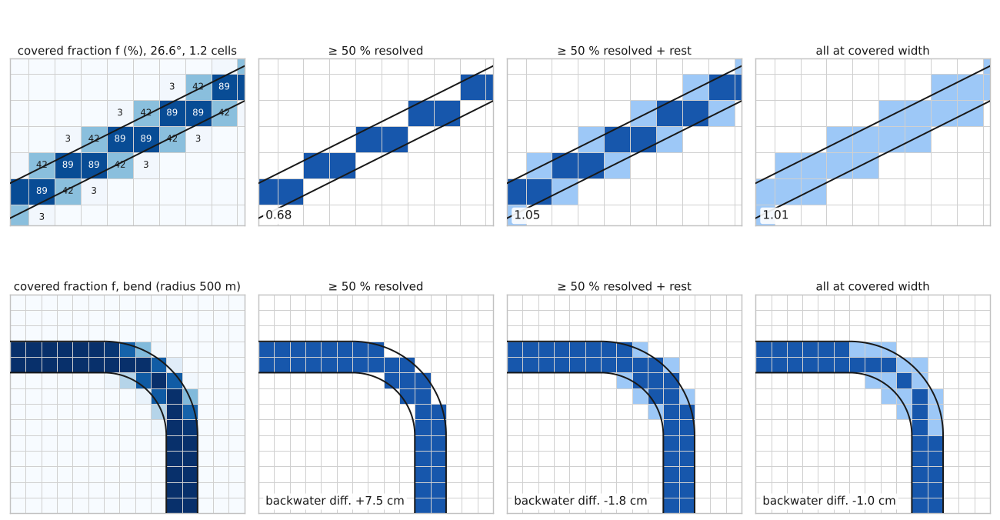
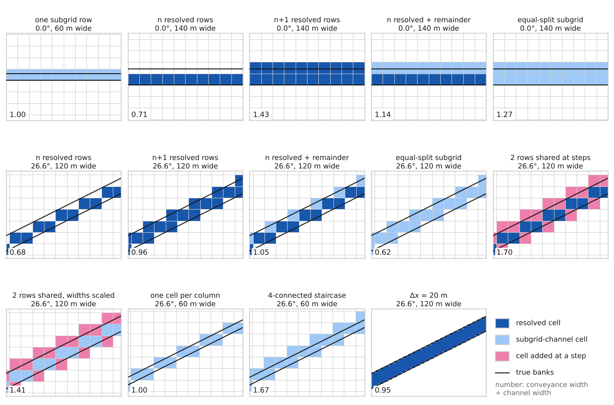
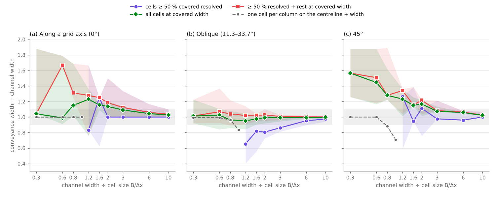
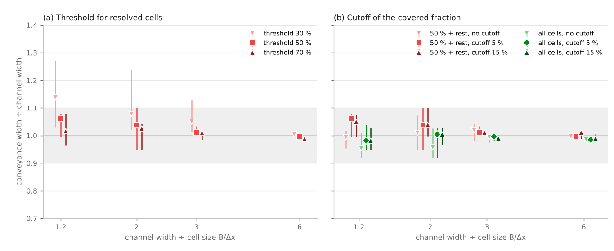
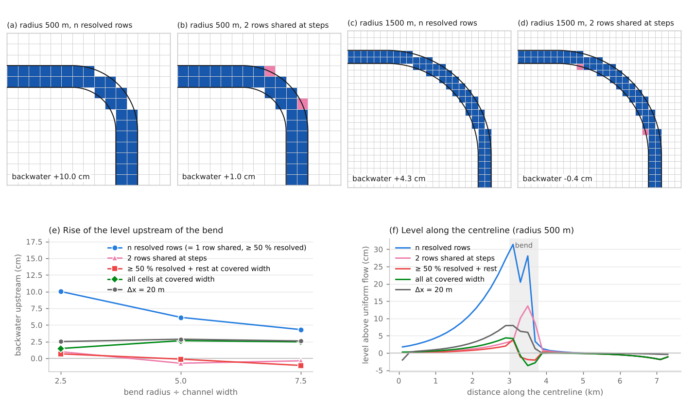
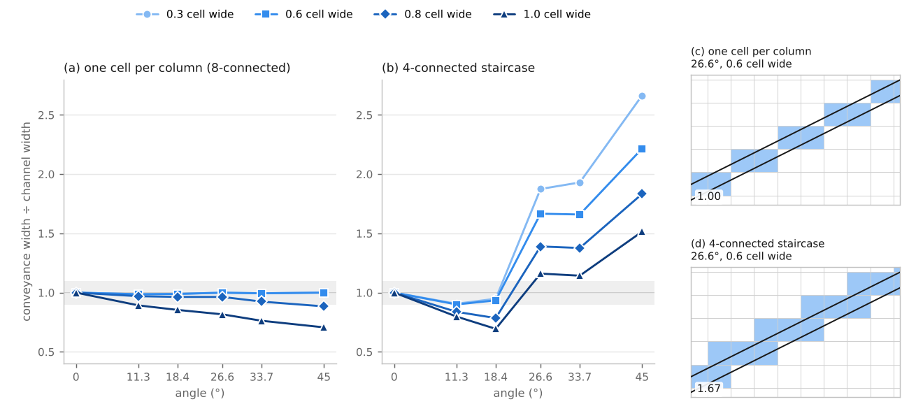
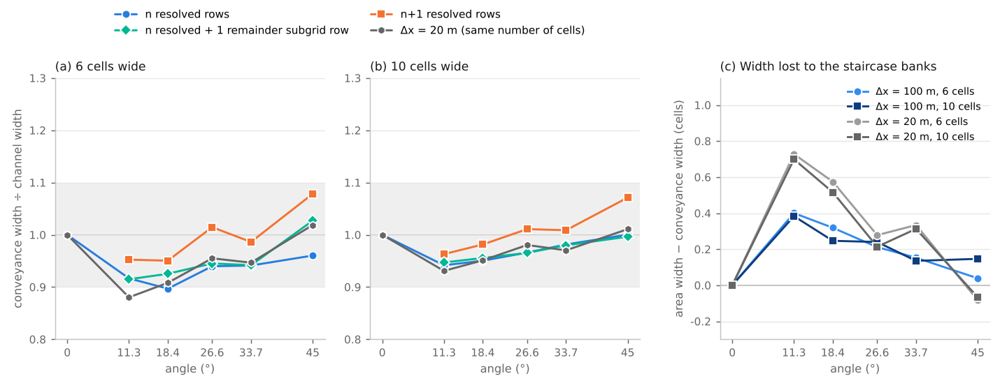
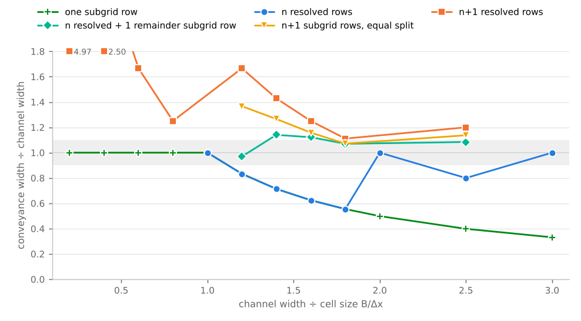

# examples/coarse_channel — Representing a river on a coarse grid: how to make the channel mask, and conveyance accuracy

> English mirror of examples/coarse_channel/README.md. The Japanese file is the master copy.

On a coarse grid (Δx = 100 m in this example) a river is represented by a raster of cells. In practice the coarse
channel mask (`fn_rw`) and the subgrid channel width (`fn_width`) are made from a channel polygon or a high-resolution
channel mask by computing, for each coarse cell, the fraction of its area covered by the channel (the covered fraction
f). How this is done changes how much water the channel can carry (its conveyance), even for the same river.

This example focuses on rules that make the mask mechanically from the covered fraction, and compares them by the
"conveyance width" back-calculated from steady uniform flow in straight channels, varying the channel width, the
direction relative to the grid, the position relative to the grid, bends, the connectivity of the channel mask, and the
water beside the channel (897 cases in all). Bands assembled from the centreline on the grid (rows of cell centres,
thickening at the steps) are compared as well and used to explain why the results come out as they do.

## Summary

| Question | Answer | Figure |
|---|---|---|
| How should a coarse channel mask be made from a channel polygon or a high-resolution mask? | Make every cell with a covered fraction f of 5 % or more a channel cell, with a subgrid channel width of f·Δ (cells with f close to 1 resolved). On oblique rivers 1.6–3 cells wide the conveyance width is 0.90–1.03 times the channel width, 0.98–1.00 times from 6 cells. Bends need no thickening: the backwater differs from the fine grid by 1 cm or less | [occ](#1-channel-masks-from-the-covered-fraction) |
| May cells with a tiny covered fraction be included? | A cutoff is still advisable. The computational core counts a cell whose width is below 5 % of the width it is compared with as outside the computation in the reassignment of openings and the conveyance ratio, so including cells covered by a few per cent keeps oblique rivers (1.2–3 cells wide) at 0.92–1.03 times, but the result differs from that with a 5 % cutoff by up to 0.07. Cutoffs of 5 % and 15 % give nearly the same | [sens](#2-threshold-for-resolved-cells-and-cutoff-of-the-covered-fraction) |
| Is a threshold (50 %) for channel / non-channel enough? | No. 0.40–1.03 times on oblique rivers (1.2–3 cells wide) and +7.5 cm of backwater in a bend. Resolving cells of 50 % or more and giving the rest their covered width is nearly the same as "all cells" on oblique rivers, but underestimates the backwater of bends by 2–4 cm | [occ](#1-channel-masks-from-the-covered-fraction), [bend](#3-bends) |
| Rivers narrower than one cell? | Make the centreline one cell per column (8-connected) and give it the channel width (0.99–1.00 times up to 0.6 cell). From the covered fraction the river splits into neighbouring cells and gives 0.84–1.88 times. A 4-connected staircase also gives 1.4–2.7 times at 26.6–45° | [mask](#4-narrower-than-one-cell-one-line-of-cells-on-the-centreline-and-mask-connectivity) |
| Rivers along a grid axis and at 45°? | The covered-fraction rules carry too much where partial cells lie side by side. At 2 cells wide, a river along a grid axis gives 1.00–1.20 times depending on where its banks fall, and a 45° river 1.02–1.22 times; up to +7 % and +6 % at 6 cells | [occ](#1-channel-masks-from-the-covered-fraction) |
| The staircase banks of rivers 6–10 cells wide? | With all cells at their covered width, 0.98–1.00 times (oblique rivers). With a threshold alone, a width of 0.14–0.40 cell is lost at the staircase banks: 0.90–1.01 times | [occ](#1-channel-masks-from-the-covered-fraction), [wide](#staircase-banks) |
| Should bends be thickened? | Not with all cells at their covered width (backwater differs by −1.0 to −0.1 cm). A thresholded band gives +7.5 cm in a sharp bend. When assembling bands from the centreline, thicken them so that two rows are shared at the steps (−3.6 to −1.5 cm) | [bend](#3-bends) |
| Is a thin film of water on the non-channel cells beside the channel harmless? | A channel bounded by virtual walls (`fn_bank`) is the same whether the land behind the walls is dry, holds 16 cm of rain or a 1.5 m pond. With banks represented by the terrain (no walls), a rain film (1–2 cm) on them lowers it from 1.013 to 0.956 times | [wet](#6-water-beside-the-channel) |

The values are the conveyance width ÷ the channel width. At 1 the channel carries its width; below 1 the channel
level comes out too high (by Manning's formula, a conveyance width 10 % short makes the depth about 6.5 % deeper).
Ranges are the minimum to maximum over all cases with different directions and positions relative to the grid.

## How it is measured


A discharge of 8.5 m³/s per metre of channel width enters the upstream end of a straight, uniform channel (slope 1/1000,
roughness 0.03, 8 km long) as a segment inflow, the stage of the uniform-flow depth is prescribed at the downstream
end, and the run continues to steady state (8 hours on the coarse grid, 4 hours on the fine grid). From the mean depth h
of the channel cells in the middle 2 km (3–5 km along the centreline) and the slope I of the straight line fitted to the
level against the distance along the centreline (the water-surface slope), Manning's formula for a wide rectangular
section gives the conveyance width, which is divided by the channel width B.

```math
B_\mathrm{eff} = \frac{n\,Q}{h^{5/3}\sqrt{I}}
```

The Manning uniform-flow depth is 3.50 m. The coarse grid is Δx = 100 m and the fine grid used for comparison is
Δx = 20 m. Cells outside the channel are not computed (outside the domain mask), and the channel cells carry virtual-wall
levees that are never overtopped (bed + 10 m), except in the series on water beside the channel.

The direction of the channel is given as a slope p/q relative to the grid axis (0, 1:5, 1:3, 1:2, 2:3, 1:1 = 0°, 11.3°,
18.4°, 26.6°, 33.7°, 45°). The covered-fraction rules are computed with the centreline shifted by 0, 0.25 and 0.5 cell
relative to the grid (a real river does not line up with the grid).

## How the channel mask is made

### From the covered fraction



The covered fraction f is the fraction of a coarse cell's area covered by the true channel (the band within ±B/2 of the
centreline; counted with 64 × 64 points per cell, 24 × 24 for bends). Cells with f below 5 % are not made channel cells.

| Rule | Channel cells | Width |
|---|---|---|
| ≥ 50 % covered resolved | f ≥ 50 % | resolved (threshold alone) |
| ≥ 50 % resolved + rest at covered width | f ≥ 5 % | resolved for f ≥ 50 %, subgrid channel of f·Δ below |
| All cells at covered width | f ≥ 5 % | subgrid channel of f·Δ (resolved for f ≈ 1) |

To see the sensitivity, rules with a threshold of 30 or 70 % for resolved cells and with a cutoff of 0 or 15 % are also
computed. Cases whose channel mask breaks apart (not 8-connected from the inflow to the outflow) are not made (35 cases of
the threshold-alone rule below one cell wide).

The numbers in the top row are the conveyance width ÷ the channel width; the bottom row shows the difference of the
backwater from the fine grid.

### Bands assembled from the centreline (to see the mechanisms)



When the direction is given as a slope p/q, the cell centres lie on "rows" spaced δ = Δx/√(p² + q²) apart in distance
from the centreline (100 m at 0°, 19.6 m at 11.3°, 31.6 m at 18.4°, 44.7 m at 26.6°, 27.7 m at 33.7°, 70.7 m at 45°).
Bands are built by choosing these rows.

| Rule | Channel cells |
|---|---|
| One subgrid row | Give the width B to one row of cells along the grid axis (a resolved cell when B ≥ Δx) |
| n resolved rows | Resolve the n = floor(B/δ) rows whose centres lie within the channel width |
| n+1 resolved rows | Add one more row and resolve it |
| n resolved + 1 remainder subgrid row | Resolve n rows and make the outer row a subgrid channel of the remaining width B − nδ |
| n+1 subgrid rows, equal split | Make all n+1 rows subgrid channels of width B/(n+1) |
| 1 / 2 rows shared at steps | Thicken the band of n resolved rows so that the 1 or 2 rows nearest the centreline are resolved cells in both columns at every column boundary (in bends, the same is done at row boundaries where the direction is closer to vertical) |
| 2 rows shared + widths scaled | Make every cell of the band thickened by sharing 2 rows a subgrid channel whose width makes the represented area equal to the channel width |
| One cell per column (8-connected) | Give the width B to the one cell nearest the centreline in each column (the same type as a D8 flow path) |
| 4-connected staircase | Give the width B to the cells within Δx(cos θ + sin θ)/2 of the centreline (two cells side by side at each step) |
| Δx = 20 m | Resolve round(B/δ) rows on the fine grid (divided by the represented width round(B/δ) δ) |

In the thumbnails, dark blue is a resolved cell, light blue a subgrid-channel cell, pink a cell added by thickening, and
the black lines are the true banks.

## Results

### 1. Channel masks from the covered fraction



Lines are medians and bands the minimum to maximum (three positions relative to the grid; for oblique rivers also the
four directions). The grey dashed line is the rule that makes the centreline one cell per column with the channel width
(one cell wide or less).

- **All cells at their covered width is the most stable rule in every direction**: on oblique rivers, 0.84–1.04 times at
  1.2 cells, 0.90–1.03 times at 1.6–3 cells and 0.98–1.00 times at 6 and 10 cells. The represented area is almost the
  channel width (less only by what the cutoff removes).
- **A threshold alone falls short on oblique rivers**: 0.40–0.96 times at 1.2 cells, 0.73–1.03 times at 2 cells and
  0.90–1.01 times even at 6 cells. This comes from the waists of the band and the staircase banks, the same behaviour as
  the "n resolved rows" band assembled from the centreline (section 5). Below one cell wide, the channel mask often
  breaks apart.
- **Resolving cells of 50 % or more and giving the rest their covered width is nearly the same as all cells on oblique
  rivers**: 0.94–1.10 times at 1.6–3 cells and 0.99–1.02 times at 6 and 10 cells. But on a river along a grid axis whose
  banks fall in the middle of cells, the partial cells are resolved too and it carries too much (1.50 times at 2 cells),
  and in bends the backwater comes out 2–4 cm smaller than on the fine grid (section 3).
- **Rivers along a grid axis and at 45° carry too much**: where partial (subgrid) cells lie side by side with resolved
  cells or other partial cells, they are linked through diagonal edges as well and the conveyance grows (section 5).
  With all cells at their covered width, a river along a grid axis gives 1.00–1.20 times (2 cells) and 1.00–1.04 times
  (10 cells), and a 45° river 1.02–1.22 times (2 cells) and 1.02–1.04 times (10 cells). A river along a grid axis is exact
  when its banks are close to cell boundaries.
- **Do not use the covered fraction below one cell wide**: the river splits into the cells on both sides of the
  centreline and carries too much through subgrid cells side by side (0.84–1.88 times). Giving the channel width to one
  line of cells on the centreline gives 0.99–1.00 times (section 4).

### 2. Threshold for resolved cells, and cutoff of the covered fraction



Medians and minimum to maximum over the four oblique directions (11.3–33.7°) with no shift relative to the grid.

- **Thresholds of 50–70 % give nearly the same**: a threshold of 30 % also resolves cells that are mostly not channel and
  carries too much (1.03–1.27 times at 1.2 cells).
- **A cutoff is still advisable**: including cells covered by a few per cent gives, with all cells at their covered
  width, 0.92–1.01 times at 1.2 cells, 0.92–1.03 times at 2 cells and 0.97–1.00 times at 3 cells, up to 0.07 away from
  the results with a 5 % cutoff (0.10 for resolving cells of 50 % or more and giving the rest their covered width).
  Cutoffs of 5 % and 15 % differ by 0.01 or less. The backwater of bends, with all cells at their covered width, is
  3.2 / 2.8 / 3.0 cm without a cutoff and 1.5 / 2.7 / 2.5 cm with a 5 % cutoff (fine grid 2.5 / 2.9 / 2.6 cm).
- A cell covered by a few per cent is a sliver that the channel edge only grazes at a corner, and its width cap almost
  stops the flow through it. The dynamic reassignment of openings (`f_opening_dynamic` in `&list_enc`, default 3) counts
  an opening as blocked when the corner cell of a diagonal edge lies outside the computation and reassigns its passage
  width to nearby open edges. The computational core counts a channel cell whose width is below 5 % of the width of the
  cell it is compared with as outside the computation in this reassignment and in the normalisation of the in-channel
  velocity (the conveyance ratio) (developer record §136). The advection term still counts such a cell as a wet
  neighbour, so the result differs slightly from that with a 5 % cutoff.

### 3. Bends



The channel runs straight from west to east (3 km), turns 90° to the right along a circular arc of radius R, and runs
straight to the south (3.6 km). It is 200 m wide (2 cells on the coarse grid) and the radius is 500, 1,000 or 1,500 m
(2.5, 5 and 7.5 times the width). The straight reaches before and after follow the grid axes, so the amount by which the
level in the upstream straight reach (1–2.5 km along the centreline) exceeds the uniform-flow level (the backwater) is the
size of the loss the bend makes.

| Rule | Backwater difference from the fine grid (radius 500 / 1,000 / 1,500 m) |
|---|---|
| All cells at covered width | −1.0 / −0.2 / −0.1 cm |
| ≥ 50 % resolved + rest at covered width | −1.8 / −3.0 / −3.7 cm |
| ≥ 50 % covered resolved (= n resolved rows, 1 row shared at steps) | +7.5 / +3.3 / +1.7 cm |
| 2 rows shared at steps | −1.5 / −3.6 / −3.0 cm |

- **On the fine grid the backwater upstream of the bend is 2.5–2.9 cm** (whatever the radius).
- **With all cells at their covered width, the fine grid is matched within 1 cm without thickening**: the partial cells
  at the steps of the arc connect the runs.
- **A thresholded band gives a large backwater in sharp bends**: along the arc it becomes a two-cell staircase with waists
  where the runs connect only through a one-cell overlap (panels (a) and (c)).
- **When bands are assembled from the centreline, thicken them so that two rows are shared at the steps**: only two cells
  along the arc are added (pink in panels (b) and (d)), and the difference in a sharp bend goes from +7.5 to −1.5 cm. In
  gentle bends the backwater instead comes out about 3 cm smaller. Sharing one row does not change a two-cell band.
- Within the bend (panel (f)) the level is about 30 cm high for the thresholded band and 8 cm for the fine grid (means of
  the channel cells every 200 m, including the superelevation at the outer bank).

### 4. Narrower than one cell: one line of cells on the centreline, and mask connectivity



The centreline is made a line of cells and given a width of 0.3–1.0 cell (1.0 is a resolved cell).

- **With one cell per column (8-connected), the subgrid width becomes the conveyance width**: up to 0.6 cell wide it is
  0.99–1.00 times in every direction. At an oblique step the cell connects to the next column through a diagonal edge.
  The width cap of that edge is "width ÷ the natural width of a diagonal edge (71 m)", so as a single flow path it
  carries the channel width. Placing the centreline on the cells with an 8-connected line that has one cell per column
  (Bresenham's line algorithm and the like) makes it mechanically.
- **A single oblique line of cells has an upper limit on the width it carries**: even with a full cell width (resolved
  cells), it carries only 0.71 cell at 45°, 0.76 at 33.7°, 0.82 at 26.6°, 0.85 at 18.4° and 0.89 at 11.3°. A channel width
  close to this limit falls short: 0.88–0.97 times at 0.8 cell.
- **A 4-connected staircase does not fit**: at a step, two subgrid cells side by side are linked to the downstream cell
  through a diagonal edge as well as an orthogonal edge. The cap of the diagonal edge (width ÷ 71 m) is looser than that of
  the orthogonal edge (width ÷ 100 m), giving 1.4–2.7 times at 26.6–45° (0.3–0.8 cell wide) and 0.78–0.95 times at
  11.3–18.4° with fewer steps.

### 5. Why: the shape of bands on the grid

Bands assembled from the centreline separate the relation between width, direction and conveyance.

#### Waists


- **No band fits a 1.2-cell river** (0.07–1.85 times). A band of this width has "waists", where a run of a few cells
  side by side connects to the next run only through a one-cell overlap or a corner, and the conveyance is decided by
  the shape of the waists. With n resolved rows the runs connect only at corners at 18.4°, 26.6° and 45°, through a
  one-cell overlap at 11.3°, and through overlaps and corners alternately at 33.7°.
- Thickening the band so that two rows are shared at the steps removes the waists, but the area swells to about 1.8
  times the channel width and the result is 1.60–1.85 times.
- For 2–3 cells, one more row (n+1 resolved rows) gives 0.93–1.03 times (except at 45°).
- **With the covered fraction, the partial cells at a waist connect the runs**, so the same problem does not arise unless
  they are thrown away by a threshold.

#### Staircase banks



- Bands 6 and 10 cells wide have no waists, and thickening by sharing rows at the steps changes nothing.
- **The shortfall is the width lost at the staircase banks**: the width of the represented area minus the conveyance
  width is 0.14–0.40 cell at 11.3–33.7° (panel (c); almost independent of the width, and larger the closer the direction
  is to a grid axis), and 0.04–0.15 cell at 45°.
- The fine grid (Δx = 20 m) loses 0.22–0.72 cell for rivers with the same number of cells (the ratio of depth to cell
  size differs, 0.035 and 0.175, so the lost width is not proportional to the cell size).
- **With the covered fraction, the partial cells at the banks fill the staircase**, so oblique rivers 6 and 10 cells wide
  give 0.98–1.00 times.

#### Channel cells side by side



- On a river along a grid axis, a subgrid cell of the remaining width beside resolved cells gives 0.97–1.14 times, and
  equal-width subgrid cells 1.07–1.37 times. Channel cells side by side are linked to the downstream cell through diagonal
  edges as well as orthogonal ones, and the cap of a diagonal edge (width ÷ 71 m) is looser than that of an orthogonal
  edge (width ÷ 100 m). This is outside the premise of the subgrid channel (a channel one cell wide, like a line).
- **The covered-fraction rules carry too much on rivers along a grid axis and at 45° for the same reason.** On oblique
  rivers (11.3–33.7°) the arrangement of partial cells changes from run to run and largely cancels out.

### 6. Water beside the channel


A 26.6° straight channel (200 m wide) is represented by the band thickened by sharing 2 rows at the steps, and the 300 m
on each side is set up in the five configurations below. In the rain cases a constant 20 mm/h falls everywhere, and the
conveyance width counts the upstream discharge plus the rain that enters the channel upstream of the middle of the
measured reach.

| Configuration | Beside the channel | Conveyance width ÷ width | Channel depth |
|---|---|---:|---:|
| (1) Terrain banks, dry | Bed + 4 m (0.5 m above the water surface), 2 % cross slope toward the channel | 1.013 | 3.474 m |
| (2) Terrain banks, rain | Rain on the same banks. The film on the banks is 1–2 cm beside the channel | 0.956 | 3.623 m |
| (3) Virtual walls, dry | Virtual walls on the channel cells (bed + 10 m), level ground behind them | 1.013 | 3.474 m |
| (4) Virtual walls, rain | Rain on the same configuration. 16 cm collects behind the walls (it does not enter the channel) | 1.013 | 3.482 m |
| (5) Virtual walls, pond | A still pond 1.5 m deep behind the walls | 1.013 | 3.474 m |

- **A channel bounded by virtual walls is not affected by the water behind them**: the advection term counts a cell
  behind a virtual wall like a dry cell, even when it is wet ([Advection scheme](../../../docs/en/users_guide/advection.md)
  §4.4). (3)–(5) give the same conveyance.
- **A thin film on terrain banks lowers the conveyance of the channel by 5.6 %**: without walls the advection term
  counts the wet bank cells. Even after removing the deepening due to the rain inflow (0.6 % for a 1.05 % larger
  discharge), the depth is 3.6 % deeper (13 cm). The default advection rules have a treatment that keeps a thin film on
  the banks from representing the flow (test/wetbank), but with this band shape some of the effect remains.
- (1) and (3) give 1.013 rather than the 1.005 of the same band in section 5 because the cells outside the channel are
  computed here and lie outside the domain there.

## Choosing how to make the mask

| Width | Rule | Conveyance width ÷ channel width measured in this example |
|---|---|---|
| Below 1 cell | Make the centreline one cell per column (8-connected) and give the channel width as the subgrid channel width | 0.99–1.00 (up to 0.6 cell). An oblique line of cells carries at most 0.71–0.89 cell |
| 1 cell or more | Make every cell with a covered fraction of 5 % or more a channel cell, with a width of f·Δ (resolved for f ≈ 1) | Oblique rivers: 0.84–1.04 (1.2 cells), 0.90–1.03 (1.6–3 cells), 0.98–1.00 (6 and 10 cells). Along a grid axis: 1.00–1.20 (2 cells), 1.00–1.04 (10 cells). 45°: 1.02–1.22 (2 cells), 1.02–1.04 (10 cells) |
| Bends | The same (no thickening needed) | Backwater difference −1.0 to −0.1 cm (2 cells wide, radius 2.5–7.5 times the width) |

- The covered fraction is obtained from the area of the channel polygon clipped by each coarse cell, or from the number
  of cells of a high-resolution channel mask. Forgetting the cutoff (5 %) still keeps oblique rivers
  (1.2–3 cells wide) at 0.92–1.03 times, but the result differs from that with the cutoff by up to 0.07.
- Rivers 1–2 cells wide, reaches along a grid axis and reaches close to 45° have larger errors. Where the level must be
  accurate, refine the grid or check against observed levels.

## Tables

<details>
<summary>Conveyance width ÷ channel width for all cases (the tables written by <code>python3 plot_results.py</code>)</summary>

Channel masks from the covered fraction (median [min–max] over three positions relative to the grid; for oblique rivers
also the four directions):

| Angle | Rule | 0.3 | 0.6 | 0.8 | 1.2 | 1.6 | 2 | 3 | 6 | 10 |
|---|---|---:|---:|---:|---:|---:|---:|---:|---:|---:|
| 0° | ≥ 50 % covered resolved | — | 1.67 | 1.25 | 0.83 [0.83–1.67] | 1.25 [0.62–1.25] | 1.00 [1.00–1.50] | 1.00 [1.00–1.33] | 1.00 [1.00–1.17] | 1.00 [1.00–1.10] |
| 0° | ≥ 50 % resolved + rest at covered width | 1.04 [1.04–1.88] | 1.67 [1.67–1.79] | 1.31 [1.25–1.69] | 1.28 [0.76–1.67] | 1.25 [1.17–1.25] | 1.18 [1.00–1.50] | 1.12 [1.00–1.33] | 1.06 [1.00–1.17] | 1.04 [1.00–1.10] |
| 0° | All cells at covered width | 1.04 [1.04–1.88] | 0.99 [0.91–1.79] | 1.15 [1.02–1.69] | 1.23 [0.76–1.36] | 1.16 [1.09–1.17] | 1.14 [1.00–1.20] | 1.09 [1.00–1.14] | 1.04 [1.00–1.07] | 1.03 [1.00–1.04] |
| 11.3–33.7° | ≥ 50 % covered resolved | — | 1.36 [1.27–1.36] | 1.02 [0.95–1.12] | 0.66 [0.40–0.96] | 0.82 [0.56–0.95] | 0.81 [0.73–1.03] | 0.86 [0.81–0.98] | 0.95 [0.90–1.01] | 0.97 [0.94–1.01] |
| 11.3–33.7° | ≥ 50 % resolved + rest at covered width | 1.01 [0.92–1.23] | 1.07 [0.92–1.37] | 1.04 [0.89–1.22] | 1.02 [0.91–1.14] | 1.02 [0.94–1.04] | 1.03 [0.95–1.10] | 1.01 [0.96–1.03] | 1.00 [0.99–1.02] | 1.00 [0.99–1.02] |
| 11.3–33.7° | All cells at covered width | 1.01 [0.92–1.23] | 1.02 [0.84–1.11] | 0.96 [0.86–1.08] | 0.95 [0.84–1.04] | 0.98 [0.90–1.01] | 0.99 [0.92–1.03] | 0.99 [0.94–1.00] | 0.99 [0.98–1.00] | 1.00 [0.98–1.00] |
| 45° | ≥ 50 % covered resolved | — | 1.18 | 0.88 [0.88–1.89] | 1.26 [0.59–1.26] | 0.95 [0.95–1.39] | 1.11 [0.76–1.11] | 0.98 [0.98–1.21] | 0.96 [0.96–1.08] | 1.00 [1.00–1.07] |
| 45° | ≥ 50 % resolved + rest at covered width | 1.57 [1.26–1.88] | 1.51 [1.18–1.88] | 1.28 [1.22–1.89] | 1.34 [1.04–1.36] | 1.16 [1.15–1.39] | 1.22 [1.04–1.22] | 1.08 [1.08–1.21] | 1.06 [1.05–1.08] | 1.03 [1.02–1.07] |
| 45° | All cells at covered width | 1.57 [1.26–1.88] | 1.45 [1.17–1.88] | 1.28 [1.22–1.62] | 1.23 [1.01–1.36] | 1.15 [1.13–1.25] | 1.17 [1.02–1.22] | 1.07 [1.07–1.13] | 1.06 [1.04–1.06] | 1.02 [1.02–1.04] |

A — for the threshold-alone rule means the channel mask breaks apart and the case is not computed (at widths where only
some positions break apart, the value of the remaining cases).

Threshold and cutoff (oblique rivers 11.3–33.7°, no shift; median [min–max]):

| B/Δx | Threshold 30 % | Threshold 50 % | Threshold 70 % | 50 %, no cutoff | 50 %, cutoff 15 % | All cells, no cutoff | All cells, cutoff 5 % | All cells, cutoff 15 % |
|---:|---:|---:|---:|---:|---:|---:|---:|---:|
| 1.2 | 1.14 [1.03–1.27] | 1.06 [1.00–1.08] | 1.02 [0.96–1.08] | 0.99 [0.95–1.02] | 1.05 [1.00–1.07] | 0.95 [0.92–1.01] | 0.98 [0.95–1.04] | 0.98 [0.95–1.03] |
| 2 | 1.08 [1.02–1.24] | 1.04 [0.95–1.10] | 1.03 [0.95–1.04] | 1.01 [0.95–1.07] | 1.04 [1.00–1.10] | 0.96 [0.92–1.03] | 1.01 [0.92–1.03] | 1.01 [0.97–1.03] |
| 3 | 1.05 [1.01–1.13] | 1.01 [1.01–1.03] | 1.01 [0.99–1.01] | 1.02 [0.98–1.04] | 1.01 [1.01–1.02] | 1.00 [0.97–1.00] | 1.00 [0.98–1.00] | 0.99 [0.98–1.00] |
| 6 | 1.00 [1.00–1.01] | 1.00 [0.99–1.00] | 0.99 [0.98–0.99] | 1.00 [0.99–1.00] | 1.01 [0.99–1.02] | 0.99 [0.98–0.99] | 0.99 [0.98–0.99] | 0.99 [0.98–1.00] |

Thresholds of 30, 50 and 70 % give the rest their covered width (cutoff 5 %).

Bends (backwater in the upstream straight reach, cm; the fine grid gives 2.5 / 2.9 / 2.6 cm):

| Radius | n resolved rows | 1 row shared at steps | 2 rows shared at steps | ≥ 50 % resolved | 50 % + rest | All cells | 50 % + rest, no cutoff | All cells, no cutoff | 50 % + rest, cutoff 15 % | All cells, cutoff 15 % |
|---|---:|---:|---:|---:|---:|---:|---:|---:|---:|---:|
| 500 m | 10.0 | 10.0 | 1.0 | 10.0 | 0.7 | 1.5 | 2.4 | 3.2 | −0.1 | 0.8 |
| 1,000 m | 6.2 | 6.2 | −0.7 | 6.2 | −0.1 | 2.7 | −0.3 | 2.8 | −1.6 | 1.3 |
| 1,500 m | 4.3 | 4.3 | −0.4 | 4.3 | −1.1 | 2.5 | −1.3 | 3.0 | −2.5 | 1.8 |

Bands assembled from the centreline, along a grid axis (B/Δx):

| B/Δx | One subgrid row | n resolved rows | n+1 resolved rows | n resolved + remainder | Equal split |
|---:|---:|---:|---:|---:|---:|
| 0.2 | 1.00 | — | 4.97 | — | — |
| 0.4 | 1.00 | — | 2.50 | — | — |
| 0.6 | 1.00 | — | 1.67 | — | — |
| 0.8 | 1.00 | — | 1.25 | — | — |
| 1.0 | 1.00 | 1.00 | — | — | — |
| 1.2 | 0.83 | 0.83 | 1.67 | 0.97 | 1.37 |
| 1.4 | 0.71 | 0.71 | 1.43 | 1.14 | 1.27 |
| 1.6 | 0.62 | 0.62 | 1.25 | 1.12 | 1.16 |
| 1.8 | 0.55 | 0.55 | 1.11 | 1.07 | 1.07 |
| 2.0 | 0.50 | 1.00 | — | — | — |
| 2.5 | 0.40 | 0.80 | 1.20 | 1.08 | 1.14 |
| 3.0 | 0.33 | 1.00 | — | — | — |

Bands assembled from the centreline, oblique rivers (120 / 200 / 300 m wide):

| Angle | n resolved rows | n+1 resolved rows | n resolved + remainder | Equal split | 1 row shared at steps | 2 rows shared at steps | 2 rows + widths scaled | Δx = 20 m |
|---|---:|---:|---:|---:|---:|---:|---:|---:|
| 0° | 0.83 / 1.00 / 1.00 | 1.67 / — / — | 0.97 / — / — | 1.37 / — / — | — | — | — | 1.00 / 1.00 / 1.00 |
| 11.3° | 0.63 / 0.81 / 0.86 | 0.71 / 0.93 / 0.93 | 0.63 / 0.81 / 0.83 | 0.07 / 0.27 / 0.33 | 0.63 / 0.81 / 0.86 | 1.60 / 0.93 / 0.86 | 1.27 / 0.91 / 0.86 | 0.88 / 0.93 / 0.95 |
| 18.4° | 0.71 / 0.73 / 0.84 | 0.53 / 0.95 / 0.95 | 0.61 / 0.79 / 0.84 | 0.13 / 0.50 / 0.55 | 0.53 / 0.73 / 0.84 | 1.63 / 0.95 / 0.84 | 1.29 / 0.93 / 0.84 | 0.91 / 0.95 / 0.97 |
| 26.6° | 0.68 / 0.73 / 0.81 | 0.96 / 1.01 / 0.98 | 1.05 / 0.89 / 0.90 | 0.62 / 0.73 / 0.71 | 0.96 / 0.73 / 0.81 | 1.70 / 1.01 / 0.81 | 1.41 / 1.00 / 0.81 | 0.95 / 0.98 / 0.99 |
| 33.7° | 0.40 / 0.80 / 0.85 | 0.93 / 1.03 / 0.96 | 0.55 / 0.82 / 0.88 | 0.30 / 0.56 / 0.56 | 0.93 / 0.80 / 0.85 | 1.74 / 1.03 / 0.85 | 1.43 / 1.02 / 0.85 | 0.95 / 0.97 / 0.98 |
| 45° | 0.59 / 0.76 / 0.98 | 1.26 / 1.11 / 1.21 | 1.08 / 1.05 / 1.02 | 1.11 / 1.02 / 1.06 | 1.26 / 0.76 / 0.98 | 1.85 / 1.11 / 0.98 | 1.54 / 1.09 / 0.98 | 1.02 / 1.01 / 1.01 |

Bands assembled from the centreline, wide rivers (600 / 1,000 m wide; sharing 1 or 2 rows at the steps gives the same
values as n resolved rows in every direction):

| Angle | n resolved rows | n+1 resolved rows | n resolved + remainder |
|---|---:|---:|---:|
| 0° | 1.00 / 1.00 | — | — |
| 11.3° | 0.92 / 0.94 | 0.95 / 0.96 | 0.91 / 0.95 |
| 18.4° | 0.90 / 0.95 | 0.95 / 0.98 | 0.93 / 0.96 |
| 26.6° | 0.94 / 0.97 | 1.01 / 1.01 | 0.95 / 0.97 |
| 33.7° | 0.94 / 0.98 | 0.99 / 1.01 | 0.94 / 0.98 |
| 45° | 0.96 / 1.00 | 1.08 / 1.07 | 1.03 / 1.00 |

One-cell channel masks (one cell per column / 4-connected staircase):

| Angle | 0.3 cell wide | 0.6 cell | 0.8 cell | 1.0 cell (resolved) |
|---|---:|---:|---:|---:|
| 0° | 1.00 | 1.00 | 1.00 | 1.00 |
| 11.3° | 0.99 / 0.91 | 0.99 / 0.90 | 0.97 / 0.84 | 0.89 / 0.80 |
| 18.4° | 0.99 / 0.95 | 0.99 / 0.93 | 0.96 / 0.78 | 0.85 / 0.69 |
| 26.6° | 1.00 / 1.87 | 1.00 / 1.67 | 0.96 / 1.39 | 0.82 / 1.16 |
| 33.7° | 0.99 / 1.93 | 0.99 / 1.66 | 0.92 / 1.38 | 0.76 / 1.14 |
| 45° | 1.00 / 2.66 | 1.00 / 2.22 | 0.88 / 1.83 | 0.71 / 1.51 |

</details>

## How to run

```bash
cd examples/coarse_channel
make                 # link to ../../bin/encflow and the input of all cases (runs/)
make run             # computes all series (about 50 minutes on 4 cores; NP=2 changes the parallelism)
make figs            # figures (figs/ and en/figs/) and tables
```

Each series can also be computed with `make occ`, `make axis`, `make oblique`, `make wide`, `make mask`, `make bend` or
`make wet`. The coarse-grid cases (a few to a dozen seconds each) run in parallel with one thread per case, and the
fine-grid cases (Δx = 20 m; 30 s to 2 min each with 4 threads) one at a time. Cases already computed are skipped.
`plot_results.py` skips the figures of series that have not been computed.

## Files

| File | Content |
|---|---|
| `make_cases.py` | Writes the input of all cases (ground, roughness, mask, initial depth, channel mask, width, crest, boundary tables) and the settings `runs/param_<case>.txt`. The covered fraction and the rules for making the channel mask are here |
| `run_series.sh` | Computes the cases of a series in `runs/` |
| `analyze.py` | Reads the conveyance width (the backwater for bends) from the results |
| `plot_results.py` | Figures and tables (with the argument `en` it draws the English figures into `en/figs/`) |

## What this example does not check

- **Real channel polygons and high-resolution masks**: the covered fraction was counted from straight bands and circular
  arcs. Reaches of varying width, meanders, mid-channel bars, confluences
  ([confluence_backwater](../../confluence_backwater/en/README.md)) and the connectivity of channel networks are not
  checked.
- **Steady uniform flow only**: the delay and attenuation of a flood wave depend on how much water the channel stores.
  All cells at their covered width represent almost the channel width as area, but resolving cells of 50 % or more and
  bands assembled from the centreline (n+1 rows, thickening) represent more area than the channel width.
- **A single flow strength**: one condition with a depth of 3.50 m and a depth ÷ cell size of 0.035.
- **Only the default configuration of the advection term and the reassignment of openings**: the conveyance of the same
  band changes by a few per cent with the advection configuration (developer record §134.10). With the dynamic
  reassignment of openings switched off, the covered-fraction rules drop to 0.65–0.87 times (developer record §135.6).
- **The extra conveyance of rivers along a grid axis and at 45°** comes from how diagonal edges between subgrid cells
  side by side are treated (a rule of the computational core); the mask rules do not fix it.
- **The fine grid is not converged either**: even at Δx = 20 m a 6-cell river at 11.3° gives 0.88 times.
- **Not run with MPI.**

Related: [Channel](../../../docs/en/users_guide/channel.md) (subgrid channel width, levees),
[Channel models](../../../docs/en/users_guide/channel_models.md) §2 (formulation and accuracy limits of the subgrid
channel width), [Advection scheme](../../../docs/en/users_guide/advection.md) (treatment of virtual walls and films on
the banks).
