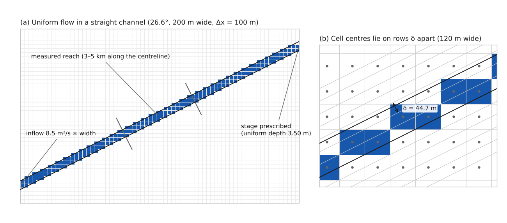
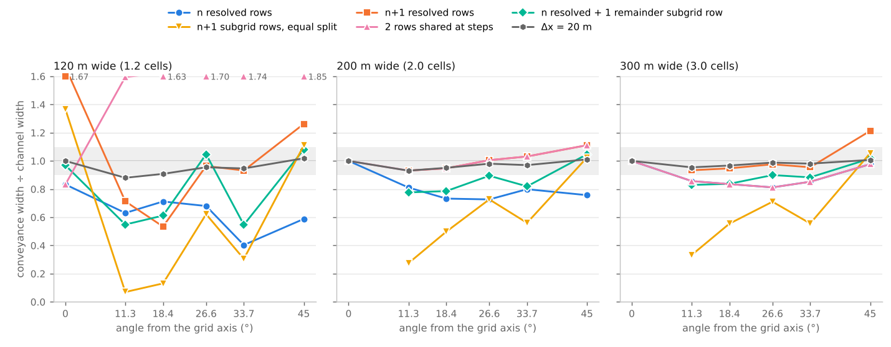
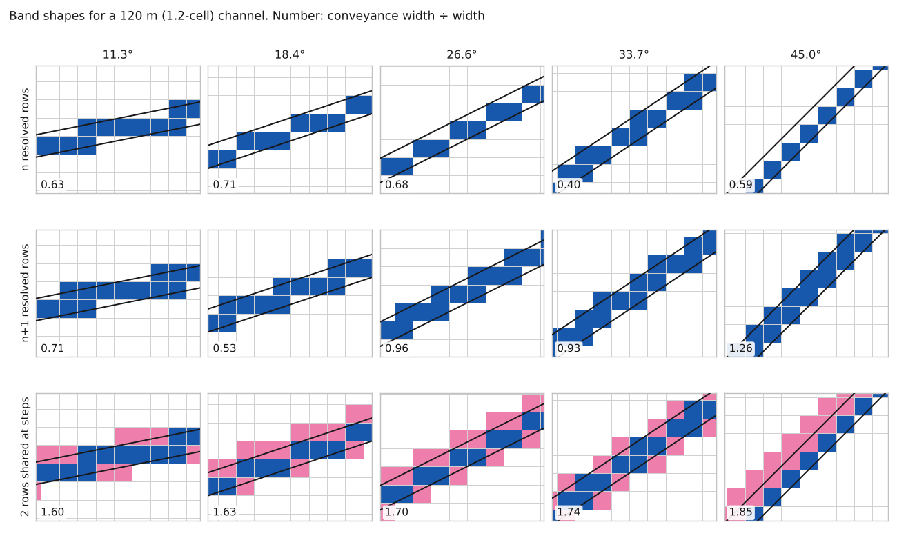
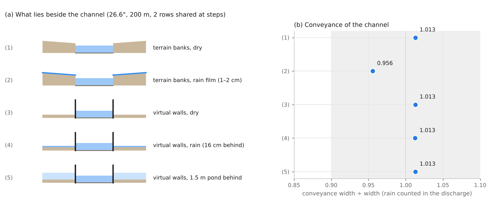

# examples/coarse_channel — Representing a river on a coarse grid: channel width, direction, bends, channel-mask shape and conveyance accuracy

> English mirror of examples/coarse_channel/README.md. The Japanese file is the master copy.

On a coarse grid (Δx = 100 m in this example) a river is represented by a raster of cells. Which cells are channel
cells (the channel mask `fn_rw`) and which width is given to a river narrower than a cell (the subgrid channel
`fn_width`) change how much water the channel can carry (its conveyance), even for the same channel width. This
example back-calculates a "conveyance width" from steady uniform flow in straight channels and compares the
representations in six series (281 cases in all) that vary the channel width, the direction relative to the grid, the
connectivity of the channel mask, bends, and the water beside the channel. It is material for deciding, when a river
is rasterized in preprocessing, which representation to choose and how large an error to expect.

## Summary

| Question | Answer | Figure |
|---|---|---|
| Is a subgrid channel right for a river narrower than one cell? | Yes. Giving the channel width as is to a channel mask with one cell per column (8-connected) gives a conveyance width of 0.99–1.00 times the channel width in every direction (up to 0.6 cell wide). A single oblique line of cells has an upper limit on the width it can carry (0.71 cell at 45°, 0.89 cell at 11.3°), and a width close to it falls short (0.88–0.97 times at 0.8 cell) | [mask](#1-narrower-than-one-cell-subgrid-channels-and-the-connectivity-of-the-channel-mask) |
| Should the channel mask be 4-connected? | No. In a 4-connected staircase, two subgrid cells side by side at a step are also linked through a diagonal edge, and the conveyance becomes 1.4–2.7 times at 26.6–45° (0.78–0.95 times at 11.3–18.4°). Make a one-cell-wide river 8-connected | [mask](#1-narrower-than-one-cell-subgrid-channels-and-the-connectivity-of-the-channel-mask) |
| A straight river along a grid axis? | If the width is a whole number of cells, resolved cells alone give the channel width (1.00). For a fractional width, see the next row | [axis](#2-a-river-along-a-grid-axis) |
| For an in-between width of 1–2 cells, "one cell + a subgrid remainder"? | Along a grid axis, one cell + the remainder (0.97–1.14 times) is better than an equal split (1.07–1.37 times). On an oblique river neither fits (0.55–1.08 and 0.07–1.11 times). No raster representation was found that represents an oblique river of this width within ±10 % | [axis](#2-a-river-along-a-grid-axis), [oblique](#3-an-oblique-river) |
| An oblique straight river, and how does the angle matter? | For 2–3 cells, taking one more row of cell centres (n+1 resolved rows) gives 0.93–1.03 times. Only at 45° this grows to 1.11–1.21 times, so use n rows + a subgrid remainder (1.02–1.05 times). For 1.2 cells the result scatters between 0.07 and 1.85 times with representation and direction | [oblique](#3-an-oblique-river) |
| Even 6–10 cells fall short because of the staircase banks. Does thickening, as in bends, help? | No (a wide band has no waists). The shortfall comes from a width of 0.14–0.40 cell lost at the staircase banks. One more row gives 0.95–1.01 times (at 45° it becomes 1.07–1.08 times, so keep n rows) | [wide](#4-wide-rivers-and-the-fine-grid) |
| Should bends be thickened, and how? | For a two-cell band, make the two rows (columns) nearest the centreline channel cells on both sides of every column (row) boundary. In a sharp bend (radius = 2.5 times the width), the difference of the backwater upstream from the fine grid goes from +7.5 to −1.5 cm. Sharing one row changes nothing for a two-cell band. In gentle bends (5–7.5 times the width) it is +3.3 and +1.7 cm without thickening and −3.6 and −3.0 cm with it | [bend](#5-bends) |
| Is a thin film of water on the non-channel cells beside the channel harmless? | A channel bounded by virtual walls (`fn_bank`) is the same whether the land behind the walls is dry, holds 16 cm of rain or a 1.5 m pond (1.013 times). With banks represented by the terrain (no walls), a rain film (1–2 cm) on them lowers it from 1.013 to 0.956 times | [wet](#6-water-beside-the-channel) |

The values are the conveyance width ÷ the channel width. At 1 the channel carries its width; below 1 the channel
level comes out too high (by Manning's formula, a conveyance width 10 % short makes the depth about 6.5 % deeper).

## How it is measured



A discharge of 8.5 m³/s per metre of channel width enters the upstream end of a straight, uniform channel (slope 1/1000,
roughness 0.03, 8 km long) as a segment inflow, the stage of the uniform-flow depth is prescribed at the downstream
end, and the run continues to steady state (8 hours on the coarse grid, 4 hours on the fine grid). From the mean depth h
of the channel cells in the middle 2 km (3–5 km along the centreline) and the slope I of the straight line fitted to the
level against the distance along the centreline (the water-surface slope), Manning's formula for a wide rectangular
section gives the conveyance width, which is divided by the channel width B.

```math
B_\mathrm{eff} = \frac{n\,Q}{h^{5/3}\sqrt{I}}
```

The Manning uniform-flow depth is 3.50 m. The coarse grid is Δx = 100 m and the fine grid used for comparison is
Δx = 20 m. Cells outside the channel are not computed (outside the domain mask), and the channel cells carry virtual-wall
levees that are never overtopped (bed + 10 m), except in the series on water beside the channel.

The direction of the channel is given as a slope p/q relative to the grid axis (0, 1:5, 1:3, 1:2, 2:3, 1:1 = 0°, 11.3°,
18.4°, 26.6°, 33.7°, 45°). The cell centres then lie on "rows" spaced δ = Δx/√(p² + q²) apart in distance from the
centreline (panel (b); 100 m at 0°, 19.6 m at 11.3°, 31.6 m at 18.4°, 44.7 m at 26.6°, 27.7 m at 33.7°, 70.7 m at 45°).
The representations that use a band of cells are built by choosing these rows.

## Representations


| Representation | How it is built |
|---|---|
| One subgrid row | Give the width B to one row of cells along the grid axis (a resolved cell when B ≥ Δx) |
| n resolved rows | Resolve the n = floor(B/δ) rows whose centres lie within the channel width |
| n+1 resolved rows | Add one more row and resolve it |
| n resolved + 1 remainder subgrid row | Resolve n rows and make the outer row a subgrid channel of the remaining width B − nδ |
| n+1 subgrid rows, equal split | Make all n+1 rows subgrid channels of width B/(n+1) |
| 1 / 2 rows shared at steps | Thicken the band of n resolved rows so that the 1 or 2 rows nearest the centreline are resolved cells in both columns at every column boundary (in bends, the same is done at row boundaries where the direction is closer to vertical) |
| 2 rows shared + widths scaled | Make every cell of the band thickened by sharing 2 rows a subgrid channel whose width makes the represented area equal to the channel width |
| One cell per column (8-connected) | Give the width B to the one cell nearest the centreline in each column (the same type as a D8 flow path) |
| 4-connected staircase | Give the width B to the cells within Δx(cos θ + sin θ)/2 of the centreline (two cells side by side at each step) |
| Δx = 20 m | Resolve round(B/δ) rows on the fine grid (divided by the represented width round(B/δ) δ) |

In the thumbnails, dark blue is a resolved cell, light blue a subgrid-channel cell, pink a cell added by thickening, and
the black lines are the true banks. The number at the lower left is the conveyance width ÷ the channel width.

## Results

### 1. Narrower than one cell: subgrid channels and the connectivity of the channel mask


A one-cell channel mask is given a width of 0.3–1.0 cell (1.0 is a resolved cell).

- **With one cell per column (8-connected), the subgrid width becomes the conveyance width**: up to 0.6 cell wide it is
  0.99–1.00 times in every direction. At an oblique step the cell connects to the next column through a diagonal edge.
  The width cap of that edge is "width ÷ the natural width of a diagonal edge (71 m)", so as a single flow path it
  carries the channel width.
- **A single oblique line of cells has an upper limit on the width it carries**: even with a full cell width (resolved
  cells), it carries only 0.71 cell at 45°, 0.76 at 33.7°, 0.82 at 26.6°, 0.85 at 18.4° and 0.89 at 11.3° (at 45° this is
  the natural width of the diagonal edge itself). A channel width close to this limit falls short: 0.88–0.97 times at
  0.8 cell.
- **A 4-connected staircase does not fit**: at a step, two subgrid cells side by side are linked to the downstream cell
  through a diagonal edge as well as an orthogonal edge. The cap of the diagonal edge (width ÷ 71 m) is looser than that of
  the orthogonal edge (width ÷ 100 m), so the parallel paths add conveyance: 1.4–2.7 times at 26.6–45° (0.3–0.8 cell
  wide). At 11.3–18.4°, with fewer steps, it is instead lower, 0.78–0.95 times.
- A river along a grid axis (0°) is the same single row of cells for both types and gives 1.00.

### 2. A river along a grid axis


- **If the width is a whole number of cells, resolved cells alone give the channel width**: 1, 2 and 3 cells give 1.00.
- **Narrower than one cell, one subgrid row gives the channel width** (1.00). A row of resolved cells instead flows with
  the width of a full cell, and the conveyance becomes Δx/B times the channel width (5 times for a 0.2-cell river).
- **For a fractional width, one cell + a subgrid remainder is better than an equal split**: for 1.2–1.8 and 2.5 cells, n
  resolved rows + a subgrid remainder give 0.97–1.14 times and the equal split 1.07–1.37 times. Both come out high because
  channel cells side by side are also linked through diagonal edges, and the wider the subgrid cells (equal split), the
  larger that share. Channel cells side by side are outside the premise of the subgrid channel (a channel one cell wide,
  like a line).

### 3. An oblique river



- **No representation fits a 1.2-cell river**: the result scatters between 0.07 and 1.85 times with direction and
  representation. A band of this width has "waists", where a run of a few cells side by side connects to the next run
  only through a one-cell overlap or a corner (figure below), and the conveyance is decided by the shape of the waists.
  Thickening the band so that 2 rows are shared at the steps removes the waists, but the area swells to about 1.8 times
  the channel width and the result is 1.60–1.85 times. Scaling the widths so that the area equals the channel width still
  gives 1.27–1.54 times (because subgrid cells lie side by side).
- **For 2–3 cells, one more row fits**: n+1 resolved rows give 0.93–1.03 times (except at 45°). For 2 cells, the band
  thickened by sharing 2 rows has almost the same shape as the band of n+1 rows (they differ by one cell, at the inflow end
  and the like) and the same value. A 3-cell band has no waists to begin with and does not change when thickened. n
  resolved rows give 0.73–0.86 times, too little.
- **45° is different**: a 45° band loses no width at the staircase banks (next section), and n+1 rows give 1.11–1.21
  times, too much. n resolved rows + a subgrid remainder fit with 1.02–1.05 times.
- **The equal split does not fit**: n+1 rows of equal subgrid width give 0.27–1.06 times.
- **Even the fine grid (Δx = 20 m) falls a little short because of the staircase banks**: 0.88–0.95 times for a river
  6 cells wide (120 m), 0.93–0.98 times for 10 cells (200 m) and 0.95–0.99 times for 15 cells (300 m) (11.3–33.7°; 0° and
  45° give 1.00–1.02 times).



The band shapes for a 1.2-cell river. With n resolved rows the runs connect only at corners at 18.4°, 26.6° and 45°,
through a one-cell overlap at 11.3°, and through overlaps and corners alternately at 33.7°. n+1 resolved rows make
the runs overlap by one cell at 18.4° and give even less (0.71 → 0.53). Sharing 2 rows at the steps makes the band 2–3
cells thick in every direction.

### 4. Wide rivers and the fine grid


- **Thickening by sharing rows at the steps changes nothing for a wide band**: bands 6 and 10 cells wide have no waists,
  and the rows nearest the centreline are already channel cells in both columns (the same values as n resolved rows in
  panels (a) and (b)).
- **The shortfall is the width lost at the staircase banks**: the width of the represented area minus the conveyance
  width is 0.14–0.40 cell at 11.3–33.7° (panel (c); almost the same for 6 and 10 cells, and larger the closer the direction
  is to a grid axis). The relative shortfall is this width ÷ the channel width and gets smaller for wider rivers (with n
  resolved rows, 0.90–0.96 times for 6 cells and 0.94–1.00 times for 10 cells). At 45° the lost width is small (0.04–0.15
  cell).
- **One more row makes up for it**: n+1 resolved rows give 0.95–1.01 times for 6 cells and 0.96–1.01 times for 10 cells
  (11.3–33.7°). At 45° they give 1.07–1.08 times, too much, so keep n rows (0.96 and 1.00 times) or n rows + the
  remainder (1.03 and 1.00 times).
- **The fine grid loses more, counted in cells**: representing the same 6- and 10-cell rivers on Δx = 20 m loses a width
  of 0.22–0.72 cell (11.3–33.7°). The ratio of depth to cell size differs (0.035 at Δx = 100 m, 0.175 at 20 m), so the
  lost width is not proportional to the cell size.

### 5. Bends


The channel runs straight from west to east (3 km), turns 90° to the right along a circular arc of radius R, and runs
straight to the south (3.6 km). It is 200 m wide (2 cells on the coarse grid) and the radius is 500, 1,000 or 1,500 m
(2.5, 5 and 7.5 times the width). The straight reaches before and after follow the grid axes, so the amount by which the
level in the upstream straight reach (1–2.5 km along the centreline) exceeds the uniform-flow level (the backwater) is the
size of the loss the bend makes.

- **On the fine grid the backwater upstream of the bend is 2.5–2.9 cm** (whatever the radius).
- **An unthickened coarse band gives a large backwater in sharp bends**: 10.0 cm at a radius of 500 m, 6.2 cm at 1,000 m
  and 4.3 cm at 1,500 m. Along the arc the band becomes a two-cell staircase with waists where the runs connect only
  through a one-cell overlap (panels (a) and (c)).
- **Thickening by sharing 2 rows at the steps brings a sharp bend close to the fine grid**: 1.0 cm at a radius of 500 m
  (difference from the fine grid +7.5 → −1.5 cm). Only two cells along the arc are added (pink in panels (b) and (d)).
- **In gentle bends thickening gives too little instead**: −0.7 and −0.4 cm at radii of 1,000 and 1,500 m (differences
  from the fine grid −3.6 and −3.0 cm), about as large as the differences without thickening (+3.3 and +1.7 cm).
- **Sharing one row does not change a two-cell band**: the row nearest the centreline is already a channel cell in both
  columns.
- Within the bend (panel (f)) the level is about 30 cm high for the unthickened band, 14 cm for the thickened band and
  8 cm for the fine grid (means of the channel cells every 200 m, including the superelevation at the outer bank).

### 6. Water beside the channel



A 26.6° straight channel (200 m wide) is represented by the band thickened by sharing 2 rows at the steps, and the 300 m
on each side is set up in the five configurations below. In the rain cases a constant 20 mm/h falls everywhere, and the
conveyance width counts the upstream discharge plus the rain that enters the channel upstream of the middle of the
measured reach.

| Configuration | Beside the channel | Conveyance width ÷ width | Channel depth |
|---|---|---:|---:|
| (1) Terrain banks, dry | Bed + 4 m (0.5 m above the water surface), 2 % cross slope toward the channel | 1.013 | 3.474 m |
| (2) Terrain banks, rain | Rain on the same banks. The film on the banks is 1–2 cm beside the channel | 0.956 | 3.623 m |
| (3) Virtual walls, dry | Virtual walls on the channel cells (bed + 10 m), level ground behind them | 1.013 | 3.474 m |
| (4) Virtual walls, rain | Rain on the same configuration. 16 cm collects behind the walls (it does not enter the channel) | 1.013 | 3.482 m |
| (5) Virtual walls, pond | A still pond 1.5 m deep behind the walls | 1.013 | 3.474 m |

- **A channel bounded by virtual walls is not affected by the water behind them**: the advection term counts a cell
  behind a virtual wall like a dry cell, even when it is wet ([Advection scheme](../../../docs/en/users_guide/advection.md)
  §4.4). (3)–(5) give the same conveyance.
- **A thin film on terrain banks lowers the conveyance of the channel by 5.6 %**: without walls the advection term
  counts the wet bank cells. Even after removing the deepening due to the rain inflow (0.6 % for a 1.05 % larger
  discharge), the depth is 3.6 % deeper (13 cm). The default advection rules have a treatment that keeps a thin film on
  the banks from representing the flow (test/wetbank), but with this band shape some of the effect remains.
- (1) and (3) give 1.013 rather than the 1.005 of the same band in the oblique-river section because the cells outside the
  channel are computed here and lie outside the domain there.

## Choosing a representation

| Width | Along a grid axis | Oblique (11–34°) | Close to 45° |
|---|---|---|---|
| Below 1 cell | One subgrid row (1.00) | Subgrid channel with one cell per column (8-connected) (0.99–1.00 up to 0.6 cell; limit 0.71–0.89 cell) | Same (limit 0.71 cell) |
| 1–2 cells | One resolved row + subgrid remainder (0.97–1.14) | No representation fits (use a finer grid, or calibrate to observed levels) | n resolved rows + remainder (1.05–1.08) |
| 2–3 cells | Resolved only for whole numbers (1.00), resolved + remainder for fractions (1.08) | n+1 resolved rows (0.93–1.03) | n resolved rows + remainder (1.02–1.05) |
| 6–10 cells | Resolved (1.00) | n+1 resolved rows (0.95–1.01) | n resolved rows (0.96–1.00) |
| Bends (2 cells) | — | Thicken a sharp bend with a radius of 2.5 times the width by sharing 2 rows at the steps (backwater difference +7.5 → −1.5 cm). At 5 times or more the difference stays within 4 cm with or without thickening | — |

The values in brackets are the conveyance width ÷ the channel width measured in this example. When deciding the width
of a band, choose with the row spacing δ (set by the direction relative to the grid) in mind.

## Tables

<details>
<summary>Conveyance width ÷ channel width for all cases (the tables written by <code>python3 plot_results.py</code>)</summary>

Along a grid axis:

| B/Δx | One subgrid row | n resolved rows | n+1 resolved rows | n resolved + remainder | Equal split |
|---:|---:|---:|---:|---:|---:|
| 0.2 | 1.00 | — | 4.97 | — | — |
| 0.4 | 1.00 | — | 2.50 | — | — |
| 0.6 | 1.00 | — | 1.67 | — | — |
| 0.8 | 1.00 | — | 1.25 | — | — |
| 1.0 | 1.00 | 1.00 | — | — | — |
| 1.2 | 0.83 | 0.83 | 1.67 | 0.97 | 1.37 |
| 1.4 | 0.71 | 0.71 | 1.43 | 1.14 | 1.27 |
| 1.6 | 0.62 | 0.62 | 1.25 | 1.12 | 1.16 |
| 1.8 | 0.55 | 0.55 | 1.11 | 1.07 | 1.07 |
| 2.0 | 0.50 | 1.00 | — | — | — |
| 2.5 | 0.40 | 0.80 | 1.20 | 1.08 | 1.14 |
| 3.0 | 0.33 | 1.00 | — | — | — |

Oblique rivers (120 / 200 / 300 m wide):

| Angle | n resolved rows | n+1 resolved rows | n resolved + remainder | Equal split | 1 row shared at steps | 2 rows shared at steps | 2 rows + widths scaled | Δx = 20 m |
|---|---:|---:|---:|---:|---:|---:|---:|---:|
| 0° | 0.83 / 1.00 / 1.00 | 1.67 / — / — | 0.97 / — / — | 1.37 / — / — | — | — | — | 1.00 / 1.00 / 1.00 |
| 11.3° | 0.63 / 0.81 / 0.86 | 0.71 / 0.93 / 0.93 | 0.55 / 0.78 / 0.83 | 0.07 / 0.27 / 0.33 | 0.63 / 0.81 / 0.86 | 1.60 / 0.93 / 0.86 | 1.27 / 0.91 / 0.86 | 0.88 / 0.93 / 0.95 |
| 18.4° | 0.71 / 0.73 / 0.84 | 0.53 / 0.95 / 0.95 | 0.61 / 0.79 / 0.84 | 0.13 / 0.50 / 0.55 | 0.53 / 0.73 / 0.84 | 1.63 / 0.95 / 0.84 | 1.29 / 0.93 / 0.84 | 0.91 / 0.95 / 0.97 |
| 26.6° | 0.68 / 0.73 / 0.81 | 0.96 / 1.01 / 0.98 | 1.05 / 0.89 / 0.90 | 0.62 / 0.73 / 0.71 | 0.96 / 0.73 / 0.81 | 1.70 / 1.01 / 0.81 | 1.41 / 1.00 / 0.81 | 0.95 / 0.98 / 0.99 |
| 33.7° | 0.40 / 0.80 / 0.85 | 0.93 / 1.03 / 0.96 | 0.55 / 0.82 / 0.88 | 0.30 / 0.56 / 0.56 | 0.93 / 0.80 / 0.85 | 1.74 / 1.03 / 0.85 | 1.43 / 1.02 / 0.85 | 0.95 / 0.97 / 0.98 |
| 45° | 0.59 / 0.76 / 0.98 | 1.26 / 1.11 / 1.21 | 1.08 / 1.05 / 1.02 | 1.11 / 1.02 / 1.06 | 1.26 / 0.76 / 0.98 | 1.85 / 1.11 / 0.98 | 1.54 / 1.09 / 0.98 | 1.02 / 1.01 / 1.01 |

Wide rivers (600 / 1,000 m wide; sharing 1 or 2 rows at the steps gives the same values as n resolved rows in every
direction):

| Angle | n resolved rows | n+1 resolved rows | n resolved + remainder |
|---|---:|---:|---:|
| 0° | 1.00 / 1.00 | — | — |
| 11.3° | 0.92 / 0.94 | 0.95 / 0.96 | 0.91 / 0.95 |
| 18.4° | 0.90 / 0.95 | 0.95 / 0.98 | 0.93 / 0.96 |
| 26.6° | 0.94 / 0.97 | 1.01 / 1.01 | 0.95 / 0.97 |
| 33.7° | 0.94 / 0.98 | 0.99 / 1.01 | 0.94 / 0.96 |
| 45° | 0.96 / 1.00 | 1.08 / 1.07 | 1.03 / 1.00 |

One-cell channel masks (one cell per column / 4-connected staircase):

| Angle | 0.3 cell wide | 0.6 cell | 0.8 cell | 1.0 cell (resolved) |
|---|---:|---:|---:|---:|
| 0° | 1.00 | 1.00 | 1.00 | 1.00 |
| 11.3° | 0.99 / 0.91 | 0.99 / 0.90 | 0.97 / 0.84 | 0.89 / 0.80 |
| 18.4° | 0.99 / 0.95 | 0.99 / 0.93 | 0.96 / 0.78 | 0.85 / 0.69 |
| 26.6° | 1.00 / 1.87 | 1.00 / 1.67 | 0.96 / 1.39 | 0.82 / 1.16 |
| 33.7° | 0.99 / 1.93 | 0.99 / 1.66 | 0.92 / 1.38 | 0.76 / 1.14 |
| 45° | 1.00 / 2.66 | 1.00 / 2.22 | 0.88 / 1.83 | 0.71 / 1.51 |

Bends (backwater in the upstream straight reach, cm):

| Radius | n resolved rows | 1 row shared at steps | 2 rows shared at steps | Δx = 20 m |
|---|---:|---:|---:|---:|
| 500 m | 10.0 | 10.0 | 1.0 | 2.5 |
| 1,000 m | 6.2 | 6.2 | −0.7 | 2.9 |
| 1,500 m | 4.3 | 4.3 | −0.4 | 2.6 |

</details>

## How to run

```bash
cd examples/coarse_channel
make                 # link to ../../bin/encflow and the input of all cases (runs/)
make run             # computes all series (about 25 minutes on 4 cores; NP=2 changes the parallelism)
make figs            # figures (figs/ and en/figs/) and tables
```

Each series can also be computed with `make axis`, `make oblique`, `make wide`, `make mask`, `make bend` or `make wet`.
The coarse-grid cases (a few seconds each) run in parallel with one thread per case, and the fine-grid cases
(Δx = 20 m; 30 s to 2 min each with 4 threads) one at a time. Cases already computed are skipped. `plot_results.py`
skips the figures of series that have not been computed.

## Files

| File | Content |
|---|---|
| `make_cases.py` | Writes the input of all cases (ground, roughness, mask, initial depth, channel mask, width, crest, boundary tables) and the settings `runs/param_<case>.txt`. The representations are built here |
| `run_series.sh` | Computes the cases of a series in `runs/` |
| `analyze.py` | Reads the conveyance width (the backwater for bends) from the results |
| `plot_results.py` | Figures and tables (with the argument `en` it draws the English figures into `en/figs/`) |

## What this example does not check

- **Steady uniform flow only**: the delay and attenuation of a flood wave depend on how much water the channel stores.
  n rows + the remainder, thickened bands and bands of n+1 rows represent an area whose width differs from the channel
  width (1.0–1.2 times for n+1 rows, about 1.8 times for a thickened 1.2-cell band), so the storage does not match even
  when the conveyance does.
- **A single flow strength**: one condition with a depth of 3.50 m and a depth ÷ cell size of 0.035. The width lost in
  cells changes with the ratio of depth to cell size (0.22–0.72 cell on the fine grid).
- **Only the default advection configuration**: the conveyance of the same band changes by a few per cent with the
  advection configuration (1.00–1.08 times for the thickened two-cell band at 26.6°; developer record §134.10).
- **The fine grid is not converged either**: even at Δx = 20 m a 6-cell river at 11.3° gives 0.88 times. Treating the
  fine grid as the right answer is accurate only to a few per cent.
- **Shapes not covered here**: reaches of varying width, meanders, bends of one-cell subgrid channels, confluences
  ([confluence_backwater](../../confluence_backwater/en/README.md)) and the connectivity of channel networks. The habits of
  channel masks made from a DEM (how cells at equal distance are chosen, and so on) are not checked either.
- **Not run with MPI.**

Related: [Channel](../../../docs/en/users_guide/channel.md) (subgrid channel width, levees),
[Channel models](../../../docs/en/users_guide/channel_models.md) §2 (formulation and accuracy limits of the subgrid
channel width), [Advection scheme](../../../docs/en/users_guide/advection.md) (treatment of virtual walls and films on
the banks).
