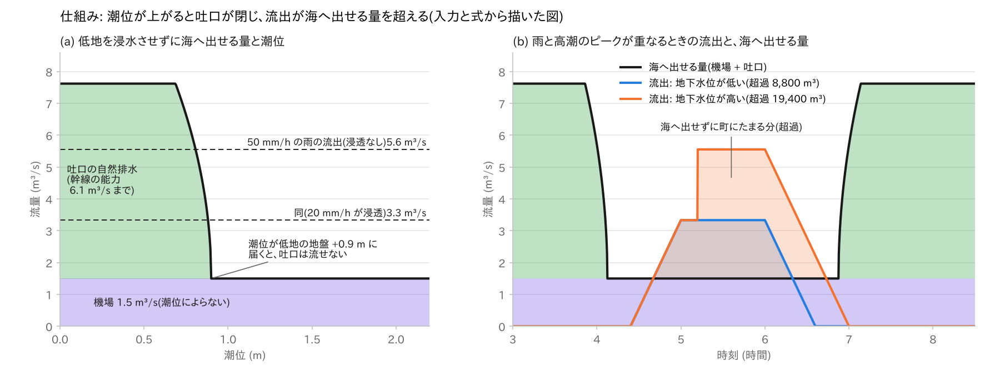
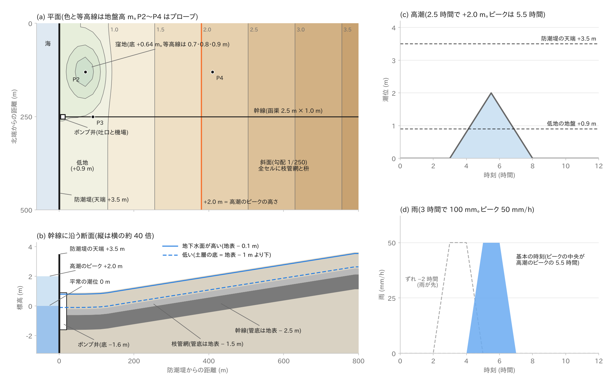
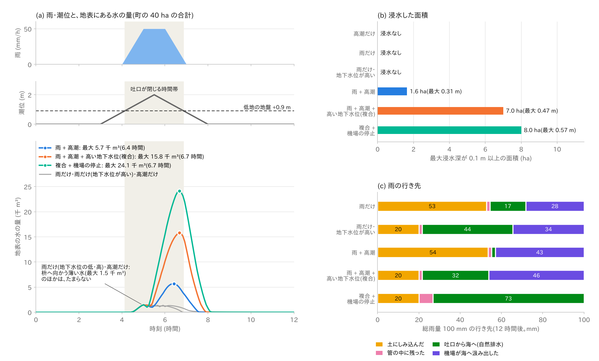
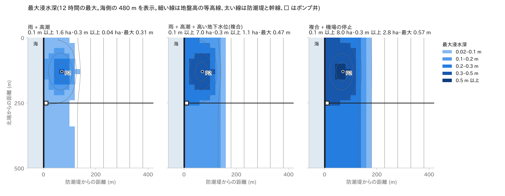
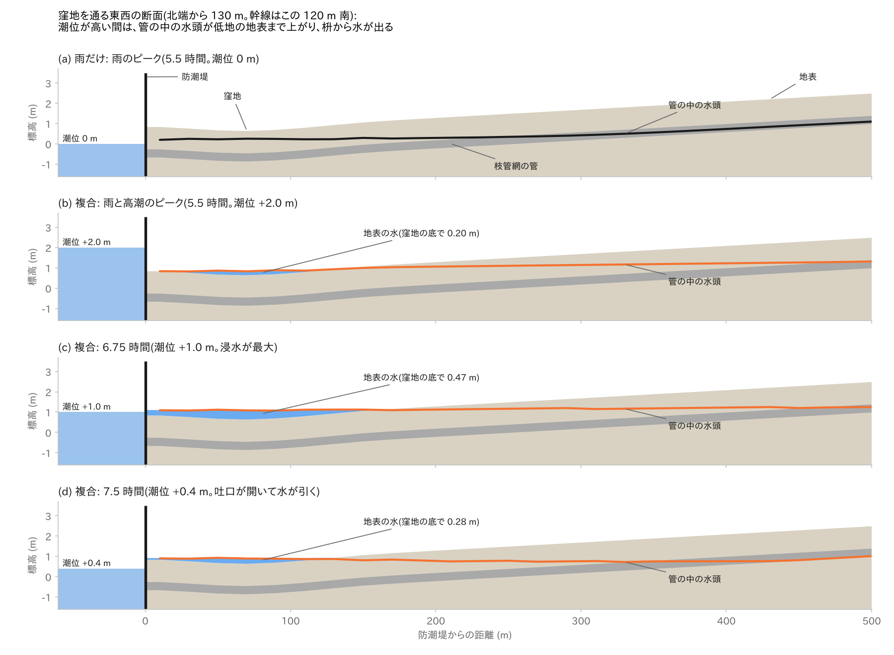
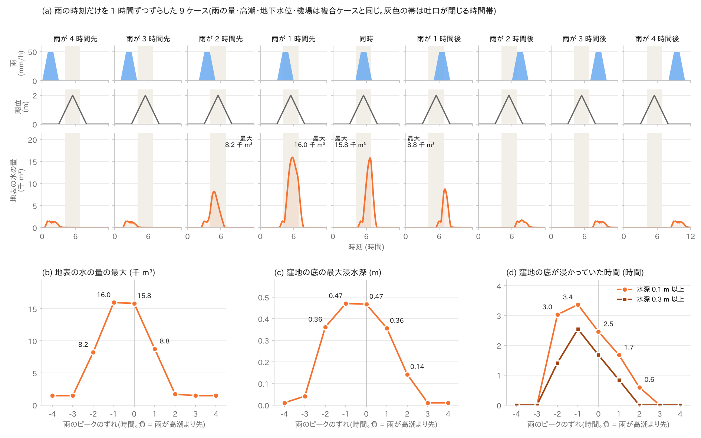
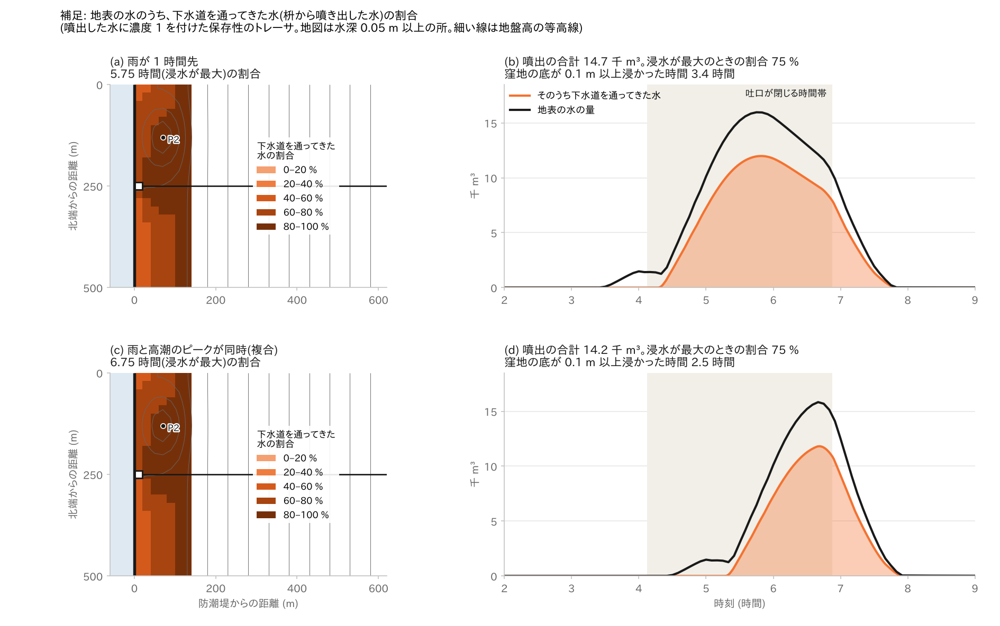

# coastal_compound_flood — 海は堤防を越えていないのに、街が浸水する(豪雨 × 高潮 × 高い地下水位)

[English](en/README.md)

高潮のとき、防潮堤が海の水を止めていても、堤防の内側の町が浸水することがあります。水は海から
ではなく、雨から来ます。潮位が上がると下水道の吐口が閉じて、雨水が海へ出られなくなります。
斜面に降った雨は下水道を通って低地へ集まり、枡から噴き出して低地にたまります。地下水位が高いと、
雨が土にしみ込めず、流れ出る水が増えます。

この例題は、海に面した 40 ha の模式的な町で、豪雨・高潮・高い地下水位を 1 つずつ重ねて計算します。
どれか 1 つだけでは浸水しない町が、3 つが重なると浸水すること、同じ雨と同じ高潮でも、重なる順序で
浸水の続く時間が変わることを見ます。値は現象を見やすくするための模式値で、特定の町の再現では
ありません。計算本体の変更はなく、入力だけで組んでいます。

## 実際に起きていること

- **複合浸水**: 高潮・高い潮位と豪雨が同時に起きる浸水を、複合浸水(compound flooding)と呼びます。
  米国の主要な沿岸都市では、高潮と豪雨が重なる回数が過去 100 年で増えています(Wahl ほか 2015)。
- **水の入り方は海からだけではない**: 海から直接入る水(越流・越波)のほかに、放流先の水位が高くて
  雨水を排水できないことと、地下水があります。海面が上がると沿岸の地下水位も上がり、土に雨が
  しみ込む余地が減って、低い所では地下水が地表に出ます(Rotzoll & Fletcher 2013、Befus ほか 2020)。
  米国地質調査所(USGS)は、降雨・高潮・浅い地下水の 3 つを合わせた複合浸水の危険度を、
  ニューヨーク州とコネチカット州の沿岸で評価しています(Glas ほか 2026)。
- **海沿いの低地の排水**: 満潮や高潮の水位より低い土地は、雨水を自然には海へ出せません。吐口の
  逆流防止のゲート(フラップゲート・樋門)と排水機場で、堤防の外へ出します。

## 再現に必要な機構

| 実際の現象 | ENCflow での表し方 | 設定 |
|---|---|---|
| 高潮で海の水位が上がるが、防潮堤は越えない | 海域マスクのセルに潮位の時系列を与える。防潮堤は、海に接する陸のセルの海側の辺に立つ仮想の壁(天端 +3.5 m) | `fn_tide`(`tival`)、`fn_sw`、`seawall0` |
| 雨が地表を流れ、枡から下水道へ入る | 降雨を陸の全セルに与える。枡の密度に応じて、地表の水が管路へ入る | `fn_precip`、`fn_gwc_inlet` |
| 下水道(枝管網と幹線)が雨水を海へ運ぶ | 管路連続体層。セルごとの貯留容量と通水能で、管の中の水頭をセルごとに追う | `f_gwconduit`、`fn_gwc_cap`・`fn_gwc_cnd`・`fn_gwc_bot`・`fn_gwc_sy`・`fn_gwc_slot_sy` |
| 吐口のフラップが、潮位が高い間は閉じる | 海に隣り合うセルの吐口。管の中の水頭が潮位より高いときだけ海へ流れる | `fn_gwc_outfall` |
| 行き場のない水が、低い所の枡から噴き出す | 管が満管になり、水頭が地表の水位を超えると、枡から地表へ出る | (自動) |
| 機場が、潮位によらず水を汲み出す | 管路の水を汲み、堤防の外(域外)へ出すポンプ | `&list_struct_pump`(`f_pump_src = 1`) |
| 地下水位が高いと、雨が土にしみ込めない | Green-Ampt の浸透。土層の空き = (1 − 初期の飽和度) × 土層厚 × 比湧水量 | `f_gwvertical = 2`、`gw_sat0`、`sd0`、`sy0` |



入力と式から描いた図(計算結果ではない)。(a) 低地を浸水させずに海へ出せる量。吐口の自然排水は、
ポンプ井の水頭が低地の地盤(+0.9 m)に達したときの流量(吐口のオリフィスの式。上限は幹線の能力
6.1 m³/s)で、潮位が上がると減り、潮位が +0.9 m に届くと 0 になります。機場の 1.5 m³/s は潮位に
よりません。破線は、計画降雨 50 mm/h のときに町全体から流れ出る量(雨がしみ込まないとき 5.6 m³/s、
20 mm/h がしみ込むとき 3.3 m³/s)です。(b) 雨と高潮のピークが重なるときの、流出(雨 − 浸透)と海へ
出せる量。潮位が +0.9 m を超える 2.75 時間は機場だけになり、流出がそれを超えた分(色の付いた部分)が
町にたまります。地下水位が高いと、土の空き 20 mm が 1.2 時間でなくなり、そこから雨の全量が
流れ出ます。超過は、地下水位が低いとき 8,800 m³、高いとき 19,400 m³ です。

## 構成



(a) 平面。(b) 幹線に沿う断面。(c)(d) 外力。入力から描いた図で、計算結果ではありません。

800 m × 500 m の陸(40 ha)と、その西の幅 60 m の海。dx = dy = 20 m(43 × 25 セル)。北・東・南の
辺は壁(分水界)です。

| 範囲 | 地形 | 役割 |
|---|---|---|
| 海(西の 3 列) | 海域マスク | 潮位を与える。平常は 0 m、高潮のピークは +2.0 m |
| 防潮堤 | 海に接する陸のセルの海側の辺。天端 +3.5 m | 高潮のピークより 1.5 m 高く、海の水は入らない |
| 低地(防潮堤から 120 m) | 地盤 +0.90〜+0.96 m。北寄りに窪地(底 +0.64 m) | 高潮のピークより 1.0〜1.4 m 低い |
| 斜面(その東 680 m) | 勾配 1/250。東端 +3.6 m | +2.0 m より低いのは防潮堤から 380 m まで |

| 下水道 | 諸元 | 管路連続体層の入力(gen_data.py が換算) |
|---|---|---|
| 枝管網(全セル) | 径 0.4 m の管が東西・南北に 20 m 間隔で通る格子状の網(枝管と支線をならしたもの)。管底は地表 − 1.5 m。枡は 1 セルに 4 個 | 通水能密度 0.104 m²/s、容量 12.6 mm、貯留係数 0.031 |
| 幹線(町の中央の東西 1 列) | 函渠 幅 2.5 m × 高さ 1.0 m、粗度係数 0.013。管底は地表 − 2.5 m。満管の通水能 C = 96.8 m³/s で、斜面の勾配 1/250 では 6.1 m³/s | 通水能密度 11.7 m²/s(= C ÷ 8.28 m。下の「注意」)、セルの容量 138 mm、貯留係数 0.138 |
| ポンプ井(幹線の海側の端のセル) | 水面の面積 100 m² の室。底 −1.6 m | 貯留係数 0.25(水面の面積 ÷ セルの面積)、容量 625 mm |
| 吐口 | ポンプ井から防潮堤を抜けて海へ。樋門 2.5 m × 1.6 m、流量係数 0.75。フラップつき | Cd·A = 3.0 m² |
| 機場 | ポンプ井の水位が −1.2 m を超えると動き始め、−0.8 m で全力の 1.5 m³/s(町の 13.5 mm/h にあたる) | `pump_rule` |

- **雨**: 3 時間で 100 mm。1 時間で 50 mm/h まで強まり、1 時間続き、1 時間で止みます。50 mm/h は
  下水道の計画降雨の代表的な強さで、町全体では 5.6 m³/s です(幹線の能力 6.1 m³/s より少し小さい)。
- **高潮**: 潮位は 3.0 時間から上がり始め、5.5 時間に +2.0 m、8.0 時間に 0 m へ戻ります。高潮の偏差だけを
  与え、天文潮と波は扱いません。
- **土と地下水位**: 土層は厚さ 1 m、比湧水量 0.2(ためられる水 200 mm)。浸透能は町の平均 20 mm/h
  (計画降雨の 4 割がしみ込み、6 割が流れ出る値)。地下水位が低いケースは土層が空(地下水面は地表の
  1 m より下。空き 200 mm)、高いケースは初期の飽和度 0.9(地下水面は地表の 0.1 m 下。空き 20 mm)です。
- 計算は 12 時間、dt = 0.5 s。管の中の流れは 1 ステップを 57 回に刻んで解きます(自動)。

| ケース | 設定ファイル | 雨 | 高潮 | 地下水位 | 機場 |
|---|---|---|---|---|---|
| 高潮だけ | param_surge.txt | — | あり | 低い | 動く |
| 雨だけ | param_rain.txt | あり | — | 低い | 動く |
| 雨だけ・地下水位が高い | param_rain_gw.txt | あり | — | 高い | 動く |
| 雨 + 高潮 | param_both.txt | あり | あり | 低い | 動く |
| 雨 + 高潮 + 高い地下水位(複合) | param.txt | あり | あり | 高い | 動く |
| 複合 + 機場の停止 | param_nopump.txt | あり | あり | 高い | 止まる |
| ずれ −4〜+4 時間(8 ケース) | param_lag_m4.txt 〜 param_lag_p4.txt | 複合ケースの雨の時刻だけを 1 時間ずつずらす | あり | 高い | 動く |

param.txt が注釈つきの基本ケース(複合)で、ほかの設定ファイルは gen_data.py が param.txt の行を
差し替えて作ります(変えた行に「基本ケースは …」の注釈が付きます)。

| ファイル | 内容 |
|---|---|
| `gen_data.py` | 管の諸元 → 容量・通水能・貯留係数の換算、入力マップ(`data/`)と各ケースの設定(`param_<ケース>.txt`)の生成 |
| `param.txt` | 基本ケース(複合)の設定。全行に注釈 |
| `plot_results.py` | 図 7 枚と数表。引数 `en` で英語版を `en/figs/` に描く |
| `Makefile` | リンク・入力の生成・ケースの実行 |

## 実行方法

```
cd examples/coastal_compound_flood
make                      # リンクと、入力マップ・各ケースの設定(gen_data.py)
make run                  # 本体の 6 ケース(1 ケース 4 スレッドで 2 分ほど)
make lag                  # 雨と高潮のピークのずれの 8 ケース
make supp                 # 補足(下水道を通ってきた水の割合)の 2 ケース(任意)
python3 plot_results.py   # figs/*.png と数表(引数 en で英語版を en/figs/ に。make の後なら、計算の前でも setup・mechanism は描ける)
```

入力の生成(gen_data.py)には Python 3 と NumPy が、図化にはさらに matplotlib が要ります。

## 結果

### 1. どれか 1 つだけでは浸水せず、重なると浸水する



(a) 雨・潮位と、地表にある水の量。灰色の帯は、潮位が低地の地盤(+0.9 m)より高く、吐口が閉じる
時間帯。(b) 最大浸水深が 0.1 m 以上になった面積。(c) 12 時間後の雨の行き先。



| ケース | 地表の水の量の最大 | 0.1 m 以上の面積 | 0.3 m 以上の面積 | 窪地の底の最大浸水深 | 窪地の底が 0.1 m 以上浸かった時間 |
|---|---:|---:|---:|---:|---:|
| 高潮だけ | 0 | 0 | 0 | 0 | 0 |
| 雨だけ | 1,500 m³(薄い水) | 0 | 0 | 0.01 m | 0 |
| 雨だけ・地下水位が高い | 1,500 m³(薄い水) | 0 | 0 | 0.01 m | 0 |
| 雨 + 高潮 | 5,700 m³ | 1.6 ha | 0.04 ha | 0.31 m | 2.1 時間 |
| 雨 + 高潮 + 高い地下水位(複合) | 15,800 m³ | 7.0 ha | 1.1 ha | 0.47 m | 2.5 時間 |
| 複合 + 機場の停止 | 24,100 m³ | 8.0 ha | 2.8 ha | 0.57 m | 2.8 時間 |

- **高潮だけでは、何も起きない**: 潮位 +2.0 m は防潮堤の天端 +3.5 m に届かず、海の水は町に入りません。
- **雨だけでも、浸水しない**: 平常の潮位(0 m)なら、計画降雨 50 mm/h の雨は吐口と機場から海へ出ます。
  地表にあるのは、枡へ向かう深さ数 mm の薄い水(町全体で最大 1,500 m³)だけです。地下水位が高くて
  雨がほとんどしみ込まなくても浸水せず、吐口から出る量が 17 mm から 44 mm に増えます。ただし、この
  ときは管の中の水頭が窪地の底にちょうど届いていて、下水道の能力の限界です(次の節)。
- **雨と高潮が重なると、浸水する**: 潮位が低地の地盤を超える 4.1〜6.9 時間は吐口が閉じ、海へ出るのは
  機場の 1.5 m³/s だけになります。地下水位が低ければ、雨の半分(54 mm)が土にしみ込むので、浸水は
  窪地の 1.6 ha(最大 0.31 m)にとどまります。
- **地下水位が高いと、地表の水は 2.8 倍になる**: 土の空きは 20 mm しかなく、雨の 80 mm が流れ出ます。地表の
  水は最大 15,800 m³ で、低地の全体を含む 7.0 ha が 0.1 m 以上、窪地は最大 0.47 m 浸かります。水は、
  潮位が地表の水面(+1.1 m)より下がる 6.6 時間ごろから吐口を通って引き始め、8 時間にはなくなります。
- **機場が止まると、さらに 1.5 倍**: 吐口が閉じている間は、海へ出る経路がなくなります。地表の水は
  最大 24,100 m³、窪地は最大 0.57 m です。

### 2. 潮位が高い間は、管の中の水頭が地表まで上がる



管の中の水頭(動水勾配線)と地表の水。(a) 雨だけのときは、雨のピークでも低地の水頭は +0.2〜+0.3 m で、
町のどこでも地表より 0.38 m 以上低く、枡は雨を飲み込み続けます(雨だけ・地下水位が高いケースでは、
流れ出る量が増えるので水頭が上がり、雨のピークの終わりに窪地の底 +0.64 m に届きます。浸水は
始まりませんが、余裕はありません)。(b) 複合ケースでは、吐口が閉じているので
水頭が低地の地表まで上がり、いちばん低い窪地の枡から水が出ます。斜面の管(管底が低地の地表より
高い所)は水を低地へ送り続けるので、低地にたまる水は、低地に降った雨(6 ha × 100 mm = 6,000 m³)
より多くなります。(c) 浸水が最大のとき、管の中の水頭と地表の水面はそろっています。(d) 潮位が
下がると吐口が開き、海に近い側から水頭が下がって、地表の水が枡から管へ戻ります。

### 3. 雨の行き先

総雨量 100 mm(40,000 m³)の 12 時間後の行き先です(町の平均の mm。図の (c))。

| ケース | 土にしみ込んだ | 管の中に残った | 吐口から海へ | 機場が海へ汲み出した |
|---|---:|---:|---:|---:|
| 雨だけ | 52.8 | 1.6 | 17.3 | 28.3 |
| 雨だけ・地下水位が高い | 20.0 | 1.6 | 43.9 | 34.5 |
| 雨 + 高潮 | 53.5 | 1.6 | 1.9 | 42.9 |
| 雨 + 高潮 + 高い地下水位(複合) | 20.0 | 1.6 | 32.3 | 46.1 |
| 複合 + 機場の停止 | 20.0 | 6.8 | 73.2 | 0 |

- 雨と高潮が重なるケースでは、機場が雨の 4 割以上を汲み出します(複合ケースの 46 mm は、全力で
  3.4 時間分)。機場が止まったケースでは、吐口が開いてから、たまっていた水の全部が吐口を通ります。
- 機場には流量の台帳がないので、機場の列は「雨 − ほかの 3 つ − 地表に残った水」で求めています。
  吐口の量は画面出力の `outfall discharge total` です。機場のないケースでは、この 4 つと地表の水の和が
  雨の量に 0.001 mm の差で一致します(下の「検算と数値設定の確認」)。

### 4. 同じ雨と同じ高潮でも、重なる順序で変わる



複合ケースの雨の時刻だけを、1 時間ずつずらした 9 ケース。雨の量、高潮、地下水位、機場は同じです。

| 雨のピークのずれ | 地表の水の量の最大 | 窪地の底の最大浸水深 | 窪地の底が 0.1 m 以上浸かった時間 | 同 0.3 m 以上 |
|---|---:|---:|---:|---:|
| −4・−3 時間(雨が先) | (薄い水だけ) | 0.01・0.04 m | 0 | 0 |
| −2 時間 | 8,200 m³ | 0.36 m | 3.0 時間 | 1.4 時間 |
| −1 時間 | 16,000 m³ | 0.47 m | 3.4 時間 | 2.6 時間 |
| 0(同時 = 複合ケース) | 15,800 m³ | 0.47 m | 2.5 時間 | 1.7 時間 |
| +1 時間(雨が後) | 8,800 m³ | 0.36 m | 1.7 時間 | 0.9 時間 |
| +2 時間 | 1,700 m³ | 0.14 m | 0.6 時間 | 0 |
| +3・+4 時間 | (薄い水だけ) | 0.01 m | 0 | 0 |

- **浸水するのは、雨が吐口の閉じる時間帯にかかるときだけ**: 雨のピークが高潮のピークから 3 時間以上
  離れると、雨は吐口が開いている間に海へ出て、浸水しません。
- **最大の深さはずれの向きによらないが、続く時間は雨が先のほうが長い**: ずれ −1 時間と 0 は、最大の
  水の量も最大浸水深もほぼ同じです。しかし窪地の底が 0.1 m 以上浸かる時間は、雨が 1 時間先のケースが
  3.4 時間、同時のケースが 2.5 時間です。ずれ −2 時間と +1 時間も、最大はほぼ同じ(8,200・8,800 m³、
  0.36 m)で、続く時間は 3.0 時間と 1.7 時間です。
- **理由は、吐口が閉じるときに町にある水の量**: 吐口が閉じる 4.1 時間ごろ、雨が 2 時間先のケースでは、
  土の空きはもうなく、管には容量 18 mm のうち 15 mm の水が入っています(雨を運んでいる最中)。雨が
  1 時間先のケースでも、土の空きはほぼなくなり、管の 3〜5 割に水が入っています。そこから後の雨と、
  斜面の管から下りてくる水が、潮位が下がるまで低地にとどまります。同時のケースでは、この時刻に土の
  空き 20 mm がほぼそのまま残り、管は空です。雨が後だと、雨の出始めは土と空の管に入り、雨の途中で
  潮位が下がって吐口が開きます。機場が汲み出した量は、ずれ −1 時間で 59 mm、0 で 46 mm、+1 時間で
  36 mm です。

## 補足: 地表の水のうち、下水道を通ってきた水の割合

低地にたまった水の多くは、その場に降った雨ではなく、下水道を通って枡から出てきた水です。水質
モジュールを保存性のトレーサとして使うと、その割合を追えます。枡から噴き出した水に濃度 1 を付ける
(`wq_gwc_conc = 1`)と、地表の濃度 C が「その場の水のうち下水道を通ってきた水の割合」になり、
台帳 `wq.csv` の `in_gwc_g` が噴き出した水の累積の体積 (m³) になります。



| ケース | 噴き出した水の合計 | 浸水が最大のときの割合 | 窪地の底が 0.1 m 以上浸かった時間 |
|---|---:|---:|---:|
| 雨が 1 時間先(param_tracer_m1.txt) | 14,700 m³ | 75 % | 3.4 時間 |
| 同時 = 複合ケース(param_tracer.txt) | 14,200 m³ | 75 % | 2.5 時間 |

- 浸水が最大のとき、地表の水の 4 分の 3 は下水道を通ってきた水です。防潮堤のすぐ内側で 6 割、窪地と
  低地の奥で 8 割です。
- 最大浸水深が同じ 2 ケースで、割合もほぼ同じですが、その水に浸かっている時間は 1 時間近く違います。
  浸水の深さの地図だけでは、この違いは見えません。
- この濃度は水の通った経路を示す目印で、汚れの濃度ではありません(下の「このモデルで表せないこと」)。

## 検算と数値設定の確認

- **水収支**: 機場のないケース(複合 + 機場の停止)では、雨 100.000 mm = 土 20.000 + 管 6.765 +
  吐口 73.228 + 地表 0.006 + 残差 0.001 mm で閉じます(残差は、吐口の量の表示の桁の範囲)。
- **数値設定**: 複合ケースで、数値の設定を 1 つずつ変えた結果です(`make check`。任意)。

  | 変えたもの | 地表の水の量の最大 | 最大浸水深 | 0.1 m 以上の面積 |
  |---|---:|---:|---:|
  | 複合ケース(dt = 0.5 s、疑似スロット sy/20・sy/10、`gwc_eps_h` = 0.02 m、dx = 20 m) | 15,833 m³ | 0.47 m | 7.0 ha |
  | 時間刻みを半分(dt = 0.25 s) | 15,836 m³ | 0.47 m | 7.0 ha |
  | 疑似スロットを既定の sy/50 に(管の中の刻みは 285 回) | 16,133 m³ | 0.47 m | 7.0 ha |
  | √則を直線でつなぐ水頭差を 0.005 m に(同 114 回) | 15,925 m³ | 0.47 m | 7.0 ha |
  | 格子を 10 m に(同 167 回) | 15,790 m³ | 0.47 m | 6.7 ha |

  どれを変えても、地表の水の量の最大は −0.3〜+1.9 % の範囲です。疑似スロット(満管の後に水頭 1 m
  あたり増える水の量)は、計算時間を抑えるために既定より緩い値にしています。浸水が最大のとき、
  疑似スロットに入っている水は 430 m³(町の平均 1.1 mm)で、既定の値では 140 m³ です。既定の値で
  計算すると、地表の水の量の最大は 1.9 % 増えます。
- **スレッド数**: 1 スレッドと 4 スレッドの Log.txt は一致します。

## このモデルで表せないこと(実際の現象との違い)

- **吐口からの海水の逆流**: 吐口は逆流防止つきで、海の水が下水道を通って町に入ること(フラップの
  ない吐口や、ゲートの閉め忘れ・故障)は表せません。
- **地下水位が上がる過程**: 地下水位は、低い・高いの 2 通りを初期条件として与えています。海面や
  長雨で地下水位が上がる過程と、地下水が地表に出る浸水は計算していません(土の中の横の流れを
  解いていない。海と地下水のやりとりには淡塩 2 層モジュールが要ります)。地下水位は地表から一定の
  深さとしていて、低地ほど浅いという実際の分布も入れていません。
- **機場の運転**: ポンプの流量は、その時刻のポンプ井の水位だけで決まります。停電や故障で途中から
  止まる・復旧するといった時刻の履歴は与えられず、この例題は「全期間止まっている」ケースと比べる
  だけです。
- **管 1 本ごとの水理**: 管路連続体層は、管網をセルごとの容量と通水能にならして扱います。どの
  マンホールから噴くか、合流や段差での損失、幹線の中の流れの切り替わりは表しません。浸水の面的な
  分布と量を見るためのモデルです。
- **枝管網は一様**: 実際の管網は、細い枝管を支線が集めて幹線へ渡す階層をもちます。この例題は、
  それを一様な網でならしています(管の体積は町の平均 18 mm)。
- **浸透**: 町の平均の浸透能を一様に与えています。舗装と庭の区別、建物は入れていません
  (`fn_gw_ksv` の分布や建物の空隙率 `fn_gv` で入れられます)。
- **天文潮・波・越波**: 高潮は水位の偏差だけです。
- **下水道を通ってきた水の割合**: 噴き出した水に一定の濃度を付ける近似(供給側固定濃度近似)で、
  管の中の物質の収支は解きません。濃度 1 は「下水道を通った」という目印で、汚水の混ざり方や病原体の
  濃度ではありません。感染の危険の予測には使えません。
- **規模と値**: 40 ha の模式的な町で、値は模式値です。

## 注意

- **1 セル幅の線として置く幹線の通水能**: 管路連続体層は、セルの辺を軸の 1 本と斜めの 2 本のエッジに
  分け、既定ではどのエッジの通過幅も 0.414 Δx です。面に広がる枝管網は、軸と斜めのエッジを合わせて
  「通水能密度 × セル幅」を運びます。1 セル幅の線に沿う流れは軸のエッジだけを通るので、運べるのは
  「通水能密度 × 0.414 Δx」です。そこで幹線のセルの通水能密度は、満管の通水能 C を 0.414 Δx(8.28 m)
  で割って与えています(C ÷ Δx で与えると、幹線の能力は 0.41 倍になります)。
- **吐口のセルは、自由水面をもつ室にする**: 吐口は、町全体の流量を 1 つのセルに集めて、時間刻みに
  1 回だけ水を抜きます。そのセルが満管の管だと、1 回に抜ける水は、水頭を潮位まで下げる分の疑似
  スロットの水(疑似スロットの貯留係数 × 潮位との水頭差 × セルの面積)に限られ、吐口の流量が
  「その水 ÷ 時間刻み」で頭打ちになります。この町の幹線のセル(疑似スロットの貯留係数 0.0138、
  400 m²)なら、水頭差 0.5 m で 1 回に 2.8 m³、dt = 0.5 s で 5.5 m³/s が上限で、計画降雨の流出と同じ
  大きさです(時間刻みを大きく、格子を細かくするほど小さくなります)。実際の機場と同じように、
  水面をもつ室(貯留係数 = 水面の面積 ÷ セルの面積)を吐口のセルにすると、この頭打ちは起きません
  (雨だけ・地下水位が高いケースをポンプ井なしで計算すると、雨のピークに吐口の手前のセルの水頭が
  0.2 m 高くなります)。
- **地表の水の量に含まれる薄い水**: Log.txt の S_surf は、地表のすべての水の平均の深さです。雨の間は、
  枡へ向かう深さ数 mm の水(この町で最大 3.7 mm = 1,500 m³)を含みます。浸水の広がりは、最大浸水深
  (H9999)で読みます。
- **海域マスクのセルには構造物を置けない**: 機場の吐き出し先を海のセルにはできません。吐き出し先を
  書かないポンプ(域外への排水)にします。
- **管の中の流れの時間刻み**: 管路連続体層は、時間刻みの上限(この例題で 0.0088 s)を超える分を
  自動で細かく刻みます(画面の `subcycles = 57`)。計算時間の大半はこの刻みです。上限は、満管の後の
  疑似スロットの貯留係数と、太い管の通水能で決まります。

## 感度実験の入口

- `tival`(高潮の高さと長さ): 吐口の閉じる時間。`seawall0` を高潮より低くすると、海の水が堤防を越えます。
- `prval`(雨の強さと長さ)、gen_data.py の `LAGS`(ずれ)。
- `gw_sat0`(地下水位)、`gw_ksv_mmh`(浸透能)、`sd0`(土層厚)。
- `pump_rule`(機場の能力と、動き始める水位)。
- gen_data.py の `CDA_OUT`(吐口の大きさ)、`B_T`・`H_T`(幹線の断面)、`D_B`・`PITCH_B`(枝管網)、
  `DEP_D`(窪地の深さ)、`X_LOW`(低地の幅)。

## 参考文献

- Wahl, T., Jain, S., Bender, J., Meyers, S. D. and Luther, M. E. (2015): Increasing risk of compound
  flooding from storm surge and rainfall for major US cities. *Nature Climate Change*, 5, 1093–1097.
  <https://doi.org/10.1038/nclimate2736>
- Rotzoll, K. and Fletcher, C. H. (2013): Assessment of groundwater inundation as a consequence of
  sea-level rise. *Nature Climate Change*, 3, 477–481. <https://doi.org/10.1038/nclimate1725>
- Befus, K. M., Barnard, P. L., Hoover, D. J., Finzi Hart, J. and Voss, C. I. (2020): Increasing threat
  of coastal groundwater hazards from sea-level rise in California. *Nature Climate Change*, 10, 946–952.
  <https://doi.org/10.1038/s41558-020-0874-1>
- Glas, R. L., Herdman, L. M., Cook, S. E., Howlader, A. and Masterson, K. K. (2026): Hazard potential of
  compound flooding from rainfall, storm surge, and groundwater in coastal New York and Connecticut.
  *Natural Hazards and Earth System Sciences*, 26, 2169–2188.
  <https://doi.org/10.5194/nhess-26-2169-2026>(USGS の事業の紹介:
  <https://www.usgs.gov/centers/new-york-water-science-center/science/regional-assessment-compound-flood-hazard-combined>)

4 編とも、書誌と要旨の内容を確かめて引いています(本文の細部は確かめていません)。

## 関連文書

- [docs/users_guide/gwflow.md](../../docs/users_guide/gwflow.md) — Green-Ampt、管路連続体層(`&list_gwflow_conduit`)、吐口
- [docs/users_guide/gwflow_models.md](../../docs/users_guide/gwflow_models.md) — 管路連続体層の式と、管の諸元からの換算
- [docs/users_guide/tide.md](../../docs/users_guide/tide.md)・[docs/users_guide/geoinfo.md](../../docs/users_guide/geoinfo.md) — 潮位と海域マスク、防潮堤(`seawall0`)
- [docs/users_guide/structure.md](../../docs/users_guide/structure.md) — ポンプ(管路から汲む `f_pump_src = 1`)
- [docs/users_guide/wq.md](../../docs/users_guide/wq.md) — 管路連続体層との連携(`wq_gwc_conc`)
- [examples/sewer_hybrid](../sewer_hybrid/) — 幹線と枝管網を 1 つの管路連続体層で表す模式実験。
  [test/coastal_drain](../../test/coastal_drain/) — 海域吐口と管路から汲む機場の検証
- 設計の記録は developer.md §125
