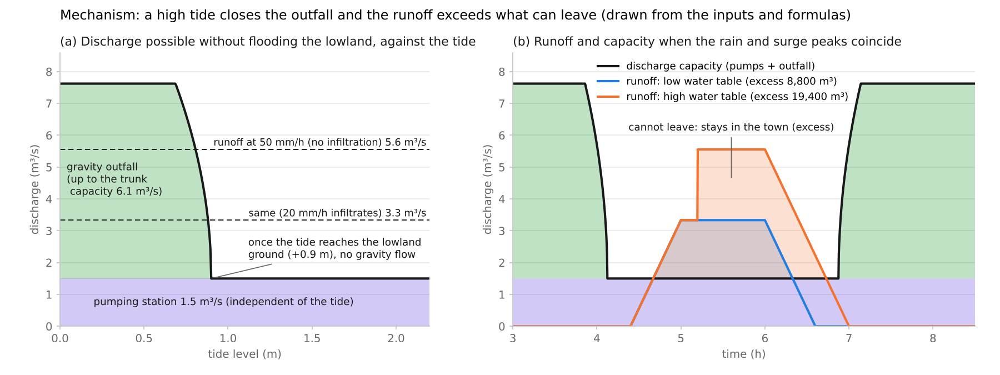
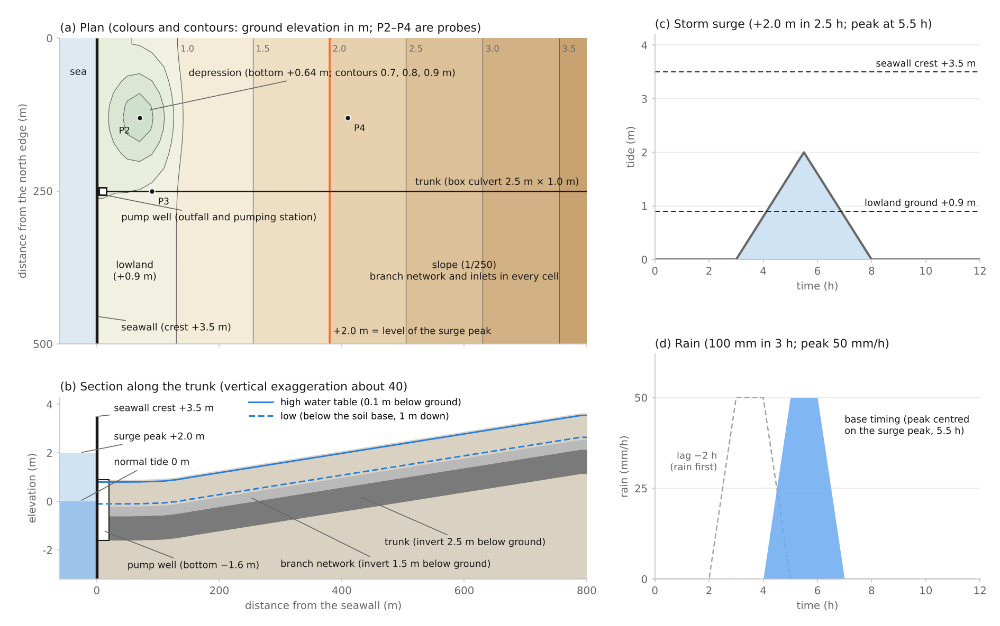
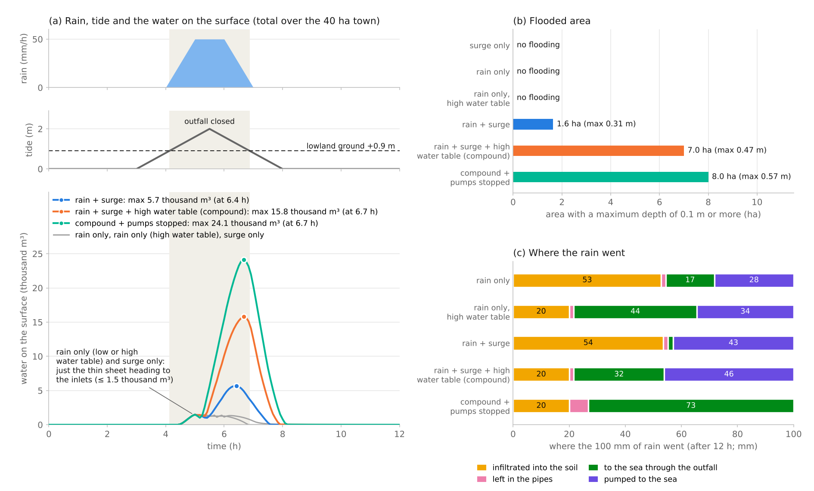
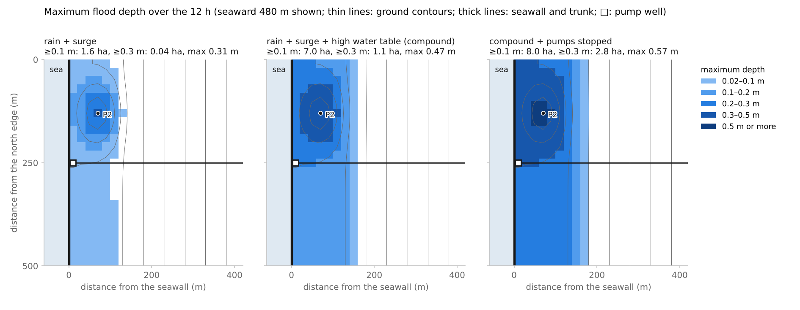
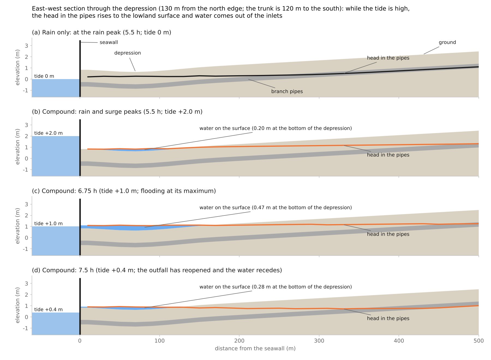
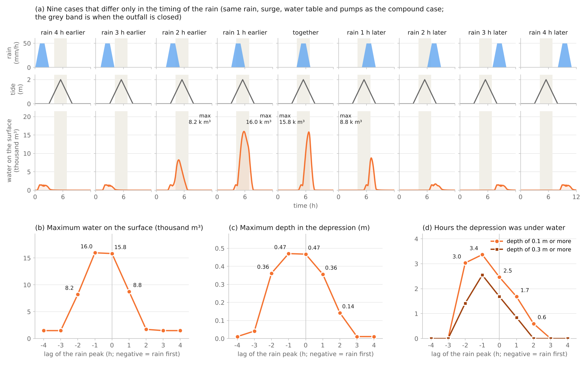
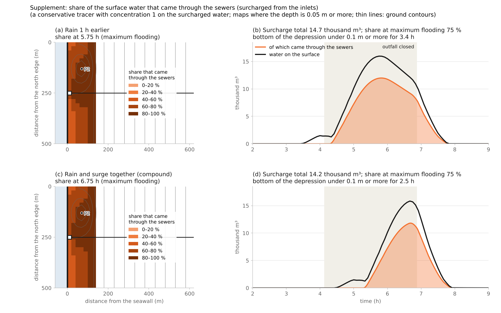

# coastal_compound_flood — the sea does not overtop the seawall, yet the town floods (heavy rain × storm surge × high water table)

> English mirror of examples/coastal_compound_flood/README.md. The Japanese file is the master copy.

[日本語](../README.md)

During a storm surge, a town behind a seawall can flood even though the seawall keeps the sea out.
The water comes from the rain, not from the sea. When the tide rises, the outfall of the sewer
system closes and the stormwater can no longer leave to the sea. Rain that falls on the slope runs
through the sewers to the lowland, comes out of the inlets and ponds there. When the water table is
high, the rain cannot infiltrate into the soil and more of it runs off.

This example computes a schematic 40 ha town facing the sea, adding heavy rain, a storm surge and a
high water table one at a time. It shows that a town that does not flood under any one of them
floods when the three coincide, and that the same rain and the same surge give a different
duration of flooding depending on the order in which they overlap. The values are schematic,
chosen to make the phenomenon easy to see; this is not a reproduction of a particular town. The
solver is unchanged; the example is built from inputs alone.

## What happens in reality

- **Compound flooding**: flooding in which a storm surge or a high tide and heavy rain occur
  together is called compound flooding. In the major coastal cities of the United States, the
  number of events in which surge and heavy rain coincide has increased over the past century
  (Wahl et al. 2015).
- **Water does not come only from the sea**: besides water that enters directly from the sea
  (overflow and overtopping), there is stormwater that cannot drain because the receiving water
  level is high, and there is groundwater. When the sea level rises, the coastal water table rises
  with it, less room is left for rain to infiltrate, and in low places the groundwater emerges at
  the surface (Rotzoll & Fletcher 2013; Befus et al. 2020). The U.S. Geological Survey (USGS) has
  assessed the compound flood hazard from rainfall, storm surge and shallow groundwater together
  along the coasts of New York and Connecticut (Glas et al. 2026).
- **Drainage of coastal lowlands**: land lower than the high-tide or surge level cannot drain its
  stormwater to the sea by gravity. Backflow-prevention gates at the outfalls (flap gates, sluices)
  and pumping stations move the water over the seawall.

## Mechanisms needed to reproduce it

| Real phenomenon | Representation in ENCflow | Setting |
|---|---|---|
| The surge raises the sea level but does not overtop the seawall | A tide time series on the sea-mask cells. The seawall is a virtual wall on the seaward edges of the land cells that touch the sea (crest +3.5 m) | `fn_tide` (`tival`), `fn_sw`, `seawall0` |
| Rain runs over the surface and enters the sewers through the inlets | Rain on every land cell. Surface water enters the conduits according to the inlet density | `fn_precip`, `fn_gwc_inlet` |
| The sewers (branch network and trunk) carry stormwater to the sea | The conduit continuum layer: the head in the pipes is tracked cell by cell from a storage capacity and a conveyance per cell | `f_gwconduit`, `fn_gwc_cap`, `fn_gwc_cnd`, `fn_gwc_bot`, `fn_gwc_sy`, `fn_gwc_slot_sy` |
| The flap of the outfall stays closed while the tide is high | An outfall on a cell next to the sea. Water flows to the sea only while the head in the pipes is above the tide | `fn_gwc_outfall` |
| Water with nowhere to go comes out of the inlets in low places | When the pipes are full and the head exceeds the surface water level, water leaves through the inlets to the surface | (automatic) |
| The pumping station pumps regardless of the tide | A pump that draws water from the conduits and discharges it outside the seawall (out of the domain) | `&list_struct_pump` (`f_pump_src = 1`) |
| A high water table keeps the rain from infiltrating | Green-Ampt infiltration. Room in the soil = (1 − initial saturation) × soil thickness × specific yield | `f_gwvertical = 2`, `gw_sat0`, `sd0`, `sy0` |



Drawn from the inputs and formulas (not a computed result). (a) The discharge that can leave to the
sea without flooding the lowland. The gravity outflow of the outfall is the discharge when the head
in the pump well reaches the lowland ground (+0.9 m) (the orifice formula of the outfall, capped by
the trunk capacity of 6.1 m³/s); it decreases as the tide rises and becomes zero when the tide
reaches +0.9 m. The 1.5 m³/s of the pumping station does not depend on the tide. The dashed lines
are the runoff of the whole town under the design rain of 50 mm/h (5.6 m³/s when none of it
infiltrates, 3.3 m³/s when 20 mm/h infiltrates). (b) The runoff (rain −
infiltration) and the discharge that can leave when the rain and surge peaks coincide. For the
2.75 h in which the tide is above +0.9 m only the pumps remain, and the runoff in excess of them
(the shaded part) stays in the town. With a high water table the 20 mm of room in the soil is used
up in 1.2 h, after which all the rain runs off. The excess is 8,800 m³ with a low water table and
19,400 m³ with a high one.

## Setup



(a) Plan. (b) Section along the trunk. (c)(d) Forcing. Drawn from the inputs, not a computed result.

Land of 800 m × 500 m (40 ha) with a 60 m wide strip of sea to its west. dx = dy = 20 m (43 × 25
cells). The north, east and south edges are walls (drainage divides).

| Range | Terrain | Role |
|---|---|---|
| Sea (the 3 western columns) | Sea mask | Receives the tide: 0 m normally, +2.0 m at the surge peak |
| Seawall | The seaward edges of the land cells that touch the sea. Crest +3.5 m | 1.5 m above the surge peak; no sea water enters |
| Lowland (120 m from the seawall) | Ground +0.90 to +0.96 m, with a depression in the northern part (bottom +0.64 m) | 1.0–1.4 m below the surge peak |
| Slope (the 680 m east of it) | Gradient 1/250; +3.6 m at the east edge | Below +2.0 m up to 380 m from the seawall |

| Sewer system | Specification | Input of the conduit continuum layer (converted by gen_data.py) |
|---|---|---|
| Branch network (every cell) | A grid of 0.4 m pipes running east–west and north–south at a 20 m spacing (branches and sub-mains smoothed together). Invert 1.5 m below ground. Four inlets per cell | Conveyance density 0.104 m²/s, capacity 12.6 mm, storage coefficient 0.031 |
| Trunk (one east–west row through the middle of the town) | Box culvert 2.5 m wide × 1.0 m high, Manning n 0.013. Invert 2.5 m below ground. Full-pipe conveyance C = 96.8 m³/s, i.e. 6.1 m³/s at the slope gradient of 1/250 | Conveyance density 11.7 m²/s (= C ÷ 8.28 m; see "Notes" below), cell capacity 138 mm, storage coefficient 0.138 |
| Pump well (the cell at the seaward end of the trunk) | A chamber with a water surface of 100 m². Bottom −1.6 m | Storage coefficient 0.25 (water surface area ÷ cell area), capacity 625 mm |
| Outfall | From the pump well through the seawall to the sea. Sluice 2.5 m × 1.6 m, discharge coefficient 0.75. With a flap | Cd·A = 3.0 m² |
| Pumping station | Starts when the level in the pump well exceeds −1.2 m and reaches its full 1.5 m³/s at −0.8 m (equivalent to 13.5 mm/h over the town) | `pump_rule` |

- **Rain**: 100 mm in 3 h. It strengthens to 50 mm/h over 1 h, holds for 1 h and stops over 1 h.
  50 mm/h is a typical design intensity for storm sewers; over the whole town it is 5.6 m³/s
  (slightly less than the trunk capacity of 6.1 m³/s).
- **Storm surge**: the tide starts to rise at 3.0 h, reaches +2.0 m at 5.5 h and returns to 0 m at
  8.0 h. Only the surge anomaly is given; the astronomical tide and waves are not treated.
- **Soil and water table**: the soil layer is 1 m thick with a specific yield of 0.2 (it can hold
  200 mm). The infiltration capacity is 20 mm/h as an average over the town (a value at which 40 %
  of the design rain infiltrates and 60 % runs off). In the low water table cases the soil layer is
  empty (the water table is more than 1 m below ground; 200 mm of room); in the high water table
  cases the initial saturation is 0.9 (the water table is 0.1 m below ground; 20 mm of room).
- The run covers 12 h with dt = 0.5 s. The flow in the pipes is solved by splitting each step into
  57 substeps (automatic).

| Case | Parameter file | Rain | Surge | Water table | Pumping station |
|---|---|---|---|---|---|
| Surge only | param_surge.txt | — | yes | low | running |
| Rain only | param_rain.txt | yes | — | low | running |
| Rain only, high water table | param_rain_gw.txt | yes | — | high | running |
| Rain + surge | param_both.txt | yes | yes | low | running |
| Rain + surge + high water table (compound) | param.txt | yes | yes | high | running |
| Compound + pumps stopped | param_nopump.txt | yes | yes | high | stopped |
| Lag −4 to +4 h (8 cases) | param_lag_m4.txt to param_lag_p4.txt | only the timing of the rain of the compound case is shifted in 1 h steps | yes | high | running |

param.txt is the annotated base case (compound); gen_data.py writes the other parameter files by
replacing lines of param.txt (each changed line carries a comment giving the value of the base
case).

| File | Contents |
|---|---|
| `gen_data.py` | Converts the pipe specifications into capacity, conveyance and storage coefficient; writes the input maps (`data/`) and the parameter file of each case (`param_<case>.txt`) |
| `param.txt` | Parameters of the base case (compound), with a comment on every line (in Japanese) |
| `plot_results.py` | Seven figures and the tables. The argument `en` draws the English versions into `en/figs/` |
| `Makefile` | Links, input generation and runs |

## How to run

```
cd examples/coastal_compound_flood
make                      # links, input maps and the parameter files of the cases (gen_data.py)
make run                  # the six main cases (about 2 min per case on 4 threads)
make lag                  # the eight cases of the lag between the rain and surge peaks
make supp                 # the two supplementary cases (share of water that came through the sewers; optional)
python3 plot_results.py   # figs/*.png and the tables (the argument en writes the English version to en/figs/; after make, setup and mechanism can be drawn before any run)
```

Generating the inputs (gen_data.py) needs Python 3 and NumPy; plotting also needs matplotlib.

## Results

### 1. No flooding under any single factor; flooding when they coincide



(a) Rain, tide and the water on the surface. The grey band is the period in which the tide is above
the lowland ground (+0.9 m) and the outfall is closed. (b) Area where the maximum depth reached
0.1 m or more. (c) Where the rain went after 12 h.



| Case | Maximum water on the surface | Area ≥ 0.1 m | Area ≥ 0.3 m | Maximum depth at the bottom of the depression | Time the bottom of the depression was under ≥ 0.1 m |
|---|---:|---:|---:|---:|---:|
| Surge only | 0 | 0 | 0 | 0 | 0 |
| Rain only | 1,500 m³ (thin sheet) | 0 | 0 | 0.01 m | 0 |
| Rain only, high water table | 1,500 m³ (thin sheet) | 0 | 0 | 0.01 m | 0 |
| Rain + surge | 5,700 m³ | 1.6 ha | 0.04 ha | 0.31 m | 2.1 h |
| Rain + surge + high water table (compound) | 15,800 m³ | 7.0 ha | 1.1 ha | 0.47 m | 2.5 h |
| Compound + pumps stopped | 24,100 m³ | 8.0 ha | 2.8 ha | 0.57 m | 2.8 h |

- **The surge alone does nothing**: the tide of +2.0 m does not reach the seawall crest of +3.5 m,
  and no sea water enters the town.
- **Rain alone does not flood the town either**: at the normal tide (0 m) the design rain of
  50 mm/h leaves to the sea through the outfall and the pumping station. All that is on the surface
  is a sheet a few millimetres deep heading to the inlets (at most 1,500 m³ over the town). Even
  when the water table is high and hardly any rain infiltrates there is no flooding, and the amount
  leaving through the outfall rises from 17 mm to 44 mm. In that case, however, the head in the
  pipes just reaches the bottom of the depression: the sewer system is at the limit of its capacity
  (next section).
- **When rain and surge coincide, the town floods**: from 4.1 to 6.9 h the tide is above the lowland
  ground, the outfall is closed, and only the 1.5 m³/s of the pumping station leaves to the sea.
  With a low water table half of the rain (54 mm) infiltrates into the soil, so the flooding stays
  within 1.6 ha of the depression (0.31 m at most).
- **With a high water table the water on the surface is 2.8 times larger**: only 20 mm of room is left in the soil, and
  80 mm of the rain runs off. The water on the surface peaks at 15,800 m³; 7.0 ha, including the
  whole lowland, are under 0.1 m or more and the depression under up to 0.47 m. The water starts to
  recede through the outfall at about 6.6 h, when the tide falls below the water surface on the
  land (+1.1 m), and is gone by 8 h.
- **With the pumps stopped, a further 1.5 times**: while the outfall is closed there is no way out
  to the sea. The water on the surface peaks at 24,100 m³ and the depression is under up to 0.57 m.

### 2. While the tide is high, the head in the pipes rises to the ground surface



The head in the pipes (hydraulic grade line) and the water on the surface. (a) With rain alone the
head in the lowland is +0.2 to +0.3 m even at the rain peak, at least 0.38 m below the ground
everywhere in the town, and the inlets keep taking in the rain (in the rain-only case with a high
water table the runoff is larger, the head is higher, and at the end of the rain peak it reaches
the bottom of the depression at +0.64 m; flooding does not start, but there is no margin left).
(b) In the compound case the outfall is closed, so the head rises to the lowland surface and water
comes out of the inlets of the depression, the lowest place. The pipes on the slope (where the
invert is higher than the lowland surface) keep sending water to the lowland, so more water ponds
in the lowland than the rain that fell on it (6 ha × 100 mm = 6,000 m³). (c) At maximum flooding
the head in the pipes and the water surface on the land coincide. (d) When the tide falls the
outfall opens, the head drops from the seaward side, and the surface water returns into the pipes
through the inlets.

### 3. Where the rain went

Where the 100 mm of rain (40,000 m³) had gone after 12 h (mm averaged over the town; panel (c) of
the figure).

| Case | Infiltrated into the soil | Left in the pipes | To the sea through the outfall | Pumped to the sea |
|---|---:|---:|---:|---:|
| Rain only | 52.8 | 1.6 | 17.3 | 28.3 |
| Rain only, high water table | 20.0 | 1.6 | 43.9 | 34.5 |
| Rain + surge | 53.5 | 1.6 | 1.9 | 42.9 |
| Rain + surge + high water table (compound) | 20.0 | 1.6 | 32.3 | 46.1 |
| Compound + pumps stopped | 20.0 | 6.8 | 73.2 | 0 |

- In the cases where rain and surge coincide, the pumping station removes more than 40 % of the
  rain (the 46 mm of the compound case is 3.4 h at full capacity). In the case with the pumps
  stopped, all the stored water passes through the outfall after it reopens.
- The pumping station has no discharge ledger, so its column is obtained as "rain − the other three
  − water left on the surface". The outfall amount is the `outfall discharge total` printed on the
  screen. In the case without pumps, the sum of these four and the surface water agrees with the
  rain to within 0.001 mm (see "Checks and numerical settings" below).

### 4. The same rain and the same surge, but a different order



Nine cases in which only the timing of the rain of the compound case is shifted in 1 h steps. The
amount of rain, the surge, the water table and the pumping station are the same.

| Lag of the rain peak | Maximum water on the surface | Maximum depth at the bottom of the depression | Time the bottom of the depression was under ≥ 0.1 m | Same, ≥ 0.3 m |
|---|---:|---:|---:|---:|
| −4, −3 h (rain first) | (thin sheet only) | 0.01, 0.04 m | 0 | 0 |
| −2 h | 8,200 m³ | 0.36 m | 3.0 h | 1.4 h |
| −1 h | 16,000 m³ | 0.47 m | 3.4 h | 2.6 h |
| 0 (together = the compound case) | 15,800 m³ | 0.47 m | 2.5 h | 1.7 h |
| +1 h (rain later) | 8,800 m³ | 0.36 m | 1.7 h | 0.9 h |
| +2 h | 1,700 m³ | 0.14 m | 0.6 h | 0 |
| +3, +4 h | (thin sheet only) | 0.01 m | 0 | 0 |

- **The town floods only when the rain overlaps the period in which the outfall is closed**: when
  the rain peak is 3 h or more away from the surge peak, the rain leaves to the sea while the
  outfall is open and there is no flooding.
- **The maximum depth does not depend on the sign of the lag, but the flooding lasts longer when the
  rain comes first**: lags of −1 h and 0 give almost the same maximum water volume and maximum
  depth. But the bottom of the depression is under 0.1 m or more for 3.4 h when the rain comes 1 h
  earlier and for 2.5 h when the peaks coincide. Lags of −2 h and +1 h also give nearly the same
  maxima (8,200 and 8,800 m³; 0.36 m), with durations of 3.0 h and 1.7 h.
- **The reason is the amount of water in the town when the outfall closes**: when the outfall
  closes at about 4.1 h, in the case with the rain 2 h earlier no room is left in the soil and the
  pipes hold 15 mm of water out of their capacity of 18 mm (they are in the middle of carrying the
  rain). In the case with the rain 1 h earlier, too, hardly any room is left in the soil and the
  pipes are 30–50 % full. The rain that follows, and the water coming down from the pipes on the
  slope, stay in the lowland until the tide falls. In the case with the peaks together, almost all
  of the 20 mm of room in the soil is still there at that time and the pipes are empty. When the
  rain comes later, the first part of the rain goes into the soil and the empty pipes, and the tide
  falls and the outfall opens while it is still raining. The pumping station removes 59 mm at a lag
  of −1 h, 46 mm at 0 and 36 mm at +1 h.

## Supplement: share of the surface water that came through the sewers

Most of the water that ponds in the lowland is not rain that fell there but water that came
through the sewers and out of the inlets. Using the water quality module as a conservative tracer,
this share can be followed. With a concentration of 1 on the water that surcharges from the inlets
(`wq_gwc_conc = 1`), the surface concentration C becomes "the share of the water at that place that
came through the sewers", and `in_gwc_g` in the ledger `wq.csv` becomes the cumulative volume (m³)
of surcharged water.



| Case | Total surcharged water | Share at maximum flooding | Time the bottom of the depression was under ≥ 0.1 m |
|---|---:|---:|---:|
| Rain 1 h earlier (param_tracer_m1.txt) | 14,700 m³ | 75 % | 3.4 h |
| Together = the compound case (param_tracer.txt) | 14,200 m³ | 75 % | 2.5 h |

- At maximum flooding, three quarters of the surface water came through the sewers: 60 % just
  inside the seawall and 80 % in the depression and the inner part of the lowland.
- The two cases have the same maximum depth and nearly the same share, yet the time spent under
  that water differs by almost an hour. A map of flood depth alone does not show this difference.
- This concentration is a marker of the path the water took, not a concentration of pollution (see
  "What this model cannot represent" below).

## Checks and numerical settings

- **Water budget**: in the case without pumps (compound + pumps stopped) the budget closes as rain
  100.000 mm = soil 20.000 + pipes 6.765 + outfall 73.228 + surface 0.006 + residual 0.001 mm (the
  residual is within the printed precision of the outfall amount).
- **Numerical settings**: the compound case with one numerical setting changed at a time
  (`make check`; optional).

  | Changed | Maximum water on the surface | Maximum depth | Area ≥ 0.1 m |
  |---|---:|---:|---:|
  | Compound case (dt = 0.5 s, pseudo-slot sy/20 and sy/10, `gwc_eps_h` = 0.02 m, dx = 20 m) | 15,833 m³ | 0.47 m | 7.0 ha |
  | Half the time step (dt = 0.25 s) | 15,836 m³ | 0.47 m | 7.0 ha |
  | Pseudo-slot at the default sy/50 (285 substeps in the pipes) | 16,133 m³ | 0.47 m | 7.0 ha |
  | Head difference below which the √ law is linearized set to 0.005 m (114 substeps) | 15,925 m³ | 0.47 m | 7.0 ha |
  | Grid of 10 m (167 substeps) | 15,790 m³ | 0.47 m | 6.7 ha |

  Whichever is changed, the maximum water on the surface stays within −0.3 to +1.9 %. The
  pseudo-slot (the water added per metre of head once the pipes are full) is set looser than the
  default to keep the run time down. At maximum flooding the pseudo-slot holds 430 m³ (1.1 mm
  averaged over the town), against 140 m³ with the default value. With the default value the
  maximum water on the surface is 1.9 % larger.
- **Number of threads**: Log.txt is identical on 1 thread and on 4 threads.

## What this model cannot represent (differences from reality)

- **Backflow of sea water through the outfall**: the outfall prevents backflow, so sea water
  entering the town through the sewers (an outfall without a flap, or a gate left open or broken)
  cannot be represented.
- **The process by which the water table rises**: the water table is given as an initial condition,
  low or high. The rise of the water table with sea level or prolonged rain, and flooding by
  groundwater emerging at the surface, are not computed (the lateral flow in the soil is not
  solved; the exchange between the sea and groundwater needs the two-layer fresh/salt water
  module). The water table is taken at a constant depth below ground; the real pattern of a
  shallower water table in lower ground is not included.
- **Operation of the pumping station**: the pump discharge is determined only by the level in the
  pump well at that moment. A history in time, such as stopping part-way through for a power
  failure or breakdown and recovering later, cannot be given; this example only compares against
  the case "stopped for the whole period".
- **Hydraulics of individual pipes**: the conduit continuum layer treats the pipe network smoothed
  into a capacity and a conveyance per cell. Which manhole surcharges, losses at junctions and
  drops, and changes of flow regime inside the trunk are not represented. It is a model for the
  areal distribution and the amount of flooding.
- **The branch network is uniform**: a real network has a hierarchy in which sub-mains collect thin
  branches and hand the water to the trunk. This example smooths that into a uniform network (the
  pipe volume averages 18 mm over the town).
- **Infiltration**: a uniform infiltration capacity averaged over the town is given. The distinction
  between pavement and gardens, and buildings, are not included (they can be included with a map
  `fn_gw_ksv` and the building porosity `fn_gv`).
- **Astronomical tide, waves and overtopping**: the surge is a water-level anomaly only.
- **Share of water that came through the sewers**: an approximation that puts a fixed concentration
  on the surcharged water (fixed supply-side concentration); the mass balance inside the pipes is
  not solved. The concentration of 1 is a marker for "came through the sewers", not the mixing of
  sewage or a concentration of pathogens. It cannot be used to predict the risk of infection.
- **Scale and values**: a schematic 40 ha town with schematic values.

## Notes

- **Conveyance of a trunk laid as a one-cell-wide line**: the conduit continuum layer divides each
  cell side into one axial and two diagonal edges, and by default every edge has a passing width
  of 0.414 Δx. A branch network spread over an area carries "conveyance density × cell width"
  through the axial and diagonal edges together. Flow along a one-cell-wide line passes through the
  axial edge only, so it can carry "conveyance density × 0.414 Δx". The conveyance density of the
  trunk cells is therefore given as the full-pipe conveyance C divided by 0.414 Δx (8.28 m) (given
  as C ÷ Δx, the trunk would have 0.41 times its capacity).
- **Make the outfall cell a chamber with a free surface**: the outfall gathers the discharge of the
  whole town in one cell and removes water once per time step. If that cell is a full pipe, the
  water removed at one time is limited to the pseudo-slot water that lowers the head to the tide
  (pseudo-slot storage coefficient × head difference from the tide × cell area), and the outfall
  discharge is capped at "that water ÷ time step". For a trunk cell of this town (pseudo-slot
  storage coefficient 0.0138, 400 m²), a head difference of 0.5 m gives 2.8 m³ at one time, a cap
  of 5.5 m³/s at dt = 0.5 s, the same size as the runoff of the design rain (the cap becomes smaller
  with a larger time step and a finer grid). Making the outfall cell a chamber with a water surface
  (storage coefficient = water surface area ÷ cell area), like a real pumping station, removes the
  cap (running the rain-only case with a high water table without the pump well raises the head in
  the cell next to the outfall by 0.2 m at the rain peak).
- **Thin sheet included in the water on the surface**: S_surf in Log.txt is the mean depth of all
  the water on the surface. During rain it includes the sheet a few millimetres deep heading to the
  inlets (at most 3.7 mm = 1,500 m³ in this town). Read the extent of flooding from the maximum
  depth (H9999).
- **No structure can be placed on a sea-mask cell**: the pumping station cannot discharge into a
  sea cell. Use a pump without a discharge cell (discharge out of the domain).
- **Time step of the flow in the pipes**: the conduit continuum layer automatically subdivides the
  step where it exceeds its limit (0.0088 s in this example; `subcycles = 57` on the screen). Most
  of the run time goes into these substeps. The limit is set by the storage coefficient of the
  pseudo-slot after the pipes fill and by the conveyance of the large pipes.

## Entry points for sensitivity experiments

- `tival` (height and length of the surge): the time the outfall is closed. With `seawall0` below
  the surge, the sea overtops the seawall.
- `prval` (intensity and length of the rain); `LAGS` in gen_data.py (lags).
- `gw_sat0` (water table), `gw_ksv_mmh` (infiltration capacity), `sd0` (soil thickness).
- `pump_rule` (capacity of the pumping station and the level at which it starts).
- In gen_data.py: `CDA_OUT` (size of the outfall), `B_T`, `H_T` (cross-section of the trunk),
  `D_B`, `PITCH_B` (branch network), `DEP_D` (depth of the depression), `X_LOW` (width of the
  lowland).

## References

- Wahl, T., Jain, S., Bender, J., Meyers, S. D. and Luther, M. E. (2015): Increasing risk of compound
  flooding from storm surge and rainfall for major US cities. *Nature Climate Change*, 5, 1093–1097.
  <https://doi.org/10.1038/nclimate2736>
- Rotzoll, K. and Fletcher, C. H. (2013): Assessment of groundwater inundation as a consequence of
  sea-level rise. *Nature Climate Change*, 3, 477–481. <https://doi.org/10.1038/nclimate1725>
- Befus, K. M., Barnard, P. L., Hoover, D. J., Finzi Hart, J. and Voss, C. I. (2020): Increasing threat
  of coastal groundwater hazards from sea-level rise in California. *Nature Climate Change*, 10, 946–952.
  <https://doi.org/10.1038/s41558-020-0874-1>
- Glas, R. L., Herdman, L. M., Cook, S. E., Howlader, A. and Masterson, K. K. (2026): Hazard potential of
  compound flooding from rainfall, storm surge, and groundwater in coastal New York and Connecticut.
  *Natural Hazards and Earth System Sciences*, 26, 2169–2188.
  <https://doi.org/10.5194/nhess-26-2169-2026> (introduction of the USGS project:
  <https://www.usgs.gov/centers/new-york-water-science-center/science/regional-assessment-compound-flood-hazard-combined>)

All four are cited after checking the bibliographic data and the content of the abstracts (the
details of the main text were not checked).

## Related documents

- [docs/en/users_guide/gwflow.md](../../../docs/en/users_guide/gwflow.md) — Green-Ampt, the conduit continuum layer (`&list_gwflow_conduit`), outfalls
- [docs/en/users_guide/gwflow_models.md](../../../docs/en/users_guide/gwflow_models.md) — equations of the conduit continuum layer and the conversion from pipe specifications
- [docs/en/users_guide/tide.md](../../../docs/en/users_guide/tide.md), [docs/en/users_guide/geoinfo.md](../../../docs/en/users_guide/geoinfo.md) — tide and sea mask, seawall (`seawall0`)
- [docs/en/users_guide/structure.md](../../../docs/en/users_guide/structure.md) — pumps (drawing from the conduits, `f_pump_src = 1`)
- [docs/en/users_guide/wq.md](../../../docs/en/users_guide/wq.md) — coupling with the conduit continuum layer (`wq_gwc_conc`)
- [examples/sewer_hybrid](../../sewer_hybrid/en/README.md) — a schematic run with a trunk and a branch network in one conduit continuum layer.
  [test/coastal_drain](../../../test/coastal_drain/en/README.md) — verification of the sea outfall and the pumping station drawing from the conduits
- The design record is developer.md §124 (in Japanese)
