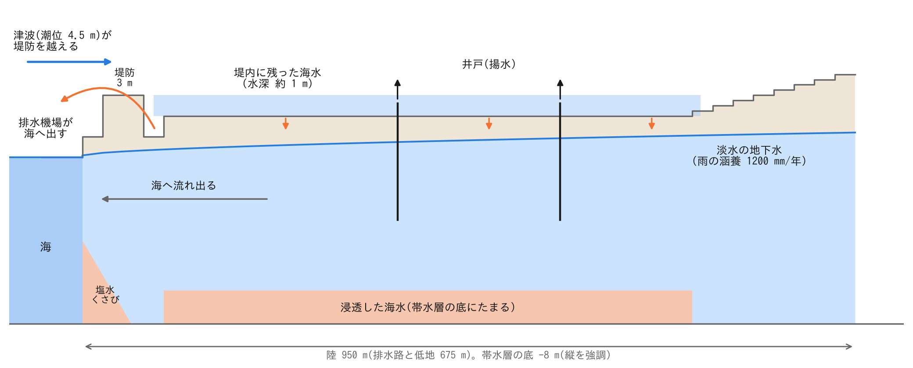
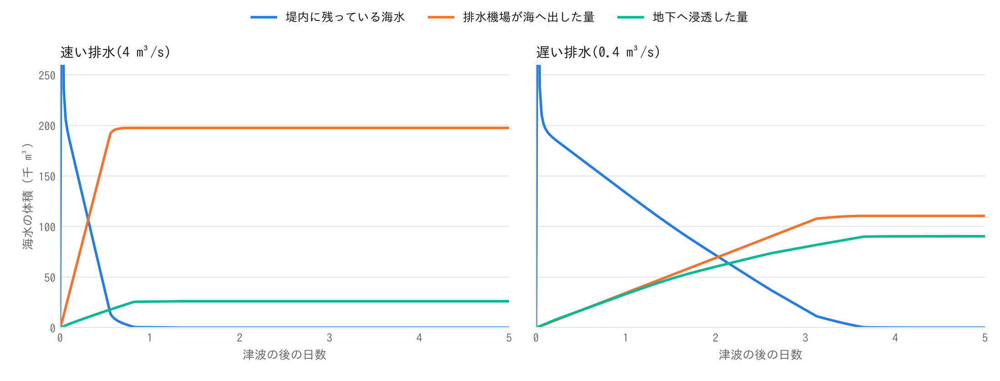
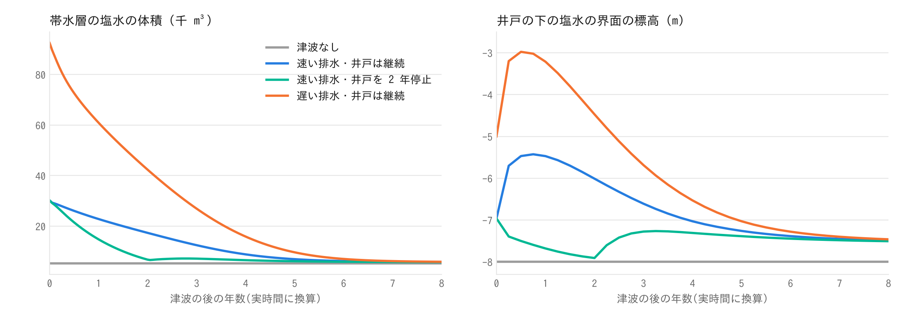
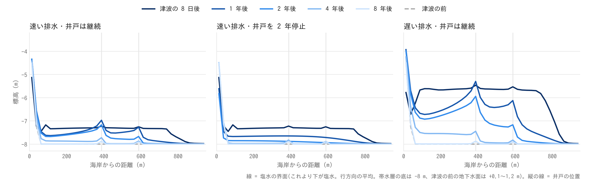

# coastal_salinity_recovery — 津波で浸水した沿岸の低地の排水と、帯水層にしみ込んだ海水の回復

[English](en/README.md)

津波や高潮で海水が堤防を越えると、堤防の内側の低地に海水がたまります。地表の浸水は排水機場で
数日のうちに解消できますが、その間に地面にしみ込んだ海水は帯水層の底にたまり、何年も残ります。
この例題は、模式的な沿岸の低地で、(1) 排水の速さで地下へしみ込む海水の量がどう変わるか、
(2) その後、井戸の揚水を続けるか止めるかで、帯水層の塩水の減り方がどう変わるかを、
[淡塩2層](../../docs/users_guide/salt.md)の塩水の体積の台帳 `salt.csv` で比べます。地表の浸水の解消と
地下水の回復が、別々の時間の物差しで進むことを見る例題です。値は現象を見やすくするための模式値で、
特定の地域の再現ではありません。

## 実際の沿岸で起きていること

- **津波の海水は井戸と帯水層に入る**: 2004 年のインド洋の津波では、スリランカで 4 万本を超える
  飲用の井戸が壊れるか、海水で汚染されました。海水は地面からしみ込み、淡水の地下水に入りました
  (Illangasekare ら 2006)。東海岸の 150 本の井戸の観測では、津波の 7 か月後も、浸水した井戸の
  91 % で塩分が飲用の目安を超えていました(Villholth ら)。
- **回復は雨の涵養しだいで、年の単位**: 砂の帯水層の塩分は、数回の雨季の涵養で下がると見積もられ
  ました(Illangasekare ら 2006)。同じ地域の数値実験は、帯水層の全体が元に戻るには 15 年以上
  かかると見積もっています(Vithanage ら 2012)。2011 年の東北地方太平洋沖地震の津波で浸水した
  仙台平野の南部では、地下水の電気伝導度が 0.7 mS/cm 未満から最大 3 mS/cm に上がり、翌年の報告の
  時点で元に戻っていませんでした(地下水学会誌 54 巻 1 号)。
- **揚水は効くことも、悪くすることもある**: 塩水になった井戸水を汲み出すと回復が早まった地域がある
  一方、汲みすぎて塩水の界面が井戸の下へ盛り上がり(アップコーニング)、塩分が上がった地域も
  報告されています(Illangasekare ら 2006)。

## 再現に必要な機構



断面の模式図です(計算結果ではありません)。津波が堤防を越えて低地にたまり、排水機場が海へ出す間に、
一部が地面にしみ込んで帯水層の底にたまります。その後は、雨の涵養でできた淡水の地下水が海へ流れ出る
流れが、塩水を海へ押し出します。

| 実際の現象 | ENCflow での表し方 | 設定 |
|---|---|---|
| 津波が堤防を越え、海水が低地にたまる | 海域マスクの海の潮位の時系列。入った水は自動的に塩水(地表の塩水層)になる | `fn_tide`、`fn_salt`(`f_salt_surf = 1`) |
| 排水機場が海水を海へ出す | 排水路の水深で運転するポンプ(域外へ排水)。底層の塩水から先に汲む | `&list_struct_pump`、`f_salt_struct = 1` |
| 海水が地面にしみ込み、帯水層の底にたまる | Green-Ampt の浸透と、浸透の淡塩配分(塩水層から先にしみ込む)。地下の塩水 zone | `f_gwvertical = 2`、`f_salt_gw = 1`(`f_salt_exch` は既定) |
| 雨の涵養と、海への地下水の流れが塩水を押し出す | 降雨の浸透、地下水の側方流、地下の海側境界(潮位) | `fn_precip`、`f_gwlateral = 1` |
| 井戸の揚水 | 揚水シンク(上部の淡水から先に汲む) | `f_gwpump = 1` |
| 塩水がどこへ行ったか | 塩水の体積の台帳 | `salt.csv` |
| 数日の浸水と、数年の回復 | 3 つの段を再開でつなぐ。回復の段は時間の圧縮 | `f_state_restore = 2`、設定ファイルの値の読み替え |

## 幾何と設定

1000 m × 250 m、dx = dy = 25 m(40 × 10 セル)。西から、海(50 m)、浜(地盤高 1 m)、堤防(天端 3 m、
幅 50 m)、排水路(幅 25 m、地盤高 1 m)、低地(地盤高 2 m、幅 650 m)、台地(4 m まで上がる)です。帯水層は
底が標高 −8 m で平ら、有効間隙率 0.2、側方の透水係数 1e-3 m/s、浸透能 2e-6 m/s(7.2 mm/h)。

- **雨**: 年 1200 mm を一年中同じ強さで与え、すべて涵養になります(蒸発散は使いません)。
- **井戸**: 低地の 2 か所(海岸から 390 m と 590 m)の 4 セルで、合計 0.004 m³/s(涵養の約 4 割)。
- **排水機場**: 排水路の 10 セルから汲んで域外(海)へ出します。排水路の水深が 0.3 m 以上で全量、
  0.1 m で止まります。能力は 4 m³/s(速い排水)と 0.4 m³/s(遅い排水)の 2 通り。
- **津波**: 潮位を 10 分で 4.5 m まで上げ、20 分保ち、40 分で 0 m に戻します。

計算は 3 つの段に分け、前の段の終わりの状態を次の段の初期条件にします(`f_state_save = 1` で保存し、
`f_state_restore = 2` で読む。保存先と読込元は同じディレクトリ `dir_save` なので、前の段の保存状態を
次の段の名前でコピーしてから計算します。`make run` がこの受け渡しを行います)。

| 段 | 設定ファイル | 期間と内容 |
|---|---|---|
| 1. 津波の前 | param_spinup.txt | 20 年。雨の涵養・井戸の揚水・海への流出が釣り合う地下水を作る。時間の圧縮 |
| 2. 浸水と排水 | param_flood_fast.txt、param_flood_slow.txt | 実時間の 8 日。津波・浸水・排水・浸透(排水機場の能力 2 通り) |
| 3. その後の 8 年 | param_rec_control.txt | 津波なし(段 1 から続ける。比較の基準) |
| | param_rec_fast_pump.txt | 速い排水の後。井戸は汲み続ける |
| | param_rec_fast_stop.txt | 速い排水の後。井戸を 2 年止めてから再開する |
| | param_rec_slow_pump.txt | 遅い排水の後。井戸は汲み続ける |
| 圧縮率の確かめ | param_rec_fast_pump_m50.txt | param_rec_fast_pump.txt と同じ 8 年を、圧縮率 50 で計算する |

段 1 と段 3 は[時間の圧縮](../../docs/users_guide/time.md#時間の圧縮長期の水塩収支の計算)(圧縮率 100)で
計算します。雨・浸透能・側方の透水係数・井戸と排水機場の流量を 100 倍にし、期間を 1/100 にします
(dt = 10 s)。段 2 は洪水の計算なので実時間です(dt = 1 s)。設定ファイルは `gen_case.py` が書き出した
もので、値を変えた比較はこのスクリプトを元に作れます。

## 実行方法

```
cd examples/coastal_salinity_recovery
make                    # リンクと入力(gen_case.py の data_coast/)
make run                # 8 つの計算を順につなぐ(1 スレッドで計 20 分ほど)
python3 plot_results.py # figs/*.png と数表(引数 en で英語版を en/figs/ に)
```

## 結果

### 津波の後の 8 日間



| 海水の体積(万 m³) | 速い排水(4 m³/s) | 遅い排水(0.4 m³/s) |
|---|---:|---:|
| 海から堤内へ入った | 62.2 | 61.9 |
| 潮が引くときに海へ戻った | 39.8 | 41.8 |
| 堤内に残った | 22.4 | 20.1 |
| 排水機場が海へ出した | 19.8(88 %) | 11.1(55 %) |
| 地下へしみ込んだ | 2.6(12 %) | 9.0(45 %) |
| 地表の浸水がなくなるまで | 18 時間 | 86 時間(3.6 日) |
| 8 日後の帯水層の塩水 | 3.0 | 9.3 |

津波の前の帯水層の塩水は 0.53 万 m³(海岸の塩水くさび)です。堤内に残った海水は、排水機場が出すか、
地面にしみ込むかのどちらかで、しみ込む速さ(浸透能)は同じなので、**浸かっている時間が長いほど多く
しみ込みます**。排水の能力を 10 分の 1 にすると、浸水は 3.6 日で消えますが、しみ込んだ海水は 3.5 倍に
なります。台帳の整合クランプの列(`lost_surf_m3`)は 0 で、入った塩水はすべて行き先が数えられています。

### その後の 8 年





| 帯水層の塩水の体積(千 m³) | 8 日後 | 1 年後 | 2 年後 | 4 年後 | 8 年後 | 余分の塩水が 2.5 千 m³ を下回るまで |
|---|---:|---:|---:|---:|---:|---:|
| 津波なし | 5.3 | 5.3 | 5.3 | 5.3 | 5.3 | — |
| 速い排水・井戸は継続 | 30.2 | 22.8 | 17.4 | 8.8 | 5.8 | 4.5 年 |
| 速い排水・井戸を 2 年停止 | 30.2 | 14.8 | 6.8 | 6.5 | 5.8 | 1.9 年 |
| 遅い排水・井戸は継続 | 92.5 | 60.9 | 42.3 | 15.9 | 5.9 | 5.6 年 |

| 井戸の下の塩水の界面の標高 (m) | 8 日後 | 最も高いとき | 2 年後 | 4 年後 | 8 年後 |
|---|---:|---:|---:|---:|---:|
| 速い排水・井戸は継続 | −6.96 | −5.43(9 か月後) | −6.01 | −7.03 | −7.49 |
| 速い排水・井戸を 2 年停止 | −6.96 | −6.96(8 日後) | −7.91 | −7.31 | −7.51 |
| 遅い排水・井戸は継続 | −5.00 | −2.98(半年後) | −4.47 | −6.53 | −7.46 |

余分の塩水は、津波なしのケースとの差です。目安の 2.5 千 m³ は、速い排水の直後の余分の 1 割にあたります。
帯水層の底は −8 m、津波の前の地下水面は +0.1〜1.2 m です。

- **地表と地下は別の時間で進む**: 地表の浸水は 18 時間(遅い排水でも 3.6 日)で消えますが、帯水層の
  塩水が津波の前に近づくには 4〜6 年かかります。塩水は、淡水の地下水が海へ流れ出る流れに押されて、
  帯水層の底を海へ動き、地下の海側境界から出ていきます(8 年で 2.6 万〜8.8 万 m³)。
- **排水が遅いと、地下の塩水が長く多く残る**: 遅い排水のケースの余分の塩水は、4 年後にも、速い排水の
  3 倍です(10.6 千 m³ と 3.5 千 m³)。井戸の下の界面は半年後に標高 −3.0 m まで上がり、井戸の所の
  淡水の厚さは、津波の前の 8.7 m から 3.8 m に減ります(速い排水では 6.2 m)。
- **井戸を汲み続けると、塩水は井戸へ寄る**: 井戸のまわりは地下水面が下がるので、塩水が井戸の下へ
  引き寄せられ、界面が 9 か月で 1.5 m 上がります(−6.96 → −5.43 m)。揚水した分だけ海へ向かう
  淡水の流れも減るので、塩水が海へ出るのも遅くなります。
- **井戸を 2 年止めると、余分の塩水が目安を下回るまでの時間が 4.5 年から 1.9 年に縮みます**。止めて
  いる間、井戸の下の界面は下がり続けます(2 年後に −7.91 m)。再開すると、残っていた塩水が井戸の
  下へ寄り、界面が −7.3 m まで戻ってから、ゆっくり下がります。
- **8 年後も、井戸の下に厚さ 0.5 m の塩水が残ります**(余分の塩水 約 0.5 千 m³。どのケースも同じ)。
  揚水でできた地下水面のくぼみが塩水を引き留めるためで、揚水を続けるかぎり残ります。井戸が汲んだ
  塩水(`out_pump_m3`)は 0 です(次の節の「井戸」)。

### 圧縮率の確かめ

「速い排水・井戸は継続」の 8 年を圧縮率 50 で計算すると、帯水層の塩水の体積の差は最大 0.07 % です。

## 結果の読み方と限界

- **塩水の体積を追う計算で、濃度は持ちません**(鋭利界面近似)。塩水と淡水は混ざらず、井戸水の塩分が
  飲用の目安に戻るまでの日数は出ません。比べられるのは、帯水層の塩水の体積と界面の高さによる
  回復の度合いです。実際の塩水は淡水と混ざって薄まりながら動くので、塩分の高い水の範囲は計算より
  広く、濃さは薄くなります。
- **しみ込む海水の量は多めの見積もりです**。浸かっている間、地面にしみ込む水は底層の塩水から先に
  数え、しみ込んだ塩水は、すぐに帯水層の底にあるものとして扱います。実際には、土の表層にとどまる
  分や、淡水と混ざりながらゆっくり沈む分があります。
- **井戸は上部の淡水から先に汲みます**(浅い井戸の近似)。淡水が足りているこの例題では、井戸は
  塩水を汲まず、塩水になった井戸水を汲み出して塩分を下げる効果は表れません。井戸を止めると回復が
  早まるという結果は、揚水が地下水の流れを変える効果(塩水を井戸へ引き寄せる・海へ向かう流れを
  減らす)だけによるものです。実際の揚水は、塩水を汲み出す効果と合わせて判断する必要があります。
- **回復の速さは、涵養と帯水層の透水性で決まります**。この例題は、雨の全量(年 1200 mm)が涵養に
  なり、帯水層は均質で底が平ら、という設定です。蒸発散や舗装で涵養が減れば、回復は遅くなります。
- **回復の段は時間の圧縮**です。季節による雨の違いや、その間の高潮・洪水は表しません
  ([時間の圧縮](../../docs/users_guide/time.md#時間の圧縮長期の水塩収支の計算)の前提)。圧縮しない
  計算との直接の比較はしていません(圧縮率 100 と 50 の比較だけ)。
- **津波は潮位の時系列**で与えています。波としての遡上の力(流速による破壊・洗掘)は見ません。
  堤防は壊れず、排水機場は津波の間も止まりません。
- 淡塩2層の式と前提は[淡塩2層](../../docs/users_guide/salt.md)、台帳の列は同じ章の「出力・確認」に
  あります。蒸発で塩が濃くなる過程や、土に残る塩を見るには、塩分を
  [水質](../../docs/users_guide/wq.md)の物質として追います。

## 参考文献

「実際の沿岸で起きていること」の記述は、次の文献・資料の要点を Web 検索の結果の要約で確かめたもので、
本文は確認していません。

- Illangasekare, T. ほか (2006): Impacts of the 2004 tsunami on groundwater resources in Sri Lanka. *Water Resources Research*, 42, W05201. doi:10.1029/2006WR004876(井戸の被害、雨季の涵養による回復の見積もり、汲みすぎによるアップコーニング)
- Villholth, K. G. ほか: Tsunami impacts on shallow groundwater and associated water supplies on the east coast of Sri Lanka. International Water Management Institute.(東海岸の 150 本の井戸の観測)
- Vithanage, M. ほか (2012): The effects of the 2004 tsunami on a coastal aquifer in Sri Lanka. *Groundwater*.(回復の数値実験)
- 地下水学会誌 54 巻 1 号 (2012) の仙台平野南部の報告(<https://www.jstage.jst.go.jp/article/jagh/54/1/54_1_11/_article/-char/en>)
