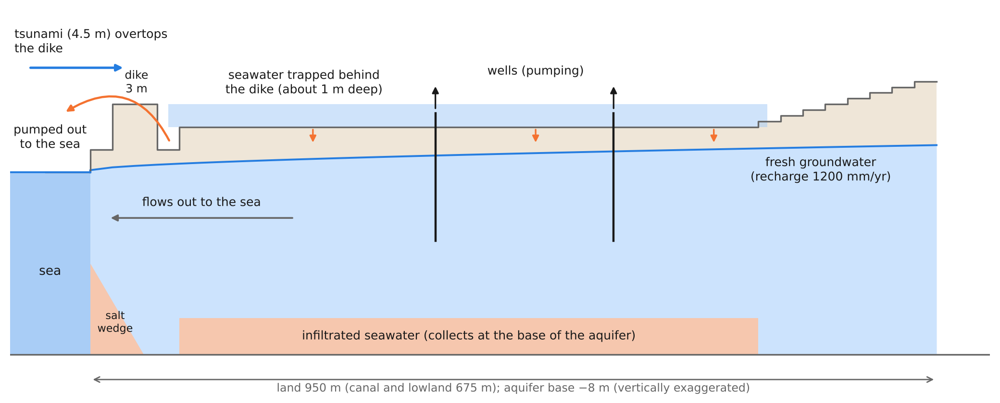
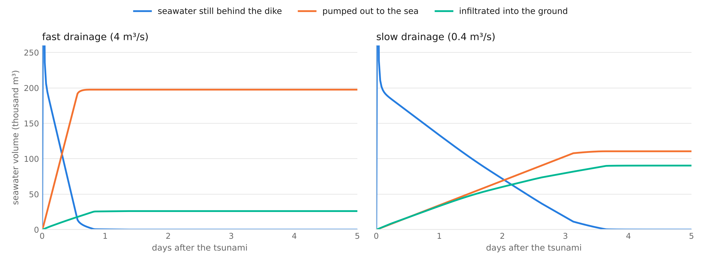
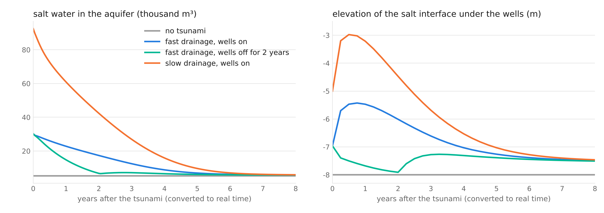
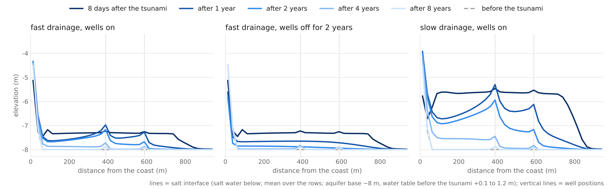

# coastal_salinity_recovery — draining coastal lowland flooded by a tsunami, and the recovery of the aquifer from the seawater that soaked in

> English mirror of examples/coastal_salinity_recovery/README.md. The Japanese file is the master copy.

[日本語](../README.md)

When a tsunami or storm surge overtops a dike, seawater collects on the lowland behind it. The
surface flooding can be removed by a pumping station within days, but the seawater that soaks into
the ground in the meantime collects at the base of the aquifer and stays for years. This example
takes a schematic coastal lowland and compares, with the salt-water volume ledger `salt.csv` of the
[fresh and salt water layers](../../../docs/en/users_guide/salt.md), (1) how the amount of seawater
that soaks into the ground changes with the drainage speed, and (2) how the decrease of the salt
water in the aquifer afterwards changes with continuing or stopping well pumping. It shows that the
end of the surface flooding and the recovery of the groundwater proceed on separate time scales. The
values are schematic, chosen to show the phenomenon clearly, and do not reproduce a particular area.

## What happens on a real coast

- **Tsunami seawater enters wells and aquifers**: in the Indian Ocean tsunami of 2004, more than
  40,000 drinking-water wells in Sri Lanka were destroyed or contaminated by seawater. The seawater
  soaked in from the ground surface and entered the fresh groundwater (Illangasekare et al. 2006).
  In a monitoring of 150 wells on the east coast, the salinity still exceeded the drinking-water
  criterion in 91 % of the flooded wells seven months after the tsunami (Villholth et al.).
- **Recovery depends on rain recharge and takes years**: the salinity of sandy aquifers was
  estimated to fall with the recharge of several monsoon seasons (Illangasekare et al. 2006). A
  numerical experiment for the same region estimated that the whole aquifer needs more than 15 years
  to recover (Vithanage et al. 2012). In the southern Sendai Plain, flooded by the tsunami of the
  2011 Tohoku earthquake, the electrical conductivity of the groundwater rose from below 0.7 mS/cm
  to at most 3 mS/cm and had not returned at the time of the report of the following year (Journal
  of Groundwater Hydrology, vol. 54, no. 1).
- **Pumping can help or harm**: pumping out salinized well water sped up the recovery in some
  areas, while in others overpumping made the salt-water interface rise under the wells (upconing)
  and raised the salinity (Illangasekare et al. 2006).

## Mechanisms needed for the reproduction



A schematic cross-section (not a computed result). The tsunami overtops the dike and collects on
the lowland; while the pumping station sends it back to the sea, part of it soaks into the ground
and collects at the base of the aquifer. Afterwards, the flow of fresh groundwater, formed by rain
recharge and running out to the sea, pushes the salt water out to the sea.

| Real phenomenon | Representation in ENCflow | Settings |
|---|---|---|
| The tsunami overtops the dike and seawater collects on the lowland | A tide-level time series of the sea of the sea mask. Water that enters automatically becomes salt water (surface salt layer) | `fn_tide`, `fn_salt` (`f_salt_surf = 1`) |
| The pumping station sends the seawater to the sea | A pump operated by the depth of the drainage canal (draining to outside the domain). It takes the bottom salt layer first | `&list_struct_pump`, `f_salt_struct = 1` |
| Seawater soaks into the ground and collects at the base of the aquifer | Green-Ampt infiltration and the fresh/salt split of infiltration (the salt layer soaks in first). Subsurface salt zone | `f_gwvertical = 2`, `f_salt_gw = 1` (`f_salt_exch` at its default) |
| Rain recharge and the groundwater flow to the sea push the salt water out | Infiltration of rain, lateral groundwater flow, subsurface sea boundary (tide level) | `fn_precip`, `f_gwlateral = 1` |
| Well pumping | A pumping sink (takes the fresh water on top first) | `f_gwpump = 1` |
| Where the salt water went | The ledger of salt-water volume | `salt.csv` |
| Days of flooding and years of recovery | Three stages chained by restart. The recovery stage uses time compression | `f_state_restore = 2`, the reading of the values in the parameter files |

## Geometry and settings

1000 m × 250 m, dx = dy = 25 m (40 × 10 cells). From the west: sea (50 m), beach (ground elevation
1 m), dike (crest 3 m, 50 m wide), drainage canal (25 m wide, ground elevation 1 m), lowland (ground
elevation 2 m, 650 m wide) and upland (rising to 4 m). The aquifer has a flat base at −8 m, an
effective porosity of 0.2, a lateral hydraulic conductivity of 1e-3 m/s and an infiltration capacity
of 2e-6 m/s (7.2 mm/h).

- **Rain**: 1200 mm per year at a constant intensity all year; all of it becomes recharge
  (evapotranspiration is not used).
- **Wells**: 4 cells at two places on the lowland (390 m and 590 m from the coast), 0.004 m³/s in
  total (about 40 % of the recharge).
- **Pumping station**: takes water from the 10 cells of the drainage canal and sends it outside the
  domain (to the sea). Full discharge at a canal depth of 0.3 m or more, stopping at 0.1 m. Two
  capacities: 4 m³/s (fast drainage) and 0.4 m³/s (slow drainage).
- **Tsunami**: the tide level rises to 4.5 m in 10 minutes, stays for 20 minutes and returns to 0 m
  in 40 minutes.

The run is divided into three stages, and the final state of one stage is the initial condition of
the next (saved with `f_state_save = 1` and read with `f_state_restore = 2`. The save destination
and the read source are the same directory `dir_save`, so the saved state of the previous stage is
copied under the name of the next stage before it runs; `make run` does this hand-over).

| Stage | Parameter file | Period and content |
|---|---|---|
| 1. Before the tsunami | param_spinup.txt | 20 years. Builds the groundwater in which rain recharge, well pumping and outflow to the sea balance. Time compression |
| 2. Flooding and drainage | param_flood_fast.txt, param_flood_slow.txt | 8 days of real time. Tsunami, flooding, drainage and infiltration (two capacities of the pumping station) |
| 3. The following 8 years | param_rec_control.txt | No tsunami (continues from stage 1; the reference for comparison) |
| | param_rec_fast_pump.txt | After the fast drainage. The wells keep pumping |
| | param_rec_fast_stop.txt | After the fast drainage. The wells stop for 2 years and then resume |
| | param_rec_slow_pump.txt | After the slow drainage. The wells keep pumping |
| Check of the compression factor | param_rec_fast_pump_m50.txt | The same 8 years as param_rec_fast_pump.txt computed with a compression factor of 50 |

Stages 1 and 3 are computed with
[time compression](../../../docs/en/users_guide/time.md#time-compression-long-term-water-and-salt-balances)
(compression factor 100): the rain, the infiltration capacity, the lateral hydraulic conductivity
and the discharges of the wells and the pumping station are multiplied by 100 and the period is
divided by 100 (dt = 10 s). Stage 2 is a flood calculation and runs in real time (dt = 1 s). The
parameter files were written by `gen_case.py`; comparisons with other values can be made from this
script.

## How to run

```
cd examples/coastal_salinity_recovery
make                    # link and inputs (data_coast/ by gen_case.py)
make run                # the 8 runs chained in turn (about 20 minutes in total on 1 thread)
python3 plot_results.py # figs/*.png and the tables (argument en: English version in en/figs/)
```

## Results

### The 8 days after the tsunami



| Seawater volume (10,000 m³) | Fast drainage (4 m³/s) | Slow drainage (0.4 m³/s) |
|---|---:|---:|
| Entered behind the dike from the sea | 62.2 | 61.9 |
| Returned to the sea as the tide fell | 39.8 | 41.8 |
| Left behind the dike | 22.4 | 20.1 |
| Sent to the sea by the pumping station | 19.8 (88 %) | 11.1 (55 %) |
| Soaked into the ground | 2.6 (12 %) | 9.0 (45 %) |
| Until the surface flooding is gone | 18 hours | 86 hours (3.6 days) |
| Salt water in the aquifer after 8 days | 3.0 | 9.3 |

Before the tsunami the aquifer holds 0.53 × 10,000 m³ of salt water (the salt wedge at the coast).
The seawater left behind the dike is either sent out by the pumping station or soaks into the
ground, and the infiltration rate (infiltration capacity) is the same, so **the longer the land
stays flooded, the more soaks in**. With one tenth of the drainage capacity the flooding is gone in
3.6 days, but 3.5 times as much seawater soaks in. The consistency-clamp column of the ledger
(`lost_surf_m3`) is 0: every part of the salt water that entered is accounted for.

### The following 8 years





| Salt-water volume in the aquifer (thousand m³) | After 8 days | 1 year | 2 years | 4 years | 8 years | Until the excess salt water falls below 2.5 thousand m³ |
|---|---:|---:|---:|---:|---:|---:|
| No tsunami | 5.3 | 5.3 | 5.3 | 5.3 | 5.3 | — |
| Fast drainage, wells on | 30.2 | 22.8 | 17.4 | 8.8 | 5.8 | 4.5 years |
| Fast drainage, wells off for 2 years | 30.2 | 14.8 | 6.8 | 6.5 | 5.8 | 1.9 years |
| Slow drainage, wells on | 92.5 | 60.9 | 42.3 | 15.9 | 5.9 | 5.6 years |

| Elevation of the salt-water interface under the wells (m) | After 8 days | Highest | 2 years | 4 years | 8 years |
|---|---:|---:|---:|---:|---:|
| Fast drainage, wells on | −6.96 | −5.43 (after 9 months) | −6.01 | −7.03 | −7.49 |
| Fast drainage, wells off for 2 years | −6.96 | −6.96 (after 8 days) | −7.91 | −7.31 | −7.51 |
| Slow drainage, wells on | −5.00 | −2.98 (after half a year) | −4.47 | −6.53 | −7.46 |

The excess salt water is the difference from the case without a tsunami. The guide value of
2.5 thousand m³ is one tenth of the excess right after the fast drainage. The base of the aquifer is
at −8 m, and the water table before the tsunami is at +0.1 to 1.2 m.

- **The surface and the ground proceed on different time scales**: the surface flooding is gone in
  18 hours (3.6 days even with the slow drainage), but the salt water in the aquifer needs 4 to 6
  years to come close to the state before the tsunami. Pushed by the fresh groundwater flowing out
  to the sea, the salt water moves along the base of the aquifer towards the sea and leaves through
  the subsurface sea boundary (26 to 88 thousand m³ in 8 years).
- **With slow drainage, more salt water stays underground for longer**: the excess salt water of the
  slow-drainage case is still 3 times that of the fast drainage after 4 years (10.6 and 3.5 thousand
  m³). The interface under the wells rises to −3.0 m after half a year, and the thickness of fresh
  water at the wells decreases from 8.7 m before the tsunami to 3.8 m (6.2 m with the fast drainage).
- **If the wells keep pumping, the salt water moves towards them**: the water table is lowered
  around the wells, so the salt water is drawn under them and the interface rises by 1.5 m in
  9 months (−6.96 → −5.43 m). The fresh flow towards the sea is also reduced by the pumped amount,
  so the salt water leaves to the sea more slowly.
- **Stopping the wells for 2 years shortens the time until the excess salt water falls below the
  guide value from 4.5 years to 1.9 years.** While they are stopped, the interface under the wells
  keeps falling (−7.91 m after 2 years). When they resume, the remaining salt water moves under the
  wells, the interface returns to −7.3 m and then falls slowly.
- **Even after 8 years, salt water 0.5 m thick remains under the wells** (an excess of about
  0.5 thousand m³, the same in every case). The depression of the water table made by the pumping
  holds the salt water, and it stays as long as the pumping continues. The salt water pumped by the
  wells (`out_pump_m3`) is 0 ("wells" in the next section).

### Check of the compression factor

Computing the 8 years of "Fast drainage, wells on" with a compression factor of 50 changes the
salt-water volume in the aquifer by at most 0.07 %.

## How to read the results, and limits

- **The calculation follows the volume of salt water and has no concentration** (sharp-interface
  approximation). Salt and fresh water do not mix, and the number of days until well water returns
  to a drinking-water criterion is not obtained. What can be compared is the degree of recovery by
  the salt-water volume in the aquifer and the elevation of the interface. Real salt water moves
  while mixing with fresh water and being diluted, so the range of saline water is wider and its
  salinity lower than in the calculation.
- **The amount of seawater that soaks in is an estimate on the high side.** While the land is
  flooded, the water soaking into the ground is counted from the bottom salt layer first, and the
  salt water that soaked in is treated as being at the base of the aquifer at once. In reality part
  of it stays in the surface soil, and part sinks slowly while mixing with fresh water.
- **Wells take the fresh water on top first** (an approximation of shallow wells). In this example
  the fresh water is sufficient, so the wells pump no salt water, and the effect of lowering the
  salinity by pumping out salinized well water does not appear. The result that stopping the wells
  speeds up the recovery comes only from the effect of pumping on the groundwater flow (drawing the
  salt water towards the wells and reducing the flow towards the sea). Real pumping has to be judged
  together with the effect of pumping the salt water out.
- **The speed of recovery is set by the recharge and the permeability of the aquifer.** In this
  example all the rain (1200 mm per year) becomes recharge, and the aquifer is homogeneous with a
  flat base. If evapotranspiration or paving reduces the recharge, the recovery is slower.
- **The recovery stage uses time compression.** The seasonal change of rain and any storm surge or
  flood in the meantime are not represented (the premises of
  [time compression](../../../docs/en/users_guide/time.md#time-compression-long-term-water-and-salt-balances)).
  No direct comparison with an uncompressed calculation was made (only compression factors of 100
  and 50 were compared).
- **The tsunami is given as a tide-level time series.** The forces of the run-up as a wave
  (destruction and scour by the velocity) are not examined. The dike does not break, and the pumping
  station does not stop during the tsunami.
- The equations and premises of the fresh and salt water layers are in
  [Fresh and salt water layers](../../../docs/en/users_guide/salt.md), and the columns of the ledger
  in "Output and monitoring" of the same chapter. To look at salt concentrated by evaporation or
  salt left in the soil, track the salt as a substance of
  [Water quality](../../../docs/en/users_guide/wq.md).

## References

The statements in "What happens on a real coast" were checked against the key points of the
following literature and material through the summaries of web search results; the texts themselves
were not read.

- Illangasekare, T. et al. (2006): Impacts of the 2004 tsunami on groundwater resources in Sri Lanka. *Water Resources Research*, 42, W05201. doi:10.1029/2006WR004876 (damage to wells, estimate of the recovery by monsoon recharge, upconing by overpumping)
- Villholth, K. G. et al.: Tsunami impacts on shallow groundwater and associated water supplies on the east coast of Sri Lanka. International Water Management Institute. (monitoring of 150 wells on the east coast)
- Vithanage, M. et al. (2012): The effects of the 2004 tsunami on a coastal aquifer in Sri Lanka. *Groundwater*. (numerical experiment of the recovery)
- Report on the southern Sendai Plain in the Journal of Groundwater Hydrology, vol. 54, no. 1 (2012) (<https://www.jstage.jst.go.jp/article/jagh/54/1/54_1_11/_article/-char/en>)
