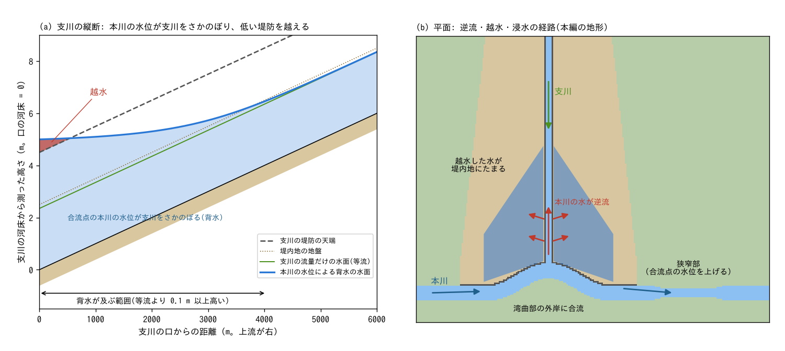
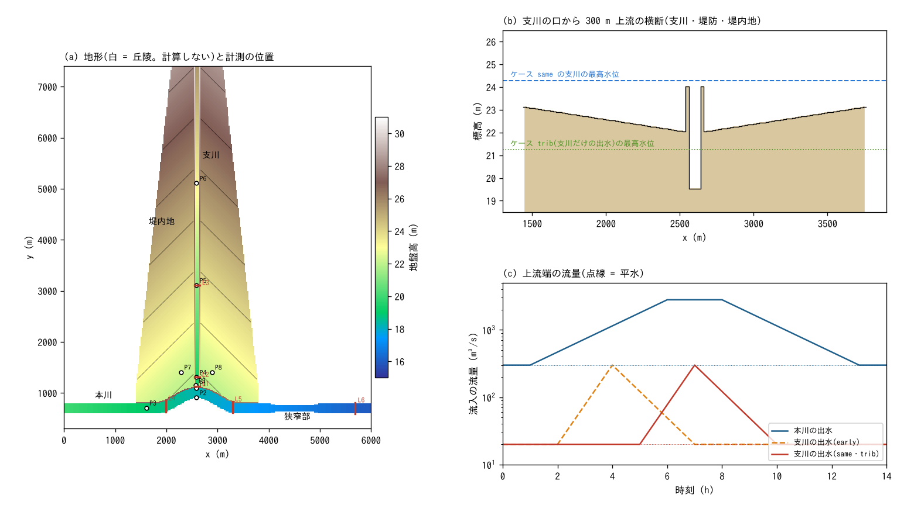
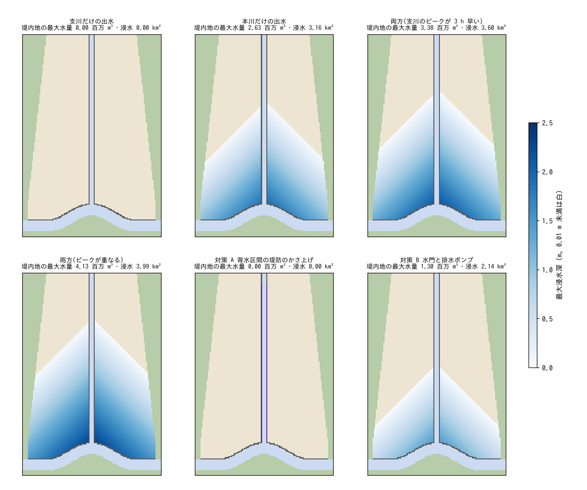
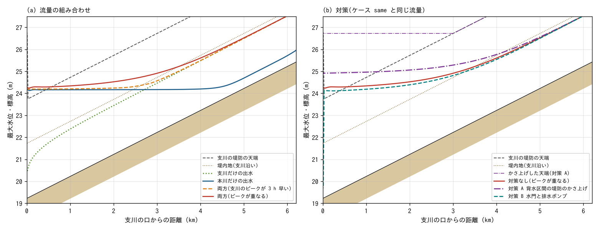
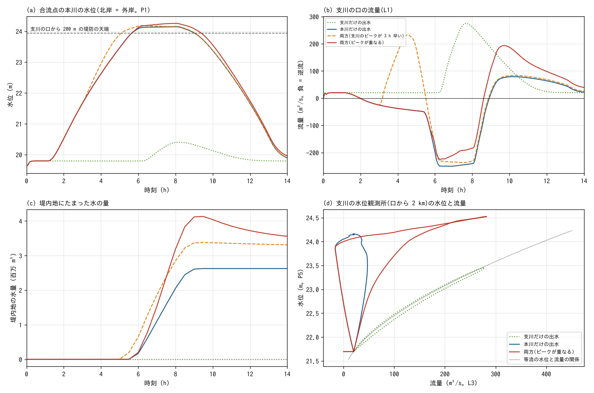
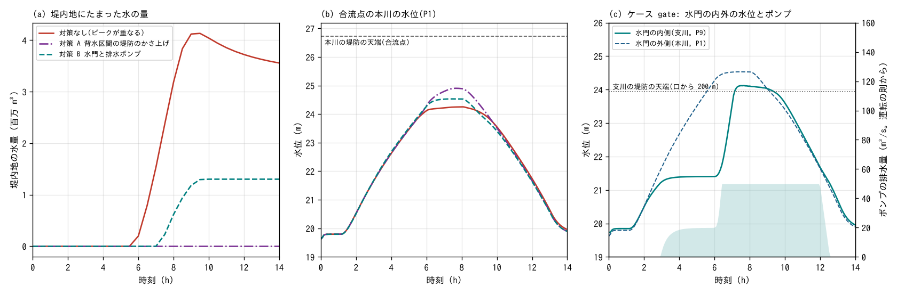
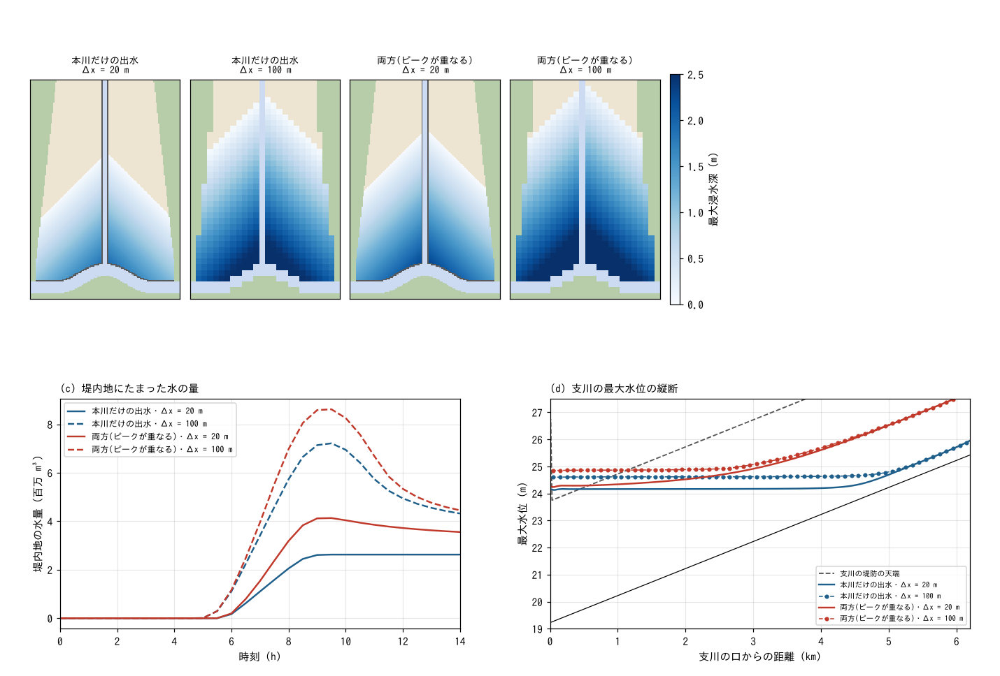
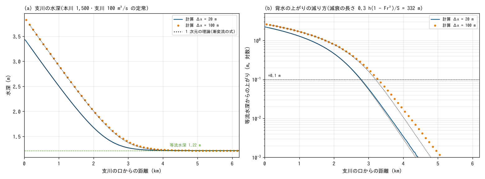
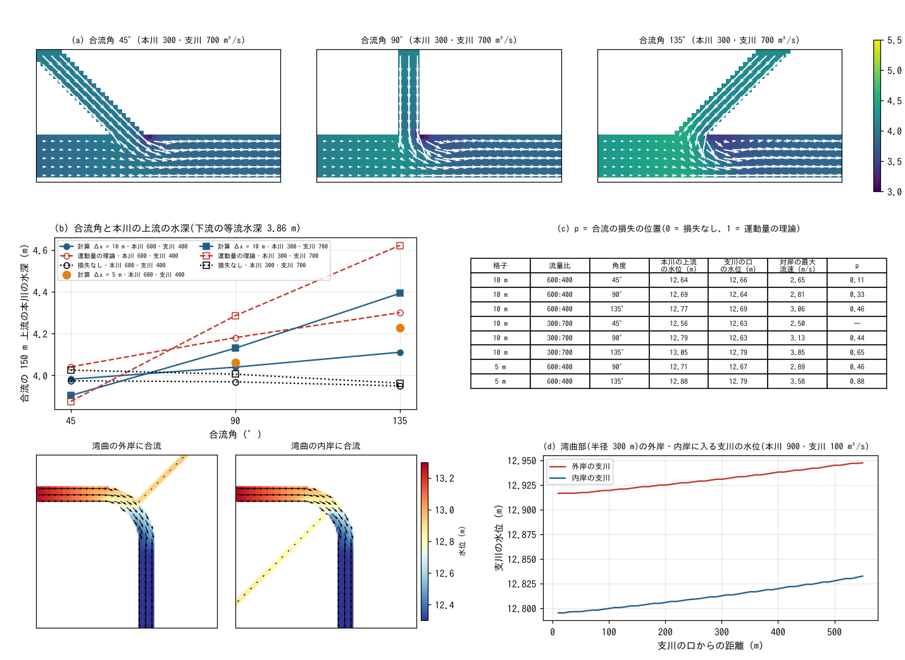

# confluence_backwater — 合流点の背水による支川の氾濫と、粗い格子で背水がどこまで出るか

[English](en/README.md)

大きな川(本川)の水位が上がると、合流する支川の水は出にくくなり、本川の水位がそのまま支川をさかのぼります。
これを背水(バックウォーター)と呼びます。支川の堤防は自分の流量に合わせて造られ、本川の堤防より低いことが
多いので、支川の流量が増えていなくても、本川の水が支川を逆流して堤防を越えることがあります。

この例題は、支川が本川の湾曲部の外岸に合流し、合流点の下流に狭窄部がある谷底平野で、次のことを見ます。

- 本川と支川の出水の組み合わせと、ピークの時刻のずれで、支川の氾濫がどう変わるか
- 対策(背水区間の支川の堤防のかさ上げ、合流点の水門と排水ポンプ)の効果と副作用
- 同じ地区を流域規模の粗い格子(Δx = 100 m、支川はサブグリッド河道)で解いたときの違い
- 背水が支川のどこまで及ぶか(定常の背水曲線を 1 次元の理論と比べる)
- 補足として、合流角と湾曲部の外岸・内岸で合流点の水位がどう変わるか

値は現象を見やすくするための模式値で、特定の合流点の再現ではありません。

## 実際の合流点で起きていること

- **本川の水位が支川をさかのぼる**: 平成 30 年 7 月豪雨(2018 年)の岡山県倉敷市真備町では、高梁川の水位が
  上がって支川の小田川の水が流れにくくなり、小田川とその支川(末政川・高馬川・真谷川)の堤防が決壊しました。
  - 国の調査委員会は、末政川などの支川を「小田川の背水の影響を大きく受ける」として小田川と一体で調べています。
  - 支川の決壊の多くは、前後より堤防が低い所からの越水が原因と推定され、背水に長時間さらされて堤防が弱った
    ことも挙げられています(国土交通省中国地方整備局 2018)。
- **支川の背水区間の堤防は本川の堤防と同じ役割を持つ**: 背水を受ける支川の区間(背水区間)の堤防が壊れると、
  本川の堤防が壊れたのと同じ被害になります。そのため、背水区間の堤防は本川と同じ作用に耐える構造とされます
  (国土交通省の技術資料)。
  - 河川の構造の基準に倣う規定では、背水区間の支川の堤防の高さを、合流点の本川の堤防の高さより低くしないと
    しています(例: 福岡市・堺市の条例)。
- **対策は、合流点の水位を下げるか、逆流を止めるか、堤防を上げるか**: 小田川では、合流点を約 4.6 km 下流へ
  移す付替えが行われました(国土交通省 岡山河川事務所)。
  - 合流点に水門・樋門を設けて本川の逆流を止めると、こんどは支川の水が本川へ出られず、排水機場(ポンプ)で
    出しきれない分が堤内地にあふれます(内水氾濫)。

背水による氾濫が起きやすいのは、次の条件が重なる合流点です。

| 条件 | なぜ効くか | この例題では |
|---|---|---|
| 合流点の下流に狭窄部(盆地の出口・山付き・橋)がある | 本川の水位が合流点で高くなる | 本編の地形(1.6 km 下流に幅 100 m の狭窄部) |
| 支川の勾配が緩く、堤防が本川より低い | 背水が上流まで届き、低い堤防を越える | 本編の地形 |
| 本川の出水が長く、支川のピークがそれに重なる | 背水が長く続き、支川の水も出られない | 流量の組み合わせのケース |
| 湾曲部の外岸に合流する | 遠心力で外岸の水位が上がる | 本編の地形と補足 3 |
| 鈍角に合流し、支川の流量が大きい | 合流の損失で上流の水位が上がり、対岸に流れが集まる | 補足 3 |

## 再現に必要な機構



模式図。(a) 支川の縦断。合流点の本川の水位(口の水深 5 m)から、支川の洪水(300 m³/s)の水面を漸変流の式で
上流へ積分した線です(本編の支川の諸元)。本川の水位はほぼ水平に支川をさかのぼり、支川の流量だけの水面
(等流)より高い区間が背水の及ぶ範囲です。口の近くでは水面が支川の堤防の天端を越えます(赤)。
(b) 平面(本編の地形)。本川の水が支川を逆流し、口の近くで支川の堤防を越えて堤内地にたまります。

| 実際の現象 | ENCflow での表し方 | 設定 |
|---|---|---|
| 本川の洪水が狭窄部で堰き上がる | 浅水流。河道・堤防・狭窄部を地盤高で表す(解像した河道) | `fn_z`(make_terrain.py) |
| 本川の水位が支川をさかのぼり、逆流する | 浅水流。合流点の水位がそのまま支川へ伝わる(逆流も同じ式) | — |
| 支川の低い堤防を越えて堤内地にたまる・戻る | 浅水流。乾いた地面へ広がる先端の扱い | `f_exflux_reduction = 1` |
| 湾曲部の外岸の水位が上がる | 運動量保存形の移流項(既定) | — |
| 背水区間の支川の堤防をかさ上げする | 地盤高を変える | `fn_z = 'z_raise.txt'` |
| 合流点の水門(本川の逆流を止める) | 支川の口の締切を抜けるカルバート 4 門。フラップゲートで逆流しない | `&list_struct_culvert`、`culv_flap` |
| 排水機場 | 支川から本川へ汲むポンプ。支川の口の水位で運転する | `&list_struct_pump` |
| 粗い格子の支川 | サブグリッド河道幅と、河道の堤防(仮想壁面) | `fn_rw`、`fn_width`、`fn_bank` |

## 幾何と設定



(a) 地形と計測の位置(P = プローブ、L = 測線)。(b) 支川の口から 300 m 上流の横断。(c) 上流端の流量。

6.0 km × 7.4 km、Δx = 20 m(300 × 370 セル。丘陵は計算しないので有効セルは 30,876)。

- **本川**: 西から東へ流れる幅 200 m の河道(河床の勾配 1/1500、粗度 0.03)。合流点で北へ膨らむ湾曲部
  (頂点の曲率半径 430 m)になり、支川はその外岸(北岸)に入ります。合流点の 1.6 km 下流に幅 100 m・
  長さ 600 m の狭窄部があります。堤防の天端は河床 + 8.5 m で、越えません。
- **支川**: 北から南へ流れる幅 80 m の河道(勾配 1/1000、粗度 0.035)。口の河床は本川の河床より 1 m 高く、
  堤防の天端は河床 + 4.5 m です。自分の洪水(300 m³/s。等流水深 2.35 m)に対しては 2 m 以上の余裕があります。
- **堤内地**: 支川の両岸の低い谷(幅は本川の近くで 2.4 km、北端で 1.0 km。粗度 0.05)。地盤は支川の河床 +
  2.5 m で、北へ 1/1000、谷の縁へ 1/1000 で上がります。周りは丘陵で、南は本川の堤防です。
- **流量**: 本川は平水 300 m³/s から、1〜6 h で 2,800 m³/s に増え、8 h まで続いて 13 h で平水に戻ります。
  支川は平水 20 m³/s で、出水は 2 h で 300 m³/s に上がり、3 h で戻ります。
- **境界**: 本川は西辺、支川は北辺から流入します。本川の下流端(東辺)は、本川と支川の流入の和の等流水深の
  水位にします。
- 計算は 14 h、dt = 1 s。初期条件は河道の平水の水深です。

| ケース | 設定ファイル | 本川 | 支川 | 地形・構造物 |
|---|---|---|---|---|
| trib | param_trib.txt | 平水のまま | 出水(7 h にピーク) | 基本 |
| main | param_main.txt | 出水 | 平水のまま | 基本 |
| early | param_early.txt | 出水 | 出水(4 h にピーク = 本川より 3 h 早い) | 基本 |
| same | param.txt | 出水 | 出水(7 h にピーク = 本川のピークに重なる) | 基本 |
| raise | param_raise.txt | 出水 | 出水(same と同じ) | 対策 A: 背水区間の支川の堤防を本川の堤防の天端までかさ上げ |
| gate | param_gate.txt | 出水 | 出水(same と同じ) | 対策 B: 合流点の水門と排水ポンプ |

- **対策 A**: 合流点から、支川の元の天端が本川の堤防の天端(26.72 m)に届く 3 km 上流までを背水区間とし、
  その区間の支川の堤防を 26.72 m(水平)にかさ上げします。上の条例の考え方です。
- **対策 B**: 支川の口の 1 行を本川の堤防の天端の高さの締切で閉じ、締切を抜けるカルバート 4 門(幅 18 m・
  高さ 4 m。フラップゲート付き)を水門とします。ポンプは支川の水を本川へ最大 50 m³/s 汲み、口の水位
  21.2 m から運転を始めて 21.7 m で全量になります。

## 実行方法

```
cd examples/confluence_backwater
make                    # リンクと入力(data/・data_coarse/・junction/data/)
make run                # 本編の 6 ケース(1 ケース 4 スレッドで 6 分前後)
make coarse             # 補足 1: 粗い格子の 3 ケース(合わせて 2 分前後)
make steady             # 補足 2: 本編の格子の定常(4 スレッドで 3 分前後)
make junction           # 補足 3: 合流の形の 9 ケース(1 ケース 4 スレッドで 2 分前後)
make junction_fine      # 補足 3: 格子の確認の 2 ケース(1 ケース 4 スレッドで 10 分前後)
python3 plot_results.py # figs/*.png と数表(引数 en で英語版を en/figs/ に。計算していないケースは飛ばす)
```

設定ファイルは make_params.py(本編・補足 1・2)と junction/make_junction.py(補足 3)が書いたものです。

## 結果



6 ケースの最大浸水深。灰色の線は堤防、紫は対策 A でかさ上げした堤防です。



支川の最大水位の縦断(4 列の平均)。破線が支川の堤防の天端です。



(a) 合流点の本川の水位(北岸)と、支川の口から 200 m の堤防の天端。(b) 支川の口の流量(負が逆流)。
(c) 堤内地にたまった水の量。(d) 支川の水位観測所(口から 2 km)の水位と流量。点線は等流の関係です。

| ケース | 合流点の本川の最高水位 北岸 / 南岸 (m) | 支川の口から 200 m の最高水位 (m) | 堤内地の最大水量 (百万 m³) | 浸水面積 (km²) | 最大浸水深 (m) | 越水した区間 |
|---|---:|---:|---:|---:|---:|---:|
| trib | 20.40 / 20.44 | 21.25 | 0 | 0 | 0 | なし |
| main | 24.15 / 23.94 | 24.17 | 2.63 | 3.16 | 1.88 | 口から 430 m |
| early | 24.18 / 23.97 | 24.20 | 3.38 | 3.60 | 2.09 | 口から 450 m |
| same | 24.25 / 24.05 | 24.29 | 4.13 | 3.99 | 2.27 | 口から 570 m |

浸水面積は最大浸水深 0.1 m 以上の堤内地の面積です。支川の口から 200 m の堤防の天端は 23.95 m です。

- **支川は自分の洪水ではあふれない**(trib): 支川の水位は天端の 2 m 以上下を流れます。
- **支川の流量が増えなくても、本川の出水だけで支川があふれる**(main): 本川の水位が上がる 2〜9 h、支川の口では
  本川の水が支川へ逆流します。逆流の流量は最大 250 m³/s です。
  - 合流点の水位が支川の堤防の天端を越える 5.5 h ごろから、口から 430 m までの区間で支川の堤防を越えます。
  - 堤内地に 263 万 m³ がたまり、最大浸水深は 1.9 m です。
- **支川の出水が本川のピークに重なると、氾濫は 1.6 倍になる**(same): 支川の水は本川へ出にくく、堤内地の水量は
  main より 150 万 m³ 増えます。支川の出水の量(平水を超える分 252 万 m³)の 6 割にあたります。
  - 支川の口から本川へ出る流量のピークは、支川だけの出水(trib)の 275 m³/s に対して 193 m³/s に下がり、2 h 遅れます。
    越水する区間は口から 570 m に延びます。
  - 支川のピークが 3 h 早いと(early)、本川の水位が高くなる前に支川の洪水の大部分が本川へ出て、氾濫は
    main の 1.3 倍にとどまります。
- **たまった水は引かない**: 堤内地の水は堤防の天端より低い分が残り、14 h でも same は 356 万 m³ が残ります。
  この例題に排水の仕組みはありません。
- **背水を受ける観測所では水位から流量が読めない**(図 (d)): 支川だけの出水では、水位と流量は等流の関係に
  乗ります。本川の出水では、流量がほぼ 0(一部は逆流)のまま水位が 2.5 m 上がります。
- **外岸の水位は南岸より 0.2 m 高い**: 合流点の本川の最高水位は、北岸(湾曲の外岸)が南岸より 0.20〜0.21 m
  高くなります。断面平均の 1 次元の計算では、外岸にある支川の口の水位を 0.1 m ほど低く見積もることになります。

## 対策の効果と副作用



(a) 堤内地にたまった水の量。(b) 合流点の本川の水位。(c) ケース gate の水門の内外の水位と、運転の則から
求めたポンプの排水量。

| ケース | 堤内地の最大水量 (百万 m³) | 浸水面積 (km²) | 最大浸水深 (m) | 合流点の本川の最高水位 北岸 (m) | 支川の観測所の最高水位 (m) |
|---|---:|---:|---:|---:|---:|
| same(対策なし) | 4.13 | 3.99 | 2.27 | 24.25 | 24.53 |
| raise(対策 A) | 0 | 0 | 0 | 24.90 | 25.06 |
| gate(対策 B) | 1.30 | 2.14 | 1.40 | 24.53 | 24.39 |

- **背水区間の堤防のかさ上げは支川の氾濫をなくすが、本川の水位を上げる**(raise): 支川から堤内地へ逃げて
  いた水が本川に残るので、合流点の本川の水位は 0.65 m 高くなり、合流点の下流の本川の流量の最大も
  2,616 → 3,063 m³/s に増えます。
  - 堤内地は遊水地の役割を果たしていたことになります。かさ上げは、本川の堤防の余裕と下流の安全を
    確かめてから選ぶ対策です。
- **水門は本川の逆流を止めるが、支川の水が残る**(gate): 本川の水位が支川より高い 2〜9 h は水門が閉じます。
  - 支川の平水はポンプで出し切れますが、7 h の支川の洪水では水門の内側の水位が 24.1 m まで上がり、口の近くで
    支川の堤防を越えます(内水氾濫)。
  - 堤内地の水量は same の 3 分の 1 になります。本川へ逃げる水が減るので、合流点の本川の水位は 0.28 m 上がります。

## 補足 1: 粗い格子(Δx = 100 m・サブグリッド河道)

流域規模の計算で使う格子で同じ地区を表します。

- **本川**: 2 セル前後の解像した河道です。狭窄部は 1 セル(幅 100 m)にします。
- **支川**: 1 セルのサブグリッド河道(幅 80 m)です。
- **堤防**: 地形で表せないので、河道の堤防(仮想壁面)の天端を絶対標高で与えます。
- 地形の式と流量は本編と同じです(make_coarse.py、param_coarse_*.txt)。



上: 最大浸水深(左から main の Δx = 20 m・100 m、same の Δx = 20 m・100 m)。(c) 堤内地にたまった水の量。
(d) 支川の最大水位の縦断。

| ケース | 合流点の本川の最高水位 (m)<br>20 m → 100 m | 堤内地の最大水量 (百万 m³)<br>20 m → 100 m | 浸水面積 (km²)<br>20 m → 100 m |
|---|---|---|---|
| main | 24.15 → 24.52 | 2.63 → 7.22 | 3.16 → 5.28 |
| same | 24.25 → 24.76 | 4.13 → 8.62 | 3.99 → 5.80 |

- **粗い格子では合流点の本川の水位が 0.4〜0.5 m 高く出て、堤内地の水量は 2〜3 倍になる**: 本川の水位の差は、
  湾曲部で生まれます。
  - 湾曲部は 2 セルの階段になり、流れに直角な幅が狭くなります。湾曲部を上流へ通る間に、水位の差が 0.6 m ほどまで
    広がります。
  - 湾曲部より下流の水位は、狭窄部の入口を除いて、本編と 0.13 m 以内で合います。
- **越水の量は合流点の水位の小さな差で大きく変わる**: 支川の堤防を越える水深は本編で 0.4〜0.5 m しかありません。
  越流量はおよそ越流水深の 1.5 乗に比例するので、合流点の水位が 0.4 m 違うと越水の量は何倍にもなります。
- **粗い格子で背水の氾濫を見るときは、まず合流点の本川の水位を確かめる**: 支川の背水曲線そのものは、粗い格子
  でも 1 次元の理論とよく合います(補足 2)。誤差の大部分は、本川の表し方から合流点の水位に入ります。
  - 本川の湾曲部の表し方を確かめ(湾曲部で 4 セル以上の幅にする、細かい格子と比べる)、観測水位で合わせて
    から読むのが安全です。

## 補足 2: 背水が支川のどこまで及ぶか(定常の背水曲線)

本川 1,500 m³/s・支川 100 m³/s の一定の流量を 6 h 流し、定常の支川の水面形を、1 次元の漸変流の式
(広い矩形断面・Manning)の解と比べます(param_steady.txt・param_coarse_steady.txt)。理論は、口から
150 m の計算の水深から上流へ積分します。



(a) 支川の水深(点線が理論)。(b) 等流水深からの上がり(対数)。

| 格子 | 口から 150 m の水深 (m) | 理論との差の最大 (m) | 背水が及ぶ範囲(等流水深 + 0.1 m)<br>計算 / 理論 |
|---|---:|---:|---:|
| Δx = 20 m(解像した河道) | 3.31 | 0.004 | 2,770 m / 2,770 m |
| Δx = 100 m(サブグリッド河道) | 3.73 | 0.018 | 3,250 m / 3,200 m |

- **支川の背水曲線は、どちらの格子でも 1 次元の理論と合う**: サブグリッド河道の支川でも差は 2 cm 以内です。
  背水の及ぶ範囲の差は格子 1 つ分(100 m)以内です。
- **粗い格子の範囲が長いのは、合流点の水位が 0.42 m 高いため**(補足 1 と同じ理由)です。背水曲線の形の
  違いではありません。
- **背水の及ぶ範囲の目安**: 本川の水位による上がり Δh が等流水深 h より大きい区間では、水面はほぼ水平に
  さかのぼります。その長さはおよそ Δh / S です。
  - その上流では、上がりが距離 L_e = 0.3 h (1 − Fr²) / S ごとに e 分の 1 に減ります。この例題の支川
    (h = 1.22 m、Fr = 0.30、S = 1/1000)では L_e = 330 m です。
  - L_e は、広い矩形断面・Manning の漸変流の式を等流のまわりで線形化して求めた長さです。上がりが 1 割に
    なる距離は 2.3 L_e になります。
  - 勾配が緩い支川ほど、深い支川ほど、背水は上流まで及びます。

## 補足 3: 合流の形と水位(背水の弱い定常の流れ)

合流角と、湾曲部の外岸・内岸で、合流点の水位がどう変わるかを、あふれない定常の流れで調べます(junction/)。

- **合流角**: Δx = 10 m の格子で、本川(幅 100 m)に支川(幅 50 m)が 45°(鋭角)・90°・135°(本川に逆らう
  向き)で入ります。勾配は 1/1000、粗度は 0.03、合流の下流の流量は 1,000 m³/s(フルード数 0.42)です。
  流量比は本川 600・支川 400 と、本川 300・支川 700 m³/s の 2 通りです。
- **格子の確認**: 本川 600・支川 400 の 90°・135° を Δx = 5 m でも計算します。
- **湾曲**: 幅 100 m の本川の半径 300 m の湾曲部の頂点に、幅 40 m の支川が外岸か内岸から入ります(本川 900・
  支川 100 m³/s)。



(a) 合流角ごとの水深と流速(本川 300・支川 700)。(b) 合流角と本川の上流の水深、1 次元の理論。(c) 数表。
p は合流の損失の大きさで、0 が損失なし、1 が 1 次元の運動量の理論です。(d) 湾曲部の外岸・内岸に入る支川の水位。

| 流量比(本川:支川) | 合流角 | 本川の上流の水位 (m) | 支川の口の水位 (m) | 対岸の最大流速 (m/s) |
|---|---|---:|---:|---:|
| 600:400 | 45° | 12.64 | 12.66 | 2.65 |
| | 90° | 12.69 | 12.64 | 2.81 |
| | 135° | 12.77 | 12.69 | 3.06 |
| 300:700 | 45° | 12.56 | 12.63 | 2.50 |
| | 90° | 12.79 | 12.63 | 3.13 |
| | 135° | 13.05 | 12.79 | 3.85 |

本川の上流は合流点の 150 m 上流、支川の口は口から 100 m の水位です。下流の等流流速は 2.59 m/s です。

- **合流角が大きいほど上流の水位が上がる**: 向きは 1 次元の運動量の理論と同じです(実験でも、上流と下流の
  水深の比は合流角と下流のフルード数とともに増えます。Hsu ら 1998)。
  - 大きさは理論の半分〜3 分の 2 です。45° から 135° で本川の上流が上がる量は、600:400 で 0.13 m(理論 0.26 m)、
    300:700 で 0.49 m(理論 0.75 m)です。
- **角度の効果を強く受けるのは本川の側**: 支川の水位の差は 45° と 135° で 0.04〜0.16 m です。支川が主で鈍角の
  合流では、支川の流れが本川を塞ぎ、本川の上流(合流点の 150 m 上流)の水位が支川の口(口から 100 m)より
  0.26 m 高くなります(45° では 0.07 m 低い)。
- **2 次元の流れの形は出る**: 合流の下流では流れが対岸へ寄り、90°・135° では対岸の流速が等流の 1.1〜1.5 倍に
  なります。
  支川側の岸には遅い区域ができ、支川が主の 90°・135° では逆流(剥離域)になります。
- **湾曲部の外岸に入る支川は、内岸に入る支川より水位が 0.12 m 高い**: その差は支川の上流まで続きます。
  支川がない湾曲部の頂点の横断の水位差(外岸 − 内岸)は 0.18 m で、簡単な式 U²B/(g r) の 0.23 m の 8 割弱です。
- **背水が強いと、合流の形の効果は小さい**: 合流の形の効果は流速の 2 乗に比例します。本川の水位で支川が
  深く遅くなる背水の氾濫では、支川の水位への効果は数 cm にとどまります。氾濫を決めるのは、合流点の本川の
  水位・その長さ・支川の堤防の高さです。

**合流の損失は格子で変わり、1 次元の理論より小さく出る**

| 合流角(本川 600・支川 400) | p(Δx = 10 m。支川 5 セル) | p(Δx = 5 m。支川 10 セル) |
|---|---:|---:|
| 90° | 0.33 | 0.46 |
| 135° | 0.46 | 0.88 |

- 格子を細かくすると合流の損失が増え、1 次元の理論に近づきます。差の多くは、合流の数セルの中での移流項の
  扱いによる離散化の誤差です(1 セル幅の合流の検定 [test/tjunction](../../test/tjunction/README.md) でも、
  軸に沿う合流の p は 0.47〜0.57)。
- 合流の損失(合流のすぐ上流の水位上昇)の見積もりには、1 次元の運動量の理論を使ってください。ENCflow は
  実用的な格子でこれを小さく出すので、この目的に 2 次元の計算を使う理由はありません。
  - ただし、鋭角で支川が主の合流では、理論の方が計算より 0.03 m 低く出ます。1 次元の理論が常に安全側とは
    限りません。
- 2 次元で初めて出るのは、湾曲部の外岸の水位上昇と、合流の下流の対岸の流速の集中です。断面平均の 1 次元の
  計算では、経験式で補正しない限り出ません。

## このモデルで表せないこと(実際の現象との違い)

- **破堤は計算しない**: 越水した水が堤防を削って破堤する過程は表しません。この例題は越水だけです。破堤を
  入れるには [levee_breach](../levee_breach/README.md) の方法で堤防の地盤高を下げます。
- **堤内地の排水は表さない**: 浸水は、堤防の天端より高い分が支川へ戻るだけです。排水路・ポンプによる
  堤内地の排水はありません。
- **合流の損失は小さく出る**: 補足 3 のとおり、解像した合流でも 1 次元の運動量の理論より小さく、格子で
  変わります。剥離域の大きさ・二次流など、水深平均の 2 次元の式で表せない 3 次元の流れも含みません。
- **粗い格子では本川の表し方が結果を左右する**: 補足 1 のとおり、湾曲部の階段で合流点の水位が 0.4〜0.5 m
  変わり、越水の量は何倍にも変わります。
- **下流端の水位は流入の和の等流水深**: 氾濫で本川の流量が減ったときの水位の低下と、河道の貯留による遅れは
  数えません。
- **土砂は動かない**: 合流点の堆積・洗掘による河床の変化は計算しません。
- **水門とポンプの運転は単純**: 水門はフラップゲートで自動に開閉し、ポンプは支川の口の水位だけで運転します。
  本川の水位が高いときの運転調整・停止は表しません。
- **規模**: 値は模式値です。本川の流量・狭窄部・支川の堤防の高さの組み合わせで、越水の有無と量は大きく
  変わります。

## 感度実験の入口

いずれも make_terrain.py の定数です。変えたら `make` で入力を作り直します。

- `QM_PEAK`(本川のピークの流量)、`XC1`・`XC2`・`BC`(狭窄部の位置・幅): 合流点の本川の水位が変わります。
- `LEV_T`(支川の堤防の高さ)、`ST`(支川の勾配): 越水する区間と背水の及ぶ範囲が変わります。
- `hydro_trib()` のピークの時刻(param の `q_trib_*.txt`): 本川と支川のピークのずれです。
- `L_RAISE`(対策 A のかさ上げの長さ): 背水区間より短くすると、その上流で越水します。
- param_gate.txt の `pump_rule`(ポンプの能力)、`culv_width`(水門の幅)。

## 参考文献

- 国土交通省中国地方整備局(2018): 高梁川水系小田川堤防調査委員会 資料(第 2〜5 回). 小田川の支川
  (末政川・高馬川・真谷川)を小田川の背水の影響を大きく受けるとして一体で調査。決壊の原因の推定.
  https://www.cgr.mlit.go.jp/emergency/2018/pdf/04odagawahaifu.pdf
- 国土交通省 岡山河川事務所(2024): 高梁川の基準水位の見直し(小田川合流点付替え事業の完成。合流点を
  約 4.6 km 下流へ). https://www.cgr.mlit.go.jp/okakawa/kouhou/kisha/R6/240516kisha/240516kisha.pdf
- 国土交通省: 河川砂防技術基準 計画編 施設配置等計画編 技術資料(支川の背水区間の堤防).
  https://www.mlit.go.jp/river/shishin_guideline/gijutsu/gijutsukijunn/keikaku/pdf/shisetsu_gijutsushiryou_0201_07.pdf
- 福岡市: 福岡市準用河川管理施設等の構造の技術的基準を定める条例(背水区間の堤防の高さ).
  https://www.city.fukuoka.lg.jp/d1w_reiki/reiki_honbun/q003RG00001232.html
- Hsu, C.-C., Lee, W.-J. and Chang, C.-H. (1998): Subcritical open-channel junction flow. *J. Hydraul. Eng.*,
  124(8), 847–855.(上流と下流の水深の比は合流角と下流のフルード数とともに増える)
- Taylor, E. H. (1944): Flow characteristics at rectangular open-channel junctions. *Trans. ASCE*, 109, 893–902.
  (合流の運動量の理論)
- Chow, V. T. (1959): *Open-Channel Hydraulics*. McGraw-Hill.(漸変流の式、湾曲部の水面の傾き U²B/(g r))
