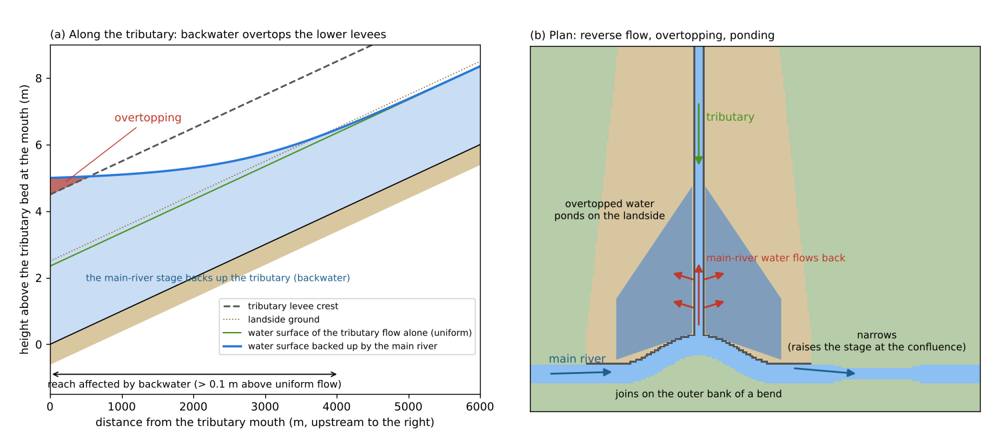
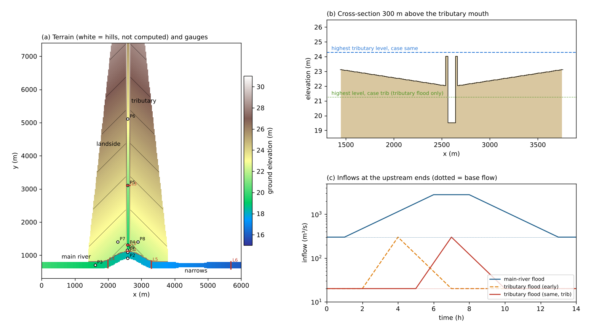
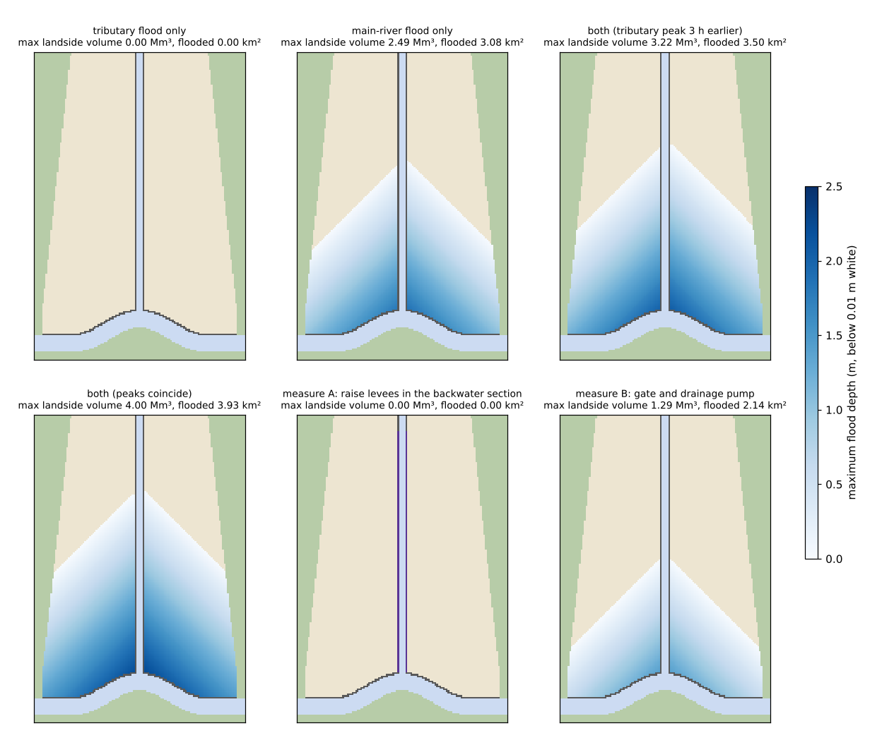
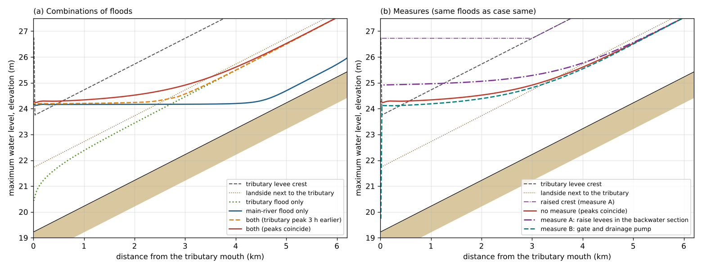
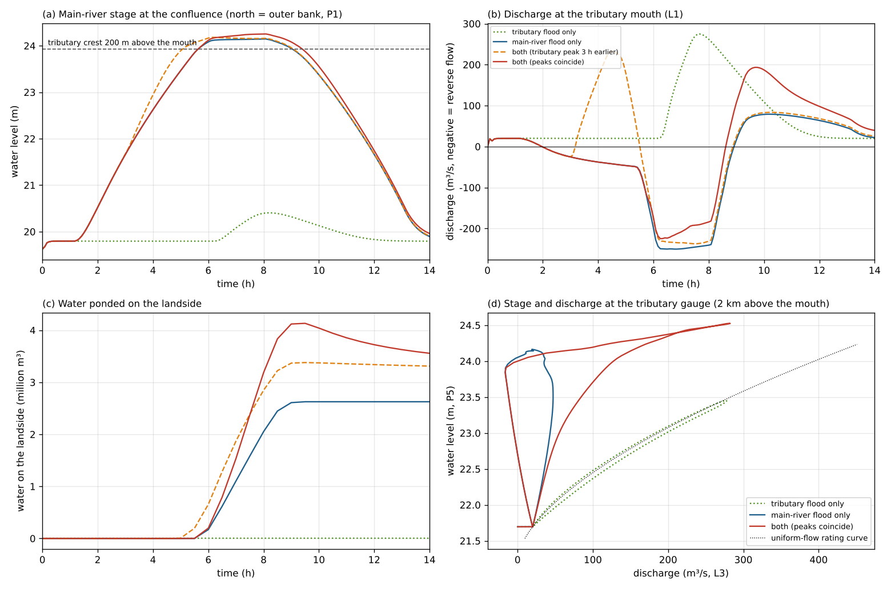
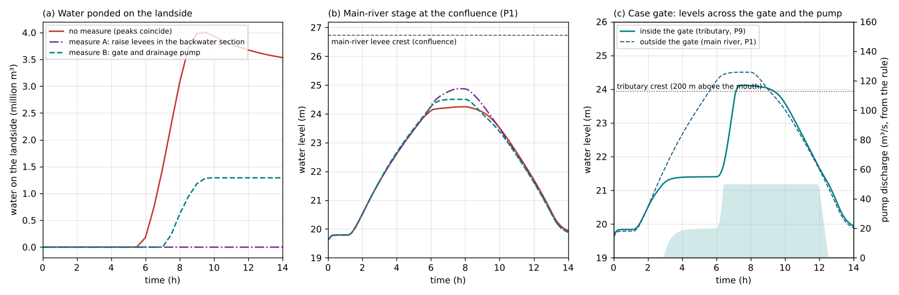
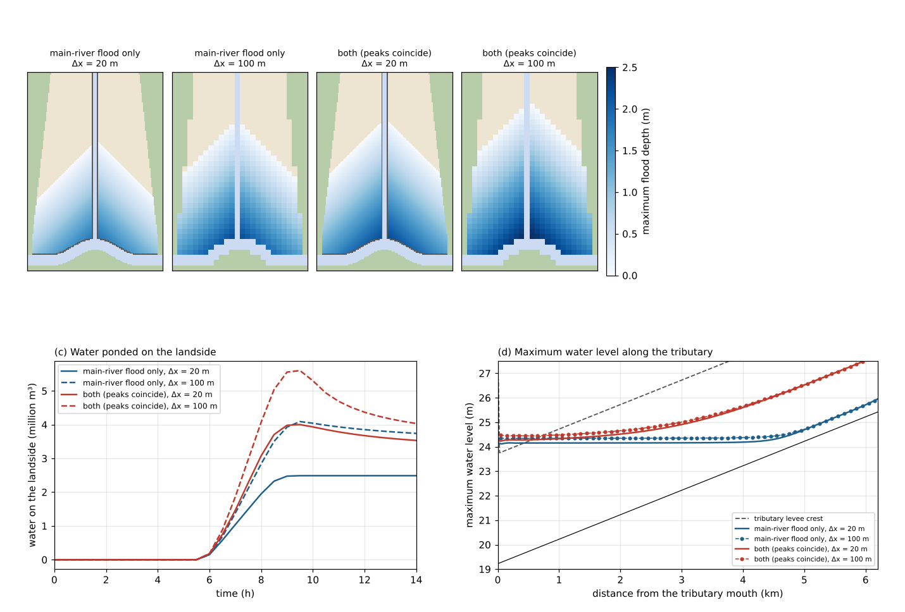
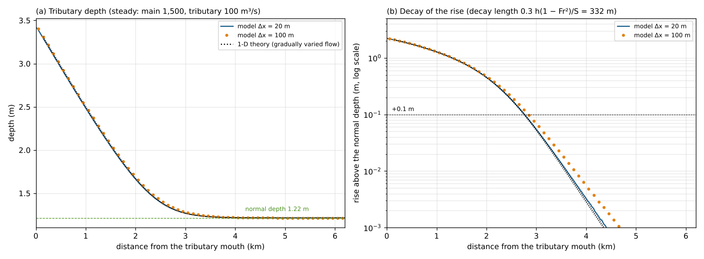
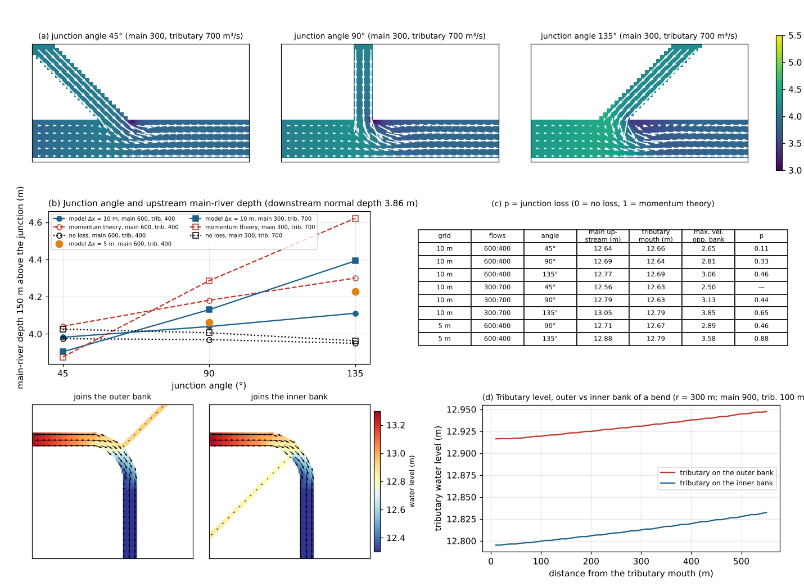

# confluence_backwater — tributary flooding caused by backwater at a confluence, and how far the backwater reaches on a coarse grid

> English mirror of examples/confluence_backwater/README.md. The Japanese file is the master copy.

[日本語](../README.md)

When the stage of a large river (the main river) rises, the water of a joining tributary can no longer get out, and
the main-river stage extends up the tributary as it is. This is called backwater. Tributary levees are built for the
tributary's own flow and are often lower than the main-river levees, so the main-river water can flow back up the
tributary and overtop its levees even when the tributary flow has not increased.

In this example a tributary joins the outer bank of a bend of the main river in a valley plain, with a narrows
downstream of the confluence. The example looks at the following.

- How the tributary flooding changes with the combination of floods on the two rivers and the timing of their peaks
- The effects and side effects of measures (raising the tributary levees of the backwater section, a gate and
  drainage pumps at the confluence)
- How the result differs when the same area is solved on a catchment-scale coarse grid (Δx = 100 m, the tributary as
  a subgrid channel)
- How far up the tributary the backwater reaches (the steady backwater profile compared with 1-D theory)
- As a supplement, how the stage at a confluence changes with the junction angle and with joining on the outer or inner
  bank of a bend

The values are schematic, chosen to make the phenomena easy to see; the example does not reproduce any particular
confluence.

## What happens at real confluences

- **The main-river stage backs up the tributary**: in the July 2018 heavy rain, in Mabi, Kurashiki City, Okayama, the
  rising Takahashi River made it hard for its tributary, the Oda River, to drain, and levees of the Oda River and of its
  own tributaries (the Suemasa, Takama and Makoto rivers) failed.
  - The national investigation committee studied the Suemasa River and the other tributaries together with the Oda
    River, as rivers "strongly affected by the backwater of the Oda River".
  - Most of the tributary failures were attributed to overtopping at places where the levee was lower than before and
    after, and the weakening of the levees by long exposure to backwater was also pointed out (Chugoku Regional
    Development Bureau, MLIT 2018).
- **The levees of a tributary's backwater section play the same role as the main-river levees**: if a levee of the
  section of the tributary that receives backwater (the backwater section) fails, the damage is the same as a failure
  of a main-river levee. The levees of the backwater section are therefore to withstand the same actions as the
  main-river levees (MLIT technical document).
  - Rules modelled on the national standards for river structures require that the levees of the backwater section of
    a tributary are not lower than the main-river levee at the confluence (for example, the ordinances of Fukuoka City
    and Sakai City).
- **Measures lower the stage at the confluence, stop the reverse flow, or raise the levees**: for the Oda River, the
  confluence was moved about 4.6 km downstream (Okayama River Office, MLIT).
  - A gate or sluice at the confluence stops the main-river water from flowing back, but then the tributary water
    cannot get out to the main river, and what the pumping station cannot pump out floods the landside (inland
    flooding).

Flooding by backwater is likely at confluences where the following conditions overlap.

| Condition | Why it matters | In this example |
|---|---|---|
| A narrows downstream of the confluence (outlet of a basin, hillside, bridge) | The main-river stage is high at the confluence | Main geometry (a 120 m-wide narrows 1.6 km downstream) |
| A gentle tributary with levees lower than the main river's | The backwater reaches far upstream and overtops the low levees | Main geometry |
| A long main-river flood, with the tributary peak overlapping it | The backwater lasts long and the tributary water cannot get out either | Cases with combinations of floods |
| Joining on the outer bank of a bend | Centrifugal effects raise the stage on the outer bank | Main geometry and supplement 3 |
| An obtuse junction with a large tributary flow | The junction loss raises the upstream stages, and the flow concentrates on the opposite bank | Supplement 3 |

## Mechanisms needed



Schematic. (a) Along the tributary. The water surface of the tributary flood (300 m³/s) integrated upstream with the
gradually varied flow equation from the main-river stage at the confluence (depth 5 m at the mouth), with the
tributary of the main geometry. The main-river stage extends almost level up the tributary, and the reach where the
surface is higher than that of the tributary flow alone (uniform flow) is the reach affected by backwater. Near the
mouth the surface overtops the tributary levee crest (red). (b) Plan (the main geometry). The main-river water flows
back up the tributary, overtops the tributary levees near the mouth and ponds on the landside.

| Real phenomenon | Representation in ENCflow | Setting |
|---|---|---|
| The main-river flood is backed up by the narrows | Shallow-water flow. Channels, levees and the narrows as ground elevation (resolved channels) | `fn_z` (make_terrain.py) |
| The main-river stage extends up the tributary and the water flows back | Shallow-water flow. The stage at the confluence passes up the tributary as it is (reverse flow by the same equations) | — |
| Overtopping of the low tributary levees, ponding on the landside and return | Shallow-water flow, with the treatment of fronts spreading over dry ground | `f_exflux_reduction = 1` |
| The stage rises on the outer bank of a bend | Momentum-conservative advection (the default) | — |
| Raising the tributary levees of the backwater section | Change of ground elevation | `fn_z = 'z_raise.txt'` |
| A gate at the confluence (stops the main-river water from flowing back) | Four culverts through a closure at the tributary mouth, with flap gates that prevent reverse flow | `&list_struct_culvert`, `culv_flap` |
| A pumping station | A pump from the tributary to the main river, run by the stage at the tributary mouth | `&list_struct_pump` |
| The tributary on a coarse grid | Subgrid channel width and channel levees (virtual walls) | `fn_rw`, `fn_width`, `fn_bank` |

## Geometry and settings



(a) Terrain and gauges (P = probes, L = flux transects). (b) Cross-section 300 m above the tributary mouth. (c) Inflows
at the upstream ends.

6.0 km × 7.4 km, Δx = 20 m (300 × 370 cells; the hills are not computed, leaving 30,884 active cells).

- **Main river**: a 200 m-wide channel flowing from west to east (bed slope 1/1500, roughness 0.03). At the
  confluence it bends into a bulge to the north (radius of curvature 430 m at the apex), and the tributary enters on
  its outer (north) bank. A 120 m-wide, 600 m-long narrows lies 1.6 km downstream of the confluence. The levee crest
  is the bed + 8.5 m and is never overtopped.
- **Tributary**: an 80 m-wide channel flowing from north to south (slope 1/1000, roughness 0.035). Its bed at the mouth
  is 1 m above the main-river bed, and its levee crest is the bed + 4.5 m. For its own flood (300 m³/s; normal depth
  2.35 m) it has more than 2 m of freeboard.
- **Landside**: a low valley on both sides of the tributary (2.4 km wide near the main river and 1.0 km at the north
  end; roughness 0.05). The ground is the tributary bed + 2.5 m and rises 1/1000 to the north and 1/1000 toward the
  valley edges. It is surrounded by hills, with the main-river levee to the south.
- **Flows**: the main river rises from a base flow of 300 m³/s to 2,800 m³/s over 1–6 h, stays there until 8 h and
  returns to the base flow by 13 h. The tributary has a base flow of 20 m³/s; its flood rises to 300 m³/s in 2 h and
  falls back in 3 h.
- **Boundaries**: the main river enters at the west edge and the tributary at the north edge. At the downstream end
  of the main river (east edge) the stage is the normal depth of the sum of the main-river and tributary inflows.
- The run is 14 h with dt = 1 s. The initial condition is the base-flow depth in the channels.

| Case | Settings file | Main river | Tributary | Terrain and structures |
|---|---|---|---|---|
| trib | param_trib.txt | base flow throughout | flood (peak at 7 h) | basic |
| main | param_main.txt | flood | base flow throughout | basic |
| early | param_early.txt | flood | flood (peak at 4 h = 3 h before the main river) | basic |
| same | param.txt | flood | flood (peak at 7 h = on the main-river peak) | basic |
| raise | param_raise.txt | flood | flood (as in same) | measure A: tributary levees of the backwater section raised to the main-river levee crest |
| gate | param_gate.txt | flood | flood (as in same) | measure B: gate and drainage pump at the confluence |

- **Measure A**: the backwater section is taken as the reach from the confluence up to 3 km, where the original crest
  of the tributary reaches the main-river levee crest (26.72 m), and the tributary levees of that reach are raised to
  26.72 m (level). This follows the idea of the ordinances above.
- **Measure B**: one row at the tributary mouth is closed with a closure at the height of the main-river levee crest,
  and four culverts through the closure (18 m wide, 4 m high, with flap gates) serve as the gate. The pump lifts
  tributary water into the main river at up to 50 m³/s; it starts at a stage of 21.2 m at the mouth and reaches full
  capacity at 21.7 m.

## How to run

```
cd examples/confluence_backwater
make                    # links and inputs (data/, data_coarse/, junction/data/)
make run                # the 6 cases of the main part (about 6 minutes per case with 4 threads)
make coarse             # supplement 1: the 3 coarse-grid cases (about 2 minutes in total)
make coarse_check       # supplement 1: the 16 cases that locate the coarse-grid difference, and the table (about 5 minutes in total)
make coarse_oblique     # supplement 1: the 67 cases on representing oblique channels, and the table (about 30 minutes in total)
make steady             # supplement 2: the steady case on the main grid (about 3 minutes with 4 threads)
make junction           # supplement 3: the 9 junction-shape cases (about 2 minutes per case with 4 threads)
make junction_fine      # supplement 3: the 2 grid-check cases (about 10 minutes per case with 4 threads)
python3 plot_results.py # figs/*.png and tables (argument en draws the English version into en/figs/; cases not computed are skipped)
```

The settings files are written by make_params.py (main part and supplements 1 and 2), coarse_check/make_check.py
and oblique.py (the checks of supplement 1) and junction/make_junction.py (supplement 3).

## Results



Maximum flood depth of the 6 cases. Grey lines are levees, purple the levees raised in measure A.



Profile of the maximum water level along the tributary (mean of the 4 columns). The dashed line is the tributary
levee crest.



(a) Main-river stage at the confluence (north bank) and the tributary levee crest 200 m above the mouth. (b) Discharge
at the tributary mouth (negative = reverse flow). (c) Water ponded on the landside. (d) Stage and discharge at the
tributary gauge (2 km above the mouth). The dotted line is the uniform-flow relation.

| Case | Highest main-river stage at the confluence, north / south bank (m) | Highest tributary level 200 m above the mouth (m) | Max. water on the landside (million m³) | Flooded area (km²) | Max. flood depth (m) | Overtopped reach |
|---|---:|---:|---:|---:|---:|---:|
| trib | 20.40 / 20.44 | 21.25 | 0 | 0 | 0 | none |
| main | 24.14 / 23.92 | 24.16 | 2.49 | 3.08 | 1.84 | 430 m from the mouth |
| early | 24.18 / 23.96 | 24.19 | 3.22 | 3.50 | 2.05 | 450 m from the mouth |
| same | 24.24 / 24.03 | 24.28 | 4.00 | 3.93 | 2.24 | 550 m from the mouth |

The flooded area is the landside area with a maximum depth of 0.1 m or more. The tributary levee crest 200 m above
the mouth is 23.95 m.

- **The tributary does not overflow with its own flood** (trib): the tributary level stays more than 2 m below the
  crest.
- **The main-river flood alone makes the tributary overflow, without any increase of the tributary flow** (main):
  while the main-river stage rises (2–9 h), main-river water flows back up the tributary at its mouth, at up to
  240 m³/s.
  - From about 6 h, when the stage at the confluence exceeds the tributary levee crest, the tributary levees are
    overtopped over the reach up to 430 m from the mouth.
  - 2.49 million m³ ponds on the landside, with a maximum depth of 1.8 m.
- **When the tributary flood coincides with the main-river peak, the flooding grows 1.6-fold** (same): the tributary
  water hardly gets out to the main river, and the water on the landside grows by 1.51 million m³ over main. This is
  60 % of the volume of the tributary flood (2.52 million m³ above the base flow).
  - The peak discharge from the tributary mouth into the main river drops to 183 m³/s, against 275 m³/s with the
    tributary flood alone (trib), and comes 2 h later. The overtopped reach extends to 550 m from the mouth.
  - When the tributary peak comes 3 h earlier (early), most of the tributary flood gets out to the main river before
    the main-river stage is high, and the flooding stays at 1.3 times that of main.
- **The ponded water does not drain**: the water on the landside below the levee crests remains; at 14 h, 3.53 million
  m³ still remains in case same. This example has no drainage of the landside.
- **At a gauge under backwater, the stage does not tell the discharge** (panel (d)): with the tributary flood alone,
  stage and discharge follow the uniform-flow relation. With the main-river flood, the stage rises by 2.5 m while the
  discharge stays near zero (partly reversed).
- **The outer bank is 0.2 m higher than the south bank**: the highest main-river stage at the confluence is 0.21 m
  higher on the north bank (the outer bank of the bend) than on the south bank. A 1-D calculation with
  cross-section-averaged stages would estimate the stage at the tributary mouth, which lies on the outer bank, about
  0.1 m too low.

## Effects and side effects of the measures



(a) Water ponded on the landside. (b) Main-river stage at the confluence. (c) Stages inside and outside the gate in
case gate, and the pump discharge obtained from the operating rule.

| Case | Max. water on the landside (million m³) | Flooded area (km²) | Max. flood depth (m) | Highest main-river stage at the confluence, north bank (m) | Highest level at the tributary gauge (m) |
|---|---:|---:|---:|---:|---:|
| same (no measure) | 4.00 | 3.93 | 2.24 | 24.24 | 24.52 |
| raise (measure A) | 0 | 0 | 0 | 24.88 | 25.04 |
| gate (measure B) | 1.29 | 2.14 | 1.39 | 24.50 | 24.39 |

- **Raising the levees of the backwater section removes the tributary flooding but raises the main-river stage**
  (raise): the water that escaped from the tributary onto the landside stays in the main river, so the main-river stage
  at the confluence rises by 0.63 m, and the maximum main-river discharge below the confluence grows from 2,626 to
  3,063 m³/s.
  - The landside had been acting as a retention basin. Raising the levees is a measure to choose after checking the
    freeboard of the main-river levees and the safety downstream.
- **The gate stops the reverse flow of the main river, but the tributary water remains** (gate): the gate is closed
  during 2–9 h, while the main-river stage is higher than the tributary's.
  - The pump can clear the tributary base flow, but with the tributary flood at 7 h the stage inside the gate rises to
    24.1 m, and the tributary levees are overtopped near the mouth (inland flooding).
  - The water on the landside becomes one third of that in same. Because less water escapes from the main river, the
    main-river stage at the confluence rises by 0.26 m.

## Supplement 1: coarse grid (Δx = 100 m, subgrid channel)

The same area on a grid used for catchment-scale computations.

- **Main river**: a resolved channel about 2 cells wide. At the steps of the bend, main-river cells are added at 6
  places so that neighbouring columns share the 2 rows nearest the centreline (`THICK = 2` in make_coarse.py; see the
  breakdown and "oblique channels" below for the reason).
- **Narrows** (120 m wide): the southern cell is a resolved channel (100 m), and the northern cell is a subgrid channel
  of the remaining 20 m. The transitions before and after it have the same form (the northern cell is 40 and 80 m
  wide).
- **Tributary**: a 1-cell subgrid channel (80 m wide).
- **Levees**: since they cannot be represented by the terrain, the crests of channel levees (virtual walls) are given
  as absolute elevations.
- The terrain equations and flows are the same as in the main part (make_coarse.py, param_coarse_*.txt).



Top: maximum flood depth (from the left: main at Δx = 20 m and 100 m, same at Δx = 20 m and 100 m). (c) Water ponded on
the landside. (d) Profile of the maximum water level along the tributary.

| Case | Highest main-river stage at the confluence (m)<br>20 m → 100 m | Max. water on the landside (million m³)<br>20 m → 100 m | Flooded area (km²)<br>20 m → 100 m |
|---|---|---|---|
| main | 24.14 → 24.33 | 2.49 → 4.09 | 3.08 → 3.95 |
| same | 24.24 → 24.43 | 4.00 → 5.60 | 3.93 → 4.67 |

- **On the coarse grid the main-river stage at the confluence comes out 0.19 m higher, and the water on the landside
  1.4–1.6 times as much**: the difference arises after the overtopping begins.
  - Before the overtopping (3–5 h), the main-river stage at the confluence agrees with the fine grid within 0.02 m.
  - From about 6 h, when the overtopping begins, the coarse grid comes out higher, by 0.18–0.21 m at 7–8 h. This is
    thought to come from how the confluence, the tributary mouth and the landside are represented on the coarse grid,
    but it has not been checked.
- **The overtopping volume changes greatly with small differences of the stage at the confluence**: the depth over the
  tributary levees is only 0.4–0.5 m in the main part. Since the overflow is roughly proportional to the 1.5 power of
  the overflow depth, a stage 0.2 m higher at the confluence makes the overflow about 1.7 times as large.

**Where the difference of the main-river stage arises**

Constant flows in the main river (and the tributary) are run for 4 h, and the steady stages computed in the channels
only are compared (coarse_check/).

| Main river | Δx = 20 m | Δx = 100 m (steps not thickened) | Difference | Δx = 100 m (steps thickened) | Difference | 1-D |
|---|---:|---:|---:|---:|---:|---:|
| straight | 23.60 | 23.59 | 0.00 | — | — | 23.60 |
| straight + narrows | 24.34 | 24.30 | −0.04 | — | — | 24.25 |
| bend | 23.63 | 24.07 | +0.44 | 23.65 | +0.02 | 23.55 |
| bend + narrows (main river of this example) | 24.33 | 24.66 | +0.33 | 24.34 | +0.01 | 24.19 |
| bend + narrows + tributary 300 m³/s | 24.78 | 25.13 | +0.35 | 24.84 | +0.06 | 24.60 |

Main-river stage at the confluence location (m). The main river carries 2,800 m³/s. The coarse grid of this example has
the steps thickened. A straight main river has no steps, so thickening changes nothing there. The 1-D column is the
solution of the gradually varied flow equation (rectangular section, Manning), without contraction, expansion or
junction losses.

- **Without thickening the steps, the coarse grid comes out high in the bend**: for a straight main river the stage is
  the same on both grids, but with the bend the coarse grid comes out 0.44 m higher. On the coarse grid the bend becomes
  a staircase 2 cells wide, and the band has waists at the steps ("oblique channels" below).
- **Thickening the main river at the steps removes the difference in the bend**: adding cells at the 6 steps so that
  neighbouring columns share the 2 rows nearest the centreline brings the difference down to 0.01–0.06 m.
- **The difference in reproducing the confluence is small**: adding the tributary raises the stage by 0.45 m at
  Δx = 20 m and by 0.50 m at Δx = 100 m (steps thickened).

**At the narrows, the representation of a width that is not a multiple of the cell size changes the stage by more
than 1 m**

| Representation of the narrows (120 m wide) | Stage (m) | Difference from Δx = 20 m (m) |
|---|---:|---:|
| 1 resolved cell (100 m wide) | 24.99 | +0.65 |
| 2 subgrid cells of 60 m | 23.80 | −0.54 |
| 1 resolved cell + 20 m subgrid (this example) | 24.30 | −0.04 |
| 2 resolved cells (200 m wide; the narrows disappears) | 23.59 | −0.75 |

Stage at the confluence location for the straight main river with the narrows. At Δx = 20 m (6 cells = 120 m) it is
24.34 m, and 24.25 m in 1-D.

- A subgrid channel width can be given only up to the cell size, so a channel wider than one cell is represented by
  channel cells side by side.
- Splitting the width equally over 2 cells almost removes the narrows. Subgrid cells in two rows, north and south, are
  connected not only with the next downstream cell in the same row (orthogonal edge) but also with the next downstream
  cell in the other row (diagonal edge).
  - The width limit of the diagonal edges (60 m ÷ diagonal natural width 71 m = 0.85) is looser than that of the
    orthogonal edges (60 m ÷ 100 m = 0.6), so the two rows together convey more than a 120 m channel.
- With the southern cell resolved and the northern cell a subgrid channel of the remaining 20 m, the diagonal edges are
  also limited by the 20 m width (0.28), and the result agrees with Δx = 20 m within 0.04 m.
  - Channel cells side by side are outside the assumption of the subgrid channel (a channel one cell wide along a
    line). For oblique channels there are directions where it does not agree (next table).

**For oblique channels, the shape of the band of cells on the coarse grid changes the conveyance**

A straight channel of uniform width is laid obliquely to the grid axes, and the conveyance width back-calculated from
the steady uniform-flow depth is compared with the channel width (coarse_check/oblique.py).

| Direction | n resolved rows | n+1 resolved rows | resolved + remainder | equal split | 2 rows shared at steps | Δx = 20 m |
|---|---:|---:|---:|---:|---:|---:|
| 0° | 0.83 / 1.00 | 1.67 / — | 0.97 / — | 1.37 / — | 1.67 / 1.00 | 1.00 / 1.00 |
| 18.4° (1:3) | 0.71 / 0.73 | 0.53 / 0.95 | 0.61 / 0.79 | 0.13 / 0.50 | 1.63 / 0.95 | 0.91 / 0.95 |
| 26.6° (1:2) | 0.68 / 0.73 | 0.96 / 1.01 | 1.05 / 0.89 | 0.62 / 0.73 | 1.70 / 1.01 | 0.95 / 0.98 |
| 33.7° (2:3) | 0.40 / 0.80 | 0.93 / 1.03 | 0.55 / 0.82 | 0.30 / 0.56 | 1.74 / 1.03 | 0.95 / 0.97 |
| 45° | 0.59 / 0.76 | 1.26 / 1.11 | 1.08 / 1.05 | 1.11 / 1.02 | 1.85 / 1.11 | 1.02 / 1.01 |

Conveyance width ÷ channel width (120 m / 200 m wide). Cell centres lie in rows whose spacing depends on the direction
of the channel (100 m at 0°, 71 m at 45°, 45 m at 26.6°, and so on), and n is the number of rows that fit in the
channel width. "2 rows shared at steps" is the band of n resolved rows thickened so that, at the boundary between
neighbouring columns, the 2 rows nearest the centreline are resolved cells in both columns. Δx = 20 m is divided by
the width it represents. At 0°, 200 m is exactly 2 resolved rows.

- **Resolved + remainder agrees at 0° and 45°**: the deviation is within 10 %.
- **In other directions the band develops "waists" and conveys too little**: runs of a few cells side by side are
  connected to each other only through an overlap of one cell or through a corner. The flow turns and is squeezed
  there.
  - How large the shortfall is varies irregularly with the direction and the width. Resolved + remainder does not fix
    the waists and scatters between 0.55 and 1.05 times. An equal split is worse still.
- **Thickening the band so that 2 rows are shared at the steps removes the waists and evens out the conveyance**:
  conveyance ÷ width of the represented area becomes 0.86–0.93 at 18.4–33.7° and 1.01 at 45°.
  - For a channel 2 cells wide the conveyance returns to 0.95–1.11 times the channel width.
  - For a channel 1.2 cells wide the area swells to almost twice the width, giving 1.6–1.9 times. There is no
    representation yet for laying a channel of this width obliquely.
- **Even on the fine grid (6–10 cells across the channel) the directions 18.4–33.7° convey 2–9 % too little**: the
  banks become staircases.
- **The higher stage in the bend on the coarse grid without thickened steps (the breakdown above) is due to these
  waists**: the bend in this example slopes at up to 30° and is a band 2 cells per column.
- With resolved + remainder, the storage of the remainder cells is larger than their share of the width, because the
  channel length counts the neighbouring channel cells as well; the storage width is 1.3 times the channel width at 0°.
  This does not affect the steady stage, but it does affect the delay and attenuation of a flood wave.

When looking at backwater flooding on a coarse grid, check the main-river stage at the confluence first. The backwater
profile of the tributary itself agrees well with 1-D theory even on the coarse grid (supplement 2). Most of the error
enters the stage at the confluence through the representation of the main river. It is safe to compare the
representation of the bends and oblique reaches, and of widths that are not a multiple of the cell size, with a finer
grid or a 1-D calculation, and to match it to observed stages before reading the results.

## Supplement 2: how far up the tributary the backwater reaches (steady backwater profile)

A steady flow of 1,500 m³/s in the main river and 100 m³/s in the tributary is run for 6 h, and the steady water
surface of the tributary is compared with the solution of the 1-D gradually varied flow equation (wide rectangular
section, Manning) (param_steady.txt, param_coarse_steady.txt). The theory is integrated upstream from the computed
depth 150 m above the mouth.



(a) Tributary depth (dotted: theory). (b) Rise above the normal depth (log scale).

| Grid | Depth 150 m above the mouth (m) | Max. difference from theory (m) | Reach affected by backwater (normal depth + 0.1 m)<br>model / theory |
|---|---:|---:|---:|
| Δx = 20 m (resolved channel) | 3.29 | 0.004 | 2,750 m / 2,750 m |
| Δx = 100 m (subgrid channel) | 3.31 | 0.018 | 2,750 m / 2,770 m |

- **The backwater profile of the tributary agrees with 1-D theory on both grids**: even for the tributary as a subgrid
  channel the difference is within 2 cm. The difference of the reach affected by backwater is within one cell (100 m).
- **The reach affected by backwater on the coarse grid is the same as in the main part**: the depth 150 m above the
  mouth differs by 0.02 m. On a coarse grid without thickened steps in the bend (`THICK = 0` in make_coarse.py), the
  higher stage at the confluence makes the depth 0.20 m greater and the reach 200 m longer. This is not a difference in
  the shape of the backwater profile.
- **A guide to the reach affected by backwater**: where the rise Δh caused by the main-river stage is larger than the
  normal depth h, the water surface extends almost level up the tributary. Its length is about Δh / S.
  - Upstream of that, the rise decreases by a factor e every distance L_e = 0.3 h (1 − Fr²) / S. For the tributary of
    this example (h = 1.22 m, Fr = 0.30, S = 1/1000), L_e = 330 m.
  - L_e is the length obtained by linearizing the gradually varied flow equation for a wide rectangular section with
    Manning friction around uniform flow. The rise falls to one tenth at a distance of 2.3 L_e.
  - The gentler and the deeper the tributary, the farther upstream the backwater reaches.

## Supplement 3: junction shape and stages (steady flow with weak backwater)

How the stage at a confluence changes with the junction angle and with joining on the outer or inner bank of a bend
is examined with steady flows that do not overflow (junction/).

- **Junction angle**: on a Δx = 10 m grid, a tributary (50 m wide) enters the main river (100 m wide) at 45° (acute),
  90° and 135° (against the main flow). The slope is 1/1000, the roughness 0.03, and the discharge below the junction
  1,000 m³/s (Froude number 0.42). The flow ratios are main 600 / tributary 400 and main 300 / tributary 700 m³/s.
- **Grid check**: the 90° and 135° cases with main 600 / tributary 400 are also computed with Δx = 5 m.
- **Bend**: a 40 m-wide tributary enters the apex of a bend of radius 300 m of a 100 m-wide main river, from the outer
  or the inner bank (main 900, tributary 100 m³/s).



(a) Depth and velocity for each junction angle (main 300, tributary 700). (b) Junction angle and upstream main-river
depth, with 1-D theory. (c) Table. p is the size of the junction loss: 0 is no loss and 1 the 1-D momentum theory.
(d) Stage of a tributary entering the outer or inner bank of a bend.

| Flow ratio (main : tributary) | Junction angle | Upstream main-river stage (m) | Stage at the tributary mouth (m) | Max. velocity on the opposite bank (m/s) |
|---|---|---:|---:|---:|
| 600:400 | 45° | 12.64 | 12.66 | 2.65 |
| | 90° | 12.69 | 12.64 | 2.81 |
| | 135° | 12.77 | 12.69 | 3.06 |
| 300:700 | 45° | 12.56 | 12.63 | 2.50 |
| | 90° | 12.79 | 12.63 | 3.13 |
| | 135° | 13.05 | 12.79 | 3.85 |

The upstream main-river stage is taken 150 m above the confluence, and the stage at the tributary mouth 100 m above
the mouth. The downstream uniform-flow velocity is 2.59 m/s.

- **The larger the junction angle, the higher the upstream stages**: the direction is the same as in the 1-D momentum
  theory (experiments also show the ratio of upstream to downstream depth growing with the junction angle and the
  downstream Froude number; Hsu et al. 1998).
  - The size is a half to two thirds of the theory. From 45° to 135° the upstream main-river stage rises by 0.13 m
    (theory 0.26 m) for 600:400 and by 0.49 m (theory 0.75 m) for 300:700.
- **The main river feels the angle more strongly**: the difference of the tributary stage between 45° and 135° is
  0.04–0.16 m. In an obtuse junction dominated by the tributary, the tributary flow blocks the main river, and the
  upstream main-river stage (150 m above the confluence) becomes 0.26 m higher than at the tributary mouth (100 m above
  the mouth); at 45° it is 0.07 m lower.
- **The two-dimensional flow pattern appears**: below the junction the flow shifts to the opposite bank, where at 90°
  and 135° the velocity becomes 1.1–1.5 times the uniform-flow velocity. A slow zone forms along the tributary-side
  bank, which turns into reverse flow (a separation zone) at 90° and 135° when the tributary dominates.
- **A tributary entering the outer bank of a bend is 0.12 m higher than one entering the inner bank**: the difference
  continues up the tributary. Without a tributary, the cross-section difference of stage at the bend apex (outer −
  inner) is 0.18 m, just under 80 % of the simple formula U²B/(g r) = 0.23 m.
- **With strong backwater the effects of the junction shape are small**: they scale with the square of the velocity.
  In backwater flooding, where the main-river stage makes the tributary deep and slow, their effect on the tributary
  stage is only a few centimetres. The flooding is governed by the main-river stage at the confluence, its duration
  and the height of the tributary levees.

**The junction loss depends on the grid and comes out smaller than in 1-D theory**

| Junction angle (main 600, tributary 400) | p (Δx = 10 m; tributary 5 cells) | p (Δx = 5 m; tributary 10 cells) |
|---|---:|---:|
| 90° | 0.33 | 0.46 |
| 135° | 0.46 | 0.88 |

- A finer grid increases the junction loss and brings it closer to 1-D theory. Most of the difference is a
  discretization error from the treatment of the advection terms within the few cells of the junction (in the test of
  a junction of 1-cell-wide channels, [test/tjunction](../../../test/tjunction/en/README.md), p of the axis-aligned
  junction is also 0.47–0.57).
- Use the 1-D momentum theory to estimate the junction loss (the rise of the stage just upstream of a junction).
  ENCflow gives it smaller on practical grids, so there is no reason to use a 2-D computation for this purpose.
  - However, in an acute junction dominated by the tributary, the theory comes out 0.03 m lower than the computation.
    The 1-D theory is not always on the safe side.
- What appears only in 2-D is the stage rise on the outer bank of a bend and the concentration of velocity on the
  opposite bank below a junction. A cross-section-averaged 1-D computation does not show them unless corrected with
  empirical formulas.

## What this model cannot represent (differences from the real phenomenon)

- **Levee breaches are not computed**: the process by which overtopping water erodes a levee until it fails is not
  represented. This example has overtopping only. To include a breach, lower the ground elevation of the levee in the
  way of [levee_breach](../../levee_breach/en/README.md).
- **Drainage of the landside is not represented**: of the flood water only the part above the levee crest returns to
  the tributary. There is no drainage of the landside by drains or pumps.
- **The junction loss comes out small**: as in supplement 3, it is smaller than the 1-D momentum theory even for
  resolved channels and depends on the grid. Three-dimensional flow that the depth-averaged 2-D equations cannot
  represent, such as the size of the separation zone and secondary currents, is not included.
- **On a coarse grid the representation of the main river governs the result**: as in supplement 1, without
  thickening the steps of the bend the stage at the confluence comes out 0.3–0.4 m higher. Even with them thickened, the
  stage at the confluence is 0.2 m higher while the levees are overtopped, and the overtopping volume is 1.4–1.6 times
  as large. For a
  width that is not a multiple of the cell size, the representation changes the stage by more than 1 m. A channel
  1–2 cells wide laid in a direction other than the axes and 45° conveys up to 60 % too little because of the waists
  in the band. For a channel 2 cells wide, thickening the steps restores it, but there is no representation yet for
  laying a channel 1–1.5 cells wide obliquely.
- **The downstream stage is the normal depth of the sum of the inflows**: the drop of the stage when flooding reduces
  the main-river discharge, and the delay by storage in the channels, are not counted.
- **Sediment does not move**: bed changes by deposition and scour at the confluence are not computed.
- **The operation of the gate and pump is simple**: the gate opens and closes automatically with its flap, and the pump
  is run by the stage at the tributary mouth alone. Adjustment or stopping of the pumps when the main-river stage is
  high is not represented.
- **Scale**: the values are schematic. Whether and how much the tributary overflows changes greatly with the
  combination of main-river discharge, narrows and tributary levee height.

## Starting points for sensitivity experiments

After changing make_terrain.py or make_coarse.py, rebuild the inputs with `make`.

- `QM_PEAK` (main-river peak discharge), `XC1`, `XC2`, `BC` (position and width of the narrows): the main-river stage at
  the confluence changes.
- `LEV_T` (tributary levee height), `ST` (tributary slope): the overtopped reach and the reach affected by backwater
  change.
- The peak time in `hydro_trib()` (the `q_trib_*.txt` of the params): the offset between the main-river and tributary
  peaks.
- `L_RAISE` (length raised in measure A): if shorter than the backwater section, the levees upstream of it are
  overtopped.
- `pump_rule` (pump capacity) and `culv_width` (gate width) in param_gate.txt.
- `REP` in make_coarse.py (how the narrows is represented on the coarse grid: the default mix, or round, split, full):
  as in supplement 1, the main-river stage at the confluence changes by about 1 m.
- `THICK` in make_coarse.py (number of rows by which the steps of the bend are thickened on the coarse grid; default
  2): with 0, the main-river stage comes out 0.3–0.4 m higher in the bend (supplement 1).

## References

- Chugoku Regional Development Bureau, MLIT (2018): materials of the Oda River (Takahashi River system) levee
  investigation committee (meetings 2–5). The tributaries of the Oda River (Suemasa, Takama, Makoto rivers) were
  studied together with the Oda River as strongly affected by its backwater; estimated causes of the failures.
  https://www.cgr.mlit.go.jp/emergency/2018/pdf/04odagawahaifu.pdf
- Okayama River Office, MLIT (2024): revision of the reference stages of the Takahashi River (completion of the project
  relocating the Oda River confluence about 4.6 km downstream).
  https://www.cgr.mlit.go.jp/okakawa/kouhou/kisha/R6/240516kisha/240516kisha.pdf
- MLIT: Technical Criteria for River Works, Planning, technical document on facility layout (levees of the backwater
  section of a tributary).
  https://www.mlit.go.jp/river/shishin_guideline/gijutsu/gijutsukijunn/keikaku/pdf/shisetsu_gijutsushiryou_0201_07.pdf
- Fukuoka City: ordinance on the technical standards for the structures of semi-designated river facilities (levee
  height of the backwater section). https://www.city.fukuoka.lg.jp/d1w_reiki/reiki_honbun/q003RG00001232.html
- Hsu, C.-C., Lee, W.-J. and Chang, C.-H. (1998): Subcritical open-channel junction flow. *J. Hydraul. Eng.*,
  124(8), 847–855. (The ratio of upstream to downstream depth grows with the junction angle and the downstream Froude
  number.)
- Taylor, E. H. (1944): Flow characteristics at rectangular open-channel junctions. *Trans. ASCE*, 109, 893–902.
  (Momentum theory of junctions.)
- Chow, V. T. (1959): *Open-Channel Hydraulics*. McGraw-Hill. (The gradually varied flow equation; the transverse
  water-surface slope in a bend, U²B/(g r).)
