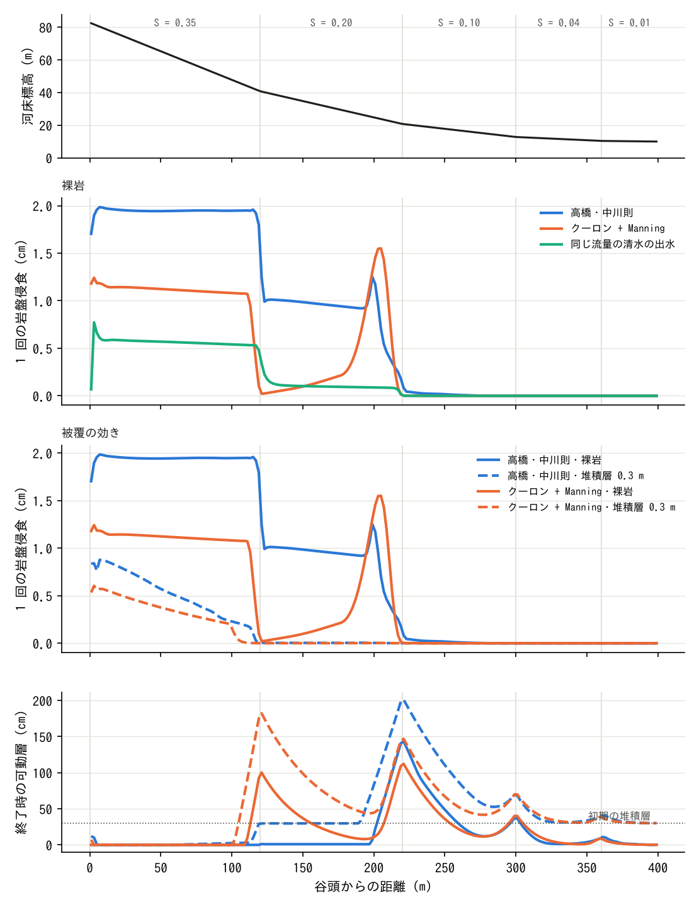
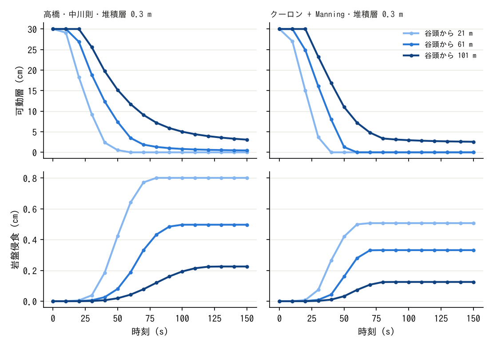
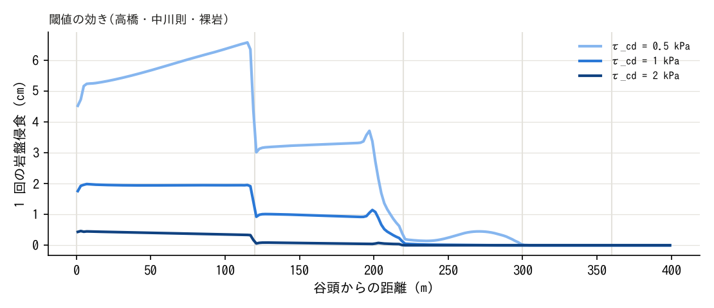
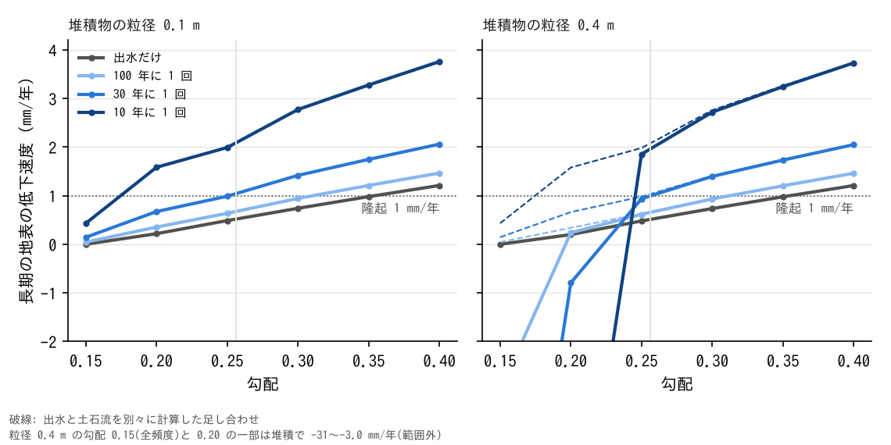
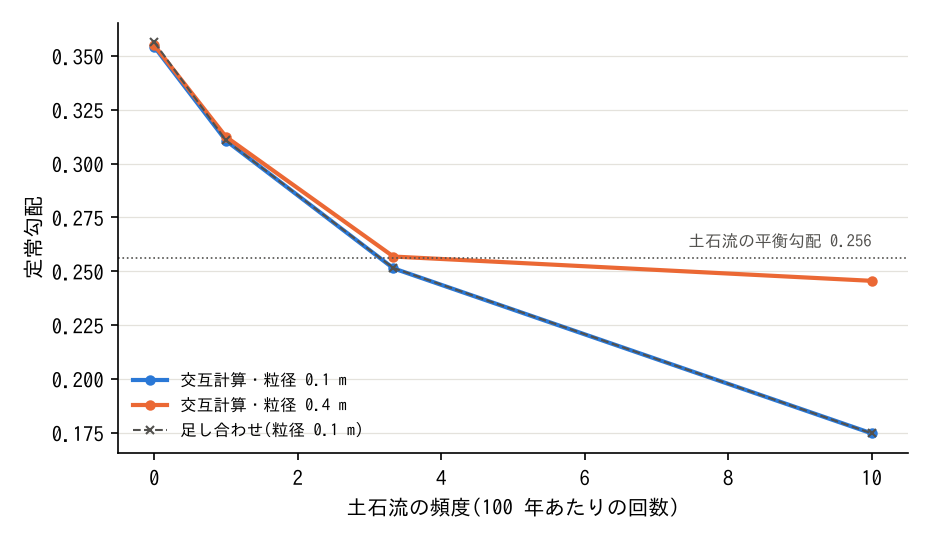
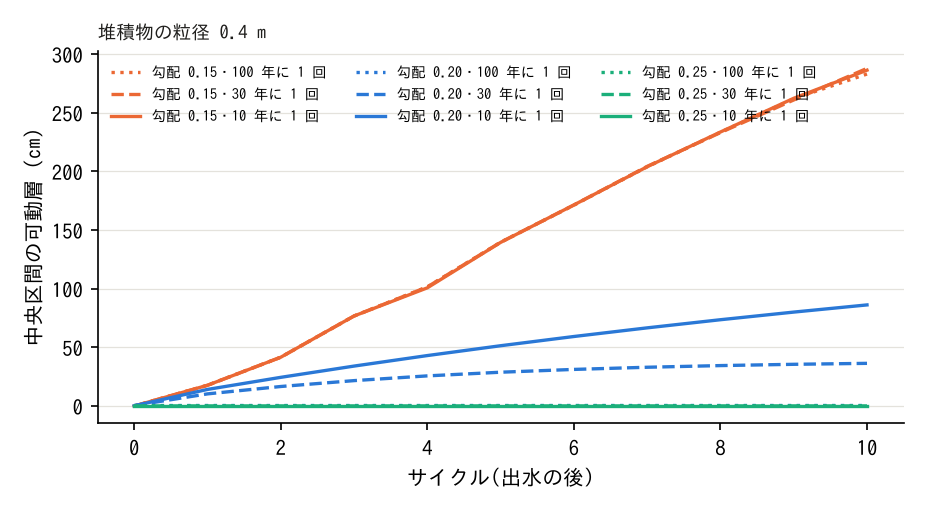
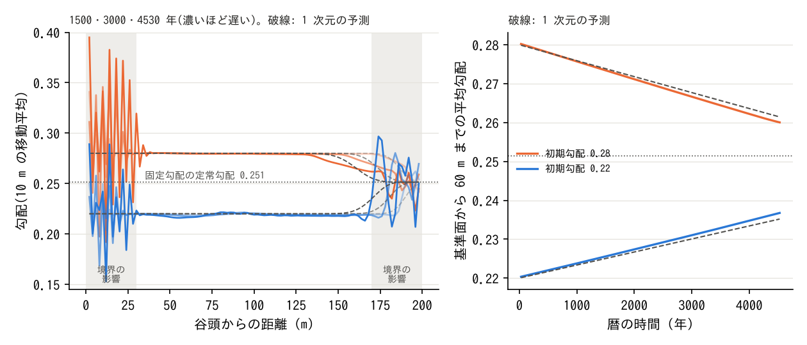

# examples/debris_bedrock — 土石流による岩盤侵食: 1 回の土石流の侵食と、頻度ごとの渓流の定常勾配

[English](en/README.md)

勾配が段々に緩くなる渓流に谷頭から土石流を 1 回流し、流れる混合体が岩盤をどこでどれだけ
削るかを見ます。比べるのは、抵抗則と侵食・堆積式の 2 通り、河床が裸岩か堆積層か、侵食の閾値、
同じ流量の清水の出水です。使う機能は、土石流 `f_debris` と岩盤下刻 `f_rockinc` の土石流の項
`rock_kdb` です([ユーザーガイドの地形変化の章](../../docs/users_guide/geomorph.md#土石流による岩盤侵食rock_kdb)、
式と出典は[解説](../../docs/users_guide/sediment.md#流水による岩盤下刻f_rockinc))。
docs/mountain_stream_plan.md §12 の単一イベントの比較(§12.4)を、実装した則で計算し直した例題です。
検定は [test/dbrock](../../test/dbrock/) にあります。値は説明用で、特定の渓流の校正値ではありません。

後半(下の「長期: 土石流を挟む渓流の定常勾配」)では、出水の長期計算に一定間隔で土石流を挟み、
一様に隆起する渓流の定常勾配が土石流の頻度と堆積物の粒径でどう変わるかを求めます
(docs/mountain_stream_plan.md §13)。

## 設定

| 項目 | 値 |
|---|---|
| 渓流 | 幅 10 m(5 セル、Δx = 2 m、両岸は壁)・長さ 400 m。勾配は谷頭から 0.35(0〜120 m)→ 0.20(〜220 m)→ 0.10(〜300 m)→ 0.04(〜360 m)→ 0.01(〜400 m)。南端は自由流出、n = 0.05 |
| 土石流 | 谷頭の 5 セルから混合体の三角形のハイドログラフ(10 s でピーク 40 m³/s、70 s で終了)。濃度 C = 0.35(水 26 m³/s と固体 14 m³/s。固体の総量 490 m³) |
| 抵抗則と侵食・堆積式 | 高橋・中川(`f_dbres = 3`・`f_dbed = 3`。d_L = 0.1 m、δe = 1e-4、δd = 0.5)とクーロン + Manning(`f_dbres = 1`・`f_dbed = 1`。δe = 7e-4、δd = 0.05)。共通は φ = 35°、λ = 0.4、低速凝集 `f_dbstop = 1`(`db_vstop` = `db_wstop` = 0.05 m/s)、勾配補正 `f_gravity_correction = 1` |
| 河床 | 裸岩(sd = 0)と、厚さ 0.3 m の堆積層 |
| 岩盤侵食 | k_d = 1.8e-4 m/s、τ_cd = 1 kPa、m_d = 1、H* = 0.05 m。k_d は §12.4 で、高橋・中川・裸岩の渓流(0〜360 m)の平均が 1 回 1 cm になるように決めた値 |
| 時間 | dt = 0.02 s で 300 s。地形は毎ステップ更新(`dt_geomorph = 0`、`morfac = 1`)。出力は 10 s ごと |

| 構成 | 内容 |
|---|---|
| `param_T_b.txt` | 高橋・中川・裸岩 |
| `param_T_c.txt` | 高橋・中川・堆積層 0.3 m |
| `param_C_b.txt` | クーロン + Manning・裸岩 |
| `param_C_c.txt` | クーロン + Manning・堆積層 0.3 m |
| `param_T_b05.txt`・`param_T_b20.txt` | T_b の閾値 τ_cd を 0.5 kPa・2 kPa に |
| `param_W.txt` | 同じ流量の清水の出水(裸岩。混合体と同じ 40 m³/s を清水で流す)。掃流砂 `f_fluvial` と流水の剥離(`rock_kp`)に、同じ係数・閾値・べき指数を当てる |

| ファイル | 内容 |
|---|---|
| `make_init.py` | 地形・土層厚と `param_*.txt` を書く(定数は `plot_results.py` と対) |
| `plot_results.py` | 図 `figs/*.png`(`en` で `en/figs/`)と数表(標準出力。区間ごとの侵食・台帳・岩盤起源の割合・終了時の可動層) |

## 実行

```bash
make                                   # ../../bin/ の実行ファイルへのリンク
python3 make_init.py                   # 入力と param_*.txt(同梱のものと同じ)を書く
for c in T_b T_c C_b C_c T_b05 T_b20 W; do
  ./encflow param_$c.txt > Screen_$c.log   # 各 約 30 秒
done
python3 plot_results.py | tee analysis.txt    # 図と数表(python3 plot_results.py en で英語版の図)
```

## 結果

### 1 回の土石流の岩盤侵食



区間ごとの 1 回の岩盤侵食(cm。各区間のセルの平均)と、削った岩盤のかさ体積(終了時の
「rock erosion by debris flows: eroded」。W は「rock incision: plucked」)です。

| 構成 | 勾配 0.35 | 0.20 | 0.10 | 0.04 | 0.01 | 台帳 (m³) |
|---|---|---|---|---|---|---|
| T_b 高橋・中川・裸岩 | 1.94 | 0.90 | 0.015 | 0 | 0 | 32.4 |
| C_b クーロン + Manning・裸岩 | 1.08 | 0.38 | 0 | 0 | 0 | 16.8 |
| T_c 高橋・中川・堆積層 | 0.51 | 0.003 | 0 | 0 | 0 | 6.1 |
| C_c クーロン + Manning・堆積層 | 0.33 | 0.001 | 0 | 0 | 0 | 3.9 |
| T_b05 閾値 0.5 kPa | 5.79 | 2.91 | 0.28 | 0.002 | 0 | 100.7 |
| T_b20 閾値 2 kPa | 0.39 | 0.067 | 0 | 0 | 0 | 5.4 |
| W 同じ流量の清水(流水の剥離) | 0.56 | 0.10 | 0 | 0 | 0 | 7.7 |

- **侵食は急な区間に集まります**。駆動応力 τ_d = ρ(1 + sC) g_e h_t tanθ が閾値 1 kPa を
  超えるのは、勾配 0.2 以上の区間の厚い流れだけです。勾配 0.10 以下では、裸岩でもほとんど
  削れません。
- **抵抗則の差**: クーロン + Manning の勾配 0.35 の区間の侵食は、高橋・中川の 0.56 倍です。
  急な区間で薄く速い流れになり(§12.4 の比較で最大の流動深 0.87 m と 1.26 m)、深さに比例する
  τ_d が小さくなります。
- **勾配の変わり目の上流の山**: 勾配 0.10 の区間の堆積が上流へ背水を作り、勾配 0.20 の区間の
  末端で混合体が厚く遅くなります。C_b の谷頭から 205 m のセルでは、70〜120 s に h_t ≈ 1.3 m・
  |V| ≈ 0.5 m/s で、この区間の最大(1.55 cm)になりました。1 s ごとの出力で分けると、C_b の
  勾配 0.20 の区間の侵食の 55 %(C_b 全体の 12 %)が |V| < 1 m/s の流れによるものでした
  (高橋・中川では同じ区間で 1 %)。準静的な駆動応力は流速によらないので、門
  (|V| ≥ `db_vstop` = 0.05 m/s)を超えて動いている限り、遅く厚い流れも被覆が厚くなるまで
  削ります。採用した則(§12.5)の性質で、観測で確かめた挙動ではありません。
- **終了時の可動層**: 急な区間はほぼ掃き出され(T_b は 0)、勾配の変わり目に堆積します
  (谷頭から 220 m で T_b 1.4 m・C_b 1.1 m)。削った岩は 1:1 で可動層に入り、侵食・堆積式が
  取り込むか被覆として残すかを決めます。
- **岩盤起源の土砂**: 削った岩盤の固体は T_b で 19.4 m³(流入した固体 490 m³ の 4.0 %)、
  C_b で 2.1 %、T_c で 0.7 %、C_c で 0.5 % です。1 回の土石流の土砂は、ほとんどが谷頭から
  来たものです。

### 清水の出水との比較

同じ流量の清水の出水(W)は、勾配 0.35 の区間で 0.56 cm、0.20 の区間で 0.10 cm を削りました
(T_b の 29 %・12 %。台帳で 24 %)。ただし W の応力は流水の剥離則のもので、セル流速の Manning
閉じ τ_b = ρ g n² V²/h^{1/3} です。この閉じは急勾配の等流で釣り合いより大きく出ます
(developer.md §88.4 の 1。この渓流の勾配 0.35 の区間と同じ幅・格子・流量の定常の等流で、
中央の列の τ_b / ρ g h tanθ = 1.41)。土石流の項と同じ準静的な応力で同じ流れを評価すると、
侵食は 0.20 cm・0.01 cm です(渓流の平均で T_b の 7 %。§12.4 の後処理)。応力の定義によって
3 倍違いますが、どちらでも土石流のほうがよく削ります(台帳で 4.2 倍、準静的な応力どうしでは
渓流の平均で 14 倍)。

### 被覆の効き



- 厚さ 0.3 m の堆積層があると、勾配 0.35 の区間の侵食は裸岩の 26 %(高橋・中川)・30 %
  (クーロン + Manning)になり、勾配 0.20 以下ではほぼ 0 です。
- 岩盤が削れ始めるのは、流れが堆積層を数 cm(H* の数倍)まで剥がしてからです。高橋・中川の
  谷頭から 21 m では 40〜60 s に剥がれ切り、0.80 cm を削りました(裸岩では 1.96 cm)。
  101 m では 3 cm まで薄くなるだけで、0.23 cm です。勾配 0.20 の区間では、堆積層は剥がれずに
  残るか厚くなります。
- 露出率 exp(−sd/H*) の H* = 0.05 m は、「厚さ約 5 cm の堆積物が衝突から床を守る」という
  観測(McCoy ら 2013。sediment.md の文献)を目安にした値です。

### 閾値の効き



- 閾値を半分(0.5 kPa)にすると勾配 0.35 の区間の侵食は 3.0 倍(5.79 cm)になり、侵食が
  勾配 0.10 の区間にも及びます。2 倍(2 kPa)にすると 0.20 倍(0.39 cm)です。閾値は侵食の
  大きさと、侵食が及ぶ勾配の範囲をともに決めます。
- 閾値が低いと、減水期の長い尾部も削ります。減水の遅い下流ほど長く削るので、0.5 kPa では
  急な区間の中でも下流ほど侵食が大きくなります(谷頭から 5 m の 5.2 cm から、区間の末端
  115 m の 6.6 cm)。

## 長期: 土石流を挟む渓流の定常勾配(後半)

1 回の侵食は数 mm〜数 cm なので、谷の形を変えるには多数の土石流と、その間の出水をつなぎます。
後半では、一様に隆起する渓流で出水の長期計算に一定間隔で土石流を挟み、土石流の頻度ごとの
定常勾配を求めます(docs/mountain_stream_plan.md §13、developer.md §88.22)。土石流のイベント計算と
出水の計算(`morfac > 1` と間欠係数の換算。[examples/mountain_valley](../mountain_valley/))は、
`f_state_restore = 2`(新しい時間軸。dt を変えられる)で交互につなぎ、両方で `f_rockinc = 1` に
して累積下刻 `Ri` を続けます(手順は[ユーザーガイド](../../docs/users_guide/geomorph.md#土石流による岩盤侵食rock_kdb))。
計算本体は変えず、`Run_chain.sh` が出水と土石流の実行を繰り返します。土石流の間隔(何年に
1 回か)は利用者が決めます。

### 後半の設定

| 項目 | 値 |
|---|---|
| 水路 | 幅 10 m を横断 1 セル(Δx = 10 m、Δy = 2 m)にした長さ 200 m の一様勾配。勾配 S = 0.15・0.20・0.25・0.30・0.35・0.40。下に勾配 0.6・長さ 20 m の落ち口を足す(理由は下の「横断 1 セルと落ち口にした理由」)。n = 0.05 |
| 出水 | 形成流量 5 m³/s の一定流量の清水。1 年に F = 300 s 流れるとみなす(間欠係数 i_f = 9.5e-6)。morfac 10、dt = 0.1 s。流水の剥離 k_p = 4.6e-6 m/s、τ_c = 300 Pa、m = 1、H* = 0.05 m(研磨なし。出水だけの定常勾配が約 0.355 になる k_p)。谷頭からの給砂なし |
| 堆積物の粒径 | 掃流砂(土石流の堆積物と剥離物)の d50 = 0.1 m と 0.4 m(巨礫) |
| 土石流 | 前半の T_b と同じ(谷頭の混合体のハイドログラフ、高橋・中川、k_d = 1.8e-4 m/s、τ_cd = 1 kPa、m_d = 1)。計算は 200 s(dt = 0.02 s)。出水の終わりの状態(水が流れている水路)から始める。T_r = 100・30・10 年に 1 回と、出水だけ |
| 暦 | 出水の計算 1 回 = T_r 年(流れの時間 T_r × F / morfac)。土石流の時間は暦に数えない。隆起はイベントでは使わない |
| 方法(主) | 固定勾配の侵食速度: 隆起なしで「出水 T_r 年分 → 土石流 1 回」を 10 サイクル(出水だけは 100 年分の出水を 5 回)回し、サイクル 3 以降の中央区間(谷頭から 40〜160 m)の地表の低下速度 E を求める。定常勾配 S* は E(S*) = U(隆起 1 mm/年)を補間する |
| 方法(確認) | 粒径 0.1 m・30 年に 1 回で、隆起ありの連鎖(水路の最後の行と落ち口は削れず隆起もしない基準面)を、一様勾配 0.28・0.22(S* ± 0.03)から 150 サイクル(4530 年)回し、E(S) の折れ線で解いた 1 次元の予測 z_t = U − E(S) と比べる |

| ファイル | 内容 |
|---|---|
| `make_long.py` | 50 構成の設定ファイル(`long/<構成>/`)と入力を書く。`track` は台帳の表示と save のセルごとの z・Ri・sd を 1 行に書き出す |
| `Run_chain.sh 構成 サイクル数` | 1 構成の連鎖(最初の出水 → 土石流 → 出水 → …)。各段の後に `long/<構成>/track.csv` へ 1 行 |
| `Run_long.sh [並列数]` | 全構成を並列に回す |
| `plot_long.py` | 図 `figs/long_*.png`(`en` で `en/figs/`)と数表(低下速度・足し合わせ・定常勾配・台帳・隆起ありの確認) |

```bash
make                                          # ../../bin/ の実行ファイルへのリンク
python3 make_long.py                          # long/<構成>/ の設定(50 構成)
./Run_long.sh 4                               # 4 並列で約 8 分
python3 plot_long.py | tee analysis_long.txt  # 図と数表(python3 plot_long.py en で英語版の図)
```

### 長期の低下速度と足し合わせ



- **粒径 0.1 m**: どの勾配・頻度でも、低下速度はサイクルによらず一定です(サイクル 3〜10 の
  最小と最大の差は 0.003 mm/年以下)。出水と土石流を別々に計算して足した値(破線。最初の出水と
  1 回目の土石流の侵食から)と 1.2 % 以内で一致します。土石流の堆積物は次の出水が運び去ります。
- 勾配 0.25 の低下速度のうち、土石流の分は 100 年に 1 回で 24 %、30 年で 52 %、10 年で 78 % です。
- **粒径 0.4 m(巨礫)**: 勾配 0.30 以上は 0.1 m とほぼ同じですが、勾配 0.25 以下では足し合わせより
  小さくなり(勾配 0.25 の 10 年に 1 回で 0.94 倍)、勾配 0.20 の 30・10 年に 1 回と勾配 0.15 では
  堆積が残って地表が上がります(下の「巨礫の堆積物」)。
- 各段の累積下刻の増分 ΣΔRi·A は、終了時の表示(剥離・土石流の侵食)と相対 2.6e-8 以内で一致します。

### 定常勾配と土石流の頻度



| 定常勾配(隆起 1 mm/年) | 出水だけ | 100 年に 1 回 | 30 年に 1 回 | 10 年に 1 回 |
|---|---|---|---|---|
| 交互計算・粒径 0.1 m | 0.354 | 0.311 | 0.251 | 0.175 |
| 足し合わせ・粒径 0.1 m | 0.356 | 0.311 | 0.252 | 0.175 |
| 交互計算・粒径 0.4 m | 0.355 | 0.312 | 0.257 | 0.246 |

- 土石流が頻繁になるほど、隆起に釣り合う勾配は緩くなります。粒径 0.1 m では、交互計算と足し合わせの
  定常勾配の差は 0.002 以内です。
- 10 年に 1 回の 0.175 は、土石流の平衡勾配 0.256(高橋・中川の平衡濃度が流入の濃度 0.35 に等しい
  勾配)より緩い勾配です。土石流は通るたびに堆積しますが、粒径 0.1 m の堆積物は出水が運び去るので、
  岩盤の侵食は続きます。
- **粒径 0.4 m では、定常勾配は土石流の平衡勾配の近く(10 年に 1 回で 0.246)に留まります**。それより
  緩い勾配では、土石流が残す巨礫を出水が運べず、岩盤が覆われて削れなくなるためです。土石流の頻度を
  上げても、勾配はそれ以上下がりません。

### 巨礫の堆積物(粒径 0.4 m)



- 勾配 0.15 では、土石流の堆積が頻度によらず 1 サイクルに約 29 cm ずつ増え続けます(出水は巨礫を
  動かせない)。
- 勾配 0.20 では、30 年に 1 回で増え方が鈍り、10 サイクルで 36 cm になります(出水が運ぶ量と土石流が
  残す量が釣り合う厚さに近づく)。10 年に 1 回では 86 cm まで増え、まだ増えています。100 年に 1 回では
  出水が運び去ります(0.5 cm)。
- 勾配 0.25 以上では堆積は残りません(0.1 cm)。

### 隆起ありの確認



- 急な水路(0.28)は緩く、緩い水路(0.22)は急になり、どちらも固定勾配で求めた定常勾配 0.251 へ
  向かいます。調整は基準面から上流へ伝わります。
- 計算(実線)と 1 次元の予測(破線)はよく合います。基準面から 60 m までの平均勾配は、4530 年後に
  0.260(予測 0.261)と 0.237(予測 0.235)です。谷頭から 30〜170 m の勾配の縦断の予測との差は、
  rms で 0.006・0.004 です。
- 調整は遅く、4530 年で基準面から約 40 m しか進みません(前線の速さ dE/dS ≈ 9 mm/年)。
- 調整がまだ届かない中央区間は U − E(S0) で上下します。0.22 は +0.20 mm/年(予測 +0.20)、0.28 は
  −0.28 mm/年です(予測 −0.25。E(S) を勾配 0.25 と 0.30 の間で直線補間したため。この間に土石流の
  平衡勾配 0.256 があり、E(S) が折れ曲がる)。
- 灰色の区間(谷頭から 30 m と、基準面から 30 m)では、数千年のうちに 2 セル周期の段差(隣り合う
  区間の勾配が交互に変わる)が育ちます。0.28 の構成から土石流を除いた出水だけの連鎖の試行でも、
  4530 年で谷頭から 16 m まで育ちました。流入と基準面の境界から始まる格子の大きさの振動で、原因は
  調べていません(developer.md §88.22)。

### 横断 1 セルと落ち口にした理由

- **横断 1 セル**: 前半と同じ 5 セルの水路で同じ連鎖を回すと、壁に接する両端の列は 1 回目の出水でも
  剥離が 35 % 小さく、中央が低くなると流れが集まって、壁の列は出水ではほとんど削れなくなりました。
  勾配 0.20・100 年に 1 回の 10 サイクルで、中央 3 列の低下速度は 1.45 倍に上がり、隆起ありの
  150 サイクルでは中央の 1 列が 7〜10 m の溝になりました。ENCflow の岩盤侵食は鉛直だけで側方の
  侵食がないので、流れが集まる正の帰還を止める過程がなく、川幅は格子の幅まで狭まります
  (developer.md §88.4 の 3 と同じ)。縦断の問いには、横断の形が変わらない 1 セルの水路を使います。
  1 セルの出水の水深は等流の値に近く、5 セルの中央の列(§88.4 の 1 の偏りで浅く速い)より剥離が
  小さいので、k_p は出水だけの定常勾配が約 0.355 になる値に合わせ直しました。
- **落ち口**: 自由流出の境界のセルは流れがやや深く遅く(勾配 0.30 で 5 %)、剥離が 17 % 小さいので、
  水路の最後のセルが堰になり、出水の運ぶ土砂がたまって堆積が上流へ伸びました(粒径 0.4 m では
  勾配 0.40 でも)。水路の下に勾配 0.6 の落ち口を足すと、土砂は止まらずに出ていきます。固定勾配の
  構成では落ち口も削り、隆起ありの構成では水路の最後の行と落ち口を基準面にします。

## 注意(この例題の範囲)

- 単層混合体は巨礫の集まる前縁を分けて表しません。観測では侵食の大半が粗い前縁の通過中に
  起きますが(Illgraben。§12.4 の 6)、§12.4 の比較では前縁の 5 s の寄与は 12 % でした。前縁の
  効果は、イベント全体の係数 k_d に含めて校正します。
- k_d・τ_cd は文献に標準値のない校正値です(1 回の低下は mm〜cm の程度と報告されている。
  sediment.md の文献)。
- 準静的な駆動応力は流速によらないので、遅く厚い流れも削ります(上の「勾配の変わり目の
  上流の山」)。速度の門は低速凝集の `db_vstop` と共有です。
- 前半の計算は 1 回のイベントだけです。後半は隆起と繰り返しの土石流を入れますが、風化・斜面からの
  供給・谷頭の給砂は入れていません。土石流は一定の大きさ、出水は一定の流量で、大きさの頻度分布は
  表しません。
- 後半の水路は横断 1 セルで、川幅の変化と横断の形は表しません(5 セルでは流れが格子の幅まで
  集まる。「横断 1 セルと落ち口にした理由」)。谷頭と基準面の近くでは、数千年の連鎖で 2 セル周期の
  段差が育ちます。

## 関連文書

- [ユーザーガイド: 地形変化](../../docs/users_guide/geomorph.md#土石流による岩盤侵食rock_kdb)、
  [解説](../../docs/users_guide/sediment.md#流水による岩盤下刻f_rockinc)(式と出典)、
  [土石流・崩壊](../../docs/users_guide/massflow.md)(混合体の抵抗則と侵食・堆積式)
- 検定: [test/dbrock](../../test/dbrock/)(自己被覆の解析解、更新間隔の不変、濃度・速度の門、
  閉じた箱の保存、入力の誤り)
- 流水による岩盤下刻の例題: [examples/bedrock_cover](../bedrock_cover/)、
  [examples/mountain_valley](../mountain_valley/)
- 設計: docs/mountain_stream_plan.md §12・§13、docs/developer.md §88.18〜§88.22
