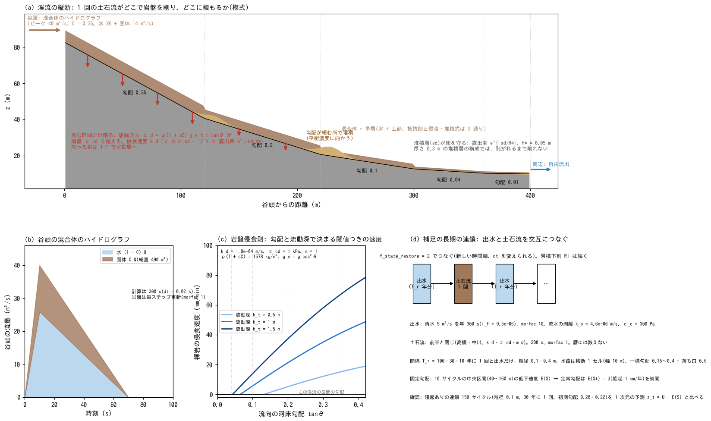
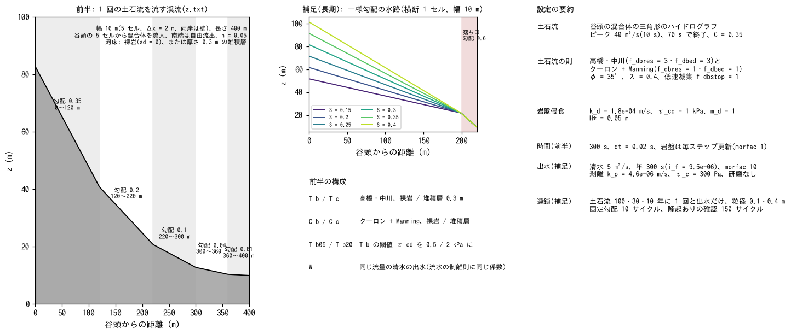
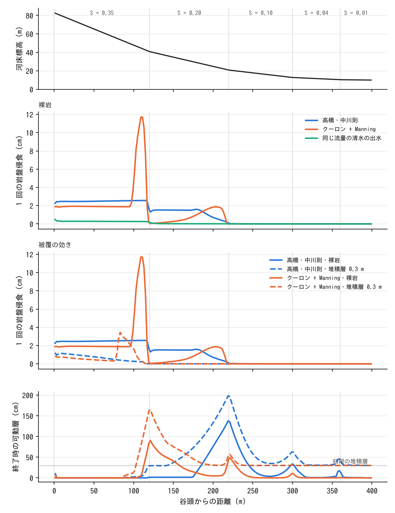
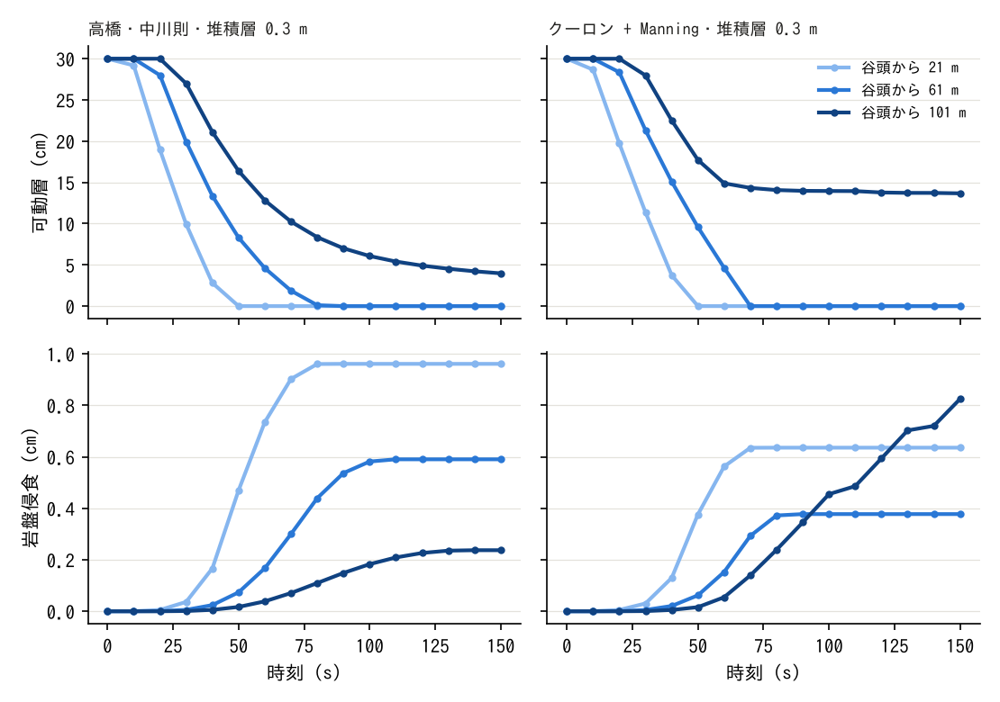
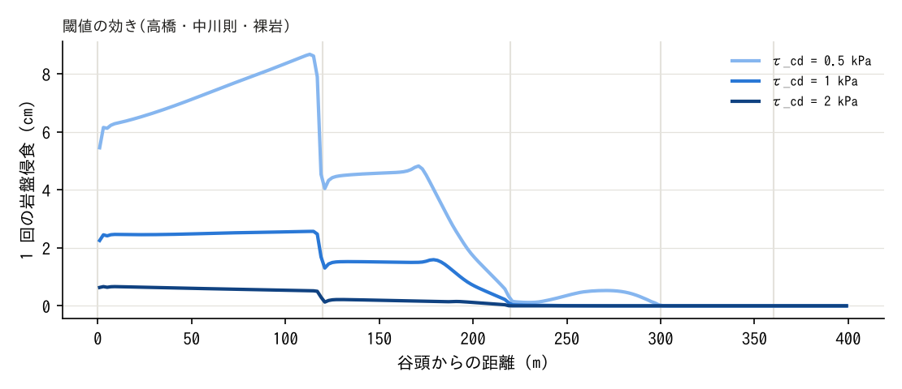
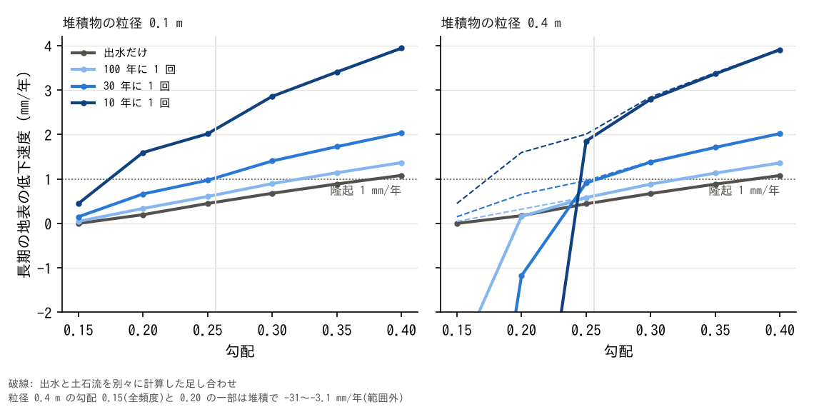
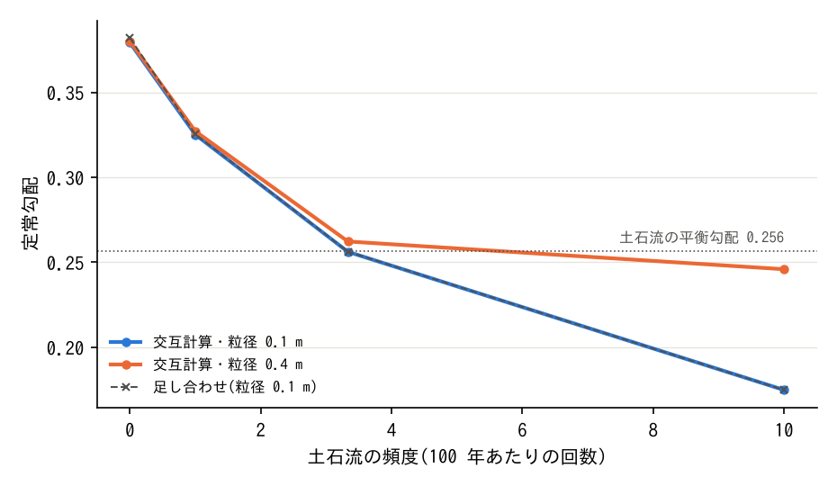
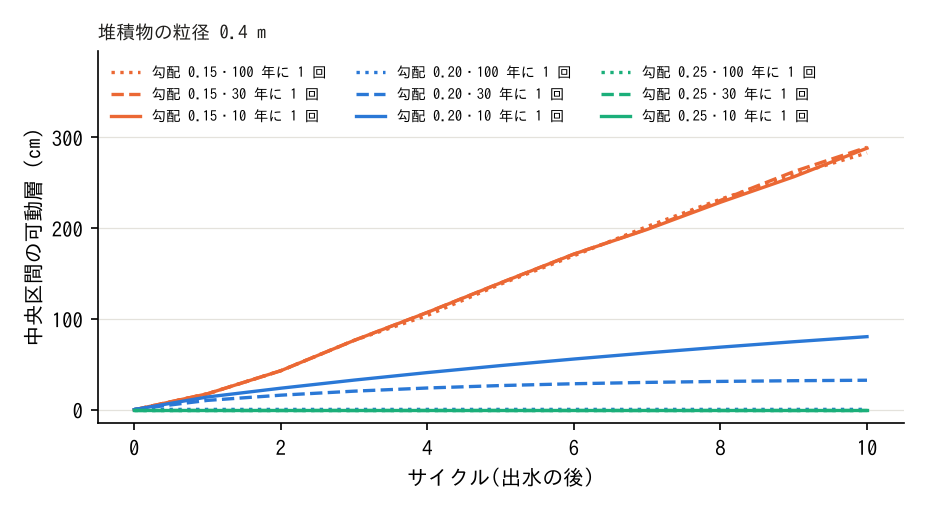
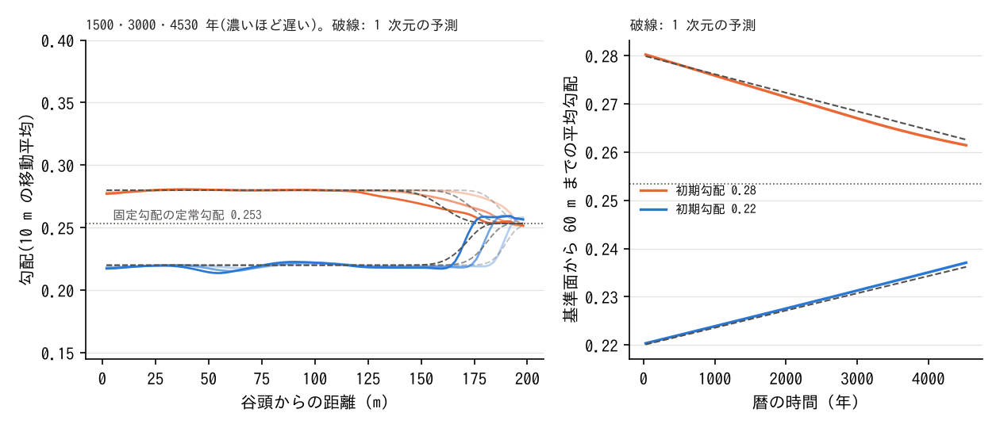

# debris_bedrock — 土石流による岩盤侵食: 1 回の土石流の侵食と、頻度ごとの渓流の定常勾配

[English](en/README.md)

勾配が段々に緩くなる渓流に谷頭から土石流を 1 回流し、流れる混合体が岩盤をどこでどれだけ削るかを
見ます。比べるのは、抵抗則と侵食・堆積式の 2 通り、河床が裸岩か堆積層か、侵食の閾値、同じ流量の
清水の出水です。使う機能は、土石流 `f_debris` と岩盤下刻 `f_rockinc` の土石流の項 `rock_kdb` です
([ユーザーガイドの地形変化の章](../../docs/users_guide/geomorph.md#土石流による岩盤侵食rock_kdb)、
式と出典は[解説](../../docs/users_guide/sediment.md#流水による岩盤下刻f_rockinc))。補足では、出水の
長期計算に一定間隔で土石流を挟み、一様に隆起する渓流の定常勾配が土石流の頻度と堆積物の粒径で
どう変わるかを求めます。値は現象を見やすくするための模式値で、特定の渓流の再現ではありません。

## 実際の急な谷で起きていること

- **急な谷は土石流が削る**: 勾配が 0.03〜0.1 より急な谷では、流水の下刻則が与える勾配と流域面積の
  関係が成り立たず、土石流が岩盤を削る主な担い手と考えられています(Stock & Dietrich 2003)。
  侵食ピンの観測でも、土石流が走る急な谷では出水による低下がなく、間欠的な土石流が主な担い手です
  (Stock ら 2005)。
- **削るのは粒子の衝突**: 岩盤の低下は主に巨礫の衝突による割れ目沿いの岩塊の除去とされ、
  土石流の粗い前縁が通過する間の衝突が担い手と考えられています(Stock & Dietrich 2006)。回転
  ドラムの実験も、慣性応力と前縁の粒子の衝突への依存を支持しています(Hsu ら 2008)。
- **1 回の低下は mm〜cm**: 弱い岩の谷の侵食ピンで最大 cm/年(Stock ら 2005)、岩盤の床に置いた
  センサーでは観測期間に 36〜64 mm の低下(McCoy ら 2013)が報告されています。
- **堆積物が床を守る**: 厚さ約 5 cm の堆積物が、衝突から床を守ります(McCoy ら 2013)。
- **侵食は前縁で起きる**: スイスの Illgraben の扇状地の水路に埋めた侵食センサーでは、堆積物の床の
  侵食は前縁の到達から 20 s 以内に段階的に起き、流動深と応力が最大になる前に始まりました
  (Berger ら 2011)。
- **勾配が緩むと止まって積もる**: 土石流は、運べる土砂の濃度(平衡濃度)が勾配で決まり、勾配が
  緩む所で堆積します(高橋・中川 1991)。この例題の流入の濃度 0.35 と内部摩擦角 35° では、平衡
  勾配は 0.256 です。
- **長期の縦断形**: 出水と土石流の両方が形づくる渓流の縦断形は、流動深と勾配の関数の土石流の
  侵食則と流水の下刻を足し合わせて求める枠組みで扱われています(McGuire ら 2023)。

## 再現に必要な機構



模式図。(a) 渓流の縦断: 谷頭から流した混合体は、駆動応力が閾値を超える急な区間だけ岩盤を削り、
勾配が緩む所で堆積し、堆積層(可動層)は露出率で床を守る。(b) 谷頭の混合体のハイドログラフ。
(c) 岩盤侵食則: 勾配と流動深で決まる閾値つきの速度。(d) 補足の長期の連鎖: 出水と土石流を交互に
つなぐ。

| 実際の現象 | ENCflow での表し方 | 設定 |
|---|---|---|
| 土石流が谷を流れ下る | 単層混合体(水 + 土砂)の浅水流。抵抗則と侵食・堆積式は高橋・中川とクーロン + Manning の 2 通り。谷頭の 5 セルから混合体のハイドログラフを与える | `f_debris = 1`、`f_dbres`・`f_dbed`、`inflow_val`・`inflow_cs` |
| 流れる混合体が岩盤を削る | 準静的な駆動応力 τ_d = ρ(1 + sC) g_e h_t tanθ の超過形 E = k_d (τ_d/τ_cd − 1)^m_d。濃い混合体が動いているセルだけで働き、削った岩は 1:1 で可動層に入る | `rock_kdb`・`rock_taucdb`・`rock_mdb`(`f_rockinc = 1`) |
| 堆積物が床を守る | 可動層の厚さ sd による露出率 e^{−sd/H*}。侵食・堆積式が取り込むか被覆として残すかを決める | `rock_hstar`、`fn_sd`(堆積層 0.3 m) |
| 勾配が緩む所で止まって積もる | 侵食・堆積式(平衡濃度へ)と低速凝集。急勾配の有効重力の補正 | `f_dbstop = 1`、`db_vstop`・`db_wstop`、`f_gravity_correction = 1` |
| 清水の出水(比較) | 同じ流量を清水で流し、流水の剥離則に同じ係数・閾値・べき指数を当てる | `f_fluvial = 1`、`rock_kp`・`rock_tauc`・`rock_m` |
| (補足)土石流の間の出水と隆起 | 出水の長期計算(代表出水を morfac で加速し、間欠係数で暦に換算)と土石流のイベント計算を、再開でつなぐ。一様隆起、出口は基準面 | `f_state_restore = 2`、`morfac`、`f_uplift`、`fn_uplift`・`fn_rock` |

岩盤侵食則に、粒子衝突の慣性応力ではなく準静的な駆動応力の超過形を使うのは、単層混合体が衝突の
集中する巨礫の前縁を分けて表さないためです。慣性応力に比例する則は数値の薄い層に敏感で、抵抗則を
替えると結果が桁で変わりました。準静的な応力は定常の等流で抵抗則の底面せん断に等しく、抵抗則の
選び方によりません([解説](../../docs/users_guide/sediment.md#流水による岩盤下刻f_rockinc))。

## 幾何と設定



左: 前半の渓流の縦断(5 区間の勾配)。中上: 補足(長期)の一様勾配の水路と落ち口。中下: 前半の
構成。右: 設定の要約。

幅 10 m(5 セル、Δx = 2 m、両岸は壁)、長さ 400 m の渓流です。勾配は谷頭から 0.35(0〜120 m)→
0.20(〜220 m)→ 0.10(〜300 m)→ 0.04(〜360 m)→ 0.01(〜400 m)で、南端は自由流出、粗度 n = 0.05
です。

- **土石流**: 谷頭の 5 セルから混合体の三角形のハイドログラフ(10 s でピーク 40 m³/s、70 s で
  終了)。濃度 C = 0.35(水 26 m³/s と固体 14 m³/s。固体の総量 490 m³)。
- **抵抗則と侵食・堆積式**: 高橋・中川(`f_dbres = 3`・`f_dbed = 3`。d_L = 0.1 m、δe = 10⁻⁴、
  δd = 0.5)とクーロン + Manning(`f_dbres = 1`・`f_dbed = 1`。δe = 7×10⁻⁴、δd = 0.05)。共通は
  φ = 35°、λ = 0.4、低速凝集 `f_dbstop = 1`(`db_vstop` = `db_wstop` = 0.05 m/s)、勾配補正
  `f_gravity_correction = 1`。
- **河床**: 裸岩(sd = 0)と、厚さ 0.3 m の堆積層。
- **岩盤侵食**: k_d = 1.8×10⁻⁴ m/s、τ_cd = 1 kPa、m_d = 1、H* = 0.05 m。k_d は、高橋・中川・裸岩の
  渓流(0〜360 m)の平均が 1 回約 1 cm になるように決めた値です(現行の既定の水理では 1.10 cm)。
- **時間**: dt = 0.02 s で 300 s。地形は毎ステップ更新(`dt_geomorph = 0`、`morfac = 1`)。出力は
  10 s ごと。

| 構成 | 設定ファイル | 内容 |
|---|---|---|
| T_b | param_T_b.txt | 高橋・中川、裸岩 |
| T_c | param_T_c.txt | 高橋・中川、堆積層 0.3 m |
| C_b | param_C_b.txt | クーロン + Manning、裸岩 |
| C_c | param_C_c.txt | クーロン + Manning、堆積層 0.3 m |
| T_b05・T_b20 | param_T_b05.txt・param_T_b20.txt | T_b の閾値 τ_cd を 0.5 kPa・2 kPa に |
| W | param_W.txt | 同じ流量の清水の出水(裸岩。混合体と同じ 40 m³/s を清水で流す)。掃流砂 `f_fluvial` と流水の剥離(`rock_kp`)に、同じ係数・閾値・べき指数を当てる |

## 実行方法

```
cd examples/debris_bedrock
make                     # リンクと入力(make_init.py が地形・土層厚と param_*.txt を作る)
make run                 # 前半の 7 構成を順に計算(各 約 30 秒)
make long                # 補足の長期の連鎖(make_long.py の 50 構成を Run_long.sh が 4 並列で回す。約 8 分)
python3 plot_setup.py    # figs/mechanism.png・setup.png(計算結果は使わない)
python3 plot_results.py  # 前半の figs/*.png と数表(引数 en で英語版を en/figs/ に)
python3 plot_long.py     # 補足の figs/long_*.png と数表(引数 en で英語版)
```

引数 `en` を付けると英語ラベルの図を en/figs/ に描きます。図化には Python 3・NumPy・matplotlib が
要ります。

## 結果

(数表と図は 2026-10-29 以降の計算のもの。2026-11-02 に現行の既定(f_opening_dynamic = 3 と、運動量
保存形移流の側方面の修正後)で再計算し、横断 5 セルの前半は数表の小数第 3 位が動くだけ(表示の桁では
同じ)、横断 1 セルの補足の連鎖は出力がバイト一致。developer.md §68.41〜§68.43。2026-11-04 に降伏の静止判定の
修正(§28.16)後に再計算し、クーロン + Manning の 2 構成(C_b・C_c)の値が変わった(台帳 C_b 32.8 → 38.9 m³、
C_c 7.1 → 11.0 m³。勾配の変わり目の上流に混合体がたまる間、遅く厚い流れが長く削る)。高橋・中川の 4 構成と
清水の出水 W、補足の連鎖は数表の値が同じで、図は erosion・cover だけを描き直した。同日、急勾配の重力補正の
修正と、岩盤侵食の有効重力を運動方程式と同じ g/(1 + |∇z|²) にした変更(§91)の後に再計算し、数表の値が
1 % ほど動いた(台帳 T_b 39.2 → 39.5 m³、T_b05 117.1 → 117.8 m³。清水の出水 W は表示の桁で同じ)。補足の
連鎖は小数第 3 位が動くだけで、定常勾配は同じ。数表・本文の数値と図はこの再計算のもの)

### 1 回の土石流の岩盤侵食



区間ごとの 1 回の岩盤侵食(cm。各区間のセルの平均)と、削った岩盤のかさ体積(終了時の
「rock erosion by debris flows: eroded」。W は「rock incision: plucked」)です。

| 構成 | 勾配 0.35 | 0.20 | 0.10 | 0.04 | 0.01 | 台帳 (m³) |
|---|---|---|---|---|---|---|
| T_b 高橋・中川・裸岩 | 2.29 | 1.19 | 0.008 | 0 | 0 | 39.5 |
| C_b クーロン + Manning・裸岩 | 2.59 | 0.78 | 0 | 0 | 0 | 38.8 |
| T_c 高橋・中川・堆積層 | 0.59 | 0.005 | 0 | 0 | 0 | 7.2 |
| C_c クーロン + Manning・堆積層 | 0.92 | 0 | 0 | 0 | 0 | 11.1 |
| T_b05 閾値 0.5 kPa | 6.77 | 3.40 | 0.32 | 0 | 0 | 117.8 |
| T_b20 閾値 2 kPa | 0.52 | 0.15 | 0 | 0 | 0 | 7.7 |
| W 同じ流量の清水(流水の剥離) | 0.32 | 0.030 | 0 | 0 | 0 | 4.1 |

- **侵食は急な区間に集まります**。駆動応力 τ_d = ρ(1 + sC) g_e h_t tanθ が閾値 1 kPa を超えるのは、
  勾配 0.2 以上の区間の厚い流れだけです。勾配 0.10 以下では、裸岩でもほとんど削れません。
- **抵抗則の差**: 勾配 0.35 の区間の 0〜100 m では、クーロン + Manning の侵食は高橋・中川の
  0.74 倍です(1.70 cm と 2.30 cm)。急な区間の上流側で薄い流れになり(谷頭から 21・41・61 m の最大の
  流動深 0.80・0.82・0.84 m と 1.13・0.96・0.82 m)、深さに比例する τ_d が小さくなります。区間の平均
  (2.59 cm と 2.29 cm)は、次の勾配の変わり目の上流の山を含みます。
- **勾配の変わり目の上流の山**: クーロン + Manning では、谷頭から 120 m の変わり目(0.35 → 0.20)に
  0.9 m の堆積ができ、その上流に混合体がたまります。111 m のセルでは 60 s から h_t = 1.4〜1.8 m に
  なり、|V| が 1.4 m/s から 0.1 m/s に下がった後も、0.2 m/s 以下の遅い流れが 250 s ごろまで削り続けて
  11.1 cm になりました(0〜100 m の平均の 6.5 倍)。1 s ごとの出力で分けると、C_b の侵食の 46 %(勾配
  0.35 の区間の 100〜120 m で 77 %、0.20 の区間で 89 %)が |V| < 1 m/s の流れによるものでした(高橋・
  中川では全体の 4 %。区間の両端の時刻の速さの平均で振り分けた)。準静的な駆動応力は
  流速によらないので、門(|V| ≥ `db_vstop` = 0.05 m/s)を超えて動いている限り、遅く厚い流れも被覆が
  厚くなるまで削ります。採用した則の性質で、観測で確かめた挙動ではありません。
- **終了時の可動層**: 急な区間はほぼ掃き出され(T_b は 0)、勾配の変わり目に堆積します(T_b は
  220 m の変わり目で 1.4 m、C_b は 120 m の変わり目で 0.90 m・220 m で 0.51 m)。削った岩は 1:1 で
  可動層に入り、侵食・堆積式が取り込むか被覆として残すかを決めます。
- **岩盤起源の土砂**: 削った岩盤の固体は T_b で 23.7 m³(流入した固体 490 m³ の 4.8 %)、C_b で
  4.8 %、T_c で 0.9 %、C_c で 1.4 % です。1 回の土石流の土砂は、ほとんどが谷頭から来たものです。

### 清水の出水との比較

同じ流量の清水の出水(W)は、勾配 0.35 の区間で 0.32 cm、0.20 の区間で 0.030 cm を削りました
(T_b の 14 %・3 %。台帳で 10 %)。W の応力は流水の剥離則のもので、セル流速の Manning 閉じ
τ_b = ρ g n² V²/h^{1/3} です。この閉じは急勾配の等流でも釣り合い ρ g h tanθ に一致します(この渓流の
勾配 0.35 の区間と同じ幅・格子・流量の定常の等流で、中央の列の比が 1.000)。土石流の項の準静的な
応力 ρ g_e h tanθ は勾配補正 g_e = g cos²θ(勾配 0.35 で 0.89 倍)を含むので、同じ流れをこれで
評価すると侵食は 0.21 cm・0.015 cm と小さくなります(渓流の平均で T_b の 7 %。1 s ごとの出力の
後処理。g_e を g にすると 0.33 cm で Manning 閉じとほぼ同じ)。どちらでも土石流のほうがよく削ります
(台帳で 9.6 倍、準静的な応力どうしでは渓流の平均で 14 倍)。

### 被覆の効き



- 厚さ 0.3 m の堆積層があると、勾配 0.35 の区間の侵食は裸岩の 26 %(高橋・中川)・36 %
  (クーロン + Manning)になり、勾配 0.20 以下ではほぼ 0 です。
- 岩盤が削れ始めるのは、流れが堆積層を数 cm(H* の数倍)まで剥がしてからです。高橋・中川の
  谷頭から 21 m では 40〜50 s に剥がれ切り、0.96 cm を削りました(裸岩では 2.29 cm)。
  101 m では 2.5 cm まで薄くなるだけで、0.24 cm です。勾配 0.20 の区間では、堆積層は剥がれずに
  残るか厚くなります。
- クーロン + Manning の堆積層あり(C_c)では、変わり目の上流で遅く厚い流れが長く続くので、可動層が
  剥がれ切らないまま削り続けます。谷頭から 101 m では可動層が 13.6 cm 残ったまま(露出率
  exp(−sd/H*) ≈ 7 %)、300 s までに 1.68 cm を削りました。その上流の 83 m では剥がれ切って 4.6 cm を
  削り、区間でいちばん大きくなりました。
- 露出率 exp(−sd/H*) の H* = 0.05 m は、「厚さ約 5 cm の堆積物が衝突から床を守る」という
  観測(McCoy ら 2013)を目安にした値です。

### 閾値の効き



- 閾値を半分(0.5 kPa)にすると勾配 0.35 の区間の侵食は 3.0 倍(6.77 cm)になり、侵食が
  勾配 0.10 の区間にも及びます。2 倍(2 kPa)にすると 0.23 倍(0.52 cm)です。閾値は侵食の
  大きさと、侵食が及ぶ勾配の範囲をともに決めます。
- 閾値が低いと、減水期の長い尾部も削ります。減水の遅い下流ほど長く削るので、0.5 kPa では
  急な区間の中でも下流ほど侵食が大きくなります(谷頭から 5 m の 5.8 cm から、区間の末端
  115 m の 7.9 cm)。

## 補足: 土石流を挟む渓流の定常勾配(長期の連鎖)

1 回の侵食は数 mm〜数 cm なので、谷の形を変えるには多数の土石流と、その間の出水をつなぎます。
補足では、一様に隆起する渓流で出水の長期計算に一定間隔で土石流を挟み、土石流の頻度ごとの定常
勾配を求めます。土石流のイベント計算と出水の計算(`morfac > 1` と間欠係数の換算。
[examples/mountain_valley](../mountain_valley/README.md))は、`f_state_restore = 2`(新しい時間軸。
dt を変えられる)で交互につなぎ、両方で `f_rockinc = 1` にして累積下刻 `Ri` を続けます(手順は
[ユーザーガイド](../../docs/users_guide/geomorph.md#土石流による岩盤侵食rock_kdb))。計算本体は変えず、
`Run_chain.sh` が出水と土石流の実行を繰り返します。土石流の間隔(何年に 1 回か)は利用者が決めます。

| 項目 | 値 |
|---|---|
| 水路 | 幅 10 m を横断 1 セル(Δx = 10 m、Δy = 2 m)にした長さ 200 m の一様勾配。勾配 S = 0.15・0.20・0.25・0.30・0.35・0.40。下に勾配 0.6・長さ 20 m の落ち口を足す(理由は「設定の選び方」)。n = 0.05 |
| 出水 | 形成流量 5 m³/s の一定流量の清水。1 年に F = 300 s 流れるとみなす(間欠係数 i_f = 9.5×10⁻⁶)。morfac 10、dt = 0.1 s。流水の剥離 k_p = 4.6×10⁻⁶ m/s、τ_c = 300 Pa、m = 1、H* = 0.05 m(研磨なし。出水だけの定常勾配が約 0.355 になる k_p)。谷頭からの給砂なし |
| 堆積物の粒径 | 掃流砂(土石流の堆積物と剥離物)の d50 = 0.1 m と 0.4 m(巨礫) |
| 土石流 | 前半の T_b と同じ(谷頭の混合体のハイドログラフ、高橋・中川、k_d = 1.8×10⁻⁴ m/s、τ_cd = 1 kPa、m_d = 1)。計算は 200 s(dt = 0.02 s)。出水の終わりの状態(水が流れている水路)から始める。T_r = 100・30・10 年に 1 回と、出水だけ |
| 暦 | 出水の計算 1 回 = T_r 年(流れの時間 T_r × F / morfac)。土石流の時間は暦に数えない。隆起はイベントでは使わない |
| 方法(主) | 固定勾配の侵食速度: 隆起なしで「出水 T_r 年分 → 土石流 1 回」を 10 サイクル(出水だけは 100 年分の出水を 5 回)回し、サイクル 3 以降の中央区間(谷頭から 40〜160 m)の地表の低下速度 E を求める。定常勾配 S* は E(S*) = U(隆起 1 mm/年)を補間する |
| 方法(確認) | 粒径 0.1 m・30 年に 1 回で、隆起ありの連鎖(水路の最後の行と落ち口は削れず隆起もしない基準面)を、一様勾配 0.28・0.22(S* ± 0.03)から 150 サイクル(4530 年)回し、E(S) の折れ線で解いた 1 次元の予測 z_t = U − E(S) と比べる |

| ファイル | 内容 |
|---|---|
| `make_long.py` | 50 構成の設定ファイル(`long/<構成>/`)と入力を書く。`track` は台帳の表示と save のセルごとの z・Ri・sd を 1 行に書き出す |
| `Run_chain.sh 構成 サイクル数` | 1 構成の連鎖(最初の出水 → 土石流 → 出水 → …)。各段の後に `long/<構成>/track.csv` へ 1 行 |
| `Run_long.sh [並列数]` | 全構成を並列に回す(`make long` が呼ぶ) |
| `plot_long.py` | 図 `figs/long_*.png`(`en` で `en/figs/`)と数表(低下速度・足し合わせ・定常勾配・台帳・隆起ありの確認) |

### 長期の低下速度と足し合わせ



- **粒径 0.1 m**: どの勾配・頻度でも、低下速度はサイクルによらず一定です(サイクル 3〜10 の
  最小と最大の差は 0.003 mm/年以下)。出水と土石流を別々に計算して足した値(破線。最初の出水と
  1 回目の土石流の侵食から)と 1.2 % 以内で一致します。土石流の堆積物は次の出水が運び去ります。
- 勾配 0.25 の低下速度のうち、土石流の分は 100 年に 1 回で 24 %、30 年で 52 %、10 年で 78 % です。
- **粒径 0.4 m(巨礫)**: 勾配 0.30 以上は 0.1 m とほぼ同じですが、勾配 0.25 以下では足し合わせより
  小さくなり(勾配 0.25 の 10 年に 1 回で 0.93 倍)、勾配 0.20 の 30・10 年に 1 回と勾配 0.15 では
  堆積が残って地表が上がります(下の「巨礫の堆積物」)。
- 各段の累積下刻の増分 ΣΔRi·A は、終了時の表示(剥離・土石流の侵食)と相対 2.6×10⁻⁸ 以内で
  一致します。

### 定常勾配と土石流の頻度



| 定常勾配(隆起 1 mm/年) | 出水だけ | 100 年に 1 回 | 30 年に 1 回 | 10 年に 1 回 |
|---|---|---|---|---|
| 交互計算・粒径 0.1 m | 0.354 | 0.311 | 0.251 | 0.174 |
| 足し合わせ・粒径 0.1 m | 0.356 | 0.311 | 0.252 | 0.174 |
| 交互計算・粒径 0.4 m | 0.355 | 0.312 | 0.257 | 0.245 |

- 土石流が頻繁になるほど、隆起に釣り合う勾配は緩くなります。粒径 0.1 m では、交互計算と
  足し合わせの定常勾配の差は 0.002 以内です。
- 10 年に 1 回の 0.174 は、土石流の平衡勾配 0.256(高橋・中川の平衡濃度が流入の濃度 0.35 に等しい
  勾配)より緩い勾配です。土石流は通るたびに堆積しますが、粒径 0.1 m の堆積物は出水が運び去るので、
  岩盤の侵食は続きます。
- **粒径 0.4 m では、定常勾配は土石流の平衡勾配の近く(10 年に 1 回で 0.245)に留まります**。それより
  緩い勾配では、土石流が残す巨礫を出水が運べず、岩盤が覆われて削れなくなるためです。土石流の頻度を
  上げても、勾配はそれ以上下がりません。

### 巨礫の堆積物(粒径 0.4 m)



- 勾配 0.15 では、土石流の堆積が頻度によらず 1 サイクルに約 29 cm ずつ増え続けます(出水は巨礫を
  動かせない)。
- 勾配 0.20 では、30 年に 1 回で増え方が鈍り、10 サイクルで 33 cm になります(出水が運ぶ量と土石流が
  残す量が釣り合う厚さに近づく)。10 年に 1 回では 81 cm まで増え、まだ増えています。100 年に 1 回では
  出水が運び去ります(0.5 cm)。
- 勾配 0.25 以上では堆積は残りません(0.1 cm)。

### 隆起ありの確認



- 急な水路(0.28)は緩く、緩い水路(0.22)は急になり、どちらも固定勾配で求めた定常勾配 0.251 へ
  向かいます。調整は基準面から上流へ伝わります。
- 計算(実線)と 1 次元の予測(破線)はよく合います。基準面から 60 m までの平均勾配は、4530 年後に
  0.260(予測 0.261)と 0.236(予測 0.235)です。水路全体(谷頭から基準面まで)の勾配の縦断の
  予測との差は、rms で 0.003・0.004 です。
- 調整は遅く、4530 年で基準面から約 40 m しか進みません(前線の速さ dE/dS ≈ 9 mm/年)。
- 調整がまだ届かない中央区間は U − E(S0) で上下します。0.22 は +0.20 mm/年(予測 +0.20)、0.28 は
  −0.28 mm/年です(予測 −0.25。E(S) を勾配 0.25 と 0.30 の間で直線補間したため。この間に土石流の
  平衡勾配 0.256 があり、E(S) が折れ曲がる)。

## このモデルで表せないこと(実際の現象との違い)

- **巨礫の前縁**: 単層混合体は、巨礫の集まる前縁を分けて表しません。観測では侵食の大半が粗い
  前縁の通過中に起きますが(Illgraben。Berger ら 2011)、この例題の則では前縁の 5 s の寄与は
  12 % ほどです。前縁の効果は、イベント全体の係数 k_d に含めて校正します。
- **係数は校正値**: k_d・τ_cd は文献に標準値のない校正値です(1 回の低下は mm〜cm の程度と報告
  されている)。準静的な駆動応力は流速によらないので、遅く厚い流れも削ります(「勾配の変わり目の
  上流の山」)。
- **横断の形と川幅**: 岩盤の侵食は鉛直だけで、側方の侵食(壁・段の後退)はありません。前半の
  5 セルの渓流でも川幅は変わらず、補足の水路は横断 1 セルで横断の形を持ちません(「設定の選び方」)。
- **粒径**: 粒径は 1 種類(前半 0.1 m、補足 0.1 m か 0.4 m)で、混合粒径や分級は表しません。
- **イベントの発生と分布**: 土石流は谷頭から一定の大きさで与え、崩壊からの発生、大きさの頻度分布、
  斜面からの供給や風化は入れていません。出水も一定の流量です。
- **時間**: 補足の暦は間欠係数による換算で、土石流の時間は暦に数えません。

## 注意

- **速度の門**: 岩盤侵食が働くのは、濃い混合体(`db_cmin` 以上)が `db_vstop` 以上の速さで動いている
  セルだけです。この門は低速凝集 `f_dbstop` の `db_vstop` と共有です。
- **連鎖の再開**: 出水と土石流は `f_state_restore = 2`(新しい時間軸)でつなぎ、両方で
  `f_rockinc = 1` にして累積下刻を続けます。土石流は出水の終わりの状態(水が流れている水路)から
  始めます。固定勾配の構成では落ち口も削り、隆起ありの構成では水路の最後の行と落ち口を基準面に
  します。
- **射流の上の剥離**: 射流の上の剥離は、方程式そのものでも短い波長の凹凸が育つ性質を持ちます
  (凸部で流れが深く遅くなる)。土石流の侵食に使う流向の河床勾配は下流側の片側差分で、補足の
  連鎖では 4530 年でも 2 セル周期の段差は育ちません(水路全体の勾配が 1 次元の予測に合う)。
- 検証は [test/dbrock](../../test/dbrock/README.md)(自己被覆の解析解、更新間隔の不変、濃度・速度の
  門、閉じた箱の保存、入力の誤り)。設計の経緯は docs/mountain_stream_plan.md。

## 設定の選び方(水路の形と抵抗則)

- **横断 1 セルの水路(補足)**: 前半と同じ 5 セルの水路で同じ連鎖を回すと、壁に接する両端の列は
  1 回目の出水でも剥離が 35 % 小さく、中央が低くなると流れが集まって、壁の列は出水ではほとんど
  削れなくなりました。勾配 0.20・100 年に 1 回の 10 サイクルで、中央 3 列の低下速度は 1.45 倍に
  上がり、隆起ありの 150 サイクルでは中央の 1 列が 7〜10 m の溝になりました。ENCflow の岩盤侵食は
  鉛直だけで側方の侵食がないので、流れが集まる正の帰還を止める過程がなく、川幅は格子の幅まで
  狭まります。縦断の問いには、横断の形が変わらない 1 セルの水路を使います。1 セルの出水の水深は
  等流の値に近く、5 セルの中央の列より剥離が小さいので、k_p は出水だけの定常勾配が約 0.355 になる
  値に合わせました。
- **落ち口(補足)**: 自由流出の境界のセルは流れがやや深く遅く(勾配 0.30 で 5 %)、剥離が 17 %
  小さいので、水路の最後のセルが堰になり、出水の運ぶ土砂がたまって堆積が上流へ伸びました(粒径
  0.4 m では勾配 0.40 でも)。水路の下に勾配 0.6 の落ち口を足すと、土砂は止まらずに出ていきます。
- **抵抗則**: 高橋・中川は急な区間の上流側で厚く遅い流れ(谷頭から 21・41・61 m の最大の流動深 1.13・
  0.96・0.82 m)、クーロン + Manning は薄く速い流れ(0.80・0.82・0.84 m)になり、深さに比例する駆動応力の分だけ侵食が違います。クーロン +
  Manning は勾配の変わり目に厚く堆積して混合体を止めるので、変わり目の上流で遅く厚い流れが
  削り続けます。
- **閾値と係数**: τ_cd は侵食の大きさと、侵食が及ぶ勾配の範囲をともに決めます(「閾値の効き」)。
  k_d は 1 回の低下量に線形なので、観測される 1 回の低下(mm〜cm)に合わせます。

## 感度実験の入口

make_init.py・make_long.py の定数を変えて実行すると、入力と設定ファイルが書き直されます。

- `BREAKS`(区間の勾配と変わり目)、`QPEAK`・`TPEAK`・`TEND`・`CMIX`(ハイドログラフと濃度):
  駆動応力が閾値を超える区間が変わります。
- `SDCOV`(堆積層の厚さ)、`HSTAR`(被覆の長さ)、`KD`・`TAUCD`・`MD`(侵食則の係数)。
- make_long.py の `SLOPES`・`TRS`・`D50S`(勾配・土石流の間隔・堆積物の粒径)、`F`(間欠係数)、
  `QF`・`KP`・`TAUC`(出水の流量と剥離則)、`U`(隆起)、`NCYC`、`UPLIFT_RUNS`(隆起ありの確認の
  初期勾配)。

## 参考文献

- Berger, C., McArdell, B. W. and Schlunegger, F. (2011): Direct measurement of channel erosion by
  debris flows, Illgraben, Switzerland. *J. Geophys. Res.*, 116, F01002. doi:10.1029/2010JF001722
- Hsu, L., Dietrich, W. E. and Sklar, L. S. (2008): Experimental study of bedrock erosion by granular
  flows. *J. Geophys. Res.*, 113, F02001. doi:10.1029/2007JF000778(要旨と紹介で確認)
- McCoy, S. W., Tucker, G. E., Kean, J. W. and Coe, J. A. (2013): Field measurement of basal forces
  generated by erosive debris flows. *J. Geophys. Res. Earth Surf.*, 118, 589–602.
  doi:10.1002/jgrf.20041(要旨で確認)
- McGuire, L. A., McCoy, S. W., Marc, O., Struble, W. and Barnhart, K. R. (2023): Steady-state forms of
  channel profiles shaped by debris flow and fluvial processes. *Earth Surf. Dynam.*, 11(6), 1117–1143.
  doi:10.5194/esurf-11-1117-2023(要旨で確認)
- Stock, J. D. and Dietrich, W. E. (2003): Valley incision by debris flows: Evidence of a topographic
  signature. *Water Resour. Res.*, 39(4), 1089. doi:10.1029/2001WR001057(要旨で確認)
- Stock, J. D., Montgomery, D. R., Collins, B. D., Dietrich, W. E. and Sklar, L. S. (2005): Field
  measurements of incision rates following bedrock exposure: Implications for process controls on the
  long profiles of valleys cut by rivers and debris flows. *Geol. Soc. Am. Bull.*, 117(1–2), 174–194.
  doi:10.1130/B25560.1(要旨で確認)
- Stock, J. D. and Dietrich, W. E. (2006): Erosion of steepland valleys by debris flows. *Geol. Soc. Am.
  Bull.*, 118(9/10), 1125–1148. doi:10.1130/B25902.1
- 高橋保・中川一 (1991): 石礫型土石流の予測法. 新砂防, 44(3), 12–19.
