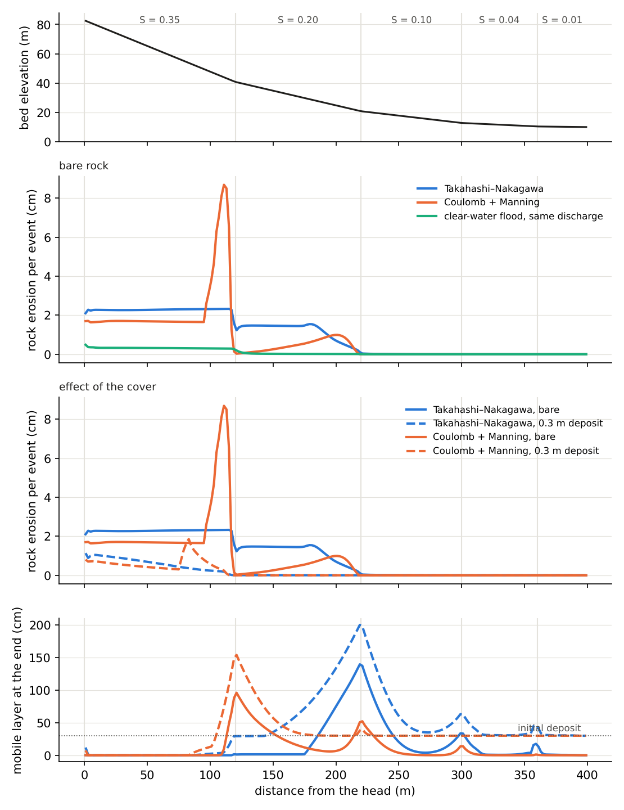
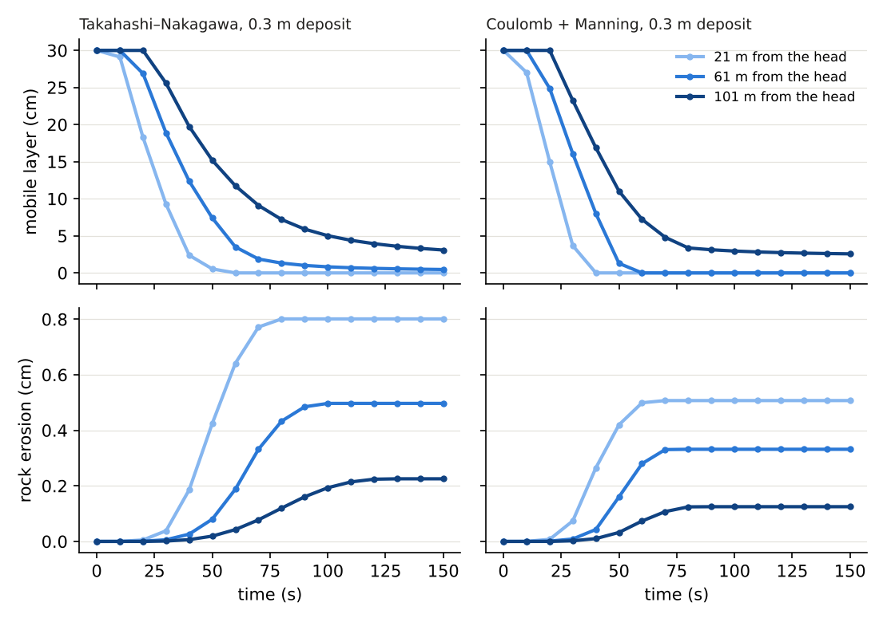
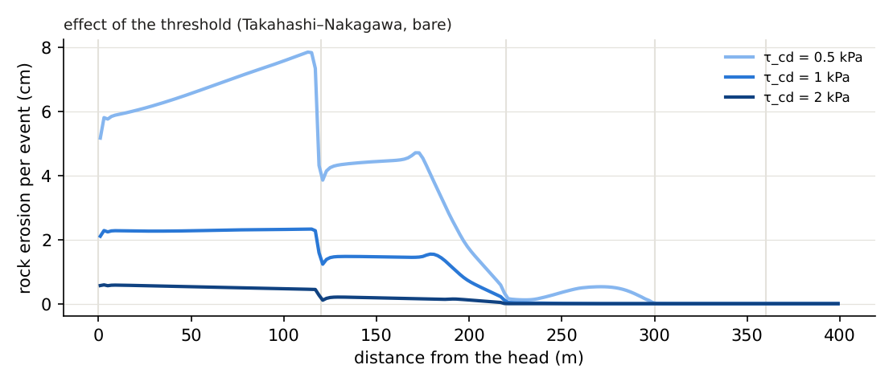
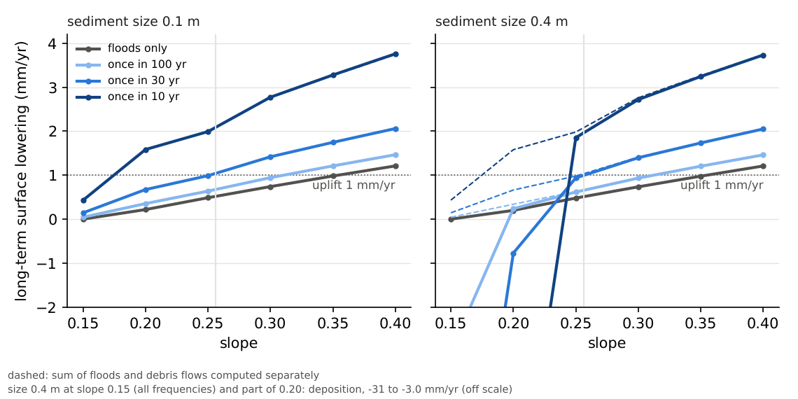
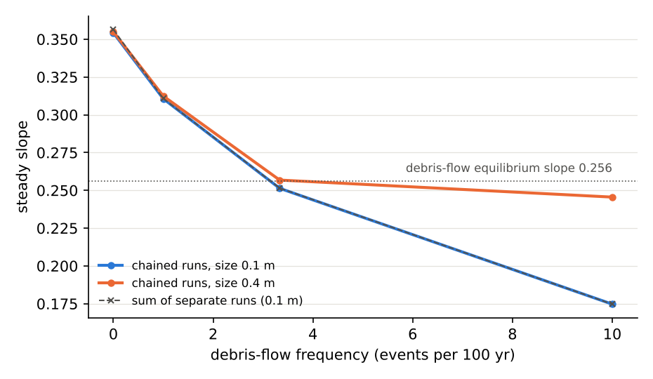
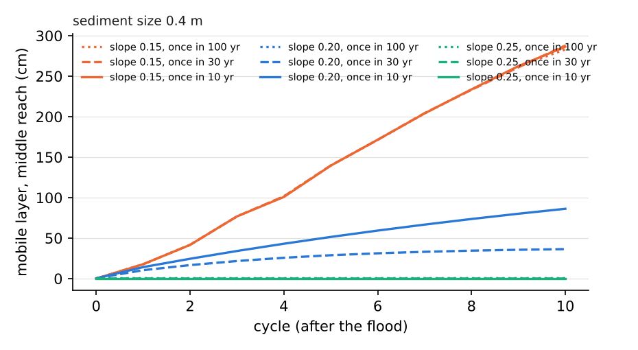
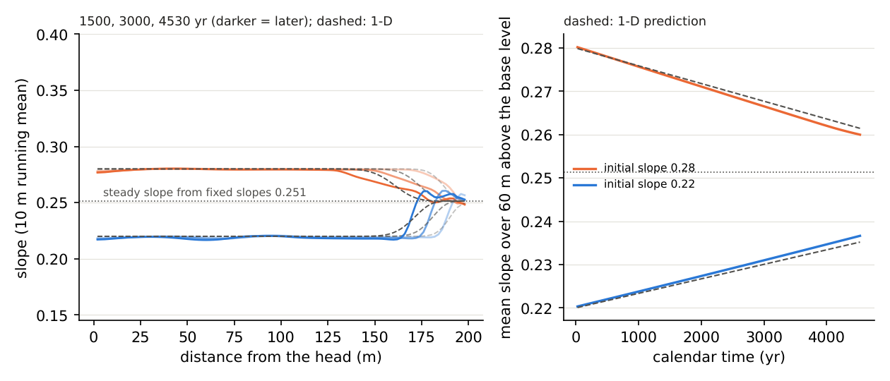

# examples/debris_bedrock — Rock erosion by debris flows: erosion by one debris flow, and the steady slope of a stream by frequency

> English mirror of examples/debris_bedrock/README.md. The Japanese file is the master copy.

[日本語](../README.md)

A debris flow is released once from the head of a stream whose slope eases in steps, and we
look at where and how much the flowing mixture erodes the rock. The comparison covers two
resistance laws with their erosion-deposition equations, a bed of bare rock or of a deposit, the
erosion threshold, and a clear-water flood with the same discharge. The features used are debris
flows `f_debris` and the debris-flow term `rock_kdb` of bedrock incision `f_rockinc`
([chapter on landform change in the users guide](../../../docs/en/users_guide/geomorph.md#rock-erosion-by-debris-flows-rock_kdb),
equations and sources in the
[supplement](../../../docs/en/users_guide/sediment.md#bedrock-incision-by-flowing-water-f_rockinc)).
The example recomputes the single-event comparison of docs/mountain_stream_plan.md §12 (§12.4,
in Japanese) with the implemented law. The checks are in [test/dbrock](../../../test/dbrock/).
The values are illustrative and are not calibrated for any particular stream.

The second half ("Long term: steady slope of a stream with debris flows" below) inserts debris flows at
a fixed interval into long-term flood runs and finds how the steady slope of a uniformly uplifting
stream changes with the debris-flow frequency and the sediment size (docs/mountain_stream_plan.md §13,
in Japanese).

## Settings

| Item | Value |
|---|---|
| Stream | 10 m wide (5 cells, Δx = 2 m, walls on both banks), 400 m long. The slope from the head is 0.35 (0–120 m) → 0.20 (to 220 m) → 0.10 (to 300 m) → 0.04 (to 360 m) → 0.01 (to 400 m). Free outflow at the south end, n = 0.05 |
| Debris flow | A triangular hydrograph of the mixture from the 5 cells at the head (peak 40 m³/s at 10 s, ending at 70 s). Concentration C = 0.35 (26 m³/s of water and 14 m³/s of solids; 490 m³ of solids in total) |
| Resistance and erosion-deposition | Takahashi–Nakagawa (`f_dbres = 3`, `f_dbed = 3`; d_L = 0.1 m, δe = 1e-4, δd = 0.5) and Coulomb + Manning (`f_dbres = 1`, `f_dbed = 1`; δe = 7e-4, δd = 0.05). Common: φ = 35°, λ = 0.4, low-velocity settling `f_dbstop = 1` (`db_vstop` = `db_wstop` = 0.05 m/s), slope correction `f_gravity_correction = 1` |
| Bed | Bare rock (sd = 0) and a deposit 0.3 m thick |
| Rock erosion | k_d = 1.8e-4 m/s, τ_cd = 1 kPa, m_d = 1, H* = 0.05 m. k_d was chosen in §12.4 so that the mean over the stream (0–360 m) for Takahashi–Nakagawa on bare rock is 1 cm per event |
| Time | 300 s with dt = 0.02 s. The landform is updated every step (`dt_geomorph = 0`, `morfac = 1`). Output every 10 s |

| Configuration | Contents |
|---|---|
| `param_T_b.txt` | Takahashi–Nakagawa, bare rock |
| `param_T_c.txt` | Takahashi–Nakagawa, 0.3 m deposit |
| `param_C_b.txt` | Coulomb + Manning, bare rock |
| `param_C_c.txt` | Coulomb + Manning, 0.3 m deposit |
| `param_T_b05.txt`, `param_T_b20.txt` | T_b with the threshold τ_cd at 0.5 kPa and 2 kPa |
| `param_W.txt` | A clear-water flood with the same discharge (bare rock; the 40 m³/s of the mixture as clear water). Bed load `f_fluvial` and fluvial plucking (`rock_kp`) with the same coefficient, threshold and exponent |

| File | Contents |
|---|---|
| `make_init.py` | Writes the terrain, soil depth and `param_*.txt` (constants kept in pairs with `plot_results.py`) |
| `plot_results.py` | Figures `figs/*.png` (`en/figs/` with `en`) and tables (standard output: erosion per reach, ledgers, share of rock-derived sediment, mobile layer at the end) |

## Running

```bash
make                                   # links to the executables in ../../bin/
python3 make_init.py                   # writes the inputs and param_*.txt (same as the bundled ones)
for c in T_b T_c C_b C_c T_b05 T_b20 W; do
  ./encflow param_$c.txt > Screen_$c.log   # about 30 s each
done
python3 plot_results.py | tee analysis.txt    # figures and tables (python3 plot_results.py en for the English figures)
```

## Results

### Rock erosion by one debris flow



Rock erosion per event in each reach (cm; mean of the cells of the reach) and the bulk volume of
eroded rock (the end-of-run line "rock erosion by debris flows: eroded"; for W, "rock incision:
plucked").

| Configuration | Slope 0.35 | 0.20 | 0.10 | 0.04 | 0.01 | Ledger (m³) |
|---|---|---|---|---|---|---|
| T_b Takahashi–Nakagawa, bare rock | 1.94 | 0.90 | 0.015 | 0 | 0 | 32.4 |
| C_b Coulomb + Manning, bare rock | 1.08 | 0.38 | 0 | 0 | 0 | 16.8 |
| T_c Takahashi–Nakagawa, deposit | 0.51 | 0.003 | 0 | 0 | 0 | 6.1 |
| C_c Coulomb + Manning, deposit | 0.33 | 0.001 | 0 | 0 | 0 | 3.9 |
| T_b05 threshold 0.5 kPa | 5.79 | 2.91 | 0.28 | 0.002 | 0 | 100.7 |
| T_b20 threshold 2 kPa | 0.39 | 0.067 | 0 | 0 | 0 | 5.4 |
| W clear water, same discharge (fluvial plucking) | 0.56 | 0.10 | 0 | 0 | 0 | 7.7 |

- **The erosion is concentrated in the steep reaches.** The driving stress
  τ_d = ρ(1 + sC) g_e h_t tanθ exceeds the threshold of 1 kPa only in the thick flow of the
  reaches with slopes of 0.2 or more. At slopes of 0.10 or less even bare rock hardly erodes.
- **Difference between the resistance laws**: in the reach with slope 0.35, Coulomb + Manning
  erodes 0.56 times as much as Takahashi–Nakagawa. Its flow is thinner and faster in the steep
  reach (largest flow depth 0.87 m against 1.26 m in the comparison of §12.4), so τ_d, which is
  proportional to the depth, is smaller.
- **Peak upstream of a slope break**: the deposit in the reach with slope 0.10 backs the flow up,
  and the mixture becomes thick and slow at the end of the reach with slope 0.20. In the cell of
  C_b 205 m from the head, h_t ≈ 1.3 m and |V| ≈ 0.5 m/s from 70 to 120 s, which gave the
  largest erosion of that reach (1.55 cm). Split with output every 1 s, 55 % of the erosion of C_b
  in the reach with slope 0.20 (12 % of the whole of C_b) came from flow with |V| < 1 m/s (1 % in
  the same reach for Takahashi–Nakagawa). The quasi-static driving stress does not depend on the
  velocity, so as long as the flow moves above the gate (|V| ≥ `db_vstop` = 0.05 m/s), a slow and
  thick flow erodes until the cover becomes thick. This is a property of the adopted law (§12.5),
  not a behaviour confirmed by observations.
- **Mobile layer at the end**: the steep reach is almost swept clean (0 for T_b), and the
  sediment deposits at the slope breaks (1.4 m for T_b and 1.1 m for C_b at 220 m from the head).
  The eroded rock enters the mobile layer 1:1, and the erosion-deposition equation decides whether
  the flow takes it up or leaves it as cover.
- **Rock-derived sediment**: the solids of the eroded rock are 19.4 m³ for T_b (4.0 % of the
  490 m³ of solids that entered), 2.1 % for C_b, 0.7 % for T_c and 0.5 % for C_c. Almost all of
  the sediment of one debris flow comes from the head.

### Comparison with a clear-water flood

The clear-water flood with the same discharge (W) eroded 0.56 cm in the reach with slope 0.35 and
0.10 cm in the reach with slope 0.20 (29 % and 12 % of T_b; 24 % in the ledgers). The stress of W,
however, is that of the fluvial plucking law, the Manning closure of the cell velocity
τ_b = ρ g n² V²/h^{1/3}. This closure comes out larger than the balance in steep uniform flow
(developer.md §88.4, item 1; in steady uniform flow with the same width, grid and discharge as the
reach with slope 0.35 of this stream, τ_b / ρ g h tanθ = 1.41 in the central column). Evaluated
with the same quasi-static stress as the debris-flow term, the same flow erodes 0.20 cm and
0.01 cm (7 % of T_b as the mean over the stream; post-processing of §12.4). The definition of the
stress changes the result threefold, but in both cases the debris flow erodes more (4.2 times in
the ledgers, and 14 times as the mean over the stream between quasi-static stresses).

### Effect of the cover



- With a deposit 0.3 m thick, the erosion in the reach with slope 0.35 drops to 26 %
  (Takahashi–Nakagawa) and 30 % (Coulomb + Manning) of that on bare rock, and is almost 0 at
  slopes of 0.20 or less.
- The rock starts to erode only after the flow has stripped the deposit down to a few cm (a few
  times H*). At 21 m from the head with Takahashi–Nakagawa, the deposit is stripped completely from
  40 to 60 s, and 0.80 cm of rock is eroded (1.96 cm on bare rock). At 101 m the deposit only
  thins to 3 cm, and the erosion is 0.23 cm. In the reach with slope 0.20 the deposit is not
  stripped; it remains or thickens.
- The H* = 0.05 m of the exposure exp(−sd/H*) follows the observation that a deposit about 5 cm
  thick protects the bed from impacts (McCoy et al. 2013; references in sediment.md).

### Effect of the threshold



- Halving the threshold (0.5 kPa) makes the erosion in the reach with slope 0.35 3.0 times larger
  (5.79 cm), and the erosion extends into the reach with slope 0.10. Doubling it (2 kPa) gives
  0.20 times (0.39 cm). The threshold sets both the magnitude of the erosion and the range of
  slopes that it reaches.
- With a low threshold, the long tail of the falling limb also erodes. Downstream, where the
  recession is slower, the rock erodes for longer, so with 0.5 kPa the erosion grows downstream
  even within the steep reach (from 5.2 cm at 5 m from the head to 6.6 cm at the end of the reach,
  115 m).

## Long term: steady slope of a stream with debris flows (second half)

One event erodes a few mm to a few cm, so changing the shape of a valley takes many debris flows and
the floods between them. The second half inserts debris flows at a fixed interval into long-term
flood runs of a uniformly uplifting stream and finds the steady slope for each debris-flow frequency
(docs/mountain_stream_plan.md §13 and developer.md §88.22, in Japanese). Debris-flow event runs and
flood runs (`morfac > 1` and the conversion by an intermittency factor;
[examples/mountain_valley](../../mountain_valley/en/README.md)) are chained alternately with
`f_state_restore = 2` (a new time axis; dt can change). With `f_rockinc = 1` in both, the cumulative
incision `Ri` continues (procedure in the
[users guide](../../../docs/en/users_guide/geomorph.md#rock-erosion-by-debris-flows-rock_kdb)). The
computational core is unchanged; `Run_chain.sh` repeats the flood and debris-flow runs. The interval
between debris flows (once in how many years) is chosen by the user.

### Settings of the second half

| Item | Value |
|---|---|
| Channel | 200 m long, uniform slope, 10 m wide as one cell across (Δx = 10 m, Δy = 2 m). Slopes S = 0.15, 0.20, 0.25, 0.30, 0.35 and 0.40. A 20 m outfall with slope 0.6 is added below (reasons under "Why one cell across and an outfall" below). n = 0.05 |
| Floods | Clear water at a constant formative discharge of 5 m³/s, taken to flow F = 300 s per year (intermittency factor i_f = 9.5e-6). morfac 10, dt = 0.1 s. Plucking by flowing water k_p = 4.6e-6 m/s, τ_c = 300 Pa, m = 1, H* = 0.05 m (no abrasion; k_p chosen so that the steady slope with floods only is about 0.355). No sediment supply at the head |
| Sediment size | d50 of the bedload (debris-flow deposits and plucked rock) 0.1 m and 0.4 m (boulders) |
| Debris flows | As T_b of the first half (hydrograph of the mixture at the head, Takahashi–Nakagawa, k_d = 1.8e-4 m/s, τ_cd = 1 kPa, m_d = 1). Each run lasts 200 s (dt = 0.02 s) and starts from the end state of the flood (water still flowing in the channel). Once in T_r = 100, 30 or 10 years, plus floods only |
| Calendar | One flood run = T_r years (flow time T_r × F / morfac). The time of a debris flow is not counted. Uplift is not used in the events |
| Method (main) | Erosion rate at a fixed slope: without uplift, run 10 cycles of "floods for T_r years → one debris flow" (floods only: 5 runs of 100 years) and take the surface lowering rate E of the middle reach (40–160 m from the head) from cycle 3 on. The steady slope S* interpolates E(S*) = U (uplift 1 mm/yr) |
| Method (check) | With sediment size 0.1 m and once in 30 years, run the chain with uplift for 150 cycles (4530 years) from uniform slopes 0.28 and 0.22 (S* ± 0.03); the last row of the channel and the outfall form the base level (no erosion, no uplift). Compare with the 1-D prediction z_t = U − E(S) solved with the piecewise-linear E(S) |

| File | Content |
|---|---|
| `make_long.py` | Writes the 50 configurations (`long/<configuration>/`) and their inputs. `track` writes the ledger lines and the per-cell z, Ri and sd of the save as one line |
| `Run_chain.sh configuration cycles` | The chain of one configuration (first flood → debris flow → flood → …). Appends one line to `long/<configuration>/track.csv` after each stage |
| `Run_long.sh [processes]` | Runs all configurations in parallel |
| `plot_long.py` | Figures `figs/long_*.png` (`en` for `en/figs/`) and tables (lowering rates, sums, steady slopes, ledger, check with uplift) |

```bash
make                                          # links to the executables in ../../bin/
python3 make_long.py                          # configurations under long/<configuration>/ (50)
./Run_long.sh 4                               # about 8 minutes with 4 processes
python3 plot_long.py | tee analysis_long.txt  # figures and tables (python3 plot_long.py en for English figures)
```

### Long-term lowering and the sum of separate runs



- **Sediment size 0.1 m**: at every slope and frequency the lowering rate is the same in every cycle
  (the difference between the smallest and largest of cycles 3–10 is at most 0.003 mm/yr). It agrees
  within 1.2 % with the sum of floods and debris flows computed separately (dashed; from the first
  flood and the erosion of the first debris flow). The next flood carries the debris-flow deposits away.
- At slope 0.25 the debris flows make up 24 % of the lowering rate at once in 100 years, 52 % at once in
  30 years and 78 % at once in 10 years.
- **Sediment size 0.4 m (boulders)**: from slope 0.30 up the rates are nearly those of 0.1 m. At slope
  0.25 and below they fall short of the sum (0.94 times at slope 0.25, once in 10 years). At slope 0.20
  once in 30 or 10 years, and at slope 0.15, deposits remain and the surface rises ("Boulder deposits"
  below).
- In each stage the increment of cumulative incision ΣΔRi·A agrees with the end-of-run lines (plucking
  and debris-flow erosion) within a relative 2.6e-8.

### Steady slope and debris-flow frequency



| Steady slope (uplift 1 mm/yr) | Floods only | Once in 100 yr | Once in 30 yr | Once in 10 yr |
|---|---|---|---|---|
| Chained runs, size 0.1 m | 0.354 | 0.311 | 0.251 | 0.175 |
| Sum of separate runs, size 0.1 m | 0.356 | 0.311 | 0.252 | 0.175 |
| Chained runs, size 0.4 m | 0.355 | 0.312 | 0.257 | 0.246 |

- The more frequent the debris flows, the gentler the slope that balances the uplift. With size 0.1 m the
  steady slopes of the chained runs and of the sum differ by at most 0.002.
- 0.175 at once in 10 years is gentler than the debris-flow equilibrium slope 0.256 (the slope where the
  Takahashi–Nakagawa equilibrium concentration equals the inflow concentration 0.35). The debris flows
  deposit on every passage, but the floods carry deposits of 0.1 m away, so the rock keeps eroding.
- **With size 0.4 m the steady slope stays near the debris-flow equilibrium slope (0.246 at once in 10
  years).** On gentler slopes the floods cannot move the boulders left by the debris flows, the rock is
  covered and stops eroding. More frequent debris flows do not lower the slope further.

### Boulder deposits (size 0.4 m)



- At slope 0.15 the debris-flow deposits keep growing by about 29 cm per cycle whatever the frequency
  (the floods cannot move the boulders).
- At slope 0.20, once in 30 years, the growth slows and reaches 36 cm after 10 cycles (approaching the
  thickness where what the floods carry balances what the debris flows leave). Once in 10 years the
  deposit grows to 86 cm and is still growing. Once in 100 years the floods carry it away (0.5 cm).
- From slope 0.25 up no deposit remains (0.1 cm).

### Check with uplift



- The steep channel (0.28) becomes gentler and the gentle one (0.22) steeper; both head for the steady
  slope 0.251 found at fixed slopes. The adjustment travels upstream from the base level.
- The runs (solid) agree well with the 1-D prediction (dashed). After 4530 years the mean slope over the
  60 m above the base level is 0.260 (predicted 0.261) and 0.237 (predicted 0.235). The rms difference
  of the slope profile from the prediction, 30–170 m from the head, is 0.006 and 0.004.
- The adjustment is slow: in 4530 years it reaches only about 40 m above the base level (front speed
  dE/dS ≈ 9 mm/yr).
- Where the adjustment has not arrived, the middle reach moves at U − E(S0): +0.20 mm/yr for 0.22
  (predicted +0.20) and −0.28 mm/yr for 0.28 (predicted −0.25, because E(S) is interpolated linearly
  between slopes 0.25 and 0.30; the debris-flow equilibrium slope 0.256 lies in between and E(S) bends
  there).
- In the grey zones (30 m from the head and 30 m above the base level), steps with a period of two cells
  (the slope alternates between neighbouring intervals) grow over thousands of years. They are steps at
  the grid scale with two causes (developer.md §88.23).
  - The flow-direction bed slope used for erosion by debris flows is a central difference
    (z_{j−1} − z_{j+1}) / 2Δy, which cannot see a two-cell undulation. The debris flow is shallower over
    the bumps, so the bumps erode less and a two-cell undulation grows by about 3 % per debris flow.
  - The seeds are at the boundaries. The edge depth at the inflow face of a segment inflow has a floor at
    the critical depth (to avoid blow-up when flowing onto a dry bed); in supercritical flow the velocity
    of the inflow cell is 21 % lower and floods do not pluck it, so the inflow cell remains as a step.
    Near the base level, the junction with the non-eroding row and the adjustment front act as seeds.

  With a scratch executable that removes both (the code in the repository is unchanged), no steps appeared in 4530 years and
  the slope of the whole channel matched the 1-D prediction. Plucking under supercritical flow is itself
  unstable to short undulations in the equations (the flow is deeper and slower over bumps), but in the
  chained runs of this example it grows slowly and is not the cause of the steps.

### Why one cell across and an outfall

- **One cell across**: running the same chain in the 5-cell channel of the first half, the columns along
  the walls were plucked 35 % less even in the first flood. Once the middle was lower, the flow gathered
  there and the floods nearly stopped eroding the wall columns. At slope 0.20, once in 100 years, the
  lowering rate of the middle three columns rose 1.45 times over 10 cycles, and in 150 cycles with uplift
  the centre column became a slot 7–10 m deep. Rock erosion in ENCflow is vertical only, with no lateral
  erosion, so nothing stops the positive feedback of gathering flow and the channel narrows to the grid
  width (as in developer.md §88.4, item 3). For a question about the long profile we use a one-cell
  channel whose cross-section cannot change. Floods in one cell have a depth close to the uniform-flow
  value and pluck less than the middle column of 5 cells (shallow and fast because of the bias of §88.4,
  item 1), so k_p was re-tuned to give a steady slope of about 0.355 with floods only.
- **Outfall**: the cell at a free-outflow boundary has slightly deeper and slower flow (5 % at slope 0.30)
  and is plucked 17 % less, so the last cell of the channel became a sill that trapped the sediment
  carried by the floods, and the deposit grew upstream (with size 0.4 m even at slope 0.40). With an
  outfall of slope 0.6 below the channel the sediment leaves without stopping. The outfall erodes in the
  fixed-slope configurations; with uplift, the last row of the channel and the outfall are the base
  level.

## Notes (scope of this example)

- A single-layer mixture does not resolve the front where boulders gather. Observations show most
  of the erosion during the passage of the coarse front (Illgraben; §12.4, item 6), whereas in the
  comparison of §12.4 the first 5 s of the front contributed 12 %. The effect of the front is
  calibrated into the coefficient k_d of the whole event.
- k_d and τ_cd are calibration values with no standard values in the literature (lowering of mm to
  cm per event has been reported; references in sediment.md).
- The quasi-static driving stress does not depend on the velocity, so slow and thick flows also
  erode ("peak upstream of a slope break" above). The velocity gate is shared with `db_vstop` of
  the low-velocity settling.
- The first half covers one event only. The second half adds uplift and repeated debris flows, but not
  weathering, supply from hillslopes or sediment supply at the head. The debris flows have a fixed size
  and the floods a constant discharge; the frequency distribution of magnitudes is not represented.
- The channel of the second half is one cell across, so changes of channel width and cross-section are
  not represented (with 5 cells the flow gathers to the grid width; "Why one cell across and an
  outfall"). Near the head and the base level, steps with a period of two cells grow over thousands of
  years of chained runs ("Check with uplift" above; causes in developer.md §88.23).

## Related documents

- [Users guide: landform change](../../../docs/en/users_guide/geomorph.md#rock-erosion-by-debris-flows-rock_kdb),
  [supplement](../../../docs/en/users_guide/sediment.md#bedrock-incision-by-flowing-water-f_rockinc)
  (equations and sources),
  [debris flows and slope failure](../../../docs/en/users_guide/massflow.md) (resistance laws and
  erosion-deposition equations of the mixture)
- Checks: [test/dbrock](../../../test/dbrock/en/README.md) (analytical solution of self-cover,
  invariance to the update interval, concentration and velocity gates, conservation in a closed
  box, input errors)
- Examples of bedrock incision by flowing water: [examples/bedrock_cover](../../bedrock_cover/en/README.md),
  [examples/mountain_valley](../../mountain_valley/en/README.md)
- Design: docs/mountain_stream_plan.md §12 and §13, docs/developer.md §88.18–§88.22 (in Japanese)
