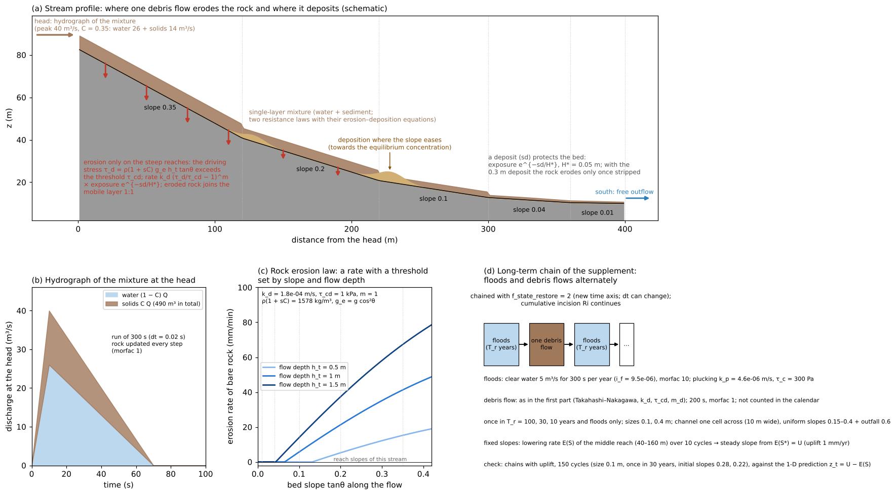
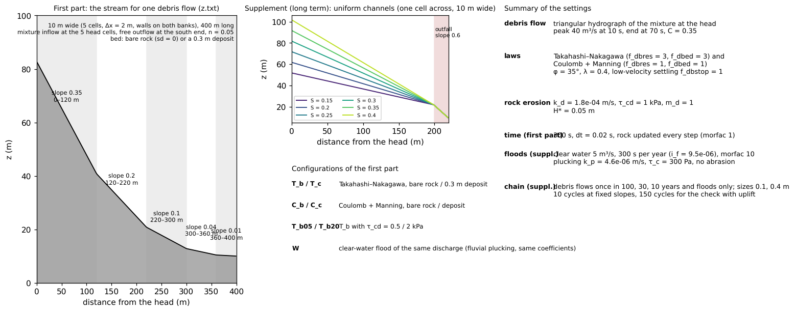
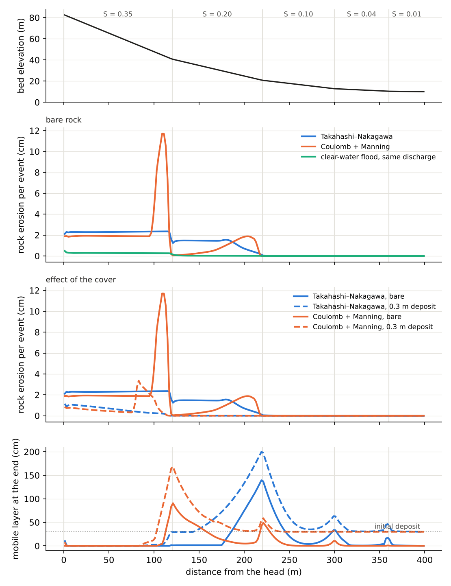
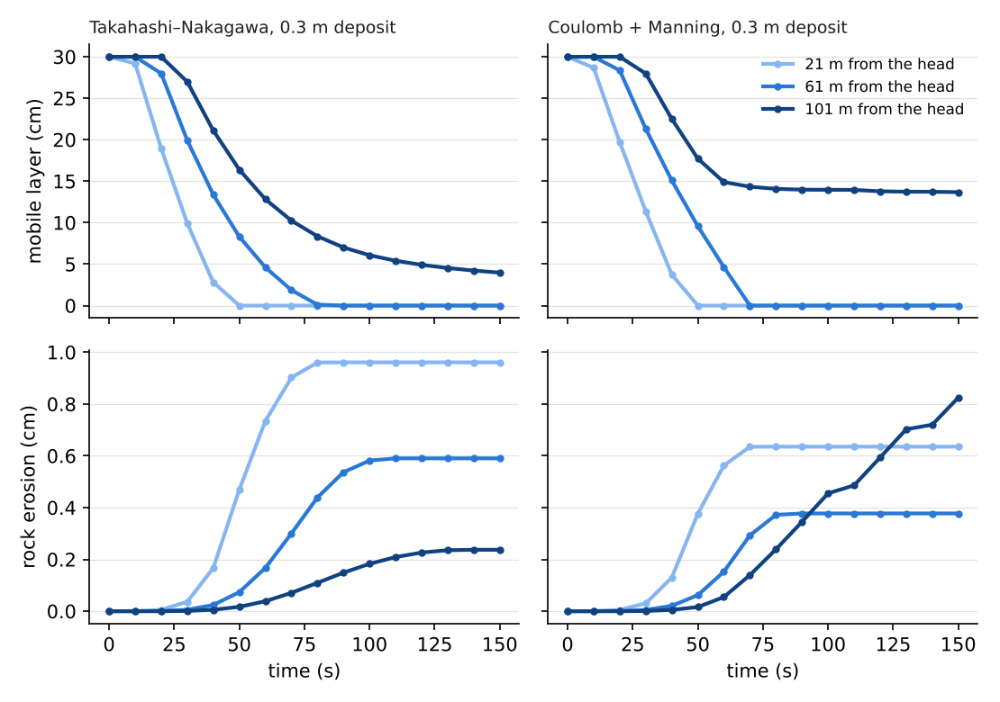
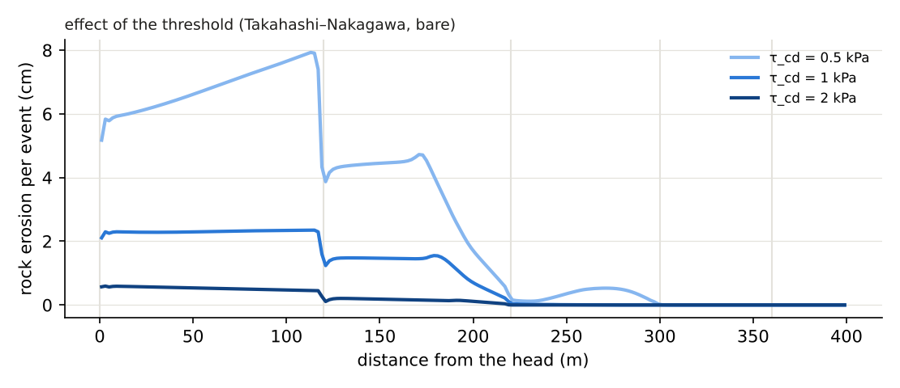
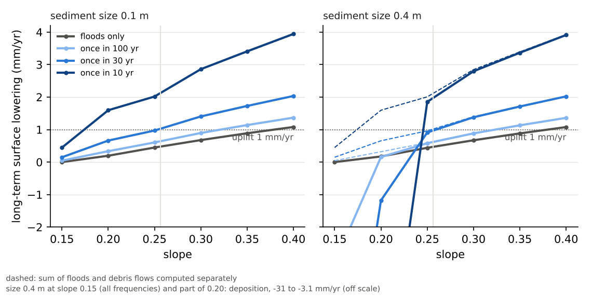
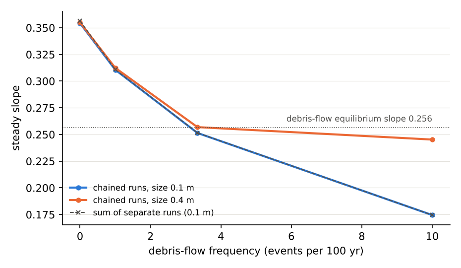
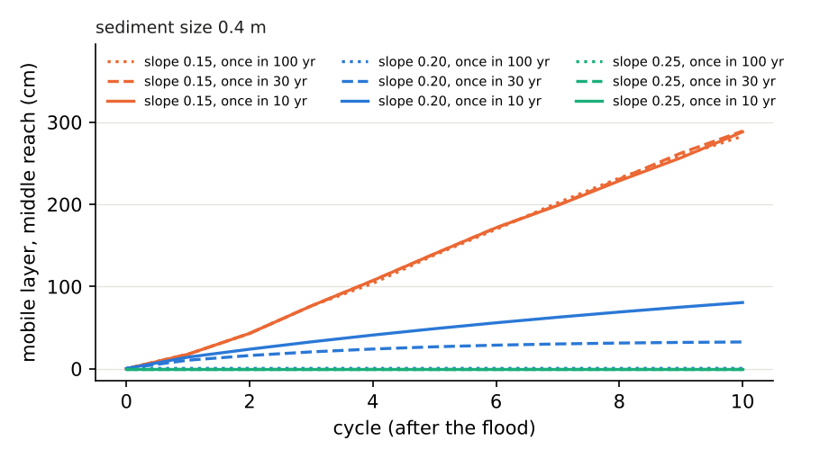
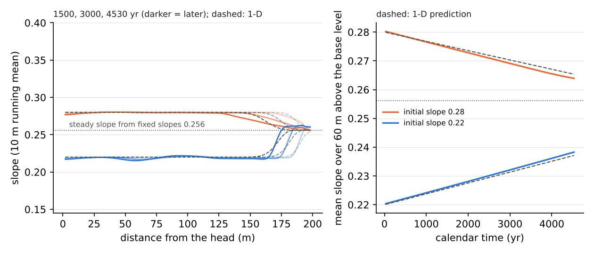

# debris_bedrock — Rock erosion by debris flows: erosion by one debris flow, and the steady slope of a stream by frequency

> English mirror of examples/debris_bedrock/README.md. The Japanese file is the master copy.

[日本語](../README.md)

A debris flow is released once from the head of a stream whose slope eases in steps, and we look
at where and how much the flowing mixture erodes the rock. The comparison covers two resistance
laws with their erosion–deposition equations, a bed of bare rock or of a deposit, the erosion
threshold, and a clear-water flood with the same discharge. The features used are debris flows
`f_debris` and the debris-flow term `rock_kdb` of bedrock incision `f_rockinc`
([chapter on landform change in the users guide](../../../docs/en/users_guide/geomorph.md#rock-erosion-by-debris-flows-rock_kdb),
equations and sources in the
[supplement](../../../docs/en/users_guide/sediment.md#bedrock-incision-by-flowing-water-f_rockinc)).
A supplement inserts debris flows at a fixed interval into long-term flood runs and finds how the
steady slope of a uniformly uplifting stream changes with the debris-flow frequency and the
sediment size. The values are illustrative, chosen to make the phenomena easy to see, not a
reproduction of any particular stream.

## What happens in a real steep valley

- **Steep valleys are eroded by debris flows**: in valleys steeper than about 0.03–0.1, the
  relation between slope and drainage area given by fluvial incision laws does not hold, and
  debris flows are thought to be the main agent eroding the bedrock (Stock & Dietrich 2003).
  Erosion-pin measurements also show no lowering by floods in steep valleys run by debris flows;
  the intermittent debris flows do the work (Stock et al. 2005).
- **Erosion is by particle impacts**: the lowering of the bedrock is thought to be mainly the
  removal of blocks along fractures by boulder impacts during the passage of the coarse front of a
  debris flow (Stock & Dietrich 2006). Rotating-drum experiments also support the dependence on
  inertial stresses and on impacts at the front (Hsu et al. 2008).
- **One event lowers the bed by mm to cm**: erosion pins in valleys of weak rock show at most
  cm/yr (Stock et al. 2005), and sensors on a bedrock bed recorded 36–64 mm of lowering during
  the observation period (McCoy et al. 2013).
- **A deposit protects the bed**: a deposit about 5 cm thick protects the bed from impacts
  (McCoy et al. 2013).
- **Erosion happens at the front**: erosion sensors buried in a fan channel of the Illgraben
  (Switzerland) showed that the erosion of the sediment bed occurred in steps within 20 s of the
  arrival of the front and started before the flow depth and the stresses reached their maxima
  (Berger et al. 2011).
- **Debris flows stop and deposit where the slope eases**: the sediment concentration a debris
  flow can carry (the equilibrium concentration) is set by the slope, so it deposits where the
  slope eases (Takahashi & Nakagawa 1991). With the inflow concentration 0.35 and the internal
  friction angle 35° of this example, the equilibrium slope is 0.256.
- **Long profiles over the long term**: the long profile of a stream shaped by both floods and
  debris flows is treated in a framework that adds a debris-flow erosion law, a function of flow
  depth and slope, to fluvial incision (McGuire et al. 2023).

## Mechanisms needed for the reproduction



Schematic. (a) Stream profile: the mixture released from the head erodes the rock only on the
steep reaches where the driving stress exceeds the threshold, deposits where the slope eases, and
the deposit (mobile layer) protects the bed through the exposure. (b) Hydrograph of the mixture
at the head. (c) Rock erosion law: a rate with a threshold set by the slope and the flow depth.
(d) Long-term chain of the supplement: floods and debris flows chained alternately.

| Real phenomenon | Representation in ENCflow | Settings |
|---|---|---|
| A debris flow runs down the valley | Shallow-water flow of a single-layer mixture (water + sediment). Two resistance laws with their erosion–deposition equations: Takahashi–Nakagawa and Coulomb + Manning. A hydrograph of the mixture at the 5 head cells | `f_debris = 1`, `f_dbres`, `f_dbed`, `inflow_val`, `inflow_cs` |
| The flowing mixture erodes the rock | Excess form of the quasi-static driving stress τ_d = ρ(1 + sC) g_e h_t tanθ: E = k_d (τ_d/τ_cd − 1)^m_d. Acts only in cells where a dense mixture is moving; eroded rock enters the mobile layer 1:1 | `rock_kdb`, `rock_taucdb`, `rock_mdb` (`f_rockinc = 1`) |
| A deposit protects the bed | Exposure e^{−sd/H*} from the thickness sd of the mobile layer. The erosion–deposition equation decides whether the flow takes it up or leaves it as cover | `rock_hstar`, `fn_sd` (0.3 m deposit) |
| The flow stops and deposits where the slope eases | Erosion–deposition equation (towards the equilibrium concentration) and low-velocity settling. Correction of the effective gravity on steep slopes | `f_dbstop = 1`, `db_vstop`, `db_wstop`, `f_gravity_correction = 2` |
| A clear-water flood (comparison) | The same discharge as clear water, with the same coefficient, threshold and exponent in the fluvial plucking law | `f_fluvial = 1`, `rock_kp`, `rock_tauc`, `rock_m` |
| (Supplement) floods between debris flows, and uplift | Long-term flood runs (a representative flood accelerated by morfac and converted to calendar time by an intermittency factor) and debris-flow event runs chained by restarts. Uniform uplift; the outlet is a base level | `f_state_restore = 2`, `morfac`, `f_uplift`, `fn_uplift`, `fn_rock` |

The rock erosion law uses the excess form of the quasi-static driving stress rather than the
inertial stress of particle impacts because a single-layer mixture does not resolve the coarse
front where the impacts concentrate. A law proportional to the inertial stress is sensitive to
numerically thin layers, and changing the resistance law changes its result by an order of
magnitude. The quasi-static stress equals the bed shear stress of the resistance law in steady
uniform flow and does not depend on the choice of law
([supplement](../../../docs/en/users_guide/sediment.md#bedrock-incision-by-flowing-water-f_rockinc)).

## Geometry and settings



Left: profile of the stream of the first part (five reach slopes). Upper middle: uniform channels
with the outfall of the supplement (long term). Lower middle: configurations of the first part.
Right: summary of the settings.

A stream 10 m wide (5 cells, Δx = 2 m, walls on both banks) and 400 m long. The slope from the
head is 0.35 (0–120 m) → 0.20 (to 220 m) → 0.10 (to 300 m) → 0.04 (to 360 m) → 0.01 (to 400 m),
with free outflow at the south end and roughness n = 0.05.

- **Debris flow**: a triangular hydrograph of the mixture from the 5 cells at the head (peak
  40 m³/s at 10 s, ending at 70 s). Concentration C = 0.35 (26 m³/s of water and 14 m³/s of
  solids; 490 m³ of solids in total).
- **Resistance and erosion–deposition**: Takahashi–Nakagawa (`f_dbres = 3`, `f_dbed = 3`;
  d_L = 0.1 m, δe = 10⁻⁴, δd = 0.5) and Coulomb + Manning (`f_dbres = 1`, `f_dbed = 1`;
  δe = 7×10⁻⁴, δd = 0.05). Common: φ = 35°, λ = 0.4, low-velocity settling `f_dbstop = 1`
  (`db_vstop` = `db_wstop` = 0.05 m/s), slope correction `f_gravity_correction = 2` (default).
- **Bed**: bare rock (sd = 0) and a deposit 0.3 m thick.
- **Rock erosion**: k_d = 1.8×10⁻⁴ m/s, τ_cd = 1 kPa, m_d = 1, H* = 0.05 m. k_d is chosen so
  that the mean over the stream (0–360 m) for Takahashi–Nakagawa on bare rock is about 1 cm per
  event (1.17 cm for T_b in the results).
- **Time**: 300 s with dt = 0.02 s. The landform is updated every step (`dt_geomorph = 0`,
  `morfac = 1`). Output every 10 s.

| Configuration | Parameter file | Contents |
|---|---|---|
| T_b | param_T_b.txt | Takahashi–Nakagawa, bare rock |
| T_c | param_T_c.txt | Takahashi–Nakagawa, 0.3 m deposit |
| C_b | param_C_b.txt | Coulomb + Manning, bare rock |
| C_c | param_C_c.txt | Coulomb + Manning, 0.3 m deposit |
| T_b05, T_b20 | param_T_b05.txt, param_T_b20.txt | T_b with the threshold τ_cd at 0.5 kPa and 2 kPa |
| W | param_W.txt | A clear-water flood with the same discharge (bare rock; the 40 m³/s of the mixture as clear water). Bedload `f_fluvial` and fluvial plucking (`rock_kp`) with the same coefficient, threshold and exponent |

## How to run

```
cd examples/debris_bedrock
make                     # links and inputs (make_init.py writes the terrain, soil depth and param_*.txt)
make run                 # the 7 configurations of the first part in turn (about 30 s each)
make long                # the long-term chain of the supplement (Run_long.sh runs the 50 configurations of make_long.py, 4 in parallel; about 8 minutes)
python3 plot_setup.py    # figs/mechanism.png and setup.png (no results needed)
python3 plot_results.py  # figs/*.png and the tables of the first part (argument en for the English figures in en/figs/)
python3 plot_long.py     # figs/long_*.png and the tables of the supplement (argument en for the English figures)
```

With the argument `en`, the figures are drawn with English labels into en/figs/. Plotting needs
Python 3, NumPy and matplotlib.

## Results

### Rock erosion by one debris flow



Rock erosion per event in each reach (cm; mean of the cells of the reach) and the bulk volume of
eroded rock (the end-of-run line "rock erosion by debris flows: eroded"; for W, "rock incision:
plucked").

| Configuration | Slope 0.35 | 0.20 | 0.10 | 0.04 | 0.01 | Ledger (m³) |
|---|---|---|---|---|---|---|
| T_b Takahashi–Nakagawa, bare rock | 2.48 | 1.22 | 0.008 | 0 | 0 | 42.1 |
| C_b Coulomb + Manning, bare rock | 2.91 | 0.75 | 0 | 0 | 0 | 42.4 |
| T_c Takahashi–Nakagawa, deposit | 0.65 | 0.005 | 0 | 0 | 0 | 7.8 |
| C_c Coulomb + Manning, deposit | 0.87 | 0.0005 | 0 | 0 | 0 | 10.4 |
| T_b05 threshold 0.5 kPa | 7.30 | 3.47 | 0.32 | 0 | 0 | 124.9 |
| T_b20 threshold 2 kPa | 0.59 | 0.15 | 0 | 0 | 0 | 8.6 |
| W clear water, same discharge (fluvial plucking) | 0.28 | 0.022 | 0 | 0 | 0 | 3.5 |

- **The erosion is concentrated in the steep reaches.** The driving stress
  τ_d = ρ(1 + sC) g_e h_t tanθ exceeds the threshold of 1 kPa only in the thick flow of the
  reaches with slopes of 0.2 or more. At slopes of 0.10 or less even bare rock hardly erodes.
- **Difference between the resistance laws**: from 0 to 100 m in the reach with slope 0.35,
  Coulomb + Manning erodes 0.78 times as much as Takahashi–Nakagawa (1.94 cm against 2.49 cm). Its
  flow is thinner and faster in the upper part of the steep reach (flow depth after the front has
  passed (30 s) 0.68, 0.71 and 0.74 m against 0.75, 0.76 and 0.78 m at 21, 41 and 61 m from the
  head), so τ_d, which is proportional to the depth, is smaller. It also recedes faster and erodes
  for a shorter time (the time integral of the flow depth at the same three points is a little over
  0.6 times). The means over the reach (2.91 cm and 2.48 cm) include the peak upstream of the slope break described next.
- **Peak upstream of a slope break**: with Coulomb + Manning, a deposit 0.9 m thick forms at the
  slope break 120 m from the head (0.35 → 0.20), and the mixture ponds upstream of it. In the cell
  111 m from the head, h_t becomes 1.4 to 1.8 m from 60 s on; after |V| has dropped from 1.5 m/s to
  0.1 m/s, a slow flow of 0.2 m/s or less keeps eroding the rock until about 250 s, reaching 11.7 cm
  (6.0 times the mean from 0 to 100 m). Split with output every 1 s, 45 % of the erosion of C_b
  (77 % from 100 to 120 m in the reach with slope 0.35 and 89 % in the reach with slope 0.20) came
  from flow with |V| < 1 m/s (5 % of the whole for Takahashi–Nakagawa; each interval assigned by the
  mean of the speeds at its two ends). The quasi-static driving stress does not depend on the velocity, so as long
  as the flow moves above the gate (|V| ≥ `db_vstop` = 0.05 m/s), a slow and thick flow erodes
  until the cover becomes thick. This is a property of the adopted law, not a behaviour confirmed
  by observations.
- **Mobile layer at the end**: the steep reach is almost swept clean (0 for T_b), and the sediment
  deposits at the slope breaks (1.4 m for T_b at the slope break at 220 m; 0.91 m for C_b at the
  slope break at 120 m and 0.49 m at 220 m). The eroded rock enters the mobile layer 1:1, and the
  erosion–deposition equation decides whether the flow takes it up or leaves it as cover.
- **Rock-derived sediment**: the solids of the eroded rock are 25.2 m³ for T_b (5.2 % of the
  490 m³ of solids that entered), 5.2 % for C_b, 1.0 % for T_c and 1.3 % for C_c. Almost all of the
  sediment of one debris flow comes from the head.

### Comparison with a clear-water flood

The clear-water flood with the same discharge (W) eroded 0.28 cm in the reach with slope 0.35 and
0.022 cm in the reach with slope 0.20 (11 % and 1.8 % of T_b; 8 % in the ledgers). The stress of W
is that of the fluvial plucking law, the Manning closure of the cell velocity evaluated with the
speed along the slope |V_s| and the depth normal to the ground h cosθ,
τ_b = ρ g n² |V_s|²/(h cosθ)^{1/3} (the default f_gravity_correction = 2; the same bed shear as the
friction of the momentum equation). In steep uniform flow this closure agrees with the quasi-static
stress of the debris-flow term, ρ g_e h tanθ (which includes the slope correction g_e = g cos²θ and
is 0.89 times ρ g h tanθ at slope 0.35): in steady uniform flow with the same width and grid as the
reach with slope 0.35 of this stream and a discharge of 40 m³/s (the peak of W), the ratio is 1.000
in the central column. Evaluated with the quasi-static stress, the same flow erodes 0.28 cm and
0.019 cm, nearly the same (post-processing of the output every 1 s). The debris flow erodes more
(12 times in the ledgers, and 12 times as the mean over the stream between quasi-static stresses).
With f_gravity_correction = 1 the Manning closure agrees with ρ g h tanθ (ratio 1.000 in the same
uniform flow), 1/cos²θ times the quasi-static stress, so W erodes 0.32 cm, 1.5 times the
evaluation with the quasi-static stress (0.22 cm).

### Effect of the cover



- With a deposit 0.3 m thick, the erosion in the reach with slope 0.35 drops to 26 %
  (Takahashi–Nakagawa) and 30 % (Coulomb + Manning) of that on bare rock, and is almost 0 at
  slopes of 0.20 or less.
- The rock starts to erode only after the flow has stripped the deposit down to a few cm (a few
  times H*). At 21 m from the head with Takahashi–Nakagawa, the deposit is stripped completely from
  40 to 50 s, and 1.04 cm of rock is eroded (2.46 cm on bare rock). At 101 m the deposit only
  thins to 2.5 cm, and the erosion is 0.27 cm. In the reach with slope 0.20 the deposit is not
  stripped; it remains or thickens.
- With Coulomb + Manning and the deposit (C_c), the slow and thick flow upstream of the slope break
  lasts long, so the rock keeps eroding without the mobile layer being stripped completely. At 101 m
  from the head, the mobile layer never becomes thinner than 13.6 cm (16.1 cm at the end; exposure
  exp(−sd/H*) 7 % or less) and 1.47 cm is eroded by 300 s. Upstream at 83 m the layer is stripped
  completely and 3.5 cm is eroded, the largest in the reach.
- The H* = 0.05 m of the exposure exp(−sd/H*) follows the observation that a deposit about 5 cm
  thick protects the bed from impacts (McCoy et al. 2013).

### Effect of the threshold



- Halving the threshold (0.5 kPa) makes the erosion in the reach with slope 0.35 2.9 times larger
  (7.30 cm), and the erosion extends into the reach with slope 0.10. Doubling it (2 kPa) gives
  0.24 times (0.59 cm). The threshold sets both the magnitude of the erosion and the range of
  slopes that it reaches.
- With a low threshold, the long tail of the falling limb also erodes. Downstream, where the
  recession is slower, the rock erodes for longer, so with 0.5 kPa the erosion grows downstream
  even within the steep reach (from 6.1 cm at 5 m from the head to 8.6 cm at the end of the reach,
  115 m).

## Supplement: steady slope of a stream with debris flows (long-term chain)

One event erodes a few mm to a few cm, so changing the shape of a valley takes many debris flows
and the floods between them. The supplement inserts debris flows at a fixed interval into
long-term flood runs of a uniformly uplifting stream and finds the steady slope for each
debris-flow frequency. Debris-flow event runs and flood runs (`morfac > 1` and the conversion by
an intermittency factor; [examples/mountain_valley](../../mountain_valley/en/README.md)) are
chained alternately with `f_state_restore = 2` (a new time axis; dt can change). With
`f_rockinc = 1` in both, the cumulative incision `Ri` continues (procedure in the
[users guide](../../../docs/en/users_guide/geomorph.md#rock-erosion-by-debris-flows-rock_kdb)). The
computational core is unchanged; `Run_chain.sh` repeats the flood and debris-flow runs. The
interval between debris flows (once in how many years) is chosen by the user.

| Item | Value |
|---|---|
| Channel | 200 m long, uniform slope, 10 m wide as one cell across (Δx = 10 m, Δy = 2 m). Slopes S = 0.15, 0.20, 0.25, 0.30, 0.35 and 0.40. A 20 m outfall with slope 0.6 is added below (reasons under "Choosing the settings"). n = 0.05 |
| Floods | Clear water at a constant formative discharge of 5 m³/s, taken to flow F = 300 s per year (intermittency factor i_f = 9.5×10⁻⁶). morfac 10, dt = 0.1 s. Plucking by flowing water k_p = 4.6×10⁻⁶ m/s, τ_c = 300 Pa, m = 1, H* = 0.05 m (no abrasion; k_p tuned with the gravity correction 1 so that the steady slope with floods only is about 0.355; 0.379 with the default 2). No sediment supply at the head |
| Sediment size | d50 of the bedload (debris-flow deposits and plucked rock) 0.1 m and 0.4 m (boulders) |
| Debris flows | As T_b of the first part (hydrograph of the mixture at the head, Takahashi–Nakagawa, k_d = 1.8×10⁻⁴ m/s, τ_cd = 1 kPa, m_d = 1). Each run lasts 200 s (dt = 0.02 s) and starts from the end state of the flood (water still flowing in the channel). Once in T_r = 100, 30 or 10 years, plus floods only |
| Calendar | One flood run = T_r years (flow time T_r × F / morfac). The time of a debris flow is not counted. Uplift is not used in the events |
| Method (main) | Erosion rate at a fixed slope: without uplift, run 10 cycles of "floods for T_r years → one debris flow" (floods only: 5 runs of 100 years) and take the surface lowering rate E of the middle reach (40–160 m from the head) from cycle 3 on. The steady slope S* interpolates E(S*) = U (uplift 1 mm/yr) |
| Method (check) | With sediment size 0.1 m and once in 30 years, run the chain with uplift for 150 cycles (4530 years) from uniform slopes 0.28 and 0.22 (above and below the steady slope S* = 0.253); the last row of the channel and the outfall form the base level (no erosion, no uplift). Compare with the 1-D prediction z_t = U − E(S) solved with the piecewise-linear E(S) |

| File | Content |
|---|---|
| `make_long.py` | Writes the 50 configurations (`long/<configuration>/`) and their inputs. `track` writes the ledger lines and the per-cell z, Ri and sd of the save as one line |
| `Run_chain.sh configuration cycles` | The chain of one configuration (first flood → debris flow → flood → …). Appends one line to `long/<configuration>/track.csv` after each stage |
| `Run_long.sh [processes]` | Runs all configurations in parallel (called by `make long`) |
| `plot_long.py` | Figures `figs/long_*.png` (`en` for `en/figs/`) and tables (lowering rates, sums, steady slopes, ledger, check with uplift) |

### Long-term lowering and the sum of separate runs



- **Sediment size 0.1 m**: at every slope and frequency the lowering rate is the same in every
  cycle (the difference between the smallest and largest of cycles 3–10 is at most 0.004 mm/yr).
  It agrees within 1.2 % with the sum of floods and debris flows computed separately (dashed; from
  the first flood and the erosion of the first debris flow). The next flood carries the debris-flow
  deposits away.
- At slope 0.25 the debris flows make up 27 % of the lowering rate at once in 100 years, 56 % at
  once in 30 years and 80 % at once in 10 years.
- **Sediment size 0.4 m (boulders)**: from slope 0.30 up the rates are nearly those of 0.1 m. At
  slope 0.25 and below they fall short of the sum (0.92 times at slope 0.25, once in 10 years). At
  slope 0.20 once in 30 or 10 years, and at slope 0.15, deposits remain and the surface rises
  ("Boulder deposits" below).
- In each stage the increment of cumulative incision ΣΔRi·A agrees with the end-of-run lines
  (plucking and debris-flow erosion) within a relative 2.3×10⁻⁸.

### Steady slope and debris-flow frequency



| Steady slope (uplift 1 mm/yr) | Floods only | Once in 100 yr | Once in 30 yr | Once in 10 yr |
|---|---|---|---|---|
| Chained runs, size 0.1 m | 0.379 | 0.321 | 0.253 | 0.174 |
| Sum of separate runs, size 0.1 m | 0.382 | 0.322 | 0.254 | 0.174 |
| Chained runs, size 0.4 m | 0.380 | 0.323 | 0.260 | 0.246 |

- The more frequent the debris flows, the gentler the slope that balances the uplift. With size
  0.1 m the steady slopes of the chained runs and of the sum differ by at most 0.003.
- 0.174 at once in 10 years is gentler than the debris-flow equilibrium slope 0.256 (the slope
  where the Takahashi–Nakagawa equilibrium concentration equals the inflow concentration 0.35). The
  debris flows deposit on every passage, but the floods carry deposits of 0.1 m away, so the rock
  keeps eroding.
- **With size 0.4 m the steady slope stays near the debris-flow equilibrium slope (0.246 at once in
  10 years).** On gentler slopes the floods cannot move the boulders left by the debris flows, the
  rock is covered and stops eroding. More frequent debris flows do not lower the slope further.

### Boulder deposits (size 0.4 m)



- At slope 0.15 the debris-flow deposits keep growing by about 29 cm per cycle whatever the
  frequency (the floods cannot move the boulders).
- At slope 0.20, once in 30 years, the growth slows and reaches 49 cm after 10 cycles (approaching
  the thickness where what the floods carry balances what the debris flows leave). Once in 10 years
  the deposit grows to 91 cm and is still growing. Once in 100 years it levels off just under 5 cm
  and then thins slightly (3.7 cm at the end).
- From slope 0.25 up no deposit remains (0.1 cm).

### Check with uplift



- The steep channel (0.28) becomes gentler and the gentle one (0.22) steeper; both head for the
  steady slope 0.253 found at fixed slopes. The adjustment travels upstream from the base level.
- The runs (solid) agree well with the 1-D prediction (dashed). After 4530 years the mean slope
  over the 60 m above the base level is 0.261 (predicted 0.263) and 0.237 (predicted 0.236). The
  rms difference of the slope profile from the prediction over the whole channel (from the head to
  the base level) is 0.003 and 0.004.
- The adjustment is slow: in 4530 years it reaches only about 40 m above the base level (front
  speed dE/dS ≈ 9 mm/yr).
- Where the adjustment has not arrived, the middle reach moves at U − E(S0): +0.22 mm/yr for 0.22
  (predicted +0.22) and −0.27 mm/yr for 0.28 (predicted −0.23, because E(S) is interpolated
  linearly between slopes 0.25 and 0.30; the debris-flow equilibrium slope 0.256 lies in between
  and E(S) bends there).

## What this model cannot represent (differences from real phenomena)

- **The boulder front**: a single-layer mixture does not resolve the front where boulders gather.
  Observations show most of the erosion during the passage of the coarse front (Illgraben; Berger
  et al. 2011), whereas with the law of this example the first 5 s of the front contribute about
  12 %. The effect of the front is calibrated into the coefficient k_d of the whole event.
- **The coefficients are calibration values**: k_d and τ_cd have no standard values in the
  literature (lowering of mm to cm per event has been reported). The quasi-static driving stress
  does not depend on the velocity, so slow and thick flows also erode ("peak upstream of a slope
  break").
- **Cross-section and channel width**: rock erosion is vertical only, with no lateral erosion
  (retreat of walls or steps). The channel width does not change even in the 5-cell stream of the
  first part, and the channel of the supplement is one cell across with no cross-sectional shape
  ("Choosing the settings").
- **Grain size**: one grain size (0.1 m in the first part; 0.1 m or 0.4 m in the supplement); no
  mixed sizes or sorting.
- **Initiation and distribution of events**: the debris flows are given at the head with a fixed
  size; initiation by slope failure, the frequency distribution of magnitudes, supply from the
  hillslopes and weathering are not included. The floods also have a constant discharge.
- **Time**: the calendar of the supplement is a conversion by the intermittency factor, and the
  time of the debris flows is not counted.

## Notes

- **Velocity gate**: rock erosion acts only in cells where a dense mixture (`db_cmin` or more) is
  moving at `db_vstop` or faster. This gate is shared with `db_vstop` of the low-velocity settling
  `f_dbstop`.
- **Restarts of the chain**: floods and debris flows are chained with `f_state_restore = 2` (a new
  time axis), with `f_rockinc = 1` in both so that the cumulative incision continues. A debris
  flow starts from the end state of the flood (water still flowing in the channel). In the
  fixed-slope configurations the outfall erodes too; with uplift, the last row of the channel and
  the outfall are the base level.
- **Plucking under supercritical flow**: plucking under supercritical flow is itself unstable to
  short undulations in the equations (the flow is deeper and slower over bumps). The bed slope
  along the flow used for erosion by debris flows is a one-sided difference to the downstream
  neighbour, and in the chains of the supplement no two-cell steps grow even in 4530 years (the
  slope of the whole channel matches the 1-D prediction).
- The checks are in [test/dbrock](../../../test/dbrock/en/README.md) (analytical solution of
  self-cover, invariance to the update interval, concentration and velocity gates, conservation in
  a closed box, input errors). The design record is docs/mountain_stream_plan.md (in Japanese).

## Choosing the settings (channel shape and resistance law)

- **A channel one cell across (supplement)**: running the same chain in the 5-cell channel of the
  first part, the columns along the walls are plucked 35 % less even in the first flood. Once the
  middle is lower, the flow gathers there and the floods nearly stop eroding the wall columns.
  At slope 0.20, once in 100 years, the lowering rate of the middle three columns rises 1.45 times
  over 10 cycles, and in 150 cycles with uplift the centre column becomes a slot 7–10 m deep. Rock
  erosion in ENCflow is vertical only, with no lateral erosion, so nothing stops the positive
  feedback of gathering flow and the channel narrows to the grid width. For a question about the
  long profile we use a one-cell channel whose cross-section cannot change. Floods in one cell have
  a depth close to the uniform-flow value and pluck less than the middle column of 5 cells, so k_p
  is tuned to give a steady slope of about 0.355 with floods only (the numbers in this item are
  computed with f_gravity_correction = 1; with the default 2 the plucking stress of the floods
  becomes cos²θ times smaller on steep slopes, and the same k_p gives a steady slope of 0.379 with
  floods only).
- **Outfall (supplement)**: the cell at a free-outflow boundary has slightly deeper and slower flow
  (5 % at slope 0.30) and is plucked 17 % less (computed with f_gravity_correction = 1), so without
  an outfall the last cell of the channel becomes a sill that traps the sediment carried by the
  floods, and the deposit grows upstream (with size 0.4 m even at slope 0.40). With an outfall of
  slope 0.6 below the channel the sediment leaves without stopping.
- **Resistance law**: Takahashi–Nakagawa gives a thick and slow flow in the upper part of the steep
  reach (flow depth after the front has passed (30 s) 0.75, 0.76 and 0.78 m at 21, 41 and 61 m from
  the head, speed 3.8 to 4.0 m/s) and Coulomb + Manning a thin and fast one (0.68, 0.71 and 0.74 m,
  4.2 to 4.4 m/s), and the erosion differs by the driving stress proportional to the depth and by
  how long the flow lasts. Coulomb + Manning deposits
  thickly at the slope breaks and stops the mixture, so a slow and thick flow keeps eroding
  upstream of the breaks.
- **Threshold and coefficient**: τ_cd sets both the magnitude of the erosion and the range of
  slopes it reaches ("Effect of the threshold"). k_d is linear in the lowering per event, so it is
  tuned to the observed lowering per event (mm to cm).

## Starting points for sensitivity tests

Change the constants in make_init.py or make_long.py and run them to rewrite the inputs and the
parameter files.

- `BREAKS` (reach slopes and breaks), `QPEAK`, `TPEAK`, `TEND`, `CMIX` (hydrograph and
  concentration): the reaches where the driving stress exceeds the threshold change.
- `SDCOV` (deposit thickness), `HSTAR` (cover length), `KD`, `TAUCD`, `MD` (coefficients of the
  erosion law).
- In make_long.py: `SLOPES`, `TRS`, `D50S` (slopes, debris-flow intervals, sediment sizes), `F`
  (intermittency), `QF`, `KP`, `TAUC` (flood discharge and plucking law), `U` (uplift), `NCYC`,
  `UPLIFT_RUNS` (initial slopes of the check with uplift).

## References

- Berger, C., McArdell, B. W. and Schlunegger, F. (2011): Direct measurement of channel erosion by
  debris flows, Illgraben, Switzerland. *J. Geophys. Res.*, 116, F01002. doi:10.1029/2010JF001722
- Hsu, L., Dietrich, W. E. and Sklar, L. S. (2008): Experimental study of bedrock erosion by granular
  flows. *J. Geophys. Res.*, 113, F02001. doi:10.1029/2007JF000778 (checked from the abstract and
  reviews)
- McCoy, S. W., Tucker, G. E., Kean, J. W. and Coe, J. A. (2013): Field measurement of basal forces
  generated by erosive debris flows. *J. Geophys. Res. Earth Surf.*, 118, 589–602.
  doi:10.1002/jgrf.20041 (checked from the abstract)
- McGuire, L. A., McCoy, S. W., Marc, O., Struble, W. and Barnhart, K. R. (2023): Steady-state forms of
  channel profiles shaped by debris flow and fluvial processes. *Earth Surf. Dynam.*, 11(6), 1117–1143.
  doi:10.5194/esurf-11-1117-2023 (checked from the abstract)
- Stock, J. D. and Dietrich, W. E. (2003): Valley incision by debris flows: Evidence of a topographic
  signature. *Water Resour. Res.*, 39(4), 1089. doi:10.1029/2001WR001057 (checked from the abstract)
- Stock, J. D., Montgomery, D. R., Collins, B. D., Dietrich, W. E. and Sklar, L. S. (2005): Field
  measurements of incision rates following bedrock exposure: Implications for process controls on the
  long profiles of valleys cut by rivers and debris flows. *Geol. Soc. Am. Bull.*, 117(1–2), 174–194.
  doi:10.1130/B25560.1 (checked from the abstract)
- Stock, J. D. and Dietrich, W. E. (2006): Erosion of steepland valleys by debris flows. *Geol. Soc. Am.
  Bull.*, 118(9/10), 1125–1148. doi:10.1130/B25902.1
- Takahashi, T. and Nakagawa, H. (1991): Prediction of stony debris flow induced by severe rainfall.
  *Journal of the Japan Society of Erosion Control Engineering*, 44(3), 12–19 (in Japanese).
