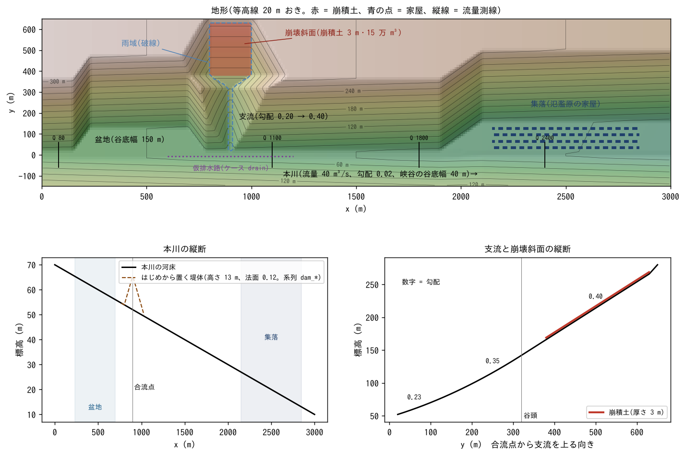
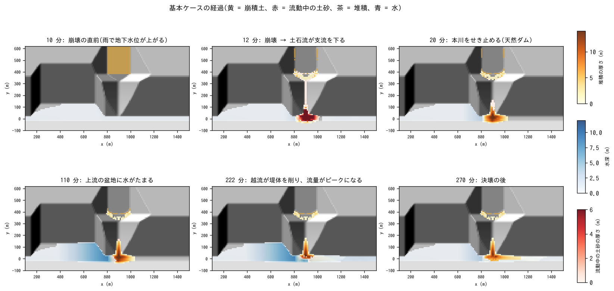
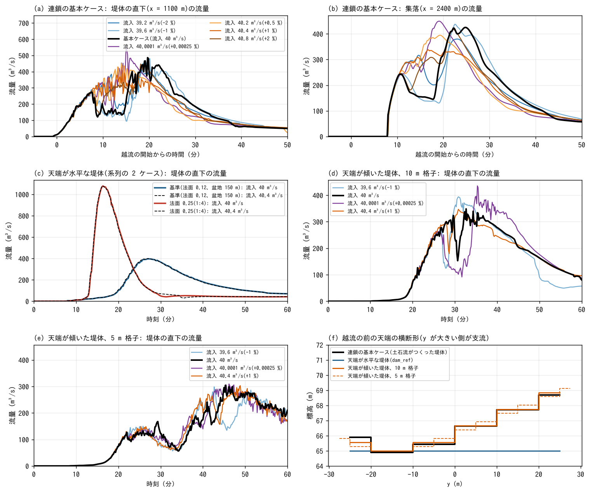
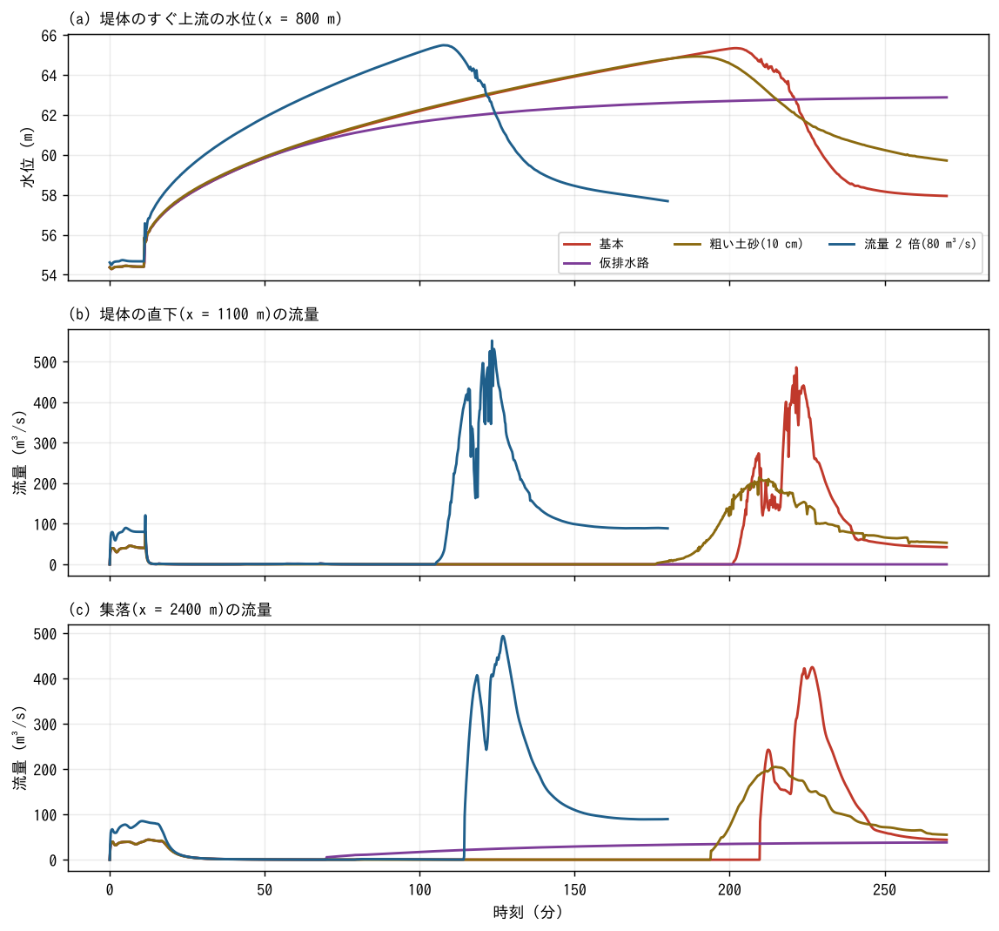
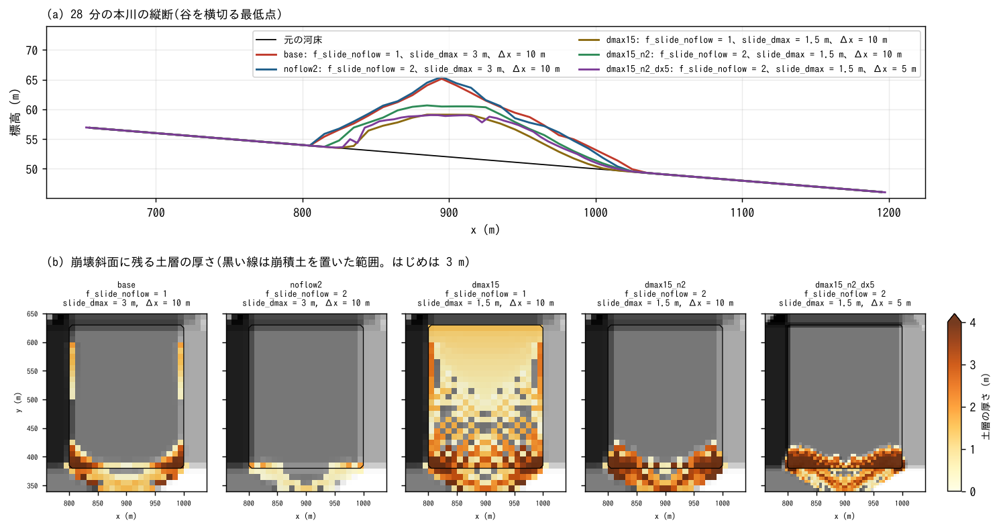
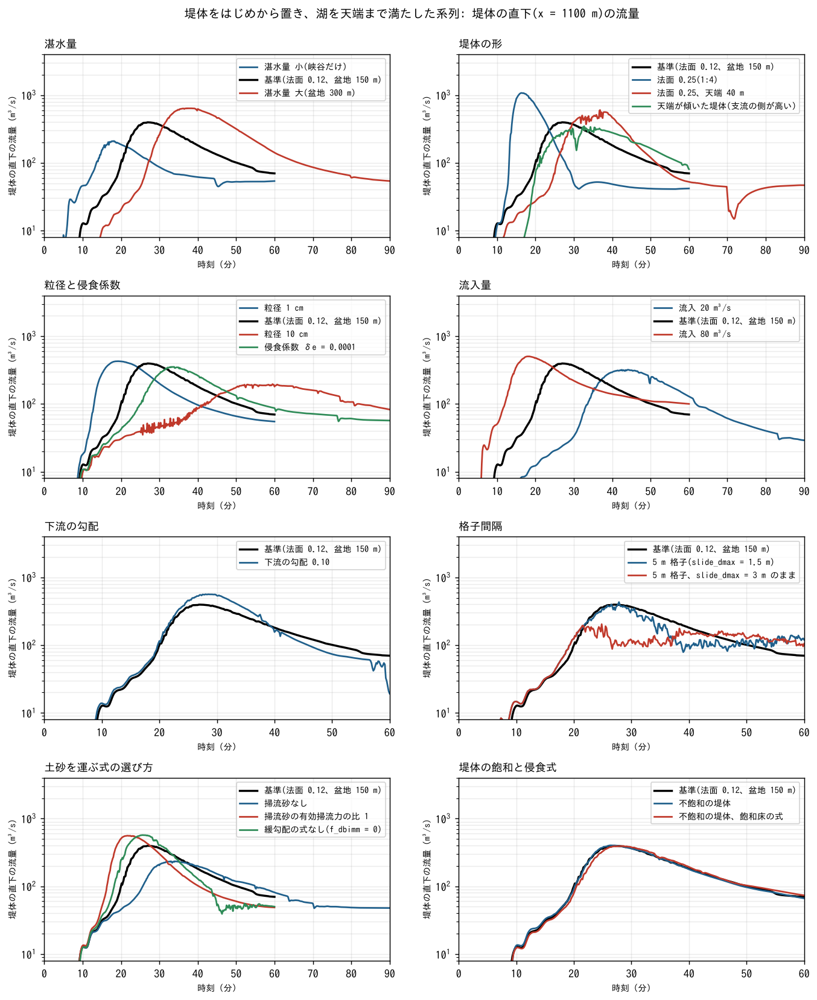
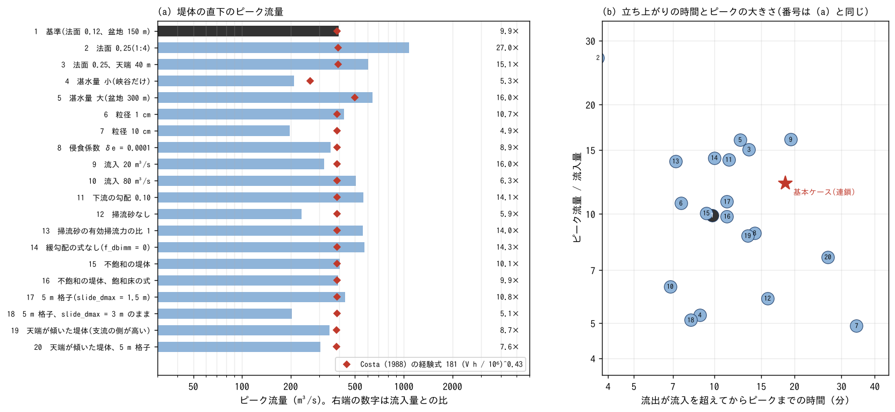

# debris_dam — 豪雨の斜面崩壊から、土石流・天然ダム・決壊の洪水まで

[English](en/README.md)

豪雨で斜面が崩れ、土石流になって谷を下り、川をせき止めて天然ダム(河道閉塞)を作ります。上流に水が
たまり、堤体を越えた流れが堤体を削って決壊すると、たまった水が洪水になって下流を襲います。この例題は、
雨の浸透による崩壊の発生から、土石流、せき止め、湛水、越流、決壊、下流の集落の家屋の被害までを、一つの
計算でつなぎます。あわせて、堤体をはじめから置いた計算で、決壊が急になる条件(湛水量・堤体の形・粒径・
流入量・下流の勾配)を一つずつ変えて比べ、実際の天然ダムで知られていることと突き合わせます。流入量を
わずかに変えた計算で、結果がどれだけ変わるか(結果の幅)も示します。値は現象を
見やすくするための模式値で、特定の災害の再現ではありません。

## 実際の天然ダムで起きていること

- **できかた**: 地震や豪雨で崩れた土砂や土石流が川を埋め、上流に水をためます。日本では 1889 年の十津川災害、
  1953 年の有田川災害、1961 年の大西山崩壊、1984 年の長野県西部地震の御岳崩れ(王滝川)などでできました
  (石川ら 1992)。2004 年の新潟県中越地震では芋川の流域(東竹沢など)にでき、ポンプによる排水と監視が
  行われました(土木研究所 2008)。
- **寿命は短い**: 63 事例の集計で、22 % が形成から 1 日以内、半数が 10 日以内に決壊しています
  (Schuster & Costa 1986)。
- **決壊のしかた**: 越流による侵食、すべり崩壊、進行性破壊(パイピング)の 3 通りがあり、これまでの事例の
  ほとんどは越流によるものです(土木研究所 2008)。満水する前に決壊した例はほとんどありません(石川ら 1992)。
  堤体の土砂の透水性が高いと、浸透が進んで、すべり崩壊や進行性破壊で決壊することもあります(土木研究所 2008)。
- **越流の流れは堤体の上で変わる**: 越流の始まる所では清水に近く、下流の法面を流れ下る間に侵食で土砂の
  濃度が増します。法面の勾配が土石流のできる勾配より急で、法面が十分に長ければ、土石流になります。
  侵食が進むと堤体は緩くなり、最後は全区間が掃流の河床変動になります(石川ら 1992)。
- **洪水の大きさ**: 天然ダムの決壊の洪水は、同じ位置エネルギーの水をためた人工のダムの決壊より小さく、氷河の
  ダムの決壊より大きい、とまとめられています(Schuster & Costa 1986)。ピーク流量は下流ほど小さくなります
  (徳島県の高磯山の天然ダムの再現計算で、42 km 下流は 5 km 下流の約 1/3。土木研究所 2008 が引く里深ら 2007)。
- **対策**: 堤体を開削して排水路を作るのが一般的で、流入量が少なければポンプやサイフォンで排水します。
  越流による決壊を防ぐには、湛水位を下げて越流させないか、流路を作って安全に越流させます(石川ら 1992)。

## 再現に必要な機構

| 実際の現象 | ENCflow での表し方 | 設定 |
|---|---|---|
| 豪雨が斜面の土層にしみ込み、地下水位が上がる | 雨(分布 × 時系列)と Green-Ampt の浸透。土層の地下貯留が底からたまる | `fn_precip`(`prtype = 2`)、`fn_gwflow`(`f_gwvertical = 2`、`gw_sat0`) |
| 間隙水圧で斜面が崩れる | 無限長斜面の安全率が 1 を切ったセルの土層を流動化する | `f_slide = 1`、`slide_phi`、`slide_gamma` |
| 崩れた土塊は水を含んだまま流れ出す | 土層の水(排水できる水と、土と一緒に動く保持水)を土砂と一緒に流れへ移す | `f_dbwet = 3`、`sy0`、`fluv_porosity` |
| 土石流が谷を下り、緩い所に積もる | 高橋・中川 (1991) の抵抗則と侵食・堆積式。止まった土砂は地形になる | `f_debris = 1`、`f_dbed = 3`、`f_dbres = 3`、`f_dbstop = 1` |
| 堆積が川をふさぎ、上流に水がたまる | 堆積が地盤高を上げ、浅水流の計算が湛水を解く | (地形の更新) |
| 湖の下の斜面や堤体は、水につかっても崩れない | 安全率に浸透力を全水頭の勾配で入れる。厚い堆積は表層だけを判定する | `f_slide_seep = 1`、`slide_dmax`、`f_slide_wet = 1`、`f_slide_noflow = 1` |
| 越流が堤体を削り、土砂を下流へ運ぶ | 飽和した堆積の侵食式、緩い勾配の平衡濃度(掃流状集合流動)、掃流砂、決壊口の側壁の安息角崩落 | `f_dbimm = 1`、`db_immexp = 2`、`f_fluvial = 1`、`f_repose = 1` |
| 洪水が家屋を押し流す | 荷重 (h + (1 + s) hs) V² による家屋の破壊と瓦礫 | `fn_bldgdebris`(`f_bdcrit = 2`)、`fn_gv` |
| 排水路で湖の水位を下げる | 堤体の上流と下流を結ぶ暗渠 | `fn_structure`(`&list_struct_culvert`) |

崩壊・土石流・堤体の侵食は同じ土砂の計算(`f_debris`)の中で続けて起こり、途中で計算を切り替えたり、
堤体の形や決壊の時刻を与えたりはしません。式と既定値の根拠は利用者ガイドの
[土石流・斜面崩壊の解説](../../docs/users_guide/massflow.md)にあります。

## 幾何と設定



上: 地形(等高線 20 m おき)。赤 = 崩積土の載る崩壊斜面、青の破線 = 雨域、青の点 = 家屋、縦線 = 流量測線、
紫の点線 = 仮排水路(ケース drain)。下左: 本川の縦断(茶の破線は、決壊の条件を比べる系列ではじめから置く
堤体)。下右: 支流と崩壊斜面の縦断(数字は勾配)。

- **領域と格子**: 3,000 m × 800 m、格子間隔 10 m(300 × 80 セル)、時間刻み 0.1 s。x は本川を下る向き。
- **本川**: 河床勾配 0.02。谷底幅 40 m の峡谷(谷壁 35°)で、上流端から 40 m³/s を入れます(等流水深
  0.47 m)。合流点の上流 x = 150〜780 m は谷底が北へ広がる盆地(谷底幅 150 m)で、せき止められた水は
  ここにたまります。下流端は自由流出です。
- **支流と崩壊斜面**: 支流は x = 900 m で北から合流します。谷底幅 20 m、谷底の勾配は合流点の 0.20 から
  谷頭の 0.40 へ増します。谷頭の上の、勾配 0.40(21.8°)の斜面(幅 200 m × 長さ 250 m)に厚さ 3 m の
  崩積土(15 万 m³)が載ります。ここだけが土層で、ほかは侵食されない基盤です(積もった土砂は侵食されます)。
- **雨と土層**: 支流の谷底と崩壊斜面に 80 mm/h の雨を 60 分。土層の空隙率は 0.4 で、そのうち 0.2 が排水
  できる間隙(比湧水量)、残りの 0.2 は土と一緒に動く保持水です。飽和透水係数は 100 mm/h(雨は全量が
  しみ込む)、はじめの飽和度は 0.83(先行する雨で湿った斜面)。
- **崩壊の条件**: 無限長斜面の安全率(粘着力 0、せん断抵抗角 35°、飽和単位体積重量 19.5 kN/m³)。勾配
  0.40 の斜面は、飽和度が 0.85 に上がると安全率が 1 を切ります。はじめの 0.83 から、80 mm/h の雨で
  約 10 分です(足りない水 (0.853 − 0.83) × 0.2 × 3 m = 14 mm)。せん断抵抗角と単位体積重量は土石流の
  内部摩擦角・濃度とそろえてあり、飽和して崩れた土塊はそのまま流れ出します(利用者ガイドの
  [土石流・斜面崩壊の解説](../../docs/users_guide/massflow.md) §4「崩壊の条件と流動の条件をそろえる」)。
- **安定判定の選択子**: 湖の下の斜面と堤体も判定にかかるので、浸透力を全水頭の勾配で入れ
  (`f_slide_seep = 1`)、間隙水圧で起きる崩壊だけを流動化し(`f_slide_wet = 1`)、濃い混合体が載るセルは
  判定しません(`f_slide_noflow = 1`)。判定して 1 回に流動化する深さの上限 `slide_dmax` は 3 m
  (崩積土の厚さ)です。崩積土は底から飽和するので、すべり面は土層の底にあり、これより浅くすると崩壊が
  遅れます。一方、格子間隔に対して大きいと、流動化でできた段が隣のセルを崩して、流動化が連鎖します
  (この例題では、格子間隔の 0.6 倍で連鎖し、0.3 倍では連鎖しない)。そこで、堤体を置く系列の 5 m 格子の
  ケース(`dam_dx5`・`dam_tilt_dx5`)は 1.5 m にします。崩壊斜面のある 5 m 格子のケース(`g5`)は 3 m のままです
  (1.5 m にすると、`f_slide_noflow = 1` では崩積土の上半分だけが崩れて下半分が斜面に残る。
  [下の節](#薄い膜の下に残る土層))。
- **土石流と堤体の侵食**: 高橋・中川 (1991) の石礫型。粒径 3 cm、内部摩擦角 35°、侵食の係数 δe = 0.0007
  (既定。Takahashi の一般値)、堆積の係数 δd = 0.5(同論文の洞谷への適用値)。緩い勾配は掃流状集合流動の
  平衡濃度 6.7c∞²(高橋・中川・山敷 1991)。掃流砂(芦田・道上)を併用し、有効掃流力の比を 0.6 にします
  (粒子の粗度 0.027〜0.031 と河道の粗度 0.04 の比の 1.5 乗。同解説 §3「掃流砂との併用」)。
- **集落**: x = 2,100 m から下流。幅 20 m・深さ 1.2 m の低水路(満杯で 96 m³/s)と、北岸の幅 150 m の
  氾濫原(岸から 100 m 離れると 1 m 高くなる)。家屋は岸から 25・55・85・115 m の 4 列に 70 棟
  (1 棟は 20 m × 10 m で 2 セル。建物の空隙率 0.5、家屋ストックは既定の 0.3 m³/m²)。荷重
  (h + (1 + s) hs) V² が 1 m³/s² で壊れ始め、4 m³/s² で破壊可能率が 1 になります(利用者ガイドの[家屋破壊・瓦礫](../../docs/users_guide/bldgdebris.md)の
  「土石流・氾濫流の集落直撃」の目安)。
- **出力**: 分布は 2 分おき(bil)、計測点と流量測線は 10 秒おき。

計算するケースは 4 つの組に分かれます。`param.txt`(基本ケース)が注釈付きの雛形で、ほかのケースの
`param_<ケース>.txt` は `make_init.py` が行を差し替えて書きます(差し替えた行には「基本ケースは …」と
注釈が入ります)。

| 組 | ケース | 基本ケースとの違い | 計算する時間 |
|---|---|---|---|
| 連鎖 | `base` | —(豪雨から家屋の被害まで) | 270 分 |
| | `drain` | 仮排水路(幅 4 m × 高さ 3 m の暗渠。呑口 x = 600 m、吐口 x = 1,200 m、敷高は河床 + 1.5 m) | 270 分 |
| | `coarse` | 粒径 10 cm | 270 分 |
| | `q80` | 本川の流量 80 m³/s | 180 分 |
| 連鎖の前半 | `norain` | 雨なし(崩壊しない。対照) | 30 分 |
| | `wet0` | 間隙水を連行しない(`f_dbwet = 0`。侵食・堆積で河床と水をやりとりしない) | 30 分 |
| | `wet2` | 保持水を授受しない(`f_dbwet = 2`。排水できる水だけをやりとりする) | 30 分 |
| | `slide0` | 斜面安定判定の選択子 4 つを使わない | 30 分 |
| | `g5` | 格子間隔 5 m | 30 分 |
| | `dmax15` | `slide_dmax` = 1.5 m(崩積土の厚さの半分。崩壊の時刻がそろうように、はじめの飽和度を 0.9035 にする) | 30 分 |
| 判定を外す条件 | `noflow2` | 載っている土砂が薄いセルは判定する(`f_slide_noflow = 2`) | 30 分 |
| | `dmax15_n2`・`dmax15_n2_dx5` | `dmax15` の設定で `f_slide_noflow = 2`(格子間隔 10 m と 5 m) | 30 分 |
| | `noflow2_ref`・`noflow2_face25` | 堤体を置く系列の `dam_ref`・`dam_face25` で `f_slide_noflow = 2` | 60 分 |
| 結果の幅 | `base_m2`・`base_m1`・`base_eps`・`base_p05`・`base_p1`・`base_p2` | 基本ケースの流入量だけを 39.2・39.6・40.0001・40.2・40.4・40.8 m³/s に変える(−2〜+2 %。初期水深は 40 m³/s のまま) | 270 分 |
| | `dam_ref_p1`・`dam_face25_p1` | 堤体を置く系列の 2 ケース(天端が水平)の流入量だけを 40.4 m³/s(+1 %)に変える | 60 分 |
| | `dam_tilt_m1`・`dam_tilt_eps`・`dam_tilt_p1`、`dam_tilt_dx5_m1`・`dam_tilt_dx5_eps`・`dam_tilt_dx5_p1` | 天端の傾いた堤体(10 m 格子と 5 m 格子)の流入量だけを 39.6・40.0001・40.4 m³/s に変える | 60 分 |
| 堤体をはじめから置く | `dam_ref` ほか 19 ケース | 合流点に高さ 13 m の堤体を置き、湖を天端まで満たして始める(雨と崩積土はなし)。湛水量・堤体の形(法面・天端の長さ・天端の傾き)・粒径・流入量・下流の勾配・格子間隔・式の選び方を 1 つずつ変える([下の節](#急な決壊が起きる条件計算と実際の天然ダム)) | 60 分(立ち上がりの遅い 6 ケースは 90 分) |

## 実行方法

```bash
cd examples/debris_dam
make                     # リンクと、全ケースの入力と設定(make_init.py)
make run                 # 35 ケースを順に計算
make perturb             # 結果の幅を見る 14 ケース(流入量だけを少し変える)を計算
python3 plot_results.py  # figs/*.png と数表(引数 en で英語版を en/figs/ に。計算前でも setup.png は描ける)
```

`make quick` は基本ケース・仮排水路と、堤体を置く系列の主な 4 ケースだけを、`make dams` は堤体を置く
系列の 20 ケースだけを計算します。`make perturb` の 14 ケースは `make run` に含まれません(「結果の幅」の
図と表に使います)。1 ケースだけなら `./encflow param.txt`(基本ケース)。

## 結果

### 連鎖の経過(基本ケース)



盆地から合流点の下流までの 6 つの時刻(黄 = 崩積土、赤 = 流動中の土砂、茶 = 堆積、青 = 水)。


(a) 崩れる前の崩積土の飽和度と安全率。(b) 土砂の行き先(かさ体積)。(c) 堤体のすぐ上流の水位と、堤体の天端の
高さ。(d) 流量。縦の破線は崩壊と越流の開始。

1. **雨の浸透と崩壊(0〜11 分)**: 雨がしみ込んで崩積土の飽和度が 0.83 から上がり、10 分で 0.852 になります。
   10 分半に安全率が 1 を切り、土層のある 500 セルのうち 482 セルが 40 秒の間に崩れます(斜面の端の
   18 セルは残る)。
2. **土石流(11〜14 分)**: 崩れた土塊(かさ体積 13.7 万 m³)は水を含んだまま流れ出し、支流の谷を最大
   24 m/s で下ります(流動深は谷の中ほどで 7〜8 m、合流点で最大 15 m)。先端は、崩壊の 30 秒ほどあとに
   合流点に届きます。
3. **せき止め(〜16 分)**: 土石流は本川の谷を埋めて止まり、堆積は崩壊の 2 分後に厚さ 10 m を超えます。
   本川に 7.9 万 m³、支流の谷に 5.7 万 m³ が積もり、崩壊の 5 分後には、高さ 13.0 m(天端の標高 65.1 m)の
   堤体ができます。堤体は川に沿って 210 m(x = 815〜1,025 m)の三角形で、法面の勾配は上流側 0.16、
   下流側 0.10 です。堤体の直下の流量は、崩壊の 3 分後に 1 m³/s まで落ち、集落の川も細っていきます
   (流量は 20 分に半分、30 分に 3 m³/s、45 分に 1 m³/s 未満)。
4. **湛水(16〜202 分)**: 本川の 40 m³/s が上流の盆地にたまり、水位は 3 時間かけて天端に届きます
   (湛水量 46 万 m³)。この間、堤体の形は変わらず、下流の川は涸れたままです(集落の低水路の水深
   0.71 m → 0.01 m)。
5. **越流と決壊(202 分〜)**: 水が天端を越えると、流れが下流の法面を削り始めます。堤体の直下の流量は、
   越流の開始から 4 分で 170 m³/s、7 分で 270 m³/s になり、天端は 6 分で 4.6 m 下がります(65.1 → 60.6 m)。
   ここで決壊口(幅 10 m)の側壁が崩れて決壊口の底を 2 m ほど埋め、流量は 120〜210 m³/s に落ちて、8 分ほど
   足踏みします。崩れた土砂が流されると流量はまた増え、越流の開始から 20 分後に 490 m³/s(流入量の
   12 倍)のピークになります(この足踏みとピークの大きさは、条件のわずかな違いで変わります。下の
   「結果の幅」)。越流の開始から 60 分で湖の水位は 7.3 m 下がり、流入量を超えて流れ出た水は
   43 万 m³(湛水量の 94 %)です。計算の終わり(270 分)に、高さ 3.5 m の堤体が残ります。
6. **下流の洪水(210 分〜)**: 洪水の先端は、越流の開始から 8 分で 1.5 km 下流の集落に届きます。涸れていた
   川の流量は 1 分で 150 m³/s を超え、11 分後に 240 m³/s の最初の山になります。いったん 150 m³/s に
   下がったあと、25 分後に 425 m³/s のピーク(低水路が満杯で流せる 96 m³/s の 4.4 倍)になります。流量が
   平常の 1.5 倍を超える時間は 40 分です。


本川の縦断(実線 = 河床、破線 = 水面)。堤体は上から削られ、削られた土砂は法尻から下流へ積もります
(x = 1,000〜1,500 m に 2.7 万 m³、最大 5 m)。法面は緩くなりながら下流へ伸び、これが侵食を遅くします。

### 集落の被害


集落の最大流動深(青)と家屋の破壊率(四角の色)。上から、基本ケース、粒径 10 cm、仮排水路。

基本ケースでは、氾濫原は岸から 130 m まで浸水します(低水路の最大水深 2.5 m)。被害は岸からの距離で
分かれます。

| 列(岸からの距離) | 最大流動深 (m) | 荷重の最大 (m³/s²。35 セルの平均と最大) | 破壊率(平均と最大) |
|---|---|---|---|
| 1 列目(25 m) | 0.9 | 8.8 / 10.1 | 1.00 / 1.00(全壊) |
| 2 列目(55 m) | 0.6 | 3.7 / 5.6 | 0.99 / 1.00 |
| 3 列目(85 m) | 0.4 | 1.1 / 2.0 | 0.03 / 0.26 |
| 4 列目(115 m) | 0.1 | 0.1 / 0.4 | 0 |

荷重が、壊れ始める 1 m³/s² と破壊可能率が 1 になる 4 m³/s² をどこで超えるかで決まります。3 列目の荷重は
壊れ始める値のすぐ上で、この列の被害は洪水の大きさと続く時間に敏感です。2 列目の破壊率も、決壊の
ピーク流量の幅に応じて 0.56〜1.00 の間で変わります(次の「結果の幅」)。

### 結果の幅(流入量を少し変えた計算)



(a)(b) 基本ケースの流入量だけを 39.2〜40.8 m³/s に変えた計算の、堤体の直下と集落の流量(越流の開始を
そろえて重ねる)。(c) 天端が水平な堤体(系列の 2 ケース)で、流入量を 40 と 40.4 m³/s にした計算。(d)(e) 天端が
谷を横切る向きに傾いた堤体(`dam_tilt`)の、10 m 格子と 5 m 格子の計算(流入量 39.6〜40.4 m³/s)。(f) 越流の
前の天端の横断形。

| ケース | 流入量 (m³/s) | 越流の開始 (分) | ピーク流量: 堤体の直下 / 集落 (m³/s) | 越流の開始からピークまで (分) | 途中の落ち込み | 家屋の破壊率の平均: 岸から 1 列目 / 2 列目 / 3 列目 |
|---|---|---|---|---|---|---|
| `base_m2` | 39.2 | 206 | 416 / 380 | 18 | 0.45 | 1.00 / 0.59 / 0 |
| `base_m1` | 39.6 | 204 | 480 / 437 | 20 | 0.34 | 1.00 / 0.98 / 0.03 |
| `base`(基本ケース) | 40 | 202 | 486 / 425 | 20 | 0.44 | 1.00 / 0.99 / 0.03 |
| `base_eps` | 40.0001 | 202 | 547 / 449 | 15 | 0.43 | 1.00 / 1.00 / 0.04 |
| `base_p05` | 40.2 | 201 | 450 / 395 | 14 | 0.61 | 1.00 / 0.90 / 0.01 |
| `base_p1` | 40.4 | 200 | 407 / 338 | 14 | 0.62 | 1.00 / 0.56 / 0 |
| `base_p2` | 40.8 | 198 | 448 / 417 | 18 | 0.49 | 1.00 / 0.72 / 0.01 |
| `dam_ref` | 40 | 10 | 397 / 386 | 18 | 0.96 | 1.00 / 0.78 / 0 |
| `dam_ref_p1` | 40.4 | 10 | 399 / 388 | 17 | 0.99 | 1.00 / 0.80 / 0.01 |
| `dam_face25` | 40 | 10 | 1,078 / 1,050 | 7 | 1.00 | 1.00 / 1.00 / 1.00 |
| `dam_face25_p1` | 40.4 | 10 | 1,079 / 1,048 | 7 | 1.00 | 1.00 / 1.00 / 1.00 |
| `dam_tilt_m1` | 39.6 | 18 | 394 / 358 | 13 | 0.45 | 1.00 / 0.56 / 0 |
| `dam_tilt` | 40 | 18 | 349 / 311 | 15 | 0.47 | 1.00 / 0.23 / 0 |
| `dam_tilt_eps` | 40.0001 | 18 | 435 / 360 | 18 | 0.35 | 1.00 / 0.60 / 0 |
| `dam_tilt_p1` | 40.4 | 18 | 347 / 327 | 13 | 0.60 | 1.00 / 0.24 / 0 |
| `dam_tilt_dx5_m1` | 39.6 | 16 | 299 / 259 | 26 | 0.38 | 0.90 / 0 / 0 |
| `dam_tilt_dx5` | 40 | 16 | 305 / 273 | 29 | 0.34 | 1.00 / 0.01 / 0 |
| `dam_tilt_dx5_eps` | 40.0001 | 16 | 309 / 287 | 30 | 0.51 | 1.00 / 0.02 / 0 |
| `dam_tilt_dx5_p1` | 40.4 | 16 | 303 / 276 | 33 | 0.41 | 1.00 / 0.01 / 0 |

「途中の落ち込み」は、越流の開始からピークまでの間の「流量 ÷ それまでの最大の流量」の最小です(0.5 より小さければ、
流量がいったん半分以下に落ちてからピークになっている)。

- **天端が水平な堤体は、わずかな違いに対して安定しています**。堤体を置く系列の堤体は、天端が谷を横切る向きに
  水平です((f))。流入量を 1 % 増やしても、ピーク流量は基準の堤体で +0.5 %(397 → 399 m³/s)、法面 0.25 の堤体で
  +0.1 %(1,078 → 1,079 m³/s)しか変わりません((c) で 2 本の線が重なる)。系列のケースの間の差は、条件の違いによる
  ものとして読めます。
- **連鎖の基本ケースは、わずかな違いで変わります**。流入量を 39.2〜40.8 m³/s(±2 %)の範囲で変えた 7 本の計算で、
  堤体の直下のピーク流量は 407〜547 m³/s、集落のピーク流量は 338〜449 m³/s、越流の開始からピークまでは
  14〜20 分です。ピークの大きさは、流入量の順に並びません(表)。流入量を 40.0001 m³/s(+0.00025 %)にしただけでも、ピークは 547 m³/s(+13 %)になります。
  岸から 2 列目の家屋の破壊率の平均は 0.56〜1.00、3 列目は 0.00〜0.04 です。
- **分かれるのは、決壊口の側壁が崩れるところからです**。どの計算も、越流の開始から 8 分までは流量の差が
  1 割以内で、そこから分かれます((a))。土石流がつくった堤体は、支流の側が高く、対岸の側が 4 m ほど低いので
  ((f))、越流は対岸の側にできる細い決壊口(幅 1〜4 セル = 10〜40 m)に集まります。決壊口の側壁(支流の側の厚い
  堆積)が崩れて決壊口をふさぐと、流量はそれまでの半分以下に落ちます(7 本のうち 5 本。表の「途中の落ち込み」が
  0.5 未満)。崩落の時刻と量が、条件のわずかな違いで変わります。
- **天端を傾けると、はじめから置いた堤体でも同じことが起こります**。基準の堤体の天端を、土石流がつくった堤体と
  同じ形に傾けると(`dam_tilt`。(f))、流入量 39.6〜40.4 m³/s の 4 本でピークは 347〜435 m³/s に散らばり、流入量を
  40.0001 m³/s にしただけで 349 → 435 m³/s に変わります((d))。4 本のうち 3 本で、流量が途中で半分以下に
  落ちます。結果の幅は、土石流や湛水の経過によるのではなく、越流が細い決壊口に集まる堤体の形によるものです。
- **格子間隔を 5 m にした計算**((e)): 同じ堤体を 5 m 格子で計算すると(`slide_dmax` は格子間隔の 0.3 倍の 1.5 m)、
  4 本のピークは 299〜309 m³/s(平均 304 m³/s)で、10 m 格子(347〜435 m³/s、平均 381 m³/s)の
  0.80 倍です。平均の差は、10 m 格子の 4 本の幅を超えています。越流が細い決壊口に集まる堤体の決壊は、格子間隔に依存します。
  5 m 格子では、4 本の差は 4 % に収まります(10 m 格子は 25 %)。10 m 格子の結果の幅は、格子を細かくすると小さくなります。
  越流の開始からピークまでは、5 m 格子で 26〜33 分、10 m 格子で 13〜18 分です(5 m 格子では、崩れた土砂が決壊口を
  ふさいでいる時間が長い)。流量が途中で半分以下に落ちるのは、5 m 格子で 4 本のうち 3 本、
  10 m 格子で 3 本です。2 つの格子間隔で値が変わるので、この堤体の決壊は格子間隔に対して収束していません。連鎖の決壊も同じ形の
  決壊なので、10 m 格子の数値は格子間隔に依存すると考えてください(連鎖は 5 m 格子で決壊まで通していない。
  下の節の「格子間隔」)。
- **読み方**: 連鎖のケースの数値(ピーク流量、家屋の被害)は、この幅を見込んで読んでください。基本ケースの
  「足踏み」のような経過の細部は、起こりうる経過の 1 つです。仮排水路(越流しない)と粒径 10 cm(ピーク
  214 m³/s)の差は、この幅より十分に大きい差です。条件の効き方(湛水量・法面・粒径・流入量)は、天端が
  水平な堤体の系列で読む方が確かです。実際の場所の計算でも、条件を少し変えた計算をいくつか流して、結果の幅を
  確かめてください。

### 対策と条件の違い(連鎖のケース)



(a) 堤体のすぐ上流の水位。(b) 堤体の直下の流量(仮排水路の吐口はこの測線より下流にある)。(c) 集落の流量。

| ケース | 堤体の高さ (m) | 越流の開始 (分) | ピーク流量: 堤体の直下 / 集落 (m³/s) | 流入量との比 | 立ち上がり (分) | 計算の終わりの堤体の高さ (m) | 家屋の破壊率の平均: 岸から 1 列目 / 2 列目 / 3 列目 |
|---|---|---|---|---|---|---|---|
| `base` | 13.0 | 202 | 486 / 425 | 12.2 | 18 | 3.5 | 1.00 / 0.99 / 0.03 |
| `drain` | 13.0 | 越流しない | — / 38 | — | — | 13.0 | 0 / 0 / 0 |
| `coarse` | 12.4 | 181 | 214 / 205 | 5.4 | 20 | 4.7 | 0.41 / 0 / 0 |
| `q80` | 13.0 | 107 | 552 / 494 | 6.9 | 14 | 2.5 | 1.00 / 1.00 / 0.16 |

「立ち上がり」は、堤体の直下の流量が流入量を超えてからピークになるまでの時間です。

- **仮排水路(`drain`)**: 暗渠は、湖の水位が呑口の敷高(59.5 m)を超える 45 分から水を流し始めます。水位が上がるほど
  流量が増え、270 分には水位 62.9 m で 38 m³/s(流入量の 96 %)が流れて、ほぼつり合います。水位は天端
  (65.1 m)の 2.3 m 下で止まり、越流も決壊も起こりません。堤体は高さ 13 m のまま残ります。集落の川は、
  70 分ごろから流れが戻り始め、ゆっくり平常の流量に近づきます(110 分に 20 m³/s)。氾濫原は浸水しません。
- **粗い土砂(`coarse`)**: 粒径を 10 cm にすると、土石流の堆積が少し平たくなり(堤高 12.4 m、下流の法面 0.095)、越流は
  早く始まります(181 分)。侵食は遅く、流量は 10 分かけて 46 m³/s、20 分で 140 m³/s に増え、越流の開始から
  28 分で 214 m³/s(流入量の 5.4 倍。基本ケースの 0.44 倍)のピークになります。集落では氾濫原が岸から
  80 m まで浸水し、岸に近い列の家屋は荷重 1.7 m³/s²(最大 2.0)で壊れ始めますが、破壊率の平均は 0.41
  (最大 0.76)にとどまります。2 列目より遠い家屋は壊れません。計算の終わりに高さ 4.7 m の堤体が残ります。
- **流量 2 倍(`q80`)**: 満水までの時間が半分になり(越流の開始は 107 分)、ピークは 552 m³/s に増えますが、
  流入量との比は 12.2 倍から 6.9 倍に下がります。はじめの立ち上がりは速く、越流の開始から 7 分で
  390 m³/s になります(基本ケースは 270 m³/s)。ここでも側壁の崩落で決壊口が埋まり、流量はいったん
  160 m³/s に落ちて、16 分後にピークになります。岸から 2 列目までの家屋がすべて全壊し(荷重 11・
  5.2 m³/s²)、3 列目も一部が壊れ始めます(破壊率の平均 0.16、最大 0.60)。基本ケースの
  ピークは、流入量のわずかな違いで 407〜547 m³/s に変わるので(上の「結果の幅」)、基本ケースとのピークの差
  (486 → 552 m³/s)から流入量の効き方は読めません。堤体を置く系列(下の節)で読んでください。
- **雨なし(`norain`)**: 雨を降らせないと崩壊は起こらず、本川は 40 m³/s のまま流れ続けます。集落の低水路の水深は
  0.71 m で、氾濫原は浸水しません(対照)。

### 堤体のできかた(間隙水の扱い・斜面安定判定の選択子・格子間隔・判定の深さ)


(a) 28 分の本川の縦断。(b) 堆積の厚さ。

| ケース | 堤体の高さ (m) | 堤体の長さ(川に沿って。m) | 法面の勾配: 上流側 / 下流側 | 本川の堆積 (万 m³) | 支流の堆積 (万 m³) | 流動中のままの土砂 (万 m³) | 斜面に残る崩積土 (万 m³) |
|---|---|---|---|---|---|---|---|
| `base` | 13.0 | 210 | 0.16 / 0.10 | 7.9 | 5.7 | 0.2 | 1.3 |
| `wet0`(間隙水を連行しない) | 10.5 | 230 | 0.12 / 0.075 | 7.7 | 5.7 | 0.2 | 1.5 |
| `wet2`(保持水を授受しない) | 10.2 | 160 | 0.15 / 0.11 | 6.5 | 6.8 | 0.2 | 1.5 |
| `slide0`(安定判定の選択子なし) | 地形になっていない | — | — | 2.4 | 1.5 | 11.0 | 0.0 |
| `g5`(5 m 格子) | 11.8 | 185 | 0.16 / 0.11 | 6.7 | 6.7 | 1.0 | 0.6 |
| `dmax15`(`slide_dmax` = 1.5 m) | 7.4 | 160 | 0.092 / 0.092 | 4.3 | 4.5 | 0.4 | 5.7 |

28 分(崩壊の 17 分半後)の値。

- **間隙水の扱い**: 基本ケース(`f_dbwet = 3`)では、崩れた土塊は土層の水の全部(排水できる水と保持水)を
  持って流れ出し、堆積するときに同じ割合の水を流れから取り込みます。`wet2` と `wet0` では、崩れた土塊が
  持って出るのは排水できる水だけで、土塊は濃く(濃度 0.78)なります。`wet2` では支流の谷に残る土砂が
  増えて(6.8 万 m³)、堤体は 2.8 m 低くなります。`wet0` では、堆積が流れの水を取り込まないので、堆積が
  平たく長く広がり(法面 0.12・0.075)、堤体は 2.5 m 低くなります。堤体の高さは湛水量を決めるので、
  間隙水の扱いは、あとの決壊の大きさまで変えます。
- **斜面安定判定の選択子**: 4 つの選択子を使わない `slide0` では、積もった土砂が流動化を繰り返して地形に
  ならず、28 分にも 11 万 m³ が流動中の土砂のままです(川はふさがれるが、堤体として固まらない)。従来の式は、
  水につかった斜面の安全率を半分ほどに見積もり、厚い堆積を一度に底まで流動化するためです(利用者ガイドの
  [土石流・斜面崩壊の解説](../../docs/users_guide/massflow.md) §4)。
- **格子間隔**: 5 m 格子(`g5`)では、支流の谷に残る土砂が多く(6.7 万 m³。10 m 格子は 5.7 万 m³)、
  堤体は 1.2 m 低くなります(11.8 m)。支流の谷底(幅 20 m)は 10 m 格子で 2 セル、5 m 格子で 4 セルで、谷の中の
  流れと堆積の形が変わります。堤体の高さは格子間隔に 9 % ほど依存します。
- **判定・流動化する深さの上限**: `slide_dmax` を崩積土の厚さの半分の 1.5 m にすると(`dmax15`。崩壊の時刻が
  そろうように、はじめの飽和度を 0.9035 に上げてある)、崩積土の上半分だけが崩れて、下半分(5.7 万 m³)が
  斜面に残ります。流動化した土砂が薄い膜として載っている間、残った層は判定されないためです
  (`f_slide_noflow = 1`)。堤体の高さは 7.4 m にしかなりません。崩す土層より浅い `slide_dmax` は、
  `f_slide_noflow = 2` と組み合わせます(次の節。利用者ガイドの
  [土石流・斜面崩壊の解説](../../docs/users_guide/massflow.md) §4)。

### 薄い膜の下に残る土層



(a) 28 分の本川の縦断。(b) 崩壊斜面に残る土層の厚さ。

濃い混合体が載るセルを安定判定から外す選択子 `f_slide_noflow` には、1(この例題の設定)と 2 があります。1 は
混合体の濃度だけで決めます。2 は、載っている土砂が薄いセル(堆積に直した厚さが、判定する厚さの半分に
満たないセル)を判定します。`slide_dmax` が 3 m(崩積土の厚さ)と 1.5 m の場合で比べます。

| ケース | `f_slide_noflow` | `slide_dmax` (m) | 格子間隔 (m) | 斜面に残る崩積土 (万 m³) | 土層の残るセルの割合 (%) | 堤体の高さ (m) | 本川の堆積 (万 m³) | 支流の堆積 (万 m³) |
|---|---|---|---|---|---|---|---|---|
| `base` | 1 | 3 | 10 | 1.3 | 12 | 13.0 | 7.9 | 5.7 |
| `noflow2` | 2 | 3 | 10 | 0.1 | 2 | 13.4 | 8.2 | 6.5 |
| `dmax15` | 1 | 1.5 | 10 | 5.7 | 86 | 7.4 | 4.3 | 4.5 |
| `dmax15_n2` | 2 | 1.5 | 10 | 1.7 | 10 | 8.8 | 6.2 | 6.9 |
| `dmax15_n2_dx5` | 2 | 1.5 | 5 | 2.1 | 12 | 7.3 | 5.9 | 6.6 |

28 分の値。

- **1 は、薄い膜の下の層を判定しません**: 土石流が流れ去ったあとに厚さ数 cm の膜が残っている間、その下の層は、
  飽和していても判定されません。基本ケースでは、崩積土を置いた範囲の側縁と下端(12 % のセル)に
  1.3 万 m³ が残ります。載っている土砂は、堆積に直した厚さで 3 cm ほどです。`slide_dmax` を崩積土の
  厚さの半分にした `dmax15` では、上の層が流動化したあとの膜が、ほぼ全面(86 % のセル)で下の層の
  判定を止めます。
- **2 は、膜が薄くなったセルを判定します**: `noflow2` で残るのは下端の 1 列だけ(0.1 万 m³)で、堤体は
  0.3 m 高くなります(13.4 m)。`dmax15_n2` では下の層も崩れます。残る 1.7 万 m³ は、
  斜面の下端に積もり直した堆積です(厚さの中央値 3.3 m で、はじめの土層より厚い。安全率は 1 以上)。
- **`slide_dmax` を土層より浅くすると、堤体は低くなります**: `dmax15_n2` の堤体は 8.8 m で、`noflow2` より
  4.5 m 低くなります。上の層が流れ去ってから下の層が崩れるので、斜面の下端と支流の谷に残る土砂が
  増えるためです(合わせて 2.0 万 m³)。
- **5 m 格子**: `slide_dmax` を格子間隔の 0.3 倍の 1.5 m にした 5 m 格子(`dmax15_n2_dx5`)でも、2 なら下の層まで
  崩れます(残る 2.1 万 m³ は、同じく斜面の下端の堆積)。堤体は 7.3 m で、10 m 格子の同じ設定より
  1.5 m 低くなります(`slide_dmax` が 3 m の `g5` と `base` の差は 1.2 m)。
- **決壊の段階での違いは小さい**: 堤体をはじめから置く系列の、天端が水平な 2 ケースで `f_slide_noflow` だけを
  2 に替えると(`noflow2_ref`・`noflow2_face25`)、ピーク流量の違いは +0.1 % と −2.2 % です。

| ケース | `f_slide_noflow` | ピーク流量 (m³/s) | 1 との差 (%) | 越流の開始からピークまで (分) | 集落のピーク流量 (m³/s) | 60 分の堤体の高さ (m) |
|---|---|---|---|---|---|---|
| `dam_ref` | 1 | 397 | — | 17.5 | 386 | 4.7 |
| `noflow2_ref` | 2 | 397 | +0.1 | 17.7 | 385 | 5.0 |
| `dam_face25` | 1 | 1,078 | — | 6.5 | 1,050 | 2.0 |
| `noflow2_face25` | 2 | 1,055 | −2.2 | 6.3 | 1,013 | 1.8 |

この例題の他のケースは 1 で計算しています。

## 急な決壊が起きる条件(計算と実際の天然ダム)

基本ケースの堤体は、越流が始まって 20 分で流量が流入量の 12 倍になりました。同じ高さの堤体でも、
条件によって、決壊のピーク流量は 5 倍、流量が立ち上がる時間は 9 倍変わります。
ここでは、合流点に高さ 13 m の堤体をはじめから
置き、湖を天端まで満たした状態から計算を始めて(雨と崩積土はなし。堤体は飽和)、条件を 1 つずつ変えます。
基準(`dam_ref`)は、基本ケースの土石流がつくる堤体に近い、法面の勾配 0.12 の三角形です(天端は谷を横切る
向きに水平に置く。土石流がつくる堤体は支流の側が高い)。そのうえで、
計算に表れた条件のうち、どれが実際の天然ダムでも成り立ち、どれがモデルの都合によるものかを分けます。

### 決壊の速さを決めるもの(湖の水収支)

堤体を越える流量 Q は、湖の水位と天端の高さの差(越流水深 H)で決まります。湖の面積を A、流入量を Q_in、
天端の下がる速さを E とすると、湖の水収支から

```
dH/dt = E − (Q − Q_in) / A
```

です。天端の下がる速さ E が、湖の水位の下がる速さ (Q − Q_in)/A より大きい間は、越流水深が増え、流量が
増え続けます。2 つがつり合うと流量は頭打ちになり、そのとき

```
Q ≈ Q_in + E·A
```

です。流入量を超える分の流量は、およそ「天端の下がる速さ × 湖の面積」になります。これは湖の水収支を
整理しただけの関係で、土砂のモデルによりません。湖が広く、堤体が速く削れるほど、決壊は急になります。
湖が非常に広いか、侵食が非常に速いと、湖の水位が下がる前に堤体が底まで削れ、流量は谷の幅と堤高で決まる
上限(幅 40 m・水深 13 m の越流でおよそ 3,000 m³/s)に近づきます。

天端の下がる速さ E を決めるのは、下流の法面を流れ下る水が運べる土砂の量(単位幅流量 × 平衡濃度)と、
その土砂を下流の川が運び去れるかどうかです。

- **法面の勾配**: 高橋・中川の式の平衡濃度は、勾配とともに急に増えます(この例題の値で、勾配 0.12 は
  0.105、0.25 は 0.34)。侵食の速さの係数 C∞/(C* − C∞) は 0.21 と 1.28 で、6 倍違います。
- **流量が増えると侵食も速くなる**: 侵食の速さは単位幅流量に比例するので、削れて越流水深が増えると、さらに
  速く削れます(正のフィードバック)。
- **削った土砂が法尻に積もる**: 下流の川が緩いと、運びきれない土砂が法尻に積もって法面が緩み、平衡濃度が
  下がって侵食が遅くなります(負のフィードバック)。

### 計算で比べた条件



堤体の直下(x = 1,100 m)の流量。黒が基準で、パネルごとに 1 つの条件を変えています(縦軸は対数)。



(a) ピーク流量(棒。右の数字は流入量との比)と、Costa (1988) の経験式の値(赤の菱形)。(b) 流出が流入を
超えてからピークまでの時間と、ピーク流量と流入量の比。左上ほど急な決壊です。赤の星は基本ケース(連鎖)。

| 変えた条件 | ケース | 湛水量 (万 m³) | ピーク流量 (m³/s) | 流入量との比 | ピークの時刻 (分) | 立ち上がり (分) | 10 分間の水位低下の最大 (m) | 60 分後の堤体の高さ (m) | 家屋の破壊率の平均 |
|---|---|---|---|---|---|---|---|---|---|
| 基準(法面 0.12、盆地 150 m、粒径 3 cm、流入 40 m³/s) | `dam_ref` | 45 | 397 | 9.9 | 27 | 9.8 | 2.5 | 4.7 | 0.45 |
| 湛水量 小(峡谷だけ) | `dam_small` | 18 | 211 | 5.3 | 18 | 8.8 | 2.6 | 5.5 | 0.03 |
| 湛水量 大(盆地 300 m) | `dam_large` | 81 | 641 | 16.0 | 37 | 12.5 | 2.6 | 4.5 | 0.76 |
| 法面 0.25(1:4) | `dam_face25` | 46 | 1,078 | 27.0 | 16 | 3.7 | 7.3 | 2.0 | 0.96 |
| 法面 0.25、天端 40 m(台形) | `dam_crest40` | 45 | 602 | 15.1 | 37 | 13.5 | 4.4 | 1.8 | 0.60 |
| 天端を谷を横切る向きに傾ける(支流の側が 3.9 m 高い) | `dam_tilt` | 44 | 349 | 8.7 | 33 | 13.3 | 2.3 | 4.5 | 0.31 |
| 粒径 1 cm | `dam_d1cm` | 45 | 428 | 10.7 | 19 | 7.5 | 2.8 | 5.0 | 0.51 |
| 粒径 10 cm | `dam_d10cm` | 45 | 197 | 4.9 | 60 | 34.2 | 1.2 | 7.4 | 0.07 |
| 侵食係数 δe = 0.0001 | `dam_delte` | 45 | 354 | 8.9 | 34 | 14.2 | 2.2 | 5.7 | 0.35 |
| 流入 20 m³/s | `dam_q20` | 45 | 321 | 16.0 | 44 | 19.3 | 2.4 | 4.7 | 0.31 |
| 流入 80 m³/s | `dam_q80` | 45 | 505 | 6.3 | 18 | 6.8 | 2.8 | 4.8 | 0.55 |
| 下流の河床勾配 0.10(合流点の下流 400 m) | `dam_steep` | 45 | 565 | 14.1 | 28 | 11.3 | 4.1 | 3.8 | 0.61 |
| 掃流砂なし(高橋・中川の式だけ) | `dam_nofluv` | 45 | 234 | 5.9 | 34 | 15.8 | 1.3 | 7.1 | 0.19 |
| 掃流砂の有効掃流力の比 1 | `dam_tau1` | 45 | 559 | 14.0 | 22 | 7.2 | 3.8 | 3.8 | 0.63 |
| 緩い勾配の平衡濃度の式なし(`f_dbimm = 0`) | `dam_imm0` | 45 | 571 | 14.3 | 26 | 10.0 | 4.0 | 4.0 | 0.76 |
| 不飽和の堤体(はじめの飽和度 0.83) | `dam_unsat` | 45 | 402 | 10.1 | 26 | 9.3 | 2.6 | 5.0 | 0.45 |
| 不飽和の堤体、飽和床の侵食式(`f_dbunsat = 0`) | `dam_unsat0` | 45 | 394 | 9.9 | 29 | 11.2 | 2.6 | 4.7 | 0.45 |
| 格子間隔 5 m(`slide_dmax` は 0.3 倍の 1.5 m) | `dam_dx5` | 45 | 433 | 10.8 | 28 | 11.2 | 2.3 | 5.2 | 0.34 |
| 格子間隔 5 m、`slide_dmax` を 3 m のまま | `dam_dx5d3` | 45 | 204 | 5.1 | 25 | 8.2 | 1.0 | 7.6 | 0.00 |
| 天端の傾いた堤体、格子間隔 5 m(`slide_dmax` は 1.5 m) | `dam_tilt_dx5` | 44 | 305 | 7.6 | 45 | 26.7 | 2.1 | 4.5 | 0.25 |

「ピークの時刻」は計算の開始からの時間です(湖を天端まで満たして始め、越流の流れが堤体の直下に届くのは
6〜18 分)。「立ち上がり」は、堤体の直下の流量が流入量を超えてからピークまでの時間です。家屋の破壊率は
計算の終わりの値です。

- **湛水量**: 18 万・45 万・81 万 m³ で、ピークは 211・397・641 m³/s(流入量の 5.3・9.9・16.0 倍)。ピークは
  湛水量のおよそ 0.75 乗で増えます。湖が小さいと水位が早く下がり、流量が育つ前に越流水深が頭打ちになります。
- **下流の法面の勾配**: 法面を 0.12 から 0.25 にすると、ピークは 397 → 1,078 m³/s(2.7 倍)、立ち上がりは
  10 → 4 分になり、湖の水位は 10 分で 7 m 下がります。堤体は 10 分ほどで底まで削れます。この系列で
  最も急な決壊です。
- **天端の長さ**: 同じ法面 0.25 で天端を 40 m にすると(台形)、ピークは 602 m³/s(三角形の 0.56 倍)に
  下がり、20 分遅れます。平らな天端は削れず、下流の法面の頭が天端を上流へ食い進んで(40 m に 9 分)
  湖の側に届いてから、天端が下がり始めるためです。
- **天端の傾き**: 天端を谷を横切る向きに傾けて、支流の側を 3.9 m 高くすると(`dam_tilt`。土石流がつくる堤体の
  形)、越流は低い側の細い決壊口に集まります。ピークは 349 m³/s(基準の 0.88 倍)で、決壊の途中で側壁の
  崩落が決壊口をふさぎ、流量がいったん落ちます。この堤体のピークは、流入量のわずかな違いで 347〜435 m³/s に
  変わります(上の「結果の幅」)。
- **粒径**: 1 cm ではピークは 428 m³/s(1.1 倍)で、ピークの時刻は 19 分(基準は 27 分)。10 cm では
  197 m³/s(0.5 倍)で、ピークは 60 分後です。
- **流入量**: 20・40・80 m³/s でピークは 321・397・505 m³/s。ピークは流入量が増えるほど大きく、早く
  なりますが(44・27・18 分)、流入量との比は 16・9.9・6.3 倍と小さくなります。
- **下流の河床勾配**: 堤体の下流 400 m を勾配 0.10 にすると、削れた土砂が運び去られて法尻に積もらず、
  ピークは 565 m³/s(1.4 倍)になります。
- **式の選び方**: 掃流砂を併用しないと 234 m³/s(0.6 倍)、掃流砂に全掃流力を使うと 559 m³/s(1.4 倍)、
  緩い勾配の平衡濃度の式を使わないと 571 m³/s(1.4 倍)。同じ堤体で、式の選び方だけでピークが
  2.4 倍変わります。
- **家屋の被害**: 集落の家屋の破壊率の平均(4 列 140 セル)は、ピークが 250 m³/s 未満のケースで 0.19 以下、
  250〜480 m³/s で 0.31〜0.51、480〜800 m³/s で 0.55〜0.76、1,078 m³/s の `dam_face25` で 0.96 です。
  決壊の急さが、そのまま下流の被害の差になります。

### 実際の天然ダムで知られていることとの対応

| 条件 | この例題の計算 | 実際の天然ダム・実験・ほかの計算の報告 | 対応 |
|---|---|---|---|
| 湛水量(湖の面積、堤高) | 湛水量 18 万・45 万・81 万 m³ で、ピークは 211・397・641 m³/s。湛水量のおよそ 0.75 乗 | ピーク流量は堤高と河床勾配(同じ堤高なら緩い川ほど貯水量が大きい)との相関が高い(石川ら 1992 の 64 ケースの計算)。経験式は貯水量 × 堤高のべき乗(Costa 1988。土木研究所 2008 による) | 合う。湖の水収支から出る関係で、モデルによらない |
| 下流の法面の勾配 | 法面 0.12 → 0.25 で、ピークは 397 → 1,078 m³/s(2.7 倍)、立ち上がりは 10 → 4 分 | 法面の勾配が土石流のできる勾配より急で、法面が十分に長ければ、越流の流れは土石流になる(石川ら 1992)。同じ論文の計算(法面 1:2 と 1:4)では、ピーク流量と法面の勾配に明確な関係はない | 条件つきで合う。石川らの 2 つの法面は、どちらも土石流のできる勾配(同論文の式にこの例題の値を入れると 0.20〜0.23)より急。この例題の差は、その勾配をまたぐかどうかの差 |
| 天端の長さ(堤体の形) | 同じ法面 0.25 で、三角形 1,078 m³/s、台形(天端 40 m)602 m³/s。台形は 20 分遅れる | 形状のほかはほぼ等しい堤体の計算で、三角形のピーク流量は台形の 5 倍以上(里深ら 2007。土木研究所 2008 による)。水路実験では、三角形と台形でピークの大きさは変わらず、台形はピークが遅れる(赤澤ら 2014)。石川ら (1992) の計算では、天端の長さとの明確な関係はない | 報告の間でも分かれる。この計算では台形が小さく(三角形は台形の 1.8 倍)、遅れる。向きは 2 つの報告のどちらとも合い、大きさはその間 |
| 粒径 | 粒径 1 cm のピークは 3 cm の 1.1 倍。10 cm は 0.5 倍で、ピークは 60 分後(3 cm は 27 分後) | 石川ら (1992) の推定式では、平均粒径 0.25 mm のピークは 2.5 mm の 1.6〜2 倍。粗い材料の堤体は、ふつうの流入量では安定を保つ(Shi ら 2022 の実験) | 向きは合う。ただし単一粒径なので、粗い粒子が残って侵食を止める効果は入っていない |
| 流入量 | 流入 20・40・80 m³/s で、ピークは 321・397・505 m³/s、ピークの時刻は 44・27・18 分、流入量との比は 16・9.9・6.3 倍(流入量の −0.67 乗) | 流入量が大きいほどピークが大きく、ピークまでの時間が短い(Zhou ら 2021、赤澤ら 2014 の実験)。流入量との比は、流入量が大きいほど小さい(田畑らの式で流入量の −0.565 乗。土木研究所 2008 による) | 合う |
| 下流の河床勾配 | 湛水量を変えずに堤体の下流 400 m だけを勾配 0.10 にすると、ピークは 1.4 倍 | 同じ堤高なら、緩い川ほどピークが大きい(石川ら 1992。緩い川の方が貯水量が大きいため) | 矛盾しない。この例題は、湛水量を変えずに堤体の下流だけを急にしている。実際の川では勾配が緩いほど貯水量が増え、その効果の方が大きい |
| 堤体の大きさ | 堤体の長さは変えていない | 日本の 43 事例の回帰で、流量と堤高が大きいほど不安定、堤体の幅と長さが大きいほど安定(Dong ら 2011) | 堤高の向きは合う。幅と長さは比べていない |
| 決壊のしかた | 越流による侵食だけ | 越流が大半。透水性が高いと、すべり崩壊や進行性破壊(土木研究所 2008)。大きなすべりはピーク流量を大きくする(高山ら 2020) | 越流のほかは表していない |

まとめると、実際の天然ダムでも急な決壊の条件になるのは、次の 3 つです。

1. **湛水量が大きい**(堤体が高い、川が緩い、上流が広い)。流入量を超える流量は「天端の下がる速さ × 湖の
   面積」で、これは水収支そのものです。
2. **下流の法面が、土石流のできる勾配より急で、長い**。崩れた土塊がそのまま谷を埋めた堤体は法面が急に
   なりやすく、土石流が流れ込んで積もった堤体は緩くなります(基本ケースは 0.10)。法面の勾配が効くことは
   石川ら (1992) の記述と合いますが、「土石流でできた堤体は緩いので決壊が遅い」は、この計算から言えること
   で、事例で確かめたものではありません。
3. **堤体の材料が粗くなく、流入量が大きい**。粗い材料は決壊を遅く、小さくします。流入量が大きいと
   ピークは大きく、早くなります(流入量との比は小さくなる)。どちらも実験と計算の報告があります。

### モデルの都合による部分

- **緩い区間の土砂を運ぶ式**: 掃流砂なし・有効掃流力の比 0.6(基準)・1 で、ピークは 234・397・559 m³/s。`f_dbimm = 0` では 571 m³/s。
  緩い区間の輸送能力は、実際には粒径の幅(細かい粒子は浮いて運ばれる)で決まる量です。単一粒径の
  このモデルでは、式の選び方がその代わりをしています。
- **侵食係数**: δe を 0.0007 から 0.0001(高橋・中川の洞谷への適用値)にすると、ピークは 397 → 354 m³/s(0.89 倍)、
  ピークの時刻は 27 → 34 分になります。係数を 1/7 にしてもピークは 1 割しか変わらず、この堤体の決壊は、侵食の速さの
  係数よりも、流れが運べる土砂の量(平衡濃度と掃流砂量)で決まっています。
- **堤体の飽和**: 堤体をはじめの飽和度 0.83 の不飽和にしても、ピークは 402 m³/s で、飽和した基準(397 m³/s)と変わりません。不飽和の堤体に
  飽和床の侵食式を使っても(`f_dbunsat = 0`)394 m³/s です。3 つの差は 2 % で、この堤体の決壊は、侵食の速さを決める式よりも、流れが
  運べる土砂の量で決まっています(上の「侵食係数」と同じ)。
- **格子間隔**: 1 回に流動化する深さの上限 `slide_dmax` を格子間隔の 0.3 倍にそろえた 5 m 格子(`dam_dx5`。1.5 m)の
  ピークは 433 m³/s・28 分で、10 m 格子(397 m³/s・27 分)の 1.09 倍です。`slide_dmax` を 3 m のまま
  5 m 格子にすると(`dam_dx5d3`)、ピークは 204 m³/s(0.47 倍)に下がります。1 セルを 3 m 流動化してできる段
  (3 m ÷ 5 m = 0.6)が、流れの水面の勾配と重なって隣の飽和したセルの安全率を 1 未満にし、流動化が湖側の法面へ
  連鎖して、動いた土砂が決壊口を埋めるためです。段の勾配が 0.3 なら連鎖しません。土石流がつくる堤体の高さは、5 m 格子で
  1.2 m 低くなります(上の「堤体のできかた」)。連鎖の前半の 5 m 格子(`g5`)は、`slide_dmax` を 3 m のままに
  しています。3 m のままでは、`dam_dx5d3` のように、決壊のときに流動化が連鎖します。1.5 m にして
  `f_slide_noflow = 2` と組み合わせれば下の層まで崩れますが、崩壊が 2 段になって、堤体が基本ケースより
  低くなります(`dmax15_n2_dx5` で 7.3 m。上の「薄い膜の下に残る土層」)。厚い土層と細かい格子では、
  基本ケースと同じ堤体を作る設定がないので、5 m 格子で連鎖を決壊まで通す計算はしていません。越流が細い決壊口に集まる堤体の決壊は、天端の
  傾いた堤体で 10 m 格子と 5 m 格子を比べています(上の「結果の幅」)。決壊口の幅は格子間隔より細くならないので、
  格子間隔への依存は残ります。この例題の数値は 10 m 格子の値です。
- **決壊口の幅と側壁の崩落**: 系列の堤体は天端が谷を横切る向きに水平で、越流は谷の全幅で起こり、天端は一様に
  下がります。土石流がつくる堤体(連鎖)は、支流の側が高く対岸の側が 4 m ほど低いので、越流は対岸の側の
  細い決壊口(幅 1〜4 セル)に集まり、側壁の崩落が決壊口をふさぐと流量が半分以下に落ちます。その時刻と量が
  わずかな条件の違いで変わり、ピーク流量は 407〜547 m³/s に散らばります。天端を同じ形に傾けた堤体でも
  同じことが起こります(10 m 格子の 4 本で 347〜435 m³/s。上の「結果の幅」)。5 m 格子の 4 本は 299〜309 m³/s で、幅は小さくなりますが、値は 10 m 格子の 0.80 倍になります
  (格子間隔に対して収束していない)。
  実際の天然ダムも天端は一様でなく、決壊口は細くできますが、この計算の決壊口は格子間隔より細くならず、
  側壁の崩落は、安息角を超えた分を隣のセルへ移す近似と、セルごとの斜面安定判定で表しています。
- **単一粒径**: アーマー化がないので、実際より削れ続ける側です。細粒分の多い堤体は、実際にはもっと高い
  濃度の流れになります。

### 経験式との比較

| ケース | 湛水量 (万 m³) | 計算 (m³/s) | Costa (1988) | 田畑ら | 石川ら (1992) |
|---|---|---|---|---|---|
| `dam_small` | 18 | 211 | 264 | 67 | 64 |
| `dam_ref` | 45 | 397 | 387 | 67 | 82 |
| `dam_large` | 81 | 641 | 500 | 67 | 97 |
| `dam_face25` | 46 | 1,078 | 393 | 67 | 83 |
| `base`(連鎖) | 46 | 486 | 390 | 67 | 82 |
| `dam_q20` | 45 | 321 | 387 | 50 | — |
| `dam_q80` | 45 | 505 | 387 | 91 | — |

Costa (1988) は Q = 181 (V h / 10⁶)^0.43(V は貯水量 m³、h は堤高 m)、田畑らは q/q_in = 0.542 [(g h³)^0.5 /
(tanθ q_in 1,000)]^0.565(q・q_in は単位幅の流量 m²/s。どちらも土木研究所 2008 の表記のとおりに計算し、
単位幅の式には谷底幅 40 m を掛けた)、石川ら (1992) は単位幅流入量 1.0 m²/s の推定式 q = 0.960 (S H / 10⁴)^0.283
(S は単位幅の貯水量。ここでは湛水量 ÷ 谷底幅)です。

- 法面の緩い堤体(基準と湛水量の系列、基本ケース)の計算は、Costa の経験式の 0.8〜1.3 倍です。湛水量への
  依存(0.75 乗)は、経験式の 0.43 乗より強く、向きは同じです。
- 田畑らの式と石川らの式は、法面の緩い堤体の計算の 1/3〜1/10 です。石川らの計算は、天端の長さ 100〜500 m の台形の堤体
  (この例題の系列では、天端を 40 m にしただけでピークが 0.56 倍になる)と、0.25〜2.5 mm の砂を対象にして
  います。流入量への依存は、田畑らの式(流入量の 0.435 乗)より計算の方が弱く(0.33 乗)、向きは同じです。
- 法面の急な三角形の堤体(`dam_face25`)は、Costa の経験式の 2.7 倍です。
- 経験式どうしが 4〜7 倍違います。どの式も「概算式」として示されているもので(土木研究所 2008)、計算の
  ピークが妥当かどうかを 1 つの式で決めることはできません。計算は、条件を変えたときの向きと大きさの比を
  読むのに向いています。

## このモデルで表せないこと(実際の現象との違い)

- **粒径の幅**: 土砂は単一粒径です。実際の天然ダムの土砂は粒径の幅が広く、細かい粒子は浮いて高い濃度で
  運ばれ、粗い礫は残って河床を覆い(アーマー化)、侵食を遅らせます。どちらも表しません。
- **緩い区間の土砂輸送**: 高橋・中川の式(掃流状集合流動)と掃流砂量式を足し合わせています。2 つの領域を
  つなぐ式はなく、勾配 0.03〜0.14 の区間は二重に数える分があります。式の選び方でピーク流量は 2.4 倍
  変わります(上の節の「式の選び方」)。
- **越流以外の決壊**: 堤体の中の浸透が進んで起こる進行性破壊(パイピング)は表しません。すべり崩壊は、
  セルごとの無限長斜面の安全率の判定だけです(円弧すべりのような深いすべりは表さない)。浸透は土層の中の
  側方流(透水係数 100 mm/h)で、計算の時間のうちに堤体を抜けません。透水性の高い堤体が浸透で壊れる
  過程は、この例題の範囲の外です。
- **決壊口の形**: 決壊口は格子間隔より細くなりません。側壁の崩落は、安息角(35°)を超えた分を隣の
  セルへ移す近似です。斜面安定判定による流動化は、セルの土層を上から `slide_dmax` だけその場で流動体に
  移す近似で、できる段の急さが格子間隔で変わります(上の節の「格子間隔」)。決壊口が 1〜2 セルの幅なので、
  側壁の崩落が決壊口をふさぐと流量が大きく変わり、その時刻と量は条件のわずかな違いに敏感です(「結果の幅」)。
- **崩壊**: 崩れるのは土層を置いた斜面だけで、崩壊の位置と規模は土層の分布で決まります。崩れた土塊は、
  安全率が 1 を切った更新で、その場の水と一緒に流れへ移します(すべり面に沿って滑り出す過程や、崩壊が
  斜面を広がっていく過程は表さない)。
- **堆積した土砂の性質の変化**: 堆積したあとの圧密や、過剰間隙水圧の消散は表しません。堆積した堤体は、
  はじめから空隙率 0.4 の飽和した土層です。
- **雨と流域**: 雨は支流の谷底と崩壊斜面だけに降らせ、本川の流量は一定です。本川の出水、谷壁からの
  流出、流木は入れていません。
- **時間の尺度**: 満水まで 3 時間という速さは、計算を短くするための設定です(湖が小さく、流入が大きい)。
  実際の天然ダムの 8 割近くは形成から決壊まで 1 日以上、半数は 10 日以上もっています(Schuster & Costa
  1986)。対策はその間にとられます。
- **対策**: 仮排水路は水だけを運ぶ暗渠で、呑口の閉塞や管の中の土砂は表しません。堤体を掘って流路を作る
  対策(開削)は入れていません(地盤高を時刻とともに下げる規定底面運動は土層厚を変えないので、掘った
  あとの侵食と組み合わせられない)。

## 注意

- **計算時間**: 1 スレッドで、基本ケース(270 分)は 1 時間あまり、堤体を置く系列は 1 ケース 15〜25 分
  (5 m 格子の 3 ケースは 2 時間ほどずつ)です。`make run` の 35 ケースは、1 ケース 1 スレッドで 4 つ並べて流して
  5 時間ほどかかります。`make perturb` の 14 ケース(基本ケース 6 本、堤体を置く系列の 10 m 格子 5 本と 5 m 格子
  3 本)も、合わせて同じ程度の計算です。出力は全部で 4 GB ほどになります(`make clean` で消せます)。
- **数値の再現性**: 連鎖のケースの、越流から先の数値(ピーク流量、家屋の被害)は、流入量の 6 桁目を変える
  だけで変わります(40 → 40.0001 m³/s でピークが 486 → 547 m³/s。「結果の幅」)。計算機やコンパイラが違うと
  丸めの差が入るので、同じ設定でも、この README の値と「結果の幅」の範囲で違う結果になることがあります
  (天端の傾いた堤体の 10 m 格子のケースも同じ)。崩壊から湛水までの数値(堤体の高さは 7 本とも 13.0 m)と、天端が水平な
  堤体の系列の数値は、こうした違いに対して安定しています。
- **終了時の表示**: 計算の終わりに出る `slide min Fs = …, fluidized cells = …`、`angle-of-repose avalanching
  moved …`、`fluvial supply limiter … fired` は、延べの回数と量です。急な基盤の上に薄く残った堆積は、
  止まって河床に戻り、雨や流れの水で飽和してまた流動化することを繰り返すので、流動化の延べ回数は
  崩壊斜面のセル数(500)よりはるかに大きくなります。崩壊の規模は土層厚の出力(`Sd`)で見てください。
- **値は模式値です**: 地形・土層・雨・流量は、連鎖の全体が 1 つの計算に収まるように選んだものです。
  実際の場所に使うときは、粒径・侵食係数・緩い区間の土砂を運ぶ式を、実績や経験式と突き合わせて決めて
  ください。

## 感度実験の入口

- **崩壊の時刻と規模**: `gw_sat0`(はじめの飽和度)、雨の強さ(`prval`)、`make_init.py` の崩積土の厚さ
  `DS`・斜面の大きさ `LS`・`WS`。土砂の量が堤体の高さを決めます。
- **湛水量**: `make_init.py` の盆地の幅 `WB`、本川の流量 `Q_BASE`。
- **結果の幅**: `make_init.py` の `PERT_BASE` に、流入量を少し変えたケースを足す(ほかの条件を少し変える
  ケースは `PERT` に足す)。
- **堤体の削れやすさ**: `db_d50`、`db_delte`、`fluv_taufac`、`f_dbimm`、`f_fluvial`。
- **集落**: 低水路の幅 `WC`・深さ `HFP`、氾濫原の横断勾配 `SFP`、家屋の破壊の閾値 `bd_fcrit`・`bd_fcrit2`。
- **対策**: 仮排水路の断面 `CULV_B`・`CULV_D` と敷高 `CULV_RISE`(小さくすると、越流を防げずに遅らせる
  だけになります)。
- **堤体の形と決壊**: `make_init.py` の `GEOMS` に `dam = (高さ, 天端の長さ, 上流の法面勾配, 下流の
  法面勾配)` を足すと、堤体をはじめから置く計算を増やせます。

## 参考文献

- 赤澤史顕・池田亮和・里深好文 (2014): 天然ダム越流決壊に伴う流出流量変動に関する研究. 土木学会論文集
  B1(水工学), 70(4), I_1027–I_1032.
- 芦田和男・道上正規 (1972): 移動床流れの抵抗と掃流砂量に関する基礎的研究. 土木学会論文報告集, 206, 59–69.
- Dong, J.-J., Tung, Y.-H., Chen, C.-C., Liao, J.-J., Pan, Y.-W. (2011): Logistic regression model for
  predicting the failure probability of a landslide dam. Engineering Geology, 117, 52–61.
- 土木研究所 (2008): 天然ダム監視技術マニュアル(案). 土木研究所資料 第 4121 号.(Costa 1988 の経験式、
  田畑らの式、里深ら 2007 の計算結果は、この資料の引用による)
- 石川芳治・井良沢道也・匡尚富 (1992): 天然ダムの決壊による洪水流下の予測と対策. 新砂防, 45(1), 14–23.
- Rickenmann, D., Recking, A. (2011): Evaluation of flow resistance in gravel-bed rivers through a large field
  data set. Water Resources Research, 47, W07538.
- Schuster, R. L., Costa, J. E. (1986): A perspective on landslide dams. In: Landslide Dams: Processes, Risk,
  and Mitigation, American Society of Civil Engineers, 1–20.(要旨による)
- Shi, Z., Zhang, G., Peng, M., Zhang, Q., Zhou, Y., Zhou, M. (2022): Experimental investigation on the
  breaching process of landslide dams with differing materials under different inflow conditions. Materials,
  15(6), 2029.
- 高橋保・中川一 (1991): 豪雨時に発生する石礫型土石流の予測. 新砂防, 44(3), 12–19.
- 高橋保・中川一・山敷庸亮 (1991): 混合粒径材料からなる土石流扇状地の形成とその侵食. 京都大学防災研究所
  年報, 34 B-2, 355–372.
- 高山翔揮・藤本将光・里深好文 (2020): 進行性崩壊による天然ダム決壊過程に関する研究. 砂防学会誌, 72(5).
  (要旨による)
- Zhou, M., Shi, Z., Zhou, G. G. D., Cui, K. F. E., Peng, M. (2021): Experimental investigation of the
  outburst discharge of landslide dam overtopping failure. Frontiers in Earth Science, 9, 766524.
- 原文を確かめていないもの(上の文献の引用による): Costa, J. E. (1988) の経験式、田畑茂清・水山高久・
  井上公夫 (2002)『天然ダムと災害』(古今書院)の式、里深好文ら (2007) の高磯山と芋川の計算(砂防学会誌
  59(6))、Jiang ら (2018) の実験(Shi ら 2022 の引用)。
