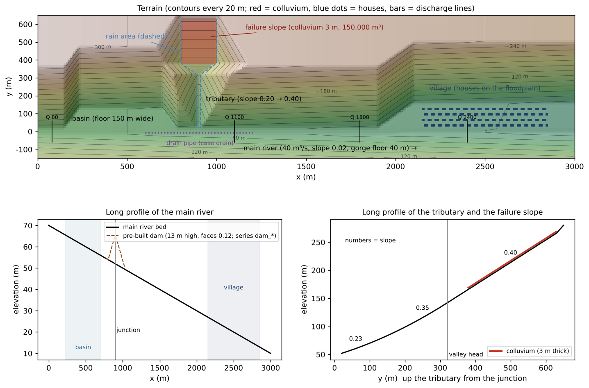
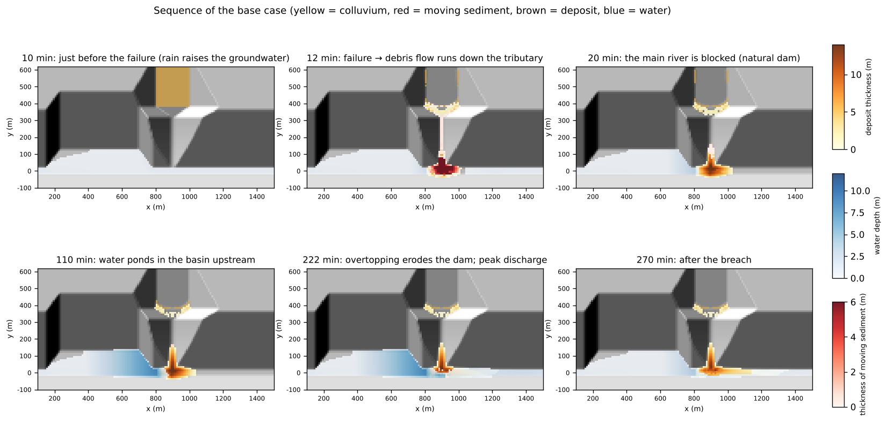
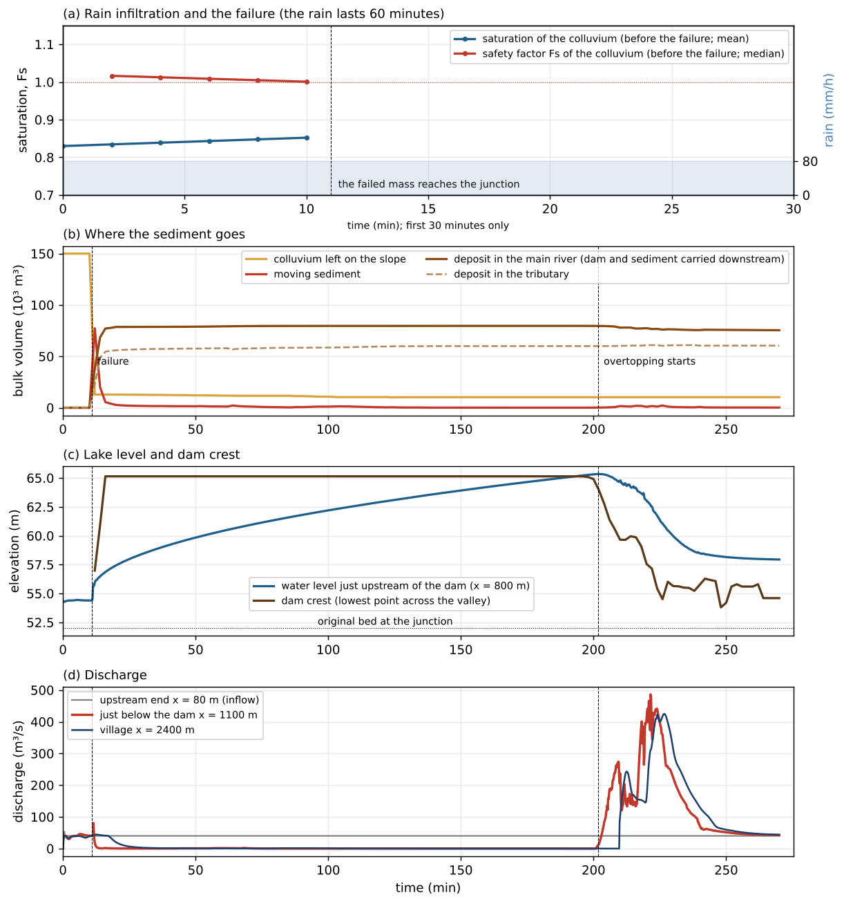
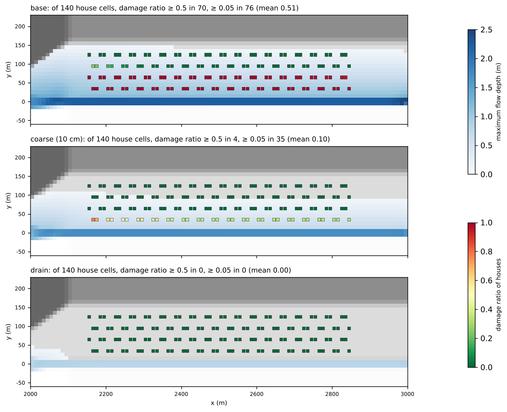
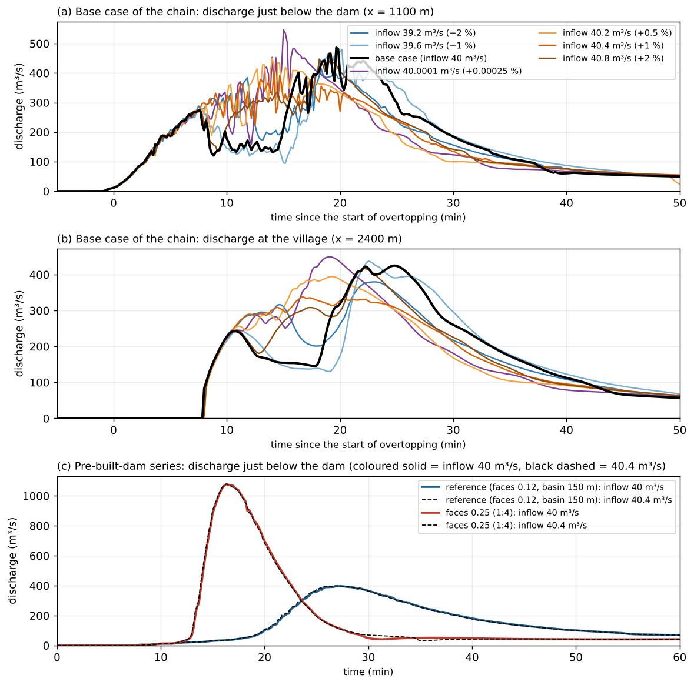
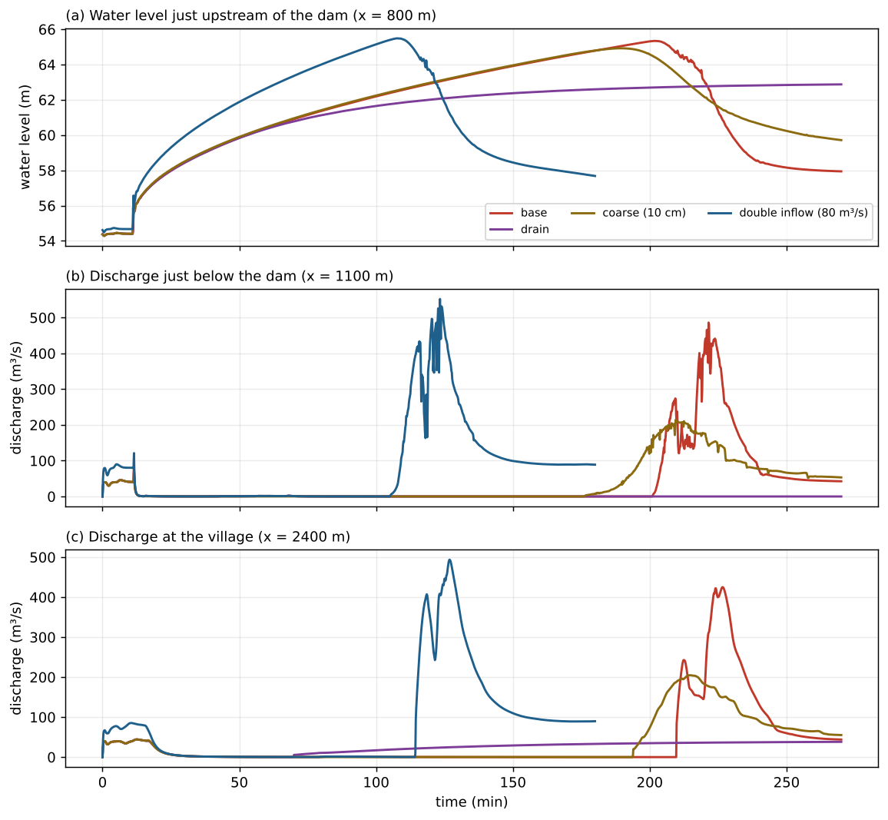
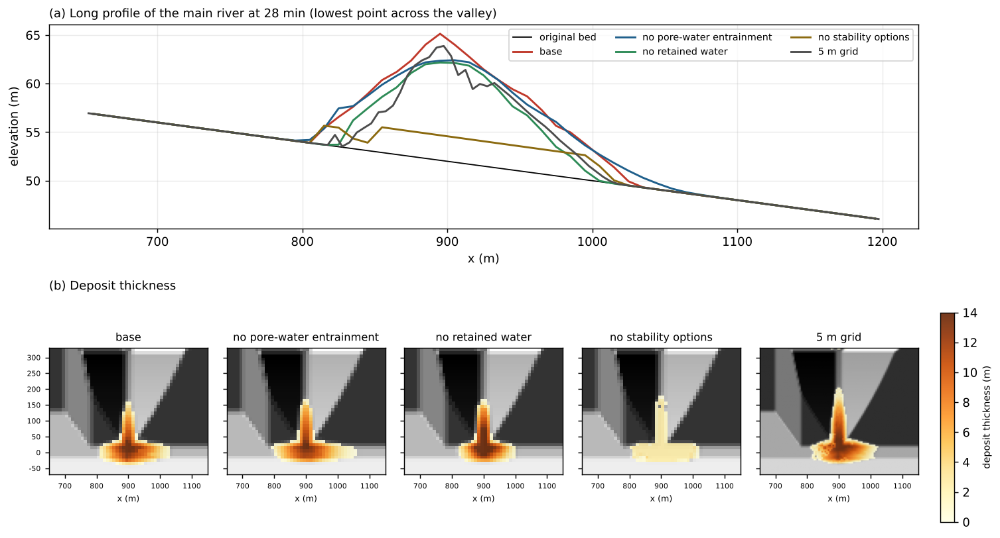
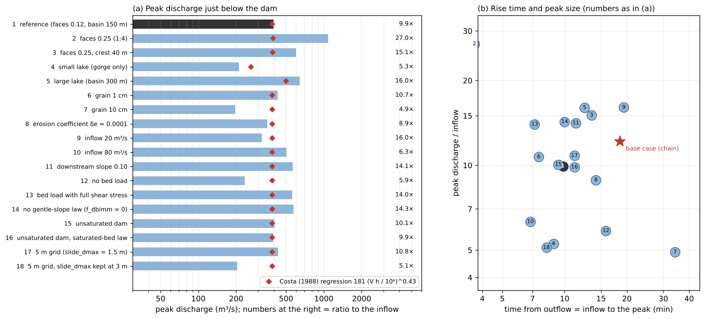

# debris_dam — from a rain-triggered slope failure to a debris flow, a natural dam and its outburst flood

English mirror of examples/debris_dam/README.md

[日本語](../README.md)

Heavy rain makes a slope fail; the failed mass becomes a debris flow, runs down a valley and blocks a river,
forming a natural dam (landslide dam). Water ponds upstream, and when the flow that overtops the dam erodes
and breaches it, the stored water becomes a flood that strikes the reach downstream. This example connects, in
one computation, the onset of the failure by rain infiltration, the debris flow, the blockage, the ponding, the
overtopping, the breach and the damage to the houses of a village downstream. In addition, computations with a
pre-built dam change the conditions that make a breach rapid (lake volume, dam shape, grain size, inflow,
downstream slope) one at a time and compare them with what is known about real natural dams. Computations
with slightly different inflows show how much the results vary (the spread of the results). The values are
schematic, chosen to make the phenomena easy to see; this is not a reproduction of a particular disaster.

## What happens at real natural dams

- **Formation**: Soil and rock that fail in earthquakes or heavy rain, or debris flows, fill a river and pond
  water upstream. In Japan natural dams formed in the 1889 Totsukawa disaster, the 1953 Arida River disaster, the
  1961 Onishiyama collapse and the Ontake collapse of the 1984 Western Nagano earthquake (Otaki River), among
  others (Ishikawa et al. 1992). In the 2004 Niigata Chuetsu earthquake they formed in the Imo River basin
  (Higashi-Takezawa and others), where pumping and monitoring were carried out (PWRI 2008).
- **They are short-lived**: In a sample of 63 documented cases, 22 % failed in less than 1 day after formation
  and half failed within 10 days (Schuster & Costa 1986).
- **How they fail**: There are three modes — erosion by overtopping, sliding failure and progressive failure
  (piping) — and almost all cases so far were caused by overtopping (PWRI 2008). Hardly any dam failed before
  the lake was full (Ishikawa et al. 1992). When the blocking material is highly permeable, seepage progresses
  and the dam may fail by sliding or progressive failure (PWRI 2008).
- **The overtopping flow changes along the dam**: Where the overflow starts it is close to clear water, and the
  sediment concentration grows by erosion as it runs down the downstream face. If the face is steeper than
  the slope needed for a debris flow to form and is long enough, a debris flow forms. As erosion proceeds the
  dam flattens, and in the end the whole reach becomes bed-load river-bed variation (Ishikawa et al. 1992).
- **Size of the flood**: Floods from the failure of landslide dams are summarised as smaller than floods from
  constructed dams impounding water with the same potential energy, and larger than floods from the failure of
  ice dams (Schuster & Costa 1986). The peak discharge decreases downstream (in a reconstruction of the
  Takaisoyama natural dam in Tokushima, the peak 42 km downstream was about one third of that 5 km downstream;
  Satofuka et al. 2007, as cited by PWRI 2008).
- **Countermeasures**: Excavating a drainage channel through the dam is the common measure, and pumps or
  siphons are used when the inflow is small. To prevent a breach by overtopping, either the lake level is
  lowered so that the dam is not overtopped, or a channel is made so that it is overtopped safely
  (Ishikawa et al. 1992).

## Mechanisms needed for the reproduction

| Real phenomenon | Representation in ENCflow | Settings |
|---|---|---|
| Heavy rain infiltrates the soil layer of the slope and the groundwater table rises | Rain (map × time series) and Green-Ampt infiltration; the subsurface storage of the soil layer fills from the bottom | `fn_precip` (`prtype = 2`), `fn_gwflow` (`f_gwvertical = 2`, `gw_sat0`) |
| Pore pressure makes the slope fail | The soil layer of cells whose infinite-slope safety factor falls below 1 is fluidised | `f_slide = 1`, `slide_phi`, `slide_gamma` |
| The failed mass flows out with the water it contains | The water of the soil layer (drainable water and the retained water that moves with the soil) is moved into the flow together with the sediment | `f_dbwet = 3`, `sy0`, `fluv_porosity` |
| The debris flow runs down the valley and deposits where the slope is gentle | Resistance law and erosion–deposition law of Takahashi & Nakagawa (1991); sediment that has stopped becomes terrain | `f_debris = 1`, `f_dbed = 3`, `f_dbres = 3`, `f_dbstop = 1` |
| The deposit blocks the river and water ponds upstream | The deposit raises the ground elevation, and the shallow-water computation solves the ponding | (terrain update) |
| Slopes under the lake and the dam do not fail merely because they are submerged | The seepage force enters the safety factor through the total-head gradient; in thick deposits only the surface layer is judged | `f_slide_seep = 1`, `slide_dmax`, `f_slide_wet = 1`, `f_slide_noflow = 1` |
| The overflow erodes the dam and carries the sediment downstream | Erosion law for a saturated deposit, equilibrium concentration on gentle slopes (bedload-like collective flow), bed load, angle-of-repose avalanching of the breach walls | `f_dbimm = 1`, `db_immexp = 2`, `f_fluvial = 1`, `f_repose = 1` |
| The flood sweeps houses away | Destruction of houses by the load (h + (1 + s) hs) V², and their debris | `fn_bldgdebris` (`f_bdcrit = 2`), `fn_gv` |
| A drain lowers the lake level | A culvert connecting the upstream and downstream sides of the dam | `fn_structure` (`&list_struct_culvert`) |

The failure, the debris flow and the erosion of the dam happen one after another inside the same sediment
computation (`f_debris`); the computation is not switched on the way, and neither the shape of the dam nor the
time of the breach is prescribed. The equations and the basis of the default values are in the
[explanation of debris flows and slope failures](../../../docs/en/users_guide/massflow.md) of the users guide.

## Geometry and settings



Top: terrain (contours every 20 m). Red = the failure slope with the colluvium, dashed blue = rain area, blue
dots = houses, vertical bars = discharge lines, dotted purple = drain pipe (case drain). Bottom left: long
profile of the main river (the dashed brown line is the dam that is pre-built in the series comparing the
breach conditions). Bottom right: long profile of the tributary and the failure slope (numbers are slopes).

- **Domain and grid**: 3,000 m × 800 m, grid spacing 10 m (300 × 80 cells), time step 0.1 s. x points down
  the main river.
- **Main river**: bed slope 0.02. A gorge with a 40 m wide floor (walls at 35°); 40 m³/s enters at the
  upstream end (normal depth 0.47 m). Upstream of the junction, at x = 150–780 m, the valley floor widens to
  the north into a basin (floor 150 m wide), where the blocked water ponds. The downstream end is a free
  outflow.
- **Tributary and failure slope**: The tributary joins from the north at x = 900 m. Its floor is 20 m wide
  and its slope increases from 0.20 at the junction to 0.40 at the valley head. Above the head, a slope of
  0.40 (21.8°; 200 m wide × 250 m long) carries 3 m of colluvium (150,000 m³). Only this is a soil layer;
  everything else is non-erodible bedrock (deposited sediment is erodible).
- **Rain and soil layer**: 80 mm/h of rain for 60 minutes on the tributary floor and the failure slope. The
  porosity of the soil layer is 0.4, of which 0.2 is drainable (specific yield) and the remaining 0.2 is
  retained water that moves with the soil. The saturated hydraulic conductivity is 100 mm/h (all the rain
  infiltrates) and the initial saturation is 0.83 (a slope wetted by antecedent rain).
- **Failure condition**: infinite-slope safety factor (cohesion 0, friction angle 35°, saturated unit weight
  19.5 kN/m³). On the slope of 0.40 the safety factor falls below 1 when the saturation rises to 0.85.
  Starting from 0.83, this takes about 10 minutes of rain at 80 mm/h (the missing water is
  (0.853 − 0.83) × 0.2 × 3 m = 14 mm). The friction angle and the unit weight are matched to the internal
  friction angle and the concentration of the debris flow, so that a mass that fails when saturated flows
  out as it is ("Matching the failure condition and the flow condition", §4 of the
  [explanation of debris flows and slope failures](../../../docs/en/users_guide/massflow.md)).
- **Options of the stability test**: Slopes and the dam under the lake are also judged, so the seepage force
  is taken from the gradient of the total head (`f_slide_seep = 1`), only failures caused by pore pressure
  are mobilized (`f_slide_wet = 1`), and cells under a dense mixture are not judged (`f_slide_noflow = 1`).
  The depth judged and mobilized at one time, `slide_dmax`, is 3 m (the thickness of the colluvium). The
  colluvium saturates from its base, so the slip surface is at the base of the layer, and a smaller value
  delays the failure. On the other hand, if it is large relative to the grid spacing, the step left by a
  mobilization brings down the neighbouring cells and the mobilization propagates (in this example it does
  at 0.6 times the grid spacing and does not at 0.3 times). The 5 m case of the pre-built-dam series
  (`dam_dx5`) therefore uses 1.5 m ("Grid spacing" in the
  [section below](#artefacts-of-the-model)).
- **Debris flow and erosion of the dam**: the stony type of Takahashi & Nakagawa (1991). Grain size 3 cm,
  internal friction angle 35°, erosion coefficient δe = 0.0007 (default; Takahashi's general value),
  deposition coefficient δd = 0.5 (the value the paper applied to Horadani). Gentle slopes use the
  equilibrium concentration of the bedload-like collective flow, 6.7c∞² (Takahashi, Nakagawa & Yamashiki
  1991). Bed load (Ashida–Michiue) is combined, with an effective-shear ratio of 0.6 (the ratio of the
  grain roughness, 0.027–0.031, to the channel roughness, 0.04, raised to the power 1.5; "Combination with bed
  load", §3 of the same explanation).
- **Village**: downstream of x = 2,100 m. A low-water channel 20 m wide and 1.2 m deep (96 m³/s bankfull) and
  a floodplain 150 m wide on the north bank (1 m higher 100 m away from the bank). The houses are 70 buildings (one building is
  20 m × 10 m, 2 cells) in four rows 25, 55, 85 and 115 m from the bank (building porosity 0.5; house stock at the default,
  0.3 m³/m²). They start to fail at a load (h + (1 + s) hs) V² of 1 m³/s², and the destructible fraction
  becomes 1 at 4 m³/s² (the guide values for "debris flows and flood flows striking a village" in
  [house destruction and debris](../../../docs/en/users_guide/bldgdebris.md) of the users guide).
- **Output**: maps every 2 minutes (bil); probes and discharge lines every 10 seconds.

The cases fall into four groups. `param.txt` (the base case) is the annotated template, and
`make_init.py` writes `param_<case>.txt` of the other cases by replacing lines (replaced lines carry the
note "基本ケースは …", i.e. the value of the base case).

| Group | Case | Difference from the base case | Computed time |
|---|---|---|---|
| Chain | `base` | — (from the heavy rain to the damage to houses) | 270 min |
| | `drain` | drain pipe (a culvert 4 m wide × 3 m high; inlet at x = 600 m, outlet at x = 1,200 m, inverts 1.5 m above the bed) | 270 min |
| | `coarse` | grain size 10 cm | 270 min |
| | `q80` | discharge of the main river 80 m³/s | 180 min |
| First half of the chain | `norain` | no rain (no failure; control) | 30 min |
| | `wet0` | no pore-water entrainment (`f_dbwet = 0`; no water is exchanged with the bed in erosion and deposition) | 30 min |
| | `wet2` | no exchange of retained water (`f_dbwet = 2`; only the drainable water is exchanged) | 30 min |
| | `slide0` | none of the four options of the stability test | 30 min |
| | `g5` | grid spacing 5 m | 30 min |
| Spread of the results | `base_m2`, `base_m1`, `base_eps`, `base_p05`, `base_p1`, `base_p2` | only the inflow of the base case is changed to 39.2, 39.6, 40.0001, 40.2, 40.4 and 40.8 m³/s (−2 to +2 %; the initial depth stays that of 40 m³/s) | 270 min |
| | `dam_ref_p1`, `dam_face25_p1` | only the inflow of two cases of the pre-built-dam series is changed to 40.4 m³/s (+1 %) | 60 min |
| Pre-built dam | `dam_ref` and 17 others | a 13 m high dam is placed at the junction and the lake starts filled to the crest (no rain, no colluvium). Lake volume, dam shape, grain size, inflow, downstream slope, grid spacing and the choice of laws are changed one at a time ([section below](#conditions-for-a-rapid-breach-computation-and-real-natural-dams)) | 60 min (90 min for the six cases that rise slowly) |

## How to run

```bash
cd examples/debris_dam
make                     # links, and the inputs and settings of all 27 cases (make_init.py)
make run                 # compute all 27 cases in turn
make perturb             # compute the 8 cases that show the spread of the results (only the inflow is changed slightly)
python3 plot_results.py  # figs/*.png and tables (argument en writes the English version to en/figs/; setup.png can be drawn before the computation)
```

`make quick` computes only the base case, the drain and the four main cases of the pre-built-dam series;
`make dams` computes only the 18 cases of the pre-built-dam series. The 8 cases of `make perturb` are not
part of `make run` (they are used in the figure and the table of "Spread of the results"). For a single
case, run `./encflow param.txt` (the base case).

## Results

### The chain (base case)



Six times, from the basin to the reach below the junction (yellow = colluvium, red = moving sediment, brown =
deposit, blue = water).



(a) Saturation and safety factor of the colluvium before the failure. (b) Where the sediment goes (bulk
volume). (c) Water level just upstream of the dam and the elevation of the dam crest. (d) Discharge. The
dashed vertical lines mark the failure and the start of overtopping.

1. **Rain infiltration and failure (0–11 min)**: Rain infiltrates and the saturation of the colluvium rises
   from 0.83 to 0.852 in 10 minutes. At 10.5 minutes the safety factor falls below 1 and 482 of the 500 cells
   with a soil layer fail within 40 seconds (18 cells at the edge of the slope remain).
2. **Debris flow (11–14 min)**: The failed mass (bulk volume 137,000 m³) flows out with the water it contains
   and runs down the tributary valley at up to 24 m/s (the flow depth is 7–8 m in the middle of the valley
   and up to 15 m at the junction). The front reaches the junction about 30 seconds after the failure.
3. **Blockage (until 16 min)**: The debris flow fills the valley of the main river and stops; the deposit is
   more than 10 m thick 2 minutes after the failure. 79,000 m³ deposits in the main river and 57,000 m³ in
   the tributary valley, and 5 minutes after the failure a dam 13.0 m high (crest elevation 65.1 m) has
   formed. The dam is a triangle 210 m long along the river (x = 815–1,025 m), with a slope of 0.16 on the
   upstream face and 0.10 on the downstream face. The discharge just below the dam drops to 1 m³/s
   3 minutes after the failure, and the river at the village dwindles (half the discharge at 20 minutes,
   3 m³/s at 30 minutes, below 1 m³/s at 45 minutes).
4. **Ponding (16–202 min)**: The 40 m³/s of the main river ponds in the basin upstream, and the water level
   takes 3 hours to reach the crest (stored volume 460,000 m³). During this time the shape of the dam does
   not change and the river downstream stays dry (depth in the low-water channel at the village
   0.71 m → 0.01 m).
5. **Overtopping and breach (from 202 min)**: When the water overtops the crest, the flow starts to erode the
   downstream face. The discharge just below the dam reaches 170 m³/s 4 minutes after the start of
   overtopping and 270 m³/s after 7 minutes, and the crest is lowered by 4.6 m in 6 minutes
   (65.1 → 60.6 m). At this point the walls of the breach (10 m wide) collapse and fill its bottom by about
   2 m; the discharge falls back to 120–210 m³/s and stalls for about 8 minutes. Once the collapsed sediment
   has been carried away the discharge rises again and peaks at 490 m³/s (12 times the inflow) 20 minutes
   after the start of overtopping (this stall and the size of the peak change with slight differences in
   the conditions; see "Spread of the results" below). Sixty minutes after the start of overtopping the lake level has fallen
   by 7.3 m, and the water released in excess of the inflow amounts to 430,000 m³ (94 % of the stored
   volume). At the end of the computation (270 min) a dam 3.5 m high remains.
6. **Flood downstream (from 210 min)**: The front of the flood reaches the village 1.5 km downstream
   8 minutes after the start of overtopping. The discharge of the river, which had run dry, exceeds
   150 m³/s within a minute and reaches a first crest of 240 m³/s after 11 minutes. After falling back to
   150 m³/s it peaks at 425 m³/s after 25 minutes (4.4 times the 96 m³/s that the low-water channel carries
   when full). The discharge stays above 1.5 times the normal flow for 40 minutes.


Long profile of the main river (solid = bed, dashed = water surface). The dam is eroded from the top, and
the eroded sediment deposits from the toe downstream (27,000 m³ at x = 1,000–1,500 m, up to 5 m thick). The
face becomes gentler as it extends downstream, which slows the erosion.

### Damage in the village



Maximum flow depth in the village (blue) and damage ratio of the houses (colour of the squares). From the
top: base case, grain size 10 cm, drain pipe.

In the base case the floodplain is inundated up to 130 m from the bank (maximum depth in the low-water
channel 2.5 m). The damage is graded by the distance from the bank.

| Row (distance from the bank) | Maximum flow depth (m) | Maximum load (m³/s²; mean and maximum of 35 cells) | Damage ratio (mean and maximum) |
|---|---|---|---|
| Row 1 (25 m) | 0.9 | 8.8 / 10.1 | 1.00 / 1.00 (destroyed) |
| Row 2 (55 m) | 0.6 | 3.7 / 5.6 | 0.99 / 1.00 |
| Row 3 (85 m) | 0.4 | 1.1 / 2.0 | 0.03 / 0.26 |
| Row 4 (115 m) | 0.1 | 0.1 / 0.4 | 0 |

What decides it is where the load exceeds the 1 m³/s² at which damage starts and the 4 m³/s² at which the
destructible fraction becomes 1. The load on the third row is just above the value at which damage starts,
so the damage of this row is sensitive to the size and the duration of the flood. The damage ratio of the
second row also varies between 0.56 and 1.00 with the spread of the peak discharge of the breach ("Spread of the
results" below).

### Spread of the results (computations with slightly different inflows)



(a), (b) Discharge just below the dam and at the village for the base case with only the inflow changed to
39.2–40.8 m³/s (aligned at the start of overtopping). (c) Two cases of the pre-built-dam series computed
with inflows of 40 and 40.4 m³/s.

| Case | Inflow (m³/s) | Start of overtopping (min) | Peak discharge: just below the dam / village (m³/s) | Time from the start of overtopping to the peak (min) | Dip on the way | Mean damage ratio of the houses: row 1 / row 2 / row 3 from the bank |
|---|---|---|---|---|---|---|
| `base_m2` | 39.2 | 206 | 416 / 380 | 18 | 0.45 | 1.00 / 0.59 / 0 |
| `base_m1` | 39.6 | 204 | 480 / 437 | 20 | 0.34 | 1.00 / 0.98 / 0.03 |
| `base` (base case) | 40 | 202 | 486 / 425 | 20 | 0.44 | 1.00 / 0.99 / 0.03 |
| `base_eps` | 40.0001 | 202 | 547 / 449 | 15 | 0.43 | 1.00 / 1.00 / 0.04 |
| `base_p05` | 40.2 | 201 | 450 / 395 | 14 | 0.61 | 1.00 / 0.90 / 0.01 |
| `base_p1` | 40.4 | 200 | 407 / 338 | 14 | 0.62 | 1.00 / 0.56 / 0 |
| `base_p2` | 40.8 | 198 | 448 / 417 | 18 | 0.49 | 1.00 / 0.72 / 0.01 |
| `dam_ref` | 40 | 10 | 397 / 386 | 18 | 0.96 | 1.00 / 0.78 / 0 |
| `dam_ref_p1` | 40.4 | 10 | 399 / 388 | 17 | 0.99 | 1.00 / 0.80 / 0.01 |
| `dam_face25` | 40 | 10 | 1,078 / 1,050 | 7 | 1.00 | 1.00 / 1.00 / 1.00 |
| `dam_face25_p1` | 40.4 | 10 | 1,079 / 1,048 | 7 | 1.00 | 1.00 / 1.00 / 1.00 |

The "dip on the way" is the minimum, between the start of overtopping and the peak, of the discharge divided by
its largest value up to that time (below 0.5 the discharge fell to less than half before the peak).

- **The pre-built-dam series is stable against slight differences**. With the inflow increased by 1 %, the peak
  discharge changes by only +0.5 % for the reference dam (397 → 399 m³/s) and +0.1 % for the dam with faces of
  0.25 (1,078 → 1,079 m³/s) (the two lines coincide in (c)). Differences between the cases of the series can be read
  as the effect of the conditions.
- **The base case of the chain changes with slight differences**. In 7 computations with the inflow varied between
  39.2 and 40.8 m³/s (±2 %), the peak discharge just below the dam is 407–547 m³/s, the peak at the village
  338–449 m³/s, and the time from the start of overtopping to the peak 14–20 minutes. The peaks are
  not ordered by the inflow (table). Merely changing the inflow to 40.0001 m³/s (+0.00025 %) gives a peak of 547 m³/s (+13 %).
  The mean damage ratio of the houses is 0.56–1.00 in the second row from the bank and 0.00–0.04 in the
  third.
- **The runs part where the walls of the breach collapse**. In all computations the discharges differ by less than
  a tenth for the first 8 minutes after the start of overtopping and part from there ((a)). The dam built by the
  debris flow is higher on the tributary side
  and about 4 m lower on the opposite side, so the overflow concentrates in a narrow breach (1–4 cells = 10–40 m
  wide) on the opposite side. When a wall of the breach (the thick deposit on the tributary side) collapses and
  blocks it, the discharge falls to less than half of what it was (5 of the 7 runs; "dip on the way" below 0.5
  in the table). The timing and volume of the collapse change with slight differences in the conditions. The
  dams of the series have a crest that is level across the valley and are overtopped over the full width, so
  the breach does not narrow and such collapses do not block the flow.
- **How to read the results**: Read the numbers of the chain cases (peak discharge, damage to houses) with this
  spread in mind. Details of the course such as the stall of the base case are one of the courses that can
  occur. The differences from the drain case (no overtopping) and from the 10 cm grains (peak 214 m³/s) are
  well beyond this spread. The effect of the conditions (lake volume, face slope, grain size, inflow) is read
  more reliably from the pre-built-dam series. For a real site too, run several computations with slightly
  different conditions and check the spread of the results.

### Countermeasure and different conditions (chain cases)



(a) Water level just upstream of the dam. (b) Discharge just below the dam (the outlet of the drain lies
downstream of this line). (c) Discharge at the village.

| Case | Dam height (m) | Start of overtopping (min) | Peak discharge: just below the dam / village (m³/s) | Ratio to the inflow | Rise time (min) | Dam height at the end (m) | Mean damage ratio of the houses: row 1 / row 2 / row 3 from the bank |
|---|---|---|---|---|---|---|---|
| `base` | 13.0 | 202 | 486 / 425 | 12.2 | 18 | 3.5 | 1.00 / 0.99 / 0.03 |
| `drain` | 13.0 | no overtopping | — / 38 | — | — | 13.0 | 0 / 0 / 0 |
| `coarse` | 12.4 | 181 | 214 / 205 | 5.4 | 20 | 4.7 | 0.41 / 0 / 0 |
| `q80` | 13.0 | 107 | 552 / 494 | 6.9 | 14 | 2.5 | 1.00 / 1.00 / 0.16 |

The "rise time" is the time from the discharge just below the dam exceeding the inflow to its peak.

- **Drain (`drain`)**: The culvert starts to carry water at 45 minutes, when the lake level exceeds the
  invert of its inlet (59.5 m). Its discharge grows as the level rises, and at 270 minutes it carries
  38 m³/s (96 % of the inflow) at a level of 62.9 m, which is almost in balance. The level stops 2.3 m below
  the crest (65.1 m), and neither overtopping nor a breach occurs. The dam stays 13 m high. The river at
  the village starts to flow again at about 70 minutes and slowly approaches its normal discharge
  (20 m³/s at 110 minutes). The floodplain is not inundated.
- **Coarse sediment (`coarse`)**: With a grain size of 10 cm the deposit of the debris flow is slightly flatter
  (dam height 12.4 m, downstream face 0.095) and overtopping starts earlier (181 minutes). The erosion is
  slow: the discharge grows to 46 m³/s in 10 minutes and to 140 m³/s in 20 minutes, and peaks at 214 m³/s
  (5.4 times the inflow, 0.44 times the base case) 28 minutes after overtopping starts. In the village the
  floodplain is inundated up to 80 m from the bank, and the houses of the row nearest the bank start to be
  damaged under a load of 1.7 m³/s² (2.0 at most), but their mean damage ratio stays at 0.41 (0.76 at
  most). The houses of the second row and beyond are not damaged. A dam 4.7 m high remains at the end of
  the computation.
- **Double inflow (`q80`)**: The time to fill is halved (overtopping starts at 107 minutes) and the peak
  rises to 552 m³/s, but its ratio to the inflow falls from 12.2 to 6.9. The initial rise is faster: the
  discharge reaches 390 m³/s 7 minutes after overtopping starts (270 m³/s in the base case). Here too the
  walls collapse and fill the breach, the discharge falls back to 160 m³/s, and the peak comes after
  16 minutes. All houses of the first two rows from the bank are destroyed (loads of 11 and 5.2 m³/s²), and
  part of the third row starts to be damaged (mean damage ratio 0.16, 0.60 at most). The peak of the
  base case varies between 407 and 547 m³/s with slight differences in the inflow ("Spread of the results"
  above), so the effect of the inflow cannot be read from the difference in the peaks (486 → 552 m³/s);
  read it from the pre-built-dam series (section below).
- **No rain (`norain`)**: Without rain there is no failure, and the main river keeps flowing at 40 m³/s. The depth
  in the low-water channel at the village is 0.71 m and the floodplain is not inundated (control).

### How the dam forms (pore-water treatment, options of the stability test, grid spacing)



(a) Long profile of the main river at 28 minutes. (b) Deposit thickness.

| Case | Dam height (m) | Dam length (along the river; m) | Face slopes: upstream / downstream | Deposit in the main river (10⁴ m³) | Deposit in the tributary (10⁴ m³) | Sediment still moving (10⁴ m³) |
|---|---|---|---|---|---|---|
| `base` | 13.0 | 210 | 0.16 / 0.10 | 7.9 | 5.7 | 0.2 |
| `wet0` (no pore-water exchange) | 10.5 | 230 | 0.12 / 0.075 | 7.7 | 5.7 | 0.2 |
| `wet2` (no exchange of retained water) | 10.2 | 160 | 0.15 / 0.11 | 6.5 | 6.8 | 0.2 |
| `slide0` (no options of the stability test) | not yet terrain | — | — | 2.4 | 1.5 | 11.0 |
| `g5` (5 m grid) | 11.8 | 185 | 0.16 / 0.11 | 6.7 | 6.7 | 1.0 |

Values at 28 minutes (17.5 minutes after the failure).

- **Pore-water treatment**: In the base case (`f_dbwet = 3`) the failed mass flows out with all the water of
  the soil layer (drainable and retained), and takes up the same proportion of water from the flow when it
  deposits. In `wet2` and `wet0` the failed mass carries only the drainable water and is denser
  (concentration 0.78). In `wet2` more sediment stays in the tributary valley (68,000 m³) and the dam is
  2.8 m lower. In `wet0` the deposit takes no water from the flow, so it spreads flatter and longer (faces
  0.12 and 0.075) and the dam is 2.5 m lower. The dam height sets the lake volume, so the pore-water
  treatment changes even the size of the later breach.
- **Options of the stability test**: In `slide0`, without the four options, the deposited sediment is
  fluidised again and again and does not become terrain; at 28 minutes 110,000 m³ is still moving sediment
  (the river is blocked, but the mass does not consolidate into a dam). This is because the conventional
  formula estimates the safety factor of a submerged slope at about half its value and fluidises a thick
  deposit down to its base at once (§4 of the
  [explanation of debris flows and slope failures](../../../docs/en/users_guide/massflow.md)).
- **Grid spacing**: With the 5 m grid (`g5`) more sediment stays in the tributary valley (67,000 m³; 57,000 m³
  on the 10 m grid) and the dam is 1.2 m lower (11.8 m). The tributary floor (20 m wide) is 2 cells on the 10 m grid
  and 4 cells on the 5 m grid, which changes the flow and the shape of the deposit inside the valley. The dam
  height depends on the grid spacing by about 9 %.

## Conditions for a rapid breach (computation and real natural dams)

In the base case the discharge reached 12 times the inflow 20 minutes after overtopping started. For dams of
the same height, the peak discharge of the breach varies by a factor of 5 and the rise time of the discharge by a
factor of 9, depending on the conditions.
Here a dam 13 m high is placed at the junction from the start and the computation begins
with the lake filled to the crest (no rain and no colluvium; the dam is saturated), and the conditions are
changed one at a time. The reference (`dam_ref`) is a triangle with face slopes of 0.12, close to the dam that
the debris flow builds in the base case (its crest is level across the valley, whereas the dam built by the
debris flow is higher on the tributary side). The conditions that appear in the computation are then sorted into
those that also hold for real natural dams and those that are artefacts of the model.

### What sets the speed of a breach (water balance of the lake)

The discharge over the dam, Q, is set by the difference between the lake level and the crest elevation (the
overflow depth H). With the lake area A, the inflow Q_in and the rate E at which the crest is lowered, the
water balance of the lake gives

```
dH/dt = E − (Q − Q_in) / A
```

While the crest is lowered faster than the lake level falls, E > (Q − Q_in)/A, the overflow depth grows and
the discharge keeps increasing. When the two balance, the discharge levels off at

```
Q ≈ Q_in + E·A
```

The discharge in excess of the inflow is roughly "the rate at which the crest is lowered × the lake area".
This is merely a rearrangement of the water balance of the lake and does not depend on the sediment model.
The wider the lake and the faster the dam erodes, the more rapid the breach. When the lake is very wide or
the erosion very fast, the dam is cut down to its base before the lake level falls, and the discharge
approaches the upper limit set by the width of the valley and the height of the dam (roughly 3,000 m³/s for
an overflow 40 m wide and 13 m deep).

The rate E is set by the amount of sediment that the water running down the downstream face can carry (unit
discharge × equilibrium concentration) and by whether the river downstream can carry that sediment away.

- **Slope of the face**: The equilibrium concentration of the Takahashi & Nakagawa law rises steeply with
  the slope (with the values of this example, 0.105 at a slope of 0.12 and 0.34 at 0.25). The factor of the
  erosion rate, C∞/(C* − C∞), is 0.21 and 1.28, a sixfold difference.
- **A larger discharge erodes faster**: The erosion rate is proportional to the unit discharge, so once the
  dam is cut and the overflow depth grows, it is cut even faster (positive feedback).
- **The eroded sediment deposits at the toe**: When the river downstream is gentle, the sediment it cannot
  carry deposits at the toe, the face becomes gentler, the equilibrium concentration falls and the erosion
  slows (negative feedback).

### Conditions compared in the computation


Discharge just below the dam (x = 1,100 m). Black is the reference, and one condition is changed in each
panel (logarithmic vertical axis).



(a) Peak discharge (bars; the numbers on the right are the ratio to the inflow) and the value of the
regression of Costa (1988) (red diamonds). (b) Time from outflow = inflow to the peak, against the ratio of
the peak discharge to the inflow. Breaches towards the upper left are more rapid. The red star is the base
case (the chain).

| Condition changed | Case | Lake volume (10⁴ m³) | Peak discharge (m³/s) | Ratio to the inflow | Time of the peak (min) | Rise time (min) | Largest fall of the lake level in 10 min (m) | Dam height after 60 min (m) | Mean damage ratio of the houses |
|---|---|---|---|---|---|---|---|---|---|
| Reference (faces 0.12, basin 150 m, grain size 3 cm, inflow 40 m³/s) | `dam_ref` | 45 | 397 | 9.9 | 27 | 9.8 | 2.5 | 4.7 | 0.45 |
| Small lake (gorge only) | `dam_small` | 18 | 211 | 5.3 | 18 | 8.8 | 2.6 | 5.5 | 0.03 |
| Large lake (basin 300 m) | `dam_large` | 81 | 641 | 16.0 | 37 | 12.5 | 2.6 | 4.5 | 0.76 |
| Faces 0.25 (1:4) | `dam_face25` | 46 | 1,078 | 27.0 | 16 | 3.7 | 7.3 | 2.0 | 0.96 |
| Faces 0.25, crest 40 m (trapezoid) | `dam_crest40` | 45 | 602 | 15.1 | 37 | 13.5 | 4.4 | 1.8 | 0.60 |
| Grain size 1 cm | `dam_d1cm` | 45 | 428 | 10.7 | 19 | 7.5 | 2.8 | 5.0 | 0.51 |
| Grain size 10 cm | `dam_d10cm` | 45 | 197 | 4.9 | 60 | 34.2 | 1.2 | 7.4 | 0.07 |
| Erosion coefficient δe = 0.0001 | `dam_delte` | 45 | 354 | 8.9 | 34 | 14.2 | 2.2 | 5.7 | 0.35 |
| Inflow 20 m³/s | `dam_q20` | 45 | 321 | 16.0 | 44 | 19.3 | 2.4 | 4.7 | 0.31 |
| Inflow 80 m³/s | `dam_q80` | 45 | 505 | 6.3 | 18 | 6.8 | 2.8 | 4.8 | 0.55 |
| River-bed slope 0.10 downstream (400 m below the junction) | `dam_steep` | 45 | 565 | 14.1 | 28 | 11.3 | 4.1 | 3.8 | 0.61 |
| No bed load (Takahashi & Nakagawa laws only) | `dam_nofluv` | 45 | 234 | 5.9 | 34 | 15.8 | 1.3 | 7.1 | 0.19 |
| Effective-shear ratio of the bed load 1 | `dam_tau1` | 45 | 559 | 14.0 | 22 | 7.2 | 3.8 | 3.8 | 0.63 |
| No gentle-slope equilibrium concentration (`f_dbimm = 0`) | `dam_imm0` | 45 | 571 | 14.3 | 26 | 10.0 | 4.0 | 4.0 | 0.76 |
| Unsaturated dam (initial saturation 0.83) | `dam_unsat` | 45 | 402 | 10.1 | 26 | 9.3 | 2.6 | 5.0 | 0.45 |
| Unsaturated dam, saturated-bed erosion law (`f_dbunsat = 0`) | `dam_unsat0` | 45 | 394 | 9.9 | 29 | 11.2 | 2.6 | 4.7 | 0.45 |
| Grid spacing 5 m (`slide_dmax` 0.3 times, 1.5 m) | `dam_dx5` | 45 | 433 | 10.8 | 28 | 11.2 | 2.3 | 5.2 | 0.34 |
| Grid spacing 5 m, `slide_dmax` kept at 3 m | `dam_dx5d3` | 45 | 204 | 5.1 | 25 | 8.2 | 1.0 | 7.6 | 0.00 |

The time of the peak is counted from the start of the computation (the lake starts filled to the crest, and
the overflow reaches the section just below the dam after 6–15 minutes). The rise time is the time from the
discharge just below the dam exceeding the inflow to the peak. The damage ratio of the houses is the value at
the end of the computation.

- **Lake volume**: With 180,000, 450,000 and 810,000 m³ the peak is 211, 397 and 641 m³/s
  (5.3, 9.9 and 16.0 times the inflow). The peak grows roughly as the lake volume to the power 0.75. With a
  small lake the level falls early, and the overflow depth stops growing before the discharge has developed.
- **Slope of the downstream face**: Steepening the faces from 0.12 to 0.25 raises the peak from 397 to
  1,078 m³/s (2.7 times) and shortens the rise from 10 to 4 minutes; the lake level falls by 7 m in
  10 minutes. The dam is cut down to its base in about 10 minutes. This is the most rapid breach of the series.
- **Crest length**: With the same faces of 0.25 and a crest 40 m long (a trapezoid), the peak falls to 602 m³/s
  (0.56 of the triangle) and comes 20 minutes later. The flat crest is not eroded; the head of the downstream
  face has to cut back through the crest (40 m in 9 minutes) and reach the lake side before the crest starts to be
  lowered.
- **Grain size**: With 1 cm the peak is 428 m³/s (1.1 times) at 19 minutes (reference: 27 minutes). With 10 cm it is
  197 m³/s (0.5 times) and comes after 60 minutes.
- **Inflow**: With 20, 40 and 80 m³/s the peak is 321, 397 and 505 m³/s. A larger inflow gives a larger and
  earlier peak (44, 27 and 18 minutes), but its ratio to the inflow decreases (16, 9.9 and 6.3 times).
- **River-bed slope downstream**: With a slope of 0.10 over the 400 m below the dam, the eroded sediment is carried
  away instead of depositing at the toe, and the peak becomes 565 m³/s (1.4 times).
- **Choice of the laws**: Without bed load the peak is 234 m³/s (0.6 times), with the full shear stress in the
  bed-load formula 559 m³/s (1.4 times), and without the gentle-slope equilibrium concentration 571 m³/s
  (1.4 times). For the same dam, the choice of the laws alone changes the peak by a factor of 2.4.
- **Damage to houses**: The mean damage ratio of the houses in the village (four rows, 140 cells) is 0.19 or
  less for peaks below 250 m³/s, 0.31–0.51 for 250–480 m³/s, 0.55–0.76 for 480–800 m³/s, and 0.96 for the
  1,078 m³/s of `dam_face25`. The rapidity of the breach translates directly into the difference in damage
  downstream.

### Correspondence with what is known about real natural dams

| Condition | Computation of this example | Reports on real natural dams, experiments and other computations | Correspondence |
|---|---|---|---|
| Lake volume (lake area, dam height) | With lake volumes of 180,000, 450,000 and 810,000 m³ the peak is 211, 397 and 641 m³/s; roughly as the lake volume to the power 0.75 | The peak discharge correlates strongly with the dam height and the river-bed slope (for the same height, a gentler river stores more water) (64 computed cases of Ishikawa et al. 1992). The regression is a power of stored volume × dam height (Costa 1988, as cited by PWRI 2008) | Agrees. The relation follows from the water balance of the lake and does not depend on the model |
| Slope of the downstream face | From faces of 0.12 to 0.25 the peak goes from 397 to 1,078 m³/s (2.7 times) and the rise from 10 to 4 minutes | If the face is steeper than the slope needed for a debris flow to form and is long enough, the overflow becomes a debris flow (Ishikawa et al. 1992). In the computations of the same paper (faces 1:2 and 1:4) the peak discharge shows no clear relation with the face slope | Agrees conditionally. Both faces of Ishikawa et al. are steeper than the slope at which a debris flow forms (0.20–0.23 when the values of this example are put into the formula of that paper). The difference in this example is the difference between being above and below that slope |
| Crest length (dam shape) | With the same faces of 0.25, 1,078 m³/s for the triangle and 602 m³/s for the trapezoid (crest 40 m). The trapezoid peaks 20 minutes later | In computations for dams that are nearly the same except for their shape, the peak discharge of a triangular dam is more than 5 times that of a trapezoidal one (Satofuka et al. 2007, as cited by PWRI 2008). In flume experiments the peak is the same for triangular and trapezoidal dams, and the trapezoidal one peaks later (Akazawa et al. 2014). In the computations of Ishikawa et al. (1992) there is no clear relation with the crest length | The reports themselves disagree. In this computation the trapezoid is smaller (the triangle is 1.8 times the trapezoid) and later. The direction agrees with both reports and the size lies between them |
| Grain size | The peak for 1 cm is 1.1 times that for 3 cm. For 10 cm it is 0.5 times, and it comes after 60 minutes (27 minutes for 3 cm) | In the estimation formulas of Ishikawa et al. (1992), the peak for a mean grain size of 0.25 mm is 1.6 to 2 times that for 2.5 mm. Dams of coarse material remain stable under ordinary inflows (experiments of Shi et al. 2022) | The direction agrees. With a single grain size, however, the effect of coarse grains staying behind and stopping the erosion is not included |
| Inflow | With inflows of 20, 40 and 80 m³/s the peak is 321, 397 and 505 m³/s, the time of the peak 44, 27 and 18 minutes, and the ratio to the inflow 16, 9.9 and 6.3 (the inflow to the power −0.67) | The larger the inflow, the larger the peak and the shorter the time to the peak (experiments of Zhou et al. 2021 and Akazawa et al. 2014). The ratio to the inflow decreases as the inflow grows (the inflow to the power −0.565 in the formula of Tabata et al., as cited by PWRI 2008) | Agrees |
| River-bed slope downstream | Steepening only the 400 m below the dam to 0.10, without changing the lake volume, makes the peak 1.4 times larger | For the same dam height, the gentler the river the larger the peak (Ishikawa et al. 1992; a gentler river stores more water) | No contradiction. This example steepens only the reach below the dam without changing the lake volume. In a real river a gentler slope increases the stored volume, and that effect is larger |
| Size of the dam | The length of the dam is not varied | In a regression of 43 Japanese cases, larger discharge and dam height make a dam less stable, and larger dam width and length make it more stable (Dong et al. 2011) | The direction for the dam height agrees. Width and length are not compared |
| Mode of failure | Erosion by overtopping only | Mostly overtopping. Sliding and progressive failure when the material is highly permeable (PWRI 2008). Large slides increase the peak discharge (Takayama et al. 2020) | Modes other than overtopping are not represented |

In summary, the conditions for a rapid breach that also hold for real natural dams are the following three.

1. **A large stored volume** (a high dam, a gentle river, a wide valley upstream). The discharge in excess of
   the inflow is "the rate at which the crest is lowered × the lake area", which is the water balance itself.
2. **A downstream face that is steeper than the slope at which a debris flow forms, and long**. A dam formed
   by a failed mass filling the valley as it is tends to have steep faces, while a dam deposited by a debris
   flow that ran into the river is gentler (0.10 in the base case). That the face slope matters agrees with
   the description of Ishikawa et al. (1992), but "a dam built by a debris flow is gentle and therefore
   breaches slowly" is what this computation says, and has not been checked against cases.
3. **Dam material that is not coarse, and a large inflow**. Coarse material makes the breach slower and
   smaller. A larger inflow makes the peak larger and earlier (its ratio to the inflow decreases). Both are
   reported from experiments and computations.

### Artefacts of the model

- **Transport law on gentle reaches**: Without bed load, with an effective-shear ratio of 0.6 (reference) and with 1, the peak is 234, 397 and 559 m³/s. With `f_dbimm = 0` it is 571 m³/s.
  In reality the transport capacity of gentle reaches is set by the range of grain sizes (fine grains are
  carried in suspension). In this single-grain-size model the choice of the laws stands in for it.
- **Erosion coefficient**: Changing δe from 0.0007 to 0.0001 (the value Takahashi & Nakagawa applied to Horadani) changes the
  peak from 397 to 354 m³/s (0.89 times) and its time from 27 to 34 minutes. A coefficient seven times
  smaller changes the peak by only a tenth: the breach of this dam is set by the amount of sediment the flow
  can carry (equilibrium concentration and bed-load transport) rather than by the coefficient of the erosion
  rate.
- **Saturation of the dam**: Making the dam unsaturated (initial saturation 0.83) leaves the peak at 402 m³/s, the same as the saturated
  reference (397 m³/s). Using the saturated-bed erosion law on the unsaturated dam (`f_dbunsat = 0`) gives 394 m³/s.
  The three differ by 2 %: the breach of this dam is set by the amount of sediment the flow can carry rather
  than by the law for the erosion rate (as with the erosion coefficient above).
- **Grid spacing**: With the depth mobilized at one time, `slide_dmax`, kept at 0.3 times the grid spacing, the 5 m grid
  (`dam_dx5`, 1.5 m) peaks at 433 m³/s after 28 minutes, 1.09 times the 10 m grid (397 m³/s after 27 minutes).
  With `slide_dmax` left at 3 m on the 5 m grid (`dam_dx5d3`) the peak falls to 204 m³/s (0.47 times). The step left by
  mobilizing 3 m in one cell (3 m ÷ 5 m = 0.6), together with the slope of the water surface, brings the safety
  factor of the saturated neighbouring cells below 1; the mobilization propagates across the lake-side face and
  the sediment set in motion fills the breach. A step of 0.3 does not propagate. The dam built by the debris
  flow is 1.2 m lower on the 5 m grid ("How the dam forms" above). The breach cannot be narrower than the grid
  spacing, so a dependence on the grid spacing remains. The 5 m case of the first half of the chain (`g5`) keeps
  `slide_dmax` at 3 m so that the slip surface at the base of the colluvium is judged (with 1.5 m the colluvium would
  not fail until its saturation reached 0.93). With a thick soil layer and a fine grid the two conditions cannot both
  be met. The numbers of this example are those of the 10 m grid.
- **Width of the breach and collapse of its walls**: The dams of the series have a crest that is level across
  the valley; they are overtopped over the full width of the valley and the crest is lowered uniformly. The dam
  built by the debris flow (the chain) is higher on the tributary side and about 4 m lower on the opposite
  side, so the overflow concentrates in a narrow breach (1–4 cells wide) on the opposite side, and the
  discharge falls to less than half when a wall collapse blocks the breach. Its timing and volume change with
  slight differences in the conditions, and the peak discharge scatters over 407–547 m³/s ("Spread of the
  results" above). Real natural dams also have uneven crests and narrow breaches, but the breach of this
  computation cannot be narrower than the grid spacing, and the wall collapse is represented by an
  approximation that moves the part above the angle of repose to the neighbouring cell and by the cell-wise
  slope-stability test. The dependence on the grid spacing when a narrow breach forms has not been checked
  in this example (the 5 m grid under "Grid spacing" below is a dam of the series, overtopped over the full
  width).
- **Single grain size**: Without armouring the dam keeps eroding more than a real one would. A dam rich in
  fines would in reality produce a flow of higher concentration.

### Comparison with empirical formulas

| Case | Lake volume (10⁴ m³) | Computation (m³/s) | Costa (1988) | Tabata et al. | Ishikawa et al. (1992) |
|---|---|---|---|---|---|
| `dam_small` | 18 | 211 | 264 | 67 | 64 |
| `dam_ref` | 45 | 397 | 387 | 67 | 82 |
| `dam_large` | 81 | 641 | 500 | 67 | 97 |
| `dam_face25` | 46 | 1,078 | 393 | 67 | 83 |
| `base` (chain) | 46 | 486 | 390 | 67 | 82 |
| `dam_q20` | 45 | 321 | 387 | 50 | — |
| `dam_q80` | 45 | 505 | 387 | 91 | — |

Costa (1988) is Q = 181 (V h / 10⁶)^0.43 (V: stored volume in m³, h: dam height in m); Tabata et al. is
q/q_in = 0.542 [(g h³)^0.5 / (tanθ q_in 1,000)]^0.565 (q, q_in: discharge per unit width in m²/s; both were
evaluated as printed in PWRI 2008, and the unit-width formula was multiplied by the floor width of 40 m);
Ishikawa et al. (1992) is their estimation formula for a unit-width inflow of 1.0 m²/s,
q = 0.960 (S H / 10⁴)^0.283 (S: stored volume per unit width; here the lake volume divided by the floor
width).

- The computations for gentle-faced dams (the reference and the lake-volume series, and the base case) are
  0.8–1.3 times the regression of Costa. Their dependence on the lake volume (power 0.75) is stronger than that of
  the regression (power 0.43), in the same direction.
- The formulas of Tabata et al. and Ishikawa et al. give 1/3 to 1/10 of the computation for the gentle-faced
  dams. The computations of Ishikawa et al. are for trapezoidal dams with crests 100–500 m long (in the series of this example, a
  crest of only 40 m already reduces the peak to 0.56 times) and for sand of 0.25–2.5 mm. The dependence on
  the inflow is weaker in the computation (power 0.33) than in the formula of Tabata et al. (inflow to the
  power 0.435), in the same direction.
- The steep-faced triangular dam (`dam_face25`) gives 2.7 times the regression of Costa.
- The empirical formulas differ from one another by a factor of 4 to 7. All of them are presented as
  "rough estimation formulas" (PWRI 2008), and no single one can decide whether a computed peak is
  reasonable. The computation is better suited to reading the direction and the ratio of the change when a
  condition is varied.

## What this model cannot represent (differences from the real phenomena)

- **Range of grain sizes**: The sediment has a single grain size. The material of real natural dams is
  widely graded: fine grains are suspended and carried at high concentrations, and coarse grains stay
  behind and cover the bed (armouring), which slows the erosion. Neither is represented.
- **Sediment transport on gentle reaches**: The Takahashi & Nakagawa law (bedload-like collective flow) and
  a bed-load formula are added together. There is no formula connecting the two regimes, and on slopes of
  0.03–0.14 some transport is counted twice. The choice of the laws changes the peak discharge by a factor
  of 2.4 ("choice of laws" in the section above).
- **Breach modes other than overtopping**: Progressive failure by seepage inside the dam (piping) is not
  represented. Sliding failure is only the cell-wise test of the infinite-slope safety factor (deep slides
  such as circular slips are not represented). Seepage is the lateral flow inside the soil layer (hydraulic
  conductivity 100 mm/h), which does not pass through the dam within the computed time. The process in
  which a highly permeable dam fails by seepage is outside the scope of this example.
- **Shape of the breach**: The breach cannot be narrower than the grid spacing. The collapse of its walls
  is an approximation that moves the part above the angle of repose (35°) to the neighbouring cell. The
  mobilization by the stability test is an approximation that turns the top `slide_dmax` of the soil layer
  of a cell into moving sediment in place, and the steepness of the step it leaves changes with the grid
  spacing ("Grid spacing" in the section above). Because the breach is only 1–2 cells wide, a wall collapse
  that blocks it changes the discharge strongly, and its timing and volume are sensitive to slight
  differences in the conditions ("Spread of the results").
- **Failure**: Only the slope given a soil layer fails, and the location and size of the failure are set by
  the distribution of the soil layer. The failed mass is moved into the flow, together with the water in
  place, in the update at which the safety factor falls below 1 (the sliding along a slip surface and the
  spreading of the failure over the slope are not represented).
- **Changes of the deposited sediment**: Consolidation after deposition and the dissipation of excess pore
  pressure are not represented. The deposited dam is a saturated soil layer with a porosity of 0.4 from the
  start.
- **Rain and catchment**: Rain falls only on the tributary floor and the failure slope, and the discharge of
  the main river is constant. A flood of the main river, runoff from the valley walls and driftwood are not
  included.
- **Time scale**: Filling in 3 hours is a setting that keeps the computation short (a small lake and a
  large inflow). Nearly 80 % of real natural dams last a day or more from formation to failure, and half
  last 10 days or more (Schuster & Costa 1986). Countermeasures are taken during that time.
- **Countermeasures**: The drain is a culvert that carries water only; clogging of its inlet and sediment
  in the pipe are not represented. The measure of excavating a channel through the dam is not included
  (prescribed bed motion, which lowers the ground elevation in time, does not change the soil thickness,
  so it cannot be combined with the erosion that follows the excavation).

## Notes

- **Computation time**: With one thread, the base case (270 minutes) takes a little over an hour and a case
  of the pre-built-dam series 15–25 minutes (2 hours each for the two cases on the 5 m grid). All 27 cases
  take about 4 hours when run four at a time with one thread each. The 8 cases of `make perturb` amount to
  six base cases and two cases of the pre-built-dam series. The output of the 27 cases is about 2 GB
  (remove it with `make clean`).
- **Reproducibility of the numbers**: The numbers of the chain cases from the overtopping onward (peak discharge,
  damage to houses) change when only the sixth digit of the inflow is changed (40 → 40.0001 m³/s changes the
  peak from 486 to 547 m³/s; "Spread of the results"). A different machine or compiler introduces
  rounding differences, so the same settings may give results that differ from the values in this README
  within that spread. The numbers from the failure to the ponding (the dam height is 13.0 m in all 7 runs)
  and those of the pre-built-dam series are stable against such differences.
- **Messages at the end**: `slide min Fs = …, fluidized cells = …`, `angle-of-repose avalanching moved …`
  and `fluvial supply limiter … fired`, printed at the end of a run, are cumulative counts and amounts.
  A thin deposit left on steep bedrock repeatedly stops, returns to the bed, is saturated by rain or flow
  and is fluidised again, so the cumulative number of fluidisations is far larger than the number of cells
  of the failure slope (500). Judge the size of the failure from the output of the soil thickness (`Sd`).
- **The values are schematic**: The terrain, the soil layer, the rain and the discharge were chosen so that
  the whole chain fits in one computation. For a real site, decide the grain size, the erosion coefficient
  and the transport law on gentle reaches by comparison with records and empirical formulas.

## Starting points for sensitivity experiments

- **Time and size of the failure**: `gw_sat0` (initial saturation), the rain intensity (`prval`), and the
  thickness of the colluvium `DS` and the size of the slope `LS`, `WS` in `make_init.py`. The volume of
  sediment sets the height of the dam.
- **Lake volume**: the width of the basin `WB` and the discharge of the main river `Q_BASE` in
  `make_init.py`.
- **Spread of the results**: add cases with slightly different inflows to `PERT_BASE` in `make_init.py`
  (cases that change another condition slightly go into `PERT`).
- **Erodibility of the dam**: `db_d50`, `db_delte`, `fluv_taufac`, `f_dbimm`, `f_fluvial`.
- **Village**: the width `WC` and depth `HFP` of the low-water channel, the cross slope of the floodplain
  `SFP`, and the thresholds of house destruction `bd_fcrit`, `bd_fcrit2`.
- **Countermeasure**: the section `CULV_B`, `CULV_D` and the invert height `CULV_RISE` of the drain (when it
  is made smaller, it only delays the overtopping instead of preventing it).
- **Dam shape and breach**: adding `dam = (height, crest length, upstream face slope, downstream face
  slope)` to `GEOMS` in `make_init.py` adds computations with a pre-built dam.

## References

English titles of works published in Japanese are translations made for this page, not the published
English titles.

- Akazawa, F., Ikeda, A., Satofuka, Y. (2014): Study on the fluctuation of the outflow discharge caused by
  the overtopping breach of a natural dam. Journal of JSCE, Ser. B1 (Hydraulic Engineering), 70(4),
  I_1027–I_1032 (in Japanese).
- Ashida, K., Michiue, M. (1972): Study on hydraulic resistance and bed-load transport rate in alluvial
  streams. Proceedings of JSCE, 206, 59–69 (in Japanese).
- Dong, J.-J., Tung, Y.-H., Chen, C.-C., Liao, J.-J., Pan, Y.-W. (2011): Logistic regression model for
  predicting the failure probability of a landslide dam. Engineering Geology, 117, 52–61.
- Ishikawa, Y., Irasawa, M., Kuang, S. (1992): Prediction of the flood caused by the breach of a natural dam
  and countermeasures. Shin-Sabo (Journal of the Japan Society of Erosion Control Engineering), 45(1), 14–23
  (in Japanese).
- PWRI (Public Works Research Institute) (2008): Manual for monitoring natural dams (draft). Technical Note
  of PWRI No. 4121 (in Japanese). (The regression of Costa 1988, the formula of Tabata et al. and the
  computations of Satofuka et al. 2007 are as cited in this note.)
- Rickenmann, D., Recking, A. (2011): Evaluation of flow resistance in gravel-bed rivers through a large
  field data set. Water Resources Research, 47, W07538.
- Schuster, R. L., Costa, J. E. (1986): A perspective on landslide dams. In: Landslide Dams: Processes, Risk,
  and Mitigation, American Society of Civil Engineers, 1–20. (From the abstract.)
- Shi, Z., Zhang, G., Peng, M., Zhang, Q., Zhou, Y., Zhou, M. (2022): Experimental investigation on the
  breaching process of landslide dams with differing materials under different inflow conditions. Materials,
  15(6), 2029.
- Takahashi, T., Nakagawa, H. (1991): Prediction of stony debris flow induced by severe rainfall. Shin-Sabo,
  44(3), 12–19 (in Japanese).
- Takahashi, T., Nakagawa, H., Yamashiki, Y. (1991): Formation and erosion of debris fans composed of
  sediment mixtures. Annuals of the Disaster Prevention Research Institute, Kyoto University, 34 B-2,
  355–372 (in Japanese).
- Takayama, S., Fujimoto, M., Satofuka, Y. (2020): Study on the breach process of natural dams by progressive
  failure. Journal of the Japan Society of Erosion Control Engineering, 72(5) (in Japanese). (From the
  abstract.)
- Zhou, M., Shi, Z., Zhou, G. G. D., Cui, K. F. E., Peng, M. (2021): Experimental investigation of the
  outburst discharge of landslide dam overtopping failure. Frontiers in Earth Science, 9, 766524.
- Not checked in the original (as cited in the references above): the regression of Costa, J. E. (1988);
  the formula in Tabata, S., Mizuyama, T., Inoue, K. (2002), Natural Dams and Disasters (Kokon Shoin, in
  Japanese); the computations for Takaisoyama and the Imo River by Satofuka, Y. et al. (2007, Journal of the
  Japan Society of Erosion Control Engineering, 59(6)); the experiments of Jiang et al. (2018) (cited by
  Shi et al. 2022).
