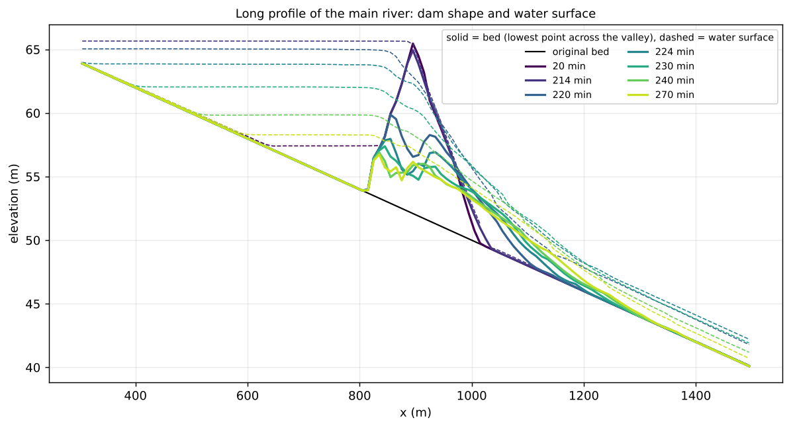
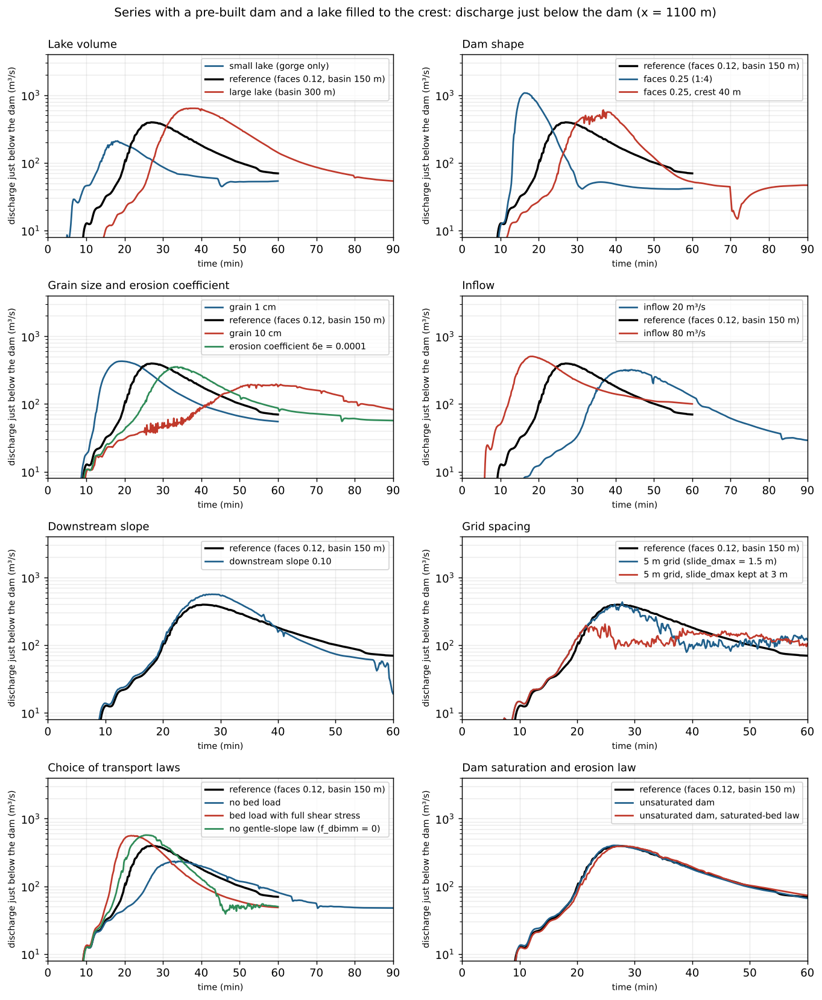
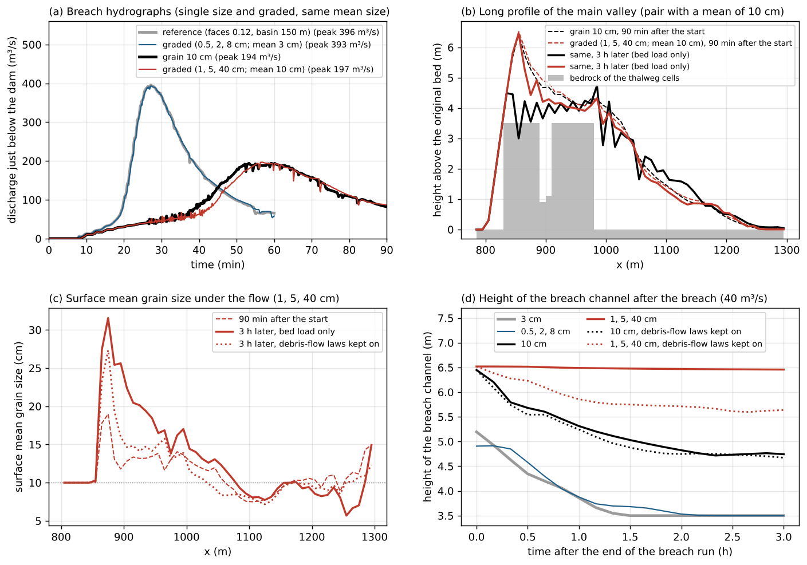
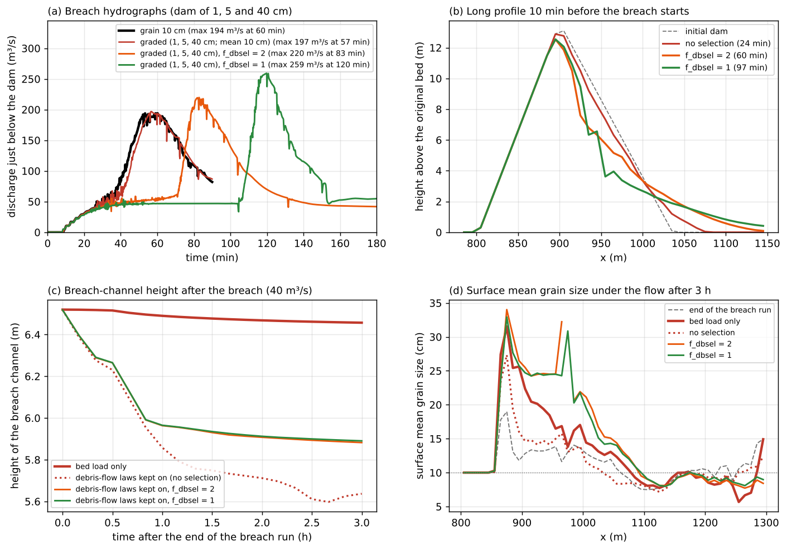

# debris_dam — from a rain-triggered slope failure to a debris flow, a natural dam and its outburst flood

English mirror of examples/debris_dam/README.md

[日本語](../README.md)

Heavy rain makes a slope fail; the failed mass becomes a debris flow, runs down a valley and blocks a river,
forming a natural dam (landslide dam). Water ponds upstream, and when the flow that overtops the dam erodes
and breaches it, the stored water becomes a flood that strikes the reach downstream. This example connects, in
one computation, the onset of the failure by rain infiltration, the debris flow, the blockage, the ponding, the
overtopping, the breach and the damage to the houses of a village downstream. In addition, computations with a
pre-built dam change the conditions that make a breach rapid (lake volume, dam shape, grain size, inflow,
downstream slope) one at a time and compare them with what is known about real natural dams. Computations
with slightly different inflows show how much the results vary (the spread of the results). Computations in
which the dam material has a range of grain sizes (mixed sizes combined with the debris-flow model) compare
the breach discharge, and the coarsening of the remaining dam by the river flow after the breach, with the
single-size computations. The values are schematic, chosen to make the phenomena easy to see; this is not a
reproduction of a particular disaster.

## What happens at real natural dams

- **Formation**: Soil and rock that fail in earthquakes or heavy rain, or debris flows, fill a river and pond
  water upstream. In Japan natural dams formed in the 1889 Totsukawa disaster, the 1953 Arida River disaster, the
  1961 Onishiyama collapse and the Ontake collapse of the 1984 Western Nagano earthquake (Otaki River), among
  others (Ishikawa et al. 1992). In the 2004 Niigata Chuetsu earthquake they formed in the Imo River basin
  (Higashi-Takezawa and others), where pumping and monitoring were carried out (PWRI 2008).
- **They are short-lived**: In a sample of 63 documented cases, 22 % failed in less than 1 day after formation
  and half failed within 10 days (Schuster & Costa 1986).
- **How they fail**: There are three modes — erosion by overtopping, sliding failure and progressive failure
  (piping) — and almost all cases so far were caused by overtopping (PWRI 2008). Hardly any dam failed before
  the lake was full (Ishikawa et al. 1992). When the blocking material is highly permeable, seepage progresses
  and the dam may fail by sliding or progressive failure (PWRI 2008).
- **The overtopping flow changes along the dam**: Where the overflow starts it is close to clear water, and the
  sediment concentration grows by erosion as it runs down the downstream face. If the face is steeper than
  the slope needed for a debris flow to form and is long enough, a debris flow forms. As erosion proceeds the
  dam flattens, and in the end the whole reach becomes bed-load river-bed variation (Ishikawa et al. 1992).
- **Size of the flood**: Floods from the failure of landslide dams are summarised as smaller than floods from
  constructed dams impounding water with the same potential energy, and larger than floods from the failure of
  ice dams (Schuster & Costa 1986). The peak discharge decreases downstream (in a reconstruction of the
  Takaisoyama natural dam in Tokushima, the peak 42 km downstream was about one third of that 5 km downstream;
  Satofuka et al. 2007, as cited by PWRI 2008).
- **Countermeasures**: Excavating a drainage channel through the dam is the common measure, and pumps or
  siphons are used when the inflow is small. To prevent a breach by overtopping, either the lake level is
  lowered so that the dam is not overtopped, or a channel is made so that it is overtopped safely
  (Ishikawa et al. 1992).

## Mechanisms needed for the reproduction

| Real phenomenon | Representation in ENCflow | Settings |
|---|---|---|
| Heavy rain infiltrates the soil layer of the slope and the groundwater table rises | Rain (map × time series) and Green-Ampt infiltration; the subsurface storage of the soil layer fills from the bottom | `fn_precip` (`prtype = 2`), `fn_gwflow` (`f_gwvertical = 2`, `gw_sat0`) |
| Pore pressure makes the slope fail | The soil layer of cells whose infinite-slope safety factor falls below 1 is fluidised | `f_slide = 1`, `slide_phi`, `slide_gamma` |
| The failed mass flows out with the water it contains | The water of the soil layer (drainable water and the retained water that moves with the soil) is moved into the flow together with the sediment | `f_dbwet = 3`, `sy0`, `fluv_porosity` |
| The debris flow runs down the valley and deposits where the slope is gentle | Resistance law and erosion–deposition law of Takahashi & Nakagawa (1991); sediment that has stopped becomes terrain | `f_debris = 1`, `f_dbed = 3`, `f_dbres = 3`, `f_dbstop = 1` |
| The deposit blocks the river and water ponds upstream | The deposit raises the ground elevation, and the shallow-water computation solves the ponding | (terrain update) |
| Slopes under the lake and the dam do not fail merely because they are submerged | The seepage force enters the safety factor through the total-head gradient; in thick deposits only the surface layer is judged | `f_slide_seep = 1`, `slide_dmax`, `f_slide_wet = 1`, `f_slide_noflow = 1` |
| The overflow erodes the dam and carries the sediment downstream | Erosion law for a saturated deposit, equilibrium concentration on gentle slopes (bedload-like collective flow), bed load, angle-of-repose avalanching of the breach walls | `f_dbimm = 1`, `db_immexp = 2`, `f_fluvial = 1`, `f_repose = 1` |
| The flood sweeps houses away | Destruction of houses by the load (h + (1 + s) hs) V², and their debris | `fn_bldgdebris` (`f_bdcrit = 2`), `fn_gv` |
| A drain lowers the lake level | A culvert connecting the upstream and downstream sides of the dam | `fn_structure` (`&list_struct_culvert`) |
| The surface of the remaining dam and of the deposit downstream is coarsened by the river flow (armouring) | Mixed grain sizes (size classes × an exchange layer and a substrate); bed load is carried class by class, and the debris flow carries the composition by class | `f_bedmix = 1`, `bmix_d`, `bmix_frac0`, `bmix_la` (the graded-dam cases) |

The failure, the debris flow and the erosion of the dam happen one after another inside the same sediment
computation (`f_debris`); the computation is not switched on the way, and neither the shape of the dam nor the
time of the breach is prescribed. The equations and the basis of the default values are in the
[explanation of debris flows and slope failures](../../../docs/en/users_guide/massflow.md) of the users guide.

## Geometry and settings


Top: terrain (contours every 20 m). Red = the failure slope with the colluvium, dashed blue = rain area, blue
dots = houses, vertical bars = discharge lines, dotted purple = drain pipe (case drain). Bottom left: long
profile of the main river (the dashed brown line is the dam that is pre-built in the series comparing the
breach conditions). Bottom right: long profile of the tributary and the failure slope (numbers are slopes).

- **Domain and grid**: 3,000 m × 800 m, grid spacing 10 m (300 × 80 cells), time step 0.1 s. x points down
  the main river.
- **Main river**: bed slope 0.02. A gorge with a 40 m wide floor (walls at 35°); 40 m³/s enters at the
  upstream end (normal depth 0.47 m). Upstream of the junction, at x = 150–780 m, the valley floor widens to
  the north into a basin (floor 150 m wide), where the blocked water ponds. The downstream end is a free
  outflow.
- **Tributary and failure slope**: The tributary joins from the north at x = 900 m. Its floor is 20 m wide
  and its slope increases from 0.20 at the junction to 0.40 at the valley head. Above the head, a slope of
  0.40 (21.8°; 200 m wide × 250 m long) carries 3 m of colluvium (150,000 m³). Only this is a soil layer;
  everything else is non-erodible bedrock (deposited sediment is erodible).
- **Rain and soil layer**: 80 mm/h of rain for 60 minutes on the tributary floor and the failure slope. The
  porosity of the soil layer is 0.4, of which 0.2 is drainable (specific yield) and the remaining 0.2 is
  retained water that moves with the soil. The saturated hydraulic conductivity is 100 mm/h (all the rain
  infiltrates) and the initial saturation is 0.83 (a slope wetted by antecedent rain).
- **Failure condition**: infinite-slope safety factor (cohesion 0, friction angle 35°, saturated unit weight
  19.5 kN/m³). On the slope of 0.40 the safety factor falls below 1 when the saturation rises to 0.85.
  Starting from 0.83, this takes about 10 minutes of rain at 80 mm/h (the missing water is
  (0.853 − 0.83) × 0.2 × 3 m = 14 mm). The friction angle and the unit weight are matched to the internal
  friction angle and the concentration of the debris flow, so that a mass that fails when saturated flows
  out as it is ("Matching the failure condition and the flow condition", §4 of the
  [explanation of debris flows and slope failures](../../../docs/en/users_guide/massflow.md)).
- **Options of the stability test**: Slopes and the dam under the lake are also judged, so the seepage force
  is taken from the gradient of the total head (`f_slide_seep = 1`), only failures caused by pore pressure
  are mobilized (`f_slide_wet = 1`), and cells under a dense mixture are not judged (`f_slide_noflow = 1`;
  the default when the stability test is used; cells whose mixture is thin are judged). The depth judged and
  mobilized at one time, `slide_dmax`, is 3 m (the thickness of the colluvium). The colluvium saturates from
  its base, so the slip surface is at the base of the layer, and a smaller value delays the failure. On the
  other hand, if it is large relative to the grid spacing, the step left by a mobilization brings down the
  neighbouring cells and the mobilization propagates (on the 5 m grid of this example it does at 0.6 times
  the grid spacing and does not at 0.3 times). The 5 m cases of the pre-built-dam series (`dam_dx5`,
  `dam_tilt_dx5`) therefore use 1.5 m. On the 5 m grid with the failure slope, both 3 m (`g5`) and 1.5 m
  (`dmax15_dx5`) are computed (neither builds the same dam as the base case; see the
  [section below](#how-the-dam-forms-pore-water-treatment-options-of-the-stability-test-grid-spacing-judged-depth)).
- **Debris flow and erosion of the dam**: the stony type of Takahashi & Nakagawa (1991). Grain size 3 cm,
  internal friction angle 35°, erosion coefficient δe = 0.0007 (default; Takahashi's general value),
  deposition coefficient δd = 0.5 (the value the paper applied to Horadani). Gentle slopes use the
  equilibrium concentration of the bedload-like collective flow, 6.7c∞² (Takahashi, Nakagawa & Yamashiki
  1991). Bed load (Ashida–Michiue) is combined, with an effective-shear ratio of 0.6 (the ratio of the
  grain roughness, 0.027–0.031, to the channel roughness, 0.04, raised to the power 1.5; "Combination with bed
  load", §3 of the same explanation).
- **Village**: downstream of x = 2,100 m. A low-water channel 20 m wide and 1.2 m deep (96 m³/s bankfull) and
  a floodplain 150 m wide on the north bank (1 m higher 100 m away from the bank). The houses are 70 buildings (one building is
  20 m × 10 m, 2 cells) in four rows 25, 55, 85 and 115 m from the bank (building porosity 0.5; house stock at the default,
  0.3 m³/m²). They start to fail at a load (h + (1 + s) hs) V² of 1 m³/s², and the destructible fraction
  becomes 1 at 4 m³/s² (the guide values for "debris flows and flood flows striking a village" in
  [house destruction and debris](../../../docs/en/users_guide/bldgdebris.md) of the users guide).
- **Output**: maps every 2 minutes (bil); probes and discharge lines every 10 seconds.

The cases fall into five groups. `param.txt` (the base case) is the annotated template, and
`make_init.py` writes `param_<case>.txt` of the other cases by replacing lines (replaced lines carry the
note "基本ケースは …", i.e. the value of the base case).

| Group | Case | Difference from the base case | Computed time |
|---|---|---|---|
| Chain | `base` | — (from the heavy rain to the damage to houses) | 270 min |
| | `drain` | drain pipe (a culvert 4 m wide × 3 m high; inlet at x = 600 m, outlet at x = 1,200 m, inverts 1.5 m above the bed) | 270 min |
| | `coarse` | grain size 10 cm | 270 min |
| | `q80` | discharge of the main river 80 m³/s | 180 min |
| First half of the chain | `norain` | no rain (no failure; control) | 30 min |
| | `wet0` | no pore-water entrainment (`f_dbwet = 0`; no water is exchanged with the bed in erosion and deposition) | 30 min |
| | `wet2` | no exchange of retained water (`f_dbwet = 2`; only the drainable water is exchanged) | 30 min |
| | `slide0` | none of the four options of the stability test | 30 min |
| | `noflow0` | cells under a dense mixture are also judged (`f_slide_noflow = 0`) | 30 min |
| | `g5` | grid spacing 5 m | 30 min |
| | `dmax15`, `dmax15_dx5` | `slide_dmax` = 1.5 m (half the thickness of the colluvium; the initial saturation is set to 0.9035 so that the failure occurs at the same time; grid spacing 10 m and 5 m) | 30 min |
| Spread of the results | `base_m2`, `base_m1`, `base_eps`, `base_p05`, `base_p1`, `base_p2` | only the inflow of the base case is changed to 39.2, 39.6, 40.0001, 40.2, 40.4 and 40.8 m³/s (−2 to +2 %; the initial depth stays that of 40 m³/s) | 270 min |
| | `dam_ref_p1`, `dam_face25_p1` | only the inflow of two cases of the pre-built-dam series (level crest) is changed to 40.4 m³/s (+1 %) | 60 min |
| | `dam_tilt_m1`, `dam_tilt_eps`, `dam_tilt_p1`; `dam_tilt_dx5_m1`, `dam_tilt_dx5_eps`, `dam_tilt_dx5_p1` | only the inflow of the tilted-crest dam (10 m and 5 m grids) is changed to 39.6, 40.0001 and 40.4 m³/s | 60 min (120 min on the 5 m grid) |
| Pre-built dam | `dam_ref` and 19 others | a 13 m high dam is placed at the junction and the lake starts filled to the crest (no rain, no colluvium). Lake volume, dam shape (face slope, crest length, tilt of the crest), grain size, inflow, downstream slope, grid spacing and the choice of laws are changed one at a time ([section below](#conditions-for-a-rapid-breach-computation-and-real-natural-dams)) | 60 min (90 min for the six cases that rise slowly, 120 min for the three cases on the 5 m grid) |
| Graded dam | `mix_d3cm` | the same dam and conditions as `dam_ref`, with the sediment in three size classes of 0.5, 2 and 8 cm (fractions 0.35, 0.40 and 0.25; the same mean grain size of 3 cm) (`f_bedmix = 1`; [section below](#a-graded-dam-and-the-coarsening-after-the-breach-coupling-with-mixed-grain-sizes)) | 60 min |
| | `mix_d10cm` | the same conditions as `dam_d10cm` (grain size 10 cm), with the sediment in classes of 1, 5 and 40 cm (fractions 0.50, 0.30 and 0.20; the same mean grain size of 10 cm) | 90 min |
| | `after_one_d3cm`, `after_mix_d3cm`; `after_one`, `after_mix` | start from the final state of `dam_ref`, `mix_d3cm`; `dam_d10cm`, `mix_d10cm` (`f_state_restore = 2`) and keep the main-river discharge of 40 m³/s running, without the debris-flow model and the slope-stability test (bed load only) | 180 min |
| | `after_one_debris`, `after_mix_debris` | continue from the final state of `dam_d10cm`, `mix_d10cm` with the same configuration as the breach computation (the debris-flow laws kept on) | 180 min |
| | `mix_d10cm_sel1`, `mix_d10cm_sel2` | `mix_d10cm` with the selector `f_dbsel` = 1, 2 that limits the erosion by the debris-flow law to the movable size classes ([section below](#limiting-the-erosion-by-the-debris-flow-law-to-the-movable-size-classes-f_dbsel)) | 180 min |
| | `after_mix_debris_sel1`, `after_mix_debris_sel2` | `after_mix_debris` with `f_dbsel` = 1, 2 (from the final state of `mix_d10cm`) | 180 min |
| | `mix_d3cm_sel1` | `mix_d3cm` with `f_dbsel = 1` | 60 min |

## How to run

```bash
cd examples/debris_dam
make                     # links, and the inputs and settings of all cases (make_init.py)
make run                 # compute the 32 cases in turn
make perturb             # compute the 14 cases that show the spread of the results (only the inflow is changed slightly)
make mixed               # compute the 15 graded-dam cases (four breach runs, six runs of the 3 hours after them, five with f_dbsel)
python3 plot_results.py  # figs/*.png and tables (argument en writes the English version to en/figs/; setup.png can be drawn before the computation)
```

`make quick` computes only the base case, the drain and the four main cases of the pre-built-dam series;
`make dams` computes only the 20 cases of the pre-built-dam series. The 14 cases of `make perturb` are not
part of `make run` (they are used in the figure and the table of "Spread of the results"). Of the 15 cases of
`make mixed`, only the single-size cases compared, `dam_ref` and `dam_d10cm`, are part of `make run`. When only
these 15 cases have been computed, `python3 plot_results.py mixed` writes just `figs/mixed.png`,
`figs/select.png` and their tables.
For a single
case, run `./encflow param.txt` (the base case).

## Results

### The chain (base case)


Six times, from the basin to the reach below the junction (yellow = colluvium, red = moving sediment, brown =
deposit, blue = water).


(a) Saturation and safety factor of the colluvium before the failure. (b) Where the sediment goes (bulk
volume). (c) Water level just upstream of the dam and the elevation of the dam crest. (d) Discharge. The
dashed vertical lines mark the failure and the start of overtopping.

1. **Rain infiltration and failure (0–11 min)**: Rain infiltrates and the saturation of the colluvium rises
   from 0.83 to 0.852 in 10 minutes. At 10.5 minutes the safety factor falls below 1 and 494 of the 500 cells
   with a soil layer fail within 30 seconds.
2. **Debris flow (11–14 min)**: The failed mass (bulk volume 149,000 m³) flows out with the water it contains
   and runs down the tributary valley at up to 22 m/s (the flow depth is 7–9 m in the middle of the valley
   and up to 15 m at the junction). The front reaches the junction about 30 seconds after the failure.
3. **Blockage (until 16 min)**: The debris flow fills the valley of the main river and stops; the deposit is
   more than 10 m thick at 12 minutes. 75,000 m³ deposits in the main river and 72,000 m³ in the tributary
   valley, and by 16 minutes a dam 13.4 m high (crest elevation 65.5 m) has formed. The dam is a triangle
   180 m long along the river (x = 825–1,005 m), with a slope of 0.19 on the upstream face and 0.12 on the
   downstream face. The crest is higher on the tributary side, and a width of about 30 m on the opposite
   side is low ((f) of "Spread of the results" below). The discharge just below the dam drops to 1 m³/s at
   14 minutes, and the river at the village dwindles (half the discharge at 20 minutes, 3 m³/s at
   30 minutes, below 1 m³/s at 40 minutes).
4. **Ponding (16–215 min)**: The 40 m³/s of the main river ponds in the basin upstream, and the water level
   takes a little over 3 hours to reach the crest (stored volume 490,000 m³). During this time the shape of
   the dam does not change and the river downstream stays dry (depth in the low-water channel at the
   village 0.71 m → 0.01 m).
5. **Overtopping and breach (from 215 min)**: When the water overtops the crest, the flow starts to erode the
   downstream face. The overtopping starts on the low side opposite the tributary and spreads over the full
   width of the valley within 5 minutes. The discharge just below the dam reaches 290 m³/s 4 minutes after
   the start of overtopping and 410 m³/s after 6 minutes, and the crest is lowered by 5.5 m in 5 minutes
   (65.4 → 59.9 m). The discharge peaks at 470 m³/s (12 times the inflow) 9 minutes after the start of
   overtopping and then falls with the lake level (240 m³/s after 20 minutes, 110 m³/s after 30 minutes).
   Sixty minutes after the start of overtopping the lake level has fallen by 7.4 m, and the water released
   in excess of the inflow amounts to 450,000 m³ (92 % of the stored volume). At the end of the computation
   (270 min) a dam 4.1 m high remains.
6. **Flood downstream (from 222 min)**: The front of the flood reaches the village 1.5 km downstream
   7 minutes after the start of overtopping. The discharge of the river, which had run dry, exceeds
   150 m³/s in less than a minute and peaks at 455 m³/s 12 minutes after the start of overtopping
   (4.7 times the 96 m³/s that the low-water channel carries when full). The discharge stays above
   1.5 times the normal flow for 36 minutes.



Long profile of the main river (solid = bed, dashed = water surface). The dam is eroded from the top, and
the eroded sediment deposits from the toe downstream (25,000 m³ at x = 1,000–1,500 m, up to 5 m thick). The
face becomes gentler as it extends downstream, which slows the erosion.

### Damage in the village


Maximum flow depth in the village (blue) and damage ratio of the houses (colour of the squares). From the
top: base case, grain size 10 cm, drain pipe.

In the base case the floodplain is inundated up to 140 m from the bank (maximum depth in the low-water
channel 2.4 m). The damage is graded by the distance from the bank.

| Row (distance from the bank) | Maximum flow depth (m) | Maximum load (m³/s²; mean and maximum of 35 cells) | Damage ratio (mean and maximum) |
|---|---|---|---|
| Row 1 (25 m) | 0.9 | 9.7 / 10.6 | 1.00 / 1.00 (destroyed) |
| Row 2 (55 m) | 0.7 | 4.2 / 5.9 | 1.00 / 1.00 (destroyed) |
| Row 3 (85 m) | 0.4 | 1.3 / 2.2 | 0.07 / 0.37 |
| Row 4 (115 m) | 0.2 | 0.2 / 0.4 | 0 |

What decides it is where the load exceeds the 1 m³/s² at which damage starts and the 4 m³/s² at which the
destructible fraction becomes 1. The load on the third row is just above the value at which damage starts,
so the damage of this row is sensitive to the size and the duration of the flood. In the 7 runs with slightly
different inflows too, the first two rows are destroyed in every run, and the mean damage ratio of the third row
varies between 0.05 and 0.09 ("Spread of the results" below).

### Spread of the results (computations with slightly different inflows)


(a), (b) Discharge just below the dam and at the village for the base case with only the inflow changed to
39.2–40.8 m³/s (aligned at the start of overtopping). (c) Dams with a level crest (two cases of the series)
computed with inflows of 40 and 40.4 m³/s. (d), (e) The dam whose crest is tilted across the valley
(`dam_tilt`) on the 10 m and 5 m grids (inflows of 39.6–40.4 m³/s). The horizontal axis of (c)–(e) is the
time from the start of the computation (the 5 m grid is computed up to 120 minutes). (f) Cross-section of
the crest before overtopping.

| Case | Inflow (m³/s) | Start of overtopping (min) | Peak discharge: just below the dam / village (m³/s) | Time from the start of overtopping to the peak (min) | Dip on the way | Mean damage ratio of the houses: row 1 / row 2 / row 3 from the bank |
|---|---|---|---|---|---|---|
| `base_m2` | 39.2 | 219 | 498 / 447 | 8.5 | 0.71 | 1.00 / 1.00 / 0.07 |
| `base_m1` | 39.6 | 217 | 488 / 457 | 8.8 | 0.72 | 1.00 / 1.00 / 0.09 |
| `base` (base case) | 40 | 215 | 470 / 455 | 9.2 | 0.96 | 1.00 / 1.00 / 0.07 |
| `base_eps` | 40.0001 | 215 | 464 / 443 | 8.0 | 0.94 | 1.00 / 1.00 / 0.06 |
| `base_p05` | 40.2 | 214 | 486 / 463 | 8.3 | 0.92 | 1.00 / 1.00 / 0.09 |
| `base_p1` | 40.4 | 212 | 468 / 444 | 8.2 | 0.81 | 1.00 / 1.00 / 0.05 |
| `base_p2` | 40.8 | 210 | 475 / 457 | 9.0 | 0.93 | 1.00 / 1.00 / 0.07 |
| `dam_ref` | 40 | 10 | 396 / 384 | 17.7 | 0.96 | 1.00 / 0.77 / 0 |
| `dam_ref_p1` | 40.4 | 10 | 398 / 387 | 16.7 | 0.99 | 1.00 / 0.79 / 0.01 |
| `dam_face25` | 40 | 10 | 1,057 / 1,017 | 6.3 | 1.00 | 1.00 / 1.00 / 1.00 |
| `dam_face25_p1` | 40.4 | 10 | 1,054 / 1,017 | 6.2 | 0.99 | 1.00 / 1.00 / 1.00 |
| `dam_tilt_m1` | 39.6 | 18 | 321 / 310 | 14.2 | 0.85 | 1.00 / 0.13 / 0 |
| `dam_tilt` | 40 | 18 | 321 / 315 | 14.8 | 0.80 | 1.00 / 0.18 / 0 |
| `dam_tilt_eps` | 40.0001 | 18 | 312 / 305 | 16.0 | 0.84 | 1.00 / 0.12 / 0 |
| `dam_tilt_p1` | 40.4 | 18 | 325 / 314 | 14.2 | 0.72 | 1.00 / 0.24 / 0 |
| `dam_tilt_dx5_m1` | 39.6 | 16 | 455 / 384 | 59.5 | 0.00 | 1.00 / 0.65 / 0.00 |
| `dam_tilt_dx5` | 40 | 16 | 438 / 374 | 50.3 | 0.00 | 1.00 / 0.51 / 0.00 |
| `dam_tilt_dx5_eps` | 40.0001 | 16 | 356 / 322 | 39.3 | 0.00 | 1.00 / 0.19 / 0 |
| `dam_tilt_dx5_p1` | 40.4 | 16 | 340 / 306 | 13.8 | 0.94 | 1.00 / 0.06 / 0 |

The "dip on the way" is the minimum, between the start of overtopping and the peak, of the discharge divided by
its largest value up to that time (below 0.5 the discharge fell to less than half before the peak).

- **Dams with a level crest are stable against slight differences**. The dams of the pre-built-dam series have a crest that is level across the valley ((f)). With the inflow
  increased by 1 %, the peak discharge changes by only +0.5 % for the reference dam (396 → 398 m³/s) and −0.3 % for the
  dam with faces of 0.25 (1,057 → 1,054 m³/s) (the two lines coincide in (c)). Differences between the cases of the
  series can be read as the effect of the conditions.
- **The base case of the chain also changes little with slight differences**. In 7 computations with the inflow
  varied between 39.2 and 40.8 m³/s (±2 %), the peak discharge just below the dam is 464–498 m³/s (a spread of
  7 % of the mean), the peak at the village 443–463 m³/s, and the time from the start of overtopping to the peak
  8–9 minutes. The peaks are not ordered by the inflow (table), and merely changing the inflow to 40.0001 m³/s
  (+0.00025 %) changes the peak from 470 to 464 m³/s. In none of the runs does the discharge fall to less than
  half on the way (dips of 0.71–0.96). The mean damage ratio of the houses is 1.00 (destroyed) in the first two
  rows from the bank in every run and 0.05–0.09 in the third.
- **The overflow starts over a wide width, so the course is the same**. The dam built by the debris flow is higher
  on the tributary side (3.6 m higher at the foot of the valley wall), while three cells (30 m wide) on the opposite
  side are nearly flat, within 0.5 m of each other ((f)). The overflow starts over these three cells and spreads
  over the full width of the crest in about 5 minutes. In the 7 runs the times at which the discharge exceeds 200,
  300 and 400 m³/s lie within 30 seconds of each other, and the discharges nearly coincide up to the peak ((a)).
  The runs differ noticeably only after 30 minutes from the start of overtopping, when the lake has been drawn
  down. In some runs 1–2 m of sediment settles on the bottom of the breach and the discharge falls below the
  inflow (2 of the 7 runs; 29 m³/s at the lowest).
- **With a tilted crest too, the results on the 10 m grid agree**. When the crest of the reference dam is tilted across the
  valley with its lowest part a notch 10 m wide (one cell) (`dam_tilt`; 3.9 m higher on the tributary side; (f)), the
  overflow concentrates in the notch. Even so, the peaks of the four runs with inflows of 39.6–40.4 m³/s agree within
  312–325 m³/s (a spread of 4 %) ((d)), and in none of them does the discharge fall to less than half on the way
  (dips of 0.72–0.85).
- **On the 5 m grid the breach is blocked and the results scatter**. When the same dam is computed on the 5 m
  grid (`dam_tilt_dx5`; `slide_dmax` 1.5 m), all four runs reach a first crest of 300–347 m³/s 12–14 minutes
  after overtopping starts, and within 3 minutes the discharge just below the dam then falls below 10 m³/s
  ((e)). Near the crest (x = 860–890 m) the floor and walls of the breach are fluidised by the slope-stability
  test and drop by 2–5 m; the dense sediment set in motion stops 20–30 m downstream and raises the floor of the
  breach there by 2–4 m. The four runs then part. In the two runs with inflows of 40 and 39.6 m³/s the
  discharge is below the inflow for a total of 21 and 30 minutes (the lake level rises by 0.6 and 0.7 m), and
  after the breach reopens it peaks at 438 and 455 m³/s, 66 and 76 minutes after the start of the computation.
  In the two runs with 40.0001 and 40.4 m³/s the discharge is below the inflow for a total of 7–8 minutes and
  swings between 0 and 250 m³/s before reaching a second crest of 356 and 336 m³/s at 55–56 minutes (in
  `dam_tilt_dx5_p1` the first crest is the peak and the blockage comes after it, so its dip on the way is 0.94).
  The peak discharges of the four runs scatter over 340–455 m³/s (29 % of the mean; 1.1–1.4 times the 10 m
  grid), the peaks at the village over 306–384 m³/s, and the mean damage ratio of the second row of houses over
  0.06–0.65.
- **How to read the results**: Read the numbers of the chain cases (peak discharge, damage to houses) with this
  spread in mind (7 % in the peak discharge of the base case). The differences from the drain case (no overtopping),
  the 10 cm grains (peak 292 m³/s) and the doubled inflow (544 m³/s) are larger than this spread. The effect of the
  conditions (lake volume, face slope, grain size, inflow) is read more reliably from the series of dams with a level
  crest (a 1 % change in the inflow changes the peak by only 0.5 %). Where the overflow concentrates in a narrow
  breach that becomes blocked (the tilted-crest dam on the 5 m grid), the peak changes by about 30 %. For a real
  site too, run several computations with slightly different conditions and check the spread of the results.

### Countermeasure and different conditions (chain cases)


(a) Water level just upstream of the dam. (b) Discharge just below the dam (the outlet of the drain lies
downstream of this line). (c) Discharge at the village.

| Case | Dam height (m) | Start of overtopping (min) | Peak discharge: just below the dam / village (m³/s) | Ratio to the inflow | Rise time (min) | Dam height at the end (m) | Mean damage ratio of the houses: row 1 / row 2 / row 3 from the bank |
|---|---|---|---|---|---|---|---|
| `base` | 13.4 | 215 | 470 / 455 | 11.8 | 8 | 4.1 | 1.00 / 1.00 / 0.07 |
| `drain` | 13.4 | no overtopping | — / 38 | — | — | 13.4 | 0 / 0 / 0 |
| `coarse` | 13.4 | 221 | 292 / 270 | 7.3 | 14 | 7.0 | 1.00 / 0.01 / 0 |
| `q80` | 13.3 | 112 | 544 / 510 | 6.8 | 8 | 3.9 | 1.00 / 1.00 / 0.31 |

The "rise time" is the time from the discharge just below the dam exceeding the inflow to its peak.

- **Drain (`drain`)**: The culvert starts to carry water at 45 minutes, when the lake level exceeds the
  invert of its inlet (59.5 m). Its discharge grows as the level rises, and at 270 minutes it carries
  38 m³/s (96 % of the inflow) at a level of 62.9 m, which is almost in balance. The level stops 2.6 m below
  the crest (65.5 m), and neither overtopping nor a breach occurs. The dam stays 13.4 m high. The river at
  the village starts to flow again at about 70 minutes and slowly approaches its normal discharge
  (20 m³/s at 110 minutes). The floodplain is not inundated.
- **Coarse sediment (`coarse`)**: With a grain size of 10 cm the dam built by the debris flow hardly changes
  (13.4 m high; the upstream face is slightly gentler at 0.17 and the downstream face is the same 0.10).
  Overtopping starts at 221 minutes. The erosion is slow: the discharge just below the dam grows to
  160 m³/s 10 minutes after overtopping starts and to 240 m³/s after 15 minutes, and peaks at 292 m³/s
  (7.3 times the inflow, 0.62 times the base case) after 20 minutes. In the village the floodplain is
  inundated up to 100 m from the bank. The houses of the row nearest the bank are destroyed under a load of
  3.5 m³/s² (4.1 at most), but the second row takes a load of 0.9 m³/s² (1.7 at most) and its mean damage
  ratio stays at 0.01 (0.21 at most). The houses of the third row and beyond are not damaged. A dam 7.0 m
  high remains at the end of the computation.
- **Double inflow (`q80`)**: The time to fill is halved (overtopping starts at 112 minutes) and the peak
  rises to 544 m³/s, but its ratio to the inflow falls from 11.8 to 6.8. The initial rise is faster: the
  discharge reaches 440 m³/s 5 minutes after overtopping starts (360 m³/s in the base case) and peaks after
  9 minutes. All houses of the first two rows from the bank are destroyed (loads of 12 and 5.6 m³/s²), and
  part of the third row is damaged (mean damage ratio 0.31, 0.86 at most). The peak of the base case
  changes between 464 and 498 m³/s with slight differences in the inflow ("Spread of the results" above). The
  difference from the base case (470 → 544 m³/s, +16 %) exceeds this spread. A comparison with the same dam and only
  the inflow changed is given by `dam_q20` and `dam_q80` of the series with a pre-built dam (section below).
- **No rain (`norain`)**: Without rain there is no failure, and the main river keeps flowing at 40 m³/s. The depth
  in the low-water channel at the village is 0.71 m and the floodplain is not inundated (control).

### How the dam forms (pore-water treatment, options of the stability test, grid spacing, judged depth)


(a) Long profile of the main river at 28 minutes. (b) Deposit thickness.

| Case | Dam height (m) | Dam length (along the river; m) | Face slopes: upstream / downstream | Deposit in the main river (10⁴ m³) | Deposit in the tributary (10⁴ m³) | Sediment still moving (10⁴ m³) | Colluvium left on the slope (10⁴ m³) |
|---|---|---|---|---|---|---|---|
| `base` | 13.4 | 180 | 0.19 / 0.12 | 7.5 | 7.2 | 0.1 | 0.1 |
| `wet0` (no pore-water exchange) | 9.2 | 230 | 0.10 / 0.066 | 7.6 | 6.6 | 0.2 | 0.6 |
| `wet2` (no exchange of retained water) | 8.6 | 160 | 0.12 / 0.096 | 5.5 | 8.7 | 0.6 | 0.2 |
| `slide0` (no options of the stability test) | not yet terrain | — | — | 3.4 | 2.4 | 9.1 | 0.0 |
| `noflow0` (judged under a dense mixture) | not yet terrain | — | — | 2.3 | 1.1 | 11.6 | 0.0 |
| `g5` (5 m grid) | 9.0 | 175 | 0.13 / 0.086 | 4.9 | 5.1 | 4.7 | 0.2 |
| `dmax15` (`slide_dmax` = 1.5 m) | 7.8 | 180 | 0.078 / 0.097 | 6.0 | 7.0 | 0.2 | 1.8 |
| `dmax15_dx5` (the same settings on the 5 m grid) | 6.5 | 175 | 0.076 / 0.072 | 5.6 | 7.3 | 0.4 | 1.7 |

Values at 28 minutes (17.5 minutes after the failure).

- **Pore-water treatment**: In the base case (`f_dbwet = 3`) the failed mass flows out with all the water of
  the soil layer (drainable and retained), and takes up the same proportion of water from the flow when it
  deposits. In `wet2` and `wet0` the failed mass carries only the drainable water and is denser
  (concentration 0.78). In `wet2` more sediment stays in the tributary valley (87,000 m³) and the dam is
  4.8 m lower. In `wet0` the deposit takes no water from the flow, so it spreads flatter and longer (faces
  0.10 and 0.066) and the dam is 4.2 m lower. The dam height sets the lake volume, so the pore-water
  treatment changes even the size of the later breach.
- **Options of the stability test**: In `slide0`, without the four options, the deposited sediment is
  fluidised again and again and does not become terrain; at 28 minutes 91,000 m³ is still moving sediment
  (the river is blocked, but the mass does not consolidate into a dam). This is because the conventional
  formula estimates the safety factor of a submerged slope at about half its value and fluidises a thick
  deposit down to its base at once (§4 of the
  [explanation of debris flows and slope failures](../../../docs/en/users_guide/massflow.md)). In `noflow0`,
  where only `f_slide_noflow`, the option that skips cells under a dense mixture, is set to 0, no dam forms
  either (116,000 m³ is still moving at 28 minutes): the bed under the flow is judged and fluidised, and the
  dense sediment that cannot move returns to the bed, saturates and is fluidised again, over and over.
- **Grid spacing**: With the 5 m grid (`g5`) the deposited sediment is fluidised again and again; at
  28 minutes 47,000 m³ is still moving in the tributary valley and on the dam, and the dam is only 9.0 m high.
  `slide_dmax` (3 m) is 0.6 times the grid spacing, so the step left by mobilizing one cell brings down the
  saturated neighbouring cell ("Grid spacing" in "Artefacts of the model" below). In `dmax15_dx5`, at
  0.3 times the grid spacing, this does not repeat (4,000 m³ moving), but the failure takes place in two stages
  as in the next item. With a thick soil layer and a fine grid, no setting builds the same dam as the base case.
- **Upper limit of the judged and mobilized depth**: With `slide_dmax` set to 1.5 m, half the thickness of the
  colluvium (`dmax15`; the initial saturation is raised to 0.9035 so that the failure occurs at the same time),
  the failure takes place in two stages, the lower layer failing after the upper layer has flowed away, and
  the dam is only 7.8 m high. The 18,000 m³ left on the slope is a deposit that settled again at the foot of
  the slope (median thickness 2.9 m, with cells thicker than the original layer; safety factor 1 or more).
  The same happens on the 5 m grid (`dmax15_dx5`), where the dam is 6.5 m high. A `slide_dmax` shallower than
  the layer that is to fail delays the failure and lowers the dam (§4 of the
  [explanation of debris flows and slope failures](../../../docs/en/users_guide/massflow.md)).

## Conditions for a rapid breach (computation and real natural dams)

In the base case the discharge reached 12 times the inflow 9 minutes after overtopping started. For dams of
the same height, the peak discharge of the breach varies by a factor of 5 and the rise time of the discharge by a
factor of 10, depending on the conditions (the series on the 10 m grid).
Here a dam 13 m high is placed at the junction from the start and the computation begins
with the lake filled to the crest (no rain and no colluvium; the dam is saturated), and the conditions are
changed one at a time. The reference (`dam_ref`) is a triangle with face slopes of 0.12, close to the dam that
the debris flow builds in the base case (its crest is level across the valley, whereas the dam built by the
debris flow is higher on the tributary side). The conditions that appear in the computation are then sorted into
those that also hold for real natural dams and those that are artefacts of the model.

### What sets the speed of a breach (water balance of the lake)

The discharge over the dam, Q, is set by the difference between the lake level and the crest elevation (the
overflow depth H). With the lake area A, the inflow Q_in and the rate E at which the crest is lowered, the
water balance of the lake gives

```
dH/dt = E − (Q − Q_in) / A
```

While the crest is lowered faster than the lake level falls, E > (Q − Q_in)/A, the overflow depth grows and
the discharge keeps increasing. When the two balance, the discharge levels off at

```
Q ≈ Q_in + E·A
```

The discharge in excess of the inflow is roughly "the rate at which the crest is lowered × the lake area".
This is merely a rearrangement of the water balance of the lake and does not depend on the sediment model.
The wider the lake and the faster the dam erodes, the more rapid the breach. When the lake is very wide or
the erosion very fast, the dam is cut down to its base before the lake level falls, and the discharge
approaches the upper limit set by the width of the valley and the height of the dam (roughly 3,000 m³/s for
an overflow 40 m wide and 13 m deep).

The rate E is set by the amount of sediment that the water running down the downstream face can carry (unit
discharge × equilibrium concentration) and by whether the river downstream can carry that sediment away.

- **Slope of the face**: The equilibrium concentration of the Takahashi & Nakagawa law rises steeply with
  the slope (with the values of this example, 0.105 at a slope of 0.12 and 0.34 at 0.25). The factor of the
  erosion rate, C∞/(C* − C∞), is 0.21 and 1.28, a sixfold difference.
- **A larger discharge erodes faster**: The erosion rate is proportional to the unit discharge, so once the
  dam is cut and the overflow depth grows, it is cut even faster (positive feedback).
- **The eroded sediment deposits at the toe**: When the river downstream is gentle, the sediment it cannot
  carry deposits at the toe, the face becomes gentler, the equilibrium concentration falls and the erosion
  slows (negative feedback).

### Conditions compared in the computation



Discharge just below the dam (x = 1,100 m). Black is the reference, and one condition is changed in each
panel (logarithmic vertical axis).


(a) Peak discharge (bars; the numbers on the right are the ratio to the inflow) and the value of the
regression of Costa (1988) (red diamonds). (b) Time from outflow = inflow to the peak, against the ratio of
the peak discharge to the inflow. Breaches towards the upper left are more rapid. The red star is the base
case (the chain).

| Condition changed | Case | Lake volume (10⁴ m³) | Peak discharge (m³/s) | Ratio to the inflow | Time of the peak (min) | Rise time (min) | Largest fall of the lake level in 10 min (m) | Dam height after 60 min (m) | Mean damage ratio of the houses |
|---|---|---|---|---|---|---|---|---|---|
| Reference (faces 0.12, basin 150 m, grain size 3 cm, inflow 40 m³/s) | `dam_ref` | 45 | 396 | 9.9 | 27 | 10.0 | 2.5 | 5.2 | 0.44 |
| Small lake (gorge only) | `dam_small` | 18 | 210 | 5.3 | 18 | 8.5 | 2.6 | 5.9 | 0.03 |
| Large lake (basin 300 m) | `dam_large` | 81 | 639 | 16.0 | 38 | 12.8 | 2.5 | 4.7 | 0.76 |
| Faces 0.25 (1:4) | `dam_face25` | 46 | 1,057 | 26.4 | 16 | 3.5 | 6.9 | 1.8 | 0.96 |
| Faces 0.25, crest 40 m (trapezoid) | `dam_crest40` | 45 | 809 | 20.2 | 34 | 10.7 | 5.2 | 1.6 | 0.66 |
| Crest tilted across the valley (3.9 m higher on the tributary side) | `dam_tilt` | 44 | 321 | 8.0 | 32 | 13.0 | 2.0 | 4.9 | 0.30 |
| Grain size 1 cm | `dam_d1cm` | 45 | 426 | 10.7 | 20 | 7.5 | 2.8 | 5.0 | 0.51 |
| Grain size 10 cm | `dam_d10cm` | 45 | 194 | 4.9 | 60 | 34.5 | 1.2 | 7.4 | 0.07 |
| Erosion coefficient δe = 0.0001 | `dam_delte` | 45 | 354 | 8.9 | 34 | 14.2 | 2.2 | 5.7 | 0.35 |
| Inflow 20 m³/s | `dam_q20` | 45 | 329 | 16.4 | 42 | 17.7 | 2.3 | 4.6 | 0.30 |
| Inflow 80 m³/s | `dam_q80` | 45 | 506 | 6.3 | 18 | 6.8 | 2.8 | 4.9 | 0.55 |
| River-bed slope 0.10 downstream (400 m below the junction) | `dam_steep` | 45 | 577 | 14.4 | 28 | 11.8 | 4.0 | 1.9 | 0.61 |
| No bed load (Takahashi & Nakagawa laws only) | `dam_nofluv` | 45 | 233 | 5.8 | 33 | 15.0 | 1.3 | 7.1 | 0.19 |
| Effective-shear ratio of the bed load 1 | `dam_tau1` | 45 | 560 | 14.0 | 22 | 7.7 | 3.8 | 3.8 | 0.63 |
| No gentle-slope equilibrium concentration (`f_dbimm = 0`) | `dam_imm0` | 45 | 575 | 14.4 | 26 | 10.3 | 3.9 | 4.0 | 0.75 |
| Unsaturated dam (initial saturation 0.83) | `dam_unsat` | 45 | 402 | 10.0 | 26 | 9.5 | 2.6 | 5.2 | 0.45 |
| Unsaturated dam, saturated-bed erosion law (`f_dbunsat = 0`) | `dam_unsat0` | 45 | 390 | 9.7 | 29 | 11.3 | 2.5 | 4.6 | 0.43 |
| Grid spacing 5 m (`slide_dmax` 0.3 times, 1.5 m) | `dam_dx5` | 45 | 308 | 7.7 | 25 | 8.5 | 2.6 | 2.5 | 0.25 |
| Grid spacing 5 m, `slide_dmax` kept at 3 m | `dam_dx5d3` | 45 | 558 | 14.0 | 52 | 35.5 | 4.1 | 0.3 | 0.62 |
| Tilted crest, grid spacing 5 m (`slide_dmax` 1.5 m) | `dam_tilt_dx5` | 44 | 438 | 10.9 | 66 | 47.7 | 3.3 | 5.1 | 0.38 |

The time of the peak is counted from the start of the computation (the lake starts filled to the crest, and
the overflow reaches the section just below the dam after 6–18 minutes). The rise time is the time from the
discharge just below the dam exceeding the inflow to the peak; for `dam_dx5d3` and `dam_tilt_dx5` on the 5 m grid
it includes the time during which the breach was blocked ("Artefacts of the model" below). The damage ratio of
the houses is the value at the end of the computation.

- **Lake volume**: With 180,000, 450,000 and 810,000 m³ the peak is 210, 396 and 639 m³/s
  (5.3, 9.9 and 16.0 times the inflow). The peak grows roughly as the lake volume to the power 0.75. With a
  small lake the level falls early, and the overflow depth stops growing before the discharge has developed.
- **Slope of the downstream face**: Steepening the faces from 0.12 to 0.25 raises the peak from 396 to
  1,057 m³/s (2.7 times) and shortens the rise from 10 to 3.5 minutes; the lake level falls by 7 m in
  10 minutes. The dam is cut down to its base in about 10 minutes. This is the most rapid breach of the series.
- **Crest length**: With the same faces of 0.25 and a crest 40 m long (a trapezoid), the peak falls to 809 m³/s
  (0.77 of the triangle) and comes 18 minutes later. The flat crest is not eroded; the head of the downstream
  face has to cut back through the crest (40 m in 10 minutes) and reach the lake side before the crest starts to be
  lowered. Once the crest is lowered, the walls of the deepened breach fail again and again in the slope-stability
  test, and between 32 and 41 minutes the discharge just below the dam swings between 230 and 810 m³/s. The peak is a
  crest of these swings; the largest 1-minute mean is 695 m³/s (0.66 of the triangle), and the peak at the village
  589 m³/s (0.58 of the triangle).
- **Tilt of the crest**: Tilting the crest across the valley so that the tributary side is 3.9 m higher (`dam_tilt`;
  its lowest part is a notch 10 m wide; the dam built by a debris flow is also higher on the tributary side)
  concentrates the overflow in a narrow breach on the low side, and the peak falls to 321 m³/s (0.81 times the
  reference). Four runs with slightly different inflows give 312–325 m³/s ("Spread of the results" above). On the
  5 m grid (`dam_tilt_dx5`) the breach is blocked for a while, and the peak is 438 m³/s ("Artefacts of the model"
  below).
- **Grain size**: With 1 cm the peak is 426 m³/s (1.1 times) at 20 minutes (reference: 27 minutes). With 10 cm it is
  194 m³/s (0.5 times) and comes after 60 minutes.
- **Inflow**: With 20, 40 and 80 m³/s the peak is 329, 396 and 506 m³/s. A larger inflow gives a larger and
  earlier peak (42, 27 and 18 minutes), but its ratio to the inflow decreases (16, 9.9 and 6.3 times).
- **River-bed slope downstream**: With a slope of 0.10 over the 400 m below the dam, the eroded sediment is carried
  away instead of depositing at the toe, and the peak becomes 577 m³/s (1.5 times).
- **Choice of the laws**: Without bed load the peak is 233 m³/s (0.6 times), with the full shear stress in the
  bed-load formula 560 m³/s (1.4 times), and without the gentle-slope equilibrium concentration 575 m³/s
  (1.5 times). For the same dam, the choice of the laws alone changes the peak by a factor of 2.5.
- **Damage to houses**: The mean damage ratio of the houses in the village (four rows, 140 cells) in the cases on
  the 10 m grid is 0.19 or less for peaks below 250 m³/s, 0.30–0.51 for 250–480 m³/s, 0.55–0.76 for 480–810 m³/s,
  and 0.96 for the 1,057 m³/s of `dam_face25`. The rapidity of the breach translates directly into the difference in damage
  downstream.

### Correspondence with what is known about real natural dams

| Condition | Computation of this example | Reports on real natural dams, experiments and other computations | Correspondence |
|---|---|---|---|
| Lake volume (lake area, dam height) | With lake volumes of 180,000, 450,000 and 810,000 m³ the peak is 210, 396 and 639 m³/s; roughly as the lake volume to the power 0.75 | The peak discharge correlates strongly with the dam height and the river-bed slope (for the same height, a gentler river stores more water) (64 computed cases of Ishikawa et al. 1992). The regression is a power of stored volume × dam height (Costa 1988, as cited by PWRI 2008) | Agrees. The relation follows from the water balance of the lake and does not depend on the model |
| Slope of the downstream face | From faces of 0.12 to 0.25 the peak goes from 396 to 1,057 m³/s (2.7 times) and the rise from 10 to 3.5 minutes | If the face is steeper than the slope needed for a debris flow to form and is long enough, the overflow becomes a debris flow (Ishikawa et al. 1992). In the computations of the same paper (faces 1:2 and 1:4) the peak discharge shows no clear relation with the face slope | Agrees conditionally. Both faces of Ishikawa et al. are steeper than the slope at which a debris flow forms (0.20–0.23 when the values of this example are put into the formula of that paper). The difference in this example is the difference between being above and below that slope |
| Crest length (dam shape) | With the same faces of 0.25, 1,057 m³/s for the triangle and 809 m³/s for the trapezoid (crest 40 m) (1,046 and 695 m³/s as 1-minute means). The trapezoid peaks 18 minutes later | In computations for dams that are nearly the same except for their shape, the peak discharge of a triangular dam is more than 5 times that of a trapezoidal one (Satofuka et al. 2007, as cited by PWRI 2008). In flume experiments the peak is the same for triangular and trapezoidal dams, and the trapezoidal one peaks later (Akazawa et al. 2014). In the computations of Ishikawa et al. (1992) there is no clear relation with the crest length | The reports themselves disagree. In this computation the trapezoid is smaller (the triangle is 1.3 times the trapezoid; 1.5 times as 1-minute means) and later. The direction agrees with both reports and the size lies between them |
| Grain size | The peak for 1 cm is 1.1 times that for 3 cm. For 10 cm it is 0.5 times, and it comes after 60 minutes (27 minutes for 3 cm) | In the estimation formulas of Ishikawa et al. (1992), the peak for a mean grain size of 0.25 mm is 1.6 to 2 times that for 2.5 mm. Dams of coarse material remain stable under ordinary inflows (experiments of Shi et al. 2022) | The direction agrees. With a single grain size, however, the effect of coarse grains staying behind and stopping the erosion is not included |
| Inflow | With inflows of 20, 40 and 80 m³/s the peak is 329, 396 and 506 m³/s, the time of the peak 42, 27 and 18 minutes, and the ratio to the inflow 16, 9.9 and 6.3 (the inflow to the power −0.69) | The larger the inflow, the larger the peak and the shorter the time to the peak (experiments of Zhou et al. 2021 and Akazawa et al. 2014). The ratio to the inflow decreases as the inflow grows (the inflow to the power −0.565 in the formula of Tabata et al., as cited by PWRI 2008) | Agrees |
| River-bed slope downstream | Steepening only the 400 m below the dam to 0.10, without changing the lake volume, makes the peak 1.5 times larger | For the same dam height, the gentler the river the larger the peak (Ishikawa et al. 1992; a gentler river stores more water) | No contradiction. This example steepens only the reach below the dam without changing the lake volume. In a real river a gentler slope increases the stored volume, and that effect is larger |
| Size of the dam | The length of the dam is not varied | In a regression of 43 Japanese cases, larger discharge and dam height make a dam less stable, and larger dam width and length make it more stable (Dong et al. 2011) | The direction for the dam height agrees. Width and length are not compared |
| Mode of failure | Erosion by overtopping only | Mostly overtopping. Sliding and progressive failure when the material is highly permeable (PWRI 2008). Large slides increase the peak discharge (Takayama et al. 2020) | Modes other than overtopping are not represented |

In summary, the conditions for a rapid breach that also hold for real natural dams are the following three.

1. **A large stored volume** (a high dam, a gentle river, a wide valley upstream). The discharge in excess of
   the inflow is "the rate at which the crest is lowered × the lake area", which is the water balance itself.
2. **A downstream face that is steeper than the slope at which a debris flow forms, and long**. A dam formed
   by a failed mass filling the valley as it is tends to have steep faces, while a dam deposited by a debris
   flow that ran into the river is gentler (0.10 in the base case before overtopping). That the face slope matters agrees with
   the description of Ishikawa et al. (1992), but "a dam built by a debris flow is gentle and therefore
   breaches slowly" is what this computation says, and has not been checked against cases.
3. **Dam material that is not coarse, and a large inflow**. Coarse material makes the breach slower and
   smaller. A larger inflow makes the peak larger and earlier (its ratio to the inflow decreases). Both are
   reported from experiments and computations.

### Artefacts of the model

- **Transport law on gentle reaches**: Without bed load, with an effective-shear ratio of 0.6 (reference) and with 1, the peak is 233, 396 and 560 m³/s. With `f_dbimm = 0` it is 575 m³/s.
  In reality the transport capacity of gentle reaches is set by the range of grain sizes (fine grains are
  carried in suspension). In this single-grain-size model the choice of the laws stands in for it.
- **Erosion coefficient**: Changing δe from 0.0007 to 0.0001 (the value Takahashi & Nakagawa applied to Horadani) changes the
  peak from 396 to 354 m³/s (0.89 times) and its time from 27 to 34 minutes. A coefficient seven times
  smaller changes the peak by only a tenth: the breach of this dam is set by the amount of sediment the flow
  can carry (equilibrium concentration and bed-load transport) rather than by the coefficient of the erosion
  rate.
- **Saturation of the dam**: Making the dam unsaturated (initial saturation 0.83) leaves the peak at 402 m³/s, the same as the saturated
  reference (396 m³/s). Using the saturated-bed erosion law on the unsaturated dam (`f_dbunsat = 0`) gives 390 m³/s.
  The three differ by 3 %: the breach of this dam is set by the amount of sediment the flow can carry rather
  than by the law for the erosion rate (as with the erosion coefficient above).
- **Grid spacing**: With the depth mobilized at one time, `slide_dmax`, kept at 0.3 times the grid spacing, the 5 m grid
  (`dam_dx5`, 1.5 m) peaks at 308 m³/s after 25 minutes, 0.78 times the 10 m grid (396 m³/s after 27 minutes).
  The course of the breach also differs. On the 10 m grid the overtopping starts over the full width of the
  valley, and from before the peak grooves one cell wide deepen along the foot of the valley walls on both
  banks (mainly on the north side; a rise 9 to 12 m high remains in the middle of the valley; "A graded dam
  and the coarsening after the breach" below). On the 5 m grid the breach splits into two channels along the
  valley walls on both banks about 15 minutes after overtopping starts, leaving a ridge about 12 m high in the
  middle of the valley. After the
  peak at 25 minutes the discharge falls to about 70 m³/s at 28 minutes, stays at 200–270 m³/s from 40 to
  60 minutes, and is nearly back to the inflow by 80 minutes (at 120 minutes about 6 m of the dam remains on the north side of the
  valley, the tributary side). With `slide_dmax` left at 3 m on the 5 m grid (`dam_dx5d3`), the whole downstream face is
  mobilized about 10 minutes after overtopping starts, the sediment set in motion blocks the breach, and the
  discharge just below the dam is zero for a little over 10 minutes. The flow is released at once after the
  lake level has risen by 0.3 m, and peaks at 558 m³/s (1.8 times `dam_dx5`) 52 minutes after the start of the
  computation. The step left by mobilizing 3 m in one cell (3 m ÷ 5 m = 0.6), together with the slope of the
  water surface, brings the safety factor of the saturated neighbouring cells below 1, and the mobilization
  propagates. A step of 0.3 does not propagate (on the tilted-crest dam, however, fluidisation of the floor and
  walls of the breach blocks the breach; see the next item). In the first half of the chain with the failure slope, the
  5 m grid with 3 m (`g5`) keeps fluidising the deposited sediment, and with 1.5 m (`dmax15_dx5`) the failure
  takes place in two stages; both give a dam lower than the base case (9.0 m and 6.5 m; "How the dam forms"
  above). With a thick soil layer and a fine grid no setting builds the same dam as the base case, so the
  chain is not computed through the breach on the 5 m grid. Because the breach cannot be narrower than the grid
  spacing and the steepness of the step left by the stability test changes with the grid spacing, the course of
  the breach depends on the grid spacing. The numbers of this example are those of the 10 m grid.
- **Width of the breach and collapse of its walls**: The dams of the series have a crest that is level across
  the valley; the overtopping starts over the full width of the valley (after that, grooves deepen along the
  foot of the valley walls on both banks; "Grid spacing" above). The dam
  built by the debris flow (the chain) is higher on the tributary side, but three cells (30 m wide) on the
  opposite side are nearly flat, so the overflow spreads over the full width of the crest in about 5 minutes
  ("Spread of the results" above). For the dam whose crest is tilted with its lowest part a notch 10 m wide
  (`dam_tilt`), the overflow concentrates in a narrow breach. On the 10 m grid the results still agree (peaks of
  312–325 m³/s), but on the 5 m grid, even with `slide_dmax` at 0.3 times the grid spacing, the floor and walls
  of the breach near the crest are fluidised by the slope-stability test and the sediment set in motion blocks
  the breach. The duration of the blockage (a total of 7–30 minutes with the discharge below the inflow) and the
  peak discharge (340–455 m³/s; 1.1–1.4 times the 10 m grid) change with slight differences in the inflow, and
  they do not converge with respect to the grid spacing either ("Spread of the results" above). Real natural
  dams also have uneven crests and narrow breaches, but the breach of this computation cannot be narrower than
  the grid spacing, and the wall collapse is represented by an approximation that moves the part above the
  angle of repose to the neighbouring cell and by the cell-wise slope-stability test.
- **Single grain size**: The dams of the series have a single grain size; without armouring they keep eroding
  more than a real one would. Giving a range of grain sizes does not change the breach discharge, but after the
  breach a coarse class that does not move keeps the breach channel in place ("A graded dam and the coarsening
  after the breach" below). A dam rich in fines would in reality produce a flow of higher concentration (this
  effect is not represented).

### Comparison with empirical formulas

| Case | Lake volume (10⁴ m³) | Computation (m³/s) | Costa (1988) | Tabata et al. | Ishikawa et al. (1992) |
|---|---|---|---|---|---|
| `dam_small` | 18 | 210 | 264 | 67 | 64 |
| `dam_ref` | 45 | 396 | 387 | 67 | 82 |
| `dam_large` | 81 | 639 | 500 | 67 | 97 |
| `dam_face25` | 46 | 1,057 | 393 | 67 | 83 |
| `base` (chain) | 49 | 470 | 405 | 68 | 85 |
| `dam_q20` | 45 | 329 | 387 | 50 | — |
| `dam_q80` | 45 | 506 | 387 | 91 | — |

Costa (1988) is Q = 181 (V h / 10⁶)^0.43 (V: stored volume in m³, h: dam height in m); Tabata et al. is
q/q_in = 0.542 [(g h³)^0.5 / (tanθ q_in 1,000)]^0.565 (q, q_in: discharge per unit width in m²/s; both were
evaluated as printed in PWRI 2008, and the unit-width formula was multiplied by the floor width of 40 m);
Ishikawa et al. (1992) is their estimation formula for a unit-width inflow of 1.0 m²/s,
q = 0.960 (S H / 10⁴)^0.283 (S: stored volume per unit width; here the lake volume divided by the floor
width).

- The computations for gentle-faced dams (the reference and the lake-volume series, and the base case) are
  0.8–1.3 times the regression of Costa. Their dependence on the lake volume (power 0.75) is stronger than that of
  the regression (power 0.43), in the same direction.
- The formulas of Tabata et al. and Ishikawa et al. give 1/3 to 1/10 of the computation for the gentle-faced
  dams. The computations of Ishikawa et al. are for trapezoidal dams with crests 100–500 m long (in the series of this example, a
  crest of only 40 m already reduces the peak to 0.77 times) and for sand of 0.25–2.5 mm. The dependence on
  the inflow is weaker in the computation (power 0.31) than in the formula of Tabata et al. (inflow to the
  power 0.435), in the same direction.
- The steep-faced triangular dam (`dam_face25`) gives 2.7 times the regression of Costa.
- The empirical formulas differ from one another by a factor of 4 to 7. All of them are presented as
  "rough estimation formulas" (PWRI 2008), and no single one can decide whether a computed peak is
  reasonable. The computation is better suited to reading the direction and the ratio of the change when a
  condition is varied.

## A graded dam and the coarsening after the breach (coupling with mixed grain sizes)

The material of a real natural dam ranges from fine soil to boulders. The computations so far represent it by
a single grain size. Mixed grain sizes (`f_bedmix`; [mixed grain sizes](../../../docs/en/users_guide/geomorph.md#mixed-grain-sizes-f_bedmix))
can be combined with the debris-flow model: the grain-size distribution of the bed is held as fractions of
size classes (an exchange layer and a substrate), and bed load is carried class by class. The debris flow
carries the composition by class, but the debris-flow laws (equilibrium concentration, rates of erosion and
deposition, resistance) still use the single representative grain size `db_d50`, and by default the erosion
by the debris-flow laws and the failures by the slope-stability test and the angle of repose do not select
grain sizes ([the mass-flow page](../../../docs/en/users_guide/massflow.md#coupling-with-mixed-grain-sizes-f_bedmix);
the selector that limits the erosion to the movable size classes is in "Limiting the erosion by the
debris-flow law to the movable size classes" at the end of this section).
Here, for a dam of the same shape as the reference, two pairs of materials show what changes when the
sediment is divided into three size classes with the same mean grain size.

| Pair | Single-size case | Graded case (size classes and fractions) | In the flow after the breach (40 m³/s) |
|---|---|---|---|
| Mean 3 cm | `dam_ref` (3 cm) | `mix_d3cm` (0.5, 2, 8 cm; 0.35, 0.40, 0.25) | even the coarsest 8 cm moves |
| Mean 10 cm | `dam_d10cm` (10 cm) | `mix_d10cm` (1, 5, 40 cm; 0.50, 0.30, 0.20; exchange-layer thickness 0.4 m, the coarsest grain size) | the 40 cm class does not move |

The computations after the breach start from the state that the breach computations (60 minutes for the 3 cm
pair, 90 minutes for the 10 cm pair) save at their end (`f_state_save = 1`, read with `f_state_restore = 2`),
and keep the main-river discharge of 40 m³/s running for 3 hours. There are two configurations.
`after_one_d3cm`, `after_mix_d3cm`, `after_one` and `after_mix` run without the debris-flow model and the
slope-stability test (bed load and angle-of-repose avalanching only; the sediment still carried by the flow is
laid on the bed in place when the state is restored). `after_one_debris` and `after_mix_debris` continue with
the same configuration as the breach computation.



(a) Discharge just below the dam (two pairs). (b) Long profile of the thalweg of the main valley (the lowest
point at each x) for the 10 cm pair. Dashed: end of the breach computation (90 min); solid: 3 hours later (bed
load only). Grey: bedrock elevation of the thalweg cells. (c) Surface mean grain size of the deposit under the
flow (`mix_d10cm` and its continuations; the grey dotted line is the mean of the material). (d) Height of the breach channel after the breach (the highest point
of the thalweg, above the original bed). Solid: bed load only; dotted: debris-flow laws kept on.

| Breach | Peak discharge (m³/s) | Time of peak (min) | Rise (min) | Height of the breach channel at the end (m) | Lake level at the end (m) |
|---|---|---|---|---|---|
| `dam_ref` (3 cm) | 396 | 27 | 10.0 | 5.2 | 59.6 |
| `mix_d3cm` (0.5, 2, 8 cm) | 393 | 27 | 10.0 | 4.9 | 59.6 |
| `dam_d10cm` (10 cm) | 194 | 60 | 34.5 | 6.5 | 60.9 |
| `mix_d10cm` (1, 5, 40 cm) | 197 | 57 | 31.0 | 6.5 | 61.2 |

| The 3 hours after the breach | Height of the breach channel (m) | Lake level (m) | Loss of deposit at the dam site (x = 800–1,100 m) (%) | Surface mean grain size of the deposit under the flow at the dam site (cm) |
|---|---|---|---|---|
| `after_one_d3cm` (3 cm, bed load only) | 5.20 → 3.50 | 59.58 → 57.68 | 6.2 | 3 (uniform) |
| `after_mix_d3cm` (0.5, 2, 8 cm, bed load only) | 4.91 → 3.50 | 59.56 → 57.91 | 5.5 | 3.3 → 3.9 (maximum 6.3) |
| `after_one` (10 cm, bed load only) | 6.45 → 4.74 | 60.87 → 59.16 | 1.1 | 10 (uniform) |
| `after_mix` (1, 5, 40 cm, bed load only) | 6.52 → 6.46 | 61.22 → 60.47 | 1.0 | 11.3 → 13.1 (maximum 33.5) |
| `after_one_debris` (10 cm, debris-flow laws kept on) | 6.45 → 4.67 | 60.87 → 58.94 | 5.9 | 10 (uniform) |
| `after_mix_debris` (1, 5, 40 cm, debris-flow laws kept on) | 6.52 → 5.64 | 61.22 → 60.04 | 5.3 | 11.3 → 11.1 (maximum 29.9) |

- **The breach discharge does not change with the grading.** In both pairs the peak agrees with that of the
  single size with the same mean grain size within 2 % (396 and 393, 194 and 197 m³/s). During the breach every
  size class moves, and in addition the erosion by the debris-flow laws and the fluidisation and failure of the
  bed and walls of the breach channel do not select grain sizes, so coarse grains have no time to stay on the
  surface. The rate of erosion is set by the representative grain size (for single sizes of 1, 3 and 10 cm the
  peak is 426, 396 and 194 m³/s; "Conditions compared in the computation" above). The inputs that affect the
  breach discharge are the representative grain size `db_d50` and the mean of the size classes.
- **After the breach, the outcome depends on whether the coarsest class moves.** In the flow through the
  breach channel (40 m³/s in a channel one cell wide; depth 1.0 to 1.3 m, velocity 3 to 4 m/s) the dimensionless
  shear stress is about 0.2 for 3 cm, 0.07 for 8 cm, 0.05 to 0.06 for 10 cm and 0.015 to 0.03 for 40 cm. Compared
  with the critical value (0.05), 8 cm moves, 10 cm is slightly above the threshold and 40 cm does not move.
  - In the 3 cm pair even the coarsest 8 cm moves, so the graded dam erodes like the single-size dam. In both
    the breach channel falls to the bedrock bench (item below) in about 2 hours, and the loss of deposit at the
    dam site is 5.5 % and 6.2 %. The surface mean grain size coarsens from 3.3 to 3.9 cm, but not enough to stop
    the erosion.
  - In the 10 cm pair the breach channel of the single-size dam falls by 1.7 m in 3 hours (6.45 → 4.74 m), and
    the lake level also falls by 1.7 m. In the dam of 1, 5 and 40 cm the finer classes are carried away first
    and the surface just downstream of the breach channel becomes covered by the 40 cm gravel (surface mean
    grain size 20 to 33 cm, fraction of the 40 cm class 0.5 to 0.8). It almost stops after falling by 0.3 to
    1.0 m, and the breach channel stays at 6.5 m. The lake level after 3 hours is 60.47 m, 1.3 m higher than
    with the single size (59.16 m; the difference at the end of the breach computations is 0.35 m).
- **With the debris-flow laws kept on, the armour is not preserved.** Even for the same dam of 1, 5 and 40 cm,
  continuing with the same configuration as the breach computation lowers the breach channel by 0.88 m in
  3 hours (0.06 m with bed load only; 1.77 m for the single size of 10 cm). The erosion by the debris-flow laws
  removes the surface without selecting grain sizes and carries the coarse gravel with it (the fractions by
  class of the sediment that left through the downstream end as debris flow are 0.51, 0.29, 0.20, the same as
  the material). For the single size of 10 cm, too, the loss of deposit at the dam site is 5.9 % against 1.1 %
  with bed load only. The flow after the breach is a dilute flow with a mean sediment concentration of 0.2 to
  0.3 %. Whether it erodes by the debris-flow laws as well or by bed load only is a setting chosen by the
  user. To look at the bed change after the breach, save the state when the breach flood has passed and
  restore it into a configuration without the debris-flow model (there is no mechanism that switches the laws
  off automatically when the flow is no longer a debris flow).
- **The breach channel forms at the foot of the valley wall, and stops falling when its bed reaches the
  bedrock.** The breach channel of this dam is a groove one cell (10 m) wide along the foot of the valley wall
  (mainly on the north side; in the middle of the valley floor a deposit 4 to 13 m thick remains untouched by
  the water). The cells of the groove lie on a bedrock bench 3.5 m above the valley floor (grey in panel (b)),
  and the groove cannot fall below the bedrock. This is why the breach channel of the 3 cm pair stops at
  3.50 m. The height of the dam that remains after the breach depends, besides the grading, on the cross-section
  of the valley and on the grid spacing (the valley wall becomes steps as wide as the grid spacing).
- **Where the sediment goes**: the fractions by class of the bed load that left through the downstream end in
  the breach computations are 0.39, 0.43, 0.17 for `mix_d3cm` (material 0.35, 0.40, 0.25) and 0.67, 0.32, 0.01
  for `mix_d10cm` (material 0.50, 0.30, 0.20), shifted to the fine side. The 40 cm class hardly leaves the
  domain as bed load (its fraction in what left as debris flow is 0.06).
- **Not represented**: grain-size sorting inside the flow (large stones gathering at the front of a debris
  flow) and the effect of fine particles being suspended and raising the concentration of the flow are not
  part of this combination. The effect of coarse grains remaining and limiting the erosion by the debris-flow
  laws is not included by default (the computations with the selector `f_dbsel` are in the subsection
  below). The exchange-layer thickness `bmix_la` sets how much erosion is needed before the surface
  coarsens (with this setting, about 1.2 m of erosion is needed for the fraction of the 40 cm class to grow
  from 0.2 to 0.8). Choose it from the measured grading and the thickness of the surface gravel layer.

### Limiting the erosion by the debris-flow law to the movable size classes (`f_dbsel`)

In the computations above the erosion by the debris-flow laws does not select grain sizes. `f_dbsel` = 1, 2
limits the erosion of the Takahashi–Nakagawa laws to the size classes the flow can move
([the mass-flow page](../../../docs/en/users_guide/massflow.md#coupling-with-mixed-grain-sizes-f_bedmix);
Takahashi et al. 2000, Takahashi et al. 2001). Where the flow-surface slope exceeds `db_seltan` (default
0.03) only the classes whose grain size is not larger than the flow depth are eroded, and elsewhere only the
classes that exceed the critical shear stress. With K3 the sum of the surface fractions of the movable
classes, the bed is lowered at K3² (`f_dbsel = 1`) and K3 (`f_dbsel = 2`) times the rate of the size-blind
law. Deposition and the failures by the slope-stability test and the angle of repose do not select grain
sizes. Computed here are the breach of the dam of 1, 5 and 40 cm (`mix_d10cm_sel1`, `mix_d10cm_sel2`), the
3 hours after the breach (`after_mix_debris_sel1`, `after_mix_debris_sel2`; from the final state of
`mix_d10cm`, with the debris-flow laws kept on) and the breach of the dam of 0.5, 2 and 8 cm
(`mix_d3cm_sel1`).



(a) Discharge just below the dam (the dam of 1, 5 and 40 cm, and the single size of 10 cm). (b) Long profile
of the thalweg of the main valley 10 minutes before the breach starts. (c) Height of the breach channel after
the breach. (d) Surface mean grain size of the deposit under the flow 3 hours after the breach (the grey
dotted line is the mean of the material). The start of the breach is counted as the time when the discharge
just below the dam passes 60 m³/s (1.5 times the inflow).

| Breach | Peak discharge (m³/s) | Time of peak (min) | Start of the breach (min) | From the start to the peak (min) | Height of the breach channel after 180 min (m) | Lake level after 180 min (m) |
|---|---|---|---|---|---|---|
| `mix_d10cm` (1, 5, 40 cm, no selection) | 197 | 57 | 35 | 22 | 5.75 | 60.25 |
| `mix_d10cm_sel2` (`f_dbsel = 2`) | 220 | 83 | 70 | 13 | 5.98 | 60.31 |
| `mix_d10cm_sel1` (`f_dbsel = 1`) | 259 | 120 | 107 | 13 | 4.95 | 59.90 |
| `mix_d3cm` (0.5, 2, 8 cm, no selection) | 393 | 27 | 19 | 8 | — | — |
| `mix_d3cm_sel1` (`f_dbsel = 1`) | 391 | 28 | 20 | 8 | — | — |

The values of `mix_d10cm` after 180 minutes are those of `after_mix_debris`, which continues from 90 minutes
with the same configuration.

| The 3 hours after the breach (from the end of `mix_d10cm`) | Height of the breach channel (m), 0 → 1 → 3 h | Lake level (m) | Loss of deposit at the dam site (%) | Surface mean grain size of the deposit under the flow at the dam site (cm) | Fractions by class of the sediment that left through the downstream end as debris flow |
|---|---|---|---|---|---|
| `after_mix` (bed load only) | 6.52 → 6.49 → 6.46 | 61.22 → 60.47 | 1.0 | 11.3 → 13.1 | — |
| `after_mix_debris` (no selection) | 6.52 → 5.86 → 5.64 | 61.22 → 60.04 | 5.3 | 11.3 → 11.1 | 0.51, 0.29, 0.20 |
| `after_mix_debris_sel2` (`f_dbsel = 2`) | 6.52 → 5.96 → 5.88 | 61.22 → 60.26 | 4.2 | 11.3 → 15.2 | 0.58, 0.32, 0.10 |
| `after_mix_debris_sel1` (`f_dbsel = 1`) | 6.52 → 5.97 → 5.89 | 61.22 → 60.26 | 3.9 | 11.3 → 14.8 | 0.58, 0.33, 0.10 |

- **The lowering of the breach channel after the breach almost stops in about an hour.** Even with the
  debris-flow laws kept on, with `f_dbsel` the breach channel falls by 0.55 m in the first hour and by 0.07 to
  0.08 m in the next two (nearly the same for 1 and 2; 0.66 m and then 0.22 m without the selection). The loss
  of deposit at the dam site slows down as well but does not stop (650 to 750 m³ in the third hour; 1,290 m³
  without the selection and 120 m³ with bed load only). Right after the breach the flow through
  the breach channel and below it is deep (around 1.5 m) and the flow-surface slope exceeds 0.03 in most
  places, so the 40 cm class is movable as well. Once the bed has fallen and the flow-surface slope has eased
  to 0.03, the criterion switches to the critical shear stress and the 40 cm class becomes immobile
  (dimensionless shear stress 0.015 to 0.03). Downstream of the breach channel (x = 885 to 955 m) the
  flow-surface slope stays around 0.03 (0.023 to 0.031) from 1 hour on, and the surface fraction of the 40 cm
  class grows from 0.34–0.48 (after 1 hour) to 0.58–0.74 (after 3 hours) (0.31–0.45 after 3 hours without the
  selection). 0.03 is the value of `db_seltan`, which separates the flow regimes, and the result depends
  strongly on this input. In 90-minute computations with `db_seltan` changed to 0.02 and 0.05 (add a
  `db_seltan` line to `param_after_mix_debris_sel2.txt`; they are not among the cases of `make_init.py`) the
  height of the breach channel after 1.5 hours is 5.83 and 6.28 m (5.93 m with 0.03, 5.75 m without the
  selection and 6.48 m with bed load only).
- **The breach is not prevented; it is delayed.** The depth of the overflow (at most 0.33 to 0.38 m in the
  crest section, 0.3 to 0.4 m on average over the wet cells of the face) is smaller than the coarsest 40 cm,
  and the thin flow over the crest and the face cannot erode the 40 cm class. The 40 cm class increases at the
  surface of the face (from 0.20 to 0.34–0.40 on average over the wet cells) and the crest falls only slowly
  (with `f_dbsel = 1`, from 12.74 to 12.55 m between 67 and 97 minutes; the discharge stays at 47 m³/s and the
  lake level falls by 0.13 m). Where the flow gathers partway down the face and becomes deeper than 0.4 m,
  all classes are movable, so that part is cut first and forms a step (panel (b); at x = 935 to 955 m the bed
  is 1.6 to 3.7 m lower than without the selection). When the step has moved upstream to the crest, the breach
  starts.
- **Once started, the breach is fast and the peak is larger.** From the discharge passing 60 m³/s to the peak
  takes 13 minutes, shorter than without the selection (22 minutes), and the peak is 220 and 259 m³/s (1.1 and
  1.3 times). Because the face is already cut partway down, the crest falls faster once it starts to give way
  (4.7 m in 20 minutes; 3.9 m without the selection). The lake level at the start of the breach is 65.1 to
  65.3 m in the three cases, so the stored volume is nearly the same.
- **The dam of 0.5, 2 and 8 cm is unchanged.** The coarsest 8 cm is smaller than the depth of the overflow
  (0.3 to 0.4 m), so the breach is not delayed. The peak is 391 m³/s at 28 minutes, within 1 % of the
  computation without the selection (393 m³/s at 27 minutes).
- **`f_dbsel` 1 and 2**: 1 restrains the erosion more strongly than 2 once the surface has coarsened (the
  lowering of the bed is proportional to the square of K3). The breach starts at 107 and 70 minutes, later
  with 1. In the computations after the breach there is hardly any difference between 1 and 2 (height of
  the breach channel after 3 hours 5.89 and 5.88 m).
- **The results are sensitive to the form of the criterion (a limit).** For the dam of 1, 5 and 40 cm the time
  of the breach is 57, 83 and 120 minutes and the peak 197, 220 and 259 m³/s for the selector 0, 2 and 1. The
  depth of the overflow (0.3 to 0.4 m) is about the same as the coarsest class (40 cm), right at the threshold
  of the flow-depth criterion. That criterion is binary, "movable if the grain size is not larger than the
  flow depth", so the erosion changes greatly depending on whether the depth crosses the grain size. The
  position of the breach channel changes as well (with `f_dbsel = 1` it forms not on the cells of the bedrock
  bench at the foot of the valley wall but on the neighbouring cells of the valley floor; with no bedrock
  bench below, it falls deeper, and its height after 180 minutes is as low as 4.95 m). No computations were
  made with different grain sizes of the classes, exchange-layer thickness or grid spacing. The time and the
  peak of the breach of a boulder-bearing dam cannot be obtained quantitatively with this selector. What it
  can be used for is to see, with the debris-flow laws kept on, the tendency of the coarse gravel to stay
  and weaken the erosion after the breach.

## What this model cannot represent (differences from the real phenomena)

- **Range of grain sizes**: The sediment of the chain cases and of most cases of the series has a single
  grain size. The material of real natural dams is widely graded: fine grains are suspended and carried at
  high concentrations, and coarse grains stay behind and cover the bed (armouring), which slows the erosion.
  The mixed-size bed of ENCflow
  (`f_bedmix`; [mixed grain sizes](../../../docs/en/users_guide/geomorph.md#mixed-grain-sizes-f_bedmix))
  can be combined with the debris flow model (`f_debris`) that carries the collapse, the debris flow and
  the erosion of the dam in this example; it handles the range of grain sizes of bed load, armouring and
  the composition of where the sediment ends up ("A graded dam and the coarsening after the breach" above).
  The debris-flow formulas, however, stay single-size with the representative size `db_d50`, and giving a
  width of the grain-size distribution at the same mean grain size does not change the peak discharge of the
  breach (396 and 393, 194 and 197 m³/s). The width matters at the bed-load stage after the breach, when the
  coarsest class does not move. While the debris flow model is active, armour does not limit the erosion by
  default. With the selector `f_dbsel`, which limits the erosion to the movable size classes, the lowering of
  the breach channel after the breach almost stops, but the time and the peak of the breach of a
  boulder-bearing dam are sensitive to
  the form of the criterion and cannot be used quantitatively ("Limiting the erosion by the debris-flow law
  to the movable size classes" above).
  The effect of fine grains being suspended and raising the concentration, and grain-size sorting inside the
  flow, are not represented
  ([the mass-flow page](../../../docs/en/users_guide/massflow.md#coupling-with-mixed-grain-sizes-f_bedmix)).
- **Sediment transport on gentle reaches**: The Takahashi & Nakagawa law (bedload-like collective flow) and
  a bed-load formula are added together. There is no formula connecting the two regimes, and on slopes of
  0.03–0.14 some transport is counted twice. The choice of the laws changes the peak discharge by a factor
  of 2.5 ("choice of laws" in the section above).
- **Breach modes other than overtopping**: Progressive failure by seepage inside the dam (piping) is not
  represented. Sliding failure is only the cell-wise test of the infinite-slope safety factor (deep slides
  such as circular slips are not represented). Seepage is the lateral flow inside the soil layer (hydraulic
  conductivity 100 mm/h), which does not pass through the dam within the computed time. The process in
  which a highly permeable dam fails by seepage is outside the scope of this example.
- **Shape of the breach**: The breach cannot be narrower than the grid spacing. The collapse of its walls
  is an approximation that moves the part above the angle of repose (35°) to the neighbouring cell. The
  mobilization by the stability test is an approximation that turns the top `slide_dmax` of the soil layer
  of a cell into moving sediment in place, and the steepness of the step it leaves changes with the grid
  spacing ("Grid spacing" in the section above). When the breach is only a few cells wide, sediment from its
  collapsed floor and walls can block it and change the discharge strongly, and the duration of the blockage
  and the peak after reopening are sensitive to slight differences in the conditions (the tilted-crest dam on
  the 5 m grid; "Spread of the results").
- **Failure**: Only the slope given a soil layer fails, and the location and size of the failure are set by
  the distribution of the soil layer. The failed mass is moved into the flow, together with the water in
  place, in the update at which the safety factor falls below 1 (the sliding along a slip surface and the
  spreading of the failure over the slope are not represented).
- **Changes of the deposited sediment**: Consolidation after deposition and the dissipation of excess pore
  pressure are not represented. The deposited dam is a saturated soil layer with a porosity of 0.4 from the
  start.
- **Rain and catchment**: Rain falls only on the tributary floor and the failure slope, and the discharge of
  the main river is constant. A flood of the main river, runoff from the valley walls and driftwood are not
  included.
- **Time scale**: Filling in 3 hours is a setting that keeps the computation short (a small lake and a
  large inflow). Nearly 80 % of real natural dams last a day or more from formation to failure, and half
  last 10 days or more (Schuster & Costa 1986). Countermeasures are taken during that time.
- **Countermeasures**: The drain is a culvert that carries water only; clogging of its inlet and sediment
  in the pipe are not represented. The measure of excavating a channel through the dam is not included
  (prescribed bed motion, which lowers the ground elevation in time, does not change the soil thickness,
  so it cannot be combined with the erosion that follows the excavation).

## Notes

- **Computation time**: With one thread, the base case (270 minutes) takes about an hour and a case of the
  pre-built-dam series 9–17 minutes (about 2 hours 40 minutes each for the three cases on the 5 m grid); these
  are values with four cases running side by side. The 32 cases of `make run` take about 17 hours in total and
  the 14 cases of `make perturb` (six base cases, and five 10 m and three 5 m cases of the pre-built-dam series)
  about 13 hours; run four at a time with one thread each, they take a little over 4 hours and a little over
  3 hours respectively. The 15 cases of `make mixed` take a little over 9 hours in total (10 to 25 minutes
  each for the four breach runs, 28 to 58 minutes each for the six runs after the breach and 17 to 54 minutes
  each for the five runs with `f_dbsel`). The output of all cases
  is close to 6 GB (remove it with `make clean`).
- **Reproducibility of the numbers**: The numbers of the chain cases from the overtopping onward (peak discharge,
  damage to houses) change even when only the sixth digit of the inflow is changed (40 → 40.0001 m³/s changes the
  peak from 470 to 464 m³/s; the 7 runs spread by 7 %; "Spread of the results"). A different machine or compiler
  introduces rounding differences, so the same settings may give results that differ from the values in this README
  within that spread (the same holds for the tilted-crest dam; on the 5 m grid the blockage of the breach changes
  and the peak varies over 340–455 m³/s). The numbers from the failure to the ponding
  (the dam height is 13.4 m in all 7 runs) and those of the series of dams with a level crest are stable against such
  differences.
- **Messages at the end**: `slide min Fs = …, fluidized cells = …`, `angle-of-repose avalanching moved …`
  and `fluvial supply limiter … fired`, printed at the end of a run, are cumulative counts and amounts.
  A thin deposit left on steep bedrock repeatedly stops, returns to the bed, is saturated by rain or flow
  and is fluidised again, so the cumulative number of fluidisations is far larger than the number of cells
  of the failure slope (500). Judge the size of the failure from the output of the soil thickness (`Sd`).
- **The values are schematic**: The terrain, the soil layer, the rain and the discharge were chosen so that
  the whole chain fits in one computation. For a real site, decide the grain size, the erosion coefficient
  and the transport law on gentle reaches by comparison with records and empirical formulas.

## Starting points for sensitivity experiments

- **Time and size of the failure**: `gw_sat0` (initial saturation), the rain intensity (`prval`), and the
  thickness of the colluvium `DS` and the size of the slope `LS`, `WS` in `make_init.py`. The volume of
  sediment sets the height of the dam.
- **Lake volume**: the width of the basin `WB` and the discharge of the main river `Q_BASE` in
  `make_init.py`.
- **Spread of the results**: add cases with slightly different inflows to `PERT_BASE` in `make_init.py`
  (cases that change another condition slightly go into `PERT`).
- **Erodibility of the dam**: `db_d50`, `db_delte`, `fluv_taufac`, `f_dbimm`, `f_fluvial`.
- **Village**: the width `WC` and depth `HFP` of the low-water channel, the cross slope of the floodplain
  `SFP`, and the thresholds of house destruction `bd_fcrit`, `bd_fcrit2`.
- **Countermeasure**: the section `CULV_B`, `CULV_D` and the invert height `CULV_RISE` of the drain (when it
  is made smaller, it only delays the overtopping instead of preventing it).
- **Range of grain sizes**: `MIX3` and `MIX10` in `make_init.py` (grain sizes, fractions and exchange-layer
  thickness of the size classes) and the length of the computation after the breach `T_AFTER`. Changing the
  coarsest class between a size that moves and one that does not move in the flow after the breach shows
  where the breach channel starts to be preserved.
- **Selector that limits the erosion to the movable size classes**: `f_dbsel` (1, 2) and the flow-surface
  slope `db_seltan` that separates the flow regimes. Whether the coarsest class is larger or smaller than
  the depth of the overflow (0.3 to 0.4 m) changes how the breach is delayed.
- **Dam shape and breach**: adding `dam = (height, crest length, upstream face slope, downstream face
  slope)` to `GEOMS` in `make_init.py` adds computations with a pre-built dam.

## References

English titles of works published in Japanese are translations made for this page, not the published
English titles.

- Akazawa, F., Ikeda, A., Satofuka, Y. (2014): Study on the fluctuation of the outflow discharge caused by
  the overtopping breach of a natural dam. Journal of JSCE, Ser. B1 (Hydraulic Engineering), 70(4),
  I_1027–I_1032 (in Japanese).
- Ashida, K., Michiue, M. (1972): Study on hydraulic resistance and bed-load transport rate in alluvial
  streams. Proceedings of JSCE, 206, 59–69 (in Japanese).
- Dong, J.-J., Tung, Y.-H., Chen, C.-C., Liao, J.-J., Pan, Y.-W. (2011): Logistic regression model for
  predicting the failure probability of a landslide dam. Engineering Geology, 117, 52–61.
- Ishikawa, Y., Irasawa, M., Kuang, S. (1992): Prediction of the flood caused by the breach of a natural dam
  and countermeasures. Shin-Sabo (Journal of the Japan Society of Erosion Control Engineering), 45(1), 14–23
  (in Japanese).
- PWRI (Public Works Research Institute) (2008): Manual for monitoring natural dams (draft). Technical Note
  of PWRI No. 4121 (in Japanese). (The regression of Costa 1988, the formula of Tabata et al. and the
  computations of Satofuka et al. 2007 are as cited in this note.)
- Rickenmann, D., Recking, A. (2011): Evaluation of flow resistance in gravel-bed rivers through a large
  field data set. Water Resources Research, 47, W07538.
- Schuster, R. L., Costa, J. E. (1986): A perspective on landslide dams. In: Landslide Dams: Processes, Risk,
  and Mitigation, American Society of Civil Engineers, 1–20. (From the abstract.)
- Shi, Z., Zhang, G., Peng, M., Zhang, Q., Zhou, Y., Zhou, M. (2022): Experimental investigation on the
  breaching process of landslide dams with differing materials under different inflow conditions. Materials,
  15(6), 2029.
- Takahashi, T., Inoue, M., Nakagawa, H., Satofuka, Y. (2000): Prediction of sediment runoff from a mountain
  watershed. Annual Journal of Hydraulic Engineering, JSCE, 44, 717–722 (in Japanese; the title is the
  published English title). doi:10.2208/prohe.44.717
- Takahashi, T., Nakagawa, H. (1991): Prediction of stony debris flow induced by severe rainfall. Shin-Sabo,
  44(3), 12–19 (in Japanese).
- Takahashi, T., Nakagawa, H., Yamashiki, Y. (1991): Formation and erosion of debris fans composed of
  sediment mixtures. Annuals of the Disaster Prevention Research Institute, Kyoto University, 34 B-2,
  355–372 (in Japanese).
- Takahashi, T., Nakagawa, H., Satofuka, Y., Kawaike, K. (2001): Flood and sediment disasters triggered by
  1999 rainfall in Venezuela; A river restoration plan for an alluvial fan. Journal of Natural Disaster
  Science, 23(2), 65–82.
- Takayama, S., Fujimoto, M., Satofuka, Y. (2020): Study on the breach process of natural dams by progressive
  failure. Journal of the Japan Society of Erosion Control Engineering, 72(5) (in Japanese). (From the
  abstract.)
- Zhou, M., Shi, Z., Zhou, G. G. D., Cui, K. F. E., Peng, M. (2021): Experimental investigation of the
  outburst discharge of landslide dam overtopping failure. Frontiers in Earth Science, 9, 766524.
- Not checked in the original (as cited in the references above): the regression of Costa, J. E. (1988);
  the formula in Tabata, S., Mizuyama, T., Inoue, K. (2002), Natural Dams and Disasters (Kokon Shoin, in
  Japanese); the computations for Takaisoyama and the Imo River by Satofuka, Y. et al. (2007, Journal of the
  Japan Society of Erosion Control Engineering, 59(6)); the experiments of Jiang et al. (2018) (cited by
  Shi et al. 2022).
