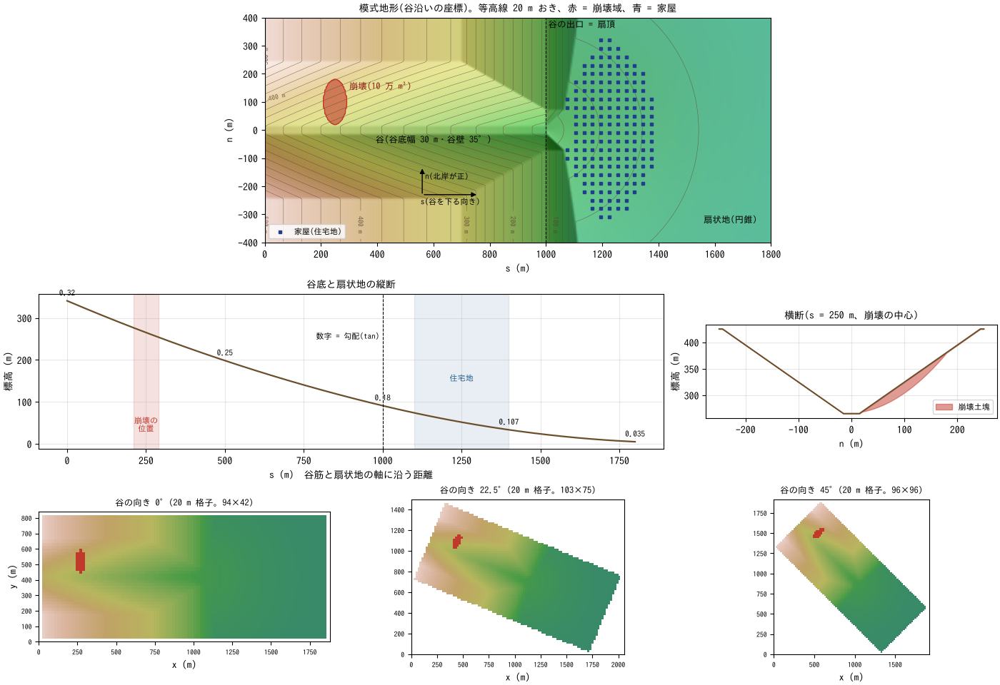
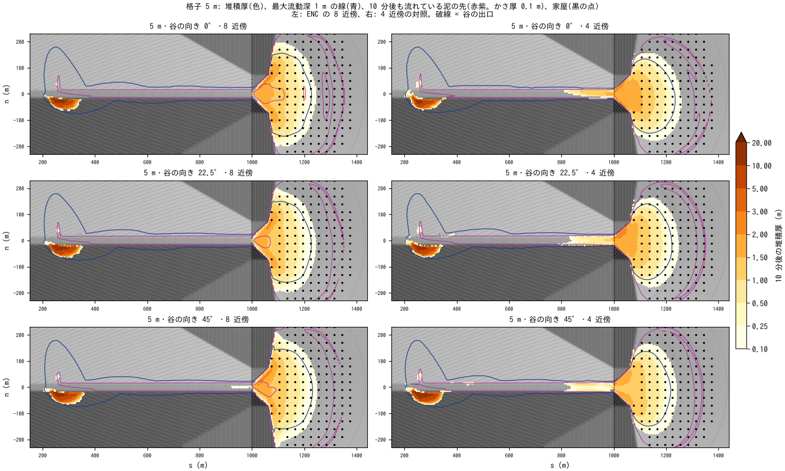
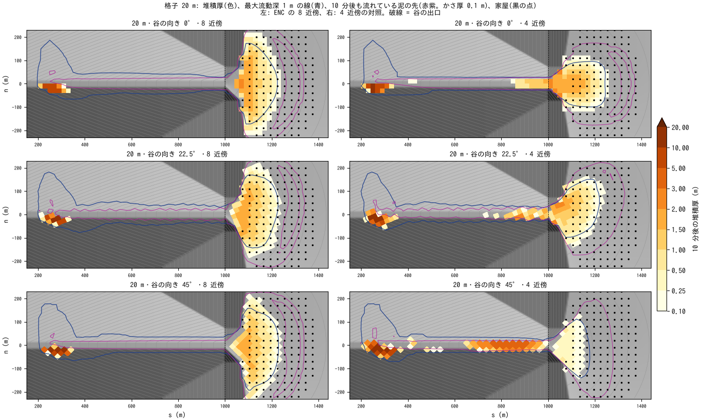
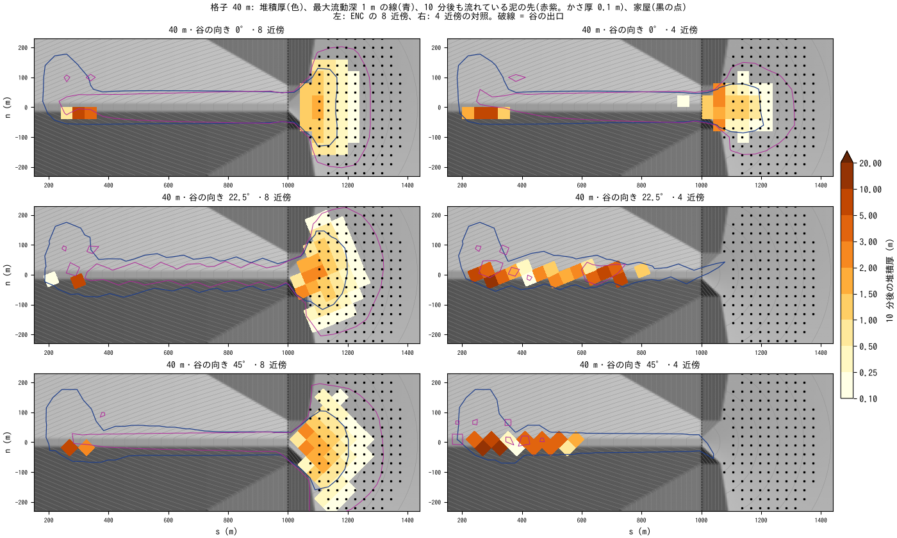
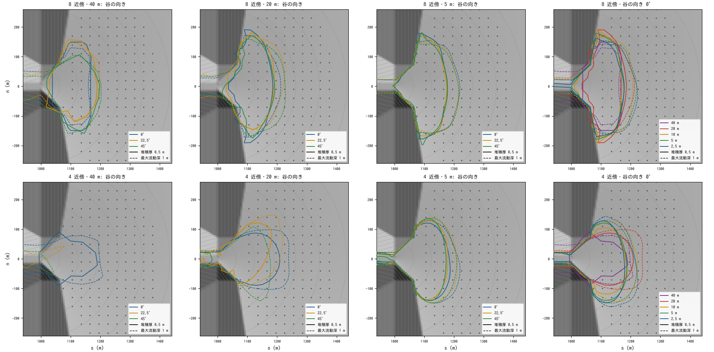
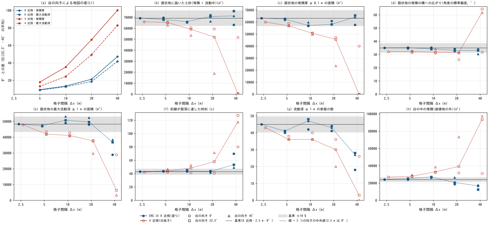
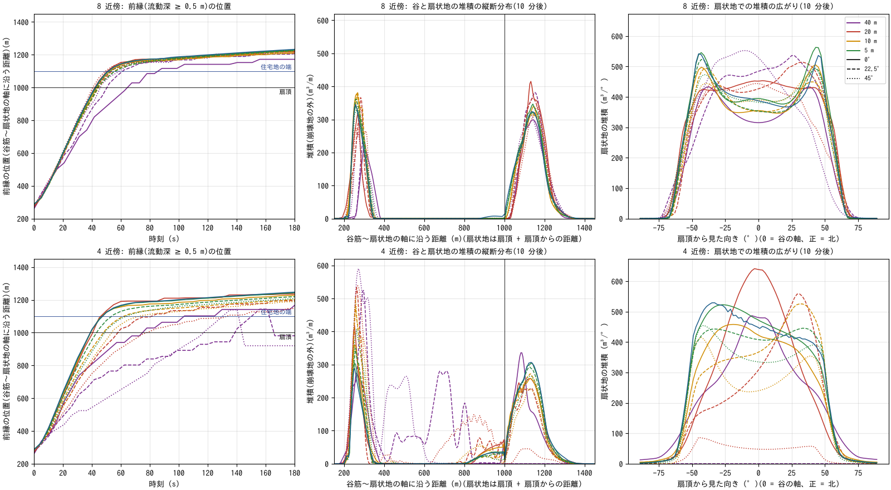

# debris_fan — 斜面崩壊から谷を下る土石流と扇状地の住宅地(格子の大きさ・向きへの依存)

[English](en/README.md)

1997 年の鹿児島県出水市針原川の土石流のように、谷壁の急な斜面が大きく崩れ、崩れた土砂が
土石流になって谷を下り、谷の出口の扇状地にある住宅地まで達する災害を、模式的な地形で計算します。
ねらいは、土石流の計算が**格子の大きさと、谷が格子に対して走る向き**にどれだけ左右されるかを
確かめることです。同じ地形・同じ崩壊を、格子間隔 40・20・10・5・2.5 m と、格子に対する谷の向き
0°・22.5°・45° の組み合わせで計算し、前縁の到達時刻、谷と扇状地の堆積の量・範囲・到達距離、
最大流動深、家屋に届く流れを比べます。広域の解析で使う粗い格子(谷底の幅より粗い 40 m まで)で
何が起きるかを見るために、ENC の 8 近傍と、斜めの近傍とのやり取りをやめた 4 近傍を並べます。地形・崩壊の大きさ・含水量は現象を見やすくするための模式値で、針原川の再現では
ありません。

**この例題で分かったこと(ENC 格子の 8 近傍と 4 近傍)**

- **粗い格子でも斜めの谷を流れ下る**: 谷底(幅 30 m)より粗い 40 m の格子でも、8 近傍では谷の向きに
  よらず基準の 0.91〜1.09 倍の土砂が扇状地に届きます。4 近傍は谷が格子に斜めだと 20 m 以上で土石流が
  谷の中で止まり、40 m・45° では 10 万 m³ のほぼ全量が谷に残ります。
- **谷の向きと格子間隔に左右されにくい**: 5 m の格子で、谷の向きによる地図の差は 8 近傍が 4 近傍の
  半分(9 % と 18 %)です。8 近傍では、扇状地に届く土砂・堆積の範囲・到達距離・到達時刻・横への広がりが、
  格子 20〜2.5 m・3 つの向きで基準の ±10 % にそろいます。
- **4 近傍は収束が遅い**: 4 近傍は格子 2.5 m でも、扇状地に届く土砂と堆積の面積が 8 近傍の 0.95 倍、
  堆積の横への広がりが 0.92 倍で、8 近傍の収束した結果からずれたまま残ります(扇頂への到達時刻はそろう)。
- 止まっていた土砂が動き出す判定と、急な斜面の重力の補正の、格子の向きによる偏り(8 近傍・4 近傍とも)は、
  この例題の作成中に見つけて直しました(developer.md §28.16・§91)。

## 実際の土石流災害で起きていること

- **針原川の土石流(1997 年 7 月 10 日)**: 出水市境町の針原川で、北岸側の斜面が大規模に崩壊し
  (崩壊土量 約 16 万 m³)、豪雨で水に飽和した土砂が崩壊の直後から土石流となって、下流の集落を
  襲いました。死者 21 名、負傷者 13 名の災害です(国土交通省の資料、地質調査所の報告)。
- **土石流が流れ、止まる勾配**: 砂防・治山の目安では、土石流は渓床勾配がおよそ 15° 以上(巨礫が
  多いと 20° 以上)の谷で発生・流下し、10° より緩い区間に出ると堆積し始め、2° 付近まで流れ下る
  おそれがあります(林野庁・鳥取県の資料)。谷の出口から広がる扇状地は、まさにその堆積の場で、
  住宅や道路が集まる場所でもあります。
- **石礫型の土石流**: 巨礫を多く含む土石流は、速く流れる間は止まらずに谷を下り、勾配が緩んで
  遅くなると急に堆積して、扇状地に舌状・扇状の堆積をつくります(Takahashi 2007)。
- **計算の格子**: 土石流の数値計算は、5 m・10 m などの数値標高モデル(DEM)の格子の上で行います。
  格子が谷の幅に比べて粗いと谷の形が崩れ、谷が格子の軸に対して斜めに走ると、流れが格子の軸の
  向きに引かれることがあります(例題 [ashfall_lahar](../ashfall_lahar/README.md) の補足では、
  4 近傍の格子で谷の向きによる差が 8 近傍の 3 倍ほど出ました)。実際の谷は格子の向きを選べず、
  広い範囲を計算するときは格子を粗くせざるをえないので、結果が格子の取り方にどれだけ左右されるかを
  知っておくことが、計算をハザードの評価に使う前提になります。

## 再現に必要な機構

| 実際の現象 | ENCflow での表し方 | 設定 |
|---|---|---|
| 斜面が崩れて流動化する | 崩壊深の分布を与え、計算開始と同時に流動化する(固体 (1 − λ)D を流れの土砂に、間隙水 λD を流れの水に移す) | `fn_dbinit`、`db_reltime = 0`、`db_relsat = 1` |
| 崩れた土塊が水を取り込んで土石流になる | 土石流の濃度 0.45 に足りない分の水を、崩壊域の初期水深として置く(シナリオとして与える) | `f_htype = 1`、`fn_hinit` |
| 巨礫のぶつかり合いが支配する流れの抵抗 | 高橋・中川 (1991) の石礫型の構成則(降伏 tanα′ = 0.45 とダイラタント項) | `f_dbres = 3`、`db_d50` |
| 急な谷では止まらず、遅くなると堆積する | 高橋・中川 (1991) の侵食・堆積(平衡濃度へ近づく。速い間は慣性で走って堆積しない) | `f_dbed = 3`、`db_delte`、`db_deltd` |
| 止まった土砂が地形になる | 低速で止まった土砂を地形に固定する | `f_dbstop = 1` |
| 積もった土砂は水を含む | 堆積で増えた層の間隙を、その場の流れの水で満たす | `f_dbwet = 1` |
| 急な斜面の重力 | 斜面の傾きによる重力の補正(摩擦と流砂のせん断も斜面に沿わせる) | `f_gravity_correction = 2`(既定) |
| 谷の向きと格子 | 地形・崩壊深・初期水深を谷に沿う座標の式で与え、各格子のセル中心で値を取る(補間しない) | `make_init.py` |
| 斜めの方向の流れ | ENC 格子の 8 近傍(斜めのエッジも流れを通す。対照の 4 近傍は斜めの通過幅を 0 にする) | `p_diagratio` |

## 幾何と設定



上: 模式地形(谷に沿う座標 s・n)。赤 = 崩壊域、青の点 = 家屋。中左: 谷底と扇状地の軸の縦断
(数字は勾配)。中右: 崩壊の中心を通る横断。下: 谷の向き 0°・22.5°・45° の 20 m 格子の地盤高
(赤 = 崩壊域)。同じ地形を格子に対して回して置きます。

- **領域**: 谷に沿って 1,840 m(谷 1,000 m + 扇状地 800 m + 下流端の吸い込みの帯 40 m)、横断 800 m
  の長方形。この長方形の外は領域外で、下流端の帯は海域マスク(標高 0 m の吸い込み)です。谷を
  格子に対して回すと、長方形の縁は格子の上で階段状になります。
- **谷**: 谷底の幅 30 m、谷壁 35°(勾配 0.7)、谷底から尾根まで 160 m。谷底の勾配は上流端の 0.32
  (17.7°)から谷の出口の 0.18(10.2°)へ直線的に緩みます(土石流が流下する 10° 以上)。尾根は
  出口の 300 m 手前から下げて出口で 40 m にし、山麓の崖(35°)の脚が出口の線から 50 m 以内に
  来るようにしています。
- **扇状地**: 谷の出口(扇頂、標高 91 m)を中心とする円錐。半径方向の勾配は 0.18(10.2°)から
  半径 800 m で 0.035(2.0°)へ緩みます(堆積の区間)。
- **崩壊**: s = 250 m の北岸の谷壁の、谷底から 4〜115 m の高さの楕円(谷沿い 80 m × 斜面の水平方向
  160 m)。深さは中心で最大約 20 m の放物面で、体積が 10 万 m³ になるように格子ごとに規格化します
  (粗い格子でも同じ土量)。崩壊深の分だけ土層厚を与え、その下と崩壊域の外は侵食されない基盤です
  (堆積した土砂は侵食されうる)。
- **水**: 崩壊土塊は飽和していて(間隙水 4 万 m³)、さらに谷の水・地下水 3.3 万 m³ を取り込んで、
  濃度 0.45(固体 6 万 m³、水 7.3 万 m³)の土石流として流れ出す、とします。
- **住宅地**: 扇頂から 100〜400 m、谷の軸から ±60° の扇形に 30 m おきに並ぶ 173 戸の位置
  (`houses.txt`)。計算には使わず(家屋は流れを妨げない)、図化で最大流動深と堆積厚を読みます。
- **土石流のモデル**: 高橋・中川 (1991) の石礫型。代表粒径 0.3 m(先頭部の巨礫)、内部摩擦角 35°、
  堆積物の空隙率 0.4、侵食・堆積の係数 δe = 0.0001・δd = 0.5(同論文の洞谷への適用値)。
- **時間刻みと出力**: dt = 0.01Δx(40 m で 0.4 s、2.5 m で 0.025 s。クーラン数の最大は格子によらず
  0.3〜0.36)。計算は 10 分、分布の出力は 5 秒おき(bil)。

| 格子間隔 | 谷の向き | 近傍 | 格子の大きさ(0° / 22.5° / 45°) | 谷底(30 m)のセル数 |
|---|---|---|---|---:|
| 40 m | 0°・22.5°・45° | 8 と 4 | 48 × 22 / 53 × 39 / 49 × 49 | 0.75 |
| 20 m | 0°・22.5°・45° | 8 と 4 | 94 × 42 / 103 × 75 / 96 × 96 | 1.5 |
| 10 m | 0°・22.5°・45° | 8 と 4 | 186 × 82 / 203 × 147 / 189 × 189 | 3 |
| 5 m | 0°・22.5°・45° | 8 と 4 | 370 × 162 / 404 × 291 / 376 × 376 | 6 |
| 2.5 m | 0° | 8 と 4 | 738 × 322 | 12 |

8 近傍は ENC の既定(`p_diagratio` = 8 本の通過幅が等しくなる値)、4 近傍は `p_diagratio = 0` です。
`param.txt`(5 m・0°・8 近傍)が注釈付きの雛形で、ほかの 25 ケースの `param_dx<格子>_r<向き>[_4nb].txt`
は `make_init.py` が格子・時間刻み・入出力の行だけを差し替えて書きます。どのケースも計算する
範囲は同じ長方形(2.5 m で 23 万セル)で、違うのは格子の大きさ・向きと近傍の数だけです。
2.5 m は谷の向き 0° だけを計算し、8 近傍のケースを比較の基準に、4 近傍のケースを 4 近傍が格子を
細かくするとどこへ近づくかの確認に使います(8 近傍は 5 m と 2.5 m の差が数 % で、5 m で十分に
細かいことを確かめるためのもの)。

## 実行方法

```bash
cd examples/debris_fan
make                     # リンクと、全 26 ケースの入力と設定(make_init.py)
make run                 # 全 26 ケースを順に計算(4 スレッドで 30 分ほど。2.5 m の 2 ケースが大半)
python3 plot_results.py  # figs/*.png と数表(引数 en で英語版を en/figs/ に)
```

`make quick` は 40・20・10 m の 18 ケースだけを計算します(数分)。1 ケースだけなら
`./encflow param.txt`(5 m・0°。1 分半ほど)。出力は全ケースで 2.5 GB ほどになります(2.5 m の
2 ケースで 0.9 GB。`make clean` で消せます)。

## 結果

表と図は、降伏の静止判定(developer.md §28.16)と急な斜面の重力の補正(§91)を直した後のコード
(2026-11-04)で全 26 ケースを計算し直した値です。静止判定の修正の違いは小さく(基準のケースで扇状地の
堆積 49,133 → 48,941 m³、流動中 19,088 → 19,280 m³)、この例題の流れの大半は速く、静止判定が効くのは
止まり際だけです。重力の補正の修正では、斜面に斜めのエッジで大きく出ていた有効重力が正しくなり、基準の
ケースの扇状地に届いた土砂が 68.2 → 69.2 千 m³(+1.5 %)、扇頂への到達が 42.3 → 43.0 秒になりました。
4 近傍は変化が大きく、谷に残る土砂が増えて扇状地に届く土砂が減り(2.5 m で 68.5 → 65.9 千 m³)、扇頂への
到達が遅くなって 8 近傍とそろいました(2.5 m で 38.9 → 42.1 秒)。

### 土石流の流れ方(基準: 8 近傍・2.5 m・0°)



格子 5 m の谷と扇状地の全体。色 = 10 分後の堆積厚、青の線 = 最大流動深 1 m、赤紫の線 = 10 分後も
流れている泥の先(かさ厚 0.1 m)、黒の点 = 家屋。左: ENC の 8 近傍、右: 4 近傍。上から谷の向き
0°・22.5°・45°(谷に沿う座標に戻して描く)。

- **崩壊直後(0〜20 秒)**: 崩れた土塊は谷へ落ち、勢いのまま谷底を横切って対岸(南岸)の斜面を
  谷底から 31 m の高さまで駆け上がります。そこで止まった約 2.4 万 m³(かさ体積)が、崩壊地の対岸の
  斜面の脚に最大 15 m の厚さで残ります。
- **谷の流下(20〜45 秒)**: 残りの土砂(固体 4.6 万 m³)は濃い土石流として谷を下ります。谷底での
  最大流速は 25 m/s、最大流動深は谷の中ほどで 9〜13 m、扇頂の手前で 6〜7 m で、前縁は 43 秒で扇頂に、52 秒で住宅地の端(扇頂から
  100 m)に達します。急な谷では慣性で走って堆積せず、谷の中の堆積は崩壊地の対岸だけです。
- **扇状地での堆積(1〜10 分)**: 扇頂から広がって減速し、扇状地に舌状の堆積をつくります。扇状地の
  堆積は 2 分で 1.7 万 m³、5 分で 3.9 万 m³、10 分で 5.0 万 m³(かさ体積)と増え、10 分後の堆積は
  扇頂から 267 m まで、厚さ 0.1 m 以上の範囲が 6.3 万 m²、最大の厚さ 2.5 m です。
- **後続の泥**: 濃度 0.45 の土石流が空隙率 0.4 の堆積物になると水が余り、その水が堆積物の上を
  薄い泥の流れ(濃度 0.4 以下)として扇状地に広がります。10 分後も扇状地で 1.9 万 m³、谷で 0.7 万 m³
  (かさ体積)の土砂が流れていて、扇頂から 350 m ほどまで届いています(図の赤紫の線)。比較はすべて
  10 分の時点の値で、堆積の指標には流れている土砂を含めません(扇状地に届いた土砂の量だけは
  堆積 + 流動中で数えます)。
- **住宅地**: 173 戸のうち、最大流動深 1 m 以上の流れが届くのが 45 戸(0.5 m 以上は 95 戸)、
  0.5 m 以上埋まるのが 30 戸、最大流体力 10 m³/s²(単位幅あたり 10 kN/m)以上を受けるのが扇頂に
  近い 10 戸です。

### 谷の向きと格子の粗さ: ENC の 8 近傍と 4 近傍





格子 20 m(上)と 40 m(下)。見方は 5 m の図と同じです。

扇状地に届いた土砂(堆積 + 流動中。千 m³。基準 69.2 千 m³):

| 格子 | 8 近傍(0° / 22.5° / 45°) | 4 近傍(0° / 22.5° / 45°) |
|---|---|---|
| 40 m | 63.1 / 75.7 / 71.3 | 51.8 / **0.7** / **0.5** |
| 20 m | 72.0 / 70.7 / 66.3 | 59.4 / 52.0 / **18.8** |
| 10 m | 66.0 / 65.5 / 66.1 | 59.0 / 60.3 / 53.6 |
| 5 m | 69.7 / 68.0 / 67.8 | 65.7 / 65.2 / 62.9 |
| 2.5 m | 69.2(0° だけ) | 65.9(0° だけ) |

- **4 近傍は、粗い格子で谷が斜めだと土石流が谷を下れない**: 谷底(幅 30 m)が 1〜2 セルになる
  20・40 m の格子で谷が格子に対して斜めに走ると、谷底のセルどうしは角でしかつながりません。
  4 近傍では角を通る流れがないので、流れは隣の高い谷壁のセルを回り込まなければならず、土石流は
  そこで止まって谷を埋めます。40 m の 22.5°・45° では 10 万 m³ のほぼ全量が谷に残って扇状地に
  届かず、20 m・45° でも 4 分の 3 が谷に残ります。谷が格子の軸に沿う 0° では 4 近傍でも扇状地に
  届きます(40 m で基準の 0.75 倍)。
- **8 近傍は、谷底より粗い格子でも扇状地に届く**: 斜めのエッジが谷底のセルを直接つなぐので、
  谷底が 1 セルに満たない 40 m でも、どの向きでも土砂の 0.91〜1.09 倍が扇状地に届き、堆積の範囲・
  到達距離も基準の ±10 % に入ります。
- **5 m では両者の差は小さい**: 谷底が 6 セルある 5 m では、4 近傍でも扇状地に届く土砂は基準の
  0.91〜0.95 倍です。ただし 4 近傍では、どの向きでも谷の出口の手前(s = 600〜1,000 m)の谷底に
  約 0.4 万 m³ の土砂が残り(厚さ最大 1.3〜1.7 m。8 近傍は 130 m³ 以下)、扇状地の堆積は
  横に広がりにくくなります(谷の軸から ±45° の方向へ山麓に沿って伸びる部分がない)。



扇状地の堆積厚 0.5 m(実線)と最大流動深 1 m(破線)の線を重ねた図。上: 8 近傍、下: 4 近傍。左から
格子 40・20・5 m の 3 つの向き、右端は谷の向き 0° の格子間隔。



(a) 谷の向きによる地図の差(0° との L1 の相対差。22.5° と 45° の平均)。(b)〜(h) 主な指標
(塗り = 8 近傍、白抜き = 4 近傍、記号 = 谷の向き、線 = 3 つの向きの中央値(2.5 m は 0° だけ)、黒線と
灰色の帯 = 基準とその ±10 %)。(d) は扇状地の堆積の横への広がり(扇頂から見た向きの標準偏差)で、
扇状地の堆積がほぼない 4 近傍・40 m の斜めの谷の値は意味を持ちません。

谷の向きによる地図の差(扇状地の堆積厚 / 最大流動深の L1 の相対差、22.5° と 45° の平均。%):

| | 40 m | 20 m | 10 m | 5 m |
|---|---:|---:|---:|---:|
| 8 近傍 | 47 / 42 | 21 / 19 | 13 / 13 | 9 / 9 |
| 4 近傍 | 100 / 83 | 66 / 49 | 35 / 24 | 18 / 13 |

主な指標の、基準に対する比の範囲(3 つの向きの最小〜最大):

| 指標 | 8 近傍 40 m | 8 近傍 20 m | 8 近傍 10 m | 8 近傍 5 m | 4 近傍 40 m | 4 近傍 20 m | 4 近傍 10 m | 4 近傍 5 m |
|---|---:|---:|---:|---:|---:|---:|---:|---:|
| 扇状地に届いた土砂 | 0.91〜1.09 | 0.96〜1.04 | 0.95〜0.95 | 0.98〜1.01 | 0.01〜0.75 | 0.27〜0.86 | 0.77〜0.87 | 0.91〜0.95 |
| 堆積の面積(≥ 0.1 m) | 0.91〜1.04 | 0.92〜0.96 | 0.90〜0.94 | 0.98〜0.99 | 0.00〜0.63 | 0.37〜0.75 | 0.78〜0.81 | 0.90〜0.93 |
| 堆積の到達距離 | 0.95〜1.00 | 0.95〜0.97 | 0.90〜0.94 | 0.95〜0.96 | 0.00〜0.98 | 0.70〜0.96 | 0.91〜0.92 | 0.94〜1.00 |
| 最大流動深 ≥ 1 m の面積 | 0.60〜0.80 | 1.00〜1.09 | 1.01〜1.10 | 0.97〜0.98 | 0.07〜0.60 | 0.61〜0.79 | 0.85〜0.89 | 0.87〜0.90 |
| 最大流体力 ≥ 10 の面積 | 0.56〜0.85 | 0.96〜1.15 | 0.87〜1.00 | 0.91〜1.03 | 0.38〜1.13 | 0.23〜1.10 | 0.58〜0.88 | 0.79〜1.02 |
| 流動深 ≥ 1 m の家屋 | 0.40〜0.62 | 0.91〜0.98 | 0.93〜1.07 | 0.89〜0.91 | 0.00〜0.58 | 0.44〜0.80 | 0.80〜0.89 | 0.80〜0.84 |
| 扇頂への到達時刻 | 1.14〜1.62 | 0.96〜1.02 | 1.01〜1.05 | 1.01〜1.02 | 1.86〜2.95 | 0.94〜1.66 | 0.97〜1.22 | 0.98〜1.09 |
| 堆積の横への広がり | 0.87〜0.97 | 0.93〜0.98 | 0.97〜1.01 | 0.99〜1.01 | 0.90〜1.84 | 0.75〜0.90 | 0.89〜0.97 | 0.90〜0.94 |

(堆積の横への広がりは、扇状地の堆積を扇頂から見た向きの標準偏差。4 近傍・40 m の 22.5°・45° は扇状地の堆積が
ほぼないので、この比は意味を持ちません)

- **8 近傍・10 m 以下(谷底 3 セル以上)**: どの指標も、どの向きでも基準の ±13 % 以内に入ります
  (いちばん外れるのは流体力の範囲と、数え方が離散的な家屋の数)。谷の向きによる地図の差は 5 m で
  9 %、10 m で 13 % で、格子を細かくすると縮みます(向きの差は離散化の誤差で、格子とともに
  収束する)。
- **8 近傍・20 m(谷底 1.5 セル)**: 扇状地に届く土砂・堆積の範囲・到達距離・扇頂への到達時刻は
  基準の ±8 % に入り、最大流動深 1 m 以上の範囲・流体力・家屋の数も ±15 % ほどです。崩壊地の
  対岸の堆積(谷の中の堆積)だけは、谷の横断を解像できず基準の 0.79〜1.10 倍に揺れます。
- **8 近傍・40 m(谷底 0.75 セル)**: 量と範囲(扇状地に届く土砂、堆積の面積、到達距離)は保たれますが、
  流れの強さの指標は崩れます。最大流動深 1 m 以上の範囲は基準の 0.60〜0.80 倍、流動深 1 m 以上の
  流れが届く家屋は 0.40〜0.62 倍と小さく出て、谷の向きによっても大きく変わります(深く速い流れが
  粗いセルで平均されるため)。0° では扇頂への到達が 1.6 倍遅れます(谷底が 1 列のセルになり、
  流れが狭い 1 列に押し込められる)。
- **4 近傍**: 5 m でも谷の向きによる地図の差は 8 近傍の 2 倍で、扇頂への到達時刻も向きで 5 秒
  (0.98〜1.09 倍)ずれます。10 m で扇状地に届く土砂が基準の 0.77〜0.87 倍、20 m 以上では上のとおり
  斜めの谷で流れが止まります。



上: 8 近傍、下: 4 近傍。左: 前縁(流動深 0.5 m 以上)の位置。中: 谷と扇状地の堆積の縦断分布
(谷は横断の積分、扇状地は扇頂を中心とする円弧の積分)。右: 扇状地の堆積の、扇頂から見た向きごとの量。
色 = 格子間隔、線種 = 谷の向き。

- 8 近傍では、40 m を除く 10 ケースの前縁の位置がほぼ 1 本の線に重なり、扇頂に 41〜45 秒で達します。
  堆積の縦断分布(崩壊地の対岸と扇状地の 2 つの山)と、扇状地での向きごとの分布(谷の軸から ±45° の
  山麓沿いに多い)も、格子間隔・向きによらずそろいます。
- 4 近傍では、粗い格子の斜めの谷で前縁が谷の途中で止まり、堆積の縦断分布には谷の中の山が現れます。

### 横への広がり: 8 近傍と 4 近傍のどちらが方程式の解に近いか

扇状地の堆積は、8 近傍の方が 4 近傍より横に広がります(扇状地の堆積を扇頂から見た向きの標準偏差)。

| 谷の向き 0° | 20 m | 10 m | 5 m | 2.5 m |
|---|---:|---:|---:|---:|
| 8 近傍 | 34.2° | 35.3° | 35.2° | 35.0° |
| 4 近傍 | 26.2° | 31.2° | 31.5° | 32.2° |

- **8 近傍の広がりは数値拡散ではない**: 数値拡散なら格子間隔に比例し、粗い格子ほど広がるはずですが、
  8 近傍の広がりは 20 m から 2.5 m まで変わらず、谷の向きにもよりません。斜めのエッジが流れの土砂
  (スカラー hs)の輸送に横向きの数値拡散を生む問題は、リンクごとの MUSCL(`f_scalar_scheme = 3`。既定。
  developer.md §78)で主要項が消してあり、この例題でも効いています。試しに 1 次風上(`f_scalar_scheme = 1`。
  斜めのリンクで横断の数値拡散 Dy ≈ 0.29uΔy が出る旧方式)に戻しても、5 m・0° の広がりは
  35.11° → 34.83° と 0.8 % しか変わりませんでした(変わるのは濃度の鋭さで、最大堆積厚が 10 % 下がる。
  重力の補正を直す前のコードでの試し)。
  運動量の移流は保存形の MUSCL(既定)で、拡散項(渦粘性)はどちらも使っていません(`f_diffusion_term = 0`)。
- **4 近傍の狭さは、斜めの方向の流れの表し方の偏り**: 4 近傍は格子を細かくすると広がりますが
  (20 m の 26° から 2.5 m の 32°)、近づき方は遅く、2.5 m でも 8 近傍に届きません。斜めのエッジがないと、
  斜めの向きの流れは軸の向きの 2 つのエッジに分けて運ばれます。エッジごとの降伏の静止判定で駆動力が
  小さく見える偏り(developer.md §28.16)と、斜面に斜めのエッジで有効重力が大きく出る偏り(§91)を
  直した後も、4 近傍の広がりは狭いまま(2.5 m で 32.2°)なので、止まり方の判定や重力の補正ではなく、
  運動量の輸送と圧力の勾配を軸の向きのエッジだけで表すことの偏りと考えられます(それ以上の切り分けは
  していません)。0° の前縁が扇頂に達する時刻は、重力の補正を直す前は 4 近傍が格子によらず 39 秒で
  8 近傍の 42 秒より早かったのが、直した後は 41〜42 秒と 43〜44 秒(20〜2.5 m)でほぼそろいました
  (速すぎた分は重力の補正の偏りでした)。扇状地に届く土砂は、4 近傍では 2.5 m でも 8 近傍の 0.95 倍で、
  谷に残る土砂が 1.1 倍です。
- **どちらが正しいか**: このモデルの方程式(水深積分の浅水流 + 高橋・中川の構成則)の解に近いのは、格子
  間隔にも向きにもよらない 8 近傍の結果です。4 近傍の横の広がりの不足は向きに偏った誤差なので、等方的な
  拡散項を足しても直りません(主流の舌状部も含めて一様にぼかすことになる)。ただし、方程式の解が実際の
  土石流の横への広がり(側方の自然堤防、巨礫の先頭など)をどこまで再現するかは別の問題で、この例題では
  実測と照らしていません。

### 広域の解析に使うときの目安

この例題の谷(谷底 30 m、流れの幅 50 m ほど)では、次のようになりました。谷の大きさが違えば、
格子間隔は谷底のセル数に読み替えてください。

| 知りたいこと | 8 近傍(ENC の既定) | 4 近傍 |
|---|---|---|
| 土砂がどこまで届き、どれだけ積もるか(扇状地に届く量・堆積の範囲・到達距離) | 谷底より粗い格子(40 m、谷底 0.75 セル)でも基準の ±10 % | 谷が斜めだと、谷底 1.5 セル以下(20 m 以上)で流れが谷で止まる。谷底 3 セル(10 m)で 0.77〜0.92 倍、6 セル(5 m)で 0.90〜1.00 倍 |
| 流れの強さ(最大流動深・流体力・家屋に届く流れ) | 谷底 1.5 セル以上(20 m)で ±15 % ほど、3 セル以上(10 m)で ±13 % 以内 | 谷底 6 セル(5 m)でも 0.79〜1.02 倍 |
| 到達時刻 | 谷底 1.5 セル以上で ±5 % | 谷底 6 セル(5 m)でも 0.98〜1.09 倍 |

1 ケースの計算時間(4 スレッド、この例題を作った環境): 40 m で 0.3 秒、20 m で 2 秒、10 m で 13 秒、5 m で
1 分半、2.5 m で 10 分。計算量は格子間隔の 3 乗に
反比例します(セル数が 2 乗、時間刻みの数が 1 乗)。広い範囲の土石流の到達範囲を粗い格子で
概算するときは 8 近傍(既定)を使い、流動深・流体力で家屋の被害を読む範囲は、谷底を 3 セル以上で
解像する格子で計算し直すのが目安です。

### 依存が小さい理由と、残る依存

- **ENC の 8 近傍**: 各セルは 8 本のエッジで隣と流れをやり取りし、既定の配分では 8 本の通過幅が
  等しくなります([ENC 格子の解説](../../docs/users_guide/encgrid.md) §2)。斜めに走る谷でも、谷底の
  セルが斜めのエッジで直接つながるので、流れが階段状の経路を強いられません。
- **侵食・堆積の勾配**: 高橋・中川の侵食・堆積(`f_dbed = 3`)は、流速の向きの流動面の勾配を使います
  (各軸の勾配を流速の向きへ射影)。勾配の向きを 8 方向に丸めないので、谷の向きに左右されません。
- **降伏で止まる判定**: クーロン型の降伏で止まるかどうかを、エッジの法線の成分でなく流れの速さで
  判定し(developer.md §28.11)、止まっている土砂が動き出すかどうかを、エッジの法線方向と接線方向を
  合わせた駆動の大きさで判定します(§28.16)。一様な斜面の検定 [test/dbonset](../../test/dbonset/README.md)
  で、動き出す勾配と滑る速さ・向きが、斜面の向きと近傍の数によらないことを確かめています。
- **残る依存**: 粗い格子で谷の横断が解像されないこと(谷底 2 セル以下)による崩壊地の対岸の堆積と
  流れの強さ、扇頂の山麓の角の形(格子で階段になる)、家屋の数(離散的な数え方)。いずれも格子を
  細かくすると縮みます。
- **急な斜面の重力の補正**: 急な斜面の重力の補正(`f_gravity_correction`)の有効重力 g cos²θ を、エッジの
  法線方向の勾配でなく、地盤の勾配の大きさから求めます(2026-11-04 に修正。developer.md §91)。修正前は
  斜面に斜めのエッジで有効重力が大きく出て、格子を細かくしても残る向きの依存になっていました(勾配
  0.38〜0.45 の一様な斜面を滑る速さで、8 近傍は 3〜5 % 速く、4 近傍は 0〜9 % 速い。test/dbonset)。この
  例題で 4 近傍の扇頂への到達が早すぎた(39 秒)のは、この偏りでした。

## このモデルで表せないこと(実際の現象との違い)

- **崩壊の発生**: 崩壊の位置・範囲・深さ・時刻は与えます。雨 → 地下水位の上昇 → 崩壊、を予測する
  なら斜面安定判定 `f_slide` と地下水計算を組みます([土砂・地形変化](../../docs/users_guide/geomorph.md))。
- **含水量**: 崩壊土塊が取り込む水の量(濃度 0.45)はシナリオです。濃度は流れ方と到達範囲を大きく
  変えます(感度実験の入口)。
- **粒径**: 粒径は 1 種類(0.3 m)です。巨礫が先頭に集まる、細粒分が泥流になって先へ流れる、といった
  分級は表しません。
- **家屋**: 家屋は流れを妨げず、壊れません。家屋の占有や破壊を入れるなら建物空隙率 `fn_gv` や
  家屋破壊 `fn_bldgdebris` を重ねます(例題 [levee_breach](../levee_breach/README.md)・
  [tsunami_town](../tsunami_town/README.md))。
- **急な斜面の堆積**: 対岸の斜面(35°)に駆け上がって止まった土砂は、そのまま斜面に残ります(堆積物が
  安息角を超えて崩れることは計算しません)。
- **流体力**: 最大流体力 F9999 は (ρm/ρw)(h + hs)V²(単位幅、清水の密度で規格化)で、巨礫の衝突力
  ではありません。
- **鉛直の構造**: 先頭部の盛り上がりや巨礫の集中、3 次元の流れは表しません(水深積分の 1 層の混合体)。
- **砂防施設**: 砂防堰堤などの対策施設は置いていません(置き方は [土砂・地形変化](../../docs/users_guide/geomorph.md)
  の「砂防施設」の段落と例題 [ashfall_lahar](../ashfall_lahar/README.md))。

## 注意

- **崩壊域の土層厚の余裕**: 崩壊域の土層厚は崩壊深より 5 cm 厚くしています(`make_init.py` の
  `SD_MARGIN`)。同じ地形更新の中で侵食が流動化より先に働くため、崩壊域の水が最初の数ステップで
  土層を数 mm 削り、崩壊深が土層厚で切られる(警告が出る)のを避けるためです。余分の 5 cm は崩壊地の
  底の土として削られ、流れに加わります(500 m³ ほど。表の「崩壊地に残る」が負になる分)。
- **時間刻み**: dt = 0.01Δx です。dt を半分にしても、指標の変化は 10 m で 2 % 以内、20 m で 4 % 以内
  (40 m では谷の中の堆積などが最大 9 %)で、格子の影響より十分小さいことを確かめています。
- **保存**: 固体の台帳(Σhs + (1 − λ)Σ(z − z0))は全ケースで ±0.06 m³(固体 6 万 m³ に対して。単精度の
  出力の丸め)で閉じ、土砂は下流端から出ていません。水の量は `Log.txt` の S 列で、開始時の 33,264 m³
  (崩壊域の水 33,333 m³。表示 4 桁の丸め)が、崩壊で加わる間隙水 4 万 m³ と堆積物の間隙に入る水
  (1 分後までに約 9,500 m³)のぶん変わることを確かめられます。
- **前縁の位置の時刻**: 前縁は 5 秒おきの出力から読み、出力の間は線形に補間しています。
- **向きの比較の地図の差**: 各ケースの場を谷に沿う共通の 5 m 格子へ双一次補間して比べています。
  体積・面積・距離は、各ケースの格子のセルのまま数えています(補間なし)。

## 感度実験の入口

- `C0`(`make_init.py`。0.45): 流れ出す土石流の濃度。小さい(水が多い)ほど遠くまで流れ、後続の泥が
  増えます。0.50 では扇頂の近くに厚く積もります。
- `db_d50`(`param.txt`。0.3 m): 高橋・中川の則では、粒径が小さいほど低速で急に堆積します。試算では
  0.1 m で土砂の大半が崩壊地の直下の谷に止まり、扇状地まで届きませんでした。
- `V0`・`S_C`・`N_C`・`A_S`・`A_N`(`make_init.py`): 崩壊の体積・位置・大きさ。
- `S_TOP`・`S_APX`・`S_END`(`make_init.py`): 谷と扇状地の勾配。
- `DXS`・`THETAS`(`make_init.py`): 格子間隔と谷の向きの組み合わせ。

## 参考文献

- 高橋保・中川一 (1991): 豪雨時に発生する石礫型土石流の予測. 新砂防, 44(3), 12–19.(侵食・堆積と
  抵抗則。δe・δd は同論文の洞谷への適用値)
- Takahashi, T. (2007): *Debris Flow: Mechanics, Prediction and Countermeasures*. Taylor & Francis, Leiden.
- 国土交通省: 土砂災害の事例の資料(出水市針原川、崩壊土砂量 約 16 万 m³、死者 21 名・負傷者 13 名).
  https://www.mlit.go.jp/common/001019680.pdf
- 地質調査所 (1997): 地質ニュース の出水市針原川の土石流災害の報告(北岸側の斜面の崩壊、飽和した斜面の
  崩壊からの土石流化). https://www.gsj.jp/data/chishitsunews/97_09_07.pdf
- 林野庁: 治山技術基準の解説の土石流の項(発生・流下の渓床勾配 15° 以上、10° を下回る区間で堆積).
  https://www.rinya.maff.go.jp/j/sekou/kizyun/attach/pdf/gijutu_kijun-30.pdf
- 鳥取県: 土砂災害の資料(土石流の発生は 15° 以上で多く、2° 付近まで流下のおそれ).
  https://www.pref.tottori.lg.jp/secure/1137670/1-7.pdf

国土交通省・地質調査所・林野庁・鳥取県の資料は、例題の作成時にウェブ検索の抜粋で内容を確かめた
もので、本文は照合していません。
