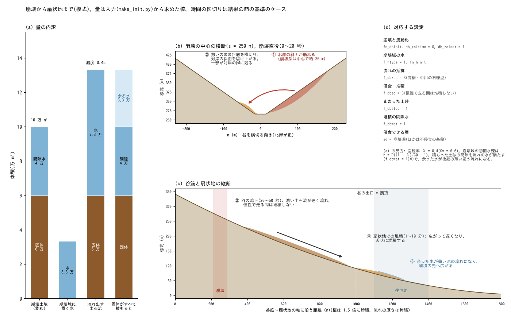
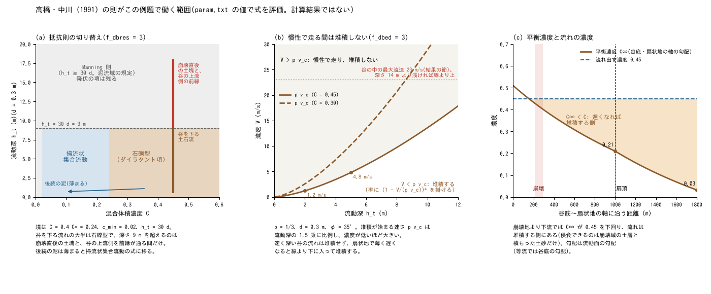
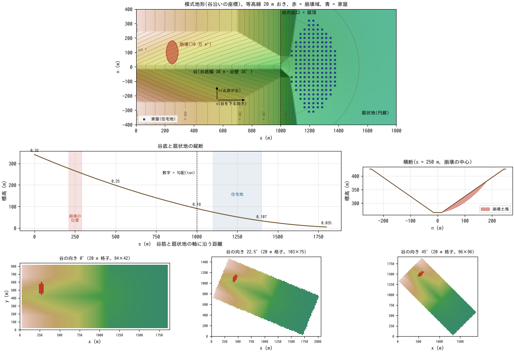
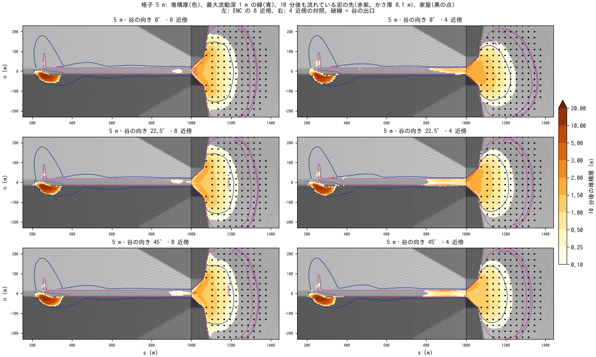
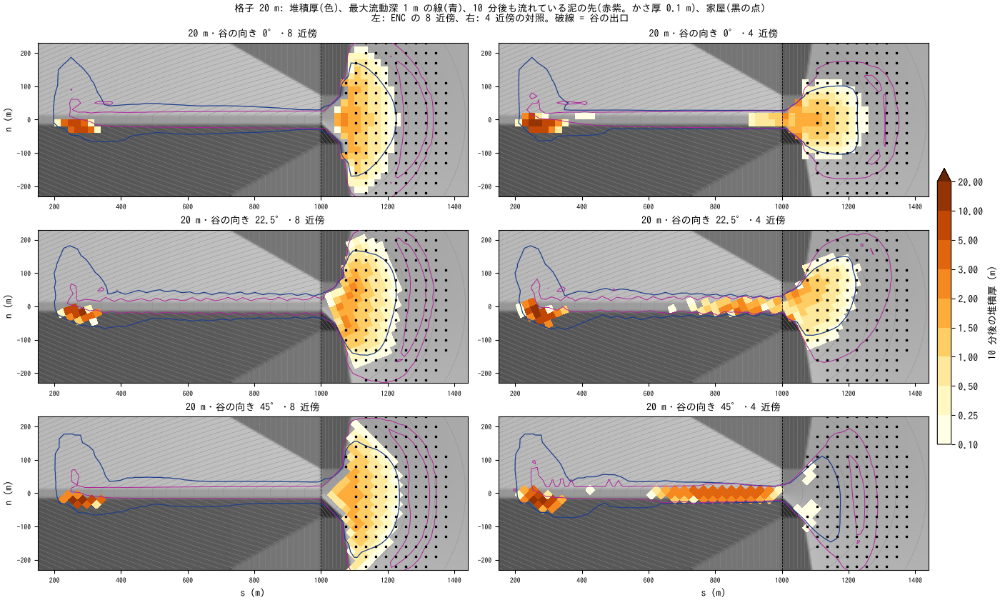
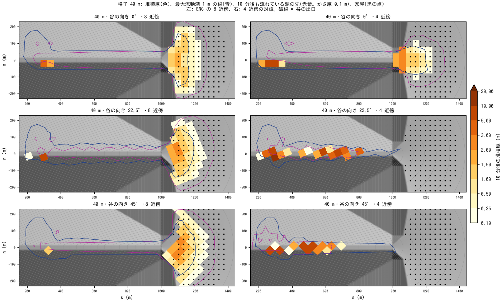
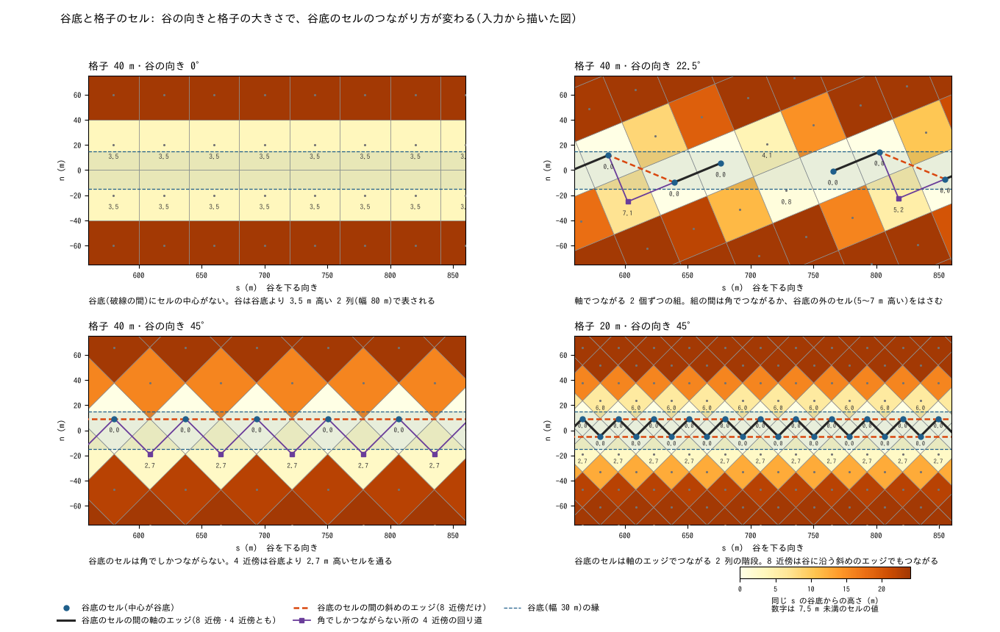
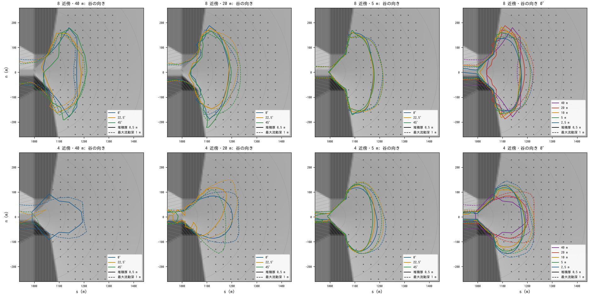
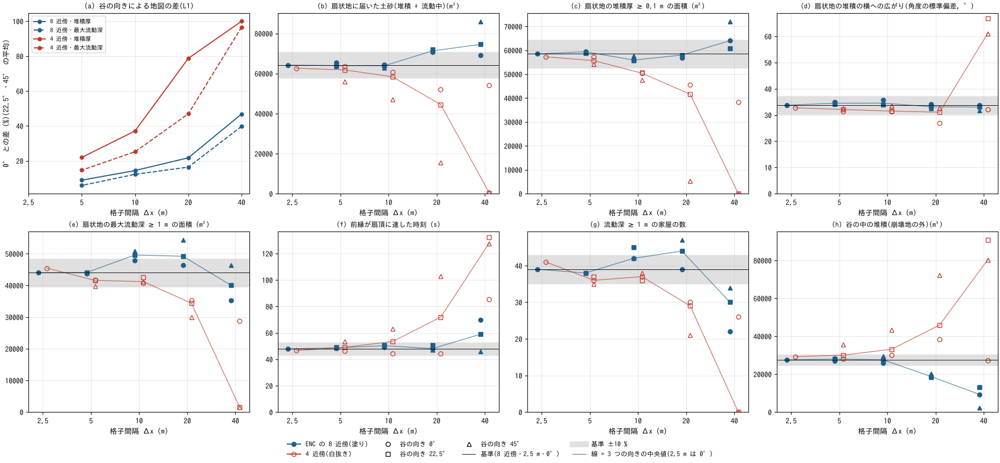
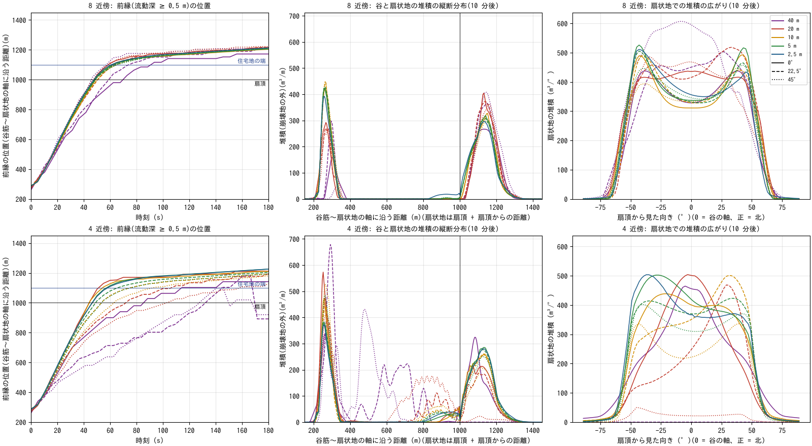

# debris_fan — 斜面崩壊から谷を下る土石流と扇状地の住宅地(格子の大きさ・向きへの依存)

[English](en/README.md)

1997 年の鹿児島県出水市針原川の土石流のように、谷壁の急な斜面が大きく崩れ、崩れた土砂が
土石流になって谷を下り、谷の出口の扇状地にある住宅地まで達する災害を、模式的な地形で計算します。
ねらいは、土石流の計算が**格子の大きさと、谷が格子に対して走る向き**にどれだけ左右されるかを
確かめることです。同じ地形・同じ崩壊を、格子間隔 40・20・10・5・2.5 m と、格子に対する谷の向き
0°・22.5°・45° の組み合わせで計算し、前縁の到達時刻、谷と扇状地の堆積の量・範囲・到達距離、
最大流動深、家屋に届く流れを比べます。広域の解析で使う粗い格子(谷底の幅より粗い 40 m まで)で
何が起きるかを見るために、ENC の 8 近傍と、斜めの近傍とのやり取りをやめた 4 近傍を並べます。地形・崩壊の大きさ・含水量は現象を見やすくするための模式値で、針原川の再現では
ありません。

**この例題で分かること(ENC 格子の 8 近傍と 4 近傍)**

- **粗い格子でも斜めの谷を流れ下る**: 谷底(幅 30 m)より粗い 40 m の格子でも、8 近傍では谷の向きに
  よらず土石流が扇状地に届きます(届く量は基準の 1.07〜1.34 倍と多めに出る。谷の中に止まる土砂を
  解像できないため)。4 近傍は谷が格子に斜めだと 20 m 以上で土石流が谷の中で止まり、40 m の 22.5°・45° では
  10 万 m³ のほぼ全量が谷に残ります。
- **谷の向きと格子間隔に左右されにくい**: 5 m の格子で、谷の向きによる地図の差は 8 近傍が 4 近傍の
  半分以下(9 % と 22 %)です。8 近傍では、扇状地に届く土砂・堆積の範囲・到達距離・到達時刻・横への広がりが、
  格子 10〜2.5 m・3 つの向きで基準の ±8 % にそろいます(20 m では扇状地に届く土砂が 1 割多い)。
- **4 近傍は下から近づく**: 4 近傍は格子が粗いほど扇状地に届く土砂が少なく(10 m で基準の 0.73〜0.94 倍、
  5 m で 0.87〜0.99 倍)、格子 2.5 m で、扇状地に届く土砂・堆積の面積・横への広がりが 8 近傍と 3 % 以内に
  そろいます。

## 実際の土石流災害で起きていること

- **針原川の土石流(1997 年 7 月 10 日)**: 出水市境町の針原川で、北岸側の斜面が大規模に崩壊し
  (崩壊土量 約 16 万 m³)、豪雨で水に飽和した土砂が崩壊の直後から土石流となって、下流の集落を
  襲いました。死者 21 名、負傷者 13 名の災害です(国土交通省の資料、地質調査所の報告)。
- **土石流が流れ、止まる勾配**: 砂防・治山の目安では、土石流は渓床勾配がおよそ 15° 以上(巨礫が
  多いと 20° 以上)の谷で発生・流下し、10° より緩い区間に出ると堆積し始め、2° 付近まで流れ下る
  おそれがあります(林野庁・鳥取県の資料)。谷の出口から広がる扇状地は、まさにその堆積の場で、
  住宅や道路が集まる場所でもあります。
- **石礫型の土石流**: 巨礫を多く含む土石流は、速く流れる間は止まらずに谷を下り、勾配が緩んで
  遅くなると急に堆積して、扇状地に舌状・扇状の堆積をつくります(Takahashi 2007)。
- **計算の格子**: 土石流の数値計算は、5 m・10 m などの数値標高モデル(DEM)の格子の上で行います。
  格子が谷の幅に比べて粗いと谷の形が崩れ、谷が格子の軸に対して斜めに走ると、流れが格子の軸の
  向きに引かれることがあります(例題 [ashfall_lahar](../ashfall_lahar/README.md) の補足では、
  4 近傍の格子で谷の向きによる差が 8 近傍の 3 倍ほど出ます)。実際の谷は格子の向きを選べず、
  広い範囲を計算するときは格子を粗くせざるをえないので、結果が格子の取り方にどれだけ左右されるかを
  知っておくことが、計算をハザードの評価に使う前提になります。

## 再現に必要な機構



(a) 量の内訳(make_init.py の値): 崩壊土塊 10 万 m³ は固体 6 万 m³ と間隙水 4 万 m³ で、崩壊域に 3.3 万 m³ の水を
置いて濃度 0.45 の土石流として流れ出します。固体がすべて空隙率 0.4 で積もると間隙に入る水は 4 万 m³ で、残りの
3.3 万 m³ が後続の薄い泥の流れになります。(b) 崩れた土塊は谷底を横切って対岸の斜面を駆け上がり、一部が対岸の
脚に残ります。(c) 谷を下る間は慣性で走って堆積せず、扇状地で広がって遅くなると堆積します。時間の区切りは下の
結果の節(基準のケース)のものです。模式図で、形は計算結果ではありません。

| 実際の現象 | ENCflow での表し方 | 設定 |
|---|---|---|
| 斜面が崩れて流動化する | 崩壊深の分布を与え、計算開始と同時に流動化する(固体 (1 − λ)D を流れの土砂に、間隙水 λD を流れの水に移す) | `fn_dbinit`、`db_reltime = 0`、`db_relsat = 1` |
| 崩れた土塊が水を取り込んで土石流になる | 土石流の濃度 0.45 に足りない分の水を、崩壊域の初期水深として置く(シナリオとして与える) | `f_htype = 1`、`fn_hinit` |
| 巨礫のぶつかり合いが支配する流れの抵抗 | 高橋・中川 (1991) の石礫型の構成則(降伏 tanα′ = 0.45 とダイラタント項) | `f_dbres = 3`、`db_d50` |
| 急な谷では止まらず、遅くなると堆積する | 高橋・中川 (1991) の侵食・堆積(平衡濃度へ近づく。速い間は慣性で走って堆積しない) | `f_dbed = 3`、`db_delte`、`db_deltd` |
| 止まった土砂が地形になる | 低速で止まった土砂を地形に固定する | `f_dbstop = 1` |
| 積もった土砂は水を含む | 堆積で増えた層の間隙を、その場の流れの水で満たす | `f_dbwet = 1` |
| 急な斜面の重力 | 斜面の傾きによる重力の補正(摩擦と混合体流動の抵抗則も斜面に沿わせる) | `f_gravity_correction = 2`(既定) |
| 谷の向きと格子 | 地形・崩壊深・初期水深を谷に沿う座標の式で与え、各格子のセル中心で値を取る(補間しない) | `make_init.py` |
| 斜めの方向の流れ | ENC 格子の 8 近傍(斜めのエッジも流れを通す。対照の 4 近傍は斜めの通過幅を 0 にする) | `p_diagratio` |



この例題の値で高橋・中川 (1991) の則を評価した図(計算結果ではない)。(a) 抵抗則は濃度と流動深で切り替わります。
谷を下る流れの大半は石礫型のダイラタント項で、深さが粒径の 30 倍(9 m)を超えると Manning 則になります(原著の
泥流域の規定。降伏の項は残る)。9 m を超えるのは崩壊直後の土塊と、谷の上流側を前縁が通る間だけです。(b) 流速が
p v_c(流動深の 1.5 乗に比例)を超える間は堆積しません。谷の速く深い流れは堆積せず、扇状地で薄く遅くなると堆積が
始まります。(c) 崩壊地より下流では平衡濃度が流れの濃度 0.45 を下回るので、流れは遅くなれば堆積する側にあります。

## 幾何と設定



上: 模式地形(谷に沿う座標 s・n)。赤 = 崩壊域、青の点 = 家屋。中左: 谷底と扇状地の軸の縦断
(数字は勾配)。中右: 崩壊の中心を通る横断。下: 谷の向き 0°・22.5°・45° の 20 m 格子の地盤高
(赤 = 崩壊域)。同じ地形を格子に対して回して置きます。

- **領域**: 谷に沿って 1,840 m(谷 1,000 m + 扇状地 800 m + 下流端の吸い込みの帯 40 m)、横断 800 m
  の長方形。この長方形の外は領域外で、下流端の帯は海域マスク(標高 0 m の吸い込み)です。谷を
  格子に対して回すと、長方形の縁は格子の上で階段状になります。
- **谷**: 谷底の幅 30 m、谷壁 35°(勾配 0.7)、谷底から尾根まで 160 m。谷底の勾配は上流端の 0.32
  (17.7°)から谷の出口の 0.18(10.2°)へ直線的に緩みます(土石流が流下する 10° 以上)。尾根は
  出口の 300 m 手前から下げて出口で 40 m にし、山麓の崖(35°)の脚が出口の線から 50 m 以内に
  来るようにしています。
- **扇状地**: 谷の出口(扇頂、標高 91 m)を中心とする円錐。半径方向の勾配は 0.18(10.2°)から
  半径 800 m で 0.035(2.0°)へ緩みます(堆積の区間)。
- **崩壊**: s = 250 m の北岸の谷壁の、谷底から 4〜115 m の高さの楕円(谷沿い 80 m × 斜面の水平方向
  160 m)。深さは中心で最大約 20 m の放物面で、体積が 10 万 m³ になるように格子ごとに規格化します
  (粗い格子でも同じ土量)。崩壊深の分だけ土層厚を与え、その下と崩壊域の外は侵食されない基盤です
  (堆積した土砂は侵食されうる)。
- **水**: 崩壊土塊は飽和していて(間隙水 4 万 m³)、さらに谷の水・地下水 3.3 万 m³ を取り込んで、
  濃度 0.45(固体 6 万 m³、水 7.3 万 m³)の土石流として流れ出す、とします。
- **住宅地**: 扇頂から 100〜400 m、谷の軸から ±60° の扇形に 30 m おきに並ぶ 173 戸の位置
  (`houses.txt`)。計算には使わず(家屋は流れを妨げない)、図化で最大流動深と堆積厚を読みます。
- **土石流のモデル**: 高橋・中川 (1991) の石礫型。代表粒径 0.3 m(先頭部の巨礫)、内部摩擦角 35°、
  堆積物の空隙率 0.4、侵食・堆積の係数 δe = 0.0001・δd = 0.5(同論文の洞谷への適用値)。
- **時間刻みと出力**: dt = 0.01Δx(40 m で 0.4 s、2.5 m で 0.025 s。クーラン数の最大は格子によらず
  0.29〜0.33)。計算は 10 分、分布の出力は 5 秒おき(bil)。

| 格子間隔 | 谷の向き | 近傍 | 格子の大きさ(0° / 22.5° / 45°) | 谷底(30 m)のセル数 |
|---|---|---|---|---:|
| 40 m | 0°・22.5°・45° | 8 と 4 | 48 × 22 / 53 × 39 / 49 × 49 | 0.75 |
| 20 m | 0°・22.5°・45° | 8 と 4 | 94 × 42 / 103 × 75 / 96 × 96 | 1.5 |
| 10 m | 0°・22.5°・45° | 8 と 4 | 186 × 82 / 203 × 147 / 189 × 189 | 3 |
| 5 m | 0°・22.5°・45° | 8 と 4 | 370 × 162 / 404 × 291 / 376 × 376 | 6 |
| 2.5 m | 0° | 8 と 4 | 738 × 322 | 12 |

8 近傍は ENC の既定(`p_diagratio` = 8 本の通過幅が等しくなる値)、4 近傍は `p_diagratio = 0` です。
`param.txt`(5 m・0°・8 近傍)が注釈付きの雛形で、ほかの 25 ケースの `param_dx<格子>_r<向き>[_4nb].txt`
は `make_init.py` が格子・時間刻み・入出力の行だけを差し替えて書きます。どのケースも計算する
範囲は同じ長方形(2.5 m で 23 万セル)で、違うのは格子の大きさ・向きと近傍の数だけです。
2.5 m は谷の向き 0° だけを計算し、8 近傍のケースを比較の基準に、4 近傍のケースを 4 近傍が格子を
細かくするとどこへ近づくかの確認に使います(8 近傍は 5 m と 2.5 m の差が数 % で、5 m で十分に
細かいことを確かめるためのもの)。

## 実行方法

```bash
cd examples/debris_fan
make                     # リンクと、全 26 ケースの入力と設定(make_init.py)
make run                 # 全 26 ケースを順に計算(4 スレッドで 35 分ほど。2.5 m の 2 ケースが大半)
python3 plot_results.py  # figs/*.png と数表(引数 en で英語版を en/figs/ に。計算前でも説明図 setup・grid・mechanism・laws は描ける)
```

`make quick` は 40・20・10 m の 18 ケースだけを計算します(数分)。1 ケースだけなら
`./encflow param.txt`(5 m・0°。2 分ほど)。出力は全ケースで 2.5 GB ほどになります(2.5 m の
2 ケースで 0.9 GB。`make clean` で消せます)。

## 結果

### 土石流の流れ方

この節の数値は基準(8 近傍・2.5 m・0°)のものです。図は格子 5 m で、8 近傍と 4 近傍、谷の向きを
並べます(基準の 2.5 m の地図は載せていません)。



格子 5 m の谷と扇状地の全体。色 = 10 分後の堆積厚、青の線 = 最大流動深 1 m、赤紫の線 = 10 分後も
流れている泥の先(かさ厚 0.1 m)、黒の点 = 家屋。左: ENC の 8 近傍、右: 4 近傍。上から谷の向き
0°・22.5°・45°(谷に沿う座標に戻して描く)。

- **崩壊直後(0〜20 秒)**: 崩れた土塊は谷へ落ち、勢いのまま谷底を横切って対岸(南岸)の斜面を
  谷底から 43 m の高さまで駆け上がります(最大流動深 0.1 m 以上の範囲)。そこで止まった約 2.5 万 m³
  (かさ体積)が、崩壊地の対岸の斜面の脚(谷底から 36 m の高さまで)に最大 15.9 m の厚さで残ります。
- **谷の流下(20〜50 秒)**: 残りの土砂(固体 4.5 万 m³)は濃い土石流として谷を下ります。谷底での
  最大流速は 23 m/s、最大流動深は谷の中ほどで 9〜13 m、扇頂の手前で 5〜6 m で、前縁は 48 秒で扇頂に、
  61 秒で住宅地の端(扇頂から 100 m)に達します。前縁が通る間は急な谷を慣性で走って堆積しません。谷の中の
  堆積は、崩壊地の対岸と、1.5 分以降の後続の流れが谷の出口の手前 170 m の谷底に残す 0.25 万 m³(最大 1.6 m)
  だけです。
- **扇状地での堆積(1〜10 分)**: 扇頂から広がって減速し、扇状地に舌状の堆積をつくります。扇状地の
  堆積は 2 分で 1.3 万 m³、5 分で 3.5 万 m³、10 分で 4.5 万 m³(かさ体積)と増え、10 分後の堆積は
  扇頂から 263 m まで、厚さ 0.1 m 以上の範囲が 5.8 万 m²、最大の厚さ 2.5 m です。
- **後続の泥**: 濃度 0.45 の土石流が空隙率 0.4 の堆積物になると水が余り、その水が堆積物の上を
  薄い泥の流れ(濃度 0.4 以下)として扇状地に広がります。10 分後も扇状地で 1.9 万 m³、谷で 0.8 万 m³
  (かさ体積)の土砂が流れていて、扇頂から 370 m ほどまで届いています(図の赤紫の線)。比較はすべて
  10 分の時点の値で、堆積の指標には流れている土砂を含めません(扇状地に届いた土砂の量だけは
  堆積 + 流動中で数えます)。
- **住宅地**: 173 戸のうち、最大流動深 1 m 以上の流れが届くのが 39 戸(0.5 m 以上は 89 戸)、
  0.5 m 以上埋まるのが 28 戸、最大流体力 10 m³/s²(単位幅あたり 10 kN/m)以上を受けるのが扇頂に
  近い 7 戸です。

### 谷の向きと格子の粗さ: ENC の 8 近傍と 4 近傍





格子 20 m(上)と 40 m(下)。見方は 5 m の図と同じです。

扇状地に届いた土砂(堆積 + 流動中。千 m³。基準 64.2 千 m³):

| 格子 | 8 近傍(0° / 22.5° / 45°) | 4 近傍(0° / 22.5° / 45°) |
|---|---|---|
| 40 m | 69.0 / 74.5 / 85.9 | 54.1 / **0.3** / **0.7** |
| 20 m | 70.6 / 72.0 / 71.3 | 52.1 / 44.5 / **15.6** |
| 10 m | 64.4 / 63.9 / 62.8 | 60.7 / 58.4 / 46.9 |
| 5 m | 65.4 / 64.0 / 63.7 | 63.7 / 61.8 / 55.9 |
| 2.5 m | 64.2(0° だけ) | 62.6(0° だけ) |



谷底(破線の間、幅 30 m)と格子のセル(色 = 同じ s の谷底からの高さ)。青の点が中心が谷底にあるセルで、黒の線は
その間の軸のエッジ(8 近傍・4 近傍とも)、橙の破線は斜めのエッジ(8 近傍だけ)、紫の線は角でしかつながらない所で
4 近傍の流れが通る回り道です。40 m・0° は谷底にセルの中心がなく、谷が谷底より 3.5 m 高い 2 列で表されます。
make_init.py の格子から描いた図です。

- **4 近傍は、粗い格子で谷が斜めだと土石流が谷を下れない**: 谷が格子に対して斜めに走ると、谷底の
  セル(中心が谷底にあるセル)は階段状に並びます。谷底(幅 30 m)が 1 セルに満たない 40 m の格子では、
  谷底のセルどうしが角でしかつながらない所があり(45° ではすべての間。22.5° では軸でつながる 2 個ずつの
  組の間が、角でつながるか谷底の外のセルをはさむ)、4 近傍では角を通る流れがないので、流れは谷底より
  高い谷壁の脚のセル(45° で 2.7 m、22.5° で 5〜7 m 高い)を通らなければなりません。20 m の 45° では
  谷底のセルは軸のエッジでつながりますが、4 近傍の経路は谷に 45° 斜めのエッジを交互にたどる階段になり、
  8 近傍のように谷に沿う向きのエッジがありません。どちらも土石流は谷の途中で止まって谷を埋めます。
  40 m の 22.5°・45° では 10 万 m³ のほぼ全量が谷に残って扇状地に
  届かず、20 m・45° でも 10 万 m³ の 4 分の 3 が谷に残ります。谷が格子の軸に沿う 0° では 4 近傍でも扇状地に
  届きます(40 m で基準の 0.84 倍)。
- **8 近傍は、谷底より粗い格子でも扇状地に届く**: 斜めのエッジが谷底のセルを直接つなぐので、
  谷底が 1 セルに満たない 40 m でも、どの向きでも土石流は扇状地に届き、到達距離は基準の 0.95〜1.04 倍です。
  ただし届く量は基準の 1.07〜1.34 倍、堆積の面積は 1.04〜1.23 倍と多めに出ます。谷の横断を解像できず、
  崩壊地の対岸に止まる土砂が基準の 0.08〜0.47 倍しか出ないので、その分が扇状地へ届きます(20 m でも
  谷の中の堆積が 0.67〜0.74 倍で、扇状地に届く土砂が 1.10〜1.12 倍)。
- **5 m では両者の差は小さい**: 谷底が 6 セルある 5 m では、4 近傍でも扇状地に届く土砂は基準の
  0.87〜0.99 倍です。ただし 4 近傍では、どの向きでも谷の出口の手前(s = 600〜1,000 m)の谷底に
  0.4〜0.5 万 m³ の土砂が残り(厚さ最大 1.6〜1.7 m。8 近傍は 400 m³ 以下)、扇状地の堆積は
  横に広がりにくくなります(谷の軸から ±45° の山麓沿いに伸びる部分が小さい)。



扇状地の堆積厚 0.5 m(実線)と最大流動深 1 m(破線)の線を重ねた図。上: 8 近傍、下: 4 近傍。左から
格子 40・20・5 m の 3 つの向き、右端は谷の向き 0° の格子間隔。



(a) 谷の向きによる地図の差(0° との L1 の相対差。22.5° と 45° の平均)。(b)〜(h) 主な指標
(塗り = 8 近傍、白抜き = 4 近傍、記号 = 谷の向き、線 = 3 つの向きの中央値(2.5 m は 0° だけ)、黒線と
灰色の帯 = 基準とその ±10 %)。(d) は扇状地の堆積の横への広がり(扇頂から見た向きの標準偏差)で、
扇状地の堆積がほぼない 4 近傍・40 m の斜めの谷の値は意味を持ちません。

谷の向きによる地図の差(扇状地の堆積厚 / 最大流動深の L1 の相対差、22.5° と 45° の平均。%):

| | 40 m | 20 m | 10 m | 5 m |
|---|---:|---:|---:|---:|
| 8 近傍 | 47 / 40 | 22 / 16 | 14 / 12 | 9 / 6 |
| 4 近傍 | 100 / 97 | 79 / 47 | 37 / 25 | 22 / 15 |

主な指標の、基準に対する比の範囲(3 つの向きの最小〜最大):

| 指標 | 8 近傍 40 m | 8 近傍 20 m | 8 近傍 10 m | 8 近傍 5 m | 4 近傍 40 m | 4 近傍 20 m | 4 近傍 10 m | 4 近傍 5 m |
|---|---:|---:|---:|---:|---:|---:|---:|---:|
| 扇状地に届いた土砂 | 1.07〜1.34 | 1.10〜1.12 | 0.98〜1.00 | 0.99〜1.02 | 0.01〜0.84 | 0.24〜0.81 | 0.73〜0.94 | 0.87〜0.99 |
| 堆積の面積(≥ 0.1 m) | 1.04〜1.23 | 0.97〜0.99 | 0.95〜0.99 | 1.00〜1.02 | 0.00〜0.66 | 0.09〜0.78 | 0.81〜0.87 | 0.93〜0.98 |
| 堆積の到達距離 | 0.95〜1.04 | 0.94〜0.99 | 0.92〜0.94 | 0.96〜0.97 | 0.00〜0.87 | 0.49〜0.97 | 0.88〜0.93 | 0.94〜1.01 |
| 最大流動深 ≥ 1 m の面積 | 0.80〜1.05 | 1.05〜1.24 | 1.09〜1.16 | 1.00〜1.00 | 0.04〜0.65 | 0.68〜0.80 | 0.93〜0.97 | 0.90〜0.95 |
| 最大流体力 ≥ 10 の面積 | 0.65〜1.52 | 1.11〜1.25 | 0.99〜1.08 | 0.97〜1.08 | 0.43〜0.87 | 0.16〜0.81 | 0.55〜1.01 | 0.84〜1.13 |
| 流動深 ≥ 1 m の家屋 | 0.56〜0.87 | 1.00〜1.21 | 1.08〜1.15 | 0.97〜0.97 | 0.00〜0.67 | 0.54〜0.77 | 0.92〜0.97 | 0.90〜0.95 |
| 扇頂への到達時刻 | 0.96〜1.46 | 0.98〜1.06 | 1.02〜1.06 | 1.01〜1.02 | 1.79〜2.77 | 0.92〜2.15 | 0.92〜1.32 | 0.97〜1.12 |
| 堆積の横への広がり | 0.94〜1.00 | 0.97〜1.01 | 1.01〜1.06 | 1.01〜1.04 | 0.95〜1.98 | 0.80〜0.97 | 0.93〜0.99 | 0.93〜0.97 |

(堆積の横への広がりは、扇状地の堆積を扇頂から見た向きの標準偏差。4 近傍・40 m の 22.5°・45° は扇状地の堆積が
ほぼないので、この比は意味を持ちません)

- **8 近傍・10 m 以下(谷底 3 セル以上)**: どの指標も、どの向きでも基準の ±16 % 以内に入り、5 m では ±8 % 以内です
  (いちばん外れるのは、10 m の最大流動深 1 m 以上の範囲(1.09〜1.16 倍)と、数え方が離散的な家屋の数)。
  谷の向きによる地図の差は 5 m で 9 %、10 m で 14 % で、格子を細かくすると縮みます(向きの差は離散化の誤差で、
  格子とともに収束する)。
- **8 近傍・20 m(谷底 1.5 セル)**: 堆積の範囲・到達距離・扇頂への到達時刻・横への広がりは基準の ±6 % に
  入りますが、扇状地に届く土砂は 1 割多く(1.10〜1.12 倍)、流れの強さの指標も大きめに出ます(最大流動深 1 m
  以上の範囲 1.05〜1.24 倍、流体力 1.11〜1.25 倍、家屋 1.00〜1.21 倍)。崩壊地の対岸の堆積(谷の中の堆積)が、
  谷の横断を解像できず基準の 0.67〜0.74 倍しか出ず、その分の土砂が扇状地へ届くためです。
- **8 近傍・40 m(谷底 0.75 セル)**: 扇状地に届く土砂(1.07〜1.34 倍)と堆積の面積(1.04〜1.23 倍)は多めに出て、
  谷の向きでも大きく変わります(45° で最も多い)。到達距離は 0.95〜1.04 倍に保たれます。流れの強さの指標は崩れ、
  最大流動深 1 m 以上の範囲は基準の 0.80〜1.05 倍、流体力は 0.65〜1.52 倍、流動深 1 m 以上の流れが届く家屋は
  0.56〜0.87 倍で、谷の向きによって大きく変わります(深く速い流れが粗いセルで平均されるため)。0° では扇頂への
  到達が 1.5 倍遅れます(谷底がセルの境に来て、谷は谷底より 3.5 m 高い 2 列のセル(幅 80 m)で表されるため、
  流れの幅が 2 倍ほどに広がって浅く、遅くなる。谷の中の最大流速は 18 m/s で、5 m では 22 m/s)。
- **4 近傍**: 5 m でも谷の向きによる地図の差は 8 近傍の 2 倍あまり(22 % と 9 %)で、扇頂への到達時刻も
  向きで 7 秒(0.97〜1.12 倍)ずれます。10 m で扇状地に届く土砂が基準の 0.73〜0.94 倍、20 m 以上では上のとおり
  斜めの谷で流れが止まります。



上: 8 近傍、下: 4 近傍。左: 前縁(流動深 0.5 m 以上)の位置。中: 谷と扇状地の堆積の縦断分布
(谷は横断の積分、扇状地は扇頂を中心とする円弧の積分)。右: 扇状地の堆積の、扇頂から見た向きごとの量。
色 = 格子間隔、線種 = 谷の向き。

- 8 近傍では、40 m を除く 10 ケースの前縁の位置がほぼ 1 本の線に重なり、扇頂に 47〜51 秒で達します。
  扇状地での向きごとの分布(谷の軸から ±45° の山麓沿いに多い)も、40 m・45° を除いてそろいます。堆積の
  縦断分布の 2 つの山(崩壊地の対岸と扇状地)のうち、崩壊地の対岸の山は 20 m と 40 m で低く出ます(上の
  谷の中の堆積)。
- 4 近傍では、粗い格子の斜めの谷で前縁が谷の途中で止まり、堆積の縦断分布には谷の中の山が現れます。

### 横への広がり: 格子を細かくすると 8 近傍と 4 近傍がそろう

扇状地の堆積の横への広がり(扇状地の堆積を扇頂から見た向きの標準偏差)は、粗い格子では 8 近傍の方が
4 近傍より大きく、格子を細かくすると両者がそろいます。

| 谷の向き 0° | 20 m | 10 m | 5 m | 2.5 m |
|---|---:|---:|---:|---:|
| 8 近傍 | 34.1° | 35.8° | 35.0° | 33.8° |
| 4 近傍 | 26.9° | 31.4° | 31.4° | 32.7° |

- **2.5 m でそろう**: 2.5 m の広がりは 8 近傍 33.8°・4 近傍 32.7° で、扇状地に届く土砂(4 近傍は 8 近傍の
  0.97 倍)・堆積の面積(0.98 倍)・谷に残る土砂(1.06 倍)もそろいます。谷の向き 0° の前縁が扇頂に達する
  時刻も、20〜2.5 m で 4 近傍 44〜47 秒、8 近傍 48〜49 秒と近い値です。
- **粗い格子では 8 近傍が少し広く、4 近傍が狭い**: 谷の向き 0° の 5〜20 m で、8 近傍は 2.5 m より 0.3〜2.0°
  広く、4 近傍は 1.3〜5.8° 狭くなります。8 近傍の広がりの過大は、塞がれた開口の通過幅の振り替え
  (`f_opening_dynamic`。既定 3)によるもので、振り替えをしない計算(0)では 5〜20 m で 31.8〜32.9° です
  (developer.md §130.11)。4 近傍の狭さは、斜めのエッジがないと、斜めの向きの流れを軸の向きの 2 つの
  エッジに分けて運ぶことの偏りと考えられます(降伏の静止判定と急な斜面の重力の補正は格子の向きによらない
  形にしてある。下の「依存が小さい理由と、残る依存」。それ以上の切り分けはしていません)。
- **流れの土砂の数値拡散ではない**: 8 近傍の広がりは格子間隔に比例しません(20 m の方が 10 m より狭い)。
  斜めのエッジが流れの土砂(スカラー hs)の輸送に横向きの数値拡散を生む問題は、リンクごとの MUSCL
  (`f_scalar_scheme = 3`。既定。developer.md §78)で主要項が消してあり、1 次風上(`f_scalar_scheme = 1`。
  斜めのリンクで横断の数値拡散 Dy ≈ 0.29uΔy が出る)にしても、5 m・0° の広がりは変わりません(0.1 % 以下。
  変わるのは濃度の鋭さで、最大堆積厚が 9 % 下がる)。運動量の移流は保存形の MUSCL(既定)で、拡散項
  (渦粘性)はどちらも使っていません(`f_diffusion_term = 0`)。
- **方程式の解と実際の土石流**: このモデルの方程式(水深積分の浅水流 + 高橋・中川の構成則)の解の広がりは、
  2.5 m でそろう 33〜34° ほどと見られます(さらに細かい格子での確認はしていません)。方程式の解が実際の
  土石流の横への広がり(側方の自然堤防、巨礫の先頭など)をどこまで再現するかは別の問題で、この例題では
  実測と照らしていません。

### 広域の解析に使うときの目安

この例題の谷(谷底 30 m、流れの幅 50 m ほど)では、次のようになりました。谷の大きさが違えば、
格子間隔は谷底のセル数に読み替えてください。

| 知りたいこと | 8 近傍(ENC の既定) | 4 近傍 |
|---|---|---|
| 土砂がどこまで届き、どれだけ積もるか(扇状地に届く量・堆積の範囲・到達距離) | 谷底 3 セル以上(10 m 以下)で基準の 0.92〜1.02 倍。谷底 1.5 セル(20 m)では扇状地に届く量が 1 割多く、谷底より粗い格子(40 m、谷底 0.75 セル)では 0.95〜1.34 倍(谷の中に止まる土砂が少なく出て、その分が扇状地に届く) | 谷が斜めだと、谷底 1.5 セル以下(20 m 以上)で流れが谷で止まる。谷底 3 セル(10 m)で 0.73〜0.94 倍、6 セル(5 m)で 0.87〜1.01 倍 |
| 流れの強さ(最大流動深・流体力・家屋に届く流れ) | 谷底 3 セル以上(10 m 以下)で 0.97〜1.16 倍(5 m で 0.97〜1.08 倍)。谷底 1.5 セル(20 m)では 1.00〜1.25 倍と大きめに出る | 谷底 6 セル(5 m)でも 0.84〜1.13 倍 |
| 到達時刻 | 谷底 1.5 セル以上で ±6 % | 谷底 6 セル(5 m)でも 0.97〜1.12 倍 |

1 ケースの計算時間(4 スレッドでの目安): 40 m で 0.5 秒、20 m で 2 秒、10 m で 14 秒、5 m で
1 分半〜2 分、2.5 m で 10〜13 分。計算量は格子間隔のほぼ 3 乗に反比例します(セル数が 2 乗、時間刻みの数が
1 乗)。広い範囲の土石流の到達範囲を粗い格子で概算するときは 8 近傍(既定)を使い、流動深・流体力で家屋の
被害を読む範囲は、谷底を 3 セル以上で解像する格子で計算し直すのが目安です。谷底 2 セル以下の格子では、
扇状地に届く量が 7〜34 % 多めに出ます(谷の中に止まる土砂を解像できないため)。

### 依存が小さい理由と、残る依存

- **ENC の 8 近傍**: 各セルは 8 本のエッジで隣と流れをやり取りし、既定の配分では 8 本の通過幅が
  等しくなります([ENC 格子の解説](../../docs/users_guide/encgrid.md) §2)。斜めに走る谷でも、谷底の
  セルが斜めのエッジで直接つながるので、流れが階段状の経路を強いられません。
- **侵食・堆積の勾配**: 高橋・中川の侵食・堆積(`f_dbed = 3`)は、流速の向きの流動面の勾配を使います
  (各軸の勾配を流速の向きへ射影)。勾配の向きを 8 方向に丸めないので、谷の向きに左右されません。
- **降伏で止まる判定**: クーロン型の降伏で止まるかどうかを、エッジの法線の成分でなく流れの速さで
  判定し(developer.md §28.11)、止まっている土砂が動き出すかどうかを、エッジの法線方向と接線方向を
  合わせた駆動の大きさで判定します(§28.16)。一様な斜面の検定 [test/dbonset](../../test/dbonset/README.md)
  で、動き出す勾配と滑る速さ・向きが、斜面の向きと近傍の数によらないことを確かめています。
- **残る依存**: 粗い格子で谷の横断が解像されないこと(谷底 2 セル以下)による崩壊地の対岸の堆積(少なく
  出て、その分が扇状地に届く)と流れの強さ、扇頂の山麓の角の形(格子で階段になる)、家屋の数(離散的な
  数え方)、8 近傍の塞がれた開口の振り替えによる横への広がりの過大(谷の向き 0° の 5〜20 m で最大 2°)。
  いずれも格子を細かくすると縮みます。
- **急な斜面の重力の補正**: 急な斜面の重力の補正(`f_gravity_correction`)の有効重力 g cos²θ を、エッジの
  法線方向の勾配でなく、地盤の勾配の大きさから求めます(developer.md §91)。エッジの法線方向の勾配から
  求めると、斜面に斜めのエッジで有効重力が大きく出て、格子を細かくしても残る向きの依存になります(勾配
  0.38〜0.45 の一様な斜面を滑る速さで、8 近傍は 3〜5 % 速く、4 近傍は 0〜9 % 速い。test/dbonset)。

## このモデルで表せないこと(実際の現象との違い)

- **崩壊の発生**: 崩壊の位置・範囲・深さ・時刻は与えます。雨 → 地下水位の上昇 → 崩壊、を予測する
  なら斜面安定判定 `f_slide` と地下水計算を組みます([土砂・地形変化](../../docs/users_guide/geomorph.md))。
- **含水量**: 崩壊土塊が取り込む水の量(濃度 0.45)はシナリオです。濃度は流れ方と到達範囲を大きく
  変えます(感度実験の入口)。
- **粒径**: 粒径は 1 種類(0.3 m)です。巨礫が先頭に集まる、細粒分が泥流になって先へ流れる、といった
  分級は表しません。ENCflow の混合粒径(`f_bedmix`。[混合粒径](../../docs/users_guide/geomorph.md#混合粒径f_bedmix))
  は、この例題の土石流モデル(`f_debris`)とは組めません(初期化で止まります)。
- **家屋**: 家屋は流れを妨げず、壊れません。家屋の占有や破壊を入れるなら建物空隙率 `fn_gv` や
  家屋破壊 `fn_bldgdebris` を重ねます(例題 [levee_breach](../levee_breach/README.md)・
  [tsunami_town](../tsunami_town/README.md))。
- **急な斜面の堆積**: 対岸の斜面(35°)に駆け上がって止まった土砂は、そのまま斜面に残ります(堆積物が
  安息角を超えて崩れることは計算しません)。
- **流体力**: 最大流体力 F9999 は (ρm/ρw)(h + hs)V²(単位幅、清水の密度で規格化)で、巨礫の衝突力
  ではありません。
- **鉛直の構造**: 先頭部の盛り上がりや巨礫の集中、3 次元の流れは表しません(水深積分の 1 層の混合体)。
- **砂防施設**: 砂防堰堤などの対策施設は置いていません(置き方は [土砂・地形変化の適用例の砂防施設](../../docs/users_guide/geomorph_applications.md#6-砂防施設遊砂地砂防堰堤)
  と例題 [ashfall_lahar](../ashfall_lahar/README.md))。

## 注意

- **崩壊域の土層厚の余裕**: 崩壊域の土層厚は崩壊深より 5 cm 厚くしています(`make_init.py` の
  `SD_MARGIN`)。同じ地形更新の中で侵食が流動化より先に働くため、崩壊域の水が最初の数ステップで
  土層を数 mm 削り、崩壊深が土層厚で切られる(警告が出る)のを避けるためです。余分の 5 cm(500 m³ ほど)は
  崩壊地の底の土として削られ、流れに加わります(表の「崩壊地に残る」が負になるのはこの分。細かい格子では
  崩壊地に土砂が少し残るので、負の値が小さくなる)。
- **時間刻み**: dt = 0.01Δx です。dt を半分にしたときの、比の範囲の表の指標の変化は、8 近傍で 10 m・20 m が
  3 % 以内、40 m が 4 % 以内(谷の中の堆積は 20 m で 4 %、40 m の 0°・22.5° で 11 %・6 %。40 m・45° は谷の中の
  堆積が 0.22 万 m³ と小さく、40 % 動く)、4 近傍で 10 m・20 m が 4 % 以内、40 m・0° が 5 % 以内(堆積の到達距離
  だけはセル 1 つ分の 14 %)で、格子の影響より十分小さいことを確かめています(4 近傍・40 m の斜めの谷は、
  扇状地にほとんど届かないので比べていません)。
- **保存**: 固体の台帳(Σhs + (1 − λ)Σ(z − z0))は 25 ケースで ±0.05 m³(固体 6 万 m³ に対して。単精度の
  出力の丸め)で閉じ、土砂は下流端から出ていません。40 m・22.5°・4 近傍だけは、谷で止まった土石流の上を
  流れ下った薄い泥水(土砂の濃度 1 % ほど)が 490 秒ごろに下流端の吸い込みに届き、10 分までに 10 m³
  (固体の 0.02 %)が出ていきます(表の固体の台帳の −10 m³)。水の量は `Log.txt` の S 列で、開始時の 33,264 m³
  (崩壊域の水 33,333 m³。表示 4 桁の丸め)が、崩壊で加わる間隙水 4 万 m³ と堆積物の間隙に入る水
  (5 m・0° で 1 分後までに約 1.05 万 m³)のぶん変わることを確かめられます。
- **前縁の位置の時刻**: 前縁は 5 秒おきの出力から読み、出力の間は線形に補間しています。
- **向きの比較の地図の差**: 各ケースの場を谷に沿う共通の 5 m 格子へ双一次補間して比べています。
  体積・面積・距離は、各ケースの格子のセルのまま数えています(補間なし)。

## 感度実験の入口

- `C0`(`make_init.py`。0.45): 流れ出す土石流の濃度。小さい(水が多い)ほど遠くまで流れ、後続の泥が
  増えます。0.50 では扇頂の近くに厚く積もります。
- `db_d50`(`param.txt`。0.3 m): 高橋・中川の則では、粒径が小さいほど低速で急に堆積します。0.1 m に
  すると、土砂の大半が崩壊地とその直下の谷に止まり(5 m・0° で崩壊地に 1.1 万 m³、谷に 7.0 万 m³)、
  扇状地に届くのは基準の 4 分の 1(1.6 万 m³)になります。
- `f_opening_dynamic`(`param.txt` の `&list_enc` に足す。既定 3): 塞がれた開口の通過幅の振り替え。振り替え
  なしの 0 にすると、谷壁に接する列の塞がれた斜めの通過幅が戻らず、扇状地に届く土砂が 5 m で 7〜9 % 減り、
  40 m では土石流が谷を下れません(届くのは 0.8〜8.3 千 m³)。平らな谷底と急な谷壁を持つこの谷では 3 のまま
  にします([通過幅の調整](../../docs/users_guide/passage_width.md) §7、developer.md §130.11)。
- `V0`・`S_C`・`N_C`・`A_S`・`A_N`(`make_init.py`): 崩壊の体積・位置・大きさ。
- `S_TOP`・`S_APX`・`S_END`(`make_init.py`): 谷と扇状地の勾配。
- `DXS`・`THETAS`(`make_init.py`): 格子間隔と谷の向きの組み合わせ。

## 参考文献

- 高橋保・中川一 (1991): 豪雨時に発生する石礫型土石流の予測. 新砂防, 44(3), 12–19.(侵食・堆積と
  抵抗則。δe・δd は同論文の洞谷への適用値)
- Takahashi, T. (2007): *Debris Flow: Mechanics, Prediction and Countermeasures*. Taylor & Francis, Leiden.
- 国土交通省: 土砂災害の事例の資料(出水市針原川、崩壊土砂量 約 16 万 m³、死者 21 名・負傷者 13 名).
  https://www.mlit.go.jp/common/001019680.pdf
- 地質調査所 (1997): 地質ニュース の出水市針原川の土石流災害の報告(北岸側の斜面の崩壊、飽和した斜面の
  崩壊からの土石流化). https://www.gsj.jp/data/chishitsunews/97_09_07.pdf
- 林野庁: 治山技術基準の解説の土石流の項(発生・流下の渓床勾配 15° 以上、10° を下回る区間で堆積).
  https://www.rinya.maff.go.jp/j/sekou/kizyun/attach/pdf/gijutu_kijun-30.pdf
- 鳥取県: 土砂災害の資料(土石流の発生は 15° 以上で多く、2° 付近まで流下のおそれ).
  https://www.pref.tottori.lg.jp/secure/1137670/1-7.pdf

国土交通省・地質調査所・林野庁・鳥取県の資料は、ウェブ検索の抜粋で内容を確かめたもので、
本文とは照合していません。
