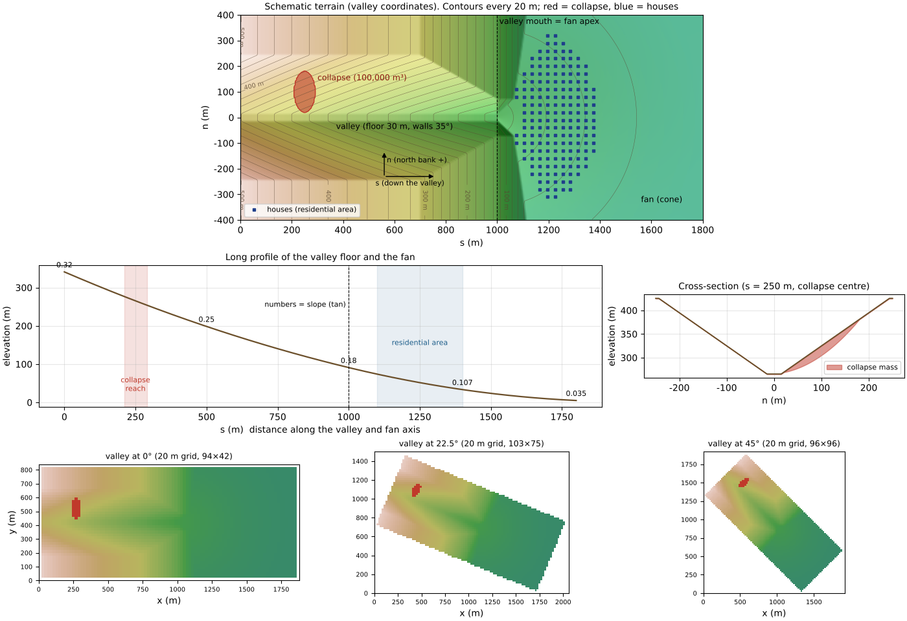
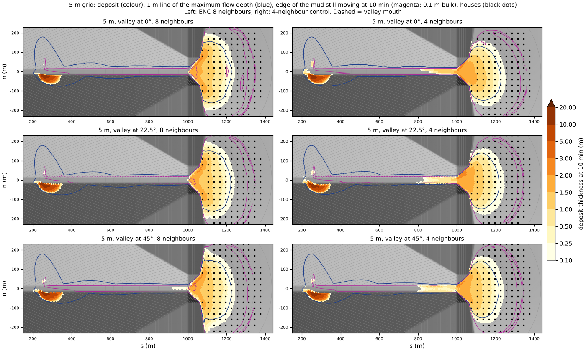
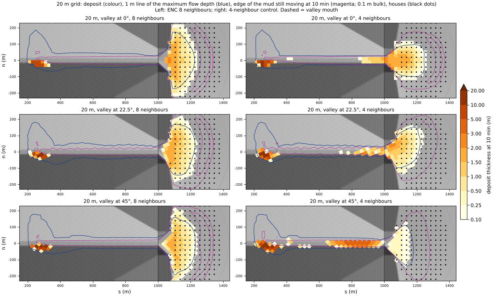
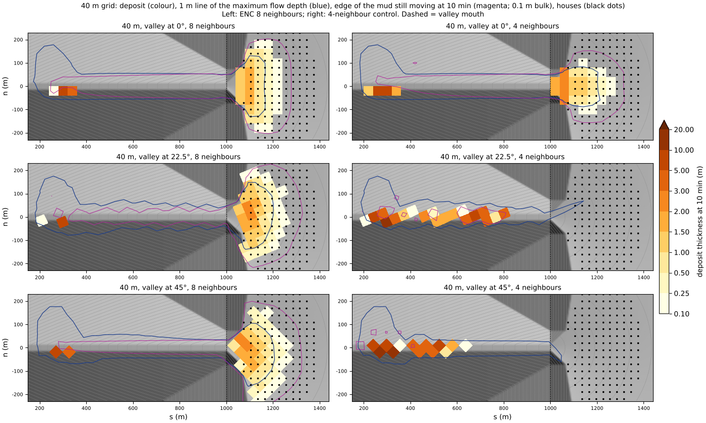
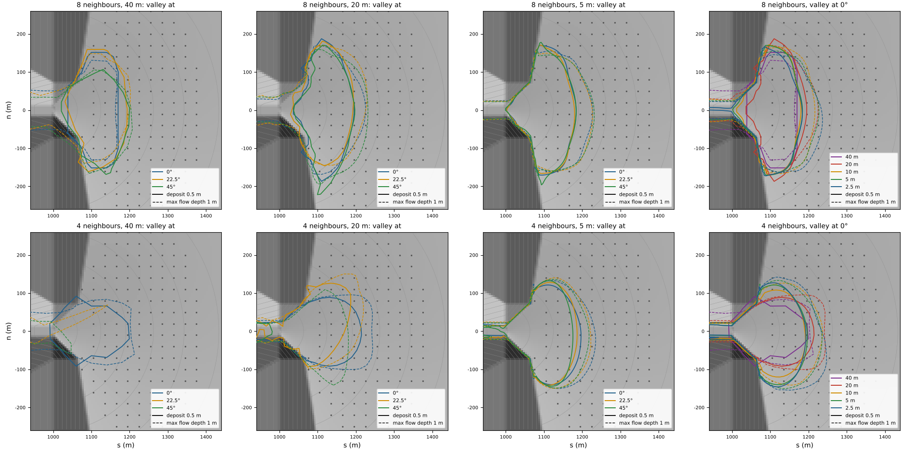
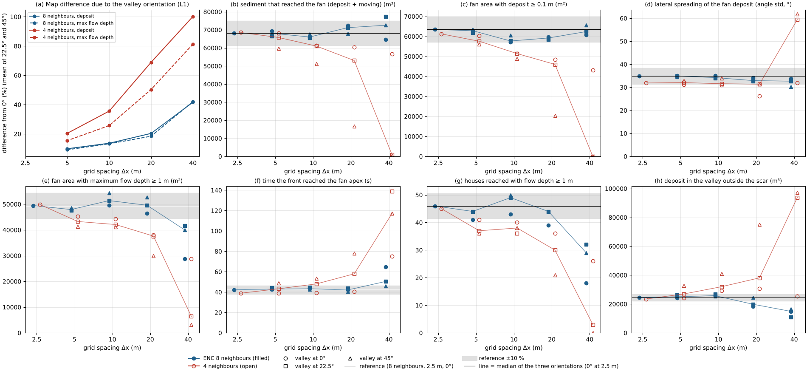
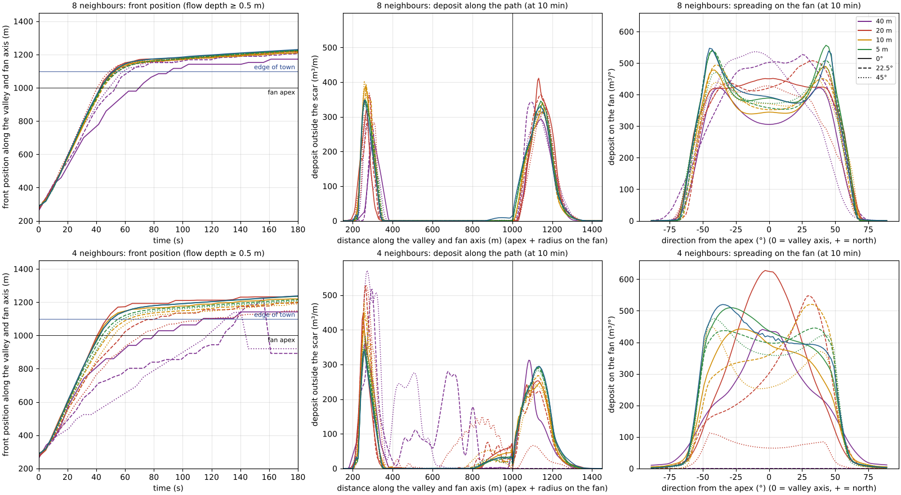

# debris_fan — a debris flow from a slope failure down a valley to a residential area on the fan (dependence on the grid spacing and orientation)

> English mirror of examples/debris_fan/README.md. The Japanese file is the master copy.

[日本語](../README.md)

This example computes, on a schematic terrain, a disaster like the 1997 debris flow of the
Harihara River in Izumi, Kagoshima: a steep valley wall fails on a large scale, the failed
material becomes a debris flow that runs down the valley, and it reaches a residential area on
the fan at the valley mouth. The aim is to see how much a debris-flow computation depends on
**the grid spacing and on the direction in which the valley runs relative to the grid**. The
same terrain and the same failure are computed with grid spacings of 40, 20, 10, 5 and 2.5 m
and with the valley at 0°, 22.5° and 45° to the grid, and the arrival time of the front, the
volume, extent and runout of the deposits in the valley and on the fan, the maximum flow depth
and the flow reaching the houses are compared. To see what happens on the coarse grids used in
wide-area analyses (down to 40 m, coarser than the valley floor), the ENC eight neighbours are
set side by side with four neighbours, in which the exchange with the diagonal neighbours is
switched off. The terrain, the size of the failure and the water content are
schematic values chosen to make the phenomena visible, and do not reproduce the Harihara River.

**What this example shows (eight and four neighbours of the ENC grid)**

- **Flow down oblique valleys even on coarse grids**: even on a 40 m grid, coarser than the valley floor
  (30 m wide), eight neighbours deliver 0.92-1.09 times the reference sediment to the fan whatever the
  valley orientation. With four neighbours, when the valley runs obliquely to the grid, the debris flow stops
  in the valley at 20 m and coarser, and at 40 m with 45° almost all of the 100,000 m³ stays in the valley.
- **Little influenced by the valley orientation and the grid spacing**: on the 5 m grid, the map difference
  due to the valley orientation with eight neighbours is half that with four (10 % and 19 %). With eight
  neighbours, the sediment reaching the fan, the extent and runout of the deposit, the arrival time and the
  lateral spreading agree within ±10 % of the reference over grids of 20-2.5 m and the three orientations.
- **Four neighbours converge slowly**: even on the 2.5 m grid, four neighbours deliver 0.94 and 0.95 times the sediment
  and deposit area of eight neighbours to the fan, with 0.94 times the lateral spreading, and remain off the
  converged result of eight neighbours (the arrival time at the apex agrees).
- Biases depending on the grid orientation in the check of whether material at rest starts to move and in
  the gravity correction on steep slopes (with both eight and four neighbours) were found while making this
  example and fixed (developer.md §28.16, §91).

## What happens in a real debris-flow disaster

- **The Harihara River debris flow (10 July 1997)**: on the Harihara River in Sakai-machi,
  Izumi, the slope on the north bank failed on a large scale (failed volume about
  160,000 m³), and the material, saturated with water by heavy rain, turned into a debris flow
  right after the failure and struck the settlement downstream. The disaster left 21 dead and
  13 injured (material of the Ministry of Land, Infrastructure, Transport and Tourism; report of
  the Geological Survey of Japan).
- **Slopes on which debris flows run and stop**: as a guide in erosion and sediment control
  and in forest conservation, debris flows start and run in valleys with bed slopes of about 15°
  or more (20° or more with many boulders), begin to deposit where the slope becomes gentler
  than 10°, and can run down to about 2° (documents of the Forestry Agency and Tottori
  Prefecture). The fan spreading from the valley mouth is exactly where they deposit, and it is
  also where houses and roads gather.
- **Stony debris flows**: a debris flow rich in boulders runs down the valley without stopping
  while it is fast, deposits suddenly when the slope eases and it slows, and leaves a
  tongue- or fan-shaped deposit on the fan (Takahashi 2007).
- **The computational grid**: debris flows are computed on the grid of a digital elevation
  model (DEM) of, say, 5 m or 10 m. When the grid is coarse compared with the width of the
  valley the shape of the valley breaks down, and when the valley runs obliquely to the grid
  axes the flow can be pulled toward the grid axes (in the supplement of the example
  [ashfall_lahar](../../ashfall_lahar/en/README.md), the dependence on the valley orientation
  with four neighbours was about three times that with eight). Real valleys cannot choose their
  orientation to the grid, and a wide area has to be computed on a coarse grid, so knowing how
  much the results depend on the choice of grid is a prerequisite for using the computation in
  hazard assessment.

## Mechanisms needed for the reproduction

| Real phenomenon | How ENCflow represents it | Settings |
|---|---|---|
| The slope fails and fluidizes | Give the distribution of the failure depth and fluidize it at the start of the computation (move the solid (1 − λ)D into the flowing sediment and the pore water λD into the flowing water) | `fn_dbinit`, `db_reltime = 0`, `db_relsat = 1` |
| The failed mass takes in water and becomes a debris flow | Place the water still missing for a debris-flow concentration of 0.45 as the initial water depth over the failure (given as a scenario) | `f_htype = 1`, `fn_hinit` |
| Flow resistance dominated by collisions of boulders | The stony-type constitutive law of Takahashi and Nakagawa (1991) (yield tanα′ = 0.45 and a dilatant term) | `f_dbres = 3`, `db_d50` |
| It does not stop in the steep valley and deposits when it slows | Erosion and deposition of Takahashi and Nakagawa (1991) (approach to the equilibrium concentration; while fast it runs on its inertia without depositing) | `f_dbed = 3`, `db_delte`, `db_deltd` |
| Material that has stopped becomes terrain | Fix material that has stopped at low speed into the terrain | `f_dbstop = 1` |
| The deposit holds water | Fill the pores of the layer added by deposition with the water of the local flow | `f_dbwet = 1` |
| Gravity on steep slopes | Gravity correction for the slope inclination (friction and the resistance laws of mixture flows also along the slope) | `f_gravity_correction = 2` (default) |
| Valley orientation and grid | Give the terrain, failure depth and initial water depth by formulas in coordinates along the valley and take their values at the cell centres of each grid (no interpolation) | `make_init.py` |
| Flow in diagonal directions | The eight neighbours of the ENC grid (the diagonal edges also carry flow; the four-neighbour control sets the diagonal passage widths to 0) | `p_diagratio` |

## Geometry and settings



Top: the schematic terrain (coordinates s, n along the valley). Red = failure area, blue dots =
houses. Middle left: long profile of the valley floor and the fan axis (numbers are slopes).
Middle right: cross-section through the centre of the failure. Bottom: ground elevation on the
20 m grid with the valley at 0°, 22.5° and 45° (red = failure area). The same terrain is laid
on the grid rotated.

- **Domain**: a rectangle 1,840 m along the valley (valley 1,000 m + fan 800 m + a 40 m sink
  strip at the downstream end) by 800 m across. Outside this rectangle is outside the domain,
  and the strip at the downstream end is a sea mask (a sink at elevation 0 m). When the valley
  is rotated relative to the grid, the edges of the rectangle become staircases on the grid.
- **Valley**: floor width 30 m, walls 35° (slope 0.7), 160 m from the floor to the ridges. The
  slope of the floor eases linearly from 0.32 (17.7°) at the upstream end to 0.18 (10.2°) at
  the valley mouth (10° or more, where debris flows run). The ridges are lowered from 300 m
  above the mouth to 40 m at the mouth, so that the foot of the mountain-front scarp (35°) lies
  within 50 m of the line of the mouth.
- **Fan**: a cone centred on the valley mouth (the fan apex, elevation 91 m). The radial slope
  eases from 0.18 (10.2°) to 0.035 (2.0°) at a radius of 800 m (the deposition range).
- **Failure**: an ellipse on the north valley wall at s = 250 m, 4-115 m above the valley floor
  (80 m along the valley × 160 m horizontally across the slope). The depth is a paraboloid with
  a maximum of about 20 m at the centre, normalized on each grid so that the volume is
  100,000 m³ (the same volume on coarse grids). The soil depth is set to the failure depth;
  below it and outside the failure is non-erodible bedrock (deposited material can be eroded).
- **Water**: the failed mass is taken to be saturated (40,000 m³ of pore water), and to take in
  a further 33,000 m³ of stream water and groundwater and flow out as a debris flow with a
  concentration of 0.45 (60,000 m³ of solid, 73,000 m³ of water).
- **Residential area**: the positions of 173 houses at 30 m spacing in a sector 100-400 m from
  the apex and ±60° from the valley axis (`houses.txt`). They are not used in the computation
  (the houses do not obstruct the flow); the plots read the maximum flow depth and the deposit
  thickness at them.
- **Debris-flow model**: the stony type of Takahashi and Nakagawa (1991). Representative grain
  size 0.3 m (the boulders at the front), internal friction angle 35°, porosity of the deposit
  0.4, erosion and deposition coefficients δe = 0.0001 and δd = 0.5 (the values that paper
  applied to the Horadani).
- **Time step and output**: dt = 0.01Δx (0.4 s at 40 m, 0.025 s at 2.5 m; the maximum Courant
  number is 0.29-0.35 on every grid). The computation runs for 10 minutes, with distribution
  output every 5 seconds (bil).

| Grid spacing | Valley orientation | Neighbours | Grid size (0° / 22.5° / 45°) | Cells across the valley floor (30 m) |
|---|---|---|---|---:|
| 40 m | 0°, 22.5°, 45° | 8 and 4 | 48 × 22 / 53 × 39 / 49 × 49 | 0.75 |
| 20 m | 0°, 22.5°, 45° | 8 and 4 | 94 × 42 / 103 × 75 / 96 × 96 | 1.5 |
| 10 m | 0°, 22.5°, 45° | 8 and 4 | 186 × 82 / 203 × 147 / 189 × 189 | 3 |
| 5 m | 0°, 22.5°, 45° | 8 and 4 | 370 × 162 / 404 × 291 / 376 × 376 | 6 |
| 2.5 m | 0° | 8 and 4 | 738 × 322 | 12 |

Eight neighbours is the ENC default (`p_diagratio` = the value that makes the eight passage
widths equal); four neighbours is `p_diagratio = 0`. `param.txt` (5 m, 0°, eight neighbours) is
the annotated template; `make_init.py` writes the other 25 cases'
`param_dx<grid>_r<orientation>[_4nb].txt` by replacing only the lines for the grid, the time
step and the input and output. Every case computes the same rectangle (230,000 cells at 2.5 m);
only the grid spacing and orientation and the number of neighbours differ. At 2.5 m only the
valley at 0° is computed: the eight-neighbour case is the reference for the comparison, and the
four-neighbour case checks where four neighbours go as the grid is refined (for eight neighbours,
2.5 m confirms that 5 m is fine enough, with differences of a few % between 5 m and 2.5 m).

## How to run

```bash
cd examples/debris_fan
make                     # links and the inputs and settings of all 26 cases (make_init.py)
make run                 # compute all 26 cases in turn (about 30 minutes with 4 threads; mostly the two 2.5 m cases)
python3 plot_results.py  # figs/*.png and tables (with the argument en, the English version in en/figs/)
```

`make quick` computes only the 18 cases at 40, 20 and 10 m (a few minutes). For a single case,
`./encflow param.txt` (5 m, 0°; about a minute and a half). The output of all cases is about
2.5 GB (0.9 GB for the two 2.5 m cases; `make clean` removes it).

## Results

The tables and figures are the values of all 26 cases recomputed with the code after the fixes of the
yield rest check (developer.md §28.16) and of the gravity correction on steep slopes (§91) (2026-11-04).
The fix of the rest check changed little (in the reference case the deposit on the fan 49,133 → 48,941 m³
and the flowing material 19,088 → 19,280 m³); most of the flow in this example is fast, and the rest
check acts only as it stops. With the fix of the gravity correction, the effective gravity, which came out
too large on edges oblique to the slope, is now right: the sediment reaching the fan in the reference case
went from 68.2 to 69.2 thousand m³ (+1.5 %) and the arrival at the apex from 42.3 to 43.0 s. Four
neighbours changed more: more material stays in the valley and less reaches the fan (68.5 → 65.9 thousand m³
at 2.5 m), and the arrival at the apex is later and now agrees with eight neighbours (38.9 → 42.1 s at
2.5 m). Recomputed all 26 cases on 2026-11-05 after the fixes of the outflow suppression and the edge depth
(§94, §95): the values mostly moved only in the last digit (the sediment reaching the fan in the reference
case stays at 69.2 thousand m³, and the arrival at the apex at 43.0 s). At that time this README said
"recomputed with the default f_gravity_correction = 2", but param.txt still specified 1 explicitly as "the
standard for debris-flow cases", so the computation actually used 1. On 2026-11-06 param.txt was aligned to
the default 2 and all 26 cases were recomputed after the change by which 2 also evaluates the resistance
laws of mixture flows along the slope (developer.md §101; the velocity-squared resistance of the
Takahashi–Nakagawa stony type becomes 1/cos⁴θ times larger in the direction of steepest descent). The flow
in the steep valley becomes slower: in the reference case the arrival at the apex went from 43.0 to 47.4 s,
the arrival at the edge of the residential area from 52 to 59 s, the sediment reaching the fan from 69.2 to
67.2 thousand m³, and the houses reached by flow with a maximum depth of 1 m or more from 45 to 39. The
trends of the dependence on the grid and the orientation do not change. The tables, figures and numbers in
the text are from this recomputation.

### How the debris flow behaves (reference: eight neighbours, 2.5 m, 0°)



The whole valley and fan on the 5 m grid. Colour = deposit thickness at 10 minutes, blue line =
maximum flow depth of 1 m, magenta line = edge of the mud still moving at 10 minutes (0.1 m
bulk thickness), black dots = houses. Left: ENC eight neighbours; right: four neighbours. From
the top, the valley at 0°, 22.5° and 45° (drawn back in the coordinates along the valley).

- **Right after the failure (0-20 s)**: the failed mass drops into the valley, crosses the
  valley floor with its momentum and runs up the opposite (south) slope to 30 m above the
  floor. About 24,000 m³ (bulk volume) stops there and remains at the foot of the slope
  opposite the scar, up to 15.5 m thick.
- **Down the valley (20-50 s)**: the rest of the material (46,000 m³ of solid) runs down the
  valley as a dense debris flow. On the valley floor the maximum velocity is 23 m/s and the
  maximum flow depth 9-13 m in the middle of the valley and about 6 m just above the apex; the front reaches the fan apex at 47 s and the edge of the
  residential area (100 m from the apex) at 59 s. While the front passes, it runs down the steep valley on its
  inertia without depositing. The only deposits in the valley are the one opposite the scar and 1,400 m³
  (up to 1.9 m thick) that the trailing flow leaves on the valley floor in the last 150 m above the outlet
  from 1.5 minutes on.
- **Deposition on the fan (1-10 min)**: it spreads from the apex, slows and leaves a
  tongue-shaped deposit on the fan. The deposit on the fan grows to 14,000 m³ at 2 minutes,
  37,000 m³ at 5 minutes and 48,000 m³ at 10 minutes (bulk volume); at 10 minutes the deposit
  reaches 263 m from the apex, the area thicker than 0.1 m is 61,000 m² and the greatest
  thickness is 2.5 m.
- **Trailing mud**: when a debris flow with a concentration of 0.45 becomes a deposit with a
  porosity of 0.4, water is left over, and it spreads over the fan on top of the deposit as a
  thin mudflow (concentration 0.4 or less). At 10 minutes, 19,000 m³ of material on the fan and
  8,000 m³ in the valley (bulk volume) are still moving, reaching about 370 m from the apex
  (the magenta line in the figure). All comparisons use the values at 10 minutes, and the
  deposit indicators do not include moving material (only the amount of sediment that reached
  the fan counts deposit + moving).
- **Residential area**: of the 173 houses, 39 are reached by flow with a maximum depth of 1 m
  or more (91 by 0.5 m or more), 29 are buried 0.5 m or deeper, and the 8 houses nearest the
  apex receive a maximum force of 10 m³/s² (10 kN/m per unit width) or more.

### Valley orientation and grid coarseness: ENC eight neighbours and four neighbours





The 20 m grid (top) and the 40 m grid (bottom), read in the same way as the 5 m figure.

Sediment that reached the fan (deposit + moving; 1,000 m³; reference 67.2 thousand m³):

| Grid | Eight neighbours (0° / 22.5° / 45°) | Four neighbours (0° / 22.5° / 45°) |
|---|---|---|
| 40 m | 62.2 / 73.4 / 70.2 | 50.5 / **0.5** / **0.6** |
| 20 m | 69.2 / 70.4 / 65.5 | 57.5 / 48.6 / **14.5** |
| 10 m | 65.5 / 64.4 / 64.0 | 57.8 / 57.6 / 47.7 |
| 5 m | 68.8 / 66.6 / 66.6 | 63.8 / 62.1 / 59.3 |
| 2.5 m | 67.2 (0° only) | 63.1 (0° only) |

- **With four neighbours, the debris flow cannot run down an oblique valley on coarse grids**:
  on the 20 and 40 m grids, where the valley floor (30 m wide) is 1-2 cells, the cells of the
  valley floor touch only at their corners when the valley runs obliquely to the grid. With four
  neighbours no flow passes through a corner, so the flow has to go round through a higher cell
  of the valley wall next to it, and the debris flow stops there and fills the valley. At 40 m
  with 22.5° and 45° almost all of the 100,000 m³ stays in the valley and does not reach the
  fan, and even at 20 m with 45° three quarters stay in the valley. With the valley along a grid
  axis (0°), four neighbours also reach the fan (0.75 times the reference at 40 m).
- **With eight neighbours the sediment reaches the fan even on grids coarser than the valley
  floor**: the diagonal edges connect the cells of the valley floor directly, so even at 40 m,
  where the floor is less than one cell, 0.92-1.09 times the sediment reaches the fan in every
  orientation, and the extent and runout of the deposit are within ±10 % of the reference.
- **At 5 m the two differ little**: at 5 m, where the floor is six cells wide, four neighbours
  also deliver 0.88-0.95 times the reference to the fan. With four neighbours, however,
  5,000-6,000 m³ of material remains on the valley floor just above the mouth
  (s = 600-1,000 m) in every orientation (up to 1.7-1.8 m thick; 210 m³ or less with eight
  neighbours), and the deposit on the fan spreads less sideways (there is no part extending along
  the mountain front toward ±45° from the valley axis).



The lines of a 0.5 m deposit (solid) and a 1 m maximum flow depth (dashed) on the fan, overlaid.
Top: eight neighbours; bottom: four neighbours. From the left, the three orientations on the 40,
20 and 5 m grids; the rightmost panel, the grid spacings with the valley at 0°.



(a) Map difference due to the valley orientation (relative L1 difference from 0°, mean of 22.5°
and 45°). (b)-(h) Main indicators (filled = eight neighbours, open = four neighbours, symbol =
valley orientation, line = median of the three orientations (0° only at 2.5 m), black line and
grey band = the reference and ±10 % of it). (d) is the lateral spreading of the fan deposit
(standard deviation of the direction seen from the apex); its values for four neighbours at 40 m in
oblique valleys, where there is almost no deposit on the fan, have no meaning.

Map difference due to the valley orientation (relative L1 difference of the deposit thickness /
maximum flow depth on the fan, mean of 22.5° and 45°; %):

| | 40 m | 20 m | 10 m | 5 m |
|---|---:|---:|---:|---:|
| Eight neighbours | 46 / 41 | 25 / 19 | 15 / 13 | 10 / 8 |
| Four neighbours | 100 / 90 | 70 / 50 | 36 / 24 | 19 / 14 |

Range of the main indicators relative to the reference (minimum-maximum over the three
orientations):

| Indicator | 8 neighbours 40 m | 8 neighbours 20 m | 8 neighbours 10 m | 8 neighbours 5 m | 4 neighbours 40 m | 4 neighbours 20 m | 4 neighbours 10 m | 4 neighbours 5 m |
|---|---:|---:|---:|---:|---:|---:|---:|---:|
| Sediment reaching the fan | 0.92-1.09 | 0.97-1.05 | 0.95-0.97 | 0.99-1.02 | 0.01-0.75 | 0.22-0.86 | 0.71-0.86 | 0.88-0.95 |
| Deposit area (≥ 0.1 m) | 0.90-1.06 | 0.94-0.96 | 0.92-0.96 | 0.99-1.01 | 0.00-0.63 | 0.25-0.77 | 0.78-0.82 | 0.90-0.94 |
| Runout of the deposit | 0.92-1.00 | 0.94-0.98 | 0.92-0.97 | 0.96-0.97 | 0.00-0.87 | 0.56-0.97 | 0.88-0.93 | 0.94-1.00 |
| Area of maximum flow depth ≥ 1 m | 0.63-0.81 | 1.00-1.09 | 1.05-1.14 | 0.99-1.02 | 0.07-0.63 | 0.63-0.84 | 0.88-0.91 | 0.87-0.90 |
| Area of maximum force ≥ 10 | 0.61-0.91 | 0.91-1.06 | 0.90-0.93 | 0.94-1.04 | 0.40-0.91 | 0.15-0.99 | 0.49-0.83 | 0.77-1.01 |
| Houses with flow depth ≥ 1 m | 0.46-0.72 | 1.03-1.10 | 1.10-1.15 | 1.00-1.03 | 0.00-0.67 | 0.51-0.92 | 0.87-0.97 | 0.90-0.92 |
| Arrival at the apex | 1.03-1.58 | 0.90-0.99 | 0.98-1.03 | 0.99-1.03 | 1.91-2.60 | 0.91-1.75 | 0.92-1.20 | 0.96-1.10 |
| Lateral spreading of the deposit | 0.87-0.97 | 0.91-0.99 | 0.98-1.03 | 1.00-1.02 | 0.91-1.88 | 0.76-0.90 | 0.90-0.96 | 0.91-0.94 |

(The lateral spreading of the deposit is the standard deviation of the direction of the fan deposit seen from the
apex. For four neighbours at 40 m with 22.5° and 45° there is almost no deposit on the fan, so this ratio has no
meaning.)

- **Eight neighbours at 10 m or finer (three or more cells across the floor)**: every indicator,
  in every orientation, stays within ±15 % of the reference (the house count, which is
  discrete, and the area of a maximum flow depth of 1 m or more deviate most). The map difference due to the valley orientation is
  10 % at 5 m and 15 % at 10 m and shrinks as the grid is refined (the orientation difference is
  a discretization error that converges with the grid).
- **Eight neighbours at 20 m (1.5 cells across the floor)**: the sediment reaching the fan, the
  extent and runout of the deposit and the arrival time at the apex are within ±10 % of the
  reference, the area of a maximum flow depth of 1 m or more and the house count are within
  about ±10 %, and the force is 0.91-1.06 times. Only the deposit opposite the scar (the deposit in the valley) swings
  between 0.79 and 1.06 times the reference, because the cross-section of the valley is not
  resolved.
- **Eight neighbours at 40 m (0.75 cells across the floor)**: the amounts and extents (sediment
  reaching the fan, deposit area, runout) are kept, but the indicators of flow intensity break
  down. The area of a maximum flow depth of 1 m or more comes out at 0.63-0.81 times the
  reference, and the houses reached by flow 1 m deep or more at 0.46-0.72 times, and both also
  change much with the valley orientation (the deep, fast flow is averaged over coarse cells).
  At 0° the front reaches the apex 1.6 times later (the valley floor becomes a single row of
  cells, and the flow is squeezed into that narrow row).
- **Four neighbours**: even at 5 m the map difference due to the valley orientation is twice that
  with eight neighbours, and the arrival time at the apex shifts by 7 seconds with the
  orientation (0.96-1.10 times). At 10 m the sediment reaching the fan is 0.71-0.86 times the
  reference, and at 20 m and coarser the flow stops in oblique valleys, as shown above.



Top: eight neighbours; bottom: four neighbours. Left: position of the front (flow depth 0.5 m or
more). Middle: distribution of the deposit along the valley and the fan (integrated across the
valley, and along arcs centred on the apex on the fan). Right: deposit on the fan by direction
seen from the apex. Colour = grid spacing, line style = valley orientation.

- With eight neighbours the front positions of the 10 cases other than 40 m nearly coincide on
  one line and reach the apex at 43-49 seconds. The distribution of the deposit along the path
  (two peaks, opposite the scar and on the fan) and the distribution by direction on the fan
  (more along the mountain front at ±45° from the valley axis) also agree regardless of the grid
  spacing and orientation.
- With four neighbours the front stops partway down oblique valleys on coarse grids, and a peak in
  the valley appears in the distribution of the deposit along the path.

### Lateral spreading: which of eight and four neighbours is closer to the solution of the equations

The deposit on the fan spreads sideways more with eight neighbours than with four (standard deviation of the
direction of the fan deposit seen from the apex).

| Valley at 0° | 20 m | 10 m | 5 m | 2.5 m |
|---|---:|---:|---:|---:|
| Eight neighbours | 34.8° | 36.2° | 35.7° | 35.0° |
| Four neighbours | 26.6° | 31.5° | 31.8° | 32.8° |

- **The spreading with eight neighbours is not numerical diffusion**: numerical diffusion is proportional to the
  grid spacing, so coarser grids would spread more; yet the spreading with eight neighbours does not change from
  20 m to 2.5 m and does not depend on the valley orientation. The problem that the diagonal edges cause a
  sideways numerical diffusion in the transport of the flowing sediment (the scalar hs) has had its leading term
  removed by link-wise MUSCL (`f_scalar_scheme = 3`, the default; developer.md §78), which is in effect in this
  example too. As a trial, returning to first-order upwind (`f_scalar_scheme = 1`, the former scheme, in which
  the diagonal links produce a cross-flow numerical diffusion Dy ≈ 0.29uΔy) changed the spreading at 5 m and 0°
  only by 0.8 % (35.11° → 34.83°); what changes is the sharpness of the concentration (the greatest deposit
  thickness drops by 10 %; a trial with the code before the fix of the gravity correction). The advection of momentum is the momentum-conservative MUSCL (the default), and
  neither uses a diffusion term (eddy viscosity) (`f_diffusion_term = 0`).
- **The narrowness with four neighbours is a bias in how diagonal flow is represented**: with four
  neighbours the spreading grows as the grid is refined (from 27° at 20 m to 33° at 2.5 m), but it approaches
  slowly and does not reach that of eight neighbours even at 2.5 m. Without diagonal edges, flow in a diagonal
  direction is carried split over two axis-direction edges. Even after the bias of the edge-by-edge yield rest
  check, in which the driving force looked too small (developer.md §28.16), and the bias in which the effective
  gravity came out too large on edges oblique to the slope (§91) were fixed, the spreading with four neighbours
  stays narrow (32.8° at 2.5 m), so we take it to be a bias of representing the transport of momentum and the
  pressure gradient on axis-direction edges only, not of the stopping check or the gravity correction (not
  separated out further). The time at which the front reaches the apex at 0° was 39 seconds with four neighbours
  on every grid, earlier than the 42 seconds with eight neighbours, before the gravity correction was fixed;
  after the fix they nearly agree (the excess speed was the bias of the gravity correction; in the current
  computation 43-46 and 46-47 seconds, 20-2.5 m). The sediment reaching the fan with four neighbours is 0.94
  times that with eight neighbours even at 2.5 m, and the material left in the valley is 1.16 times.
- **Which is right**: closer to the solution of this model's equations (depth-integrated shallow water + the
  Takahashi-Nakagawa constitutive law) is the result with eight neighbours, which depends neither on the grid
  spacing nor on the orientation. The lack of sideways spreading with four neighbours is an error biased by
  direction, so adding an isotropic diffusion term would not fix it (it would blur everything evenly, including
  the main tongue). Whether the solution of the equations reproduces the sideways spreading of real debris flows
  (lateral levees, boulder fronts and so on) is another matter, and this example has not compared it with
  observations.

### Guide for wide-area analyses

For the valley of this example (floor 30 m, flow about 50 m wide) the results were as follows. For
valleys of other sizes, read the grid spacing as the number of cells across the valley floor.

| What you want to know | Eight neighbours (ENC default) | Four neighbours |
|---|---|---|
| How far the material reaches and how much it deposits (sediment reaching the fan, deposit extent, runout) | within ±10 % of the reference even on a grid coarser than the valley floor (40 m, 0.75 cells across the floor) | in an oblique valley the flow stops in the valley at 1.5 cells or fewer across the floor (20 m and coarser); 0.71-0.93 times at 3 cells (10 m), 0.88-1.00 times at 6 cells (5 m) |
| Flow intensity (maximum flow depth, force, flow reaching the houses) | about ±10 % at 1.5 cells or more across the floor (20 m; the force 0.91-1.06 times); within ±15 % at 3 cells or more (10 m) | 0.77-1.01 times even at 6 cells across the floor (5 m) |
| Arrival time | ±10 % at 1.5 cells or more across the floor | 0.96-1.10 times even at 6 cells across the floor (5 m) |

Computing time per case (4 threads, on the machine on which this example was made): 0.3 s at 40 m,
2 s at 20 m, 13 s at 10 m, a minute and a half at 5 m and 10 minutes at 2.5 m. The cost
is inversely proportional to the cube of the grid spacing (the number of cells to the square, the
number of time steps to the first power). To estimate the runout of debris flows over a wide area on
a coarse grid, use eight neighbours (the default); for the area where the flow depth and force are
used to read damage to houses, recompute on a grid that resolves the valley floor with three or more
cells, as a guide.

### Why the dependence is small, and what remains

- **The ENC eight neighbours**: each cell exchanges flow with its neighbours through eight edges,
  and with the default distribution the eight passage widths are equal
  ([Explanation of the ENC grid](../../../docs/en/users_guide/encgrid.md) §2). Even in a valley that
  runs obliquely, the cells of the valley floor are connected directly by diagonal edges, so the
  flow is not forced along a staircase path.
- **Slope for erosion and deposition**: the erosion and deposition of Takahashi and Nakagawa
  (`f_dbed = 3`) use the slope of the flow surface in the direction of the velocity (the slopes along
  each axis projected onto the velocity direction). Since the direction of the slope is not rounded to
  eight directions, it does not depend on the valley orientation.
- **Stopping under yield**: whether the flow stops under the Coulomb-type yield is judged by the
  flow speed, not by the component normal to the edge (developer.md §28.11), and whether material at
  rest starts to move is judged by the magnitude of the drive combining the normal and tangential
  directions of the edge (§28.16). The uniform-slope check
  [test/dbonset](../../../test/dbonset/en/README.md) confirms that the slope at which the material starts
  to move and the speed and direction of sliding do not depend on the direction of the slope or on the
  number of neighbours.
- **What remains**: the deposit opposite the scar and the flow intensity, because the cross-section
  of the valley is not resolved on coarse grids (two cells or fewer across the floor); the shape of the
  corners of the mountain front at the apex (staircases on the grid); and the number of houses (a
  discrete count). All of them shrink as the grid is refined.
- **Gravity correction on steep slopes**: the effective gravity g cos²θ of the gravity correction for
  steep slopes (`f_gravity_correction`) is taken from the magnitude of the ground slope, not from the
  slope in the normal direction of each edge (fixed on 2026-11-04; developer.md §91). Before the fix the
  effective gravity came out large on edges oblique to the slope, a direction dependence that remained as
  the grid was refined (in the speed of sliding on a uniform slope of 0.38-0.45, eight neighbours 3-5 % fast
  and four neighbours 0-9 % fast; test/dbonset). In this example, the too-early arrival at the apex with four
  neighbours (39 s) was this bias.

## What this model cannot represent (differences from real phenomena)

- **Initiation of the failure**: the location, extent, depth and time of the failure are given. To
  predict rain → rising groundwater → failure, combine the slope-stability judgment `f_slide` with
  the groundwater computation ([Sediment and landform change](../../../docs/en/users_guide/geomorph.md)).
- **Water content**: the amount of water the failed mass takes in (concentration 0.45) is a scenario.
  The concentration changes the flow and the runout considerably (see the starting points for
  sensitivity tests).
- **Grain size**: there is a single grain size (0.3 m). Sorting, such as boulders gathering at the
  front or fines turning into a mudflow that runs ahead, is not represented.
- **Houses**: the houses neither obstruct the flow nor break. To include their occupation or
  destruction, add the building porosity `fn_gv` or the house destruction `fn_bldgdebris` (examples
  [levee_breach](../../levee_breach/en/README.md) and [tsunami_town](../../tsunami_town/en/README.md)).
- **Deposits on steep slopes**: material that ran up the opposite slope (35°) and stopped stays on
  the slope (the collapse of a deposit steeper than its angle of repose is not computed).
- **Force**: the maximum force F9999 is (ρm/ρw)(h + hs)V² (per unit width, normalized by the density
  of clear water), not the impact force of boulders.
- **Vertical structure**: the bulge at the front, the concentration of boulders and three-dimensional
  flow are not represented (a single depth-integrated mixture layer).
- **Erosion and sediment control structures**: no check dams or other countermeasures are placed
  (for how to place them, see [sabo facilities](../../../docs/en/users_guide/geomorph_applications.md#6-sabo-facilities-sediment-retarding-basins-check-dams) on the
  applications page of sediment and landform change and the example
  [ashfall_lahar](../../ashfall_lahar/en/README.md)).

## Notes

- **Margin in the soil depth over the failure**: the soil depth over the failure is 5 cm thicker than
  the failure depth (`SD_MARGIN` in `make_init.py`). Within one landform update the erosion acts before
  the fluidization, so the water over the failure erodes the soil by a few millimetres in the first
  steps, and the failure depth would be cut by the soil depth (with a warning); the margin avoids this.
  The extra 5 cm (about 500 m³) is eroded as soil at the bottom of the scar and joins the flow (this
  is why "left in the scar" in the tables is negative; on finer grids a little material stays in the
  scar, so the negative value is smaller).
- **Time step**: dt = 0.01Δx. Halving dt changes the indicators by 2 % or less at 10 m and 4 % or
  less at 20 m (at most 9 % at 40 m, for the deposit in the valley and others), which we confirmed to
  be well below the effect of the grid.
- **Conservation**: the solid ledger (Σhs + (1 − λ)Σ(z − z0)) closes within ±0.08 m³ in 25 cases
  (against 60,000 m³ of solid; rounding of the single-precision output), and no material leaves from
  the downstream end. Only at 40 m with 22.5° and four neighbours, thin muddy water (sediment column
  1 mm or less) that runs down over the debris flow stopped in the valley reaches the sink at the
  downstream end after about 500 seconds, and 11 m³ (0.02 % of the solid) leaves by 10 minutes (the
  solid ledger of -11 m³ in the table; the computation of 2026-11-05 also gave -5 m³, so the earlier
  statement "within ±0.06 m³ in every case" was wrong). For the water, the S column of `Log.txt` shows that the 33,264 m³ at the start
  (33,333 m³ of water over the failure; rounding of the four-digit display) changes by the 40,000 m³
  of pore water added by the failure and the water that enters the pores of the deposit (about
  9,400 m³ by 1 minute).
- **Time of the front position**: the front is read from the output every 5 seconds and interpolated
  linearly between outputs.
- **Map difference for the orientation comparison**: the fields of each case are interpolated
  bilinearly onto a common 5 m grid along the valley and compared. Volumes, areas and distances are
  counted on the cells of each case's own grid (no interpolation).

## Starting points for sensitivity tests

- `C0` (`make_init.py`; 0.45): concentration of the debris flow that flows out. The smaller it is (the
  more water), the farther it flows and the more trailing mud there is. At 0.50 it deposits thickly
  near the apex.
- `db_d50` (`param.txt`; 0.3 m): in the Takahashi-Nakagawa law, the smaller the grain size, the more
  suddenly it deposits at low speed. In a trial, with 0.1 m most of the material stopped in the
  valley just below the scar and did not reach the fan.
- `V0`, `S_C`, `N_C`, `A_S`, `A_N` (`make_init.py`): volume, location and size of the failure.
- `S_TOP`, `S_APX`, `S_END` (`make_init.py`): slopes of the valley and the fan.
- `DXS`, `THETAS` (`make_init.py`): combinations of grid spacing and valley orientation.

## References

- Takahashi, T. and Nakagawa, H. (1991): Prediction of stony debris flow induced by severe rainfall.
  *Journal of the Japan Society of Erosion Control Engineering (Shin-Sabo)*, 44(3), 12–19 (in
  Japanese). (Erosion, deposition and resistance; δe and δd are the values that paper applied to the
  Horadani.)
- Takahashi, T. (2007): *Debris Flow: Mechanics, Prediction and Countermeasures*. Taylor & Francis,
  Leiden.
- Ministry of Land, Infrastructure, Transport and Tourism: material on sediment-disaster cases (Harihara
  River, Izumi; failed volume about 160,000 m³, 21 dead and 13 injured).
  https://www.mlit.go.jp/common/001019680.pdf
- Geological Survey of Japan (1997): report on the Harihara River debris-flow disaster in Izumi in
  Chishitsu News (failure of the north-bank slope; a debris flow from the failure of a saturated slope).
  https://www.gsj.jp/data/chishitsunews/97_09_07.pdf
- Forestry Agency: the debris-flow section of the commentary on the technical standards for forest
  conservation (initiation and runout at bed slopes of 15° or more, deposition beginning below 10°).
  https://www.rinya.maff.go.jp/j/sekou/kizyun/attach/pdf/gijutu_kijun-30.pdf
- Tottori Prefecture: document on sediment disasters (debris flows mostly start at 15° or more and may
  run down to about 2°). https://www.pref.tottori.lg.jp/secure/1137670/1-7.pdf

The documents of the Ministry, the Geological Survey, the Forestry Agency and Tottori Prefecture were
checked through excerpts from a web search when this example was made; their full texts have not been
compared.
