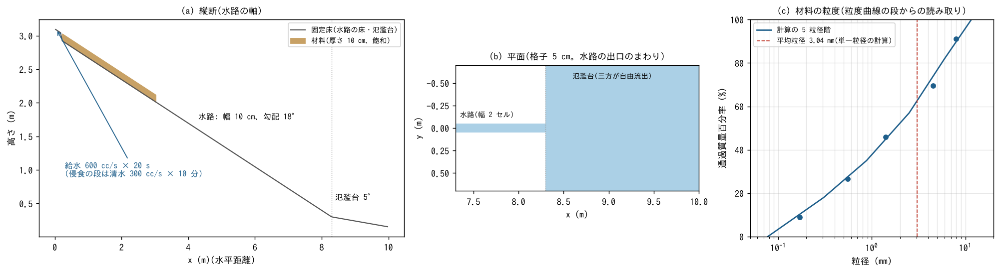
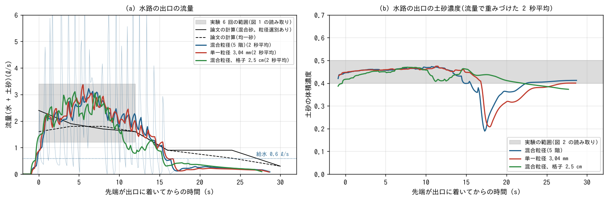
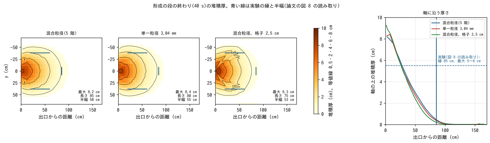
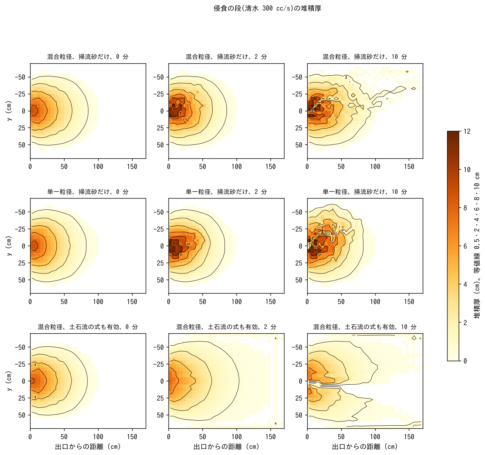
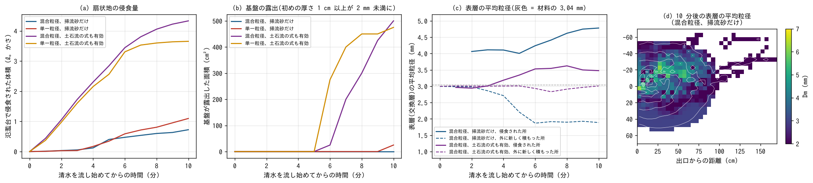

# debris_fan_flume — 混合粒径の材料の土石流がつくる扇状地と、清水による侵食(水路実験の計算)

[English](en/README.md)

高橋・中川・山敷 (1991) の水路実験を計算する例題です。勾配 18° の水路に敷いた混合粒径の材料を給水が侵食して
土石流になり、水路の出口につないだ勾配 5° の氾濫台に扇状地をつくります(形成の段)。そのあと水路から清水を
10 分流して、扇状地を侵食させます(侵食の段)。

ENCflow の土石流モデル(`f_debris`)と混合粒径(`f_bedmix`)の併用を使います。併用では、流れの土砂を
粒径階ごとの柱で運び、河床との出し入れの組成を追います。土石流の式そのものは代表粒径 1 個のままです
([土石流の解説](../../docs/users_guide/massflow.md#混合粒径との併用f_bedmix))。この例題のねらいは、この併用で
何が計算でき、何が計算できないかを、公開されている実験と並べて示すことです。

**結果の要約**

- **形成の段**: 水路の出口の流量(2 秒平均で 2.1〜2.8 ℓ/s = 給水の 3.5〜4.6 倍)と土砂濃度(0.46)は、実験の
  範囲に入ります。扇状地の長さ(85 cm)も実験に近い値です。扇状地の幅は実験より広く(半幅 50 cm に対して
  実験 38 cm)、扇頂は厚すぎます(8 cm に対して 5〜6 cm)。
- **形成の段では、混合粒径と単一粒径の計算はほぼ同じ**です。土石流の交換は粒径を選ばないので、扇状地の
  堆積はどこも材料と同じ組成(平均 3.0 mm)になります。実験の堆積の中の粒径の分布(下部に粗粒、先端に
  大礫)は表せません。
- **侵食の段は、土砂を運ぶ式の選び方で結果が大きく分かれ、どちらも実験と合いません**。
  - 土石流の式を有効にしたまま清水を流すと、水みちが 5〜7 分で氾濫台の面(基盤)まで掘れます。混合粒径でも
    単一粒径でも同じです(土石流の式の侵食は粒径を選ばず、表層が粗くなっても抑えられない)。論文の計算
    (平均粒径 1 個)も基盤まで掘れ、著者はこれを実験と合わない点に挙げています。
  - 土石流のない構成に切り替えて掃流砂だけで計算すると、侵食は弱く(10 分で扇状地の 3〜5 %)、扇状地は
    実験のようには削られません。この構成では混合粒径の効果が出ます。侵食された所の表層は平均 4.8 mm に
    粗くなり、細粒は扇状地の外へ運ばれて積もり(平均 1.9 mm)、侵食量は単一粒径の 0.65 倍です。
- 実験の侵食(水みちができ、基盤は露出せず、扇状地が下流へ 30 cm ほど延びる)は、この 2 つの間にあります。

## 実験

高橋・中川・山敷 (1991)[^tny91] の §3 の実験です。水路と材料は前報(高橋・中川・原田 1990[^tnh90])の実験 2 と
同じです。

- **水路**: 幅 10 cm、勾配 18° の長方形断面。下流端から 5.5〜8.5 m の 3 m の区間に、厚さ 10 cm の材料を敷き、
  水で飽和させます。
- **形成**: 上流から 600 cc/s を 20 秒給水して、土石流を発生させます。水路の下流端につないだ平らな台
  (氾濫台。縦断勾配 5°。表面に材料を貼って粗度にしてある)に流れ出て、扇状地をつくります。
- **侵食**: 扇状地ができたあと、水路から清水 300 cc/s を 10 分流します。
- **材料**: 5 種類の珪砂の混合。平均粒径 3.04 mm、最大粒径 11 mm、√(d84/d16) = 6.12。
- **計測**: 水路の下流端の流量・土砂濃度・平均粒径の時間変化(6 回の繰り返し)、扇状地の厚さの等値線、堆積の
  中の平均粒径の鉛直分布(9 地点)、侵食の 0・2・10 分後の厚さの等値線。

論文には数表がなく、この例題が比べる値は、公開版の図(スキャン)からの読み取りです。読み取りは概略で、長さは
±5 cm 程度、流量は ±0.3 ℓ/s 程度の不確かさがあります(値は `plot_results.py` の先頭にまとめてあります)。

## 計算の設定



(a) 水路の軸の縦断。(b) 水路の出口のまわりの平面(格子 5 cm)。(c) 材料の粒度(計算の 5 粒径階と、単一粒径の
計算に使う平均粒径)。

- **領域と格子**: 10 m × 1.4 m、格子間隔 5 cm(論文の扇状地の計算と同じ。200 × 28 セル)、時間刻み 0.004 s。
  x は水路を下る向きの水平距離で、水路の出口が x = 8.3 m です。斜面に沿う長さは水平距離に直してあります
  (18° の水路は cos 18° 倍)。水路の幅は 2 セルで、幅の外は領域外(側壁)です。
- **材料の区間**: 土層厚(鉛直)10.5 cm = 床に直角な 10 cm。ほかの水路の床と氾濫台は、侵食されない固定床です
  (積もった土砂は侵食されます)。
- **氾濫台**: 流下方向の長さ 1.7 m、幅 1.4 m、三方が自由流出。
- **土石流**: 高橋・中川 (1991) の石礫型(`f_dbed = 3`・`f_dbres = 3`)。代表粒径 3.04 mm、内部摩擦角 35°
  (tanφ = 0.70)、堆積層の濃度 0.65、飽和床の侵食の係数 δe = 0.0007 は論文の値です。氾濫台の 5° は
  掃流状集合流動の領域(`f_dbimm = 1`)です。材料は飽和(`f_dbwet = 1`・`db_satbed = 1`)。
- **混合粒径**: 0.17・0.55・1.4・4.5・8.0 mm の 5 粒径階(割合 0.18・0.17・0.22・0.25・0.18。平均 3.0 mm)、
  交換層厚 8 mm。掃流砂は芦田・道上式と修正 Egiazaroff の遮蔽係数です。
- **侵食の段**: 形成の段の終わりの状態を初期条件にします(`f_state_restore = 2`)。掃流砂だけのケースは、土石流の
  ない構成に復元します。このとき流れに残っていた土砂は、その組成でその場の河床に積もります。

論文に書かれていないので、この例題で決めた値は次のとおりです。

- **氾濫台の大きさ**(1.7 m × 1.4 m)。実験と計算の図の範囲より広くとってあります。
- **水路の上流端**: 材料の区間より上流の床は、材料の表面と同じ高さの固定床にしました(給水が段を落ちない
  ように)。
- **粗度**: マニングの n = 0.018(粒径 3 mm の粗度の目安)を、水路の固定床と氾濫台に一様に与えました。
- **粒径階**: 前報の粒度曲線(Fig. 10)の 5 つの段から粒径を読み取り、割合は平均粒径が 3.04 mm に近くなる
  ように決めました。
- **堆積の係数**: `db_deltd = 0.5`。ENCflow の堆積の式は高橋・中川 (1991, 新砂防)[^tn91]の形で、論文
  (年報)の式 (17)(δd = 1.0、p = 2/3)とは形が違います。0.05〜1 の範囲で、出口の流量と扇状地の形はほとんど
  変わりません(下の「感度」)。

計算するケースは 7 つです。`param.txt`(ケース `form`)が注釈付きの雛形で、ほかのケースの
`param_<ケース>.txt` は `make_init.py` が行を差し替えて書きます。

| 段 | ケース | 内容 | 計算する時間 |
|---|---|---|---|
| 形成 | `form` | 混合粒径(5 階) | 40 秒(給水 20 秒) |
| | `form_single` | 単一粒径 3.04 mm | 40 秒 |
| | `form_dx25` | 混合粒径、格子 2.5 cm | 40 秒 |
| 侵食 | `ero` | `form` の続き。混合粒径、掃流砂だけ(土石流のない構成に復元) | 10 分 |
| | `ero_single` | `form_single` の続き。単一粒径、掃流砂だけ | 10 分 |
| | `ero_debris` | `form` の続き。混合粒径、土石流の式を有効にしたまま | 10 分 |
| | `ero_debris_single` | `form_single` の続き。単一粒径、土石流の式を有効にしたまま | 10 分 |

## 実行方法

```bash
cd examples/debris_fan_flume
make                     # リンクと、全ケースの入力と設定(make_init.py)
make run                 # 7 ケースを順に計算(1 スレッドで合わせて 30 分ほど)
python3 plot_results.py  # figs/*.png と数表(引数 en で英語版を en/figs/ に。計算前でも setup.png は描ける)
```

侵食の 4 ケースは形成のケースの保存(`save_form/`・`save_form_single/`)を読むので、形成を先に計算します
(`make run` の順)。1 ケースだけなら `./encflow param.txt`(ケース `form`)。

## 結果

### 形成: 水路の出口の流量と土砂濃度



(a) 水路の出口の流量(水 + 土砂)。太い線は 2 秒の移動平均、細い線はケース `form` の 0.1 秒ごとの値。灰色は
実験 6 回の点の範囲、黒い線は論文の計算(実線 = 混合砂で粒径選別あり、破線 = 均一砂)。(b) 土砂の体積濃度。

| | 先端の到達 (s) | 流量 0〜4 s | 4〜8 s | 8〜12 s (ℓ/s) | 2 秒平均の最大 (ℓ/s) | 濃度 | 出口を通った土砂 (ℓ。固体) |
|---|---|---|---|---|---|---|---|
| `form`(混合粒径) | 11.3 | 2.12 | 2.76 | 2.15 | 3.22 | 0.46 | 16.3 |
| `form_single`(単一粒径) | 11.4 | 2.20 | 2.71 | 2.22 | 3.37 | 0.46 | 16.4 |
| `form_dx25`(格子 2.5 cm) | 12.3 | 2.47 | 2.58 | 1.53 | 3.10 | 0.45 | 14.9 |
| 実験(図の読み取り) | — | 1.2〜3.4(0〜12 s の点の範囲) | | | — | 0.40〜0.50 | — |
| 論文の計算(同) | — | 混合砂 2.4 → 1.6、均一砂 1.6〜1.8 | | | 混合砂 2.4 | 0.42〜0.45 | — |

時間は、先端が出口に着いてから数えます。

- 流量は給水(0.6 ℓ/s)の 3.5〜4.6 倍で、実験の点の範囲に入ります。論文の均一砂の計算(2.7 倍)より大きく、
  混合砂の計算(4 倍)に近い値です。ただし理由は違います。論文の混合砂の計算は、先端に大礫が集まることで
  ピークが大きくなります。ENCflow にその機構はありません。
- 0.1 秒ごとの流量は 0〜8.6 ℓ/s の間で脈動します(急勾配の薄い流れが波の列になる。図の細い線)。比べるのは
  2 秒の平均です。
- 土砂濃度 0.46 は実験の範囲です。材料(固体 19.5 ℓ)のうち 16 ℓ が 40 秒のうちに出口を通ります。
- 混合粒径と単一粒径の差は、脈動の出方の違いの範囲です。

### 形成: 扇状地の形



形成の段の終わり(40 秒)の堆積厚。青い線は、実験の厚さ 0 の線の下流端(85 cm)と最大の半幅(38 cm)。
右端は軸に沿う厚さ。

| | 堆積 (ℓ。かさ) | 最大の厚さ (cm) | 長さ (cm) | 半幅 (cm) |
|---|---|---|---|---|
| `form`(混合粒径) | 21.1 | 8.2 | 85 | 50 |
| `form_single`(単一粒径) | 21.2 | 8.4 | 80 | 55 |
| `form_dx25`(格子 2.5 cm) | 20.0 | 9.3 | 75 | 53 |
| 実験(図 8 の読み取り) | — | 5〜6 | 85 | 38 |
| 論文の計算(同) | — | 5〜6 | 100 | 40 |

長さと半幅は、厚さ 5 mm の線の下流端までの距離と、最も広い所の半幅です。

- 長さは実験に近く、幅は 1.3〜1.5 倍、扇頂の厚さは 1.4〜1.7 倍です。計算の扇状地は、出口の正面に厚く積もり、
  横にも広がります。実験と論文の計算では、出口から少し下流に高まり(マウンド)ができます。
- 混合粒径の計算の堆積の表層の平均粒径は、扇状地のどこでも 2.97〜3.00 mm です(材料のまま)。実験では、
  堆積の下部に粗い粒子が、上部に平均粒径に近い粒子が積もり、先端の縁に大礫が集まります(論文の図 9)。
  これは流れの中の粒径選別によるもので、この併用では表せません。
- 格子 2.5 cm では、扇頂がさらに厚く(9.3 cm)、長さが短く(75 cm)なります。格子への依存が残っています。

### 侵食: 清水を 10 分流す



清水 300 cc/s を流し始めてから 0・2・10 分の堆積厚。上 = 混合粒径・掃流砂だけ、中 = 単一粒径・掃流砂だけ、
下 = 混合粒径・土石流の式を有効にしたまま。



(a) 氾濫台の上で、初めより下がった所の体積。(b) 基盤が露出した面積(初めの厚さが 1 cm 以上で、2 mm 未満に
なったセル)。(c) 表層の平均粒径(実線 = 侵食された所、破線 = 扇状地の外に新しく積もった所)。(d) 混合粒径・
掃流砂だけのケースの、10 分後の表層の平均粒径。

| | 侵食された体積 (ℓ) 2 分 | 5 分 | 10 分 | 基盤の露出 (cm²) 10 分 | 最も薄くなった所 (cm) | 水路に残る土砂 (ℓ) 0 → 10 分 |
|---|---|---|---|---|---|---|
| `ero`(混合粒径、掃流砂だけ) | 0.03 | 0.40 | 0.72 | 0 | 0.95 | 7.5 → 1.1 |
| `ero_single`(単一粒径、掃流砂だけ) | 0.03 | 0.35 | 1.10 | 25 | 0.72 | 7.3 → 0.7 |
| `ero_debris`(混合粒径、土石流の式も有効) | 1.05 | 2.84 | 4.33 | 500 | 0 | 4.6 → 0.2 |
| `ero_debris_single`(単一粒径、同) | 0.97 | 2.56 | 3.65 | 475 | 0 | 4.5 → 0.0 |

体積はかさ(空隙を含む)。「最も薄くなった所」は、初めの厚さ 2 cm の線の内側の、10 分後の最小の厚さ。

- **はじめの数分**は、水路に残っていた土砂(4.5〜7.5 ℓ)が流されて扇頂に積もります。実験でも、最初の十数秒に
  水路の中の土砂が流れ出て扇状地を覆ったと書かれています。掃流砂だけの計算の扇頂は、2 分で 12〜13 cm まで
  高くなります。
- **土石流の式を有効にしたまま**(下段): 清水が扇状地の上を薄く広がりながら土砂を運び、2 分で氾濫台の端
  (160 cm)まで薄く積もります。5 分を過ぎると軸に沿って水みちが基盤まで掘れ、10 分で 500 cm² が露出します。
  混合粒径と単一粒径はほぼ同じです。土石流の式による侵食は、粒径を選ばずに柱の上から取り去るので、表層の
  粒径の変化が侵食に効きません。論文の計算(平均粒径 1 個の流砂量式)も、水みちがほぼ基盤まで掘れています。
- **掃流砂だけ**(上段・中段): 侵食は弱く、10 分で 0.7〜1.1 ℓ(扇状地の 21 ℓ の 3〜5 %)です。混合粒径では、
  扇頂の高まりを切った水が扇状地の片側の縁から外へ出て、その先に細かい土砂が積もります。単一粒径では、
  基盤が 1 セル(25 cm²)露出します。
- **混合粒径の効果**(掃流砂だけのケース): 侵食された所の表層の平均粒径は、2 分で 4.1 mm、10 分で 4.8 mm に
  粗くなります(最大 6.2 mm)。扇状地の外に新しく積もった所は 1.9 mm です。氾濫台の外へ出た土砂は、細かい
  3 階が各 0.10 ℓ(固体)、4.5 mm の階は 0.0002 ℓ、8 mm の階は 0 でした。細かい粒子が抜けて粗い粒子が残る
  過程(アーマー化)が計算されています。
- **実験**(論文の図 10 と本文): 水みちは、粗い材料でできた中央の高まりで左右に分かれて島をつくり、水は主に
  片側を流れます。6 分ごろに島がはっきりしなくなり、そのあとは中央部の全体で緩やかな侵食が進んで、形は
  ほとんど変わらなくなります。10 分後の扇状地は下流へ 30 cm ほど延びています(厚さ 0 の線の下流端が 115 cm
  付近)。基盤の露出は描かれていません。著者は、計算が掘れすぎる理由を「実際には混合粒径効果によって侵食が
  抑えられる」ためと推察しています。

実験は 2 組の計算の間にあります。土石流の式を有効にしたままでは掘れすぎ、掃流砂だけでは削れません。
ENCflow には、緩い勾配の土砂の多い流れ(掃流状集合流動)の輸送と、粒径ごとの輸送(アーマー化)を一緒に扱う
式がありません。前者は土石流の式が、後者は掃流砂の式が受け持ち、土石流の式は粒径を選びません。

### 感度

形成の段(単一粒径、格子 5 cm)で、設定を 1 つずつ変えた計算です(`make_init.py` のケースには入れていません。
`param_form_single.txt` の値を変えて計算できます)。

| 変えたもの | 流量 0〜4・4〜8・8〜12 s (ℓ/s) | 堆積 (ℓ) | 最大の厚さ (cm) | 長さ (cm) | 半幅 (cm) |
|---|---|---|---|---|---|
| 基準(`form_single`) | 2.20・2.71・2.22 | 21.2 | 8.4 | 80 | 55 |
| `db_deltd` = 0.05 | 2.19・2.84・2.30 | 21.6 | 8.5 | 85 | 50 |
| `db_deltd` = 1.0 | 2.20・2.61・2.21 | 21.6 | 8.6 | 80 | 55 |
| `db_immexp` = 1 | 2.34・2.42・2.20 | 21.5 | 8.9 | 85 | 50 |
| `rn0` = 0.010 | 1.97・2.57・2.24 | 20.5 | 8.3 | 85 | 50 |
| `rn0` = 0.025 | 2.99・2.78・1.37 | 22.6 | 8.9 | 85 | 55 |
| `db_delte` = 0.003 | 4.98・1.56・2.53 | 27.6 | 7.6 | 90 | 60 |

堆積の係数・掃流状集合流動の抵抗の指数・粗度は、扇状地の形をほとんど変えません(粗度は流量の時間変化を
少し変える)。侵食の係数 δe を 0.003(前報が同じ材料の計算に使った値)にすると、土石流の発達が速くなり、
先端の流量が 2 倍を超えます。扇頂が厚すぎることと幅が広すぎることは、どの設定でも変わりません。

## このモデルで表せないこと・精度の限界

- **流れの中の粒径選別**: 先端への大礫の集中と、堆積の中の粒径の分布(論文の図 3・図 9)は表せません。
  流れの土砂の組成は受動的に運ばれるだけで、流動深の中の粒子の上下の動きを持ちません。
- **土石流の式は代表粒径 1 個**: 流れの組成が変わっても、抵抗・侵食・堆積の式の粒径は `db_d50` のままです。
- **アーマーは土石流の式の侵食を抑えない**: 土石流のあとの流水による粗粒化を計算するには、土石流のない
  構成に復元して掃流砂だけで計算します(この例題の `ero`)。その構成では、緩い勾配の土砂の多い流れの輸送が
  入りません。
- **水深が粒径より浅い**: 侵食の段の氾濫台の上の流れは、濡れたセルの平均の水深が 1〜2 mm、最大でも
  1〜4 cm です(粒径は平均 3 mm、最大の粒径階 8 mm)。浅水流の式と流砂量式の前提の外にあります。
- **細粒の浮遊**: 0.17 mm の粒径階は、実際には浮遊して運ばれます。この例題では掃流砂として運びます
  (浮遊砂 `f_suspend` は土石流と排他)。
- **水みちの位置**: 計算の設定は左右対称ですが、水みちは片側に寄ります(丸めの差からの成長)。実験でも、
  水みちは左右に振れてどちらかに偏ることが多いと書かれています。寄る向きに意味はありません。
- **扇状地の形**: 幅が広すぎ、扇頂が厚すぎます。格子 2.5 cm でも変わりません。
- **下層 1 枚**: 堆積の鉛直の層序を持ちません。堆積した土砂は、交換層の厚さを残して下層と一様に混ざります。
- **読み取りの値**: 実験と論文の計算の値は図からの概略の読み取りで、実験 6 回のばらつきも大きい量です。

## 参考文献

[^tny91]: 高橋保・中川一・山敷庸亮 (1991): 混合粒径材料からなる土石流扇状地の形成とその侵食. 京都大学防災研究所年報, 34 B-2, 355–372. <https://repository.kulib.kyoto-u.ac.jp/dspace/handle/2433/72336>(実験の条件 §3.1〜3.3、水路の出口の流量・濃度 図 1・2、扇状地の形 図 8、堆積の中の粒径 図 9、侵食の実験と計算 図 10・11。公開版の本文と図で確認)
[^tnh90]: 高橋保・中川一・原田達夫 (1990): 混合粒径材料からなる渓床侵食型土石流の予測. 京都大学防災研究所年報, 33 B-2, 443–456. <https://repository.kulib.kyoto-u.ac.jp/dspace/handle/2433/72271>(同じ水路と材料の実験 2 = 図 9・図 10 の粒度曲線。公開版の本文と図で確認)
[^tn91]: 高橋保・中川一 (1991): 豪雨時に発生する石礫型土石流の予測. 新砂防, 44(3), 12–19.(ENCflow の `f_dbed = 3`・`f_dbres = 3` の式)

## 関連文書

- [土石流・斜面崩壊・動く底層の解説](../../docs/users_guide/massflow.md)(混合粒径との併用、高橋・中川の式)
- [土砂輸送の解説](../../docs/users_guide/sediment.md#混合粒径f_bedmix)(混合粒径の式と限界)
- 検定 [test/dbmix](../../test/dbmix/README.md)(併用の保存と、単一粒径との一致)
- 例題 [debris_fan](../debris_fan/README.md)(現地の大きさの土石流扇状地。格子への依存)、
  [joganji_flume](../joganji_flume/README.md)(混合粒径の掃流砂と移動床の模型実験)
