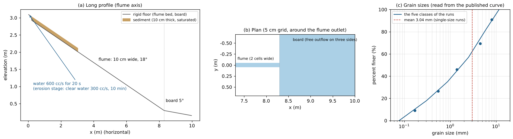
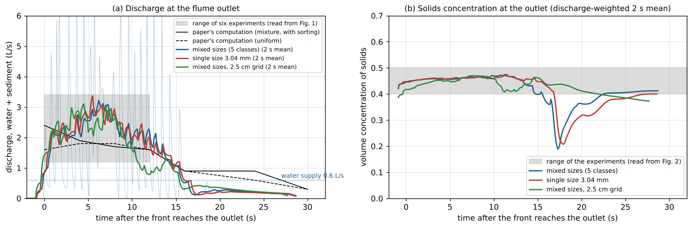
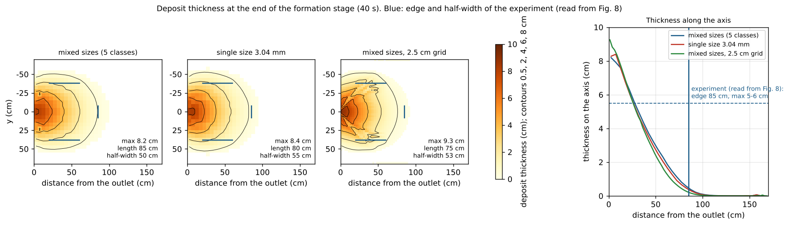
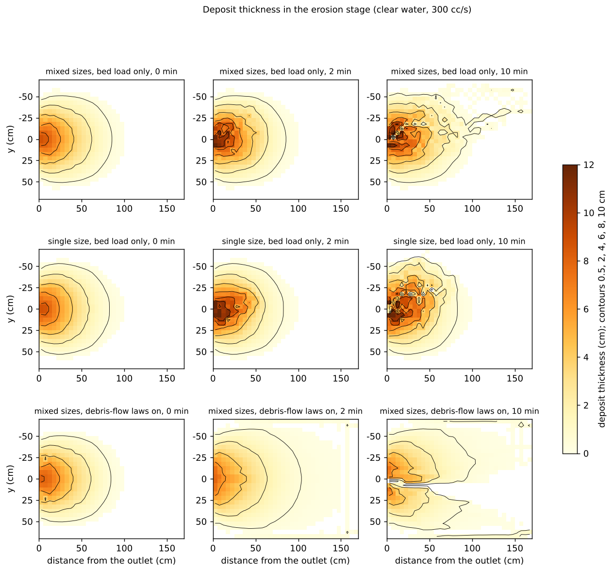
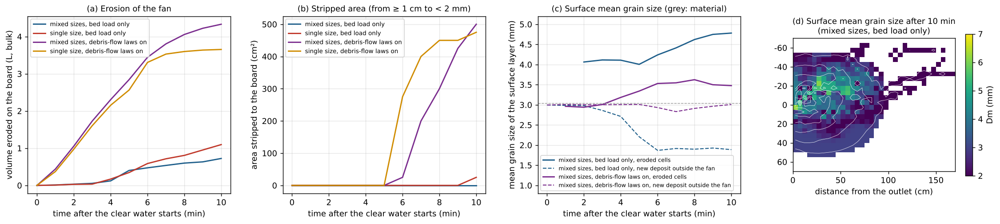

# debris_fan_flume — A fan built by a debris flow of mixed-size sediment and its erosion by clear water (a flume experiment)

> English mirror of examples/debris_fan_flume/README.md. The Japanese file is the master copy.

[日本語](../README.md)

This example computes the flume experiment of Takahashi, Nakagawa and Yamashiki (1991). Water supplied to an
18° flume erodes a bed of mixed-size sediment and becomes a debris flow, which builds a fan on a 5° board
attached to the flume outlet (the formation stage). Clear water is then run from the flume for 10 minutes and
erodes the fan (the erosion stage).

It uses the combination of ENCflow's debris-flow model (`f_debris`) and mixed grain sizes (`f_bedmix`). In
the combination the solids of the flow are carried as one column per size class, and the composition of
what is exchanged with the bed is tracked. The debris-flow formulas themselves keep a single representative
grain size ([the mass-flow page](../../../docs/en/users_guide/massflow.md#coupling-with-mixed-grain-sizes-f_bedmix)).
The aim of the example is to show, next to a published experiment, what this combination can compute and
what it cannot.

**Summary of the results**

- **Formation stage**: the discharge at the flume outlet (2.1 to 2.8 L/s as a 2 s mean, 3.5 to 4.6 times the
  water supply) and the solids concentration (0.46) fall within the range of the experiment. The length of
  the fan (85 cm) is also close to the experiment. The fan is wider than in the experiment (half-width 50 cm
  against 38 cm) and its apex is too thick (8 cm against 5 to 6 cm).
- **In the formation stage the mixed-size and the single-size runs are almost the same.** The exchange of a
  debris flow does not select grain sizes, so the deposit of the fan has the composition of the material
  everywhere (mean 3.0 mm). The grain-size distribution inside the deposit of the experiment (coarse grains
  in the lower part, large stones at the front) cannot be represented.
- **In the erosion stage the result depends strongly on which formula carries the sediment, and neither
  choice matches the experiment.**
  - With the debris-flow laws left on, the channel is cut down to the surface of the board (the base) in 5 to
    7 minutes. This is the same for mixed sizes and for a single size (the erosion by the debris-flow laws
    does not select grain sizes and is not restrained by a surface that has become coarse). The computation
    of the paper (a single mean grain size) is also cut down to the base, and the authors name this as a
    point that does not match the experiment.
  - After switching to a configuration without debris flow and computing with bed load alone, the erosion
    is weak (3 to 5 % of the fan in 10 minutes) and the fan is not cut as in the experiment. In this
    configuration the effect of mixed grain sizes appears: the surface of the eroded cells coarsens to a
    mean of 4.8 mm, the fines are carried out of the fan and deposited there (mean 1.9 mm), and the eroded
    volume is 0.65 times that of the single size.
- The erosion of the experiment (channels form, the base is not exposed, the fan extends about 30 cm
  downstream) lies between the two.

## The experiment

The experiment is that of §3 of Takahashi, Nakagawa and Yamashiki (1991)[^tny91]. The flume and the material
are those of experiment 2 of the preceding paper (Takahashi, Nakagawa and Harada 1990[^tnh90]).

- **Flume**: rectangular section, 10 cm wide, slope 18°. A 3 m reach, 5.5 to 8.5 m from the downstream end,
  is covered with 10 cm of the material and saturated with water.
- **Formation**: 600 cc/s of water is supplied from upstream for 20 seconds and generates a debris flow. It
  runs out onto a flat board attached to the downstream end of the flume (longitudinal slope 5°; the
  material is glued to its surface as roughness) and builds a fan.
- **Erosion**: after the fan has formed, clear water at 300 cc/s is run from the flume for 10 minutes.
- **Material**: a mixture of five silica sands; mean grain size 3.04 mm, maximum 11 mm, √(d84/d16) = 6.12.
- **Measurements**: time series of the discharge, the solids concentration and the mean grain size at the
  downstream end of the flume (six repetitions), contours of the fan thickness, vertical distributions of
  the mean grain size inside the deposit (nine points), and contours of the thickness 0, 2 and 10 minutes
  into the erosion.

The paper has no tables; the values this example compares with are read from the figures of the published
version (a scan). The readings are approximate, with an uncertainty of about ±5 cm in lengths and about
±0.3 L/s in discharges (the values are collected at the head of `plot_results.py`).

## Settings of the computation



(a) Long profile along the flume axis. (b) Plan around the flume outlet (5 cm grid). (c) Grain sizes of the
material (the five classes of the runs and the mean grain size used in the single-size runs).

- **Domain and grid**: 10 m × 1.4 m, grid spacing 5 cm (as in the paper's fan computation; 200 × 28 cells),
  time step 0.004 s. x is the horizontal distance down the flume, and the flume outlet is at x = 8.3 m.
  Lengths along the slope are converted to horizontal distances (times cos 18° in the flume). The flume is
  two cells wide and the cells outside its width are outside the domain (side walls).
- **Sediment reach**: soil thickness (vertical) 10.5 cm = 10 cm normal to the bed. The rest of the flume bed
  and the board are rigid and cannot be eroded (sediment deposited on them can).
- **Board**: 1.7 m long in the flow direction, 1.4 m wide, free outflow on three sides.
- **Debris flow**: the stony type of Takahashi and Nakagawa (1991) (`f_dbed = 3`, `f_dbres = 3`). The
  representative grain size 3.04 mm, the internal friction angle 35° (tanφ = 0.70), the concentration of the
  deposit 0.65 and the erosion coefficient of a saturated bed δe = 0.0007 are the values of the paper. The 5°
  of the board is in the range of the bedload-like collective flow (`f_dbimm = 1`). The material is saturated
  (`f_dbwet = 1`, `db_satbed = 1`).
- **Mixed grain sizes**: five classes of 0.17, 0.55, 1.4, 4.5 and 8.0 mm (fractions 0.18, 0.17, 0.22, 0.25,
  0.18; mean 3.0 mm), exchange-layer thickness 8 mm. Bed load uses the Ashida–Michiue formula with the
  modified Egiazaroff hiding function.
- **Erosion stage**: the state at the end of the formation stage is the initial condition
  (`f_state_restore = 2`). The bed-load-only cases restore it into a configuration without debris flow; the
  solids left in the flow are then deposited on the bed in place with their composition.

The following values are not given in the paper and were chosen for this example.

- **Size of the board** (1.7 m × 1.4 m), larger than the area shown in the figures of the experiment and of
  the computation.
- **Upstream end of the flume**: the bed upstream of the sediment reach is a rigid floor at the level of the
  sediment surface (so that the supplied water does not fall over a step).
- **Roughness**: Manning's n = 0.018 (a guide value for a roughness of 3 mm grains), uniform over the rigid
  flume bed and the board.
- **Size classes**: the grain sizes were read from the five steps of the grain-size curve of the preceding
  paper (its Fig. 10), and the fractions were chosen so that the mean grain size is close to 3.04 mm.
- **Deposition coefficient**: `db_deltd = 0.5`. ENCflow's deposition formula has the form of Takahashi and
  Nakagawa (1991, Shin-Sabo)[^tn91], which differs from eq. (17) of the paper (Annuals; δd = 1.0, p = 2/3).
  Between 0.05 and 1 the discharge at the outlet and the shape of the fan hardly change ("Sensitivity"
  below).

Seven cases are computed. `param.txt` (case `form`) is the annotated template, and `make_init.py` writes
`param_<case>.txt` of the other cases by replacing lines.

| Stage | Case | Content | Computed time |
|---|---|---|---|
| Formation | `form` | mixed sizes (5 classes) | 40 s (water for 20 s) |
| | `form_single` | single size 3.04 mm | 40 s |
| | `form_dx25` | mixed sizes, 2.5 cm grid | 40 s |
| Erosion | `ero` | continues `form`; mixed sizes, bed load only (restored into a configuration without debris flow) | 10 min |
| | `ero_single` | continues `form_single`; single size, bed load only | 10 min |
| | `ero_debris` | continues `form`; mixed sizes, debris-flow laws left on | 10 min |
| | `ero_debris_single` | continues `form_single`; single size, debris-flow laws left on | 10 min |

## How to run

```bash
cd examples/debris_fan_flume
make                     # links, and the inputs and settings of all cases (make_init.py)
make run                 # computes the 7 cases in order (about 30 minutes in total on one thread)
python3 plot_results.py  # figs/*.png and the tables (argument en writes the English versions to en/figs/; setup.png can be drawn before the runs)
```

The four erosion cases read the saves of the formation cases (`save_form/`, `save_form_single/`), so the
formation cases are computed first (the order of `make run`). For a single case, `./encflow param.txt` (case
`form`).

## Results

### Formation: discharge and solids concentration at the flume outlet



(a) Discharge at the flume outlet (water + sediment). Thick lines are 2 s moving means and the thin line is
the 0.1 s series of case `form`. Grey: range of the points of the six experiments; black lines: computation
of the paper (solid = mixture with grain-size sorting, dashed = uniform sand). (b) Volume concentration of
solids.

| | Front arrival (s) | Discharge 0–4 s | 4–8 s | 8–12 s (L/s) | Maximum of the 2 s mean (L/s) | Concentration | Solids through the outlet (L, solid) |
|---|---|---|---|---|---|---|---|
| `form` (mixed sizes) | 11.3 | 2.12 | 2.76 | 2.15 | 3.22 | 0.46 | 16.3 |
| `form_single` (single size) | 11.4 | 2.20 | 2.71 | 2.22 | 3.37 | 0.46 | 16.4 |
| `form_dx25` (2.5 cm grid) | 12.3 | 2.47 | 2.58 | 1.53 | 3.10 | 0.45 | 14.9 |
| Experiment (read from the figures) | — | 1.2–3.4 (range of the points, 0–12 s) | | | — | 0.40–0.50 | — |
| Computation of the paper (same) | — | mixture 2.4 → 1.6, uniform 1.6–1.8 | | | mixture 2.4 | 0.42–0.45 | — |

Times are counted from the arrival of the front at the outlet.

- The discharge is 3.5 to 4.6 times the water supply (0.6 L/s) and falls within the range of the
  experimental points. It is larger than the paper's computation for uniform sand (2.7 times) and close to
  that for the mixture (4 times), but for a different reason: in the paper's mixture computation the peak
  grows because large stones gather at the front. ENCflow has no such mechanism.
- The 0.1 s discharge pulsates between 0 and 8.6 L/s (the thin, steep flow breaks into a train of waves; the
  thin line in the figure). The comparison uses the 2 s mean.
- The solids concentration, 0.46, is within the range of the experiment. Of the material (19.5 L of solids),
  16 L pass the outlet within the 40 s.
- The difference between the mixed-size and the single-size runs is within the variation of the pulsation.

### Formation: shape of the fan



Deposit thickness at the end of the formation stage (40 s). The blue lines mark the downstream end of the
zero-thickness contour of the experiment (85 cm) and its largest half-width (38 cm). Right: thickness along
the axis.

| | Deposit (L, bulk) | Maximum thickness (cm) | Length (cm) | Half-width (cm) |
|---|---|---|---|---|
| `form` (mixed sizes) | 21.1 | 8.2 | 85 | 50 |
| `form_single` (single size) | 21.2 | 8.4 | 80 | 55 |
| `form_dx25` (2.5 cm grid) | 20.0 | 9.3 | 75 | 53 |
| Experiment (read from Fig. 8) | — | 5–6 | 85 | 38 |
| Computation of the paper (same) | — | 5–6 | 100 | 40 |

The length and the half-width are the distance to the downstream end of the 5 mm thickness contour and its
largest half-width.

- The length is close to the experiment, the width is 1.3 to 1.5 times and the apex thickness 1.4 to 1.7
  times that of the experiment. The computed fan piles up thickly in front of the outlet and also spreads
  sideways. In the experiment and in the paper's computation a rise (mound) forms a little downstream of the
  outlet.
- In the mixed-size run the surface mean grain size of the deposit is 2.97 to 3.00 mm everywhere on the fan
  (that of the material). In the experiment coarse grains lie in the lower part of the deposit, grains near
  the mean size in the upper part, and large stones gather along the front edge (Fig. 9 of the paper). This
  comes from grain-size sorting inside the flow and cannot be represented by this combination.
- With the 2.5 cm grid the apex is thicker still (9.3 cm) and the fan shorter (75 cm). A dependence on the
  grid remains.

### Erosion: clear water for 10 minutes



Deposit thickness 0, 2 and 10 minutes after the clear water (300 cc/s) starts. Top = mixed sizes, bed load
only; middle = single size, bed load only; bottom = mixed sizes with the debris-flow laws left on.



(a) Volume of the cells on the board that are lower than at the start. (b) Area stripped to the base (cells
that were at least 1 cm thick at the start and are thinner than 2 mm). (c) Surface mean grain size (solid =
eroded cells, dashed = new deposit outside the fan). (d) Surface mean grain size after 10 minutes in the
mixed-size, bed-load-only case.

| | Eroded volume (L) 2 min | 5 min | 10 min | Stripped area (cm²) 10 min | Thinnest point (cm) | Sediment left in the flume (L) 0 → 10 min |
|---|---|---|---|---|---|---|
| `ero` (mixed sizes, bed load only) | 0.03 | 0.40 | 0.72 | 0 | 0.95 | 7.5 → 1.1 |
| `ero_single` (single size, bed load only) | 0.03 | 0.35 | 1.10 | 25 | 0.72 | 7.3 → 0.7 |
| `ero_debris` (mixed sizes, debris-flow laws on) | 1.05 | 2.84 | 4.33 | 500 | 0 | 4.6 → 0.2 |
| `ero_debris_single` (single size, same) | 0.97 | 2.56 | 3.65 | 475 | 0 | 4.5 → 0.0 |

Volumes are bulk (including pores). "Thinnest point" is the minimum thickness after 10 minutes inside the
initial 2 cm thickness contour.

- **In the first minutes** the sediment left in the flume (4.5 to 7.5 L) is washed out and deposited on the
  apex. The paper also reports that in the first ten-odd seconds the sediment inside the flume flowed out
  and covered the fan. In the bed-load-only runs the apex rises to 12 to 13 cm within 2 minutes.
- **With the debris-flow laws left on** (bottom row): the clear water carries sediment while spreading
  thinly over the fan, and within 2 minutes a thin deposit reaches the end of the board (160 cm). After
  5 minutes a channel is cut down to the base along the axis, and after 10 minutes 500 cm² are exposed. The
  mixed-size and single-size runs are almost the same: the erosion by the debris-flow laws takes the top of
  the column without selecting grain sizes, so the change of the surface grain size does not act on it. In
  the paper's computation (a bed-load formula with a single mean grain size) the channel is also cut almost
  down to the base.
- **Bed load only** (top and middle rows): the erosion is weak, 0.7 to 1.1 L in 10 minutes (3 to 5 % of the
  21 L of the fan). With mixed sizes the water that cut the rise at the apex leaves the fan over one side of
  its edge, and fine sediment is deposited beyond it. With a single size one cell (25 cm²) of the base is
  exposed.
- **Effect of mixed grain sizes** (the bed-load-only case): the surface mean grain size of the eroded cells
  coarsens to 4.1 mm after 2 minutes and 4.8 mm after 10 minutes (at most 6.2 mm). The new deposit outside
  the fan has 1.9 mm. The sediment that left the board was 0.10 L (solid) of each of the three fine classes,
  0.0002 L of the 4.5 mm class and none of the 8 mm class. The process in which fine grains leave and coarse
  grains stay (armouring) is computed.
- **Experiment** (Fig. 10 and the text of the paper): the channel divides at a central rise made of coarse
  material and forms an island, and the water runs mainly on one side. After about 6 minutes the island
  becomes indistinct, gentle erosion then proceeds over the whole central part, and the shape hardly changes
  any more. After 10 minutes the fan has extended about 30 cm downstream (the downstream end of the
  zero-thickness contour is near 115 cm). No exposure of the base is drawn. The authors attribute the
  excessive cutting of their computation to the fact that "in reality the erosion is restrained by the
  effect of mixed grain sizes" (our translation).

The experiment lies between the two pairs of runs. With the debris-flow laws left on the fan is cut too
deeply, and with bed load alone it is hardly eroded. ENCflow has no formula that treats together the
transport by a sediment-laden flow on a gentle slope (the bedload-like collective flow) and the transport by
grain size (armouring). The former is covered by the debris-flow laws and the latter by the bed-load
formula, and the debris-flow laws do not select grain sizes.

### Sensitivity

Runs of the formation stage (single size, 5 cm grid) in which one setting at a time was changed (they are
not among the cases of `make_init.py`; they can be computed by changing the values in
`param_form_single.txt`).

| What was changed | Discharge 0–4, 4–8, 8–12 s (L/s) | Deposit (L) | Maximum thickness (cm) | Length (cm) | Half-width (cm) |
|---|---|---|---|---|---|
| base (`form_single`) | 2.20, 2.71, 2.22 | 21.2 | 8.4 | 80 | 55 |
| `db_deltd` = 0.05 | 2.19, 2.84, 2.30 | 21.6 | 8.5 | 85 | 50 |
| `db_deltd` = 1.0 | 2.20, 2.61, 2.21 | 21.6 | 8.6 | 80 | 55 |
| `db_immexp` = 1 | 2.34, 2.42, 2.20 | 21.5 | 8.9 | 85 | 50 |
| `rn0` = 0.010 | 1.97, 2.57, 2.24 | 20.5 | 8.3 | 85 | 50 |
| `rn0` = 0.025 | 2.99, 2.78, 1.37 | 22.6 | 8.9 | 85 | 55 |
| `db_delte` = 0.003 | 4.98, 1.56, 2.53 | 27.6 | 7.6 | 90 | 60 |

The deposition coefficient, the exponent of the resistance of the bedload-like collective flow and the
roughness hardly change the shape of the fan (the roughness changes the time course of the discharge a
little). With the erosion coefficient δe = 0.003 (the value the preceding paper used for the same material)
the debris flow develops faster and the discharge at the front more than doubles. That the apex is too
thick and the fan too wide does not change with any of these settings.

## What this model cannot represent, and limits of accuracy

- **Grain-size sorting inside the flow**: the gathering of large stones at the front and the grain-size
  distribution inside the deposit (Figs. 3 and 9 of the paper) cannot be represented. The composition of the
  solids of the flow is only carried passively; there is no vertical motion of grains within the flow depth.
- **The debris-flow formulas have one representative grain size**: the grain size in the formulas of
  resistance, erosion and deposition stays `db_d50` when the composition of the flow changes.
- **Armouring does not restrain the erosion by the debris-flow laws**: to compute the coarsening by the
  flow of water after a debris flow, restore the state into a configuration without debris flow and compute
  with bed load alone (`ero` in this example). That configuration does not include the transport by a
  sediment-laden flow on a gentle slope.
- **The water is shallower than the grains**: in the erosion stage the flow on the board has a mean depth of
  1 to 2 mm over the wet cells and at most 1 to 4 cm (the grains are 3 mm on average and 8 mm in the largest
  class). This is outside the assumptions of the shallow-water equations and of the bed-load formulas.
- **Suspension of fines**: the 0.17 mm class is in reality carried in suspension. In this example it moves
  as bed load (the suspended load `f_suspend` is exclusive with debris flow).
- **Position of the channel**: the settings are symmetric about the axis, but the channel shifts to one side
  (growth from round-off differences). The paper also reports that the channel swung left and right and
  often ended up on one side. The side has no meaning.
- **Shape of the fan**: too wide, and too thick at the apex. This does not change with the 2.5 cm grid.
- **One substrate layer**: there is no vertical stratigraphy of the deposit. Deposited sediment is mixed
  uniformly with the substrate, leaving the thickness of the exchange layer.
- **Readings**: the values of the experiment and of the paper's computation are approximate readings from
  the figures, and the six experiments themselves scatter widely.

## References

[^tny91]: Takahashi, T., Nakagawa, H. and Yamashiki, Y. (1991): Formation and erosion of debris fan that is composed of sediment mixtures. *Annuals, Disaster Prevention Research Institute, Kyoto University*, 34 B-2, 355–372 (in Japanese). <https://repository.kulib.kyoto-u.ac.jp/dspace/handle/2433/72336> (Conditions of the experiment, §3.1 to 3.3; discharge and concentration at the flume outlet, Figs. 1 and 2; shape of the fan, Fig. 8; grain sizes inside the deposit, Fig. 9; experiment and computation of the erosion, Figs. 10 and 11. Checked against the text and figures of the published version.)
[^tnh90]: Takahashi, T., Nakagawa, H. and Harada, T. (1990): Prediction of debris flow generated by erosion of steep well-graded sediment mixture bed. *Annuals, Disaster Prevention Research Institute, Kyoto University*, 33 B-2, 443–456 (in Japanese). <https://repository.kulib.kyoto-u.ac.jp/dspace/handle/2433/72271> (Experiment 2 with the same flume and material = its Fig. 9 and the grain-size curve of its Fig. 10. Checked against the text and figures of the published version.)
[^tn91]: Takahashi, T. and Nakagawa, H. (1991): Prediction of stony debris flow induced by severe rainfall. *J. Jpn. Soc. Erosion Control Eng.* (Shin-Sabo), 44(3), 12–19 (in Japanese). (The formulas of ENCflow's `f_dbed = 3` and `f_dbres = 3`.)

## Related documents

- [Debris flow, slope failure and the moving bed layer](../../../docs/en/users_guide/massflow.md) (coupling with mixed grain sizes, the Takahashi–Nakagawa laws)
- [Sediment transport](../../../docs/en/users_guide/sediment.md#mixed-grain-sizes-f_bedmix) (formulas and limits of mixed grain sizes)
- Verification [test/dbmix](../../../test/dbmix/en/README.md) (conservation in the combination and agreement with the single size)
- Examples [debris_fan](../../debris_fan/en/README.md) (a debris-flow fan at field scale; grid dependence) and
  [joganji_flume](../../joganji_flume/en/README.md) (mixed-size bed load against a movable-bed model experiment)
