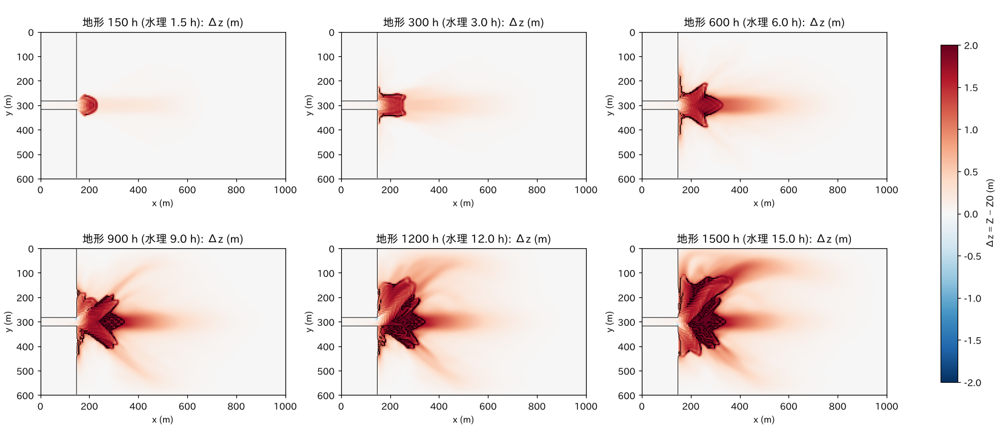
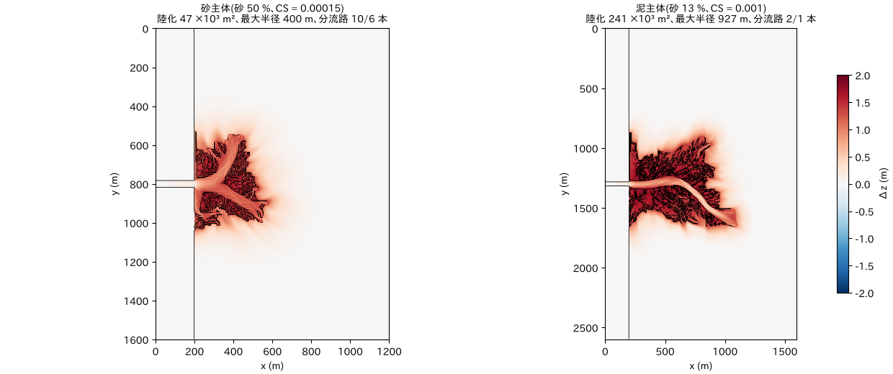
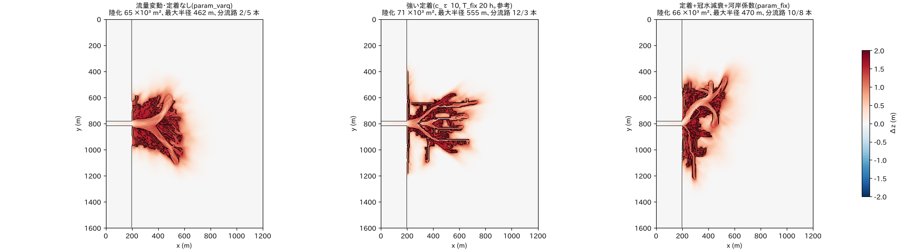
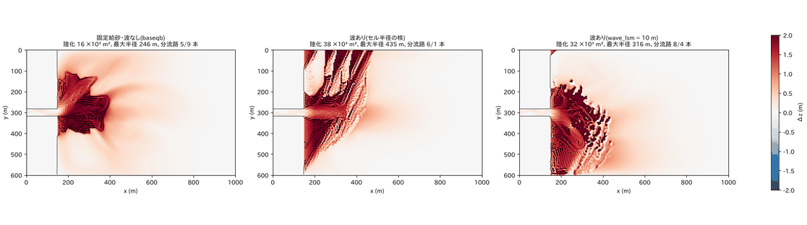
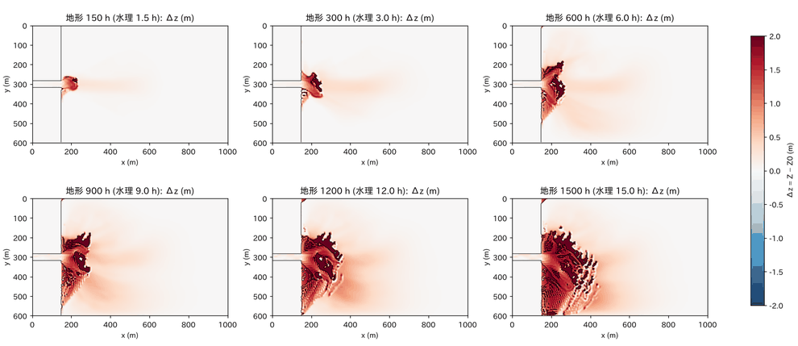
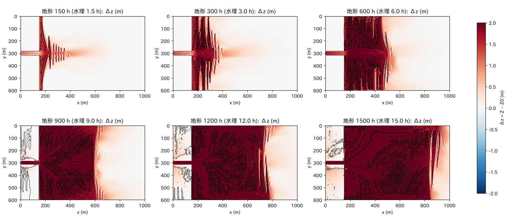
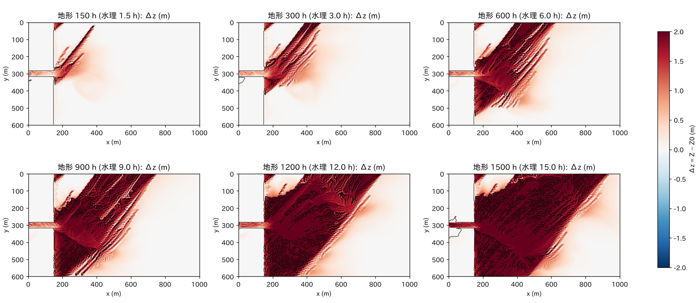
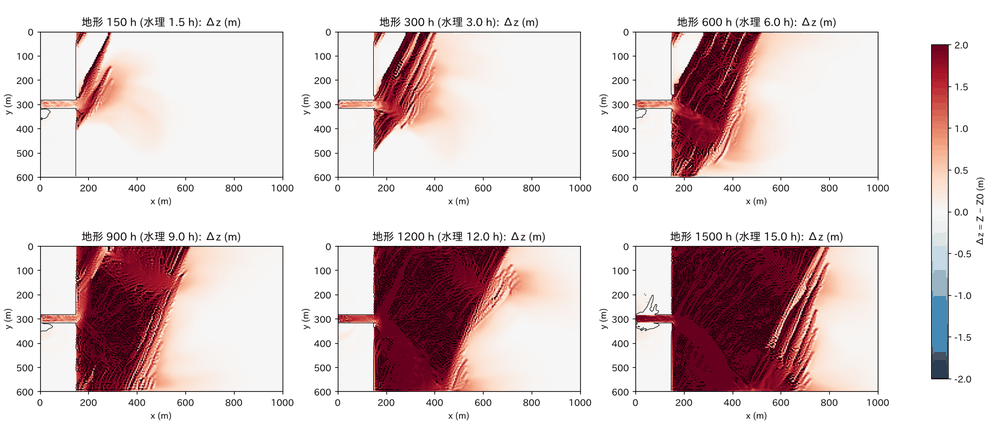
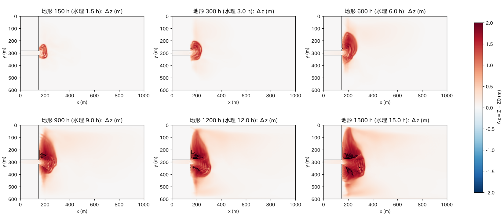
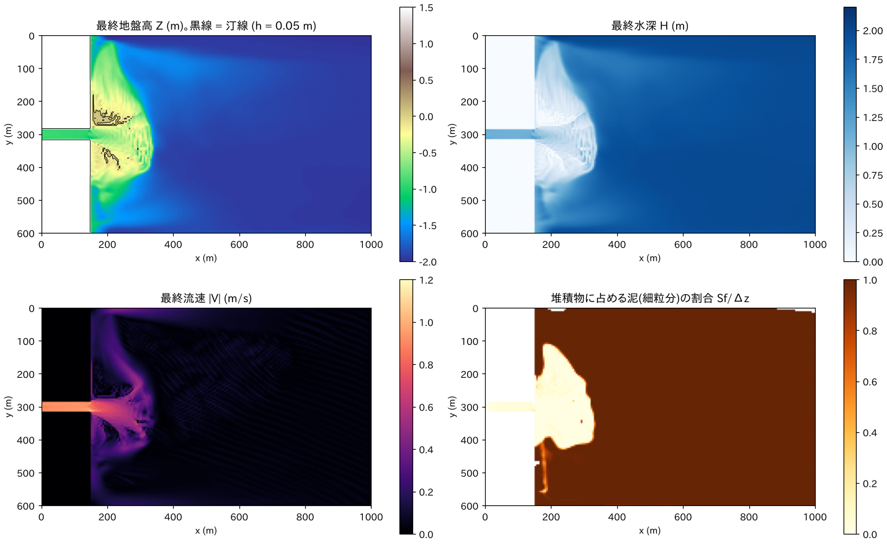

# delta — 河口デルタの形成(給砂河川が静水の海盆に突入する)

[English](en/README.md)

河川が静水域に突入して河口砂州を作り、砂州の両脇へ分岐し、ローブが育ち、流路が
乗り換える、という DeltaRCM 型の構成を ENCflow の既存機能だけで組んだ例題です
(設定のみ。コード変更なし)。試行の全体像・機構の議論・他モデルとの対応は
[docs/delta_plan.md](../../docs/delta_plan.md)、設定の手順は
[docs/users_guide/geomorph.md](../../docs/users_guide/geomorph.md) の「河口デルタ」。

## 共通の構成

- **海は海域マスクでなく通常セル+初期水位**(f_htype = 2、e0 = 0)。海セルは土砂を
  受け取らないので、デルタは海マスクの中へ前進できません。遠端(東辺)は長波放射
  (f_bc_e = 2。基準水位は e0 から自動)で海面を固定します。
- 西側に幅 30 m(6 セル)の掘り込み河道(河床 −1 m、勾配 0.001)。両岸は +1.5 m の乾いた
  非侵食の陸地(土層 0)。河口から 50 m の斜面で平坦な海盆底へ。
- 砂(0.5 mm)は掃流砂 Exner(芦田・道上式)+容量給砂 `fluv_bcfeed = 1`(入口の河床を
  固定 = 上流から平衡量の砂が来る)。泥は浮遊砂の流入濃度 `inflow_cs`(沈降速度
  `susp_wf = 1 mm/s` を直接与える粘着性泥の読み替え)+ 河床の細粒分の帳簿 `f_bedfines`。
- 河床勾配による流砂方向補正 `fluv_slope = 1` と安息角崩落 `f_repose = 1`(30°)。
  二次流 `f_secflow` は使いません(デルタの大局形状は河口砂州の分岐で決まる)。
- 地形時間は `morfac` で加速(100〜200)。地形出力 `Z0001…` と `Z0000` の差が堆積厚。
- 入力は `make_init.py`(`make` が z_<case>.txt・sd_<case>.txt を生成)。

## 構成

| ケース | 設定ファイル | 領域・海盆 | 砂:泥 | 流入 | 地形時間 | 所要(4 スレッド) |
|---|---|---|---|---|---|---|
| base | param.txt | 1000 × 600 m、2 m | 泥 0.0005(1:1.7) | 30 m³/s 一定 | 1500 h(morfac 100) | 45 分 |
| sand | param_sand.txt | 1200 × 1600 m、1.5 m | 泥 0.00015(砂 57 %) | 一定 | 4000 h(morfac 200) | 2 時間 |
| mud | param_mud.txt | 1600 × 2600 m、1.5 m | 泥 0.001(砂 15 %) | 一定 | 4000 h | 3.5 時間 |
| varq | param_varq.txt | 1200 × 1600 m、1.5 m | 泥 0.0005 | 出水 30 / 低水 6 m³/s を 20 分ずつ | 4000 h | 2 時間 |
| fix | param_fix.txt | 同上 | 同上 | 同上 + 定着(c_τ 3、T_fix 100 h、冠水減衰 T_dec 50 h、河岸係数 0.5)+ 側岸侵食則 | 4000 h | 1.5 時間 |
| baseqb | param_baseqb.txt | base と同じ | 同上 | 一定。砂は固定給砂 0.00715 m³/s(base の実績平均)、陸地内の河道は非侵食 | 1500 h | 1 時間 |
| wave | param_wave.txt | 同上 | 同上 | baseqb + 沖波 H₀ 0.6 m・T 6 s・進行方向 150°、汀線方位の平滑化長 wave_lsm 10 m、河口の規則 wave_vmax 0.5 m/s | 1500 h | 1 時間 |
| wfsed | param_wfsed.txt | 同上 | 同上 | baseqb + 沿岸の波浪場(沖波 H_m0 0.6 m・T 6 s・進行方向 150°・方向分散 20°、流れ→波の作用)と過程の漂砂(f_wfsed)。南北の辺は流れが壁・波が側方 Neumann | 1500 h | 約 5 時間(2 スレッド、他の計算と並行に実行した参考値) |

## 実行

```bash
make                         # リンクと入力(z_*.txt, sd_*.txt)
./encflow param.txt          # base(他は param_sand.txt など)
python3 plot_results.py base # fig_base_evolution.png, fig_base_final.png, fig_base_timeseries.png, timeseries_base.csv
```

## 結果

**base**(図 `figs/base_evolution.png`、`figs/base_final.png`): 地形 150 h で河口砂州
(+1.5 m)、300 h で砂州の両脇へ分岐して砂州が陸化、600〜900 h で 2 本の分流路が斜め前方に
伸びてローブが成長、前方への前進は 190 m で頭打ちになり以後は側方のローブが育つ。
1500 h で陸化 15.7×10³ m²、堆積 194×10³ m³(供給の 97 %)。砂はデルタ本体、泥は外側
600〜800 m のプロデルタに薄く分かれる。



**砂泥比**(図 `figs/sandmud.png`、`figs/sandmud_timeseries.png`):

| | 砂主体(sand) | 泥主体(mud) |
|---|---|---|
| 堆積(供給比) | 247×10³ m³(98 %) | 816×10³ m³(97 %) |
| 陸化 | 47×10³ m² | 241×10³ m² |
| 汀線半径 平均 ± 標準偏差(凹凸比) | 295 ± 60 m(0.20) | 533 ± 225 m(0.42) |
| 分流路 | 6〜10 本 | 1〜2 本 |

砂主体は半円に近い扇で分流路が多く短い。泥主体は一度 3 本に分岐したあと 1 本が勝ち、
細長い分流路が沖へ 900 m 伸びる鳥趾状。供給量の差を除いても凹凸比と分流路数は形の
差として残り、DeltaRCM・Delft3D・実験の「泥が多いほど分流路が少なく細長い」と一致する。



**流量変動と定着**(図 `figs/fixation.png`、`figs/fix_final.png`):

| | 陸化 (10³ m²) | 最大半径 (m) | 汀線 平均/標準偏差 (m) | 分流路 |
|---|---|---|---|---|
| varq(定着なし) | 65 | 462 | 302 / 98 | 2〜5 本(幅 50〜100 m) |
| 強い定着(参考。c_τ 10、T_fix 20 h、減衰なし) | 71 | 555 | 355 / 127 | 12 本(幅 5〜10 m) |
| fix(定着+冠水減衰+河岸係数) | 67 | 470 | 318 / 69 | 10 本(幅 20〜30 m) |

定着なしでは出水ごとに砂州が再冠水・再侵食されて広い分流路が位置を変える。冠水減衰の
ない定着(参考)では露出した砂州が恒久化し、分流路が格子幅の直線的な水路に落ちる
(`fix_tdec` を追加した経緯 = developer.md §84.13)。冠水減衰と河岸係数つきの定着では
分流路が幅 20〜30 m の滑らかな水路として安定し、汀線の凹凸は最小になる。拡幅の主因は
冠水減衰で定着が戻った砂州の河床侵食で、側岸侵食則の寄与は小さい。



**波浪**(図 `figs/wave_cmp.png`、`figs/wave_evolution.png`。fn_wave の沿岸漂砂、
developer.md §84.15、docs/wave_plan.md): 固定給砂の基準 baseqb に沖波(H₀ = 0.6 m、
T = 6 s、東南東から入射角 30°)を加えた wave。汀線方位の平滑化は物理長 wave_lsm = 10 m
(= 2Δx)。河川の砂 Q_r は同じ(給砂 3.86 万 m³ 固体、堆積 195 対 194 ×10³ m³ bulk)で、
波が運べる沿岸漂砂量との比 R ≈ 0.5。

| | baseqb(波なし) | wave(波あり、wave_lsm 10 m) | 参考: 波あり、セル半径の核 |
|---|---|---|---|
| 陸化 | 16.0×10³ m² | 31.6×10³ m² | 37.8×10³ m² |
| 最大半径 | 246 m | 316 m | 435 m |
| 汀線半径 平均 / 標準偏差 | 182 / 49 m | 244 / 58 m | 266 / 79 m |
| 分流路(0.5 R / 0.8 R) | 5 / 9 本 | 8 / 4 本 | 6 / 1 本 |
| 南北の非対称 | 0.55 | 0.85 | 0.93 |

波なしでは河口砂州が分岐して分流路網をもつローブ状のデルタになる。波ありでは河口砂州
から風下(北)へ砂嘴が伸び、堆積体は河口の両側の汀線に沿って広がって、縁の滑らかな
弧状で風下側へ偏ったデルタになる(陸化 2 倍、分流路は 4 本に減る)。波浪卓越型の特徴
(砂嘴・弧状の前面・汀線沿いの堆積・分流路の減少)が出る。従来のセル半径の核では堆積体の
中に波の峰に平行な指状の砂州が格子幅で並び(高角不安定の格子スケール成長)、陸化と
最大半径が過大だった(参考列。developer.md §84.15 段 3 (a))。堆積体の中に残る小さな
水たまりは、干上がったセルを波が削れない規則(R1)の帰結で、安息角崩落(f_repose)で
均せる。




この構成に至る試行の記録(規則 wave_vmax と固定給砂を入れた理由):

| 設定 | 挙動 |
|---|---|
| 正面入射(進行方向 180°)、容量給砂 | 水深 ≤ h_b の河道全体が砕波帯になり波が河道を遡る。沿岸漂砂が河口の砂を運び去る分を容量給砂が補い、供給が base の 5.5 倍、海盆が格子幅の砂州で埋まる(`figs/wave_headon_evolution.png`) |
| 入射角 45°(135°)、容量給砂 | 高角不安定の閾値。河口から波の峰に沿う砂嘴が 600 m 伸び続ける(CEM の flying spit に相当。`figs/wave_a45_evolution.png`) |
| 入射角 30°(150°)、容量給砂 | 波が河口砂州を均し続けて入口の流砂能力が落ちず、供給が base の 11 倍。海盆は波の峰に平行な前線で埋まる(`figs/wave_capfeed_evolution.png`) |
| 入射角 30°、固定給砂 0.00715 m³/s、可動河道 | 河道の流下水深(1.2〜2.2 m)が h_b = 1.07 m を超えて河道全体が波の源になり、河道内の砂州に沿岸漂砂が働く正帰還で水理 1.25 h に発散(停止)。→ 河口の規則 wave_vmax を追加(test/wave_river) |

固定給砂は波が無くても可動河道の入口を 1 h で土層 3 m まで洗掘する(流砂能力 > 給砂)
ので、陸地内の河道を非侵食(給砂を運ぶ固い水路)にした。沿岸漂砂そのものの検定は
test/wave_shore(直線汀線の線形理論)と test/wave_river(河口の規則)。





**波浪場(V12)**(図 `figs/wfsed_evolution.png`、`figs/wfsed_final.png`。沿岸の波浪場 fn_wavefield と
過程の漂砂 f_wfsed、developer.md §88、docs/wavefield_plan.md): wave と同じ河川・給砂・波を、CERC 型の
沿岸漂砂(fn_wave)でなく、波を解く沿岸の波浪場と過程の漂砂で与えた wfsed。沖波(H_m0 = 0.6 m、
T = 6 s、進行方向 150°、方向分散 20°)を東の辺から入射させ、屈折・砕波・デルタ自身の陰を波浪場が、
河口の噴流による波の阻止を流れによる波の変化(`f_wf_current = 1`)が与える(wave の規則 wave_vmax に
当たる)。波による流れ(放射応力とローラー・GLM・波・流れの摩擦。`wf_flow = 2`)が北向きの沿岸流を
起こし、砂と泥は軌道流速で攪拌されて、Euler 平均流速と波の歪度・非対称の岸向きの速度で運ばれる。
南北の辺は、波が側方 Neumann、流れが壁(wave と同じ。流れの側方 Neumann は沿岸流の流入側の辺が
不安定になる。developer.md §88.16)。

| 地形 1500 h | wfsed(波浪場) |
|---|---|
| 堆積(bulk) | 147×10³ m³(砂 64×10³ m³ = 給砂のほぼ全量、泥 83×10³ m³ = 供給の 61 %) |
| 陸化(h < 0.05 m) | 4.1×10³ m² |
| 浅瀬(h < 0.5 m) | 20.6×10³ m² |
| 河口からの陸地の最大前進 | 142 m |
| 河道軸より北の堆積の割合 | 0.55(砂は 0.52) |

(`python3 plot_results.py wfsed` の集計と、最終の Z・Sf・H から求めた砂・泥と南北の内訳。陸化・浅瀬は
河口より沖のセルの面積)

wave(CERC)では河口砂州から風下(北)へ砂嘴が伸びて陸化が 31.6×10³ m² に達したのに対し、波浪場の
過程の漂砂では、砂は河口の前に沿岸方向 450 m・沖へ 180 m ほどの浅い弧状の台地として広がり、陸化は
4.1×10³ m²(河口の両脇の砂州の頂)にとどまる。浅瀬は時間とともに広がり続け(地形 900 h の
5.5×10³ m² から 1500 h の 20.6×10³ m²)、北(風下)への偏りは小さい。位相平均の波は汀線の手前で止まり、
遡上域の輸送(浜や汀線の高まりを積み上げる過程)を持たないので、砂は浅瀬にとどまって陸になりにくい
([沿岸の波浪場](../../docs/users_guide/wavefield.md)の「適用範囲と併用の制限」)。泥は波の攪拌で
沈みにくく、薄い層(x > 500 m で平均 7 cm)として海盆全体に広がり、終了時にも供給の 22 % が水中に
浮遊していて、残りの 17 % は東の開境界から出た(base では供給の 97 % が堆積)。浅瀬の台地が陸に
なるかどうかは遡上域の過程に依るので、汀線の形の議論は wave(CERC)と合わせて読むこと。最終流速の
図の沖に見える斜めの縞は、時間とともに育つ格子規模の流速の振動(水理 3.3 h で格子規模の偏差が
0.01 m/s、15 h で |V| の最大 0.15 m/s。水位は滑らかで格子規模の偏差は 0.1 mm 未満)で、原因は
調べていない(docs/handoff.md)。




## 所見と注意

- **対称性の破れ**: 乱数はなく計算は決定的。河口砂州までは完全対称で、砂州を挟む
  2 本の分流路の配分が不安定平衡のため丸め誤差が指数的に増幅する(150 h ごとに
  10〜40 倍、900 h で飽和)。どちら側にローブが育つかはコンパイラやスレッド数で変わり
  得る。形は実現ごとに違うが積分量(堆積・陸化・最大半径)は数 % しか違わない
  (図 `figs/ensemble.png`: 地盤高に ±2 cm の擾乱を入れた 5 実現と相関擾乱 1 実現)。
  平均的な形を論じるときは複数実現の統計で。
- **格子の方向性**: 河道軸を 20° 回しても分岐の相対角は同じで、格子対角線への固定はない。
  ただし壁が硬く流路幅が格子幅まで落ちると流路は 8 方位に見える(delta_plan.md §3)。
  分流路は幅/5 以上のセル数で解像すること(dx 2.5 m で主要分流路の幅が m 単位で
  保たれることを確認済み。§2.7)。
- **領域**: 非対称に育つ実現が壁に達しないよう、河口から沖へ 1500 m、横に ±1300 m 以上
  (mud はそのために広い)。
- 潮汐流・淡水プルームの浮力・泥の圧密は含まない。fn_wave の波浪(wave)は沿岸漂砂のみで、波を解く
  攪拌・遮蔽・波による流れは波浪場のケース(wfsed)にある。
- 2026-10-21 以前の実行ファイルでは、終了時の警告の崩落・側岸侵食の体積に、非侵食の
  陸地の壁の「仮想の流束」が含まれていた(地形は正しい。developer.md §84.14)。

## 感度実験の入口

- 砂:泥比 → `inflow_cs`(DeltaRCM の f_sand に相当)。
- 泥の沈降・再浮上 → `susp_wf`、`susp_tausc`、`susp_esa`。
- 海面変動・沈降 → 遠端に海域マスクの帯を置いて `fn_tide`、地盤は `fn_bedmotion`。
- 分流路の維持 → `fix_tfix`、`fix_ctau`、`fix_tdec`(出水の継続時間程度)、`fix_ctau_bank`、
  出水・低水の周期(`inflow_val`)。
- 二次流の有無 → `f_secflow = 1`、`sec_nstar = 7`(examples/meander の値)。
- 河川と波の比 R → `inflow_qb`(固定給砂)と `wave_h0`・`wave_t`。汀線方位の平滑化長 → `wave_lsm`(2Δx〜砕波帯の幅の 1/4)。入射角 → `wave_dir`
  (河道軸の正面 ±22.5° は不可、45° は高角不安定の閾値。param_wave.txt のヘッダ)。
- 波浪場のケース → 沖波 `wf_hm0`・`wf_trep`・`wf_dir`・`wf_spread`、岸向きの速度の係数 `wfsed_facsk`・
  `wfsed_facas`、砕波による水平混合 `wf_break_visc`(&list_enc)、砕波の乱れによる攪拌 `f_wfsed_turb`
  ([沿岸の波浪場](../../docs/users_guide/wavefield.md))。流れの南北の辺を側方 Neumann にするのは、
  沿岸流の流入側の辺の近くで流れが非一様になると発散するので避ける(developer.md §88.16)。
